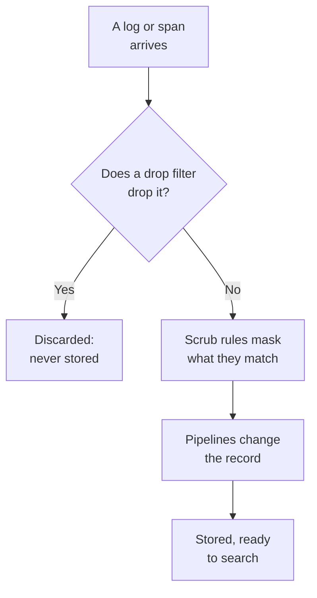

# Drop Filters & Scrub Rules

Drop filters and scrub rules act on your logs and spans as they arrive, before anything is stored. A drop filter throws away the records you never need, or keeps only a sample of them. A scrub rule masks personal data and secrets, such as email addresses, card numbers and passwords, so they never reach your storage.

:::cards
- [Where they run](#where-they-run): Before pipelines, before storage.
- [Drop or sample records](#drop-or-sample-records): Match records, then drop them or keep a share.
- [Scrub sensitive data](#scrub-sensitive-data): Redact, mask or hash what a pattern finds.
- [Check what a filter dropped](#check-what-a-filter-dropped): Counts on every filter.
:::

## Where they run

Logs have theirs under **Logs → Settings**, and spans under **Traces → Settings**. As a record arrives, OneUptime runs them in this order:



- **They act on new records only.** A rule you create or change applies to records that arrive about a minute later. Records already stored are not changed.
- **A dropped record is gone.** No search, chart, monitor or recording rule ever sees it, and no exception is made from it. On OneUptime Cloud, it is not billed either.
- **Each list runs in order.** Drag the rows of a list to change the order. Only enabled filters and rules run.

Log drop filters and scrub rules apply to logs from OpenTelemetry, syslog, Fluent Bit and Fluentd alike. [Log Pipelines](/docs/telemetry/log-pipelines) explains the step after them.

## Before you begin

- **Logs or spans arriving.** See [OpenTelemetry](/docs/telemetry/open-telemetry).
- **A role that changes telemetry settings.** Project Owner or Project Admin, or a custom role with the permission for what you change, such as Create Log Drop Filter or Create Trace Scrub Rule. The Telemetry roles can see filters and rules, but not change them.

## Drop or sample records

:::steps
### Open Drop Filters

Go to **Logs → Settings → Drop Filters**, or **Traces → Settings → Drop Filters** for spans.

### Match the records

Click **Create Log Drop Filter**, or **Create Trace Drop Filter** for spans. On **Match**, give the filter a **Name**, then build its **Filter Query**: a field, an operator and a value for each condition, and whether **All conditions** or **Any condition** must match. Click **Next**.

### Choose the action

On **Action**, keep **Drop** to discard every matching record, or pick **Sample** and enter the **Sample Percentage** to keep, from 1 to 99. Then create the filter.
:::

The filter starts dropping within a minute. To save it without dropping anything yet, turn **Enabled** off under **Advanced** before you create it.

> [!WARNING]
> A dropped record cannot be brought back. Keep a filter's query narrow, and watch its **Dropped** count after you create it.

A filter can test these fields, and any attribute with **Custom Attribute...**:

| Records | Fields |
| --- | --- |
| Logs | **Severity**, **Log Body**, **Service ID** |
| Spans | **Span Name**, **Span Kind**, **Status**, **Status Message**, **Service ID**, **Has Exception**, **Is Root Span** |

| Operator | Matches |
| --- | --- |
| **equals** | The exact value, with its upper and lower case: `Debug` matches, `DEBUG` does not. |
| **does not equal** | Anything but the exact value. |
| **contains** | The value anywhere in the field, in any case. A `%` in the value is a wildcard. |
| **is one of** | One of a list of exact values, separated by commas. |

**Preview query** shows the query the conditions make. This one drops a health check's debug lines:

```text
severityText = 'Debug' AND body LIKE 'healthcheck'
```

Sampling decides record by record: at a **Sample Percentage** of 10, about one matching record in ten is kept. Filters run in the order of the list, and the first one that drops a record decides; a record a sample keeps goes on to the next filter.

## Scrub sensitive data

:::steps
### Open Scrub Rules

Go to **Logs → Settings → Scrub Rules**, or **Traces → Settings → Scrub Rules** for spans.

### Pick what to find

Click **Create Log Scrub Rule**, or **Create Trace Scrub Rule** for spans, and pick a **Pattern Type**. The rule is named after it, such as **Scrub email addresses**, until you type a name of your own. For **Custom Regex**, also enter the **Custom Regex Pattern**.

### Choose how to scrub it

Under **Advanced**, pick the **Scrub Action** and the **Fields to Scrub**, or leave them as they are: a new rule replaces every match with `[REDACTED]`, wherever it is in the record. Then create the rule.
:::

| Pattern Type | What it finds |
| --- | --- |
| **Email Address** | Email addresses, such as `jane@example.com` |
| **Credit Card Number** | Sixteen digits in groups of four, such as `4111 1111 1111 1111` |
| **SSN (Social Security Number)** | US Social Security numbers, such as `123-45-6789` |
| **Phone Number** | North American phone numbers, such as `555-123-4567` |
| **IP Address** | IPv4 addresses, such as `192.168.1.1` |
| **Sensitive Attribute Keys** | The whole value of any attribute whose key looks secret, such as `password`, `token`, `api_key`, `authorization` or `cookie` |
| **Custom Regex** | Your own regular expression, written without slashes or flags, and matched with its case |

| Scrub Action | What a match becomes |
| --- | --- |
| **Redact** | `[REDACTED]`, the default |
| **Mask** | Mostly hidden: an email keeps its first letter and the end of its domain, a card, phone or Social Security number its last four digits, and a custom match or a secret value its first and last characters. An IP address is hidden completely. |
| **Hash** | A short hash of it, the same for the same value every time, so repeats can still be counted |

For example, an **Email Address** rule stores this log body:

```text
Payment failed for jane@example.com
```

as one of these, depending on its **Scrub Action**:

```text
Redact: Payment failed for [REDACTED]
Mask:   Payment failed for j***@***.com
Hash:   Payment failed for [HASHED:8c87b489]
```

**Fields to Scrub** is **Both (Body & Attributes)** for a log rule unless you pick **Body Only** or **Attributes Only**, and **All (Name, Attributes & Events)** for a span rule unless you pick **Span Name Only**, **Attributes Only** or **Event Attributes Only**. A **Sensitive Attribute Keys** rule always scrubs attribute values, since it reads attribute keys.

- **Exceptions come from the scrubbed record.** An exception found in a log is made after scrubbing, and the rules that scrub span events also scrub the exceptions recorded on them.
- **Session replays are scrubbed too.** Log scrub rules also run over session replay recordings, behind the masking the recorder does in the browser.
- **Rules run in the order of the list.** Each rule sees what the rules before it left.
- **A custom pattern takes time in line with the record.** It keeps JavaScript's syntax and answers, look-aheads and look-behinds included, however it is written. A back-reference, such as `\1`, cannot run that way: a rule with one is refused when you save it, as is a pattern too large to run. If finding every match would read a long value over and over, the rule scrubs the whole value.

## Check what a filter dropped

The **Drop Filters** list shows each filter's **Dropped** count and when it **Last Dropped**. **Nothing dropped yet** means it has never matched. A filter's own page has the same under **Activity**, updated within a minute of a drop. Its **Filter Conditions** card shows what it matches, and you can change them there.

## Troubleshooting

:::details A drop filter drops nothing
**equals**, **does not equal** and **is one of** compare exact text, upper and lower case included. Severities are `Information` and `Warning`, not `INFO` or `WARN`. Check that the filter is enabled, and allow a minute after a change.
:::

:::details Logs I expected are missing
Look at the **Dropped** count and **Last Dropped** time of each drop filter. Turn **Enabled** off on the one you suspect, and the next logs arrive again.
:::

:::details A custom scrub rule says Scrubs nothing
Its pattern is empty, is not a valid regular expression, or cannot run, such as one with a back-reference like `\1`, so it scrubs nothing. Edit the rule and give it a pattern that matches at least one character.
:::

:::details Old records still show the data a new rule scrubs
Scrub rules act as records arrive. Records stored before the rule keep what they had until their retention ends. See [Data Retention](/docs/telemetry/data-retention).
:::

## Next steps

:::cards
- [Log Pipelines](/docs/telemetry/log-pipelines): Parse and enrich the logs you keep.
- [Logs Explorer](/docs/telemetry/logs-explorer): Search what was stored.
- [Traces Explorer](/docs/telemetry/traces-explorer): Follow the spans you keep.
- [Data Retention](/docs/telemetry/data-retention): Decide how long they are kept.
:::
