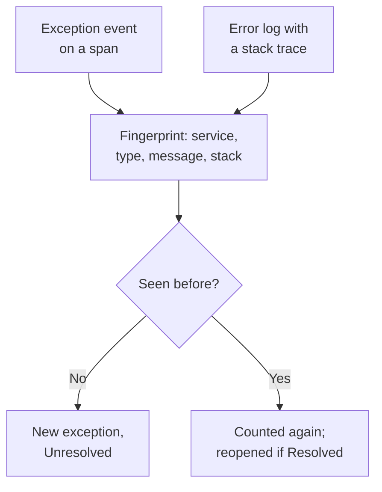

# Exception Tracking

Exception Tracking collects the errors your code throws and groups every occurrence of the same error into one exception, with its stack trace, its trend and the requests it happened in. Triage them like a to-do list: fix, resolve, or archive the noise, and let AI open a pull request for the ones it can fix.

:::cards
- [Where exceptions come from](#where-exceptions-come-from): Spans and logs your services already send.
- [Triage the list](#triage-the-list): Unresolved first, noise hidden.
- [An exception's page](#an-exceptions-page): Stack trace, occurrences and context.
- [Fix it with AI](#fix-it-with-ai): A pull request with the fix, or a regression test.
- [Find and fix new and rising exceptions with AI](#find-and-fix-new-and-rising-exceptions-with-ai): Pull requests for the exceptions OneUptime finds.
:::

## Where exceptions come from

You do not send exceptions separately. OneUptime finds them in the telemetry your services already send:

- an exception event on a span, which is what OpenTelemetry's `recordException()` writes;
- a log with the `exception.type`, `exception.message` or `exception.stacktrace` attributes;
- a log at Error or Fatal severity whose message holds a stack trace, when the log was not written inside a span (the span reports it already).

Each occurrence is grouped with the earlier ones of the same error into one exception:

- **One exception per service and error.** The fingerprint is made from the service, the exception type, the message and the stack trace. Values that change from call to call are taken out first: UUIDs and other IDs, timestamps, IP and email addresses, and numbers of seven digits or more. So `Order id=1042 not found` and `Order id=2077 not found` are one exception.
- **A new occurrence reopens a resolved exception.** If it happens again after you resolved it, the fix did not hold, and the exception is marked **Regressed**. An occurrence from before you resolved it that reaches OneUptime late does not reopen it.
- **An archived exception stays archived.** Its new occurrences are still counted, but they stop notifying.

> [!TIP]
> To keep an expected error out of Exception Tracking, such as invalid input your service rejected, set the `error.class` attribute to `user-error` or `expected-denial` on the span's exception event. OneUptime then records no exception for it.

## Before you begin

- **Spans or logs arriving.** Instrument your services with [OpenTelemetry](/docs/telemetry/open-telemetry). The **Setup Guide** tab shows the code for your language.
- **A role that reads telemetry.** Project Owner, Project Admin, Project Member, Viewer, Telemetry Admin, Telemetry Member or Telemetry Viewer, or a custom role with the Read Telemetry Service Exception permission. Resolving and archiving takes Project Owner or Project Admin, or the Edit Telemetry Service Exception permission.

## Triage the list

:::steps
### Open Exceptions

Go to **Products → Observability → Exceptions**. The badge on the **Exceptions** tab counts the unresolved issues, and the list opens on the **Unresolved** exceptions.

### Pick a status

Switch between **Unresolved**, **Resolved**, **Archived** and **All**. The chart above the list shows how many occurrences were **Unhandled** and how many **Handled** over time. A row marked **Regressed** came back after it was resolved, and one marked **New** was first seen in the last 24 hours.

### Choose what counts as an issue

**Issues**, the default, hides user errors and expected denials, so the list shows what needs a fix. **User errors** shows only those, and **All** shows every exception.

### Search and filter

Type a query such as `type:TypeError env:production`, see [Search Syntax](/docs/telemetry/search-syntax#exceptions), or click a value in the **Filters** sidebar: a service, a host or other resource, an **Exception Type**, an **Environment** or an **Error Class**. **Assigned to me** shows only the exceptions assigned to you, and the sort menu orders the list by **Last seen**, **First seen** or **Most events**.

### Open an exception

Click a row to open the exception's page.
:::

## An exception's page

The page's side menu groups what you do with an exception:

| Page | What it shows |
| --- | --- |
| **Overview** | The message, the service, how often it happened and when it was first and last seen, its trend over time, and its latest occurrence: the release, environment, span, trace and user session. At the top, OneUptime AI's explanation of what happened, when AI is on. |
| **Stack Trace** | The frames of the stack. For browser code, the original files and lines, once you upload [Source Maps](/docs/telemetry/source-maps) for the release. |
| **Occurrences** | Every occurrence, with its time, its message and the trace it happened in. |
| **Context** | The latest occurrence's attributes, its session replay when one was recorded, and the steps that led up to it. |
| **Logs** | The logs written around the latest occurrence. |
| **AI Assistance** | AI tasks that fix the exception or test it. |
| **Settings** | Resolve or archive the exception. It is under **Manage**, which starts collapsed. |

## Resolve, reopen and archive

The buttons at the top of the exception's page, its **Settings** page and the ⋯ menu on its row in the list change its status:

| Action | When to use it | What happens next |
| --- | --- | --- |
| **Resolve** | You deployed the fix. | It leaves the **Unresolved** list. A new occurrence reopens it. |
| **Resolve in next release** | The fix ships in your next release. | It leaves the **Unresolved** list. Occurrences from the release it was last seen in do not reopen it, and one from any other release does. |
| **Reopen** | The fix did not work. | It is unresolved again. |
| **Archive** | It is noise you do not plan to fix. | It leaves the list. New occurrences are counted but stop notifying. |
| **Unarchive** | You want to hear about it again. | It is back in the list it belongs to. |

**Resolve in next release** is in the menu beside **Resolve**, in the row's ⋯ menu, under **Bulk Actions** and on **Settings**, while the exception's occurrences name their release: the `service.version` resource attribute.

**Settings** shows who last resolved or archived the exception, and when. Its buttons read **Mark as Resolved** or **Mark as Unresolved**, and **Archive** or **Unarchive**.

To change several at once, tick their rows in the list, or the box above the rows for every exception on the page, and use the same actions under **Bulk Actions**. It says which exceptions it changed, which it left as they were, and why.

**Assign** in the exception's header gives it to one person or one team, and removing them unassigns it. Each row shows who owns it, its ⋯ menu offers **Assign to me**, and **Assign to…** under **Bulk Actions** assigns several at once.

## Error classes

Every exception has an error class, which says whose problem it is. OneUptime AI sets it when it triages an insight about the exception, such as a new or spiking exception: see [AI SRE](/docs/ai/ai-sre#insights-proactive-detection). An exception it has not triaged stays `unknown`.

| Class | What it means | In **Issues** |
| --- | --- | --- |
| `code-fault` | A defect in the code. The only class AI fixes on its own. | Yes |
| `infrastructure` | A timeout, a dropped connection or exhausted resources. | Yes |
| `unknown` | Not classified yet. | Yes |
| `user-error` | The result of invalid input from a user. | No |
| `expected-denial` | A check doing its job, such as a refused login. | No |

With **Archive exceptions that are expected** on, in the settings of AI Insights, exceptions the triage finds to be expected denials are archived for you.

## Explain it with AI

At the top of an exception's **Overview**, **Explain with OneUptime AI** asks OneUptime AI what went wrong. It reads the stack trace, the trace and logs of the latest occurrence, and the deploys of the service around the time the exception started, and answers in the **What happened** card:

| Part | What it says |
| --- | --- |
| **What happened** | A sentence or two, how sure OneUptime AI is, and where the fault lies: the code, a dependency, the infrastructure, bad input or the configuration. |
| **Likely root cause** | The cause, and the frame, span, log line or deploy that shows it. |
| **Suggested fix** | What to change. |
| **Where to look** | The frames of the stack trace to open first. |
| **Next steps** | At most three steps to confirm or fix it. |

The explanation is kept on the exception, so the next person who opens it reads it at once, and **Explain again** asks for a new one. **Open a fix pull request** opens the exception's **AI Assistance** page, and **Ask a follow-up** opens Ask AI on the exception.

IDs, email and IP addresses and tokens are taken out of everything that is sent, and of a span's attributes only a few, such as its route and status code, are sent. The explanation uses the project's LLM provider and AI credits, and is not offered while **Enable AI** is off. Anyone who can read the exception can ask for one.

## Fix it with AI

The **AI Assistance** page offers three tasks. Each runs as an AI task that opens a pull request in your code repository:

| Task | What the pull request does |
| --- | --- |
| **Fix this exception with AI** | Fixes the root cause. Start it with **Fix with AI**. |
| **Generate Regression Test** | Adds a test that fails until the bug is fixed. |
| **Improve Error Handling** | For expected errors: validates input earlier, keeps user data out of messages, and marks the error as handled. |

AI needs three things first: an LLM provider, a connected repository (on GitHub, GitLab, Forgejo or Gitea, or any Git server), and an AI agent online to run the task. The page checks each one and links to what is missing. The tasks pause while the exception is resolved or archived. See [Code](/docs/ai/ai-agent).

## Find and fix new and rising exceptions with AI

Every 15 minutes OneUptime looks through your exceptions for new ones, ones that suddenly happen far more often, and services whose exceptions carry no stack trace, and files what it finds as AI insights, with the evidence. OneUptime AI then looks into each one and opens a pull request for the ones it can fix. Nothing is ever merged: your team reviews each pull request.

| Finding | When OneUptime files it | The pull request |
| --- | --- | --- |
| **New Exception** | An exception first seen in the last 24 hours that already happened 3 or more times. | Fixes the exception, or handles it better. |
| **Exception Spike** | An exception that happened 10 or more times in the last hour, at 5 or more times its hourly rate over the 24 hours before. | Fixes the exception, or handles it better. |
| **Missing Stack Trace** | The exceptions a service recorded in the last day carry no stack trace, and together happened 20 or more times. | Makes the service record a stack trace with each exception. |

A new or rising exception's pull request is the exception's own AI task, the one its **AI Assistance** page starts, and it waits for OneUptime AI to look into the finding. When it finds the code at fault (`code-fault`), the pull request fixes it, as **Fix this exception with AI** does. When it finds an expected error (`user-error` or `expected-denial`), the pull request handles the error better, as **Improve Error Handling** does. Any other verdict opens no pull request on its own. With **Archive exceptions that are expected** on, an expected denial is archived instead, and gets no pull request.

OneUptime AI opens one on its own only for an exception raised in your own code: one whose stack trace has a frame of your code, not only frames of libraries or the runtime. A pull request someone closed without merging pauses the automatic ones for that exception. Anyone can still ask for any of them with **Fix with AI** on the finding.

### Turn it on

**Exceptions → AI → Settings** holds the switch **Find and fix new and rising exceptions**, on for new projects. While it is off, new and rising exceptions are AI Insights' as before: see [AI SRE](/docs/ai/ai-sre#insights-proactive-detection). With **Enable AI** off, they are still found, but OneUptime AI does nothing with them. To open pull requests, OneUptime AI needs a repository connected in [Code](/docs/ai/ai-agent): the page says what is missing first. Each repository's code is changed on the Runner the repository picks in Code.

OneUptime AI opens at most 5 pull requests on its own each day (UTC), one for each finding, and never more than a repository's limit on open AI pull requests.

### AI rules

With no rule, OneUptime AI looks into every exception it finds right away, and opens a pull request for each one it can fix. The **AI rules** under **More settings** narrow that, in three steps:

| Step | What it decides |
| --- | --- |
| **Match** | Which services: the ones picked, the ones with certain labels, or the ones whose names match a pattern. |
| **Investigate** | **Right away**, or **Only if still found after a wait**: an exception that goes away during the wait is not looked into. |
| **Fix** | **Don't fix**, **Ask before fixing** or **Fix without asking**. Asking first leaves the pull request to a person: the finding offers **Fix with AI**. |

Under **More fields** a rule picks the code repositories, the MCP servers and the LLM provider OneUptime AI may use for it. With none picked, it may use any of them, and the project's default LLM provider.

### See what it did

- **Exceptions → AI → Insights** lists what OneUptime found, each finding with its evidence, the frames of your code in its stack trace included. **View Exception Group** opens the exception, and on a service's missing stack traces, **Open in Exceptions** opens its unresolved exceptions from the last day.
- **Exceptions → AI → Logs** lists every investigation and pull request, newest first, with how each one stands and what each investigation found.
- The pull request says why it was opened, with a link to its finding. A new or rising exception's also links the exception, and shows on the exception's **AI Assistance** page. In Code, its task names the exception it fixes, or the finding it came from.

## Exceptions Insights

The **Insights** tab counts your **Unresolved**, **Resolved** and **Archived** exceptions and your resolution rate, and lists the most frequent exceptions, the services they affect and the ones seen most recently.

## Troubleshooting

:::details An exception I just threw is not in the list
Check the lens first: **Issues** hides user errors and expected denials, so pick **All**. Then widen the time range, and check that the exception was recorded on a span, or in a log with a stack trace.
:::

:::details One error shows up as several exceptions
The fingerprint includes the message and the stack trace. When they differ, for example when a message embeds a short number or a name that changes on every call, each variant is its own exception.
:::

:::details A resolved exception keeps coming back
A new occurrence reopens a resolved exception on purpose: the error still happens. Check that the fix reached the release that reports it, or archive the exception if you no longer want to hear about it. If old pods of the release keep reporting it during a rollout, use **Resolve in next release** instead.
:::

## Next steps

:::cards
- [Exceptions Monitor](/docs/monitor/exceptions-monitor): Get alerted when exceptions spike.
- [Source Maps](/docs/telemetry/source-maps): Readable stack traces for browser code.
- [Code](/docs/ai/ai-agent): How AI fixes code and opens pull requests.
- [Traces Explorer](/docs/telemetry/traces-explorer): See the request an exception happened in.
:::
