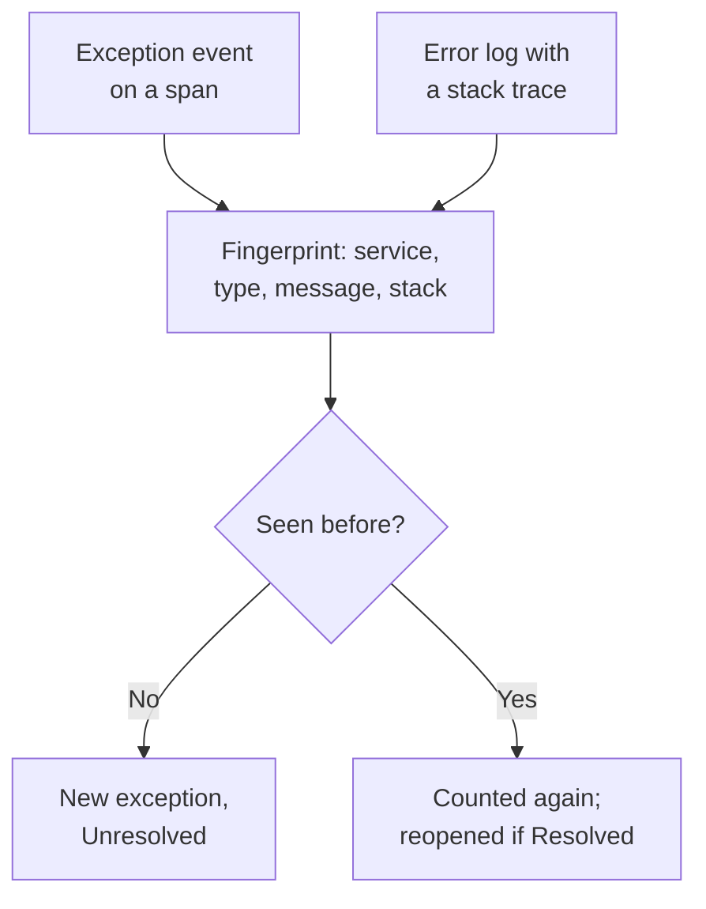

# Exception Tracking

Exception Tracking collects the errors your code throws and groups every occurrence of the same error into one exception, with its stack trace, its trend and the requests it happened in. Triage them like a to-do list: fix, resolve, or archive the noise, and let AI open a pull request for the ones it can fix.

:::cards
- [Where exceptions come from](#where-exceptions-come-from): Spans and logs your services already send.
- [Triage the list](#triage-the-list): Unresolved first, noise hidden.
- [An exception's page](#an-exceptions-page): Stack trace, occurrences and context.
- [Fix it with AI](#fix-it-with-ai): A pull request with the fix, or a regression test.
:::

## Where exceptions come from

You do not send exceptions separately. OneUptime finds them in the telemetry your services already send:

- an exception event on a span, which is what OpenTelemetry's `recordException()` writes;
- a log with the `exception.type`, `exception.message` or `exception.stacktrace` attributes;
- a log at Error or Fatal severity whose message holds a stack trace, when the log was not written inside a span (the span reports it already).

Each occurrence is grouped with the earlier ones of the same error into one exception:

- **One exception per service and error.** The fingerprint is made from the service, the exception type, the message and the stack trace. Values that change from call to call are taken out first: UUIDs and other IDs, timestamps, IP and email addresses, and numbers of seven digits or more. So `Order id=1042 not found` and `Order id=2077 not found` are one exception.
- **A new occurrence reopens a resolved exception.** If it happens again after you resolved it, the fix did not hold.
- **An archived exception stays archived.** Its new occurrences are still counted, but they stop notifying.

> [!TIP]
> To keep an expected error out of Exception Tracking, such as invalid input your service rejected, set the `error.class` attribute to `user-error` or `expected-denial` on the span's exception event. OneUptime then records no exception for it.

## Before you begin

- **Spans or logs arriving.** Instrument your services with [OpenTelemetry](/docs/telemetry/open-telemetry). The **Setup Guide** tab shows the code for your language.
- **A role that reads telemetry.** Project Owner, Project Admin, Project Member, Viewer, Telemetry Admin, Telemetry Member or Telemetry Viewer, or a custom role with the Read Telemetry Service Exception permission. Resolving and archiving takes Project Owner or Project Admin, or the Edit Telemetry Service Exception permission.

## Triage the list

:::steps
### Open Exceptions

Go to **Products → Observability → Exceptions**. The badge on the **Exceptions** tab counts the unresolved issues, and the list opens on the **Unresolved** exceptions.

### Pick a status

Switch between **Unresolved**, **Resolved**, **Archived** and **All**. The chart above the list shows how many occurrences were **Unhandled** and how many **Handled** over time.

### Choose what counts as an issue

**Issues**, the default, hides user errors and expected denials, so the list shows what needs a fix. **User errors** shows only those, and **All** shows every exception.

### Search and filter

Type a query such as `type:TypeError env:production`, see [Search Syntax](/docs/telemetry/search-syntax#exceptions), or click a value in the **Filters** sidebar: a service, a host or other resource, an **Exception Type**, an **Environment** or an **Error Class**.

### Open an exception

Click a row to open the exception's page.
:::

## An exception's page

The page's side menu groups what you do with an exception:

| Page | What it shows |
| --- | --- |
| **Overview** | The message, the service, how often it happened and when it was first and last seen, its trend over time, and its latest occurrence: the release, environment, span, trace and user session. |
| **Stack Trace** | The frames of the stack. For browser code, the original files and lines, once you upload [Source Maps](/docs/telemetry/source-maps) for the release. |
| **Occurrences** | Every occurrence, with its time, its message and the trace it happened in. |
| **Context** | The latest occurrence's attributes, its session replay when one was recorded, and the steps that led up to it. |
| **Logs** | The logs written around the latest occurrence. |
| **AI Assistance** | AI tasks that fix the exception or test it. |
| **Settings** | Resolve or archive the exception. It is under **Manage**, which starts collapsed. |

## Resolve, reopen and archive

The buttons at the top of the exception's page, and its **Settings** page, change its status:

| Action | When to use it | What happens next |
| --- | --- | --- |
| **Resolve** | You deployed the fix. | It leaves the **Unresolved** list. A new occurrence reopens it. |
| **Reopen** | The fix did not work. | It is unresolved again. |
| **Archive** | It is noise you do not plan to fix. | It leaves the list. New occurrences are counted but stop notifying. |
| **Unarchive** | You want to hear about it again. | It is back in the list it belongs to. |

**Settings** shows who last resolved or archived the exception, and when. Its buttons read **Mark as Resolved** or **Mark as Unresolved**, and **Archive** or **Unarchive**.

## Error classes

Every exception has an error class, which says whose problem it is. OneUptime AI sets it when it triages an insight about the exception, such as a new or spiking exception: see [AI SRE](/docs/ai/ai-sre#insights-proactive-detection). An exception it has not triaged stays `unknown`.

| Class | What it means | In **Issues** |
| --- | --- | --- |
| `code-fault` | A defect in the code. The only class AI fixes on its own. | Yes |
| `infrastructure` | A timeout, a dropped connection or exhausted resources. | Yes |
| `unknown` | Not classified yet. | Yes |
| `user-error` | The result of invalid input from a user. | No |
| `expected-denial` | A check doing its job, such as a refused login. | No |

With **Archive exceptions that are expected** on, in the settings of AI Insights, exceptions the triage finds to be expected denials are archived for you.

## Fix it with AI

The **AI Assistance** page offers three tasks. Each runs as an AI task that opens a pull request in your code repository:

| Task | What the pull request does |
| --- | --- |
| **Fix this exception with AI** | Fixes the root cause. Start it with **Fix with AI**. |
| **Generate Regression Test** | Adds a test that fails until the bug is fixed. |
| **Improve Error Handling** | For expected errors: validates input earlier, keeps user data out of messages, and marks the error as handled. |

AI needs three things first: an LLM provider, a connected repository (on GitHub, GitLab, Forgejo or Gitea, or any Git server), and an AI agent online to run the task. The page checks each one and links to what is missing. The tasks pause while the exception is resolved or archived. See [Code](/docs/ai/ai-agent).

## Exceptions Insights

The **Insights** tab counts your **Unresolved**, **Resolved** and **Archived** exceptions and your resolution rate, and lists the most frequent exceptions, the services they affect and the ones seen most recently.

## Troubleshooting

:::details An exception I just threw is not in the list
Check the lens first: **Issues** hides user errors and expected denials, so pick **All**. Then widen the time range, and check that the exception was recorded on a span, or in a log with a stack trace.
:::

:::details One error shows up as several exceptions
The fingerprint includes the message and the stack trace. When they differ, for example when a message embeds a short number or a name that changes on every call, each variant is its own exception.
:::

:::details A resolved exception keeps coming back
A new occurrence reopens a resolved exception on purpose: the error still happens. Check that the fix reached the release that reports it, or archive the exception if you no longer want to hear about it.
:::

## Next steps

:::cards
- [Exceptions Monitor](/docs/monitor/exceptions-monitor): Get alerted when exceptions spike.
- [Source Maps](/docs/telemetry/source-maps): Readable stack traces for browser code.
- [Code](/docs/ai/ai-agent): How AI fixes code and opens pull requests.
- [Traces Explorer](/docs/telemetry/traces-explorer): See the request an exception happened in.
:::
