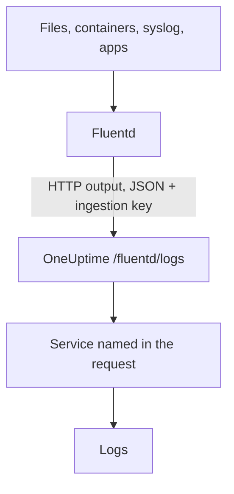

# Fluentd

[Fluentd](https://www.fluentd.org/) collects logs from files, containers, syslog, applications and [many other sources](https://www.fluentd.org/datasources). Its built-in [HTTP output](https://docs.fluentd.org/output/http) sends them to OneUptime's Fluentd endpoint, where they become searchable under **Products → Logs**.

:::cards
- [Configure Fluentd](#configure-fluentd): Add an HTTP output that points at OneUptime.
- [How records are read](#how-records-are-read): Which fields become the message, the severity and attributes.
- [Self-hosted OneUptime](#self-hosted-oneuptime): Point Fluentd at your own instance.
:::

## How it works



Fluentd posts batches of records as JSON, with your ingestion key in the `x-oneuptime-token` header and the service name in `x-oneuptime-service-name`. OneUptime turns each record into a log of that service, and creates the service the first time it sends.

## Before you begin

- **Install Fluentd** — see the [installation guide](https://docs.fluentd.org/installation).
- **A OneUptime project.** On OneUptime Cloud, telemetry is billed per GB ingested — see [pricing](https://oneuptime.com/pricing) — and a project on the Free plan needs a payment method before it can send telemetry.
- **A telemetry ingestion key.** If you do not have one:

:::steps
### Open the ingestion keys

Go to **Products → Project Settings**, open **Telemetry & APM** in the side menu and select **Ingestion Keys**.


### Create a key

Click **Create Ingestion Key**. The dialog has the key's name filled in and **Server** picked — the kind of key an application or a collector sends with — so click **Create Ingestion Key** to create it, or rename it first.

### Copy the secret

The new key opens on its own page. Copy its **Secret Key**: this is the `YOUR_SERVICE_TOKEN` in the configuration below.


:::

## Configure Fluentd

Fluentd's configuration file is usually `/etc/fluent/fluentd.conf`, or `/etc/td-agent/td-agent.conf` for the older td-agent package.

:::steps
### Add an HTTP output

Add a `<match>` section that sends records to OneUptime. Replace `YOUR_SERVICE_TOKEN` with your ingestion key, and `YOUR_SERVICE_NAME` with the name the logs should appear under — any name you like:

```text title="fluentd.conf"
# Send the time Fluentd gave each event: the HTTP output sends only the record
<filter **>
  @type record_transformer
  enable_ruby true
  <record>
    fluentd_time ${time.utc.strftime("%Y-%m-%dT%H:%M:%S.%NZ")}
  </record>
</filter>

# Match all patterns
<match **>
  @type http

  endpoint https://oneuptime.com/fluentd/logs
  open_timeout 2

  headers {"x-oneuptime-token":"YOUR_SERVICE_TOKEN", "x-oneuptime-service-name":"YOUR_SERVICE_NAME"}

  content_type application/json
  json_array true

  # Send a batch again when OneUptime is busy (429) or restarting (502, 503, 504)
  retryable_response_codes 429,502,503,504

  <format>
    @type json
  </format>
  <buffer>
    # Keep the batches on disk until OneUptime takes them: a restart of Fluentd loses none
    @type file
    path /var/log/fluent/buffer/oneuptime
    total_limit_size 512m
    flush_interval 10s
    chunk_limit_size 900k
    # Try again at least every 30 seconds, for up to 72 hours
    retry_max_interval 30s
    retry_timeout 72h
  </buffer>
</match>

# Keep Fluentd's own logs out of OneUptime
<label @FLUENT_LOG>
  <match **>
    @type null
  </match>
</label>
```

`json_array true` sends each buffer chunk as one JSON array, and `flush_interval 10s` sends the buffer every 10 seconds. `chunk_limit_size 900k` keeps each request under 1 MB, the most OneUptime accepts on this endpoint.

Fluentd's own default works as well: without `content_type` and `json_array true`, it sends newline-delimited JSON, one record a line, and OneUptime reads each line as the record it is, with `compress gzip` or without.

`@type file` keeps the batches still to send in the folder `path` names, so a restart of Fluentd loses none of them; a buffer in memory, Fluentd's default, loses what it holds. Fluentd's user must be able to write that folder: `/var/log/fluent` is fluent-package's, `/var/log/td-agent` td-agent's, and `/fluentd/log` the `fluent/fluentd` image's. `total_limit_size 512m` keeps at most 512 MB there; when it is full, Fluentd takes no more records until a batch is sent.

`retryable_response_codes 429,502,503,504` sends a batch again when OneUptime is busy (`429`) or restarting (`502`, `503`, `504`); without it, Fluentd drops a batch on any answer but `503`. `retry_max_interval 30s` waits at most 30 seconds between tries, and `retry_timeout 72h` drops a batch it still cannot send after 72 hours. The `record_transformer` filter adds the time Fluentd gave each record, as `fluentd_time`: the HTTP output sends only the record, and OneUptime reads a log's time from it.

### Restart Fluentd

Restart the Fluentd service so it loads the new output.

### Check that logs arrive

Within a few seconds of the next flush, the logs appear under **Products → Logs**. The service is listed under **Products → Services** — if it did not exist yet, OneUptime creates it.
:::

## Complete example

This configuration receives records over Fluentd's forward protocol on port `24224`, from this host alone, and sends them all to OneUptime:

```text title="fluentd.conf"
####
## Source descriptions:
##

## built-in TCP input
## @see https://docs.fluentd.org/input/forward
<source>
  @type forward
  port 24224
  # This host alone: see "Take records from other hosts" to open it
  bind 127.0.0.1
</source>

# Send the time Fluentd gave each event: the HTTP output sends only the record
<filter **>
  @type record_transformer
  enable_ruby true
  <record>
    fluentd_time ${time.utc.strftime("%Y-%m-%dT%H:%M:%S.%NZ")}
  </record>
</filter>

<match **>
  @type http

  endpoint https://oneuptime.com/fluentd/logs
  open_timeout 2

  headers {"x-oneuptime-token":"YOUR_SERVICE_TOKEN", "x-oneuptime-service-name":"YOUR_SERVICE_NAME"}

  content_type application/json
  json_array true

  # Send a batch again when OneUptime is busy (429) or restarting (502, 503, 504)
  retryable_response_codes 429,502,503,504

  <format>
    @type json
  </format>
  <buffer>
    # Keep the batches on disk until OneUptime takes them: a restart of Fluentd loses none
    @type file
    path /var/log/fluent/buffer/oneuptime
    total_limit_size 512m
    flush_interval 10s
    chunk_limit_size 900k
    # Try again at least every 30 seconds, for up to 72 hours
    retry_max_interval 30s
    retry_timeout 72h
  </buffer>
</match>

# Keep Fluentd's own logs out of OneUptime
<label @FLUENT_LOG>
  <match **>
    @type null
  </match>
</label>
```

`bind 127.0.0.1` takes records from this host alone, such as those of Docker's `fluentd` log driver, which sends to `localhost:24224`. To send different sources as different services, use one `<match>` section per tag, each with its own `x-oneuptime-service-name` and its own buffer `path`: Fluentd does not start with two buffers on one path.

## Take records from other hosts

With `bind 0.0.0.0` and no `<security>` section, anyone who can reach port `24224` can send logs to OneUptime under your ingestion key. To take records from Fluentd or Fluent Bit on other hosts, listen on every address, ask each sender for a shared key, and use TLS. Replace the `<source>` section of the complete example with:

```text title="fluentd.conf on this host"
<source>
  @type forward
  port 24224
  bind 0.0.0.0
  <transport tls>
    cert_path /etc/fluent/certs/fluentd.crt
    private_key_path /etc/fluent/certs/fluentd.key
  </transport>
  <security>
    self_hostname fluentd.example.com
    shared_key YOUR_SHARED_KEY
  </security>
</source>
```

`cert_path` and `private_key_path` are a certificate for this host's name, `fluentd.example.com` here, and its key, which Fluentd's user must be able to read. Fluentd warns when the key has no passphrase; `private_key_passphrase` sets one. Replace `YOUR_SHARED_KEY` with a long random secret, such as one from `openssl rand -base64 32`, and give each sender the same:

```text title="fluentd.conf on each sender"
<match **>
  @type forward
  transport tls
  # The certificate of the authority that signed this host's; not needed for a public one
  tls_cert_path /etc/fluent/certs/ca.crt
  <security>
    self_hostname app-1.example.com
    shared_key YOUR_SHARED_KEY
  </security>
  <server>
    host fluentd.example.com
    port 24224
  </server>
  <buffer>
    @type file
    path /var/log/fluent/buffer/forward
  </buffer>
</match>

# Keep Fluentd's own logs out of OneUptime
<label @FLUENT_LOG>
  <match **>
    @type null
  </match>
</label>
```

Fluent Bit's `forward` output takes the same settings: `Shared_Key`, `Self_Hostname`, `tls On` and `tls.ca_file`.

A sender without the key, or without TLS, is turned away. The key never crosses the network: each side proves that it holds it. Without TLS, anyone on the network between the hosts can read the records. Open port `24224` in the host's firewall only to the hosts that send. If Fluentd runs from the logs guide's Docker Compose file, publish the port on every address there too, `"24224:24224"`, and mount the certificate's folder into the container.

## How records are read

OneUptime reads these fields from each record:

| Log field | Read from the record's first field of | Notes |
| --- | --- | --- |
| Body | `message`, `log`, `msg`, `body`, `text` | The log line. A record with none of them is stored whole, as JSON. |
| Severity | `level`, `severity`, `loglevel`, `log_level`, `priority`, `severityText`, `severity_text` | Names such as `trace`, `debug`, `info`, `notice`, `warn`, `error`, `critical` and `fatal`, in any case. Any other value is stored as `Unspecified`. |
| Trace ID | `trace_id`, `traceId`, `traceid` | Links the log to its trace. |
| Span ID | `span_id`, `spanId`, `spanid` | Links the log to its span. |
| Service | the `x-oneuptime-service-name` header | `Fluentd` when the header is not set. |
| Time | `time`, `timestamp`, `@timestamp`, `ts`, `fluentd_time` | An ISO 8601 time, such as `2026-11-14T08:00:00.123Z`, or seconds, milliseconds, microseconds or nanoseconds since the epoch; a time without a zone is UTC. A time before 2000, or more than a day ahead, is not read. The field the time is read from is not kept as an attribute. A record with no time is stored at the time OneUptime receives it. |

Every other field becomes an attribute named `fluentd.` and the field's name, which you can search and filter on: a `container_name` field is `@fluentd.container_name` in the Logs explorer. A nested object is flattened with dots, such as `fluentd.kubernetes.pod_name`, and a list is stored as JSON.

Fluentd logs go through your [log pipelines](/docs/telemetry/log-pipelines), drop filters and scrub rules like any other log.

## Self-hosted OneUptime

Replace `https://oneuptime.com` in `endpoint` with the URL of your OneUptime instance: `http(s)://YOUR_ONEUPTIME_HOST/fluentd/logs`.

## Troubleshooting

:::details Fluentd logs `401` from the HTTP output
The ingestion key is missing, unknown or expired. Check the `x-oneuptime-token` value in `headers`.
:::

:::details Fluentd logs `402` or `422`
`402`: on OneUptime Cloud, the project is on the Free plan and has no payment method. Add one under **Project Settings → Billing and Invoices → Billing**. `422`: the key is disabled, or it is a Browser key. Turn **Enabled** back on in the key's settings, or create a **Server** key.
:::

:::details Fluentd logs `413`
The request is over 1 MB, the most OneUptime accepts on this endpoint. Set `chunk_limit_size 900k` in the `<buffer>` section, as in the configuration above.
:::

:::details Fluentd logs `429`, `502`, `503` or `504`
OneUptime is busy or restarting. With `retryable_response_codes 429,502,503,504` in the `<match>` section, as in the configuration above, Fluentd keeps the batch and sends it again; without it, Fluentd drops the batch. With `@type file` in the `<buffer>` section, Fluentd also keeps the batch when it restarts.
:::

:::details Logs show the time OneUptime received them, not their own
OneUptime reads a log's time from its record, and Fluentd's HTTP output sends only the record. A `<parse>` section takes the `time` field out of a record, as the event's time: add `time_key fluentd_time` to it, so that it reads no record's time and leaves `time` as it is. Add the `record_transformer` filter of the configuration above too: it adds the time Fluentd gave each record, as `fluentd_time`.
:::

:::details A JSON line whose `time` is `null`, `true`, a list or an object never arrives
Fluentd's `json` parser reads a line's `time` field as the event's time, and drops a line whose `time` is neither text nor a number, without a warning. Add `time_key fluentd_time` to its `<parse>` section, as above: Fluentd then leaves `time` in the record as it is. With the `record_transformer` filter above, OneUptime stores the log at the time Fluentd read it, `fluentd_time`; without it, at the time OneUptime receives it.
:::

:::details Logs arrive under the `Fluentd` service
The `x-oneuptime-service-name` header is missing. Add it to `headers` in each `<match>` section.
:::

:::details The log body shows the whole record as JSON
OneUptime takes the body from the first of `message`, `log`, `msg`, `body` or `text` that the record has, and stores the whole record when it has none of them. Rename the field that holds your log line to one of these, for example with Fluentd's `record_transformer` filter.
:::

If you have any questions or need help with the configuration, please reach out to us at support@oneuptime.com.

## Next steps

:::cards
- [Log Pipelines](/docs/telemetry/log-pipelines): Parse and enrich the logs Fluentd sends.
- [Search Syntax](/docs/telemetry/search-syntax): Find the logs in the Logs explorer.
- [Fluent Bit](/docs/telemetry/fluentbit): A lighter-weight agent that sends over OpenTelemetry.
- [Logs Monitor](/docs/monitor/logs-monitor): Alert when matching logs appear.
:::
