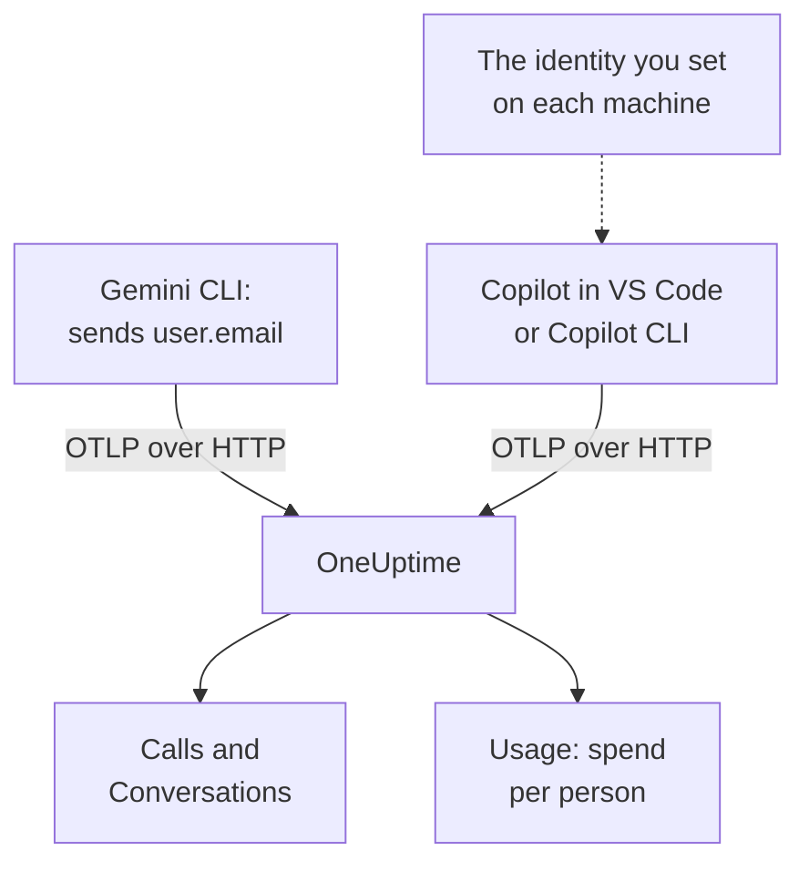

# Gemini CLI & GitHub Copilot

Gemini CLI and GitHub Copilot both export OpenTelemetry themselves: point them at OneUptime and their model calls, tokens, cost and tool calls arrive in [AI / LLM](/docs/telemetry/ai-llm-observability), next to your own apps' AI calls. They differ in what matters most for chargeback: Gemini CLI names the person on every record, and Copilot names nobody, so you name each developer yourself.

:::cards
- [Gemini CLI](#set-up-gemini-cli): Turn telemetry on, with traces, and send it straight to OneUptime.
- [GitHub Copilot](#set-up-github-copilot): Export from VS Code or Copilot CLI.
- [Name each developer](#name-each-developer): The identity Copilot leaves out.
- [Troubleshooting](#troubleshooting): What to check when nothing arrives.
:::

## How it works



| | Gemini CLI | GitHub Copilot |
| --- | --- | --- |
| Sends | Traces, metrics and logs | Traces, metrics and events, from its agent surfaces only |
| Names the person | `user.email`, when signed in | Nobody: you set `enduser.id` and `user.email` |
| Prompt text | Sent unless you turn `logPrompts` off | Not sent unless you turn `captureContent` on |
| Out of the box it sends to | `http://localhost:4317`, over gRPC | `http://localhost:4318`, over HTTP |

## Before you begin

- An ingestion key: open **Project Settings → Telemetry & APM → Ingestion Keys** and click **Create Ingestion Key**.
- Your OTLP base URL: `https://oneuptime.com/otlp`, or `https://YOUR-ONEUPTIME-HOST/otlp` if you host OneUptime yourself.
- The key travels in the `x-oneuptime-token` header of every export request.

## Set up Gemini CLI

Gemini CLI sends traces, metrics and log events, and puts `user.email` on every record when someone is signed in. OneUptime reads `user.email` as the employee, so each person's spend shows with no mapping and no setup per machine.

:::steps
### Turn telemetry on

Add a `telemetry` block to the user settings file of each machine, or to `.gemini/settings.json` in a repository:

```json title="~/.gemini/settings.json"
{
  "telemetry": {
    "enabled": true,
    "target": "local",
    "otlpEndpoint": "https://oneuptime.com/otlp",
    "otlpProtocol": "http",
    "otlpHeaders": {
      "x-oneuptime-token": "YOUR_INGESTION_TOKEN"
    },
    "traces": true,
    "logPrompts": false
  }
}
```

### Start a new session

Gemini CLI reads its settings when it starts, so start it again and run a prompt.

### Check that data arrives

Open **Products → AI / LLM → Calls**: the calls are listed under the service `gemini-cli`, with the model and the tokens.
:::

Three settings in that block matter more than the rest:

- `otlpProtocol: "http"`. Gemini CLI uses gRPC unless told otherwise. Over HTTP it adds `/v1/traces`, `/v1/metrics` and `/v1/logs` to the base URL itself. OneUptime also accepts gRPC on port 443 (see [OTLP over gRPC](/docs/telemetry/open-telemetry#otlp-over-grpc)), but HTTP is simpler.
- `traces: true`. It is off by default, and without it Gemini CLI's spans carry no model and no token counts, so nothing can be priced. Gemini CLI sends no cost metric either: turn traces on to see what its calls cost.
- `logPrompts: false`. Read the warning below.

> [!WARNING]
> `logPrompts` is `true` by default, so turning telemetry on sends the text your engineers type: often source code, customer data and pasted credentials. Set it to `false` in the same change that turns telemetry on. If you want prompts for debugging, decide that on purpose, and mask what you must with scrub rules under **Traces → Settings**.

### Settings for a fleet

Every setting has an environment variable, and the variables win over a repository's `.gemini/settings.json`, which makes them the place for a fleet policy pushed by MDM:

```bash
export GEMINI_TELEMETRY_ENABLED=true
export GEMINI_TELEMETRY_TARGET=local
export GEMINI_TELEMETRY_OTLP_ENDPOINT="https://oneuptime.com/otlp"
export GEMINI_TELEMETRY_OTLP_PROTOCOL=http
export GEMINI_TELEMETRY_OTLP_HEADERS="x-oneuptime-token=YOUR_INGESTION_TOKEN"
export GEMINI_TELEMETRY_TRACES_ENABLED=true
export GEMINI_TELEMETRY_LOG_PROMPTS=false
```

| Setting | Variable | Default | What it does |
| --- | --- | --- | --- |
| `enabled` | `GEMINI_TELEMETRY_ENABLED` | `false` | Turns telemetry on |
| `target` | `GEMINI_TELEMETRY_TARGET` | `local` | `local` sends to the endpoint you set; `gcp` sends to Google Cloud |
| `otlpEndpoint` | `GEMINI_TELEMETRY_OTLP_ENDPOINT` | `http://localhost:4317` | Where telemetry goes |
| `otlpProtocol` | `GEMINI_TELEMETRY_OTLP_PROTOCOL` | `grpc` | `grpc` or `http` |
| `otlpHeaders` | `GEMINI_TELEMETRY_OTLP_HEADERS` | None | Headers on every export: an object in the file, `key=value` pairs or JSON in the variable |
| `traces` | `GEMINI_TELEMETRY_TRACES_ENABLED` | `false` | Puts the model, tokens and payloads on spans |
| `logPrompts` | `GEMINI_TELEMETRY_LOG_PROMPTS` | `true` | Puts prompt text in log events |
| `outfile` | `GEMINI_TELEMETRY_OUTFILE` | None | Writes telemetry to a file instead, to see what would be sent |

Command-line flags win over the `GEMINI_TELEMETRY_*` variables, which win over the standard `OTEL_EXPORTER_OTLP_*` variables, which win over `settings.json`. Gemini CLI reads `OTEL_EXPORTER_OTLP_HEADERS` too, so a header you already set for other tools reaches it.

:::details Send through an OpenTelemetry Collector instead
A collector on each machine, or one per team, can batch, retry and route telemetry before it reaches OneUptime. Leave Gemini CLI on its defaults, which send gRPC to `http://localhost:4317`, and let the collector add the key:

```yaml title="otel-collector-config.yaml"
receivers:
  otlp:
    protocols:
      grpc:
        endpoint: 0.0.0.0:4317
      http:
        endpoint: 0.0.0.0:4318

exporters:
  otlphttp:
    endpoint: "https://oneuptime.com/otlp"
    headers:
      "x-oneuptime-token": "YOUR_INGESTION_TOKEN"

service:
  pipelines:
    traces:
      receivers: [otlp]
      exporters: [otlphttp]
    metrics:
      receivers: [otlp]
      exporters: [otlphttp]
    logs:
      receivers: [otlp]
      exporters: [otlphttp]
```

See [OpenTelemetry](/docs/telemetry/open-telemetry) for running a collector.
:::

### What Gemini CLI sends

| Metric | What it carries |
| --- | --- |
| `gen_ai.client.token.usage` | Input and output tokens: the series OneUptime counts |
| `gemini_cli.token.usage` | The same tokens under Gemini CLI's own name, plus its `thought`, `cache` and `tool` tokens; not counted, so tokens are never counted twice |
| `gen_ai.client.operation.duration` | How long each model call took |
| `gemini_cli.api.request.count` | Model calls |
| `gemini_cli.tool.call.count` | Tool calls |
| `gemini_cli.session.count` | Sessions started |
| `gemini_cli.lines.changed` | Lines the agent changed |

Its log events include `gemini_cli.user_prompt`, `gemini_cli.api_request`, `gemini_cli.api_response`, `gemini_cli.api_error`, `gemini_cli.tool_call` and `gemini_cli.file_operation`. Every record carries `session.id`, `installation.id`, `active_approval_mode` and, when someone is signed in, `user.email`. OneUptime reads `session.id` as a conversation id, so a whole Gemini CLI session shows as one conversation under **Conversations**, however many traces it took.

The metrics are ordinary OpenTelemetry metrics: chart any of them on a dashboard, or alert on one with a [Metrics monitor](/docs/monitor/metrics-monitor).

## Set up GitHub Copilot

GitHub documents OpenTelemetry for Copilot's agent surfaces only:

| Surface | Sends OpenTelemetry |
| --- | --- |
| Copilot Chat and agent mode in VS Code | Yes |
| Copilot CLI | Yes |
| Copilot SDK | Yes |
| Agent workflows in JetBrains IDEs | Yes, set in the Copilot plugin's settings |
| Inline completions, Copilot on github.com, Copilot code review | Not documented |

So a team that mostly takes inline completions looks idle in OneUptime, however the export is set up.

:::tabs
@tab VS Code
```json title="settings.json"
{
  "github.copilot.chat.otel.enabled": true,
  "github.copilot.chat.otel.exporterType": "otlp-http",
  "github.copilot.chat.otel.otlpEndpoint": "https://oneuptime.com/otlp",
  "github.copilot.chat.otel.captureContent": false
}
```
@tab Copilot CLI
```bash
export COPILOT_OTEL_ENABLED=true
export OTEL_EXPORTER_OTLP_ENDPOINT="https://oneuptime.com/otlp"
export OTEL_EXPORTER_OTLP_HEADERS="x-oneuptime-token=YOUR_INGESTION_TOKEN"
```
@tab Managed settings
```json title="Copilot enterprise managed settings"
{
  "telemetry": {
    "enabled": true,
    "endpoint": "https://oneuptime.com/otlp",
    "protocol": "http/protobuf",
    "serviceName": "github-copilot",
    "captureContent": false,
    "lockCaptureContent": true,
    "headers": {
      "x-oneuptime-token": "YOUR_INGESTION_TOKEN"
    }
  }
}
```
:::

- VS Code's settings have no key for headers: set `OTEL_EXPORTER_OTLP_HEADERS` in the environment VS Code starts from, as for Copilot CLI. Environment variables win over VS Code's settings.
- Managed settings, pushed by an enterprise to VS Code and Copilot CLI, carry the key in `headers` and win over what each developer sets. `lockCaptureContent` keeps prompt capture off for everyone. `protocol` there is the wire format, `http/protobuf` or `http/json`.
- `captureContent` is off by default, so prompts and answers are not sent unless you turn it on.

## Name each developer

Copilot sends no identity OneUptime can use. Its `captureIdentity` setting adds `user.name`, and Copilot CLI may add `enduser.pseudo.id`, but OneUptime reads neither as the employee. Without an identity, all of Copilot's spend lands in one **Unattributed** row on the **Usage** tab.

Set the identity on each machine, in the environment VS Code and Copilot CLI start from: a shell profile, or a script your MDM runs.

```bash
export OTEL_RESOURCE_ATTRIBUTES="enduser.id=alice@example.com,user.email=alice@example.com,team.id=platform,cost_center=eng-tools"
```

| Attribute | OneUptime reads it as |
| --- | --- |
| `enduser.id` | The employee's id |
| `user.email` | The employee's email: the name the **Usage** tab shows |
| `team.id`, `team`, `cost_center`, `department` | The team or cost centre |

These are resource attributes, so they arrive as `resource.enduser.id`, `resource.user.email` and so on: OneUptime reads every identity and team key with or without the `resource.` prefix. Gemini CLI already sends `user.email`; give it `OTEL_RESOURCE_ATTRIBUTES` only for the team.

- Set the identity before the first call: calls that arrived without one can't be attributed later.
- Leave `resourceAttributes` out of Copilot's managed settings: they win over `OTEL_RESOURCE_ATTRIBUTES`, and would replace the identity you set on each machine.
- Don't use `gen_ai.user` or `llm.user`. In an app that serves customers they name the customer, so OneUptime never reads them as the employee.

## What Copilot's data looks like

Copilot follows the OpenTelemetry GenAI conventions, so its calls show in **Calls**, **Conversations** and **Usage** like your own apps' calls.

| Span | One per |
| --- | --- |
| `invoke_agent` | Agent turn |
| `chat` | Model call |
| `execute_tool` | Tool call |
| `execute_hook` | Hook run |

Its spans carry the model, `gen_ai.usage.input_tokens`, `gen_ai.usage.output_tokens` and `gen_ai.conversation.id`, so a whole agent turn shows as one conversation. Both surfaces also send the `gen_ai.client.token.usage` and `gen_ai.client.operation.duration` metrics, and events on the OTLP logs signal: keep a `logs` pipeline in any collector you put in between.

OneUptime prices each call from its model and tokens, at the rates under **Pricing**. That is what the tokens would cost at list price, not what GitHub bills you: Copilot is paid per seat and per premium request.

Seats, seat activity and premium-request billing are not in OpenTelemetry at all: they are in GitHub's REST API, which OneUptime doesn't read. Take seat and billing figures from GitHub.

## Troubleshooting

:::details Nothing arrives from Gemini CLI
The usual cause is `otlpProtocol` left at its `grpc` default while the endpoint is the HTTP URL. Set `otlpProtocol` to `http`, and check that `otlpEndpoint` is the base URL, ending in `/otlp`, and that the `x-oneuptime-token` header is set. Set `outfile` for a moment to see what Gemini CLI would send.
:::

:::details Gemini CLI's calls arrive with no model, tokens or cost
`traces` is off. Turn it on: without it, Gemini CLI's spans carry no model and no token counts, and it sends no cost metric.
:::

:::details Copilot's spend shows as Unattributed
The identity didn't reach the exporter. Check that `OTEL_RESOURCE_ATTRIBUTES` is set in the environment VS Code or Copilot CLI started from, and that Copilot's managed settings don't set `resourceAttributes`, which would replace it.
:::

:::details Copilot sends nothing at all
Check that the people you expect use an agent surface, not inline completions, and that `OTEL_EXPORTER_OTLP_HEADERS` carries the key: VS Code's own settings can't.
:::

:::details The key is rejected
OneUptime answers `401` for a missing, unknown or expired key, and `422` for a disabled key or a browser key. Use a server key, sent in `x-oneuptime-token`.
:::

## Next steps

:::cards
- [AI Coding Assistants](/docs/telemetry/ai-coding-assistants): Who uses which tool, and what each person and team spends.
- [AI / LLM Observability](/docs/telemetry/ai-llm-observability): The attributes OneUptime reads, how cost is worked out, and daily budgets.
- [AI Gateways](/docs/telemetry/ai-gateways): Tools with no export of their own, through a gateway.
:::
