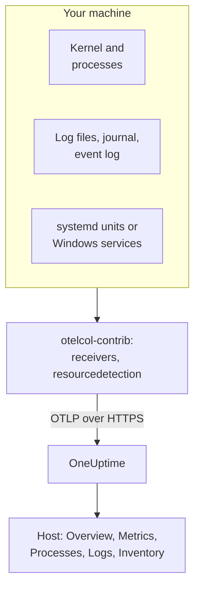

# Host OpenTelemetry Collector

Run the OpenTelemetry Collector on a Linux, macOS or Windows machine to send its metrics, processes, logs and service states to OneUptime. The machine appears under **Products → Infrastructure → Hosts** with its own pages, with no OneUptime agent to install: the collector is the upstream `otelcol-contrib` release. [Host monitors](/docs/monitor/host-monitor) alert on what it sends.

:::cards
- [Install the collector](#install-the-collector): Three steps on Linux, macOS or Windows.
- [Choose what to collect](#choose-what-to-collect): Metrics, file logs, the journal, event logs and service states.
- [Inventory attributes](#inventory-attributes-ip-mac-serial-number-make-model-firmware): IP, MAC, serial number, make, model and firmware for your CMDB.
- [Reduce what you send](#reducing-the-volume-of-data-collected): Fewer log lines, coarser intervals, fewer series.
:::

## How it works

The collector reads the machine through its receivers, stamps every record with the machine's identity, and sends it to OneUptime over OTLP with your ingestion key. OneUptime registers the host from its first metrics and fills in its pages as the data arrives.



| What you see on the host | Where it comes from |
| --- | --- |
| **Overview** and **Metrics** | The `hostmetrics` receiver: CPU, memory, disks, filesystems, network, load, paging. |
| **Processes** | The `process` scraper of `hostmetrics`: one series set per process. |
| **Logs** | The `filelog`, `journald` and `windowseventlog` receivers. |
| **Systemd Units** (Linux) | The `systemd` receiver. |
| **Services** (Windows) | The `windows_service` receiver. |
| The inventory item | The `resourcedetection` processor, plus the [attributes you stamp](#inventory-attributes-ip-mac-serial-number-make-model-firmware). |
| **Agent Version** | `oneuptime.agent.version` in the `resource` processor. |

A host is registered once a batch that carries `host.name` also carries `hostmetrics` or `process` metrics, or an `os.type` attribute. The `resourcedetection` processor sets all of them, which is why every config keeps it first. `host.id` or `host.arch` alone do not register a host, and telemetry that carries a Kubernetes identity (`k8s.cluster.name`, `k8s.node.name`, `k8s.pod.name`) is filed under its cluster instead: monitor Kubernetes nodes with the [Kubernetes Agent](/docs/telemetry/kubernetes-agent).

## Before you begin

- An ingestion key. Create one under **Project Settings → Telemetry & APM → Ingestion Keys** and copy its value. The collector sends it as the `x-oneuptime-token` header.
- Administrator rights on the machine: `sudo` on Linux and macOS, an elevated PowerShell prompt on Windows.
- Outbound HTTPS from the machine to your OneUptime URL.
- The contrib distribution of the collector, `otelcol-contrib`. The core `otelcol` build lacks the receivers and processors these configs use. The `systemd` receiver (Linux) works from v0.143.0 and the `windows_service` receiver (Windows) from v0.155.0; the commands below install v0.161.0, the release OneUptime pins.

## Install the collector

:::steps
### Save the config

Save this as `config.yaml` in the folder you will run the install commands from, and replace `YOUR_TELEMETRY_INGESTION_TOKEN` with your ingestion key (and the endpoint with your own URL if you self-host).

:::tabs
@tab Linux
```yaml title="config.yaml"
receivers:
  hostmetrics:
    collection_interval: 30s
    scrapers:
      cpu:
        metrics:
          system.cpu.utilization:
            enabled: true
          system.cpu.logical.count:
            enabled: true
      memory:
        metrics:
          system.memory.utilization:
            enabled: true
      disk:
      filesystem:
        metrics:
          system.filesystem.utilization:
            enabled: true
      load:
      network:
      paging:
      processes:
      process:
        mute_process_name_error: true
        mute_process_exe_error: true
        mute_process_io_error: true
        metrics:
          process.cpu.utilization:
            enabled: true
          process.memory.utilization:
            enabled: true

  # The systemd journal: every unit's logs, info and above.
  journald:
    directory: /var/log/journal
    priority: info

  # Powers the Systemd Units tab (otelcol-contrib v0.143.0+).
  systemd:
    collection_interval: 30s
    units: ["*.service"]
    metrics:
      systemd.service.cpu.time:
        enabled: false

processors:
  # Stamps host.name, host.id and os.type: this is how OneUptime attaches
  # telemetry to the host. Without it the host's pages stay empty.
  resourcedetection:
    detectors: [system, env]
    system:
      hostname_sources: [os]
      resource_attributes:
        host.name:
          enabled: true
        host.id:
          enabled: true
        host.arch:
          enabled: true
        host.ip:
          enabled: true
        host.mac:
          enabled: true
        os.type:
          enabled: true
        os.description:
          enabled: true
        os.version:
          enabled: true
  # The collector release this config is for: the host's Agent Version.
  resource:
    attributes:
      - key: oneuptime.agent.version
        value: "0.161.0"
        action: upsert
  batch:

exporters:
  otlphttp/oneuptime:
    endpoint: https://oneuptime.com/otlp
    headers:
      x-oneuptime-token: YOUR_TELEMETRY_INGESTION_TOKEN

service:
  pipelines:
    metrics:
      receivers: [hostmetrics, systemd]
      processors: [resourcedetection, resource, batch]
      exporters: [otlphttp/oneuptime]
    logs:
      receivers: [journald]
      processors: [resourcedetection, resource, batch]
      exporters: [otlphttp/oneuptime]
```
@tab macOS
```yaml title="config.yaml"
receivers:
  hostmetrics:
    collection_interval: 30s
    scrapers:
      cpu:
        metrics:
          system.cpu.utilization:
            enabled: true
          system.cpu.logical.count:
            enabled: true
      memory:
        metrics:
          system.memory.utilization:
            enabled: true
      disk:
      filesystem:
        metrics:
          system.filesystem.utilization:
            enabled: true
      load:
      network:
      paging:
      processes:
      process:
        mute_process_name_error: true
        mute_process_exe_error: true
        mute_process_io_error: true
        metrics:
          process.cpu.utilization:
            enabled: true
          process.memory.utilization:
            enabled: true

  filelog/system:
    include:
      - /var/log/install.log
      - /var/log/wifi.log
    start_at: end

processors:
  # Stamps host.name, host.id and os.type: this is how OneUptime attaches
  # telemetry to the host. Without it the host's pages stay empty.
  resourcedetection:
    detectors: [system, env]
    system:
      hostname_sources: [os]
      resource_attributes:
        host.name:
          enabled: true
        host.id:
          enabled: true
        host.arch:
          enabled: true
        host.ip:
          enabled: true
        host.mac:
          enabled: true
        os.type:
          enabled: true
        os.description:
          enabled: true
        os.version:
          enabled: true
  # The collector release this config is for: the host's Agent Version.
  resource:
    attributes:
      - key: oneuptime.agent.version
        value: "0.161.0"
        action: upsert
  batch:

exporters:
  otlphttp/oneuptime:
    endpoint: https://oneuptime.com/otlp
    headers:
      x-oneuptime-token: YOUR_TELEMETRY_INGESTION_TOKEN

service:
  pipelines:
    metrics:
      receivers: [hostmetrics]
      processors: [resourcedetection, resource, batch]
      exporters: [otlphttp/oneuptime]
    logs:
      receivers: [filelog/system]
      processors: [resourcedetection, resource, batch]
      exporters: [otlphttp/oneuptime]
```
@tab Windows
```yaml title="config.yaml"
receivers:
  hostmetrics:
    collection_interval: 30s
    scrapers:
      cpu:
        metrics:
          system.cpu.utilization:
            enabled: true
          system.cpu.logical.count:
            enabled: true
      memory:
        metrics:
          system.memory.utilization:
            enabled: true
      disk:
      filesystem:
        metrics:
          system.filesystem.utilization:
            enabled: true
      load:
      network:
      paging:
      processes:
      process:
        mute_process_name_error: true
        mute_process_exe_error: true
        mute_process_io_error: true
        metrics:
          process.cpu.utilization:
            enabled: true
          process.memory.utilization:
            enabled: true

  windowseventlog/system:
    channel: System
    start_at: end

  windowseventlog/application:
    channel: Application
    start_at: end

  windowseventlog/security:
    channel: Security
    start_at: end

  # Powers the Services tab (otelcol-contrib v0.155.0+).
  windows_service:
    collection_interval: 30s

processors:
  # Stamps host.name, host.id and os.type: this is how OneUptime attaches
  # telemetry to the host. Without it the host's pages stay empty.
  resourcedetection:
    detectors: [system, env]
    system:
      hostname_sources: [os]
      resource_attributes:
        host.name:
          enabled: true
        host.id:
          enabled: true
        host.arch:
          enabled: true
        host.ip:
          enabled: true
        host.mac:
          enabled: true
        os.type:
          enabled: true
        os.description:
          enabled: true
        os.version:
          enabled: true
  # The collector release this config is for: the host's Agent Version.
  resource:
    attributes:
      - key: oneuptime.agent.version
        value: "0.161.0"
        action: upsert
  batch:

exporters:
  otlphttp/oneuptime:
    endpoint: https://oneuptime.com/otlp
    headers:
      x-oneuptime-token: YOUR_TELEMETRY_INGESTION_TOKEN

service:
  pipelines:
    metrics:
      receivers: [hostmetrics, windows_service]
      processors: [resourcedetection, resource, batch]
      exporters: [otlphttp/oneuptime]
    logs:
      receivers:
        - windowseventlog/system
        - windowseventlog/application
        - windowseventlog/security
      processors: [resourcedetection, resource, batch]
      exporters: [otlphttp/oneuptime]
```
:::

Each config is the one the dashboard writes under **Products → Infrastructure → Hosts → Documentation**, with a logs pipeline added: its processors are `resourcedetection`, `resource` and `batch`, and its exporter is `otlphttp/oneuptime`. It sets no `service.name`, so the host's telemetry belongs to the host itself, filed as `host/<hostname>`. Add a `service.name` to the `resource` processor only if you want it filed under a telemetry service of that name instead.

### Install and start the collector

:::tabs
@tab Linux
On Debian or Ubuntu:

```bash
VERSION=0.161.0                      # the release OneUptime pins
ARCH=$(dpkg --print-architecture)   # amd64 or arm64

curl -fL -o /tmp/otelcol-contrib.deb \
  "https://github.com/open-telemetry/opentelemetry-collector-releases/releases/download/v${VERSION}/otelcol-contrib_${VERSION}_linux_${ARCH}.deb"
sudo dpkg -i /tmp/otelcol-contrib.deb
```

On RHEL, CentOS, Fedora or Amazon Linux:

```bash
VERSION=0.161.0
ARCH=$(uname -m | sed 's/x86_64/amd64/;s/aarch64/arm64/')

curl -fL -o /tmp/otelcol-contrib.rpm \
  "https://github.com/open-telemetry/opentelemetry-collector-releases/releases/download/v${VERSION}/otelcol-contrib_${VERSION}_linux_${ARCH}.rpm"
sudo rpm -Uvh /tmp/otelcol-contrib.rpm
```

The package installs `/usr/bin/otelcol-contrib` and a systemd unit, and starts it with a default config. Put yours in place, let the collector's user read the journal, and restart it:

```bash
sudo install -m 0644 config.yaml /etc/otelcol-contrib/config.yaml
sudo usermod -aG systemd-journal otelcol-contrib
sudo systemctl enable otelcol-contrib
sudo systemctl restart otelcol-contrib
sudo systemctl status otelcol-contrib
```

The packaged unit runs the collector as the unprivileged `otelcol-contrib` user. The `systemd-journal` group lets it read the journal; to tail files in `/var/log` (readable by the `adm` group on Debian and Ubuntu), add that group too. For the `process` scraper to see the processes of other users, give it the `CAP_SYS_PTRACE` capability.
@tab macOS
```bash
VERSION=0.161.0
ARCH=$(uname -m | sed 's/x86_64/amd64/')   # arm64 on Apple silicon, amd64 on Intel

curl -fL -o /tmp/otelcol-contrib.tar.gz \
  "https://github.com/open-telemetry/opentelemetry-collector-releases/releases/download/v${VERSION}/otelcol-contrib_${VERSION}_darwin_${ARCH}.tar.gz"

sudo mkdir -p /usr/local/otelcol-contrib /usr/local/bin /etc/otelcol-contrib
sudo tar -xzf /tmp/otelcol-contrib.tar.gz -C /usr/local/otelcol-contrib
sudo ln -sf /usr/local/otelcol-contrib/otelcol-contrib /usr/local/bin/otelcol-contrib
sudo install -m 0644 config.yaml /etc/otelcol-contrib/config.yaml
```

Create `/Library/LaunchDaemons/com.oneuptime.otelcol-contrib.plist`, so launchd starts the collector with the Mac and restarts it if it stops:

```xml title="/Library/LaunchDaemons/com.oneuptime.otelcol-contrib.plist"
<?xml version="1.0" encoding="UTF-8"?>
<!DOCTYPE plist PUBLIC "-//Apple//DTD PLIST 1.0//EN" "http://www.apple.com/DTDs/PropertyList-1.0.dtd">
<plist version="1.0">
<dict>
  <key>Label</key><string>com.oneuptime.otelcol-contrib</string>
  <key>ProgramArguments</key>
  <array>
    <string>/usr/local/bin/otelcol-contrib</string>
    <string>--config=/etc/otelcol-contrib/config.yaml</string>
  </array>
  <key>RunAtLoad</key><true/>
  <key>KeepAlive</key><true/>
  <key>StandardOutPath</key><string>/var/log/otelcol-contrib.out.log</string>
  <key>StandardErrorPath</key><string>/var/log/otelcol-contrib.err.log</string>
</dict>
</plist>
```

Load it:

```bash
sudo launchctl load -w /Library/LaunchDaemons/com.oneuptime.otelcol-contrib.plist
sudo launchctl list | grep otelcol-contrib
```

Use this tarball, not Homebrew: the Homebrew formula is the core build, which refuses to start with this config.
@tab Windows
From an elevated PowerShell prompt, in the folder that holds `config.yaml`, run this block as a whole: each line depends on the variables above it.

```powershell
$VERSION = "0.161.0"                          # the release OneUptime pins; v0.155.0+ has the Services tab
$ARCH    = "amd64"                            # use "arm64" on ARM hosts
$dest    = "C:\Program Files\otelcol-contrib"
$tar     = "$env:TEMP\otelcol-contrib.tar.gz"

# Note the "-contrib" in the asset name; otelcol_... is the wrong archive.
$url = "https://github.com/open-telemetry/opentelemetry-collector-releases/releases/download/v$VERSION/otelcol-contrib_${VERSION}_windows_${ARCH}.tar.gz"

New-Item -ItemType Directory -Force -Path $dest | Out-Null
Invoke-WebRequest -Uri $url -OutFile $tar
tar -xf $tar -C $dest                          # tar.exe ships with Windows 10 1803+ / Server 2019+
Get-ChildItem $dest                            # expect otelcol-contrib.exe, not otelcol.exe
Copy-Item config.yaml "$dest\config.yaml" -Force

# --% hands the rest of the line to sc.exe unchanged, so its quoting
# survives PowerShell — keep the command on one line.
sc.exe --% create "otelcol-contrib" binPath= "\"C:\Program Files\otelcol-contrib\otelcol-contrib.exe\" --config=\"C:\Program Files\otelcol-contrib\config.yaml\"" start= auto DisplayName= "OpenTelemetry Collector (OneUptime)"
sc.exe description "otelcol-contrib" "Collects host telemetry and forwards it to OneUptime over OTLP."
sc.exe start "otelcol-contrib"
sc.exe query "otelcol-contrib"
```

The service runs as `LocalSystem`, which can read the `Security` event log and every Windows service. On Windows the `load` scraper only emulates a load average from the *Processor Queue Length* counter, starting at 0.

The asset name must start with `otelcol-contrib_`. The core `otelcol_<version>_windows_amd64.tar.gz` archive unpacks `otelcol.exe`, which has no `windowseventlog` or `windows_service` receiver; renaming it to `otelcol-contrib.exe` does not add them. Prefer an installer? The same [releases page](https://github.com/open-telemetry/opentelemetry-collector-releases/releases) has a signed `otelcol-contrib_<version>_windows_x64.msi`, which registers the service for you: point it at this `config.yaml` and keep the service on `LocalSystem`.
:::

### Check the host appears

Open **Products → Infrastructure → Hosts → All Hosts**. The host appears under its hostname once the first metrics arrive, usually within 30 seconds, and its **Overview**, **Metrics**, **Processes** and **Logs** pages fill in. If it does not, read the collector's own logs:

:::tabs
@tab Linux
```bash
sudo journalctl -u otelcol-contrib -f
```
@tab macOS
```bash
tail -f /var/log/otelcol-contrib.err.log
```
@tab Windows
```powershell
Get-WinEvent -LogName Application -MaxEvents 20 | Where-Object ProviderName -eq "otelcol-contrib"
```
:::
:::

To generate a test log line, run `logger "hello from oneuptime"` (Linux, macOS) or `eventcreate /T INFORMATION /ID 999 /L APPLICATION /SO OneUptimeTest /D "hello from oneuptime"` (Windows, elevated), then look at the host's **Logs** page.

## Choose what to collect

Every config follows the same shape: receivers for what to read, the `resourcedetection`, `resource` and `batch` processors, and the `otlphttp/oneuptime` exporter. Add the receivers below to `receivers:` and to their pipeline, then restart the collector (`sudo systemctl restart otelcol-contrib`, `launchctl unload` and `load` on a Mac, `Restart-Service otelcol-contrib` on Windows). Merge each snippet into the sections your config has: a second `processors:` or `service:` key replaces the first.

### Host metrics

`hostmetrics` works on every OS. It reads CPU, memory, disks, filesystems, network, load, paging and processes from the kernel, every `collection_interval`. The `*.utilization` metrics and `system.cpu.logical.count` are off in the receiver by default, and the host's charts and the Host alert templates read them, so keep them enabled as the configs above do. The `process` scraper feeds the **Processes** page; it is also the largest source of series (see [Reduce what you send](#reducing-the-volume-of-data-collected)).

On Linux the collector reads `/proc` and `/sys`. A collector in a container must mount the host's and set `HOST_PROC` and `HOST_SYS` (see [In a Docker container](#in-a-docker-container)); a native install needs nothing.

### File logs

Tail any log file on disk with a `filelog` receiver, and add it to the `logs` pipeline:

```yaml
receivers:
  filelog/app:
    include:
      - /var/log/myapp/*.log
    start_at: end
    multiline:
      # A new entry starts with a timestamp; continuation lines (the
      # "at ...", "File ...", "Caused by: ..." frames) are folded into it.
      line_start_pattern: '^\d{4}-\d{2}-\d{2}[ T]\d{2}:\d{2}:\d{2}'
```

`start_at: end` reads only new lines; use `beginning` to read the files from the start on the first run. The collector keeps its place in each file, so it resumes correctly after a restart.

OneUptime scans error and fatal log lines for stack traces and groups them into **Exceptions**, under the host. For that, a multi-line stack trace (Java, Python, .NET, Ruby) must arrive as one record, which is what `multiline` does; without it, each frame is a log of its own. If your application can write the OpenTelemetry `exception.type`, `exception.message` and `exception.stacktrace` attributes itself, that is more reliable still.

On a systemd host, `/var/log/syslog` and `/var/log/messages` repeat what the journal already holds, so read one or the other.

### systemd journal

On a systemd host, the `journald` receiver reads every unit's logs in one place, with their structured fields. The Linux config above reads them all at `info` and above; narrow it to some units:

```yaml
receivers:
  journald:
    directory: /var/log/journal
    units:
      # Drop this list to ingest everything; restrict it to limit volume.
      - ssh.service
      - cron.service
      - nginx.service
    priority: info
```

The receiver runs `journalctl`, which the Debian and RPM packages depend on, and the collector's user must be in the `systemd-journal` group.

### Linux Services (systemd units, metrics)

The host's **Systemd Units** page lists every unit and its state, from the [`systemdreceiver`](https://github.com/open-telemetry/opentelemetry-collector-contrib/tree/main/receiver/systemdreceiver) (config type `systemd`), the Linux counterpart of the **Services** page on Windows. The Linux config above turns it on:

```yaml
receivers:
  systemd:
    collection_interval: 30s
    # The service manager to read: "system" (default) or "user".
    scope: system
    # Which units to scrape, as systemctl unit patterns. The default is
    # every service; widen it to include timers, sockets or mounts, or
    # narrow it to cut volume on hosts with hundreds of units:
    units: ["*.service"]
    # units: [nginx.service, postgresql.service, "*.timer"]
    metrics:
      # Per-service CPU time is on by default and doubles this receiver's
      # datapoint count. The Systemd Units tab does not use it, so turn it
      # off unless you chart it. On v0.142.0 the key is
      # systemd.unit.cpu.time — naming a metric the running build does not
      # have stops the collector at startup.
      systemd.service.cpu.time:
        enabled: false

service:
  pipelines:
    metrics:
      receivers: [hostmetrics, systemd]
      processors: [resourcedetection, resource, batch]
```

The receiver first shipped in `otelcol-contrib` v0.142.0, and v0.143.0 is the first release worth running. On anything older, adding `systemd` fails at startup with `'receivers' unknown type: "systemd"`; v0.142.0 alone names its CPU metric `systemd.unit.cpu.time` and looks for cgroup statistics on every unit, which logs a scrape error for each non-`.service` unit.

It emits `systemd.unit.state` as a state set: on every scrape, each unit gets one datapoint per possible state (`active`, `reloading`, `inactive`, `failed`, `activating`, `deactivating`, `maintenance`, `refreshing`), `1` for the state it is in and `0` for the rest. The unit name is the resource attribute `systemd.unit.name` and the state the datapoint attribute `systemd.unit.active_state`. Because the unit name is a resource attribute, `resourcedetection` must stay in the metrics pipeline: it stamps `host.name` onto each unit's resource, and without it the samples never attach to a host.

It reads unit state over the system D-Bus, with the read-only calls `systemctl list-units` makes, which systemd allows unprivileged. So the packaged service, which runs as the `otelcol-contrib` user, not root, needs no extra rights. It does need the bus: a collector in a container has no `/run/dbus/system_bus_socket` unless you mount the host's, so use a native install. The receiver is alpha and Linux-only.

> [!WARNING]
> The state set costs eight datapoints per unit per scrape, and the default-on `systemd.service.cpu.time` adds two more (`user` and `system`): 10 datapoints per unit per scrape. A host tracking 300 units every 30 seconds sends about 6,000 datapoints a minute from this receiver alone, or about 4,800 with the CPU metric off. Narrow `units:` to the services you alert on, or raise `collection_interval`, before you turn it on across a fleet.

### Apple Unified Log

macOS writes its system logs to the Apple Unified Log, read with `log show` and `log stream`, rather than to `/var/log/system.log`. To collect it, stream it into a file with a small script, `/usr/local/otelcol-contrib/log-stream.sh`:

```bash title="/usr/local/otelcol-contrib/log-stream.sh"
#!/bin/bash
exec /usr/bin/log stream --style ndjson --level info \
  --predicate 'subsystem != "com.apple.cfnetwork"' \
  >> /var/log/apple-unified.log
```

Make it executable and run it under launchd (or `nohup` for a quick test), then point a `filelog` receiver at the file:

```yaml
receivers:
  filelog/apple-unified:
    include:
      - /var/log/apple-unified.log
    start_at: end
    operators:
      - type: json_parser
        timestamp:
          parse_from: attributes.timestamp
          layout: "%Y-%m-%d %H:%M:%S.%f%j"
```

Many Mac fleets do well with host metrics and a few file logs, without the unified log.

### Windows Event Logs

The Windows config above subscribes to the `System`, `Application` and `Security` channels. To narrow the high-volume `Security` channel to some event IDs:

```yaml
windowseventlog/security:
  channel: Security
  start_at: end
  query: "*[System[(EventID=4625 or EventID=4740)]]"
```

To read another channel (anything under *Event Viewer → Applications and Services Logs*), use its exact name:

```yaml
windowseventlog/iis:
  channel: Microsoft-IIS-Logging/Logs
  start_at: end
```

### Windows Services (metrics)

The host's **Services** page lists every Windows service with its state and startup type, from the [`windowsservicereceiver`](https://github.com/open-telemetry/opentelemetry-collector-contrib/tree/main/receiver/windowsservicereceiver) (config type `windows_service`). It ships in `otelcol-contrib` from v0.155.0: on earlier releases, adding `windows_service` fails at startup with `'receivers' unknown type: "windows_service"`. The Windows config above turns it on:

```yaml
receivers:
  windows_service:
    collection_interval: 30s
    # Collect every service by default. To cut volume — and avoid the
    # "access denied" noise from services the collector can't open —
    # list just the ones you care about:
    # include_services: [Spooler, W3SVC, MSSQLSERVER]
    # Or collect everything except a few:
    # exclude_services: [TrustedInstaller]

service:
  pipelines:
    metrics:
      receivers: [hostmetrics, windows_service]
```

It emits one `windows.service.status` gauge per service, the Win32 service state (`4` is running, `1` is stopped), with `name` and `startup_mode` attributes. The collector reads every service as `LocalSystem` and skips any it cannot open. The receiver is alpha and Windows-only; if a scrape error or an `access denied` on one service affects the others, restrict it with `include_services`.

`include_services` can only narrow the set. If you list services and still see every one, the edited config has not reached the running collector: restart the service, check that `include_services` is a filled list at the same indent as `collection_interval`, and give the **Services** page a few minutes, until the services reported before the change leave its rolling window. The names are the exact, case-sensitive service key names (`Spooler`, `W3SVC`), which `Get-Service | Select-Object Name` lists.

### Labels

Any resource attribute that starts with `oneuptime.label.` becomes a project label on the host: `oneuptime.label.<dimension>=<value>` is the label `<dimension>:<value>`. Add a processor for them and name it in the pipelines:

```yaml
processors:
  resource/oneuptime-labels:
    attributes:
      - key: oneuptime.label.team
        value: payments
        action: upsert
      - key: oneuptime.label.env
        value: production
        action: upsert

service:
  pipelines:
    metrics:
      processors: [resourcedetection, resource, resource/oneuptime-labels, batch]
```

Labels are matched case-insensitively, so an existing `Production` label is reused rather than duplicated, and labels added in OneUptime are never removed by the collector.

### Inventory attributes (IP, MAC, serial number, make, model, firmware)

Every host also gets an inventory item: the record a CMDB export reads. Its details are filled straight from the resource attributes on the telemetry you send, so what arrives is what a CMDB sync can pull.

| What you want | Attribute | Where it comes from |
| --- | --- | --- |
| IP addresses | `host.ip` | `resourcedetection`, comma-joined when the machine has several |
| MAC addresses | `host.mac` | `resourcedetection`, one per interface that is up, comma-joined |
| Architecture | `host.arch` | `resourcedetection` |
| Machine id | `host.id` | `resourcedetection`: the machine GUID on Windows, `/etc/machine-id` on Linux |
| OS | `os.type`, `os.description`, `os.version` | `resourcedetection` |
| Serial number | `host.serial_number` | Stamped by you, from WMI or DMI |
| Make | `device.manufacturer` | Stamped by you, from WMI or DMI |
| Model | `device.model.name` | Stamped by you, from WMI or DMI |
| Firmware (BIOS or UEFI) version | `device.firmware.version` | Stamped by you, from WMI or DMI |

The configs above enable every detected attribute: in the system detector only `host.name` and `os.type` are on by default, which is why they list the others under `resource_attributes`. If you build a config of your own, keep that `resourcedetection` block: without it there is no `host.name`, so no host and no inventory item at all.

#### Serial number, make, model and firmware version have no detector

They live in the machine's firmware, which the collector does not read. On Linux that is no setting you can change: the packaged collector runs as the unprivileged `otelcol-contrib` user, and `/sys/class/dmi/id/product_serial` is readable only by root. So read them once, when the machine is provisioned, and stamp them onto the resource with a processor of their own:

```yaml
processors:
  resource/oneuptime-hardware:
    attributes:
      - key: host.serial_number
        value: "7XYZ123"
        action: upsert
      - key: device.manufacturer
        value: "Dell Inc."
        action: upsert
      - key: device.model.name
        value: "OptiPlex 7090"
        action: upsert
      - key: device.firmware.version
        value: "1.21.0"
        action: upsert

service:
  pipelines:
    metrics:
      processors: [resourcedetection, resource, resource/oneuptime-hardware, batch]
```

Add `resource/oneuptime-hardware` to the processor list you already have rather than pasting this line over it: drop `resource`, and the host loses its **Agent Version**. Keep `resourcedetection` first either way: it is what attaches the batch to the host.

`host.manufacturer`, `host.model.name`, `host.firmware.version` and `host.bios.version` are accepted as alternative spellings and stored under the `device.*` keys above, so a config written either way lands in one place; when both are present, the `device.*` value wins. The serial number goes the other way: `device.serial_number` is accepted and stored as `host.serial_number`.

> [!NOTE]
> On a resource with no host identity, `device.manufacturer` means "mobile app": it is one of the attributes that mark a batch as mobile Real User Monitoring. A host's resource always carries `host.name` or `host.id`, so a collector config like the one above is never mistaken for a phone, but do not reuse the same block in a mobile app's SDK configuration.

#### Reading the values

On Windows, from an elevated PowerShell prompt. It prints the YAML block for the machine you run it on:

```powershell
$bios = Get-CimInstance -ClassName Win32_BIOS
$cs   = Get-CimInstance -ClassName Win32_ComputerSystem

# Quote for YAML: trim, escape any embedded quote, wrap in single quotes.
# The cast to string first is what keeps this working on machines whose
# firmware leaves a field empty — .Trim() on $null throws.
function Format-YamlValue($value) {
  "'" + ("$value".Trim() -replace "'", "''") + "'"
}

@"
  resource/oneuptime-hardware:
    attributes:
      - key: host.serial_number
        value: $(Format-YamlValue $bios.SerialNumber)
        action: upsert
      - key: device.manufacturer
        value: $(Format-YamlValue $cs.Manufacturer)
        action: upsert
      - key: device.model.name
        value: $(Format-YamlValue $cs.Model)
        action: upsert
      - key: device.firmware.version
        value: $(Format-YamlValue $bios.SMBIOSBIOSVersion)
        action: upsert
"@
```

It prints one processor entry, already indented: add it inside the `processors:` block you have, not as a second `processors:` key. Use `Get-CimInstance`, not the deprecated `Get-WmiObject`, which PowerShell 7 and later no longer have. A field the firmware leaves empty prints as `''`: drop that attribute rather than send a blank one. Virtual machines often have no serial number at all.

On Linux, as root:

```bash
cat /sys/class/dmi/id/product_serial   # host.serial_number
cat /sys/class/dmi/id/sys_vendor       # device.manufacturer
cat /sys/class/dmi/id/product_name     # device.model.name
cat /sys/class/dmi/id/bios_version     # device.firmware.version
```

`bios_version` is the one of the four any user can read. On machines without `/sys/class/dmi`, `dmidecode -s system-serial-number`, `-s system-manufacturer`, `-s system-product-name` and `-s bios-version` return the same values. Virtual machines report their hypervisor here (`QEMU`, `VMware, Inc.`, `Amazon EC2`), which is usually what you want in a CMDB.

On a Mac:

```bash
ioreg -l | awk -F'"' '/IOPlatformSerialNumber/{print $4}'   # host.serial_number
sysctl -n hw.model                                          # device.model.name
system_profiler SPHardwareDataType | awk -F': ' '/System Firmware Version/{print $2}'   # device.firmware.version
```

The manufacturer is `Apple Inc.` `hw.model` returns the model identifier, such as `Mac14,7` or `MacBookPro18,3`, not the marketing name, which the Mac does not report: map the identifier in your CMDB if you need one. Put it in `device.model.name` anyway: `device.model.identifier` marks a batch as a mobile app whatever else it carries, so a Mac stamped with it is filed as a phone and detached from its host.

#### Using environment variables instead

The `env` detector is on, so `OTEL_RESOURCE_ATTRIBUTES` works instead of the processor:

```text
OTEL_RESOURCE_ATTRIBUTES=host.serial_number=7XYZ123,device.manufacturer=Dell%20Inc.,device.model.name=OptiPlex%207090
```

Percent-encode every value. The variable is read as a W3C Baggage `key=value` list, where `,` and `=` separate entries and spaces are not portable across collector versions; quoting does not help, and `device.manufacturer="Dell Inc."` can arrive with the quotes in the value. On Windows, `[System.Uri]::EscapeDataString($value)` encodes a value.

Set it on the collector's own service, never machine-wide:

- **Linux:** `sudo systemctl edit otelcol-contrib`, then a `[Service]` section with `Environment="OTEL_RESOURCE_ATTRIBUTES=…"`.
- **Windows:** the `Environment` value (type `REG_MULTI_SZ`) under `HKLM\SYSTEM\CurrentControlSet\Services\otelcol-contrib`. `sc.exe create` cannot set service environment variables, and `setx` sets a variable the running service never reads again.

> [!WARNING]
> Do not set it machine-wide (`setx /M`, `/etc/environment`). Every OpenTelemetry SDK process on the machine inherits `OTEL_RESOURCE_ATTRIBUTES`, so your applications would report the machine's `device.manufacturer` as their own, and an application resource with `device.manufacturer` and no `host.name` or `host.id` is read as a mobile app, which detaches it from its service.

The processor is easier to get right: it is scoped to the collector by construction, and the values never change for a machine. Prefer it unless you already template environment files.

#### A MAC address is not a stamped value

`host.mac` comes from the `system` detector like `host.ip`: one address per network interface that is up, loopback excluded, in the IEEE form OpenTelemetry specifies (`AC-DE-48-23-45-67`). A machine running Docker or Hyper-V reports its virtual switches too, which is why the value is a list. An interface that reports the all-zero placeholder (`00-00-00-00-00-00`) is left out.

Nothing on the machine reports a firmware version available as an upgrade, so OneUptime records the version installed.

#### Checking it worked

Open the host in OneUptime, follow **Open inventory item** from the host's page, and look at the details on its **Attributes** card. Values appear within a few minutes of the next batch. Because they are stamped rather than detected, they do not update themselves: stamp them again after a motherboard swap, a firmware update or a re-image.

## Other ways to run the collector

### In a Docker container

Run the collector in a container that sees the host's processes and filesystems, from the folder that holds `config.yaml`:

```bash
docker run -d \
  --name otel-collector \
  --restart unless-stopped \
  --network host \
  --pid host \
  -v $(pwd)/config.yaml:/etc/otelcol-contrib/config.yaml:ro \
  --volume /:/hostfs:ro,rslave \
  -e HOST_PROC=/hostfs/proc \
  -e HOST_SYS=/hostfs/sys \
  -e HOST_ETC=/hostfs/etc \
  -e HOST_VAR=/hostfs/var \
  -e HOST_RUN=/hostfs/run \
  -e HOST_DEV=/hostfs/dev \
  otel/opentelemetry-collector-contrib:0.161.0 \
  --config /etc/otelcol-contrib/config.yaml
```

`--network host`, `--pid host`, the `/hostfs` mount and the `HOST_*` variables let `hostmetrics` and `process` read the host's kernel rather than the container's. Use the config's metrics pipeline only: the image has no `journalctl`, and the `systemd` receiver needs the host's D-Bus.

### From the release tarball

Where packages are not an option, unpack the static binary and give it a systemd unit of its own:

```bash
VERSION=0.161.0
ARCH=$(uname -m | sed 's/x86_64/amd64/;s/aarch64/arm64/')

curl -fL -o /tmp/otelcol.tar.gz \
  "https://github.com/open-telemetry/opentelemetry-collector-releases/releases/download/v${VERSION}/otelcol-contrib_${VERSION}_linux_${ARCH}.tar.gz"
sudo mkdir -p /opt/otelcol-contrib
sudo tar -xzf /tmp/otelcol.tar.gz -C /opt/otelcol-contrib
sudo install -m 0644 config.yaml /opt/otelcol-contrib/config.yaml
```

```ini title="/etc/systemd/system/otelcol-contrib.service"
[Unit]
Description=OpenTelemetry Collector
After=network.target

[Service]
ExecStart=/opt/otelcol-contrib/otelcol-contrib --config /opt/otelcol-contrib/config.yaml
Restart=on-failure
RestartSec=5s
User=root

[Install]
WantedBy=multi-user.target
```

```bash
sudo systemctl daemon-reload
sudo systemctl enable --now otelcol-contrib
```

`User=root` lets this unit read every log file and every process; the packaged install above is the unprivileged alternative.

### On Kubernetes nodes

Kubernetes nodes are not hosts in OneUptime: their telemetry carries a Kubernetes identity and is filed under the cluster. Install the [Kubernetes Agent](/docs/telemetry/kubernetes-agent): each node appears on its cluster's **Nodes** page, next to its pods.

## Upgrading the collector

Every config on this page stamps the collector release it is for as `oneuptime.agent.version`, in its `resource` processor. OneUptime shows it as the **Agent Version** on the host's **Overview**, with a warning sign beside it when OneUptime pins a newer release. Select the sign to see how to upgrade the way you installed.

To upgrade by hand, install the new release the way you installed this one, with the new `VERSION` (on Debian and Ubuntu, `sudo dpkg -i --force-confold` keeps your config without asking), set `oneuptime.agent.version` in `config.yaml` to the same version, and restart the collector. A collector whose config stamps no version shows none, and never a sign.

## Reducing the volume of data collected

You own the config, so nothing leaves the machine unless a receiver you added reads it. If a host sends more than you want (which shows as more ingest, and on OneUptime Cloud, more cost), trim it here. The two biggest levers are which logs you read and how often you scrape metrics; a `filter` processor does the rest. Change one lever at a time, and restart the collector after each edit.

### Where the volume comes from

| Signal | Biggest driver | Turn it down with |
| --- | --- | --- |
| Logs | Every line from every file, journal unit or event channel | Fewer receivers, a narrower `units:` or `query:`, a `filter` on severity |
| Host metrics | How often you scrape, times the number of series | A longer `collection_interval`, fewer scrapers |
| Metric cardinality | Per-process metrics: one set of series per process | Leaving out, or narrowing, the `process` scraper |
| systemd units | 10 datapoints per unit per scrape (state set and CPU) | A narrower `units:`, the CPU metric off, a longer `collection_interval` |

### Read only the logs you need

Logs are almost always the largest share, and the collector reads only what you list, so list less:

- Point `filelog` at specific files, not broad globs: `/var/log/myapp/error.log` rather than `/var/log/**`.
- Narrow `journald` to the units you care about, and raise `priority` to drop `info` and `debug` before they leave the machine:

```yaml
receivers:
  journald:
    directory: /var/log/journal
    units:
      - ssh.service
      - nginx.service
    priority: warning # info and debug are dropped before export
```

- Narrow the high-volume `Security` event channel to the event IDs you audit with a `query:` (as in [Windows Event Logs](#windows-event-logs)), or drop the channel.

### Scrape metrics less often

`hostmetrics` volume scales with `collection_interval`: if 30-second resolution is more than you need, 60 seconds halves the datapoints.

```yaml
receivers:
  hostmetrics:
    collection_interval: 60s
```

### Narrow the per-process scraper

The `process` scraper emits a set of series for every running process, so on a busy machine it is the largest source of series. Leave it out if you do not need the **Processes** page, or keep it to the processes that matter (keep `processes`, a handful of process counts, either way):

```yaml
receivers:
  hostmetrics:
    collection_interval: 60s
    scrapers:
      cpu:
      memory:
      disk:
      filesystem:
      network:
      load:
      paging:
      processes: # aggregate counts only — cheap
      process:
        mute_process_name_error: true
        mute_process_exe_error: true
        mute_process_io_error: true
        include:
          names: [nginx, postgres, node]
          match_type: strict
```

This trims the receiver to its default metrics: put the `metrics:` blocks of the configs above back under `cpu`, `memory`, `filesystem` and `process` if you use the host's charts and the Host alert templates.

### Narrow the systemd units

The `systemd` receiver sends a datapoint per state per unit on every scrape, eight per unit, plus two for the default-on `systemd.service.cpu.time`, so its volume is set by how many units `units:` matches. The default `["*.service"]` includes the dozens of one-shot units that never change state. List the units you alert on, and turn off the CPU metric unless you chart it:

```yaml
receivers:
  systemd:
    collection_interval: 60s
    units: [nginx.service, postgresql.service, ssh.service]
    metrics:
      # On otelcol-contrib v0.142.0 this key is systemd.unit.cpu.time.
      systemd.service.cpu.time:
        enabled: false
```

Together these take a 300-unit host from about 6,000 datapoints a minute to well under 100. Units dropped from the list leave the **Systemd Units** page a few minutes later, once their last samples age out of its rolling window.

### Drop records with a filter processor

When you want a receiver but not all of its output, add a [`filter`](https://github.com/open-telemetry/opentelemetry-collector-contrib/tree/main/processor/filterprocessor) processor. It evaluates an [OTTL](https://github.com/open-telemetry/opentelemetry-collector-contrib/blob/main/pkg/ottl/README.md) condition and drops every record that matches, before anything is sent.

Drop logs below a severity:

```yaml
processors:
  filter/drop-low-severity:
    error_mode: ignore
    logs:
      log_record:
        # Drop anything less severe than WARN (info, debug, trace).
        # The UNSPECIFIED guard is required — see the warning below.
        - "severity_number != SEVERITY_NUMBER_UNSPECIFIED and severity_number < SEVERITY_NUMBER_WARN"
```

> [!WARNING]
> Keep the `UNSPECIFIED` guard. `SEVERITY_NUMBER_UNSPECIFIED` is `0` and `SEVERITY_NUMBER_WARN` is `13`, so a bare `severity_number < SEVERITY_NUMBER_WARN` is true for every record whose severity was never parsed. A plain `filelog` receiver parses no severity from the line, so without the guard the condition silently deletes every line it reads, with no error anywhere. With the guard, unparsed records are kept and arrive as severity `Unspecified`, which tells you a severity parser is what you need.

To filter file logs by severity properly, parse one first with a [`severity_parser`](https://github.com/open-telemetry/opentelemetry-collector-contrib/blob/main/pkg/stanza/docs/operators/severity_parser.md) operator on the receiver:

```yaml
receivers:
  filelog/app:
    include:
      - /var/log/myapp/*.log
    start_at: end
    operators:
      # Pull a level out of lines like "2026-01-01 ERROR something broke".
      - type: regex_parser
        regex: '(?i)(?P<level>TRACE|DEBUG|INFO|WARN(?:ING)?|ERROR|FATAL)'
        parse_from: body
        # Lines with no recognisable level fall through unparsed rather
        # than being discarded, and are then kept by the guard above.
        on_error: send
      - type: severity_parser
        parse_from: attributes.level
        preset: default
        mapping:
          warn: warning
          error: err
          fatal: panic
```

On a systemd host the journal needs none of this: `journald`'s `priority:` filters by level in `journalctl` itself.

Drop metrics you do not chart, by exact name or by pattern:

```yaml
processors:
  filter/drop-metrics:
    error_mode: ignore
    metrics:
      metric:
        # Exact metric name.
        - 'name == "system.paging.faults"'
        # Or a whole family. IsMatch is RE2 and UNANCHORED, so anchor it
        # yourself with ^ when you mean "starts with".
        - 'IsMatch(name, "^system\\.paging\\.")'
```

To send only a fixed set of metrics, invert the condition: `filter` drops what matches, so `not (...)` drops everything you did not name. Keep the condition on one line:

```yaml
processors:
  filter/allowlist:
    error_mode: ignore
    metrics:
      metric:
        - 'not (name == "system.cpu.utilization" or name == "system.memory.utilization" or name == "system.filesystem.utilization")'
```

An allowlist is a big hammer: whatever you forget to name is gone, with the monitors built on it. Prefer dropping the few metrics you do not want, or leaving out the scraper that makes them: a metric never collected costs nothing to filter.

Then add the processor to its pipeline, before `batch`:

```yaml
service:
  pipelines:
    metrics:
      receivers: [hostmetrics]
      processors: [filter/drop-metrics, resourcedetection, resource, batch]
      exporters: [otlphttp/oneuptime]
    logs:
      receivers: [journald]
      processors: [filter/drop-low-severity, resourcedetection, resource, batch]
      exporters: [otlphttp/oneuptime]
```

A pipeline that names a processor or exporter the config does not define stops the collector at startup. Keep `resourcedetection`, which attaches the telemetry to the host, and `resource`, which reports the collector's version. `filter` is a contrib processor, so the core build refuses this config.

### A lean starting point

A metrics-only host, with a coarse interval and no per-process series, is the smallest useful footprint:

```yaml title="config.yaml"
receivers:
  hostmetrics:
    collection_interval: 60s
    scrapers:
      cpu:
        metrics:
          system.cpu.utilization:
            enabled: true
          system.cpu.logical.count:
            enabled: true
      memory:
        metrics:
          system.memory.utilization:
            enabled: true
      disk:
      filesystem:
        metrics:
          system.filesystem.utilization:
            enabled: true
      load:
      network:
      paging:
      processes:

processors:
  # Stamps host.name, host.id and os.type: this is how OneUptime attaches
  # telemetry to the host. Without it the host's pages stay empty.
  resourcedetection:
    detectors: [system, env]
    system:
      hostname_sources: [os]
      resource_attributes:
        host.name:
          enabled: true
        host.id:
          enabled: true
        host.arch:
          enabled: true
        host.ip:
          enabled: true
        host.mac:
          enabled: true
        os.type:
          enabled: true
        os.description:
          enabled: true
        os.version:
          enabled: true
  # The collector release this config is for: the host's Agent Version.
  resource:
    attributes:
      - key: oneuptime.agent.version
        value: "0.161.0"
        action: upsert
  batch:

exporters:
  otlphttp/oneuptime:
    endpoint: https://oneuptime.com/otlp
    headers:
      x-oneuptime-token: YOUR_TELEMETRY_INGESTION_TOKEN

service:
  pipelines:
    metrics:
      receivers: [hostmetrics]
      processors: [resourcedetection, resource, batch]
      exporters: [otlphttp/oneuptime]
```

Add a `logs` pipeline back, with a narrow `filelog` or `journald` receiver, when you need it.

> [!CAUTION]
> Watch what you cut. A log monitor needs its logs to arrive, so filtering out a severity or a channel silences the monitors that watch it, and the Host alert templates need the `*.utilization` metrics. Trim the data you do not act on, not the data a monitor watches, and check the drop under **Project Settings → Usage History** a day or two later (usage is counted per day) before you pull the next lever.

## Self-hosted OneUptime and proxies

On a self-hosted OneUptime, point the exporter at your own instance; use `http://` and its port if it is HTTP-only:

```yaml
exporters:
  otlphttp/oneuptime:
    endpoint: https://your-oneuptime-host.example.com/otlp
    headers:
      x-oneuptime-token: YOUR_TELEMETRY_INGESTION_TOKEN
```

Behind a proxy, the collector uses the standard `HTTPS_PROXY`, `HTTP_PROXY` and `NO_PROXY` variables. Set them on its service:

- **Linux:** a drop-in, `/etc/systemd/system/otelcol-contrib.service.d/proxy.conf`, with a `[Service]` section and `Environment="HTTPS_PROXY=http://proxy.example.com:3128"`; then `sudo systemctl daemon-reload` and restart the collector.
- **macOS:** an `EnvironmentVariables` dictionary in the plist.
- **Windows:** the `Environment` value under `HKLM\SYSTEM\CurrentControlSet\Services\otelcol-contrib`.

## AI agent

The collector sends what a host reports; the **Host AI agent** lets OneUptime AI ask the host itself while it investigates an incident or alert there. It runs read-only commands — `systemctl status nginx --no-pager -n 50`, `journalctl -u nginx -n 200 --no-pager`, `df -h`, `free -m`, `ps aux --sort=-%cpu`, `ss -tulpn` — and, only if you allow it, applies fixes such as restarting a named systemd unit. It is a Linux container (image `oneuptime/resource-ai-agent:release`) with its own installer, which needs Docker (the system engine, not rootless Docker) and the Docker Compose plugin:

```bash
curl -fsSL https://raw.githubusercontent.com/OneUptime/oneuptime/master/agents/HostAIAgent/install.sh -o install.sh
sudo bash install.sh
```

- **AI investigations are on by default.** Once the agent connects, OneUptime AI investigates incidents and alerts on this host with it, and the host's **Overview** shows the agent's status. To stop, set `ONEUPTIME_AI_INVESTIGATION=false` where the agent runs (**Change** under **What AI may do** on the AI agent page shows how), or remove the agent.
- It registers under `HOST_NAME`; leave it empty to use the host's own hostname, which is what this collector reports as `host.name` unless you set another name. The two must match, so the agent serves the host this collector created. It shows up on the host's **AI agent** page in OneUptime.
- It runs the host's own programs, entering the host's namespaces with `nsenter`, so it runs privileged, as root, with `pid: host`: it is root on the host. The agent's command policy is the limit: read-only commands unless you set `ONEUPTIME_AI_ALLOW_WRITES=true`, never a shell, `sudo` or a program outside its list, and never itself, this collector's unit or anything in `ONEUPTIME_AI_PROTECTED_TARGETS`.
- With `ONEUPTIME_AI_ALLOW_WRITES=true`, `ONEUPTIME_AI_WRITE_TARGETS` (full unit names such as `nginx.service,app-*`) limits which units a fix may touch. `ONEUPTIME_AI_FIXES` says how fixes run — `ask-for-approval` (a person approves each one), `automatic` or `bypass-approval` — and the AI agent page shows it read-only; the installer writes both from its environment into the agent's `.env` ([What AI may do, set by the agent](/docs/ai/infrastructure-ai-agents#what-ai-may-do-set-by-the-agent)).

What it may run, how fixes work and how to troubleshoot it: [Infrastructure AI Agents](/docs/ai/infrastructure-ai-agents#hosts).

## Troubleshooting

:::details No host appears in OneUptime
1. Read the collector's logs for export errors (see [Check the host appears](#check-the-host-appears)). Add `service.telemetry.logs.level: debug` to the config for more detail.
2. An HTTP `401` means the ingestion key is missing, wrong or expired; `422` means it has been disabled, or is a browser key, which cannot send host telemetry. Create a key under **Project Settings → Telemetry & APM → Ingestion Keys** and update `x-oneuptime-token`.
3. Check that the machine can reach OneUptime: `curl -v https://oneuptime.com/otlp` (or your self-hosted URL) from the same machine.
4. Keep `resourcedetection` in the metrics pipeline: it sets `host.name`, which is how OneUptime recognizes the host.
:::

:::details The collector cannot read the journal or a log file
The packaged collector runs as the unprivileged `otelcol-contrib` user. Add it to the group that can read the logs, then restart it: `sudo usermod -aG systemd-journal otelcol-contrib` for the journal, and the `adm` group for most of `/var/log` on Debian and Ubuntu. For `journald`, `journalctl` must be on the collector's `PATH` and `/var/log/journal` must exist (`sudo systemd-tmpfiles --create --prefix /var/log/journal` creates it).
:::

:::details The Windows service fails with Error 2: The system cannot find the file specified
The Service Control Manager cannot find the program the service was registered with. Run `sc.exe qc "otelcol-contrib"` and compare `BINARY_PATH_NAME` with what is in `C:\Program Files\otelcol-contrib`. Almost always the core `otelcol_<version>_windows_amd64.tar.gz` archive was downloaded: it unpacks `otelcol.exe`, while the service names `otelcol-contrib.exe`, which only the `otelcol-contrib_<version>_...` archive has. Download the contrib asset again; do not rename `otelcol.exe`, which gives the `1064` below instead. The other cause is an unquoted `binPath=`: a path through `C:\Program Files` splits at the space unless it is quoted exactly as the install step shows.
:::

:::details The Windows service fails with Error 1064
The service manager started the program, but the collector exited during startup. A renamed `otelcol.exe` does this: the core build has no `windowseventlog` or `windows_service` receiver, so it rejects the config. So does an unquoted `--config` path, which splits at the space in `Program Files`. Check what you have:

- `otelcol-contrib.exe --version` should print `otelcol-contrib version ...`; `otelcol version ...` is the core build, renamed.
- `otelcol-contrib.exe components` should list `windowseventlog` and `windows_service` among the receivers (not `hostmetrics`, which the core build has too).
- Run it in the foreground to see the real error: `& "C:\Program Files\otelcol-contrib\otelcol-contrib.exe" --config="C:\Program Files\otelcol-contrib\config.yaml"`.
- *Event Viewer → Windows Logs → Application*, source `otelcol-contrib`, records the startup error the service manager swallowed.
:::

:::details The Security event log returns access denied
The service lacks the rights. Run it as `LocalSystem` (the `sc.exe create` default), or grant its account the *Manage auditing and security log* user right.
:::

:::details The systemd receiver reports a D-Bus error, or the Systemd Units page is empty
- The collector cannot reach the system bus: check that `/run/dbus/system_bus_socket` exists and that the collector's user can open it; `systemctl list-units` run as that user is the quickest check. Root is not required. A collector in a container sees no bus unless you mount the host's socket.
- The page is empty while the receiver runs: keep `resourcedetection` in the same metrics pipeline. The receiver attaches only `systemd.unit.name` to each unit's resource, so without `resourcedetection` there is no `host.name` and the samples never attach to a host.
- A scrape error per unit, or the collector refusing to start over an unknown metric, is version skew: v0.142.0 reads cgroup statistics on every unit and calls its CPU metric `systemd.unit.cpu.time`; v0.143.0 and later read services only and call it `systemd.service.cpu.time`. Run v0.143.0 or later, and name the key your build has in any `metrics:` override.
:::

:::details The CPU and memory charts or the Host alert templates show no data
They read `system.cpu.utilization`, `system.memory.utilization` and `system.filesystem.utilization`, which `hostmetrics` leaves off unless you enable them. Copy the `metrics:` blocks under `cpu`, `memory` and `filesystem` from the configs above into yours, and restart the collector.
:::

:::details Too much data, or a high bill
See [Reducing the volume of data collected](#reducing-the-volume-of-data-collected): narrow the receivers (Windows channels, systemd units, log files), scrape less often, narrow the per-process scraper, or drop records with a `filter` processor before they are sent.
:::

## Next steps

:::cards
- [Host Monitor](/docs/monitor/host-monitor): Alert on CPU, memory, disk and processes.
- [Logs Monitor](/docs/monitor/logs-monitor): Alert on log patterns, such as failed logons in a 5-minute window.
- [Exporting to a CMDB](/docs/inventory/cmdb-sync): Send the inventory attributes on to your CMDB.
- [Server / VM Monitor](/docs/monitor/server-monitor): Watch a server's reachability from outside too.
:::
