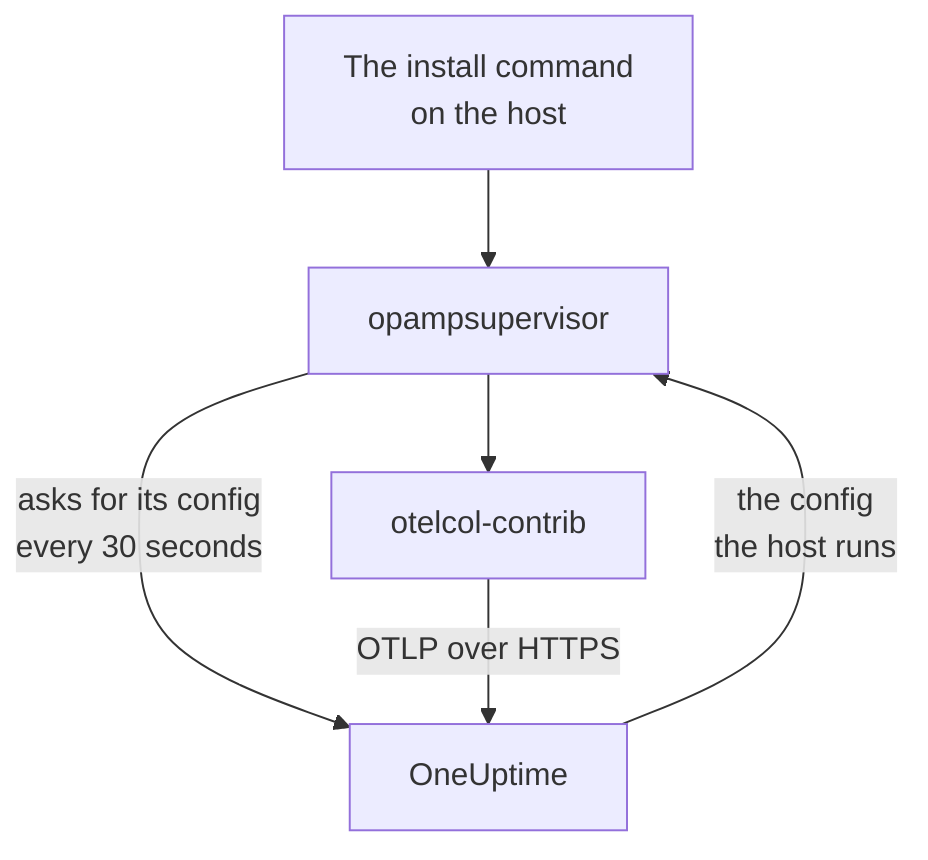

# Hosts

Add a Linux, Windows or macOS machine to OneUptime with one command. The command installs the OpenTelemetry Collector on the host, and OneUptime sends the collector its config and keeps it up to date: there is no `config.yaml` to write, copy to each host or keep in step. To change what your hosts collect, edit a Collector Config once, and every host it applies to gets the change within a minute.

:::cards
- [Add a host](#add-a-host): One command on Linux, Windows or macOS.
- [Change what hosts collect](#change-what-hosts-collect): Collector Configs by system and label, with every version kept.
- [Check on a host's collector](#check-on-a-hosts-collector): The config it runs, its version, and why a config did not start.
- [What a config may do](#what-a-config-may-do): Read the host, and send only to this OneUptime.
:::

## How it works

The command installs two programs from the OpenTelemetry Collector releases, each checked against the SHA-256 its release publishes: `otelcol-contrib`, the collector that reads the host, and `opampsupervisor`, which runs the collector and keeps it on the config OneUptime sends over OpAMP, the OpenTelemetry Agent Management Protocol. Both run as the service `oneuptime-collector`.



The supervisor asks OneUptime for the host's config about every 30 seconds, with your ingestion key, and reports which config the host runs and whether it started. The host registers under **Hosts** when the supervisor first connects, named after its hostname, and its pages fill in as its metrics and logs arrive.

Each host runs one config, chosen in this order:

| The host runs | When |
| --- | --- |
| The config picked for it on its **Collector** page | Someone picked one. |
| The first of the **Collector Configs** that applies to it | A config applies when it is for the host's system and, if it names labels, the host has one of them. |
| OneUptime's default for its system | No config applies. |

OneUptime's default reads CPU, memory, disks, filesystems, network and processes on every system; the journal and systemd units on Linux, where the host has them; the System, Application and Security event logs and Windows services on Windows; and the install and Wi-Fi logs in `/var/log` on macOS. It leaves out the file systems that are full by design, such as snap packages and macOS's `/dev`, so they never keep the High Filesystem Usage template firing. It follows OneUptime's releases, so a host on the default gets OneUptime's improvements to it.

## Before you begin

- An ingestion key. **Add Host** creates one for you, or pick one you made under **Project Settings → Telemetry & APM → Ingestion Keys**.
- Administrator rights on the host: `sudo` on Linux and macOS, PowerShell run as administrator on Windows.
- Linux with systemd, Windows 10 or Windows Server 2019 and later, or macOS on Apple silicon or Intel.
- Outbound HTTPS from the host to your OneUptime URL, directly or through a proxy.

## Add a host

:::steps
### Open Add Host

Open **Products → Infrastructure → Hosts** and select **Add Host**. Pick what the host runs: Linux, Windows or macOS. A Kubernetes cluster's nodes are monitored by the [Kubernetes Agent](/docs/telemetry/kubernetes-agent) instead.

### Pick an ingestion key

Pick a key, or create one from the dialog. The command below fills it in.

### Run the command on the host

Copy the command from the dialog and run it on the host. It takes about a minute. These are the same commands, with your OneUptime URL and key in place of the examples:

:::tabs
@tab Linux
```bash
curl -fsSL https://oneuptime.com/docs/static/scripts/host-collector/install.sh | sudo sh -s -- --url https://oneuptime.com --key YOUR_INGESTION_KEY
```
@tab macOS
```bash
curl -fsSL https://oneuptime.com/docs/static/scripts/host-collector/install.sh | sudo sh -s -- --url https://oneuptime.com --key YOUR_INGESTION_KEY
```
@tab Windows
```powershell
[Net.ServicePointManager]::SecurityProtocol = [Net.ServicePointManager]::SecurityProtocol -bor [Net.SecurityProtocolType]::Tls12; & ([scriptblock]::Create((Invoke-RestMethod -Uri 'https://oneuptime.com/docs/static/scripts/host-collector/install.ps1'))) -Url 'https://oneuptime.com' -Key 'YOUR_INGESTION_KEY'
```
:::

Every OneUptime serves its own installers, so a self-hosted OneUptime hands out the installer of its own release: replace `https://oneuptime.com` with your URL in both places.

### Wait for the host

The dialog's last step says when the host connects, with a link to it. In the list it shows as **Starting** until its first metrics arrive, usually within a minute, then as connected, with its collector **Running**. The host's **Topology** page draws what runs on it, what calls it and what it calls as one map: see [Topology](/docs/telemetry/topology#open-a-resources-own-map).
:::

## Label hosts

Add labels to the command, and the host has them from the moment it connects:

:::tabs
@tab Linux
```bash
curl -fsSL https://oneuptime.com/docs/static/scripts/host-collector/install.sh | sudo sh -s -- --url https://oneuptime.com --key YOUR_INGESTION_KEY --label env=production --label team=payments
```
@tab macOS
```bash
curl -fsSL https://oneuptime.com/docs/static/scripts/host-collector/install.sh | sudo sh -s -- --url https://oneuptime.com --key YOUR_INGESTION_KEY --label env=production --label team=payments
```
@tab Windows
```powershell
[Net.ServicePointManager]::SecurityProtocol = [Net.ServicePointManager]::SecurityProtocol -bor [Net.SecurityProtocolType]::Tls12; & ([scriptblock]::Create((Invoke-RestMethod -Uri 'https://oneuptime.com/docs/static/scripts/host-collector/install.ps1'))) -Url 'https://oneuptime.com' -Key 'YOUR_INGESTION_KEY' -Label 'env=production','team=payments'
```
:::

`env=production` becomes the label `env:production`. Labels are added, never taken off: run the command again with another label and the host has both. You can also label hosts on the **Hosts** list or with **Label Rules**. A Collector Config that names labels is only for hosts with one of them, so the same command with different labels gives each group of hosts its own config.

## Change what hosts collect

:::steps
### Create a Collector Config

Open **Products → Infrastructure → Hosts → Collector Configs** and select **Create Collector Config**. Give it a name, the system of the hosts it is for, and, to reach only some of them, their labels. Its config starts as OneUptime's default for that system.

### Edit its config.yaml

On the config's page, select **Edit config**, change the YAML and save. OneUptime checks it first and refuses a config it cannot send, saying why: see [What a config may do](#what-a-config-may-do).

### Watch it reach the hosts

Every saved change is a new version, and the hosts it applies to get it within a minute. The config's **Hosts** list shows each host, its collector's state and the version it runs.
:::

A host runs the first config in the list that applies to it: drag the rows on **Collector Configs** to change the order. Put the narrowest configs first, such as one for `env:production` web servers, and broad ones, such as one for every Linux host, after them. The **OneUptime defaults** card under the list shows what a host runs when no config applies.

### Versions and Put back

A config's **Versions** list keeps every saved change, newest first, with who saved it and when. Select **View** to read a version, and **Put back** to send it to the hosts again: it is saved as a new version that says which one it put back, so the list always tells what each host was sent.

### Pick a config for one host

On a host's **Collector** page, select **Change config** and pick a config for this host only. Configs for the host's system and for any system are offered. Pick Automatic to give the host back to the list. A host whose picked config is deleted goes back to the list on its own.

### When a config does not start

The supervisor checks a new config with the collector before it switches to it, and goes back to the last config that worked when one does not start. The host keeps sending all along. Its **Collector** page shows **Config failed** with the collector's reason, such as a log file the collector may not read, and OneUptime does not send that config to the host again until it changes. Once you have fixed the cause on the host, select **Try again** to send it once more.

## What a config may do

A config OneUptime sends runs on every host it applies to, so OneUptime checks it every time it is saved, and refuses one that breaks a rule:

| Rule | Why |
| --- | --- |
| Only the receivers, processors, exporters, extensions and connectors on OneUptime's list | It reads the host and the services on it. A component that runs programs or reads cloud or cluster credentials is not on the list. |
| Data leaves the host only through the `otlp_http` exporter, to `${env:ONEUPTIME_URL}/otlp` with the header `x-oneuptime-token: ${env:ONEUPTIME_INGESTION_KEY}` | Each host sends to this OneUptime, with the key it was installed with. No config holds a key. |
| `${env:NAME}` is the only `${...}` it may use | A `${file:...}` or `${https:...}` would be read on every host and could be sent on. |
| No setting that runs a program or sends a file it reads, such as journald's `journalctl_path` | A config may not reach further than reading the host. |

A config can still be one a host cannot run, such as a receiver for another system or a log file that does not exist there. The collector on each host checks that before it switches, as [When a config does not start](#when-a-config-does-not-start) describes.

## Check on a host's collector

Open the host and its **Collector** page. It shows where the collector stands, the config it runs and **Why this config**, the version it runs, its **Last report** and its **Collector release**. Under **On the host** are the commands to check on it from a shell on the host: whether its service runs, its log, and a restart.

:::tabs
@tab Linux
```bash
sudo systemctl status oneuptime-collector
sudo journalctl -u oneuptime-collector -n 50
sudo systemctl restart oneuptime-collector
```
@tab macOS
```bash
sudo launchctl print system/com.oneuptime.collector
sudo tail -n 50 /usr/local/oneuptime-collector/log/collector.log
sudo launchctl kickstart -k system/com.oneuptime.collector
```
@tab Windows
```powershell
Get-Service oneuptime-collector
Get-WinEvent -FilterHashtable @{ LogName = 'Application'; ProviderName = 'oneuptime-collector' } -MaxEvents 50 | Format-List TimeCreated, Message
Restart-Service oneuptime-collector
```
:::

On Linux the collector runs as the unprivileged user `oneuptime-collector`, in the `systemd-journal` and `adm` groups so it can read the journal and the logs in `/var/log`. On macOS it runs as root, as launchd daemons do, and on Windows as LocalSystem, so it can read every event log and Windows service.

## Hosts set up by hand

A host whose collector you installed yourself, with the [Host OpenTelemetry Collector](/docs/telemetry/host-otel-collector) guide, keeps reporting as it did, and OneUptime does not send it a config. To hand it over, open the host's **Collector** page: its command adds `--replace-existing`, which stops and disables the collector installed by hand (the `otelcol-contrib` service), so the host does not report twice. The host keeps its name, its history and its labels.

## Install options

Run the command again to change any of these, or to move to a newer release: it replaces what it installed and keeps the host as it is in OneUptime.

| Linux and macOS | Windows | What it does |
| --- | --- | --- |
| `--url URL` | `-Url URL` | Where OneUptime is. |
| `--key KEY` | `-Key KEY` | A telemetry ingestion key of your project. |
| `--label KEY=VALUE` | `-Label KEY=VALUE` | Labels the host. Repeat it for more labels; on Windows, list them with commas. |
| `--env NAME=VALUE` | `-EnvVar NAME=VALUE` | Gives the collector an environment variable, for configs that read `${env:NAME}`. |
| `--version VERSION` | `-Version VERSION` | The collector release to install, 0.161.0 by default. |
| `--download-url URL` | `-DownloadUrl URL` | Downloads the releases from a mirror with the same folder layout as GitHub's. |
| `--proxy URL` | `-Proxy URL` | Sends the downloads and all of the collector's traffic through an HTTP proxy. |
| `--replace-existing` | `-ReplaceExisting` | Stops and disables a collector installed by hand. |
| `--uninstall` | `-Uninstall` | Removes the collector and everything the command installed. |

## Uninstall

:::tabs
@tab Linux
```bash
curl -fsSL https://oneuptime.com/docs/static/scripts/host-collector/install.sh | sudo sh -s -- --uninstall
```
@tab macOS
```bash
curl -fsSL https://oneuptime.com/docs/static/scripts/host-collector/install.sh | sudo sh -s -- --uninstall
```
@tab Windows
```powershell
& ([scriptblock]::Create((Invoke-RestMethod -Uri 'https://oneuptime.com/docs/static/scripts/host-collector/install.ps1'))) -Uninstall
```
:::

The host stays in OneUptime with its history: archive or delete it on the **Hosts** list.

## Troubleshooting

:::details The command says OneUptime refused the key
HTTP `401`: the key is wrong, has expired or was deleted. HTTP `422`: it is disabled, a browser key, or pinned to one service. Pick an enabled server key in **Add Host** and run the command again: it replaces the key on the host.
:::

:::details The host does not appear
Check that the host can reach your OneUptime URL over HTTPS, then read the collector's log with the command for its system in [Check on a host's collector](#check-on-a-hosts-collector).
:::

:::details The host says its config failed
Its **Collector** page shows why the config did not start. The host keeps running the last config that worked, and gets the failed one again when the config changes or you select **Try again**.
:::

:::details The host shows Not reporting
OneUptime has not heard from the host's supervisor for more than 15 minutes. Check that the `oneuptime-collector` service runs, and that the host can still reach OneUptime.
:::

## Next steps

:::cards
- [Host OpenTelemetry Collector](/docs/telemetry/host-otel-collector): Install the collector and write its config yourself instead.
- [Host monitor](/docs/monitor/host-monitor): Alert on what your hosts report.
- [Ingestion keys](/docs/telemetry/ingestion-keys): Create, scope and rotate the keys hosts send with.
- [Kubernetes Agent](/docs/telemetry/kubernetes-agent): Monitor a cluster's nodes and workloads.
:::
