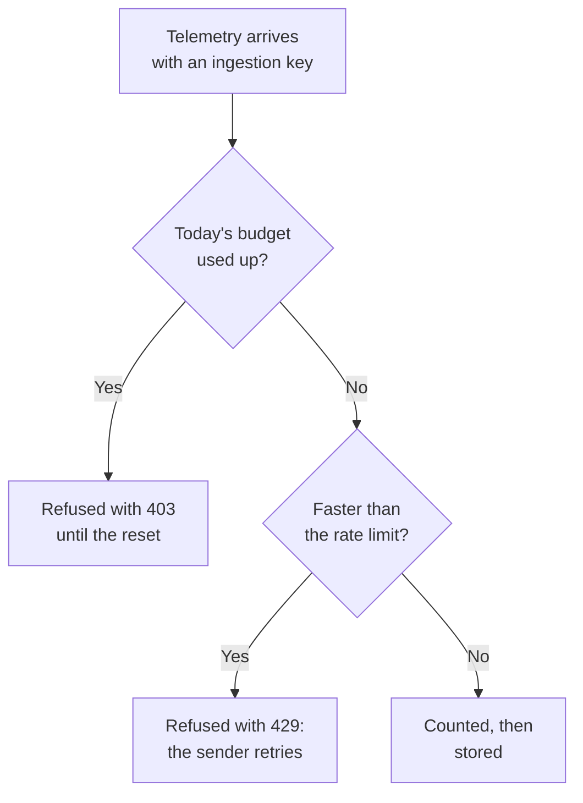

# Ingestion Budgets

An ingestion budget caps how much telemetry a project sends in a day, so one noisy service or a runaway log loop cannot fill your storage. The instance admin sets a daily budget for each signal, for every project or for one project, and anyone who edits an ingestion key can give the key a smaller budget of its own. Each budget can have a per-second rate limit too.

:::cards
- [How budgets work](#how-budgets-work): Three levels, counted as telemetry arrives.
- [Set every project's default budgets](#set-every-projects-default-budgets): In the Admin Dashboard's settings.
- [Give an ingestion key its own budget](#give-an-ingestion-key-its-own-budget): A share of the project's budget.
- [Alert on a budget](#alert-on-a-budget): Before it is used up, and when it is.
:::

## How budgets work

Telemetry is counted as it arrives: against its project's budget for its signal, and against its ingestion key's when the key has one. Once a daily budget is used up, that signal is refused until the budget resets.



- **Three levels.** The instance's default applies to every project. The instance admin can give one project a budget of its own instead, or no limit at all. A key's budget only subdivides its project's: it can be smaller, never larger.
- **Five signals.** Logs, traces, metrics, profiles and security events each have a budget of their own. Session replays have limits of their own: see [Session Replay](/docs/telemetry/session-replay).
- **Bytes are counted decompressed.** A request counts the size of its body once decompressed, so compressing it does not change what it counts. A GB is 1024³ bytes, and an MB 1024² bytes.
- **What arrives is counted, not what is stored.** Telemetry a [drop filter](/docs/telemetry/drop-filters-and-scrub-rules) removes later still counts, so a budget can read more than the [Telemetry Usage](/docs/telemetry/usage) page, which counts what was stored.
- **The last request is stored whole.** A request that arrives while a budget still has room is stored in full, so a used-up budget can read a little over 100%.
- **Nothing is limited until a budget is set.** Every installation starts with no budgets, and a project without one is not counted at all.
- **Changes reach every server within a minute.**
- **Telemetry is accepted when it cannot be counted.** The budgets are counted in Valkey. While it cannot be reached, OneUptime stores telemetry without counting it rather than refuse it, and the budget pages say so.

## Before you begin

- **For the instance's and a project's budgets, the Admin Dashboard.** On a self-hosted installation, only the instance admin sets them. A project's owners and admins see its budgets, but cannot change them.
- **For a key's own budget, a role that edits ingestion keys.** Project Owner or Project Admin, or a custom role with the Edit Ingestion Key permission.
- **To see the budgets, a role that sees the project's usage.** The roles that see the [Telemetry Usage](/docs/telemetry/usage) page see its budgets on it.

## Set every project's default budgets

:::steps
### Open Ingestion Budgets

In the Admin Dashboard, go to **Settings → Telemetry → Ingestion Budgets**. **Telemetry** starts collapsed in the side menu: click it to open it.

### Set the daily budgets

On the **Default Daily Budgets** card, click **Edit Default Daily Budgets**, enter a number of GB for each signal to limit, such as **Logs (GB per day)**, and click **Save Changes**. Leave a signal empty for no limit.

### Set the rate limits, if you need them

On the **Default Rate Limits** card, click **Edit Default Rate Limits** and enter a number of MB per second for a signal, such as **Logs (MB per second)**. A rate limit keeps one burst from using up a day's budget in minutes.
:::

The **Warning and Reset** card holds the warning threshold and the time the budget day resets: see [The warning and the reset](#the-warning-and-the-reset).

## Set one project's budgets

:::steps
### Open the project

In the Admin Dashboard, go to **Projects**, click the project, and click **Ingestion Budgets** in its side menu. The page opens with what the project used of its budgets today.

### Set its daily budgets

On the **Daily Budgets for This Project** card, click **Edit Daily Budgets**. Enter a number of GB in place of the instance default for a signal, or 0 for no limit at all. Leave a signal empty to keep the instance default.

### Set its rate limits

On the **Rate Limits for This Project** card, click **Edit Rate Limits** and set them the same way: a number of MB per second, 0 for no limit, or empty for the instance default.
:::

The project's members see these budgets on their [Telemetry Usage](/docs/telemetry/usage) page, read only.

## Give an ingestion key its own budget

A key's budget is a share of its project's: a sender that floods its own key stops at the key's budget, while the project's other keys keep sending.

:::steps
### Open the key

Go to **Project Settings → Telemetry & APM → Ingestion Keys** and click the key. **Telemetry & APM** starts collapsed in the side menu: click it to open it.

### Set its budgets

On the **Ingestion Budgets** card, click **Edit Ingestion Budgets**. Enter a number of GB per day for each signal to limit on the **Daily Budgets** step, and a number of MB per second on the **Rate Limits** step. Leave a signal empty for no budget of the key's own.

### Save the budgets

Click **Save Changes**. A key's budget cannot be more than its project's: OneUptime refuses it and says the most it can be.
:::

- **Both budgets count.** Telemetry sent with the key counts against the key's budget and the project's, and whichever is used up first refuses it.
- **A lowered project budget holds the key too.** When the project's budget is lowered below a key's, the key is held to the project's.

## What senders see

| When | Over HTTP | Over OTLP/gRPC | What the sender does |
| --- | --- | --- | --- |
| A daily budget is used up | `403` | `RESOURCE_EXHAUSTED` | Drops the batch: retrying cannot help before the reset |
| A rate limit is exceeded | `429` with `Retry-After` | `RESOURCE_EXHAUSTED` with a retry delay | Retries the batch after the delay |

Every refusal says why. Over OTLP/HTTP its body is a `google.rpc.Status`, in protobuf or JSON as the request was sent, so the sender's log shows a reason such as:

```text
This project's daily logs ingestion budget of 10 GB is used up, so OneUptime is not storing logs from this project until the budget resets at 2026-11-10 00:00 UTC.
```

- **Other HTTP senders get JSON.** Fluent Bit, Fluentd, syslog and the other HTTP endpoints get `error`, `message` and `resetsAt`, and `retryAfterSeconds` from a rate limit.
- **MQTT and cloud streams cannot be told.** Telemetry that arrives over MQTT or from a cloud provider's stream is dropped once its budget is used up. No rate limit applies to it: it could not be sent again.
- **Refusals are counted.** What a used-up budget refuses or drops is counted as dropped, and each request a rate limit refuses as throttled: see [See today's usage and drops](#see-todays-usage-and-drops).

## The warning and the reset

- **The warning.** When a daily budget passes the warning threshold, 80% unless the instance admin changes it, the project's owners get an email, and the explorers show a banner above that signal's data. They get one more email when the budget is used up. Each budget sends each email at most once a day.
- **The reset.** Each budget day starts again at 00:00 UTC unless the instance admin changes it. The **Warning and Reset** card sets **Warning Threshold (%)**, from 1 to 99, **Reset Time**, as HH:MM, and **Reset Time Zone**: click **Edit Warning and Reset**.
- **Daylight saving time.** The reset follows the time zone's clock, so the budget day the clocks change on is an hour shorter or longer. A reset time the clocks skip happens that long after the jump.
- **A changed reset starts a new day.** Changing the reset time or the time zone starts a new budget day at once, with nothing counted yet.

## See today's usage and drops

Go to **Project Settings → Telemetry & APM → Usage**. While a budget or a rate limit is set for the project, the page opens with the **Ingestion Budgets** card, and the keys with budgets of their own are on the **Ingestion Key Budgets** card:

| Column | What it shows |
| --- | --- |
| **Signal** | The signal the row is for. |
| **Used Today** | What was counted since the budget day started, and its share of the budget. |
| **Daily Budget** | The budget in force, and where it was set: **Instance default**, **Set for this project** or **This key's own**. |
| **Rate Limit** | The rate limit in force. |
| **Dropped** | What was refused or dropped because the budget was used up. |
| **Throttled** | How many requests the rate limit refused. |
| **Status** | **Within budget**, **Past warning** or **Used up**, **No daily budget** for a signal with only a rate limit, and **Unknown** while the counts cannot be read. |

- **On a key's page**, the **Today's Budget Usage** card shows what the key used of its own budgets.
- **In the explorers**, a banner above the Logs, Traces, Metrics, Profiles and Security Events data says when that signal's budget is past its warning or used up, with **See budgets** to open the Usage page.
- **In the Admin Dashboard**, a project's **Ingestion Budgets** page shows the same figures.

## Alert on a budget

Every 5 minutes, OneUptime writes each budget's figures for the day as metrics of the project, and a [Metrics Monitor](/docs/monitor/metrics-monitor) alerts on them like on any other metric:

| Metric | Unit | What it holds |
| --- | --- | --- |
| `oneuptime.telemetry.budget.used.bytes` | `By` | The bytes counted against the daily budget since the budget day started. |
| `oneuptime.telemetry.budget.used.percent` | `%` | The same, as a percent of the daily budget. At 100 or more, the signal is refused until the reset. |
| `oneuptime.telemetry.budget.dropped.bytes` | `By` | The bytes refused or dropped since the budget day started because the budget was used up. |
| `oneuptime.telemetry.budget.throttled.requests` | `{request}` | The requests the rate limit refused since the budget day started. |

Each point carries these attributes:

| Attribute | Value |
| --- | --- |
| `projectId` | The ID of the project. |
| `signal` | `logs`, `traces`, `metrics`, `profiles` or `security-events`. |
| `scope` | `project`, or `ingestion-key` for a key's own budget. |
| `ingestionKeyId` | The ID of the key, for a key's own budget. |
| `ingestionKeyName` | The name of the key when the point was written, for a key's own budget. |

To be told at 90% of the project's logs budget, create a Metrics Monitor on `oneuptime.telemetry.budget.used.percent`, filtered on `signal` `logs` and `scope` `project`, that alerts when the maximum is above 90:

- **Aggregate with the maximum.** Each figure only grows during a budget day.
- **Use a window of 15 minutes or more.** A point is written every 5 minutes, and a window with no point in it resolves the alert.
- **Expect gaps, not zeros.** Nothing is written for a figure that is 0, or while the counts cannot be read.
- **They cost nothing.** These metrics are not counted against any budget or as telemetry usage, and are kept as long as monitor metrics: 30 days unless the instance admin changes it. Metric names that start with `oneuptime.telemetry.budget.` are reserved for them: metrics your applications send under such a name are dropped.

## Troubleshooting

:::details A collector logs 403 for its exports
The project's or the key's daily budget for that signal is used up, and the collector drops what it cannot send until the budget resets. See **Used Today** on the Usage page. Ask the instance admin to raise the project's budget, or send less: a drop filter does not help here, as it removes telemetry after it is counted.
:::

:::details A collector logs 429 and retries
It sends faster than a rate limit allows. It retries after the `Retry-After` delay, so nothing is lost unless its queue fills up. Raise the rate limit, or spread the sending more evenly.
:::

:::details Used Today is more than the Telemetry Usage page shows
A budget counts telemetry as it arrives, decompressed, including what drop filters remove later. The Usage page counts what was stored, the day after.
:::

:::details The budgets say today's counts could not be read
OneUptime cannot reach Valkey, where the budgets are counted. Until it can, telemetry is stored without being counted, and no budget is enforced.
:::

## Next steps

:::cards
- [Telemetry Usage](/docs/telemetry/usage): See what each project and service sends.
- [Drop Filters & Scrub Rules](/docs/telemetry/drop-filters-and-scrub-rules): Stop storing the telemetry you do not need.
- [Ingestion Keys](/docs/telemetry/ingestion-keys): A key for each sender, so each can have a budget.
- [Metrics Monitor](/docs/monitor/metrics-monitor): Alert on the budget metrics.
:::
