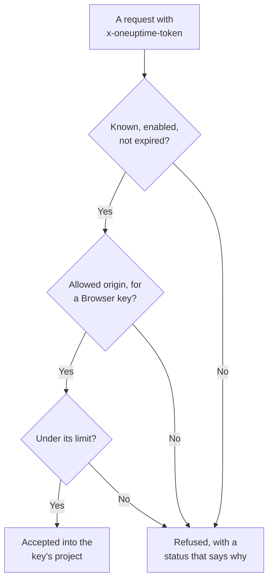

# Ingestion Keys

An ingestion key connects your telemetry to your project. Applications, OpenTelemetry collectors and agents send it with every request, and OneUptime files their logs, traces and metrics in the project the key belongs to. This page shows how to create a key, which kind to pick, and how to keep keys safe.

:::cards
- [Create an ingestion key](#create-an-ingestion-key): A name, a type and a secret to copy.
- [Server or Browser](#server-or-browser): Which kind of key a sender needs.
- [Lock down a Browser key](#lock-down-a-browser-key): Origins, one service name and a limit.
- [Rotate, turn off or delete a key](#rotate-turn-off-or-delete-a-key): What to do when a key leaks.
:::

## How a key is checked

Every request carries the key's secret, usually in an `x-oneuptime-token` header. OneUptime looks the key up, checks that it may still send, and only then accepts the data into the key's project.



- **The key decides the project.** You never send a project ID: data sent with a key lands in the project the key belongs to.
- **Changes reach every server within a minute.** Turning a key off, resetting its secret, or changing its origins, expiry or limit takes effect within about a minute.
- **A Server key is a password.** Anyone who has it can send telemetry into your project. Keep it in your servers' secrets, never in source control or a web page.

## Server or Browser

Pick the type by where the key will live. The type cannot be changed after the key is created.

| | **Server** | **Browser** |
| --- | --- | --- |
| For | Applications, collectors and agents on machines you run | Web pages, and React Native session replay |
| Sends | Every kind of telemetry, to every endpoint | Traces, logs, metrics and session replays |
| A secret | Yes: keep it on your servers | No: anyone who views the page can read it |
| Origins | Not checked | Only the listed origins are accepted |
| Requests per minute | No limit, unless you set one | 6,000, unless you set another limit |

OneUptime refuses a Browser key everywhere else, such as over gRPC and MQTT, for profiles, syslog, Fluent Bit and Fluentd, and for source map uploads. To move a sender to the other type, create a key of that type, switch the sender to it, then delete the old key.

## Before you begin

- **A role that manages ingestion keys.** Project Owner or Project Admin, or a custom role with the Create Telemetry Ingestion Key permission. The Telemetry roles do not include ingestion keys.
- **On OneUptime Cloud, a payment method.** Telemetry is billed as you use it, so a project on the Free plan needs a payment method before it can create a key. The create dialog then ends on a **Billing** step with the pricing.

## Create an ingestion key

:::steps
### Open Ingestion Keys

Go to **Project Settings → Telemetry & APM → Ingestion Keys**. **Telemetry & APM** starts collapsed in the side menu: click it to open it. The list shows each key's **Name**, **Type**, **Last Used** and **Description**.

### Name the key and pick its type

Click **Create Ingestion Key**. The dialog starts with the name **Server key** and the **Server** type. Pick the **Key Type**, and rename the key after what will use it, such as `checkout-collector`. A **Description** is under **Advanced**.

### Add a Browser key's origins

A **Browser** key asks for its **Allowed Origins** on the next step, **Browser Settings**, with its **Pinned Service Name** under **Advanced**. See [Lock down a Browser key](#lock-down-a-browser-key).

### Create the key and copy its secret

Click **Create Ingestion Key**. The key's own page opens: copy its **Secret Key** and give it to your senders.
:::

Every product's **Setup Guide** starts with **Choose an ingestion key**, which lists the keys that guide can use and creates one in place. The snippets on the guide then carry that key.

## Send telemetry with the key

Senders put the secret in an `x-oneuptime-token` header:

```text
x-oneuptime-token: YOUR_ONEUPTIME_INGESTION_KEY
```

- OpenTelemetry SDKs read it from `OTEL_EXPORTER_OTLP_HEADERS`. See the [OpenTelemetry quickstart](/docs/telemetry/open-telemetry#quickstart).
- Over OTLP/gRPC, it goes in the `x-oneuptime-token` metadata.
- An MQTT device sends it as its password. See [IoT Devices](/docs/telemetry/iot-devices).
- OneUptime also reads the key from an `x-oneuptime-ingestion-key` or `x-oneuptime-service-token` header, which some older setups send.

## Lock down a Browser key

A Browser key sits in your page, where anyone can copy it. These settings limit what a copy can do. Change them on the key's page with **Edit Telemetry Ingestion Key**.

| Setting | What it does |
| --- | --- |
| **Allowed Origins** | The only origins the key is accepted from. A request from any other origin, or with no `Origin` header at all, is refused. A Browser key must keep at least one. |
| **Pinned Service Name** | Files everything the key sends over OTLP/HTTP under this one service, whatever `service.name` the sender set. A copy of the key can then only write into that service. |
| **Requests Per Minute Limit** | The most requests the key is accepted for each minute, shared by every visitor. A Browser key gets 6,000 when you leave it empty. |
| **Expires At** | The date after which the key is refused, so a published copy stops working. |

An origin is a scheme, a host and an optional port: `https://app.example.com` does not cover `https://app.example.com:8443`. One leading `*.` covers every subdomain, but not the bare domain itself. React Native session replay sends an exact `app://` identity, which takes no wildcard:

```json
[
  "https://app.example.com",
  "https://*.example.com",
  "app://com.example.mobile"
]
```

The [Service Catalog](/docs/telemetry/services#how-a-service-gets-into-the-catalog) shows how a pinned name decides the service. The Kubernetes agent's Runner and AI agent, and the infrastructure AI agents, do not register with a pinned key: give them an unpinned Server key.

## Rotate, turn off or delete a key

A key's page shows its **Status**, its **Secret Key** behind **Click to reveal**, and its **Last Used At**: the last time OneUptime accepted data sent with it.

| To | Do this | What senders see |
| --- | --- | --- |
| Stop a key at once, and undo it later | Click **Edit Telemetry Ingestion Key**, open **Access & Limits** and turn **Enabled** off. The status reads **Disabled — telemetry refused**. | `422` until you turn it back on |
| Replace a leaked secret | Click **Reset Secret Key** and confirm. The key keeps its settings and gets a new secret. | `401` until they send the new secret |
| Stop a key for good | Click **Delete Telemetry Ingestion Key** at the bottom of its page. | `401` |

To change a secret without losing data, create a second key, move your senders to it, and delete the old key once its **Last Used At** stops moving. **Last Used At** is updated every few minutes, not on every request.

## Troubleshooting

A refused request is answered with a status and a sentence that says why.

| Answer | What it means |
| --- | --- |
| `401` with `Missing ingestion token` | The request has no key. Send it in `x-oneuptime-token`. |
| `401` with `Invalid ingestion token` | No key has this secret: it was mistyped, reset or deleted. |
| `401` with `This telemetry ingestion key expired.` | Its **Expires At** has passed. Set a later date, or use another key. |
| `402` with `Add a payment method` | On OneUptime Cloud, the project is on the Free plan and has no payment method yet. |
| `422` with `This telemetry ingestion key has been disabled.` | Someone turned **Enabled** off. |
| `422` with `A browser ingestion key cannot be used for` | A Browser key reached an endpoint that takes only Server keys. |
| `422` with `did not send an Origin header` | A Browser key was sent from outside a browser. Use a Server key there. |
| `422` with `is not allowed for this browser ingestion key` | The page's origin is not in **Allowed Origins**. |
| `422` with `is pinned to a single service` | A key with a **Pinned Service Name** was used to register an agent. Use an unpinned Server key. |
| `429` with `Too many telemetry requests for this ingestion key` | The key reached its **Requests Per Minute Limit**. Exporters retry after the `Retry-After` time. |

For the other answers an OTLP exporter can get, see [Responses](/docs/telemetry/open-telemetry#responses).

:::details Data still arrives a minute after I turned the key off
Each OneUptime server keeps what it knows about a key for up to a minute, so a change reaches all of them within about a minute. Requests after that are refused.
:::

:::details A Browser key works on my laptop but not in production
An origin includes its scheme and port. `http://localhost:3000` and `https://app.example.com` are different origins: list each one the page is served from.
:::

:::details Last Used At still says Never
Nothing has sent data with this key since OneUptime began recording its use. Check that your senders hold this key's secret, and that their requests reach OneUptime.
:::

## Next steps

:::cards
- [OpenTelemetry](/docs/telemetry/open-telemetry): Send traces, metrics and logs with your key.
- [Service Catalog](/docs/telemetry/services): See the services your telemetry is filed under.
- [Data Retention](/docs/telemetry/data-retention): Decide how long the data is kept.
- [Drop Filters & Scrub Rules](/docs/telemetry/drop-filters-and-scrub-rules): Drop or mask data before it is stored.
:::
