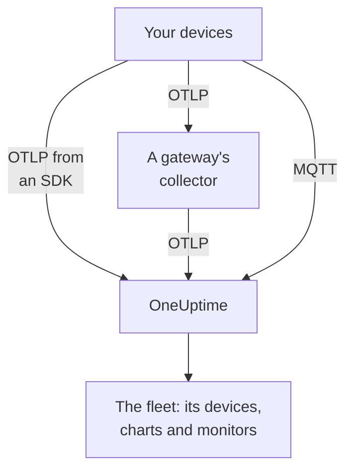

# IoT Devices

OneUptime monitors fleets of IoT devices — sensors, gateways, controllers and edge boxes — from a small set of `iot_*` metrics they send. It groups the devices into fleets, keeps an inventory of each fleet's devices, and charts their battery, signal, temperature, CPU, memory and availability. There is no OneUptime agent to install on a device: devices send standard OpenTelemetry, or publish to OneUptime's MQTT endpoint. [IoT device monitors](/docs/monitor/iot-device-monitor) alert on what they send.

:::cards
- [Choose how to send](#choose-how-to-send): An OpenTelemetry SDK, a gateway collector, or MQTT.
- [Sending metrics via MQTT](#sending-metrics-via-mqtt): Topics, per-device credentials and Last Will.
- [Metric conventions](#metric-conventions): The `iot_*` names OneUptime charts and alerts on.
- [Troubleshooting](#troubleshooting): Missing fleets, missing devices, offline flips.
:::

## How it works

Every reading belongs to a fleet and a device. OneUptime creates the fleet from its first reading, adds each new device to the fleet's inventory, and updates the device's latest values with every reading after that. Readings sent over OpenTelemetry and over MQTT feed the same fleets, inventory, charts and monitors.



## How OneUptime models IoT

- **Fleet**: a group of devices, such as `building-a-sensors` or `field-gateways`. It comes from the `iot.fleet.name` resource attribute, and appears in OneUptime as the telemetry service `iot/<fleet>`. Set `service.name=iot/<fleet>` too, so logs and metrics line up under the same service.
- **Device**: one device in a fleet, named by the `device.id` attribute on each datapoint. The fleet's inventory is keyed on `device.id`.

| Attribute | Set on | Required | Description |
| --- | --- | --- | --- |
| `iot.fleet.name` | Resource | Yes | The fleet the device belongs to. It becomes the OneUptime service `iot/<fleet>`. |
| `device.id` | Each datapoint | Yes | A stable id for the device, unique in its fleet. |
| `iot.device.kind` | Each datapoint | No | The device class, such as `Device`, `Sensor` or `Gateway`. Defaults to `Device`. |
| `iot.device.type` | Each datapoint | No | A finer type or model for filtering monitors, such as `temp-sensor`. |
| `iot.device.firmware` | Each datapoint | No | The firmware version the device reports. |

Over MQTT the topic sets the fleet and the device for you.

## Choose how to send

| Way | Use it when | Needs |
| --- | --- | --- |
| [OpenTelemetry SDK](#sending-metrics-via-the-opentelemetry-sdk) | The device runs an OpenTelemetry SDK and reaches OneUptime itself. | An ingestion key on the device. |
| [OpenTelemetry Collector](#sending-metrics-via-an-opentelemetry-collector) | Many devices report through a gateway. | A gateway that runs the collector. |
| [MQTT](#sending-metrics-via-mqtt) | The device already speaks MQTT, or should report offline the moment it drops. | Any MQTT client that connects over WebSocket. |

## Before you begin

- An ingestion key. Create one under **Project Settings → Telemetry & APM → Ingestion Keys** and copy its value. Devices send it as the `x-oneuptime-token` header, or as the MQTT password.
- Network access from the device or gateway to your OneUptime URL.
- A fleet name for each group of devices, and a stable id for each device.

## Sending metrics via the OpenTelemetry SDK

:::steps
### Point the SDK at OneUptime

Set the standard OpenTelemetry environment variables on the device. Replace the key, the fleet name and the device id with yours:

```bash
export OTEL_EXPORTER_OTLP_ENDPOINT=https://oneuptime.com/otlp
export OTEL_EXPORTER_OTLP_PROTOCOL=http/protobuf
export OTEL_EXPORTER_OTLP_HEADERS=x-oneuptime-token=YOUR_TELEMETRY_INGESTION_TOKEN
export OTEL_RESOURCE_ATTRIBUTES=iot.fleet.name=building-a-sensors,device.id=sensor-001,service.name=iot/building-a-sensors
```

Keep `iot.fleet.name` stable: changing it registers a new fleet.

### Record readings as iot_* metrics

Emit each reading as a metric with one of the [conventional names](#metric-conventions), and give every datapoint a `device.id` attribute:

| Metric | Value | Datapoint attribute |
| --- | --- | --- |
| `iot_device_up` | `1` | `device.id=sensor-001` |
| `iot_battery_percent` | `87` | `device.id=sensor-001` |
| `iot_temperature_celsius` | `21.5` | `device.id=sensor-001` |

The inventory is keyed on the datapoint's `device.id`, not the resource's, so set it on each measurement as well as in `OTEL_RESOURCE_ATTRIBUTES`.
:::

Then [check that the fleet appears](#check-that-the-fleet-appears).

## Sending metrics via an OpenTelemetry Collector

When many devices report through a gateway, run an OpenTelemetry Collector on the gateway. It receives OTLP from your devices, stamps the fleet on every reading and forwards them to OneUptime.

:::steps
### Save the gateway's config

Save this as `config.yaml` on the gateway:

```yaml title="config.yaml"
receivers:
  otlp:
    protocols:
      grpc:
        endpoint: 0.0.0.0:4317
      http:
        endpoint: 0.0.0.0:4318

processors:
  batch:
    send_batch_size: 512
    timeout: 5s
  resource:
    attributes:
      - key: iot.fleet.name
        value: field-gateways
        action: upsert
      - key: service.name
        value: iot/field-gateways
        action: upsert

exporters:
  otlphttp:
    endpoint: "https://oneuptime.com/otlp"
    headers:
      "x-oneuptime-token": "YOUR_TELEMETRY_INGESTION_TOKEN"

service:
  pipelines:
    metrics:
      receivers: [otlp]
      processors: [resource, batch]
      exporters: [otlphttp]
```

- `otlp` receives from your devices over gRPC (`4317`) and HTTP (`4318`). Receive readings any other way the collector supports (an MQTT bridge, file logs) and send them through the same pipeline.
- `resource` stamps every reading with the fleet. Set `iot.fleet.name`, and the matching `service.name=iot/<fleet>`, per gateway, so each gateway's devices land in their fleet.
- Keep `device.id`, and any of `iot.device.kind`, `iot.device.type` and `iot.device.firmware`, on each datapoint, so OneUptime can tell the devices in the fleet apart.
- `otlphttp` sends to OneUptime over HTTPS with the ingestion key. Both the default protobuf encoding and `encoding: json` are accepted.

### Run the collector on the gateway

:::tabs
@tab Docker
Run it from the folder that holds `config.yaml`:

```bash
docker run -d \
  --name otel-collector \
  --restart unless-stopped \
  -p 4317:4317 \
  -p 4318:4318 \
  -v $(pwd)/config.yaml:/etc/otelcol-contrib/config.yaml:ro \
  otel/opentelemetry-collector-contrib:0.161.0 \
  --config /etc/otelcol-contrib/config.yaml
```
@tab otelcol-contrib
If the gateway already has `otelcol-contrib`, point it at the file:

```bash
otelcol-contrib --config config.yaml
```
:::

Devices then send OTLP to the gateway, for example with `OTEL_EXPORTER_OTLP_ENDPOINT=http://<gateway-host>:4318` in each device's SDK.
:::

Then [check that the fleet appears](#check-that-the-fleet-appears).

## Sending metrics via MQTT

OneUptime has an MQTT endpoint of its own, so devices that speak MQTT publish readings to it directly, with no SDK, collector or bridge. What arrives over MQTT goes through the same pipeline as OTLP: fleets are created, the inventory updates, and every IoT monitor and alert template works the same.

### Endpoints

| Transport | Address | Notes |
| --- | --- | --- |
| MQTT over WebSocket | `wss://<your-host>/mqtt` | Works on every deployment, through the normal HTTPS port. |
| MQTT over TCP | `<app-host>:1883` | Self-hosted only, and internal to the cluster or Compose network until you expose it. The port is `MQTT_INGEST_PORT`. |

### Authentication

- **With the ingestion key**: send it as the MQTT password. The username is ignored; if your client has only a username field, put the key there. This suits a gateway that publishes for many devices.
- **With a credential per device**: recommended for devices that connect directly. Open the fleet's **Device Registry** page and register the device, with the **Device ID** it uses as `device.id`. The device's **MQTT Username** is its username and its **MQTT Password (Secret)** its password.

A device credential can publish only under its own `oneuptime/<fleet>/<device>/` topics. You can revoke one device without touching the rest of the fleet: turn its **Enabled** switch off, or delete it, and a connected device is cut off within about a minute. A registered device that goes silent stays in the inventory as offline, and the Device Offline alert template fires for it, even if it dies without a Last Will.

OneUptime refuses bad credentials at CONNECT with return code 4 (bad username or password), so a misconfigured device fails loudly. Browser keys are refused over MQTT.

### Topics and payloads

Publish under the fixed `oneuptime/` prefix. The fleet and device segments must not contain `/`, `+` or `#`, must not start with `$`, and are at most 100 characters long.

| Topic | Payload |
| --- | --- |
| `oneuptime/<fleet>/<device>/telemetry` | A JSON object of readings: `{"metrics":{"iot_temperature_celsius":21.5}}`, or a flat object whose numeric fields are the metrics. |
| `oneuptime/<fleet>/<device>/metrics/<metricName>` | One value: a bare number (`23.4`) or `{"value":23.4}`. |
| `oneuptime/<fleet>/<device>/status` | `online` or `offline` (also `1` or `0`, `true` or `false`, `up` or `down`). It sets `iot_device_up`. |

A telemetry payload may also carry `"attributes"`, a map of strings stamped on every datapoint (use it for `iot.device.kind`, `iot.device.type`, `iot.device.firmware` or your own labels), and `"timestamp"`, in ISO 8601 or unix seconds or milliseconds. Both are optional: without a `timestamp`, the time OneUptime receives the reading is used.

### Offline detection with Last Will

Register an MQTT Last Will on `oneuptime/<fleet>/<device>/status` with the payload `offline`. If the device dies or drops off the network, OneUptime publishes `iot_device_up = 0` for it the moment its session ends, which trips the stock Device Offline alert template and marks the device down in the inventory, with no polling. Publish `online` to the same topic after connecting, so the device shows as up again.

### Examples

:::tabs
@tab mosquitto_pub
Over raw TCP, on a self-hosted instance:

```bash
mosquitto_pub -h YOUR-ONEUPTIME-APP-HOST -p 1883 \
  -u oneuptime -P "YOUR_TELEMETRY_INGESTION_TOKEN" \
  -t "oneuptime/building-a-sensors/sensor-001/telemetry" \
  -m '{"metrics":{"iot_device_up":1,"iot_battery_percent":87,"iot_temperature_celsius":21.5},"attributes":{"iot.device.type":"temp-sensor","iot.device.firmware":"1.4.2"}}'
```
@tab Node.js
With the `mqtt` package, over WebSocket, against oneuptime.com or any self-hosted instance:

```javascript
const mqtt = require("mqtt");

const client = mqtt.connect("wss://oneuptime.com/mqtt", {
  username: "oneuptime", // ignored — the token below is what authenticates
  password: "YOUR_TELEMETRY_INGESTION_TOKEN",
  will: {
    topic: "oneuptime/building-a-sensors/sensor-001/status",
    payload: "offline",
  },
});

client.on("connect", () => {
  client.publish("oneuptime/building-a-sensors/sensor-001/status", "online");
  setInterval(() => {
    client.publish(
      "oneuptime/building-a-sensors/sensor-001/telemetry",
      JSON.stringify({
        metrics: {
          iot_device_up: 1,
          iot_battery_percent: readBattery(),
          iot_temperature_celsius: readTemperature(),
        },
      }),
    );
  }, 60 * 1000);
});
```
@tab Python
With `paho-mqtt`, over WebSocket:

```python
import json
import paho.mqtt.client as mqtt

client = mqtt.Client(transport="websockets")
client.username_pw_set("oneuptime", "YOUR_TELEMETRY_INGESTION_TOKEN")
client.tls_set()
client.will_set("oneuptime/building-a-sensors/sensor-001/status", "offline")
client.ws_set_options(path="/mqtt")
client.connect("oneuptime.com", 443)

client.publish("oneuptime/building-a-sensors/sensor-001/status", "online")
client.publish(
    "oneuptime/building-a-sensors/sensor-001/telemetry",
    json.dumps({"metrics": {"iot_device_up": 1, "iot_temperature_celsius": 21.5}}),
)
```
:::

### Limits and delivery

- The endpoint only takes readings: subscriptions are refused (a SUBACK failure), and retained messages are not kept.
- Ingestion is at least once. Use QoS 1 to have OneUptime acknowledge each publish; a QoS 1 or 2 resend after a lost acknowledgement can produce duplicate datapoints.
- A publish over 128 KB, or with more than 100 metrics, is dropped, and a packet that declares more than that closes the connection.
- A publish outside these topics, or with a malformed payload, is accepted and dropped, because MQTT 3.1.1 has no per-message error. OneUptime logs a warning with the reason (`MQTT: dropped publish to …`).
- On the WebSocket endpoint, keep the MQTT keepalive under 5 minutes. The ingress closes a WebSocket that is idle for 300 seconds, which fires the Last Will and a false Device Offline alert. Client-library defaults (60 seconds for `mqtt` and `paho-mqtt`) are fine, and the TCP endpoint has no such limit.

## Metric conventions

OneUptime recognizes these `iot_*` metric names. Send only the ones that make sense for your device: the missing ones are not charted. Each datapoint carries the device's `device.id` (over MQTT, the topic names the device).

| Metric name | Meaning |
| --- | --- |
| `iot_device_up` | Availability: `1` is up and reachable, `0` is down. The IoT Device monitor reads it. |
| `iot_device_info` | Identity only. It carries `device.id`, the kind, the type and the firmware, so a device shows in the inventory before it reports readings. |
| `iot_battery_percent` | Battery charge, `0` to `100` (%). |
| `iot_signal_strength_dbm` | Wireless signal strength in dBm, such as Wi-Fi, LoRa or cellular RSSI. |
| `iot_temperature_celsius` | Device or sensor temperature in °C. |
| `iot_cpu_usage_ratio` | CPU use as a ratio from `0` to `1`. OneUptime stores and shows it as a percentage. |
| `iot_memory_usage_bytes` | Memory in use, in bytes. |
| `iot_memory_size_bytes` | Total memory on the device, in bytes. |
| `iot_uptime_seconds` | Seconds since the device last booted. |

## Check that the fleet appears

1. Check that the device, the gateway's collector or the MQTT client sends without errors: look for export failures and HTTP `401` or `422` answers in its logs, or a connection refused with return code 4.
2. Open **Products → Infrastructure → IoT → All Fleets**. The fleet appears as `iot/<fleet>` within a minute or so of its first readings.
3. Open the fleet's **Devices** page. Each device you sent should be listed with its latest battery, signal, temperature, CPU, memory and up or down status.
4. Open the fleet's **Metrics** page to chart any of the `iot_*` series.

## Self-hosted OneUptime

Point the endpoint at your own instance:

```bash
export OTEL_EXPORTER_OTLP_ENDPOINT=https://your-oneuptime-host.example.com/otlp
```

Or, in a collector:

```yaml
exporters:
  otlphttp:
    endpoint: https://your-oneuptime-host.example.com/otlp
    headers:
      "x-oneuptime-token": "YOUR_TELEMETRY_INGESTION_TOKEN"
```

For MQTT, connect to `wss://your-oneuptime-host.example.com/mqtt`, or expose the app service's raw MQTT TCP port (`MQTT_INGEST_PORT`, `1883` by default) for devices that cannot use WebSocket. Set `MQTT_INGEST_ENABLED=false` on the app service to turn both MQTT listeners off. If the instance is HTTP-only, use `http://` (and `ws://` for MQTT) and its port.

## Troubleshooting

:::details The fleet does not appear
1. Check that `iot.fleet.name` is a resource attribute (not a datapoint label) and that `service.name` is `iot/<fleet>`.
2. Check that the endpoint is `https://oneuptime.com/otlp` (or your self-hosted `…/otlp`) and that the `x-oneuptime-token` header carries a valid ingestion key.
3. Over MQTT, check that the topic follows `oneuptime/<fleet>/<device>/…` exactly: the topic's fleet segment is what creates the fleet.
:::

:::details Devices are missing from the inventory
1. Give every datapoint a `device.id` label: devices are keyed on it. Over MQTT, it is the topic's device segment.
2. For a device that has not reported readings yet, send `iot_device_info` (or, over MQTT, a `status` message) so it shows in the inventory.
3. Keep `device.id` values stable: a changing id creates duplicate devices.
:::

:::details HTTP 401 or 422 from the exporter
`401` means the ingestion key is missing, wrong or expired; `422` means it has been disabled, or is a browser key, which cannot send device telemetry. Create a new one under **Project Settings → Telemetry & APM → Ingestion Keys** and update the `x-oneuptime-token` header.
:::

:::details The MQTT connection is refused with "bad username or password"
OneUptime refuses bad credentials at CONNECT with return code 4. Check that the password is a valid ingestion key that has not been disabled or expired, or, for a registered device, the credential's secret with its **MQTT Username** as the username. Browser keys are refused over MQTT.
:::

:::details Devices flip to offline while they are running
On the WebSocket endpoint, the ingress closes a connection that is idle for 300 seconds, which fires the Last Will and a false Device Offline alert. Keep the MQTT keepalive under 5 minutes: client-library defaults of 60 seconds are fine.
:::

:::details Readings do not show on the fleet's charts
1. Use the exact `iot_*` names from [Metric conventions](#metric-conventions): other names are stored as generic metrics and do not fill the IoT charts.
2. Send `iot_cpu_usage_ratio` as a ratio from `0` to `1`; OneUptime shows it as a percentage.
3. Allow up to a minute for the first datapoints to appear after a device starts reporting.
:::

## Next steps

:::cards
- [IoT Device Monitor](/docs/monitor/iot-device-monitor): Alert when a device goes offline, runs low on battery or overheats.
- [OpenTelemetry](/docs/telemetry/open-telemetry): How OneUptime takes OTLP from any SDK or collector.
- [Host OpenTelemetry Collector](/docs/telemetry/host-otel-collector): Monitor a Linux, macOS or Windows gateway itself.
:::
