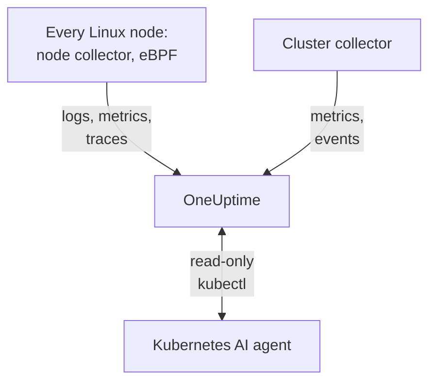

# Kubernetes Agent

The OneUptime Kubernetes agent is a Helm chart that collects your cluster's metrics, events and pod logs and, with eBPF, the traces, request metrics, service graph and network flows of every pod, with no code changes and no SDKs. It also runs the [Kubernetes AI agent](#kubernetes-ai-agent), which lets OneUptime AI run read-only `kubectl` while it investigates an incident or alert. One `helm install` puts it in place; [Kubernetes monitors](/docs/monitor/kubernetes-monitor) alert on what it sends.

:::cards
- [Install the agent](#install-the-agent): Four steps with Helm.
- [Configuration options](#configuration-options): Filters, sampling, control plane, service mesh, costs and labels.
- [Kubernetes AI agent](#kubernetes-ai-agent): Read-only `kubectl` for OneUptime AI, and fixes when you allow them.
- [Reduce what you send](#reducing-the-volume-of-data-collected): The levers, in order of impact.
:::

## How it works

The chart runs a few workloads in its own namespace. Each one sends what it collects to your OneUptime URL over OTLP, with the ingestion key you give it, and the cluster registers itself under the name you give it in `clusterName`.



| Workload | Kind | What it does | Runs |
| --- | --- | --- | --- |
| Cluster collector | Deployment | Cluster metrics, Kubernetes events and the specs of pods, nodes and workloads, from the Kubernetes API. | Always |
| Node collector | DaemonSet | Pod logs from `/var/log/pods`, kubelet and cAdvisor metrics, and the node's OS metrics. | Everywhere but EKS Fargate |
| eBPF instrumentation (OBI) | DaemonSet | HTTP, gRPC, SQL and Redis traces and request metrics from every pod, and the service map. | By default, except on GKE Autopilot and EKS Fargate |
| Kubernetes AI agent | Deployment | Read-only `kubectl` for OneUptime AI while it investigates an incident or alert. | By default |
| Log tailer | Deployment | Pod logs through the Kubernetes API, where the node collector cannot read them. | With the `gke-autopilot` and `eks-fargate` presets |
| Cost engine and poller | Deployments | Spend per namespace, workload and pod. | With `cost.enabled=true` |

Every agent image is Linux-only, so every workload is pinned to Linux nodes.

## Before you begin

- A Kubernetes cluster running v1.23 or later, and `kubectl` configured to reach it.
- Helm 3. Upgrades use `--reset-then-reuse-values`, which needs Helm 3.14 or later.
- An ingestion key. Create one under **Project Settings → Telemetry & APM → Ingestion Keys**. The agent sends it as the `x-oneuptime-token` header, so a project API key does not work here.
- A name for the cluster, unique in your project and stable, such as `prod-us-east-1`: the cluster appears in OneUptime under it.
- Outbound HTTPS from the cluster to your OneUptime URL.

## Install the agent

:::steps
### Add the Helm repository

```bash
helm repo add oneuptime https://helm-chart.oneuptime.com
helm repo update
```

### Install the chart

Replace `YOUR_ONEUPTIME_URL`, `YOUR_ONEUPTIME_API_KEY` (the ingestion key) and the cluster name with your values, and pick the tab for your platform (see [Pick a preset](#pick-a-preset)).

:::tabs
@tab Standard
Self-managed clusters, EKS on EC2, GKE Standard, AKS, minikube, kind and k3s:

```bash
helm install kubernetes-agent oneuptime/kubernetes-agent \
  --namespace oneuptime-agent \
  --create-namespace \
  --set oneuptime.url="YOUR_ONEUPTIME_URL" \
  --set oneuptime.apiKey="YOUR_ONEUPTIME_API_KEY" \
  --set clusterName="my-cluster" \
  --set aiAgent.enabled=true
```
@tab GKE Autopilot
```bash
helm install kubernetes-agent oneuptime/kubernetes-agent \
  --namespace oneuptime-agent \
  --create-namespace \
  --set oneuptime.url="YOUR_ONEUPTIME_URL" \
  --set oneuptime.apiKey="YOUR_ONEUPTIME_API_KEY" \
  --set clusterName="my-cluster" \
  --set aiAgent.enabled=true \
  --set preset=gke-autopilot
```
@tab EKS Fargate
```bash
helm install kubernetes-agent oneuptime/kubernetes-agent \
  --namespace oneuptime-agent \
  --create-namespace \
  --set oneuptime.url="YOUR_ONEUPTIME_URL" \
  --set oneuptime.apiKey="YOUR_ONEUPTIME_API_KEY" \
  --set clusterName="my-cluster" \
  --set aiAgent.enabled=true \
  --set preset=eks-fargate
```
:::

**AI investigations are on by default.** `aiAgent.enabled=true` runs the [Kubernetes AI agent](#kubernetes-ai-agent) next to the collector: when an incident or alert is raised on this cluster, OneUptime AI investigates it with read-only `kubectl` (`get`, `describe`, `logs`, `events`, `top`) and changes nothing. Fixes stay off until you allow them. To install without it, use `--set aiAgent.enabled=false` instead.

### Check the pods are running

```bash
kubectl get pods -n oneuptime-agent
```

Every pod should reach `Running` within a minute or two:

:::tabs
@tab Standard
The cluster collector, the AI agent, and on every node a node collector and an eBPF pod:

```text
NAME                                          READY   STATUS    RESTARTS   AGE
kubernetes-agent-xxxxxxxxxx-xxxxx             1/1     Running   0          1m
kubernetes-agent-ai-agent-xxxxxxxxxx-xxxxx    1/1     Running   0          1m
kubernetes-agent-ebpf-xxxxx                   1/1     Running   0          1m
kubernetes-agent-logs-xxxxx                   1/1     Running   0          1m
```
@tab GKE Autopilot
The node collector still runs, reading kubelet and cAdvisor metrics without `hostPath`, and a log tailer Deployment reads pod logs through the Kubernetes API:

```text
NAME                                          READY   STATUS    RESTARTS   AGE
kubernetes-agent-xxxxxxxxxx-xxxxx             1/1     Running   0          1m
kubernetes-agent-ai-agent-xxxxxxxxxx-xxxxx    1/1     Running   0          1m
kubernetes-agent-logs-yyyyyyyyyy-yyyyy        1/1     Running   0          1m
kubernetes-agent-logs-xxxxx                   1/1     Running   0          1m
```
@tab EKS Fargate
Three Deployments and no DaemonSet: Fargate gives each pod a micro-VM of its own and never schedules DaemonSets, so node metrics are not available there:

```text
NAME                                          READY   STATUS    RESTARTS   AGE
kubernetes-agent-xxxxxxxxxx-xxxxx             1/1     Running   0          1m
kubernetes-agent-ai-agent-xxxxxxxxxx-xxxxx    1/1     Running   0          1m
kubernetes-agent-logs-yyyyyyyyyy-yyyyy        1/1     Running   0          1m
```
:::

### Find the cluster in OneUptime

Open **Products → Infrastructure → Kubernetes → All Clusters**. The cluster appears under its `clusterName` within a few minutes, and its nodes, pods and workloads fill in. The Kubernetes AI agent shows as connected on the cluster's **Agent** page, under **AI**.
:::

## Pick a preset

`preset` picks the defaults that work on your platform: whether pod logs are read from the node through `hostPath` or through the Kubernetes API, and which workloads may run privileged.

| `preset` | Use for | Pod logs | Node metrics |
| --- | --- | --- | --- |
| `standard` (default) | Self-managed clusters, **EKS on EC2**, **GKE Standard**, **AKS**, minikube, kind, k3s | The node collector reads `/var/log/pods` through `hostPath` (lowest overhead) | Kubelet, cAdvisor and the node's OS metrics |
| `gke-autopilot` | **GKE Autopilot** | The log tailer reads them through the Kubernetes API (no `hostPath`, no host access) | Kubelet and cAdvisor, without `hostPath` |
| `eks-fargate` | **EKS Fargate** | The log tailer reads them through the Kubernetes API (no `hostPath`, no host access) | None: Fargate runs no DaemonSets |

If you are not sure, start with `standard`. If the install fails with a Pod Security error that names `hostPath`, install again with `preset=gke-autopilot` (or `eks-fargate` on Fargate). GKE Autopilot and EKS Fargate also refuse privileged pods, which eBPF and the profiler need, so those two presets leave both out.

## What gets collected

| Category | Data |
| --- | --- |
| Node metrics | CPU, memory, filesystem and network use |
| Pod metrics | CPU, memory, network and restarts |
| Container metrics | CPU and memory per container |
| Cluster metrics | Node conditions, allocatable resources, pod counts |
| Kubernetes events | Warnings, errors and scheduling events |
| Pod logs | The stdout and stderr of every container (through `hostPath` on standard clusters, through the Kubernetes API on Autopilot and Fargate) |
| Application traces (eBPF, on by default) | HTTP, gRPC, SQL and Redis spans from every pod, with no SDK or code changes |
| HTTP RED metrics (eBPF) | `http.server.request.duration`, and request and response body sizes, per service |
| Service graph (eBPF) | Caller-to-callee request rate, latency and error edges, which draw the service map |
| Network flow metrics (eBPF) | Pod-to-pod TCP and UDP byte and packet counters, with Kubernetes metadata |
| TCP stats (eBPF) | Node-level round-trip time, failed-connection and retransmit counters |
| Workload costs (opt-in, `cost.enabled=true`) | Spend per namespace, workload and pod, with idle and efficiency, and node and volume hourly costs: see [Kubernetes Cost Observability](/docs/telemetry/kubernetes-cost) |

## Configuration options

Every option below is a Helm value. Set it at install time, or on an installed agent with `helm upgrade ... --reset-then-reuse-values --set <value>`.

### Namespace filtering

`namespaceFilters.rules` applies namespace patterns to four scopes, each on its own:

| Scope | Where it filters | What it affects |
| --- | --- | --- |
| `podLogs` | At the hostPath filelog receiver or the API log tailer | Pod stdout and stderr only; Kubernetes events and audit logs are not affected |
| `ebpfDiscovery` | At OBI's process discovery | Both eBPF traces and eBPF metrics from matching workloads |
| `metrics` | In the collector, after Kubernetes metadata is added | Namespaced metric series; node and cluster series without a namespace are kept |
| `traces` | In the collector, after Kubernetes metadata is added | Both eBPF spans and spans applications push over OTLP |

A pattern matches the whole namespace name and may use `*` (`team-*`). If a scope has any `include` rule, only matching namespaces are kept for that scope, and `exclude` rules always win. The default rule excludes `kube-system` from `podLogs` and `ebpfDiscovery` only.

To keep pod logs and eBPF discovery to some namespaces:

```bash
helm install kubernetes-agent oneuptime/kubernetes-agent \
  --namespace oneuptime-agent \
  --create-namespace \
  --set oneuptime.url="YOUR_ONEUPTIME_URL" \
  --set oneuptime.apiKey="YOUR_ONEUPTIME_API_KEY" \
  --set clusterName="my-cluster" \
  --set-json 'namespaceFilters.rules=[{"action":"include","namespaces":["default","production","staging"],"scopes":["podLogs","ebpfDiscovery"]}]'
```

To stop the logs of a noisy namespace while keeping its eBPF traces, service map and metrics, scope the exclusion to `podLogs`:

```bash
  --set-json 'namespaceFilters.rules=[{"action":"exclude","namespaces":["kube-system"],"scopes":["podLogs","ebpfDiscovery"]},{"action":"exclude","namespaces":["noisy-*"],"scopes":["podLogs"]}]'
```

`podLogs` and `ebpfDiscovery` rules filter at the source: excluded log files are never opened, and excluded workloads are never instrumented. `metrics` and `traces` rules act later, in the collector, after the namespace has been attached to the data.

#### Filtering metrics and traces by namespace

Add those scopes to a rule to filter namespaced metrics or spans too:

```bash
  --set-json 'namespaceFilters.rules=[{"action":"exclude","namespaces":["kube-system","noisy-*"],"scopes":["podLogs","ebpfDiscovery","metrics","traces"]}]'
```

> [!NOTE]
> Node- and cluster-level metrics are always kept. A namespace belongs to a pod, not to a node, so series such as node CPU, node memory and filesystem use have nothing to match and are never dropped: a `metrics`-scoped rule trims per-pod series without hiding a node going bad.

Kubernetes events cannot be filtered by namespace at the agent: they arrive from the `k8sobjects` receiver without a `k8s.namespace.name` attribute (the namespace is inside the event body), so there is nothing for a filter to match. Drop them in OneUptime instead, with **Logs → Settings → Drop Filters**.

### Filtering by log severity

`filters.logs.minSeverity` drops pod log records below a severity, at the agent, before anything is sent:

```bash
  --set filters.logs.minSeverity=WARN
```

It accepts `TRACE`, `DEBUG`, `INFO`, `WARN`, `ERROR` and `FATAL`. `WARN` keeps WARN, ERROR and FATAL and drops INFO, DEBUG and TRACE; the default (`""`) keeps everything. It applies in both log modes (through the collector in `daemonset` mode, inside the log tailer in `api` mode), so a preset never turns it off under you.

Container runtimes record no severity, so the agent reads one from the log text itself (`[ERROR]`, `WARN:`, `"level":"info"`, …). What happens to a line with no recognisable level depends on the log mode, because the two modes know different things:

| Mode | A line with no level | Why |
| --- | --- | --- |
| `daemonset` | `stderr` counts as ERROR (kept), `stdout` as INFO (dropped by a WARN threshold) | The container runtime records which stream each line came from. |
| `api` | Always kept | The Kubernetes `pods/log` API merges stdout and stderr into one stream with no per-line marker, so rather than guess, the agent keeps the line. |

So `api` mode drops strictly less than `daemonset` mode, on purpose: a Python traceback or an `npm ERR!` carries no severity keyword, and silently deleting it is the failure a threshold should protect you from. In hybrid mode (`logs.windowsPods.enabled`) both rows apply, by node OS: Linux pods follow `daemonset`, Windows pods `api`.

Multi-line events are put back together before filtering in both modes, so a Java stack trace is judged on its first line and kept or dropped whole.

> [!IMPORTANT]
> Kubernetes events and resource specs are never filtered by this. They arrive from the Kubernetes API with no severity of their own, so a threshold would delete the whole feed, including the `FailedScheduling`, `BackOff` and `OOMKilling` warnings you most want. They are few and valuable, so the agent always sends them; to thin them out, use **Logs → Settings → Drop Filters** in OneUptime.

### Including or excluding metrics by name

`filters.metrics` decides which metrics leave the cluster, across every receiver.

Drop a few noisy metrics (a denylist, usually what you want):

```bash
  --set-json 'filters.metrics.exclude=["k8s.volume.available","k8s.volume.capacity"]'
```

Send only a fixed set (an allowlist: everything else is dropped):

```bash
  --set-json 'filters.metrics.include=["k8s.pod.cpu.utilization","k8s.pod.memory.usage"]'
```

Match by pattern instead of by exact name:

```bash
  --set filters.metrics.matchType=regexp \
  --set-json 'filters.metrics.exclude=["^container_network_"]'
```

| Key | Meaning |
| --- | --- |
| `filters.metrics.exclude` | Metric names to drop. Applied after `include`, so an exclusion always wins. |
| `filters.metrics.include` | When not empty, only these metrics are sent. |
| `filters.metrics.matchType` | `strict` (the exact name, the default) or `regexp` (RE2, unanchored). |

- `regexp` is unanchored: `system.cpu` also matches `system.cpu.time`. Anchor it (`^system\.cpu$`) when you mean exactly one metric.
- RE2 has no lookahead, so `^(?!container_)` does not compile. Say "everything except" with `include`, not a negative pattern.
- `include` spans every receiver at once. An allowlist that forgets a metric silently removes the monitors built on it, so prefer `exclude` unless you want a closed set.
- Use `--set-json` (or a values file) for lists: a plain `--set` replaces a list rather than adding to it.

> [!WARNING]
> Test a pattern before you roll it out. The collector compiles patterns when it starts, so an invalid one does not misbehave quietly: the collector refuses to start and crash-loops, taking that collector's logs down with its metrics. Helm cannot compile RE2, so `helm upgrade` accepts a bad pattern without complaint.

### Trace sampling

The filters above remove a category of telemetry: a namespace, a severity, a metric name. Sampling keeps every category and thins the population instead. Set `sampling.traces.percentage` to the share of traces to keep:

```bash
helm upgrade kubernetes-agent oneuptime/kubernetes-agent \
  --namespace oneuptime-agent --reset-then-reuse-values \
  --set sampling.traces.percentage=10
```

That keeps one trace in ten and drops the other nine at the agent, before they leave your cluster.

- **You get whole traces, not fragments.** The decision is a hash of the trace ID, not a coin flip per span, so every span of a trace is kept or dropped together, and the traces that survive read end to end.
- **Your metric-based monitors do not move.** OBI computes the eBPF RED metrics (request rate, error rate, duration) from every request, and they travel the metrics pipeline, which the sampler is not in. At 10%, you get a tenth of the traces and exact rate, error and latency.
- **Your span-based monitors do.** Anything OneUptime counts from the spans themselves scales down with the rate: see the warning below.

| Key | Meaning |
| --- | --- |
| `sampling.traces.percentage` | The percentage of traces to keep, 0 to 100. Default `100` (keep everything). |
| `sampling.traces.hashSeed` | The seed of the trace-ID hash. Default `22`. |

- `0` keeps no traces at all. It is a rate, not an off switch: it deletes every trace while the eBPF DaemonSet keeps running and costing you. For no traces, use `ebpf.enabled=false`; for no traces but the RED metrics and the service map, keep eBPF on and set `0` on purpose.
- It applies only when `ebpf.enabled` is on: otherwise there is no traces pipeline, and the value does nothing.
- It samples traces only. There is no `sampling.logs` or `sampling.metrics`, on purpose: see the note below.
- Fractions need `--set-json`, and they have a floor. `--set sampling.traces.percentage=0.5` fails, because Helm reads `0.5` as a string: use `--set-json 'sampling.traces.percentage=0.5'` or a values file. Below about `0.0061` the rate rounds down to zero and behaves exactly like `0`, with no error; `0.01` (one in ten thousand) is the smallest value that does what it says.
- Several clusters work by default. Two agents keep the same trace only if they agree on both `hashSeed` and `percentage`, and both default to the same values everywhere, so a trace crossing two clusters survives whole. Change `hashSeed` only to make two sampling tiers independent: with the same seed, a lower rate keeps a subset of the higher rate's traces.
- Pod logs are never sampled, so with `ebpf.logToTraceCorrelation: true` every log record still carries a trace ID while only the kept share of those traces exists. Roughly (100 − `percentage`)% of log records then link to a trace that is not there; following a trace to its logs is not affected.

> [!WARNING]
> Retune your span-based monitors when you set this. Sampling reduces the spans that reach OneUptime, so anything that counts them counts less: a **Traces** monitor on `Span Count` and an **Exceptions** monitor on `Exception Count` see roughly `percentage`% of yesterday's volume. A threshold tuned on unsampled traffic quietly stops being crossed: the monitor does not error, it just goes silent. Divide those thresholds by the same factor; the rate is cluster-wide, so no service can be exempted. Error grouping degrades worse than linearly: a common exception still shows, but a rare one-off is more likely to disappear than to appear a tenth as often.

> [!NOTE]
> Why there is no log or metric sampling: the collector's sampler cannot sample metrics at all. It can sample logs, but it draws its randomness from the trace ID, which pod logs do not have, so every log record would hash the same way, and a log rate would keep everything or delete everything depending on the seed. Rather than offer a setting that silently deletes your logs, the chart offers none. Thin logs with [Filtering by log severity](#filtering-by-log-severity) and [Namespace filtering](#namespace-filtering), which are precise about what they remove.

### Disable log collection

If you do not need pod logs:

```bash
helm install kubernetes-agent oneuptime/kubernetes-agent \
  --namespace oneuptime-agent \
  --create-namespace \
  --set oneuptime.url="YOUR_ONEUPTIME_URL" \
  --set oneuptime.apiKey="YOUR_ONEUPTIME_API_KEY" \
  --set clusterName="my-cluster" \
  --set logs.enabled=false
```

Your metrics are not affected: the node collector keeps running for kubelet, cAdvisor and host metrics, and only stops reading pod logs. Log-based alerts stop, and nothing else does.

### Force a specific log collection mode

`logs.mode` overrides the preset's choice, and always wins over it:

- `logs.mode=daemonset`: the hostPath DaemonSet (lowest overhead; needs `hostPath`).
- `logs.mode=api`: the Kubernetes API log tailer Deployment (works on any cluster).
- `logs.mode=disabled`: no pod logs.

The mode only decides where pod logs come from: node metrics are collected either way, so `api` and `disabled` keep your kubelet, cAdvisor and host metrics. The exception is the platform: EKS Fargate cannot schedule DaemonSets at all, so it has no node collector and no node, pod or container metrics. GKE Autopilot runs the node collector but blocks `hostPath`, so it collects kubelet and cAdvisor metrics without the `hostmetrics` ones (disk I/O, inodes, NIC errors) that read the host's `/proc` and `/sys`.

On clusters with Windows node pools, `daemonset` mode covers only the Linux nodes, because every agent image is Linux-only. Add `--set logs.windowsPods.enabled=true` to run the API log tailer beside it for the pods on Windows nodes only: Linux pods keep node-local file tailing, and the two never send the same line twice. This needs a `kubernetes-log-tailer` image at least as new as the chart: an older image ignores the restriction and sends Linux logs twice.

### Enable control plane monitoring

The cluster's **Control Plane** page charts etcd, the API server, the scheduler and the controller manager. The agent scrapes all four when `controlPlane.enabled` is `true`:

```bash
helm upgrade kubernetes-agent oneuptime/kubernetes-agent \
  --namespace oneuptime-agent \
  --reset-then-reuse-values \
  --set controlPlane.enabled=true
```

Each component is scraped at the addresses in its own list: `controlPlane.etcd.endpoints`, `controlPlane.apiServer.endpoints`, `controlPlane.scheduler.endpoints` and `controlPlane.controllerManager.endpoints`. The scrape runs in the agent's pod, which has no host network, so the defaults (`https://localhost:<port>/metrics`) point at that pod itself: set each list to an address the pod can reach. Inside any cluster the API server answers at `https://kubernetes.default.svc:443/metrics`:

```bash
helm upgrade kubernetes-agent oneuptime/kubernetes-agent \
  --namespace oneuptime-agent \
  --reset-then-reuse-values \
  --set controlPlane.enabled=true \
  --set "controlPlane.apiServer.endpoints={https://kubernetes.default.svc:443/metrics}"
```

`controlPlane.enabled` turns on all four scrapes at once. Where a component cannot be reached at its endpoints (etcd, the scheduler and the controller manager on a managed cluster, or at their `localhost` defaults), its scrape fails on every interval: the collector logs a scrape error and reports the target as down, and nothing else changes.

The agent scrapes over HTTPS only, with the service account's token and no client certificate. So:

- **etcd** needs an HTTPS metrics address that does not ask for a client certificate. etcd's usual metrics ports are out of reach: plain HTTP on `2381` (kubeadm's `--listen-metrics-urls`) is scraped as HTTPS and fails, and `2379` requires client certificates.
- **The scheduler** (`10259`) and **the controller manager** (`10257`) serve HTTPS and accept the token, but kubeadm binds them to `127.0.0.1` on the control-plane nodes: they need a `--bind-address` the agent's pod can reach.

Managed Kubernetes services (EKS, GKE, AKS) do not expose etcd, the scheduler or the controller manager, so those tabs stay empty there. Until a tab's metrics arrive, the **Control Plane** page shows what to set in place of its charts, with the command to copy.

### Enable CoreDNS metrics

The **CoreDNS** tab of the **Control Plane** page charts DNS queries, latency, the cache and forwarding. Collecting them is off by default:

```bash
helm upgrade kubernetes-agent oneuptime/kubernetes-agent \
  --namespace oneuptime-agent \
  --reset-then-reuse-values \
  --set coreDns.enabled=true
```

The agent scrapes port `9153` of the pods labelled `k8s-app=kube-dns` in `kube-system`, which is how CoreDNS runs on kubeadm clusters, EKS and AKS. If yours runs elsewhere, also set `coreDns.namespace`, `coreDns.service` (the `k8s-app` label) and `coreDns.port`. GKE runs kube-dns (dnsmasq) or Cloud DNS instead of CoreDNS, so the tab stays empty there.

### Enable service mesh metrics

The cluster's **Service Mesh** page charts Istio and Linkerd. The agent scrapes one mesh, the one `serviceMesh.provider` names (`istio` or `linkerd`):

```bash
helm upgrade kubernetes-agent oneuptime/kubernetes-agent \
  --namespace oneuptime-agent \
  --reset-then-reuse-values \
  --set serviceMesh.enabled=true \
  --set serviceMesh.provider=istio
```

For Istio it reads the Envoy statistics of every `istio-proxy` sidecar (port `15090`); for Linkerd, the admin port of every `linkerd-proxy`. Neither mesh's control plane is scraped: istiod (the **Pilot** card) and Linkerd's identity, destination and proxy-injector components (the **Control Plane** card) serve their metrics on admin ports of their own, so those cards say so in place of their charts.

### Metrics the agent does not collect

Some charts show metrics the agent has no scrape for: **kube-proxy** on the **Control Plane** page; **Cilium** (with Hubble) on the **Service Mesh** page; and on the Istio and Linkerd tabs, the meshes' own control planes (**istiod**, and Linkerd's identity, destination and proxy-injector components). They fill in when those metrics reach OneUptime another way, for example from your own [OpenTelemetry Collector](/docs/telemetry/open-telemetry) scraping them, with the resource attribute `k8s.cluster.name` set to the cluster's name (the agent's `clusterName`). Clusters that run without kube-proxy have no kube-proxy metrics at all.

### Enable cost observability

See what every namespace, workload and pod costs, with idle capacity and how much of each request is used, on the cluster's **Costs** page:

```bash
helm upgrade kubernetes-agent oneuptime/kubernetes-agent \
  --namespace oneuptime-agent \
  --reset-then-reuse-values \
  --set cost.enabled=true
```

That alone is a complete install: the chart bundles the open-source [OpenCost](https://opencost.io) engine (with the small Prometheus it needs) and prices your nodes and volumes from your cloud provider's public list prices, with no credentials. It adds two small pods, and the first costs appear after the first closed hour. Already running Kubecost or OpenCost? Add `--set cost.engine.url=<its service URL>` instead, and nothing is bundled. On-prem clusters can set a rate card with `cost.opencost.customPricing`. The full guide, with on-prem pricing and troubleshooting, is [Kubernetes Cost Observability](/docs/telemetry/kubernetes-cost).

### Auto-tag with project labels

Every resource attribute that starts with `oneuptime.label.` becomes a project label, attached to the cluster and to the services and hosts this agent reports: `oneuptime.label.<dimension>=<value>` is the label `<dimension>:<value>`. Pass labels at install time with `--set oneuptime.labels.<key>=<value>`:

```bash
helm install kubernetes-agent oneuptime/kubernetes-agent \
  --namespace oneuptime-agent \
  --create-namespace \
  --set oneuptime.url="YOUR_ONEUPTIME_URL" \
  --set oneuptime.apiKey="YOUR_ONEUPTIME_API_KEY" \
  --set clusterName="prod" \
  --set oneuptime.labels.team=payments \
  --set oneuptime.labels.env=production \
  --set oneuptime.labels.region=us-east-1
```

Or keep them in a values file:

```yaml title="values.yaml"
oneuptime:
  url: YOUR_ONEUPTIME_URL
  apiKey: YOUR_ONEUPTIME_API_KEY
  labels:
    team: payments
    env: production
    region: us-east-1
clusterName: prod
```

Labels are matched case-insensitively, so an existing `Production` label you created by hand is reused rather than duplicated, and labels added in OneUptime are never removed by the agent.

## Application traces and HTTP metrics via eBPF (on by default)

The chart runs a DaemonSet with [OpenTelemetry eBPF Instrumentation (OBI)](https://opentelemetry.io/docs/zero-code/obi/) on every node. It loads eBPF programs into the kernel and captures the HTTP and HTTPS, gRPC, SQL and Redis traffic of every supported runtime (Go, .NET, Java, Node.js, Python, Ruby, Rust), with no SDK and no sidecar. The traces and request metrics then flow through the in-cluster collector to OneUptime.

It needs Linux kernel 5.8 or later with BTF (the default on Debian 11+, Ubuntu 20.10+, Fedora 34+, RHEL and Stream 9+), and its DaemonSet runs privileged, because loading eBPF programs takes it.

### What eBPF traces look like

eBPF sees network calls, not your code, so a trace is built from the requests a service handles and the calls it makes while handling them:

- **A request and its calls form one trace.** The request into a service is the root span, named `<METHOD> <route>`, and the HTTP, gRPC, SQL and Redis calls the service makes while handling it are its children. (For Node.js this relies on OBI's Node.js agent, which the chart turns on with `ebpf.nodejs.enabled`.) Calls that concurrent requests send down one shared connection, typical of Redis clients, cannot always be told apart, so some of them are not placed in their request's trace.
- **A call to a service on another node starts a new trace**, unless something carries the trace context across: an OpenTelemetry SDK, or the opt-in context propagation described below. When both ends run on the same node, OBI sees both and links them itself.
- **Work that no request started stands alone.** A queue worker polling Redis, or a cron job, has no request for its calls to belong to.
- **Database servers usually stand alone.** Database wire protocols carry no trace context, so unless the caller runs on the same node, the span OBI records inside a database server for each command is a trace of one span.

Those standalone database calls arrive as one-span traces named after a bare command (`set`, `evalsha`, `SELECT`), and on a busy cluster they can be most of what OBI captures. By default the agent drops them before they leave the cluster: a database server's own span, which always duplicates the caller's (`ebpf.dropDatabaseServerSpans=true`), and an application's call that belongs to no trace (`ebpf.dropUnlinkedDatabaseCalls=true`). An application's database calls inside a request's trace are kept, spans your applications send from their own SDKs are never touched, and the database metrics still count every command.

One trade-off: OneUptime discovers databases, and draws them on the service map, from database client spans. A database that only background work talks to (a worker's queue, a cron job's warehouse) is then no longer discovered from traces, and appears on the service map as a remote endpoint. Its metrics are not affected. Set `ebpf.dropUnlinkedDatabaseCalls=false` to keep those spans.

Background work's HTTP and gRPC calls (a worker querying ClickHouse over HTTP, a controller renewing its Kubernetes lease) also arrive as one-span traces (`POST /`, `PUT /apis/*/...`). Set `ebpf.dropUnlinkedClientCalls=true` to drop them as well, together with calls OBI could not place in their request's trace, which look the same; database, messaging and GenAI calls (MCP included) are never dropped by it. It is off by default because it costs data: when the called service runs on the same node, OBI links the request it handled under the call, so the call is the root of that trace, and dropping it leaves the trace without its root. With `ebpf.contextPropagation` on, that happens on any node, and to a service with its own OpenTelemetry SDK too. The service map also reads these calls: a dependency only background work calls is then drawn from OBI's service graph metrics alone, and an edge also seen inside requests counts only those calls. A service's overview counts its spans, so a worker or probe whose spans are mostly such calls shows far fewer requests, with an error rate and p95 latency over the spans left. OBI's client request metrics still count every call.

On a self-hosted OneUptime, upgrade the server before the agent: the eBPF tracer this chart runs (OBI v0.14) names called services and reports message brokers' own spans in ways older OneUptime servers do not read.

Names come from the traffic. HTTP spans use the app's route template when OBI can read it, and otherwise a pattern made from the URL with id-like segments replaced by `*`; set `ebpf.routes.patterns` to name them yourself. OBI reads the route templates of Go (net/http, Gorilla mux, Gin), Java (Spring, JAX-RS), Node.js (Express, Fastify, Koa, NestJS, Next.js), Python (Django, FastAPI, Flask), Ruby (Rails), .NET (ASP.NET Core attribute routes) and PHP (Symfony, Laravel, Slim) apps. Application-level names such as `OrderService.charge` exist only in code and need an OpenTelemetry SDK.

If an app already exports traces with an OpenTelemetry SDK, OBI notices and stops sending eBPF traces for it, so it is not traced twice (`ebpf.excludeOtelInstrumentedServices=true`, OBI's default). Set it to `false` if that SDK reports to another project and you want eBPF traces for the app in this one too.

### Disable eBPF auto-instrumentation

Turn eBPF off when:

- You install on **GKE Autopilot** or **EKS Fargate**: those platforms refuse privileged pods, so `preset=gke-autopilot` and `preset=eks-fargate` already leave eBPF out for you, and the profiler with it.
- The nodes run a kernel older than 5.8 without BTF backports.
- You already send traces from OpenTelemetry SDKs in every app and do not want the eBPF metrics either. (For traces alone you need not: OBI stops sending eBPF traces for an app it sees exporting its own, as above.)

```bash
helm install kubernetes-agent oneuptime/kubernetes-agent \
  --namespace oneuptime-agent \
  --create-namespace \
  --set oneuptime.url="YOUR_ONEUPTIME_URL" \
  --set oneuptime.apiKey="YOUR_ONEUPTIME_API_KEY" \
  --set clusterName="my-cluster" \
  --set ebpf.enabled=false
```

### Toggle individual signal families

All of them are on by default except one. Turn any off with `--set ebpf.features.<name>=false`:

| `ebpf.features.*` | Default | What it adds |
| --- | --- | --- |
| `httpMetrics` | on | HTTP and gRPC RED metrics (request rate, latency, errors) per service |
| `spanMetrics` | on | Span call count and duration (`traces.span.metrics.*`) |
| `serviceGraph` | on | Caller-to-callee edge metrics, which draw the service map |
| `networkMetrics` | on | Pod-to-pod TCP and UDP flow counters |
| `networkInterZoneMetrics` | off | The inter-zone variant of the network metrics (doubles their cardinality) |
| `tcpStats` | on | Node-level TCP round-trip time, failed-connection and retransmit counters |

Cross-service trace context propagation, where OBI injects a W3C `traceparent` so a request crossing from pod A to pod B shows as one trace with no SDK anywhere, is off by default. Opt in with `--set ebpf.contextPropagation=true`. It needs no kernel beyond what the rest of the agent needs, and no kernel version makes it inert.

It is off because injecting the header means rewriting traffic already in flight: plaintext HTTP requests are widened in place in the kernel, while TLS and raw TCP get a TCP option appended from a Traffic Control hook. If the connection's byte accounting is not corrected exactly, the stream falls out of step; the reported symptom is transfers through an L7 proxy such as nginx hanging mid-body once the response passes about 64KB, while small requests keep working. Do not rule this out by kernel age: below kernel 5.17 OBI falls back to bounded-scan programs and rewrites traffic the same way. Traces, RED metrics and the service map do not depend on it; for linking across services, an OpenTelemetry SDK propagates `traceparent` in userspace, with no kernel rewriting, and is the safer choice.

## Kubernetes AI agent

When an incident or alert is raised on this cluster, OneUptime AI investigates it. The chart's **Kubernetes AI agent** gives it a terminal: it runs read-only `kubectl` the way an on-call engineer would (describe the failing pod, read its events, tail the crashing container's logs, check node capacity) and cites every command on the incident page.

The agent is **on by default** and **read-only**: one small Deployment (`kubernetes-agent-ai-agent`, pod label `component=ai-agent`, image `oneuptime/kubernetes-ai-agent`) whose ServiceAccount may only read. It registers itself with the same `oneuptime.apiKey` and `clusterName` the collector uses, so there is nothing to set up in the dashboard: the cluster's **AI agent** page (Kubernetes → cluster → AI → Agent) shows it as Connected within a minute, and **Test connection**, in the **⋯** menu next to that status, runs `kubectl version` and `kubectl auth can-i --list` through it. Everything AI did with it is on the cluster's **AI Logs** page (AI → Logs), and what is worth knowing about the cluster — the problems that keep coming back and why, the node or workload behind most of them, what AI fixed — on the **AI Insights** page (AI → Insights). The agent ships a pinned kubectl (v1.36.4). It is not a Runner and never appears under Runbooks → Runners: OneUptime never hands it a credential, never runs runbooks on it, and it is never accepted as an auto-remediation rule's command Runner.

On an agent installed before the AI agent existed, refresh your chart index first, then upgrade (on a self-hosted OneUptime, upgrade OneUptime first — see [Upgrading the Agent](#upgrading-the-agent)):

```bash
helm repo update
helm upgrade kubernetes-agent oneuptime/kubernetes-agent \
  --namespace oneuptime-agent --reset-then-reuse-values \
  --set aiAgent.enabled=true
```

Use the release name and namespace you installed the agent with, if they differ (`helm list -A | grep kubernetes-agent` shows them). Without `helm repo update`, Helm may resolve the chart you installed from, which does not know `aiAgent` and fails with `Additional property aiAgent is not allowed`. Published chart versions follow the OneUptime version, so if `helm show values oneuptime/kubernetes-agent | grep aiAgent` prints nothing, your index is still old. To run the chart without the AI agent, pass `--set aiAgent.enabled=false`.

### What AI may do

What OneUptime AI may do on the cluster is set in the chart, with two values, and the cluster's AI agent page shows them under **What AI may do** without a way to change them there:

- `aiAgent.investigation` — `true`: AI runs read-only `kubectl` while it investigates an incident or alert on the cluster. `false`: it still investigates, with the data OneUptime already has.
- `aiAgent.fixes` — `off`, `ask-for-approval`, `automatic` or `bypass-approval` (below). Every level but `off` grants the AI agent write access; `off` grants none, and the agent then refuses every write itself.

The AI agent reports both to OneUptime, which applies them to the cluster and refuses a change made anywhere else — the AI agent page, the API or Terraform. **Change** on that page shows the command for the option you pick. Both are unset in `values.yaml`: a release that sets neither lets the agent use its defaults (investigation on, fixes off), and OneUptime applies those only to a cluster whose settings nobody chose on its AI agent page — settings someone chose there are kept as they are, and the page shows how to move them to the chart.

### Let AI fix what it finds

Fixes are off until you turn them on with `aiAgent.fixes` — a separate, optional step that also grants the AI agent write access. The recommended form grants it only in the namespaces AI may fix, with node operations off:

```bash
helm repo update
helm upgrade kubernetes-agent oneuptime/kubernetes-agent \
  --namespace oneuptime-agent --reset-then-reuse-values \
  --set aiAgent.enabled=true \
  --set aiAgent.investigation=true \
  --set aiAgent.fixes=ask-for-approval \
  --set "aiAgent.remediation.namespaces={web,api}" \
  --set aiAgent.remediation.nodeOperations=false
```

Or cluster-wide:

```bash
helm repo update
helm upgrade kubernetes-agent oneuptime/kubernetes-agent \
  --namespace oneuptime-agent --reset-then-reuse-values \
  --set aiAgent.enabled=true \
  --set aiAgent.investigation=true \
  --set aiAgent.fixes=ask-for-approval \
  --set-json 'aiAgent.remediation.namespaces=[]'
```

Every namespace you list must already exist: the chart creates one RoleBinding in each and never creates a namespace, so a missing one fails the whole upgrade — the collector's too — with `namespaces "api" not found`. Create it first, or take it off the list, and take a namespace off the list before you delete it. Leaving the flag out of an upgrade keeps the stored list; `--set-json 'aiAgent.remediation.namespaces=[]'` (Helm 3.10+) goes back to cluster-wide — not `={}`, which Helm reads as one empty name. `--set aiAgent.remediation.namespaces=null` does not reset a stored list under `--reuse-values`: Helm keeps the stored list. `aiAgent.remediation.nodeOperations=false` keeps fixes off nodes; set it to `true` to let AI cordon, uncordon, drain and taint nodes.

`aiAgent.fixes` picks how fixes run; to turn them off again, upgrade with `--set aiAgent.fixes=off`, which also removes the write access:

- **ask-for-approval** — OneUptime AI composes the exact `kubectl` plan and a human approves it with one click on the incident;
- **automatic** — safe changes run on their own; a riskier change never does. When the round could only find riskier fixes, it ends by proposing exactly those for one-click approval; when it also ran a safe fix, the riskier one is proposed only if verification shows the safe fix did not recover the signal (the follow-up round, which asks);
- **bypass-approval** — AI does not ask: every change the policy allows runs on its own, follow-up rounds included, except that a round asks when the hourly circuit breaker trips, when another unattended OneUptime AI round is still changing or verifying the same cluster, or when it follows a fix whose rollback did not complete.

Whatever the mode, a write in kube-system, kube-public or kube-node-lease always needs a human, and so do a `drain`, a `taint` and a `patch` of a node (a drain evicts pods in every namespace, the agent's own included, and a `NoExecute` taint does too, whether `kubectl taint` or a node `patch` sets it); a custom resource is judged by its namespace, even one named like a built-in kind; and the AI agent never changes anything in its own namespace, outside `aiAgent.remediation.namespaces`, or on a node with `aiAgent.remediation.nodeOperations=false`. OneUptime reads that scope from what the AI agent reports and refuses such a fix when it is proposed or approved, not only in the agent. In both unattended modes a round proposes its plan for approval instead of running it when the hourly circuit breaker trips or another unattended round already holds the cluster. See [AI SRE — Cluster access](/docs/ai/ai-sre) for what each mode may run and what the command policy refuses outright.

**What the write access amounts to.** Patch/update on workloads, pods and CronJobs, and create on Jobs, in a namespace is equivalent to running any image as any ServiceAccount in that namespace and reading its Secrets — a pod template can name any image, ServiceAccount and Secret volume. So the chart's RBAC bounds *where* the AI agent may write, not what a write may do: the command policy refuses pod-template security patches, patches that replace the pod spec or a whole `containers` list, `set serviceaccount`, `create … --image`, `expose --overrides` (which can create a Job or any other kind of object instead of a Service) and patch bodies that are not JSON. It does not refuse `set image`, or a patch of an image field: that is a riskier change — the new image runs as the workload's own ServiceAccount, with its Secrets — which a human approves unless the cluster bypasses approvals or its allowlist names the command. With `aiAgent.remediation.namespaces` empty the write role is bound cluster-wide, which RBAC cannot keep out of kube-system, kube-public, kube-node-lease or the agent's own namespace; there the policy and the AI agent hold the line. List namespaces and the chart binds it in those alone, and a write anywhere else is refused when it is proposed or approved, and again by the AI agent.

### AI agent values

`aiAgent.remediation.*` and `aiAgent.extraEnv` are not set in `values.yaml`, so a value stored under the old `aiAccess` key keeps applying until you set them (see [Upgrading the Agent](#upgrading-the-agent)). The defaults the table gives for them apply only when neither the `aiAgent` key nor the `aiAccess` one is set. `aiAgent.investigation` and `aiAgent.fixes` are not set either, so AI settings chosen on a cluster's AI agent page stay until you set one of them.

| Value | Default | What it does |
| --- | --- | --- |
| `aiAgent.enabled` | `true` | Run the Kubernetes AI agent with read-only RBAC (cluster-wide). `false` removes it. |
| `aiAgent.investigation` | unset (`true`) | Whether OneUptime AI runs read-only `kubectl` while it investigates. The cluster's AI agent page shows it read-only. |
| `aiAgent.fixes` | unset (`off`) | `off`, `ask-for-approval`, `automatic` or `bypass-approval`. Every level but `off` grants the write verbs below. The cluster's AI agent page shows it read-only. |
| `aiAgent.remediation.enabled` | `false` | Deprecated by `aiAgent.fixes`, and read only while that is unset. Also grant the write verbs OneUptime AI's fixes use: patch/update on Deployments, StatefulSets, DaemonSets, ReplicaSets (and their scale subresource), Jobs, CronJobs, Pods and HPAs; create on Jobs and HPAs; delete on Pods and Jobs only. It never grants Secrets, `exec`, `attach`, `port-forward`, CRDs or RBAC writes, so a change to any other kind — deleting a Deployment, labelling a Service or ConfigMap — fails with `Forbidden` even when approved. |
| `aiAgent.remediation.namespaces` | `[]` | Bind the write role only in these namespaces, one RoleBinding each; a write elsewhere is refused when it is proposed or approved, and by the AI agent. Each must already exist, or the upgrade fails. Empty binds it cluster-wide; `--set-json 'aiAgent.remediation.namespaces=[]'` resets a stored list (`--set aiAgent.remediation.namespaces=null` does not reset a stored list under `--reuse-values`). The agent's own namespace cannot be listed. |
| `aiAgent.remediation.nodeOperations` | `true` | With `remediation.enabled`, also grant cordon/uncordon/taint (patch on nodes) and drain (pod evictions), cluster-wide. Set `false` to keep fixes off nodes: no node RBAC, node operations are refused when proposed or approved, and the AI agent refuses them (`ONEUPTIME_KUBECTL_ALLOW_NODE_OPERATIONS=false`). |
| `aiAgent.image.repository` | `oneuptime/kubernetes-ai-agent` | The agent image. Point it at your mirror if nodes cannot pull from Docker Hub. |
| `aiAgent.image.tag` | `release` | `release` moves with every OneUptime release; pin a version to hold it. |
| `aiAgent.image.pullPolicy` | `Always` for `release`, `IfNotPresent` for a pinned tag | Leave empty for that default, so a node's cached agent never outlives an upgrade. |
| `aiAgent.imagePullSecrets` | `[]` | Pull secrets for a private registry or mirror, as `[{name: <secret>}]`. |
| `aiAgent.resources` | `50m` / `64Mi` requests, `500m` / `256Mi` limits | The agent idles between commands. |
| `aiAgent.extraEnv` | `[]` | Extra `EnvVar` objects for the agent container — e.g. `HTTPS_PROXY` / `NO_PROXY` behind an egress proxy, which the agent honours. Names the chart sets itself (such as `ONEUPTIME_KUBECTL_ALLOW_WRITES`, `ONEUPTIME_KUBECTL_WRITE_NAMESPACES`, `ONEUPTIME_KUBECTL_ALLOW_NODE_OPERATIONS` or `ONEUPTIME_KUBERNETES_CLUSTER_NAME`) fail the render instead of silently replacing the chart's value. |

### If the AI agent does not connect

If the AI agent page still says the agent is not connected after a couple of minutes, read its log:

```bash
kubectl logs -n oneuptime-agent -l component=ai-agent --tail=100
```

- **"This OneUptime server does not have the Kubernetes AI agent API"** — the chart is newer than your OneUptime server. Upgrade OneUptime, or install the chart version that matches your server (`--version <your OneUptime version>`). The agent retries every 5 minutes.
- **A refusal that clears on its own** — a previous agent pod that still reports in (a pod replaced without a clean shutdown), or the old in-cluster Runner still shutting down during an upgrade. The agent retries after the wait the server names.
- **A refusal that needs you** — an empty or too-long `clusterName`, or a project that has reached its limit of AI agents; the log names what to change. If an agent never connects and its log says `Another Kubernetes AI agent for cluster "<name>" is online`, two installs share one `clusterName` (the AI agent page warns about it too): the one already connected keeps it for as long as it runs, so give each cluster its own `clusterName` or remove the extra release. An ingestion key with a **Pinned Service Name** cannot register the agent — give the chart a key without one.

**Reset agent**, in the **⋯** menu next to the agent's status on the AI agent page, makes the server forget the agent's key once you confirm it (a Project Owner, a Project Admin or **Edit Auto Remediation Rule** may do it); the pod reconnects on its own within a few minutes. The agent's readiness does not depend on OneUptime, so a misconfigured AI agent never fails `helm upgrade --wait` — only a pod that cannot pull its image does.

## Upgrading the agent

When the agent is older than your OneUptime, a warning sign appears beside **Agent Version** in the cluster's **Cluster Details**. Select it to see this command.

```bash
helm repo update
helm upgrade kubernetes-agent oneuptime/kubernetes-agent \
  --namespace oneuptime-agent \
  --reset-then-reuse-values
```

`--reset-then-reuse-values` (Helm 3.14+) keeps the values you set (preset, cluster name, filters) and takes every other value from the new chart; pass any new `--set` overrides on top of it. On Helm 3.13 or earlier, upgrade with the values you set instead:

```bash
helm repo update
helm get values kubernetes-agent --namespace oneuptime-agent -o yaml > values.yaml && \
  helm upgrade kubernetes-agent oneuptime/kubernetes-agent \
  --namespace oneuptime-agent -f values.yaml
```

Don't use `--reuse-values`: it also keeps the defaults of the chart you upgrade from, so a newer chart's defaults (its eBPF image among them) never apply. When a release runs on an older chart's defaults, the notes Helm prints after the install or upgrade end with a warning and the command that fixes it.

If the upgrade fails with `namespaces "<name>" not found`, `aiAgent.remediation.namespaces` (or the older `aiAccess.remediation.namespaces`) lists a namespace that does not exist (or no longer does): the chart puts a RoleBinding in each listed namespace and never creates one. Create the namespace, or upgrade with the list minus that namespace (`--set "aiAgent.remediation.namespaces={web}"`), or with `--set-json 'aiAgent.remediation.namespaces=[]'` to go back to the cluster-wide binding. `--set aiAgent.remediation.namespaces=null` does not reset a stored list under `--reuse-values`, so it fails with the same error.

> **eBPF span metrics have new names.** `ebpf.features.spanMetrics` now sends `traces.span.metrics.calls` and `traces.span.metrics.duration` (seconds) instead of `traces_spanmetrics_calls_total` and `traces_spanmetrics_latency`: the same series, under the names OBI keeps (it deprecated the old ones). A dashboard, chart or metric monitor on an old name receives no new data after the upgrade, with no error — move it to the new name, and update any `filters.metrics` entry that names an old one.

### Upgrading to the Kubernetes AI agent

The chart now runs the [Kubernetes AI agent](#kubernetes-ai-agent) by default. It replaces the in-cluster Runner (`component=ai-runner`) that `aiAccess.enabled=true` installed in earlier versions. Before you upgrade:

- **Self-hosted OneUptime: upgrade the OneUptime server first.** The AI agent needs an API that older servers do not have. Against one, it logs "This OneUptime server does not have the Kubernetes AI agent API" and retries every 5 minutes — and the upgrade has already removed the old in-cluster Runner, so OneUptime AI has no kubectl access until the server is upgraded. If you cannot upgrade the server yet, install the chart version that matches it (`--version <your OneUptime version>`).
- **The upgrade adds a pod that pulls `docker.io/oneuptime/kubernetes-ai-agent`.** If your nodes pull through a mirror or an image allowlist, and you upgrade with `--wait` or `--atomic`, with Terraform or with Flux (both wait by default), mirror the image first and set `aiAgent.image.repository` (and `aiAgent.imagePullSecrets` for a private registry) — or pass `--set aiAgent.enabled=false`. Otherwise the pod never becomes ready, the upgrade times out, and `--atomic` rolls back the whole release, collector included.

Your `aiAccess` settings carry over:

- Write access (`aiAccess.enabled` with `aiAccess.remediation.enabled`), `aiAccess.remediation.namespaces`, `aiAccess.remediation.nodeOperations` and `aiAccess.extraEnv` keep applying until you set the matching `aiAgent.*` value, which always wins. Revoke write access with `--set aiAgent.fixes=off`, go back to cluster-wide with `--set-json 'aiAgent.remediation.namespaces=[]'`, and clear a stored proxy setting with `--set-json 'aiAgent.extraEnv=[]'`.
- `aiAccess.enabled=false` does not turn the AI agent off; `--set aiAgent.enabled=false` does.
- `aiAccess.image` and `aiAccess.resources` are not carried over: the AI agent is a different image, with its own `aiAgent.image` and `aiAgent.resources`.
- In OneUptime, each cluster keeps its AI settings, with two changes made when the server is upgraded: a cluster whose Runner someone had unbound or deleted (the in-cluster Runner or any other) starts with **Investigate with kubectl** and fixes off (turn them back on on its AI agent page), and **Automatic** or **Bypass approval** on a cluster whose project never turned on **Enable AI Command Execution** becomes **Ask for approval** — that switch used to hold those fixes back, and fixes through the AI agent no longer need it.

To go back, use `helm rollback kubernetes-agent <revision> --namespace oneuptime-agent` (`helm history` lists the revisions), not `helm upgrade --version <older version>`: an older chart's schema refuses the `aiAgent` values stored on the release. Within a week of the upgrade, the rollback brings the in-cluster Runner back, and it reconnects on its own once the AI agent has stopped. After that, OneUptime may have removed the old Runner (the cluster's **Feed** says when). The rolled-back Runner then connects but is not used until you bind it to the cluster again with the API or Terraform (the cluster's **AI Access Runner**; a Project Owner, a Project Admin or **Edit Auto Remediation Rule** may do it), or you upgrade the chart again.

The Kubernetes AI agent is not related to the AI Agent retired in OneUptime 12.

## Uninstalling the agent

```bash
helm uninstall kubernetes-agent --namespace oneuptime-agent
kubectl delete namespace oneuptime-agent
```

The cluster stays in OneUptime with the data it sent, shown as disconnected. If you no longer need it, delete it with **Delete Cluster** in its menu.

## Reducing the volume of data collected

Out of the box the agent is tuned for coverage: it sends metrics, pod logs and eBPF traces from the whole cluster, so every dashboard and monitor works on day one. On a large or busy cluster that can be more than you need, which shows as more ingest (and, on OneUptime Cloud, more cost). Nothing here is required, but if a cluster sends more than you want, these are the settings to change, roughly in order of impact. Each is a Helm value: apply it with `--set` on `helm upgrade --reset-then-reuse-values`, and undo it the same way.

### Where the volume comes from

| Signal | Biggest driver | Turn it down with |
| --- | --- | --- |
| Pod logs | Every line from every container, cluster-wide | `namespaceFilters`, `filters.logs.minSeverity`, `logs.enabled`, `logs.mode` |
| eBPF traces and span metrics | One trace per request from every instrumented process | `sampling.traces.percentage`, `ebpf.enabled`, `ebpf.features.*`, `ebpf.autoTargetExe`, `ebpf.excludeExePaths` |
| Metric data points | How often the agent scrapes, times the pods and containers | `collectionInterval`, `hostMetrics.collectionInterval`, `cadvisor.scrapeInterval` |
| Metric cardinality | The number of distinct series (per container, per PVC, …) | `filters.metrics.exclude`, `namespaceFilters.rules` with the `metrics` scope, `cadvisor.metricsAllowlist`, `kubeletstats.volumeMetrics` |
| Opt-in extras | Profiling, audit logs, the control plane, inter-zone metrics | Leaving them off, as they are by default |

There are three ways to cut volume, and it is worth knowing which one you are using:

- **At the receiver**: the data is never collected. `namespaceFilters` on pod logs, `cadvisor.metricsAllowlist`, a longer `collectionInterval`. It costs nothing to run and saves CPU, egress and ingest together, so prefer it where it covers your case.
- **At the filter processor**: the data is collected, then dropped before it is sent. `filters.logs.minSeverity`, `filters.metrics.*`, and `namespaceFilters.rules` scoped to `metrics` or `traces`. A little more collector CPU, but it works across receivers and can say what a receiver cannot.
- **At the sampler**: the data is collected, then a representative share is kept. `sampling.traces.percentage`. The other two remove a whole category of telemetry; sampling keeps every category and thins it, so what survives is still complete and representative.

All three are irreversible: what you drop never reaches OneUptime, and all three can make a monitor go quiet. The first two silence a monitor by removing what it watches. Sampling is narrower: the eBPF RED metrics are computed before the sampler, so metric monitors stay exact, but monitors that count spans (**Traces** on `Span Count`, **Exceptions** on `Exception Count`) see proportionally fewer and need their thresholds retuned. To decide later instead, drop data in OneUptime (**Logs → Settings → Drop Filters**, **Metrics → Settings → Pipeline Rules**): that still costs egress, but you change it without a redeploy.

### Cut pod logs first

Container logs are almost always the largest share of ingest: one record per line, from every container in the cluster.

- Only want logs from some namespaces? Use a `podLogs` include rule. Matching happens at the source, so filtered namespaces are never read, and eBPF telemetry is not affected:

```bash
helm upgrade kubernetes-agent oneuptime/kubernetes-agent \
  --namespace oneuptime-agent --reset-then-reuse-values \
  --set-json 'namespaceFilters.rules=[{"action":"include","namespaces":["default","production"],"scopes":["podLogs"]}]'
```

- To keep every namespace but a family of noisy ones, use an exclude rule with `"namespaces":["noisy-*"]` and `"scopes":["podLogs"]`.
- Only care about warnings and errors? `filters.logs.minSeverity` drops the rest at the agent. On a chatty cluster this is often the biggest single cut, because INFO and DEBUG are most of what applications write (see [Filtering by log severity](#filtering-by-log-severity) for how severity is read):

```bash
helm upgrade kubernetes-agent oneuptime/kubernetes-agent \
  --namespace oneuptime-agent --reset-then-reuse-values \
  --set filters.logs.minSeverity=WARN
```

- Do not need pod logs in OneUptime at all? Turn them off:

```bash
helm upgrade kubernetes-agent oneuptime/kubernetes-agent \
  --namespace oneuptime-agent --reset-then-reuse-values \
  --set logs.enabled=false
```

This stops pod logs only. Node, pod and container metrics keep flowing, and the monitors built on them (OOM kills, CPU throttling, PVC low disk) keep working: the node collector stays, it just stops reading `/var/log/pods`. The same is true of `logs.mode: api` and `logs.mode: disabled`.

### Trim eBPF auto-instrumentation

eBPF gives you traces, RED metrics, the service map and network flow metrics with no code changes, but it is also the second-largest source of data: a span per request, and several metric families per service.

- Already sending traces from OpenTelemetry SDKs, or do not want automatic traces? Turn eBPF off:

```bash
helm upgrade kubernetes-agent oneuptime/kubernetes-agent \
  --namespace oneuptime-agent --reset-then-reuse-values \
  --set ebpf.enabled=false
```

- Keep the traces, and drop the heavy metric families. The [signal family table](#toggle-individual-signal-families) lists each `ebpf.features.*` flag; the network and span metrics are the largest, and turning them off keeps traces, HTTP RED metrics and the service map:

```bash
helm upgrade kubernetes-agent oneuptime/kubernetes-agent \
  --namespace oneuptime-agent --reset-then-reuse-values \
  --set ebpf.features.networkMetrics=false \
  --set ebpf.features.tcpStats=false \
  --set ebpf.features.spanMetrics=false
```

- Leave `ebpf.features.networkInterZoneMetrics` off, its default: it doubles the network flow series.
- Instrument only the runtimes you care about. By default OBI attaches to every process it recognizes (`ebpf.autoTargetExe: "*"`); narrow it, or add binaries to the skip list (`ebpf.excludeExePaths` in the chart's values), to cut the services and traces the agent produces. `--set` splits on commas, so escape the one between the two patterns:

```bash
helm upgrade kubernetes-agent oneuptime/kubernetes-agent \
  --namespace oneuptime-agent --reset-then-reuse-values \
  --set 'ebpf.autoTargetExe=*/python\,*/java'
```

### Scrape less often

Metric volume is proportional to how often the agent scrapes. Doubling an interval roughly halves the data points of that metric, with the same coverage and coarser resolution. If 30-second resolution is more than you need, 60 or 120 seconds is a big, safe cut:

```bash
helm upgrade kubernetes-agent oneuptime/kubernetes-agent \
  --namespace oneuptime-agent --reset-then-reuse-values \
  --set collectionInterval=60s \
  --set hostMetrics.collectionInterval=60s \
  --set cadvisor.scrapeInterval=60s
```

- `collectionInterval` (default `30s`) drives the node, pod and container metrics (`kubeletstats`) and the cluster state metrics (`k8s_cluster`): most of the metric volume.
- `hostMetrics.collectionInterval` and `cadvisor.scrapeInterval` cover the nodes' OS metrics and the throttling and OOM counters.
- `resourceSpecs.interval` (default `300s`) sets how often full resource specs (labels, annotations, status) are read: raise it if spec changes need not show quickly.
- The optional scrapers have their own: `kubeStateMetrics.scrapeInterval`, `serviceMesh.*.scrapeInterval`, `coreDns.scrapeInterval`, `csi.scrapeInterval`.

### Keep metric cardinality bounded

Cardinality, the number of distinct series, matters as much as frequency, because each series is stored and billed on its own.

- cAdvisor is allowlisted on purpose. The cAdvisor receiver (on by default) can emit hundreds of metrics; the chart forwards only the few that monitors use (`cadvisor.metricsAllowlist`). Keep the list short: each entry is kept per container, so one more metric multiplies by the cluster's container count. kube-state-metrics is off by default; if you turn it on (`kubeStateMetrics.enabled=true`), its `kubeStateMetrics.metricsAllowlist` works the same way.
- Per-PVC volume metrics (`kubeletstats.volumeMetrics.enabled`, on by default) emit one series per PVC per pod: fine for most clusters, a lot on stateful workloads (Kafka, databases) with thousands of PVCs. Turn them off there if you do not watch PVC disk space, with `--set kubeletstats.volumeMetrics.enabled=false`.
- Saturation metrics (`kubeletstats.utilizationMetrics.enabled`, on by default) add 8 derived "% of request or limit" families. They cost no extra scrape, but if you do not use the CPU and memory-against-limit monitors, drop them with `--set kubeletstats.utilizationMetrics.enabled=false`.
- Drop metrics by name with `filters.metrics.exclude`, which spans every receiver, for anything the receiver allowlists cannot say (see [Including or excluding metrics by name](#including-or-excluding-metrics-by-name)):

```bash
helm upgrade kubernetes-agent oneuptime/kubernetes-agent \
  --namespace oneuptime-agent --reset-then-reuse-values \
  --set filters.metrics.matchType=regexp \
  --set-json 'filters.metrics.exclude=["^container_network_"]'
```

- Drop a whole namespace's metrics with a `metrics`-scoped exclude rule. Per-pod and per-container series are filtered, and node and cluster series without a namespace are always kept:

```bash
helm upgrade kubernetes-agent oneuptime/kubernetes-agent \
  --namespace oneuptime-agent --reset-then-reuse-values \
  --set-json 'namespaceFilters.rules=[{"action":"exclude","namespaces":["noisy-*"],"scopes":["metrics"]}]'
```

### Leave the heavy opt-in features off

These are off by default because they add load. Turn one on only when you use what it gives you, and off again if you were only trying it:

| Value | Adds |
| --- | --- |
| `profiling.enabled` | A continuous CPU profiling DaemonSet, heavier than eBPF traces |
| `auditLogs.enabled` | Every Kubernetes API request as a log record (high volume) |
| `controlPlane.enabled` | etcd, API server, scheduler and controller manager metrics |
| `kubeStateMetrics.enabled` | CrashLoop, ImagePull and scheduling-reason metrics (adds a kube-state-metrics Deployment and a scrape) |
| `ebpf.features.networkInterZoneMetrics` | Doubles the network flow series |
| `serviceMesh.enabled` / `csi.enabled` / `coreDns.enabled` | More Prometheus scrape jobs |
| `cost.enabled` | Workload costs (bundles OpenCost and a small Prometheus; hourly cost rows and a tightly allowlisted metrics scrape; modest ingest, two more pods) |

### Sample traces instead of dropping them

Every setting above buys volume by giving something up: a namespace you stop watching, a severity you stop keeping, a metric family you stop collecting. Sampling is the exception, and on a busy cluster it is often the largest cut for the smallest loss:

```bash
helm upgrade kubernetes-agent oneuptime/kubernetes-agent \
  --namespace oneuptime-agent --reset-then-reuse-values \
  --set sampling.traces.percentage=10
```

That is a 90% cut in trace volume, and the traces you keep are whole, while your RED metrics stay exact. What you give up is mostly example traces: when a monitor fires, you have a tenth as many to open. On a cluster doing thousands of identical requests a second that is usually a good trade; on a quiet one it is not, because you may have no example of the rare request that broke. Check the monitors that count spans first (see [Trace sampling](#trace-sampling)), and prefer turning eBPF features off when you want to stop instrumenting something entirely.

### A lean starting point

To send less while every monitor still works, this profile keeps full metric coverage and cuts the two things that drive volume, log lines and eBPF spans:

```yaml title="lean-values.yaml"
# lean-values.yaml
oneuptime:
  url: YOUR_ONEUPTIME_URL
  apiKey: YOUR_ONEUPTIME_API_KEY
clusterName: my-cluster

# Halve the metric data points. Coarser resolution, same coverage.
collectionInterval: 60s
hostMetrics:
  collectionInterval: 60s
cadvisor:
  scrapeInterval: 60s

# Keep pod logs, but only ship the ones worth alerting on. (Metrics do
# not depend on this — the node collector runs either way.)
logs:
  enabled: true
  mode: daemonset

filters:
  logs:
    minSeverity: WARN # drop INFO / DEBUG / TRACE at the agent

namespaceFilters:
  rules:
    - action: exclude
      namespaces: [kube-system]
      scopes: [podLogs, ebpfDiscovery]
    - action: exclude
      namespaces: [noisy-*]
      scopes: [podLogs]

ebpf:
  enabled: true
  features:
    networkMetrics: false # the heaviest eBPF families
    tcpStats: false
    spanMetrics: false
```

```bash
helm upgrade --install kubernetes-agent oneuptime/kubernetes-agent \
  --namespace oneuptime-agent --create-namespace \
  -f lean-values.yaml
```

Tighten further as you need: raise `minSeverity` to `ERROR`, add `metrics` to a namespace rule's scopes, or set `ebpf.enabled=false` if you already send traces from OpenTelemetry SDKs.

> [!CAUTION]
> Watch what you cut. Some monitors depend on particular signals: turning off `cadvisor` removes the OOM-kill and CPU-throttling monitors, turning off `kubeletstats.volumeMetrics` removes the PVC low-disk monitor, and turning off logs removes log-based alerts. `sampling.traces.percentage` removes no monitor but scales down the span-based ones (**Traces** on `Span Count`, **Exceptions** on `Exception Count`), so retune their thresholds. Trim the signals you do not act on, not the ones a monitor is watching.

### Measure the effect

Telemetry usage is counted per day, so check the trend under **Project Settings → Usage History** over a day or two: it does not move the moment you apply a change. Change one setting at a time (logs off, then the interval up, then eBPF trimmed) so you can tell what each one did, rather than turning everything down at once and losing a monitor you relied on.

## Troubleshooting

Start with the diagnostic script. It checks the pods' health, decodes and validates the ingestion key, checks that the cluster can reach OneUptime, and asks OneUptime whether it accepts your key, then prints one verdict naming the most likely cause:

```bash
curl -fsSL https://raw.githubusercontent.com/OneUptime/oneuptime/master/HelmChart/Public/kubernetes-agent/troubleshoot.sh \
  | bash -s -- -n oneuptime-agent
```

It only reads the cluster's state and runs a couple of probes; it changes nothing. For the most accurate egress test, install with `--set debug.enabled=true` first: this adds a small network-tools sidecar to the agent's pods, so the script tests the collector's own path out.

:::details The install fails with "hostPath volumes are not allowed" or a Pod Security error
Your cluster refuses `hostPath`, as GKE Autopilot and EKS Fargate do. Switch to the API-mode preset. It leaves out eBPF and the profiler too, which need privileged pods those platforms refuse:

```bash
helm repo update
helm upgrade kubernetes-agent oneuptime/kubernetes-agent \
  --namespace oneuptime-agent \
  --reset-then-reuse-values \
  --set preset=gke-autopilot   # or eks-fargate
```
:::

:::details The cluster shows as Disconnected
A cluster's connected status follows the telemetry that arrives: if no data lands for about 15 minutes, the cluster shows as disconnected. So "disconnected" and "no metrics" almost always have the same cause: OneUptime is not accepting the agent's telemetry.

The most common reason, especially after a reinstall, is a wrong or revoked ingestion key. OneUptime refuses such a key: the OTLP endpoints answer HTTP `401` for a missing, unknown or expired key and `422` for a disabled key or a browser key. Neither is retried, so the collector drops each batch and logs one `Exporting failed. Dropping data.` error per batch, while the pods stay Running and Ready, which makes the line easy to miss.

1. Check that the agent's pods are running: `kubectl get pods -n oneuptime-agent`
2. Check the metrics collector's logs: `kubectl logs -n oneuptime-agent -l component=metrics-collector -c otel-collector` (an `Exporting failed` line reporting `HTTP Status Code 401` or `422` means the key was refused)
3. Ask OneUptime whether your key is accepted (`200` is valid, `401` is unknown or revoked):

```bash
curl -i -H "x-oneuptime-token: <YOUR_API_KEY>" https://oneuptime.com/otlp/v1/validate
```

4. If it answers `401`, the key in your release is wrong or was revoked. Copy a live key from **Project Settings → Telemetry & APM → Ingestion Keys** and deploy it:

```bash
helm upgrade kubernetes-agent oneuptime/kubernetes-agent \
  --namespace oneuptime-agent --reset-then-reuse-values \
  --set oneuptime.apiKey=<LIVE_KEY>
```

5. Check that `oneuptime.url` is right and that the cluster can reach it over the network.
6. If you changed `clusterName` on a reinstall, the agent shows as a new cluster, and the old one stays disconnected: that is expected, it is stale.
:::

:::details No metrics appear
1. First rule out a refused ingestion key: it is the most common cause, and hard to see from the agent's side. See *The cluster shows as Disconnected* above, or run the diagnostic script.
2. Check that the cluster's **Cluster Name (clusterName)** matches the `clusterName` you passed. It is on the cluster's **Settings** page, in **Cluster Details**; to correct it, choose **Edit Details** and open **More fields**.
3. Check the RBAC permissions: `kubectl get clusterrolebinding | grep kubernetes-agent`
4. Look for export errors in the collector's logs.
:::

:::details No pod logs appear (API mode)
1. Check that the log tailer pod is Ready: `kubectl get pods -n oneuptime-agent -l component=log-collector`
2. Check its `/healthz`: the log tailer answers on port `13133` with its number of active streams and its last export error.
3. Read its logs: `kubectl logs -n oneuptime-agent deployment/kubernetes-agent-logs`
4. On a very large cluster, one replica can be a bottleneck: split the namespaces across releases with `podLogs`-scoped include rules in `namespaceFilters.rules`.
:::

:::details The eBPF pods crash-loop or do not start
Read their logs:

```bash
kubectl logs -n oneuptime-agent -l component=ebpf-instrument --tail=200
```

- **The kernel is too old, or has no BTF.** OBI needs Linux 5.8 or later with BTF; run `uname -r` on a node. If you cannot upgrade, turn eBPF off with `--set ebpf.enabled=false`.
- **Privileged pods are refused.** On GKE Autopilot and EKS Fargate their presets already leave eBPF out; on other locked-down clusters, turn eBPF off.
- **`debugfs` or `tracefs` is not mounted on the host.** The `tcpStats` family attaches to kernel tracepoints that need them. The chart mounts both through `hostPath`; if your hosts do not have them, turn off that family alone with `--set ebpf.features.tcpStats=false`.
:::

:::details No application traces appear
1. Check that the eBPF DaemonSet is healthy: `kubectl get pods -n oneuptime-agent -l component=ebpf-instrument`
2. Turn on OBI's trace printer to check that it captures traffic: `--set ebpf.printTraces=true --set ebpf.logLevel=debug`, then read `kubectl logs -n oneuptime-agent -l component=ebpf-instrument --tail=200`.
3. If OBI prints spans that the dashboard does not show, the problem is the export from the collector to OneUptime: read the metrics collector's logs.
:::

## Next steps

:::cards
- [Kubernetes Monitor](/docs/monitor/kubernetes-monitor): Alert on crash loops, OOM kills, CPU throttling and full disks.
- [Kubernetes Cost Observability](/docs/telemetry/kubernetes-cost): See what every workload costs, and which requests to shrink.
- [Databases](/docs/telemetry/databases): Database workloads in the cluster are found and get pages of their own.
- [Host OpenTelemetry Collector](/docs/telemetry/host-otel-collector): Monitor Linux, macOS and Windows machines outside Kubernetes.
:::
