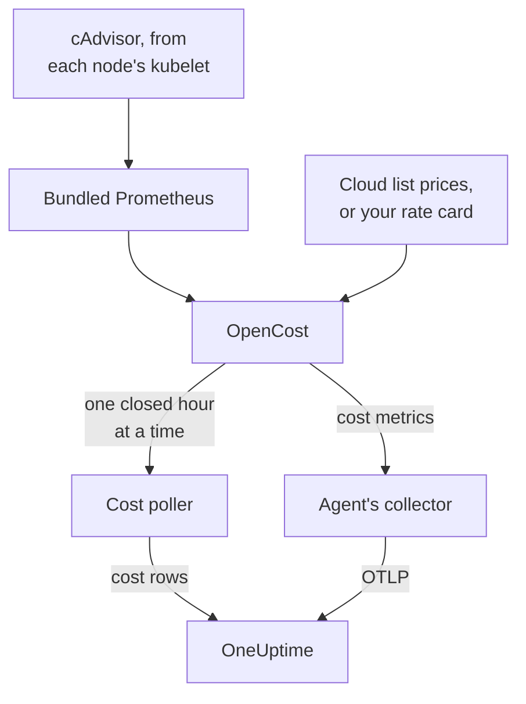

# Kubernetes Cost Observability

See what every Kubernetes workload costs — spend per namespace, workload and pod, idle capacity, and how much of each request is used — next to the metrics, logs and traces the [Kubernetes Agent](/docs/telemetry/kubernetes-agent) already collects. It is on by default, with no cloud credentials: the cluster's overview says what it costs, its **Costs** page tells you which requests to shrink, and the cost metrics can be charted and alerted on like any other.

:::cards
- [Turn it on](#turn-on-cost-observability): On by default; one `helm upgrade` where it is not.
- [Alerting on cost](#alerting-on-cost): Cost per cluster, namespace and workload, as metrics.
- [Your own engine](#already-running-kubecost-or-opencost): Kubecost or OpenCost you already run is found and read.
- [Right-sizing](#right-sizing): Request recommendations, and how they are made.
- [Troubleshooting](#troubleshooting): Empty pages, missing recommendations.
:::

## How it works

With cost monitoring on, as it is by default (`cost.enabled: auto`), the chart runs four things beside the agent:



1. **OpenCost**, the open-source cost engine (Apache-2.0, CNCF; the [cost-model](https://github.com/kubecost/cost-model) that also powers Kubecost). It watches the cluster, prices your nodes, volumes and load balancers, and works out what each workload costs.
2. **A small Prometheus**, which OpenCost needs for usage and price history. It runs one replica, keeps 7 days of history, and scrapes exactly two targets: cAdvisor on each node's kubelet (through the API server's node proxy on the `eks-fargate` preset, where no pod reaches a kubelet), keeping only the series OpenCost reads, and OpenCost itself (which emits its own resource-request metrics, so kube-state-metrics is not involved). It is never exposed outside the cluster, and its data never leaves it.
3. **The cost poller** (`cost.agent`). Once per closed hour it reads OpenCost's Allocation API and sends one cost row per workload to OneUptime: CPU, memory, GPU, volumes, network, load balancers and idle, with efficiency. Each hour is sent once; the server skips an hour it already has, so a restart cannot count spend twice. OneUptime also writes the [cost metrics](#alerting-on-cost) from these rows.
4. **A cost metrics scrape** (`cost.metrics`). The agent's collector scrapes OpenCost's price metrics, what each node, volume and load balancer costs an hour, and sends them with the rest of the cluster's metrics.

OpenCost prices nodes from your cloud provider's public list prices (AWS, Google Cloud, Azure) with no credentials. Elsewhere it uses its default rates, which a [rate card](#on-prem-and-bare-metal-pricing) of your own replaces.

The three pods request about 150m of CPU and 450Mi of memory between them. Cost monitoring is off by default on the `gke-autopilot` and `eks-fargate` presets: those platforms bill every pod by what it requests, so the cost pods would add to the bill they measure, and OpenCost prices nodes, which is not how either platform charges.

## Turn on cost observability

A new install needs nothing: cost monitoring is on by default. Upgrade an agent installed before it was, or turn it on with the `gke-autopilot` or `eks-fargate` preset:

:::steps
### Upgrade the agent

```bash
helm upgrade kubernetes-agent oneuptime/kubernetes-agent \
  --namespace oneuptime-agent \
  --reset-then-reuse-values \
  --set cost.enabled=true
```

That is a complete install: three small extra pods, OpenCost, its Prometheus and the cost agent. If you installed the agent under another release name or namespace, use yours (`helm list -A | grep kubernetes-agent` shows them). To turn cost monitoring off, set `--set cost.enabled=false` the same way.

### Wait for the first closed hour

The first costs appear after the first full hour closes, and OpenCost needs a few minutes after it starts to price its first hour.

### Open the Costs pages

- **Products → Infrastructure → Kubernetes → Costs** shows spend across every cluster in the project.
- On a cluster, the overview shows its spend over the last 24 hours, a monthly run-rate, idle spend, efficiency and its costliest namespaces and workloads.
- On a cluster, **Costs** shows its spend trend, **Spend by Namespace** with the CPU, memory and storage split, **Spend by Workload**, idle spend, efficiency, and the **Right-Sizing** card.
:::

The cost metrics (`node_total_hourly_cost`, `pv_hourly_cost` and the rest) are ordinary metrics: they are in the metric explorer, on custom dashboards and in metric monitors. For a ready-made dashboard, go to **Products → Dashboards**, select **Create Dashboard** and pick **Kubernetes Cost Dashboard**: node hourly cost trends, CPU and memory unit costs, and volume and load balancer spend.

Under the figures, the overview and the **Costs** page say where their prices come from: a cloud's list prices, your rate card, or OpenCost's default rates. Efficiency is one figure everywhere, the efficiency metric included: how much of the requested CPU and memory was used, each container's hour weighted by what its CPU and memory cost, so a cheap job that uses nothing cannot pull a well-used cluster down, and idle capacity is not counted.

## Already running Kubecost or OpenCost?

The cost agent finds it and reads it instead of the bundled OpenCost, so the cluster is priced as you set it up: your rate card, or your cloud bill behind Kubecost. It looks when it starts, then hourly, through the Kubernetes API, for the Services the engines' own charts create in any namespace (Kubecost's `cost-analyzer` or `frontend`, OpenCost's chart, and the `opencost` Service its manifest creates), Kubecost first. It passes over an engine that does not answer, needs a sign-in or answers for several clusters, and then reads the bundled one.

The cluster's overview then names your engine and says the bundled OpenCost is not needed. Stop running it:

```bash
helm upgrade kubernetes-agent oneuptime/kubernetes-agent \
  --namespace oneuptime-agent \
  --reset-then-reuse-values \
  --set cost.engine.url=auto
```

With `cost.engine.url=auto` nothing is bundled, and the agent reads your engine wherever it runs; with no engine installed, nothing is priced. The chart cannot look for an engine itself: Helm's `lookup` sees nothing under `helm template`, Argo CD or a dry run. To keep the bundled OpenCost beside your own engine, set `cost.engine.preferExisting=false`; to name the engine to read, set `cost.engine.url` to its Service:

| Engine | Usual service URL |
| --- | --- |
| OpenCost | `http://opencost.opencost.svc.cluster.local:9003` |
| Kubecost 2 | `http://kubecost-cost-analyzer.kubecost.svc.cluster.local:9090` |
| Kubecost 3 | `http://kubecost-frontend.kubecost.svc.cluster.local:9090` |

The Allocation API path is found by itself (`/model/allocation` for Kubecost, `/allocation/compute` or `/allocation` for OpenCost). Set `cost.engine.allocationPath` only for an unusual install. With `auto` or a URL nothing is bundled, so for memory recommendations also set `cost.engine.prometheusUrl` (see [The data behind it](#the-data-behind-it)). The price metrics are found by themselves too, whichever of the engine's Services you name: the agent tries its `/metrics`, then the `/model/metrics` a Kubecost 2 frontend or OpenCost's UI passes on to the engine, then Kubecost 3's FinOps agent, and the collector scrapes the first that has price series. To name them yourself, set `cost.metrics.endpoint`.

## On-prem and bare-metal pricing

Clusters whose nodes have no public cloud list price can set a rate card. Without one, OpenCost prices them at its default rates (on-premises, bare metal, kind, k3s), which can be far from what your hardware costs, and the cluster's overview and **Costs** page say so; on a cloud it recognises, a node keeps its list price, and a rate card prices only what the list lacks. With one, OpenCost then prices every resource from these figures, all in USD per resource-hour:

```yaml title="values.yaml"
cost:
  enabled: true
  opencost:
    customPricing:
      enabled: true
      cpuPerCoreHour: "0.031611"       # ~$23 per core-month
      ramPerGiBHour: "0.004237"        # ~$3 per GiB-month
      storagePerGBHour: "0.00005479452" # ~$0.04 per GB-month
      gpuPerHour: "0.95"
```

These are OpenCost's own default rates: put your own figures in, or the **Costs** page still says the cluster is priced at OpenCost's default rates.

## Settings worth knowing

All optional; the chart's `values.yaml` has the full list:

```yaml title="values.yaml"
cost:
  enabled: auto           # on, except with the gke-autopilot and eks-fargate presets
  agent:
    windowSeconds: 3600   # allocation window length (hourly = native)
    includeIdle: true     # ship the engine's __idle__ allocation
    currency: USD         # currency code shown in the UI (informational)
  prometheus:
    retention: 7d         # bundled TSDB history; right-sizing reads peaks back over days
    persistence:
      enabled: false      # set true for a small PVC; emptyDir otherwise
  metrics:
    enabled: true         # cost metrics for dashboards / Metric Explorer
    scrapeInterval: 60s
```

## Right-sizing

The **Right-Sizing** card on a cluster's **Costs** page recommends a CPU and a memory request for every container it has enough history for, ranked by how much each change saves per month.

A recommendation is the observed demand plus 25% headroom, rounded to a value you can paste into a manifest (10m of CPU, 16Mi of memory):

- CPU is sized from the 95th percentile of hourly average use: high enough to cover real load, low enough that one spike does not inflate the request for a month.
- Memory is sized from the peak working set, never an average (see [The data behind it](#the-data-behind-it)).

Requests are recommended; limits are not. A request is what the scheduler reserves and what the bill is worked out from, so it is the number that moves cost. A limit is a decision about whether a misbehaving container should be throttled or killed, which usage data cannot make for you.

Each container is compared with its current request:

| Verdict | What it means |
| --- | --- |
| Over-provisioned | It reserves clearly more than it uses. This is where the savings come from. |
| Under-provisioned | It reserves less than it uses, so it is throttled or at risk of an OOM kill. Fixing it costs money, and the card shows that as an increase. |
| No request set | There is nothing to shrink, but the scheduler cannot place the container safely, and it is the first evicted under pressure. |

A container within 15% of its recommendation counts as right-sized and is left out: nobody should edit a manifest to shave 3% off a request.

Two guards keep the advice honest. A workload needs at least 24 hours of cost windows before it is sized at all, because a four-hour window can catch a nightly batch job at rest and advise shrinking it to nothing. And savings are projected from the length of the window you are looking at, not from the number of rows, so a Deployment's saving is not multiplied by its replica count. The estimate assumes spend scales with what the engine allocated, which is `max(request, usage)`; for an over-provisioned container that is the request, so the savings figure is exact.

### The data behind it

Beside spend, the poller collects what a recommendation needs: each container's CPU and memory requests, limits and use.

Memory needs one more source. The Allocation API reports only an average over each window, and an hourly average hides the burst that OOM-kills a container, so sizing memory from it would be dangerous. The poller reads each container's memory peak from Prometheus instead, joined on `(namespace, pod, container)`:

- With the bundled engine (the default), it uses the chart's own Prometheus. Nothing to set.
- With `cost.engine.url` set (`auto` or your engine's URL), point `cost.engine.prometheusUrl` at a Prometheus that scrapes cAdvisor, and set `cost.engine.prometheusCadvisorJob` if its scrape job is not named `kubernetes-nodes-cadvisor`.
- With no Prometheus, CPU recommendations still work, from the stored hourly averages, and memory recommendations are left out rather than guessed.

A Prometheus outage never stops spend collection: peaks are an extra, and an hour is sent without them. CPU deliberately does not use Prometheus: too large a CPU request only throttles where too small a memory request kills, so the hourly averages are safe for CPU, and querying every container's CPU rate across a cluster is heavy enough to topple a small Prometheus.

## Alerting on cost

OneUptime writes four metrics from the cost rows of every hour, priced and named for what they are, so cost can be charted, put on a dashboard and alerted on in a [Kubernetes monitor](/docs/monitor/kubernetes-monitor) or a [metrics monitor](/docs/monitor/metrics-monitor):

| Metric | What it is | Attributes |
| --- | --- | --- |
| `oneuptime.kubernetes.cost.total` | What the cluster cost in each hour, idle capacity included | `k8s.cluster.name` |
| `oneuptime.kubernetes.cost.idle` | The part of it no workload used: idle and unallocated capacity | `k8s.cluster.name` |
| `oneuptime.kubernetes.cost.workload` | What each workload cost in each hour; summed by namespace, what the namespace cost | `k8s.cluster.name`, `k8s.namespace.name`, and the workload's name under its kind, such as `k8s.deployment.name` |
| `oneuptime.kubernetes.cost.efficiency` | How much of its requested CPU and memory each workload used, in percent, weighted by cost | The workload's, as above |

Each point is one hour's cost, in the agent's currency (USD by default), stamped at the start of the hour and written about an hour after it ends: sum the points over a window of hours, and a day's add up to the day's cost. They come from what the cluster already sent, so they are not billed as ingested metrics, and they are kept as long as the cluster's other metrics.

The Kubernetes monitor has three templates for them: Cluster Daily Cost Over Budget, Namespace Daily Cost Over Budget and High Idle Spend, each with a budget to set to your own. OpenCost's price metrics are ordinary metrics too: a metrics monitor can alert when the average `node_total_hourly_cost` rises above a budget, or when `pv_hourly_cost` appears for a volume class that should not exist in a cluster.

## Data model and retention

Cost rows are stored in ClickHouse, one per cluster, window, namespace, controller, pod and container. They follow the cluster's telemetry retention: the cluster's `retainTelemetryDataForDays`, or the project's data retention when that is not set. Idle and unallocated capacity are stored as ordinary rows under the `__idle__` and `__unallocated__` namespaces, so they group and filter like workload spend.

## Troubleshooting

:::details The Costs pages are empty
On the `gke-autopilot` and `eks-fargate` presets cost monitoring is off by default: turn it on with `--set cost.enabled=true`. Otherwise, read the cost poller's logs: `kubectl logs -n oneuptime-agent deploy/kubernetes-agent-cost`. (The deployment is `<release>-kubernetes-agent-cost` when the release name does not contain `kubernetes-agent`; `kubectl get deploy -n oneuptime-agent` lists them.) `HTTP 401` means OneUptime refused the ingestion key. `did not answer any known allocation path` means the engine is not up yet (the bundled OpenCost needs a few minutes to price its first hours) or `cost.engine.url` is wrong.
:::

:::details The bundled OpenCost is not ready
Read its logs: `kubectl logs -n oneuptime-agent deploy/kubernetes-agent-opencost`. It says which cloud provider it detected and whether its pricing data loaded.
:::

:::details The overview says the bundled OpenCost is not needed
The cluster runs its own Kubecost or OpenCost, and the cost agent reads that, so the OpenCost and Prometheus the chart bundled price nothing. Upgrade with `--set cost.engine.url=auto` to stop running them, or set `cost.engine.preferExisting=false` to read the bundled engine instead.
:::

:::details The cost agent does not read your engine
Its log says which engine it reads, and why it passed over the others: `kubectl logs -n oneuptime-agent deploy/kubernetes-agent-cost`. It passes over an engine that does not answer (a NetworkPolicy between the namespaces, say), needs a sign-in, or answers for several clusters, as a Kubecost that federates others does. Name the engine to read with `cost.engine.url`.
:::

:::details The OpenCost log says mkdir /var/configs: permission denied
An older chart ran OpenCost without a writable config directory, so `Error downloading default pricing data` left its Allocation API unable to answer and the poller stalled, while the pod stayed `Running`, `/healthz` stayed green and the node cost metrics kept publishing. Current charts fix it: run `helm repo update`, then upgrade with `--reset-then-reuse-values`. Cost rows appear on the next poll.
:::

:::details The Kubernetes Cost Dashboard shows no data
The template reads the scraped cost metrics: check that `cost.metrics.enabled` is `true`. With `cost.engine.url` set, the cost agent finds where your engine serves them, and its log says where, or which addresses it tried: `kubectl logs -n oneuptime-agent deploy/kubernetes-agent-cost`. To name them yourself, set `cost.metrics.endpoint`.
:::

:::details The Right-Sizing card is empty
Either the time range is shorter than the 24 hours a recommendation needs (widen it), or every container is already within 15% of its recommended request, which the card says.
:::

:::details Memory recommendations show - but CPU ones work
No memory peak reached OneUptime, so memory was left unsized rather than guessed from an average. With your own engine, set `cost.engine.prometheusUrl`. The card says how many containers this affects.
:::

:::details The numbers differ from the engine's own UI
OneUptime includes the engine's reconciliation adjustments in each cost component, and sends whole closed hours: the current hour's spend appears after it closes.
:::

:::details The bundled Prometheus restarted
With the default `emptyDir` storage a restart loses a few hours of usage history, so the costs of those hours may come out smaller. Set `cost.prometheus.persistence.enabled=true` if that matters to you.
:::

## Next steps

:::cards
- [Kubernetes Agent](/docs/telemetry/kubernetes-agent): Install the agent, and everything else it collects.
- [Metrics Monitor](/docs/monitor/metrics-monitor): Alert when spend crosses a budget.
- [Kubernetes Monitor](/docs/monitor/kubernetes-monitor): Alert on the cluster's health too.
:::
