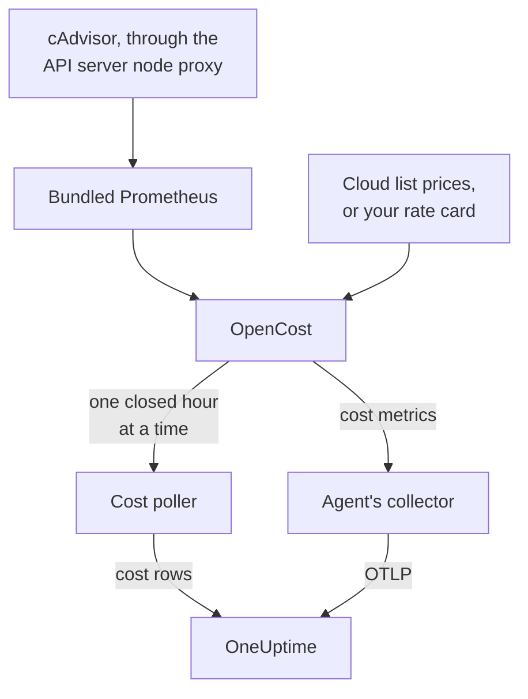

# Kubernetes Cost Observability

See what every Kubernetes workload costs — spend per namespace, workload and pod, idle capacity, and how much of each request is used — next to the metrics, logs and traces the [Kubernetes Agent](/docs/telemetry/kubernetes-agent) already collects. One Helm value turns it on, with no cloud credentials, and the cluster's **Costs** page then tells you which requests to shrink.

:::cards
- [Turn it on](#turn-on-cost-observability): One `helm upgrade`.
- [Bring your own engine](#already-running-kubecost-or-opencost): Point the agent at Kubecost or OpenCost.
- [Right-sizing](#right-sizing): Request recommendations, and how they are made.
- [Troubleshooting](#troubleshooting): Empty pages, missing recommendations.
:::

## How it works

With `cost.enabled=true` the chart runs four things beside the agent:



1. **OpenCost**, the open-source cost engine (Apache-2.0, CNCF; the [cost-model](https://github.com/kubecost/cost-model) that also powers Kubecost). It watches the cluster, prices your nodes, volumes and load balancers, and works out what each workload costs.
2. **A small Prometheus**, which OpenCost needs for usage and price history. It runs one replica, keeps 7 days of history, and scrapes exactly two targets: cAdvisor through the API server's node proxy, and OpenCost itself (which emits its own resource-request metrics, so kube-state-metrics is not involved). It is never exposed outside the cluster, and its data never leaves it.
3. **The cost poller** (`cost.agent`). Once per closed hour it reads OpenCost's Allocation API and sends one cost row per workload to OneUptime: CPU, memory, GPU, volumes, network, load balancers and idle, with efficiency. Each hour is sent once; the server skips an hour it already has, so a restart cannot count spend twice.
4. **A cost metrics scrape** (`cost.metrics`). The agent's collector scrapes OpenCost's cost metrics and sends them with the rest of the cluster's metrics.

OpenCost prices nodes from your cloud provider's public list prices (AWS, Google Cloud, Azure) with no credentials. Clusters with no cloud list price set a [rate card](#on-prem-and-bare-metal-pricing) instead.

## Turn on cost observability

:::steps
### Upgrade the agent with cost.enabled

```bash
helm upgrade kubernetes-agent oneuptime/kubernetes-agent \
  --namespace oneuptime-agent \
  --reset-then-reuse-values \
  --set cost.enabled=true
```

That is a complete install: two small extra pods, OpenCost and its Prometheus. If you installed the agent under another release name or namespace, use yours (`helm list -A | grep kubernetes-agent` shows them).

### Wait for the first closed hour

The first costs appear after the first full hour closes, and OpenCost needs a few minutes after it starts to price its first hour.

### Open the Costs pages

- **Products → Infrastructure → Kubernetes → Costs** shows spend across every cluster in the project.
- On a cluster, **Costs** shows its spend trend, **Spend by Namespace** with the CPU, memory and storage split, **Spend by Workload**, idle spend, efficiency, and the **Right-Sizing** card.
:::

The cost metrics (`node_total_hourly_cost`, `pv_hourly_cost` and the rest) are ordinary metrics: they are in the metric explorer, on custom dashboards and in metric monitors. For a ready-made dashboard, go to **Products → Dashboards**, select **Create Dashboard** and pick **Kubernetes Cost Dashboard**: node hourly cost trends, CPU and memory unit costs, and volume and load balancer spend.

## Already running Kubecost or OpenCost?

Point the agent at your engine instead, and nothing is bundled:

```bash
helm upgrade kubernetes-agent oneuptime/kubernetes-agent \
  --namespace oneuptime-agent \
  --reset-then-reuse-values \
  --set cost.enabled=true \
  --set cost.engine.url=http://kubecost-cost-analyzer.kubecost.svc.cluster.local:9090
```

| Engine | Usual service URL |
| --- | --- |
| OpenCost | `http://opencost.opencost.svc.cluster.local:9003` |
| Kubecost | `http://kubecost-cost-analyzer.kubecost.svc.cluster.local:9090` |

The Allocation API path is found by itself (`/model/allocation` for Kubecost, `/allocation/compute` or `/allocation` for OpenCost). Set `cost.engine.allocationPath` only for an unusual install. For memory recommendations, also set `cost.engine.prometheusUrl` (see [The data behind it](#the-data-behind-it)).

## On-prem and bare-metal pricing

Clusters whose nodes have no public cloud list price can set a rate card. OpenCost then prices every resource from these figures, all in USD per resource-hour:

```yaml title="values.yaml"
cost:
  enabled: true
  opencost:
    customPricing:
      enabled: true
      cpuPerCoreHour: "0.031611"       # ~$23 per core-month
      ramPerGiBHour: "0.004237"        # ~$3 per GiB-month
      storagePerGBHour: "0.00005479452" # ~$0.04 per GB-month
      gpuPerHour: "0.95"
```

## Settings worth knowing

All optional; the chart's `values.yaml` has the full list:

```yaml title="values.yaml"
cost:
  agent:
    windowSeconds: 3600   # allocation window length (hourly = native)
    includeIdle: true     # ship the engine's __idle__ allocation
    currency: USD         # currency code shown in the UI (informational)
  prometheus:
    retention: 7d         # bundled TSDB history; right-sizing reads peaks back over days
    persistence:
      enabled: false      # set true for a small PVC; emptyDir otherwise
  metrics:
    enabled: true         # cost metrics for dashboards / Metric Explorer
    scrapeInterval: 60s
```

## Right-sizing

The **Right-Sizing** card on a cluster's **Costs** page recommends a CPU and a memory request for every container it has enough history for, ranked by how much each change saves per month.

A recommendation is the observed demand plus 25% headroom, rounded to a value you can paste into a manifest (10m of CPU, 16Mi of memory):

- CPU is sized from the 95th percentile of hourly average use: high enough to cover real load, low enough that one spike does not inflate the request for a month.
- Memory is sized from the peak working set, never an average (see [The data behind it](#the-data-behind-it)).

Requests are recommended; limits are not. A request is what the scheduler reserves and what the bill is worked out from, so it is the number that moves cost. A limit is a decision about whether a misbehaving container should be throttled or killed, which usage data cannot make for you.

Each container is compared with its current request:

| Verdict | What it means |
| --- | --- |
| Over-provisioned | It reserves clearly more than it uses. This is where the savings come from. |
| Under-provisioned | It reserves less than it uses, so it is throttled or at risk of an OOM kill. Fixing it costs money, and the card shows that as an increase. |
| No request set | There is nothing to shrink, but the scheduler cannot place the container safely, and it is the first evicted under pressure. |

A container within 15% of its recommendation counts as right-sized and is left out: nobody should edit a manifest to shave 3% off a request.

Two guards keep the advice honest. A workload needs at least 24 hours of cost windows before it is sized at all, because a four-hour window can catch a nightly batch job at rest and advise shrinking it to nothing. And savings are projected from the length of the window you are looking at, not from the number of rows, so a Deployment's saving is not multiplied by its replica count. The estimate assumes spend scales with what the engine allocated, which is `max(request, usage)`; for an over-provisioned container that is the request, so the savings figure is exact.

### The data behind it

Beside spend, the poller collects what a recommendation needs: each container's CPU and memory requests, limits and use.

Memory needs one more source. The Allocation API reports only an average over each window, and an hourly average hides the burst that OOM-kills a container, so sizing memory from it would be dangerous. The poller reads each container's memory peak from Prometheus instead, joined on `(namespace, pod, container)`:

- With the bundled engine (the default), it uses the chart's own Prometheus. Nothing to set.
- With your own engine (`cost.engine.url`), point `cost.engine.prometheusUrl` at a Prometheus that scrapes cAdvisor, and set `cost.engine.prometheusCadvisorJob` if its scrape job is not named `kubernetes-nodes-cadvisor`.
- With no Prometheus, CPU recommendations still work, from the stored hourly averages, and memory recommendations are left out rather than guessed.

A Prometheus outage never stops spend collection: peaks are an extra, and an hour is sent without them. CPU deliberately does not use Prometheus: too large a CPU request only throttles where too small a memory request kills, so the hourly averages are safe for CPU, and querying every container's CPU rate across a cluster is heavy enough to topple a small Prometheus.

## Alerting on cost

The cost metrics are ordinary metrics, so a [metrics monitor](/docs/monitor/metrics-monitor) can alert on them like anything else: for example, when the average `node_total_hourly_cost` rises above a budget, or when `pv_hourly_cost` appears for a volume class that should not exist in a cluster.

## Data model and retention

Cost rows are stored in ClickHouse, one per cluster, window, namespace, controller, pod and container. They follow the cluster's telemetry retention: the cluster's `retainTelemetryDataForDays`, or the project's data retention when that is not set. Idle and unallocated capacity are stored as ordinary rows under the `__idle__` and `__unallocated__` namespaces, so they group and filter like workload spend.

## Troubleshooting

:::details The Costs pages are empty
Read the cost poller's logs: `kubectl logs -n oneuptime-agent deploy/kubernetes-agent-cost`. (The deployment is `<release>-kubernetes-agent-cost` when the release name does not contain `kubernetes-agent`; `kubectl get deploy -n oneuptime-agent` lists them.) `HTTP 401` means OneUptime refused the ingestion key. `did not answer any known allocation path` means the engine is not up yet (the bundled OpenCost needs a few minutes to price its first hours) or `cost.engine.url` is wrong.
:::

:::details The bundled OpenCost is not ready
Read its logs: `kubectl logs -n oneuptime-agent deploy/kubernetes-agent-opencost`. It says which cloud provider it detected and whether its pricing data loaded.
:::

:::details The OpenCost log says mkdir /var/configs: permission denied
An older chart ran OpenCost without a writable config directory, so `Error downloading default pricing data` left its Allocation API unable to answer and the poller stalled, while the pod stayed `Running`, `/healthz` stayed green and the node cost metrics kept publishing. Current charts fix it: run `helm repo update`, then upgrade with `--reset-then-reuse-values`. Cost rows appear on the next poll.
:::

:::details The Kubernetes Cost Dashboard shows no data
The template reads the scraped cost metrics: check that `cost.metrics.enabled` is `true`.
:::

:::details The Right-Sizing card is empty
Either the time range is shorter than the 24 hours a recommendation needs (widen it), or every container is already within 15% of its recommended request, which the card says.
:::

:::details Memory recommendations show - but CPU ones work
No memory peak reached OneUptime, so memory was left unsized rather than guessed from an average. With your own engine, set `cost.engine.prometheusUrl`. The card says how many containers this affects.
:::

:::details The numbers differ from the engine's own UI
OneUptime includes the engine's reconciliation adjustments in each cost component, and sends whole closed hours: the current hour's spend appears after it closes.
:::

:::details The bundled Prometheus restarted
With the default `emptyDir` storage a restart loses a few hours of usage history, so the costs of those hours may come out smaller. Set `cost.prometheus.persistence.enabled=true` if that matters to you.
:::

## Next steps

:::cards
- [Kubernetes Agent](/docs/telemetry/kubernetes-agent): Install the agent, and everything else it collects.
- [Metrics Monitor](/docs/monitor/metrics-monitor): Alert when spend crosses a budget.
- [Kubernetes Monitor](/docs/monitor/kubernetes-monitor): Alert on the cluster's health too.
:::
