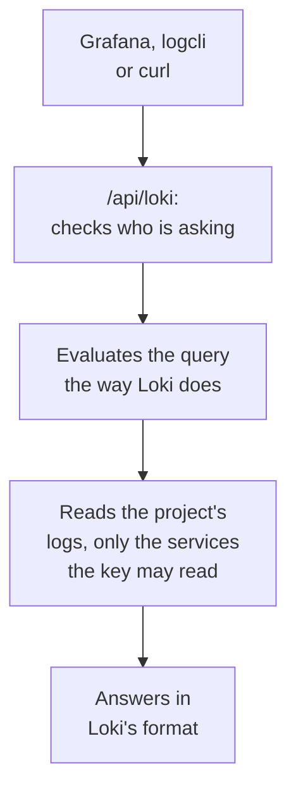

# Query Logs with LogQL

LogQL is the query language of Grafana Loki. OneUptime answers Loki's query API over your project's logs, so Grafana's Loki data source, logcli, or any Loki client reads them, and the dashboards and saved queries you wrote for Loki keep working.

:::cards
- [Connect Grafana](#connect-grafana): Add OneUptime as a Loki data source.
- [How logs are labelled](#how-logs-are-labelled): What a stream selector matches.
- [What LogQL covers](#what-logql-covers): Log queries, parsers and metric queries.
- [Limits](#limits): What a query may read, and how often.
:::

## How it works

Grafana asks OneUptime as it asks Loki. OneUptime checks that the API key may read the project's logs, reads only the services it may read, and evaluates the query the way Loki does.



## Before you begin

- **Logs arriving.** Send them with [OpenTelemetry](/docs/telemetry/open-telemetry), or from Promtail, Grafana Alloy, Fluent Bit or Vector through [Loki's push API](/docs/telemetry/compatible-endpoints).
- **A project API key that reads logs**, with the role Project Owner, Project Admin, Project Member, Viewer, Telemetry Admin, Telemetry Member or Telemetry Viewer, or the Read Logs permission. A key limited to some services reads only their logs. See [Create an API key](/docs/api-reference/api-reference#create-an-api-key). On OneUptime Cloud, API keys need the **Growth** plan.
- **Not an ingestion key.** An ingestion key sends telemetry and reads none, so Grafana cannot sign in with one.

## Connect Grafana

:::steps
### Create an API key

In OneUptime, open **Project Settings → Advanced → API Keys** and click **Create API Key**. Give the key a role that reads telemetry, or the Read Logs permission.

### Add a Loki data source

In Grafana, open **Connections → Data sources → Add data source** and pick **Loki**.

### Enter the URL

Set **URL** to your OneUptime address followed by `/api/loki`. On OneUptime Cloud, that is `https://oneuptime.com/api/loki`.

### Send the API key

Under **HTTP headers**, add the header `Authorization` with the value `Bearer` followed by a space and your API key. Basic authentication works too: any user name, with the API key as the password.

### Save and test

Click **Save & test**. Grafana runs a query, and says the data source works.
:::

Explore, the logs volume above the lines, label browsers and dashboards then read OneUptime as they read Loki. logcli and any other Loki client work the same way. With curl:

```bash title="Query OneUptime's Loki API"
curl -G -H "Authorization: Bearer $ONEUPTIME_API_KEY" \
  "https://oneuptime.com/api/loki/loki/api/v1/query_range" \
  --data-urlencode 'query={service_name="checkout"} |= "error"'
```

## How logs are labelled

A stream selector matches a log's attributes, named the way Loki 3 names OpenTelemetry logs:

| In OneUptime | In LogQL |
| --- | --- |
| A resource attribute `service.name` | The label `service_name` |
| A resource attribute `k8s.pod.name` | The label `k8s_pod_name` |
| An attribute `http.method` | The label `http_method` |
| A label a Loki client sent, such as `job` | The label `job` |
| The log's severity | The label `detected_level`: `trace`, `debug`, `info`, `warn`, `error`, `fatal` or `unknown` |

- **Every attribute is a label.** A log query answers one stream per label set, so logs with different attributes are different streams, as Loki 3 answers logs with structured metadata.
- **A log's own attribute comes first** when its resource has one of the same name.
- **A selector names a value**, as Loki asks: at least one matcher that a log without the label fails, such as `{service_name="checkout"}` or `{service_name=~"check.+"}`.

A few queries to start from:

```text title="LogQL"
# The checkout service's lines that say error
{service_name="checkout"} |= "error"

# Requests slower than 250ms, read from JSON lines
{service_name="checkout"} | json | duration > 250ms

# Error logs per second, by service
sum by (service_name) (rate({detected_level="error"} [5m]))
```

## What LogQL covers

- **Log queries**: stream selectors with `=`, `!=`, `=~` and `!~`; line filters `|=`, `!=`, `|~` and `!~`, with `or`; the `json` and `logfmt` parsers; label filters on text, numbers, durations and sizes, with `and`, `or` and `__error__`; `line_format` with `{{.label}}`; `drop`, `keep` and `decolorize`.
- **Metric queries**: `count_over_time`, `rate`, `bytes_over_time`, `bytes_rate` and `absent_over_time`; over a label taken with `unwrap` (with `duration()` or `bytes()`), `rate`, `sum_over_time`, `avg_over_time`, `min_over_time`, `max_over_time`, `first_over_time`, `last_over_time`, `stddev_over_time`, `stdvar_over_time` and `quantile_over_time`; and `offset`.
- **Around them**: `sum`, `avg`, `min`, `max`, `count`, `stddev`, `stdvar`, `topk` and `bottomk`, with `by` or `without`; arithmetic, comparisons (with `bool`), `and`, `or` and `unless`, with `on`, `ignoring`, `group_left` and `group_right`; `sort`, `sort_desc`, `label_replace` and `vector()`.

The `pattern`, `regexp` and `unpack` parsers, `label_format`, `json` with named fields, `ip()` filters, and `line_format` templates beyond `{{.label}}` are not available yet. A query that uses one is refused with a message that names it.

## The API

The API answers Loki's HTTP API routes, with `GET` or `POST`, under `/api/loki`:

| Route | What it answers |
| --- | --- |
| `/loki/api/v1/query_range` | A log query's lines from `start` to `end`, or a metric query at every `step`. |
| `/loki/api/v1/query` | A metric query at one time (`time`, by default now). |
| `/loki/api/v1/labels` | Label names, of the logs `query` selects or of every log. |
| `/loki/api/v1/label/<name>/values` | One label's values. |
| `/loki/api/v1/series` | The label sets of the logs `match[]` selects. |

Times are nanoseconds since 1970, Unix seconds or RFC 3339, and a range is the hour before `end` unless it says otherwise. A log query answers `limit` lines, 100 by default, newest first unless `direction=forward`. Answers are in Loki's format, and errors are plain text, as Loki writes them. `/loki/api/v1/status/buildinfo` answers as a Loki 3 server.

## Limits

Every query is bounded, so a dashboard of many panels cannot overload OneUptime:

| Limit | Value |
| --- | --- |
| Lines a log query answers | 5,000 |
| Logs a log query reads, when filters past its parsers drop some | 20,000 |
| Logs a metric query reads itself, when ClickHouse cannot count them | 100,000 |
| Series a metric query answers | 500 |
| Points in one series of a range query | 11,000 |
| Logs one read hands back | 64 MB |
| Time a read may take | 30 seconds |
| Queries a project may send each minute | 1,200 |

A metric query whose pipeline is line filters alone, such as `sum(count_over_time({service_name="checkout"} |= "error" [5m]))`, is counted where the logs are, so it reads no lines at all.

## Troubleshooting

:::details Grafana says the data source does not work
Check the URL ends in `/api/loki`, and the `Authorization` header holds `Bearer`, a space and the API key. An ingestion key, or an API key with no role that reads logs, is refused: give the key such a role in **Project Settings → Advanced → API Keys**.
:::

:::details "queries require at least one regexp or equality matcher that does not have an empty-compatible value"
The selector matches logs without naming a value, such as `{service_name=~".*"}`. Add a matcher that names one, such as `{service_name="checkout"}`.
:::

:::details "This project sent more queries this minute than OneUptime answers."
The project's dashboards and clients sent more than 1,200 queries to the API this minute. The panels load again in the next minute; refresh dashboards less often to stay under it.
:::

## Next steps

:::cards
- [Logs Explorer](/docs/telemetry/logs-explorer): Search and filter logs without writing a query.
- [PromQL](/docs/telemetry/promql): Query metrics with PromQL, and from Grafana's Prometheus data source.
- [Logs Monitor](/docs/monitor/logs-monitor): Alert on log volume and content.
:::
