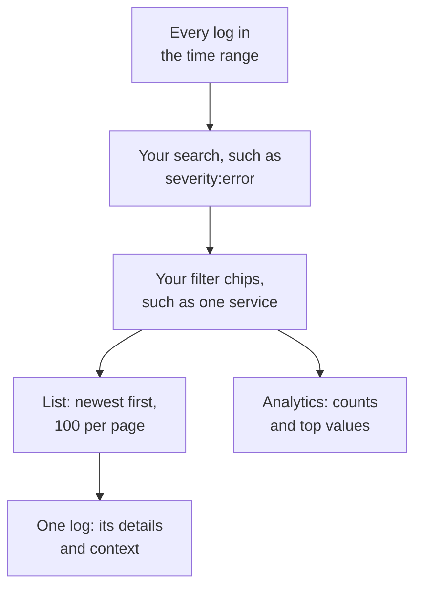

# Logs Explorer

The Logs explorer is where you search and read the logs your services, hosts and agents send to OneUptime. Narrow millions of lines down to the few that matter, follow new ones as they arrive, chart them, and save the views your team comes back to.

:::cards
- [Find a log line](#find-a-log-line): A time range, a search and a few filters.
- [Read a log](#read-a-log): Its attributes, its trace and the lines around it.
- [Follow logs live](#follow-logs-live): New lines every 10 seconds.
- [Save a view](#save-a-view): Keep a search, its filters and its columns for everyone.
- [Logs Insights](#logs-insights): Top errors, severities and who is logging what.
- [Find and fix error, missing and noisy logs with AI](#find-and-fix-error-missing-and-noisy-logs-with-ai): Pull requests that fix errors, log what goes unlogged and quiet noisy lines.
:::

## How the explorer narrows your logs

Everything on the **Viewer** tab works on one set of logs: the ones in the time range that match your search and every filter chip. Change any of them and the list, the volume chart and the counts in the sidebar change together.

The explorer has five tabs:

| Tab | What it is for |
| --- | --- |
| **Viewer** | Search, filter and read logs. It opens on the past hour, newest first, 100 logs per page. |
| **Insights** | What your services logged in a time range, and what went wrong. |
| **AI** | The error logs, missing logging and noisy logs OneUptime finds in your logs, and what OneUptime AI did about them. See [Find and fix error, missing and noisy logs with AI](#find-and-fix-error-missing-and-noisy-logs-with-ai). |
| **Setup Guide** | How to send logs with OpenTelemetry, Fluent Bit or Fluentd, using one of your [ingestion keys](/docs/telemetry/ingestion-keys). |
| **Settings** | What happens to logs as they arrive: **Pipelines**, **Drop Filters**, **Scrub Rules** and **Recording Rules**. |

## Before you begin

- **Logs arriving.** Send them with [OpenTelemetry](/docs/telemetry/open-telemetry), [Fluent Bit](/docs/telemetry/fluentbit), [Fluentd](/docs/telemetry/fluentd) or [Syslog](/docs/telemetry/syslog). The **Setup Guide** tab shows the configuration for your language or collector.
- **A role that reads telemetry.** Project Owner, Project Admin, Project Member, Viewer, Telemetry Admin, Telemetry Member or Telemetry Viewer, or a custom role with the Read Telemetry Service Log permission. Its scope decides whose logs you see: see [Telemetry](/docs/permissions/index#telemetry).

## Find a log line

:::steps
### Open the Viewer

Go to **Products → Observability → Logs**. The **Viewer** lists the past hour's logs, newest first, with their **Time**, **Service**, **Severity** and **Message**.

### Pick the time range

Pick a range in the time picker, or drag across the volume chart above the list to zoom into a spike. Double-click the chart to zoom back out. See [Zooming Into a Time Range](/docs/telemetry/charts-and-time-ranges).

### Search

Type a query in the search box and press Enter, for example `severity:error service:checkout timeout`. Bare words search the message, and `@key:value` searches an attribute. See [Search Syntax](/docs/telemetry/search-syntax#logs).

### Narrow it down with filters

Click a value in the **Filters** sidebar to add it as a chip: a severity, a service, or a host, cluster or other resource that sent logs. Each value shows how many logs carry it. On a phone, tap **Filters** to open the sidebar.

### Open a log

Click a row. Its details open beside the list.
:::

Your search, your chips and the time range are kept in the page's address, so a refresh, a bookmark or a shared link opens the same logs.

## Read a log

The details panel has two tabs:

| Tab | What it shows |
| --- | --- |
| **Details** | The **Log Body**, its **Trace ID**, **Span ID** and **Session** when it has them, and its **Attributes**, as a list or as JSON. |
| **Context** | The log among its neighbours. **Nearby (service + time)** shows the five lines before and after it from the same service, and **This trace** shows up to 100 logs of its trace. |

- Click the trace ID to open the whole request in the [Traces Explorer](/docs/telemetry/traces-explorer).
- Point at an attribute and click its filter icon to search for that value, or copy it. You can copy every attribute at once as JSON.
- **This trace** appears only for a log written inside a trace.

## Follow logs live

Click **Live** above the list. The explorer jumps to the first page, sorted newest first, and checks for new logs every 10 seconds, so lines appear as your services write them.

Live mode turns itself off when you change the search, a filter or the time range, or go to another page of results: it shows the newest logs only. Click **Live** again to resume.

## Choose columns and export

- **Columns** picks what the list shows. **Time**, **Service**, **Severity** and **Message** come first; add **Trace ID**, **Span ID** or any attribute, move columns up and down, or **Reset** to the defaults.
- **Export** downloads the logs on the page you are looking at. **Export as CSV** writes the columns you show; **Export as JSON** writes every field of each log, with all its attributes.

## Save a view

A saved view keeps a search, its filter chips, the time range, the columns, the sort and the page size, under a name.

:::steps
### Set up the view

Search, filter and pick the columns you want to keep.

### Save it

Open **Saved Views** and click **+ Save Current View**. Enter a **Name**, tick **Set as default** if this view should open whenever anyone opens Logs, and click **Save View**.

### Use it

Pick the view from **Saved Views** to apply it, and **Clear view** to go back to the past hour with no filters. Point at a view in the list to **Edit** or **Delete** it, or, while it is applied, to **Update** it with your changes.
:::

Saved views belong to the project, so everyone in it sees the same list. A rolling range such as the past hour stays rolling: the view shows the hour before you open it, not the hour you saved. While the project has no default view, the next view saved becomes the default, and a project has one default at a time.

## Chart your logs

Switch the list to **Analytics** to count logs instead of reading them. Pick a time series, a top list or a table; count every log, or the unique values of one field; and group by severity, service, trace, span or any attribute, then by a second field. A top list or a table shows the top 5, 10, 25 or 50 groups.

Click **List** to go back to the lines themselves.

## Open related traces and metrics

The **Traces** and **Metrics** buttons beside **Saved Views** open the [Traces Explorer](/docs/telemetry/traces-explorer) or the [Metrics Explorer](/docs/telemetry/metrics-explorer) for the same time window, with as much of your filtering as that explorer can use. Point at a button to see anything it cannot carry over.

## Logs Insights

The **Insights** tab shows what your services logged in a time range, and what went wrong. Scope it to some services, hosts or clusters with the dropdown beside the time picker.

| Panel | What it shows |
| --- | --- |
| Summary cards | **Total logs**, **Errors**, **Distinct errors** and **Reporting sources**. |
| **Severity distribution** | How the logs break down by severity. |
| **Top errors** | The distinct messages logged at Error or Fatal severity, most frequent first. |
| **Sources reporting logs** | The volume and error signal of each service, host or other source. |

Select a top error to see what was happening around it: when it happened, what its occurrences share, where it happens, the traces carrying it and its most recent lines. **Open matching logs** opens them in the **Viewer**, and **Explain with AI** opens [Ask AI](/docs/ai/ask-ai) with the error and its evidence as a prompt you can edit.

## Find and fix error, missing and noisy logs with AI

Every hour OneUptime looks through each service's logs from the last hour for errors it logs again and again, failures it does not log, and lines that flood its logs, and files what it finds as AI insights, with the evidence. OneUptime AI then looks into each one and opens a pull request to fix it. Nothing is ever merged: your team reviews each pull request.

OneUptime files three kinds of finding:

| Finding | When OneUptime files it | The pull request |
| --- | --- | --- |
| **Error Log** | A service logged one message at Error or Fatal 20 or more times in the hour, a message with words of its own and no exception. A message logged with an exception, or with a stack trace in it, is tracked in [Exception Tracking](/docs/telemetry/exceptions) instead. | Fixes why the error is logged, or logs it at the level it deserves. |
| **Missing Logging** | At least 20 of an operation's spans failed in the hour, 5% or more of them, while at least 100 of the service's logs carry a trace id, and none of the operation's 20 most recent failed requests wrote a log line. Or a service sent 500 or more logs and 100 or more spans in the hour, and fewer than 1% of its logs carry a trace id. | Logs the failure where it happens, or makes the service's logs carry the trace id. |
| **Noisy Log** | One message logged below Error is 25% or more of a service's lines in the hour, and some 10,000 lines or more. | Logs the line less: at Debug, once for a batch, or not at all. |

A finding keeps a message as its pattern: the parts that change from line to line, such as numbers and ids, are masked. The pull request is asked for with that pattern, never with a line as it was logged, and OneUptime AI is told never to log secrets or personal data, or to copy log lines into the pull request.

OneUptime AI opens an error log's pull request on its own only once it finds the code at fault. An error that comes from somewhere else, such as a dependency that is down, gets no pull request unless someone asks for one with **Fix with AI**.

### Turn it on

**Logs → AI → Settings** holds the switch **Find and fix error, missing and noisy logs**, on for new projects. With **Enable AI** off, error, missing and noisy logs are still found, but OneUptime AI does nothing with them. To open pull requests, OneUptime AI needs a repository connected in [Code](/docs/ai/ai-agent): the page says what is missing first. Each repository's code is changed on the Runner the repository picks in Code.

OneUptime AI opens at most 5 pull requests on its own each day (UTC), for all the telemetry it fixes together, one for each finding, and never more than a repository's limit on open AI pull requests.

### AI rules

With no rule, OneUptime AI looks into every problem it finds in your logs right away, and opens a pull request for each one it can fix. The **AI rules** under **More settings** narrow that, in three steps:

| Step | What it decides |
| --- | --- |
| **Match** | Which services: the ones picked, the ones with certain labels, or the ones whose names match a pattern. |
| **Investigate** | **Right away**, or **Only if still found after a wait**: a problem that goes away during the wait is not looked into. |
| **Fix** | **Don't fix**, **Ask before fixing** or **Fix without asking**. Asking first leaves the pull request to a person: the finding offers **Fix with AI**. |

Under **More fields** a rule picks the code repositories, the MCP servers and the LLM provider OneUptime AI may use for it. With none picked, it may use any of them, and the project's default LLM provider.

### See what it did

- **Logs → AI → Insights** lists what OneUptime found, each finding with its evidence and **Open in Logs**, which opens the lines it is about, from the hour it was found in, in the **Viewer**. A failure that writes no log line has no lines to open: **Open in Traces** opens its failed spans instead. On an error log, **Create Monitor** sets up a Logs monitor that counts the message's lines.
- **Logs → AI → Activity** lists every investigation and pull request, newest first, with how each one stands. A finished investigation also says what OneUptime AI found, such as an error's cause outside the code, which is why that error log got no pull request on its own.
- In Code, the task says OneUptime started it, with a link to its finding, and the pull request says why it was opened.

## What happens to logs as they arrive

The **Settings** tab holds the rules OneUptime applies to every log before it is stored. They act on the logs that arrive afterwards, not on stored ones. How long each log is kept is decided as it arrives too: see [Data Retention](/docs/telemetry/data-retention).

| Rule | What it does |
| --- | --- |
| **Drop Filters** | Discard logs you do not want to keep, or keep a sample of them. See [Drop or sample records](/docs/telemetry/drop-filters-and-scrub-rules#drop-or-sample-records). |
| **Scrub Rules** | Mask sensitive data, such as email addresses and card numbers. See [Scrub sensitive data](/docs/telemetry/drop-filters-and-scrub-rules#scrub-sensitive-data). |
| **Pipelines** | Parse fields out of the message, fix the severity, rename attributes. See [Log Pipelines](/docs/telemetry/log-pipelines). |
| **Recording Rules** | Turn matching logs into metrics. See [Log Recording Rules](/docs/telemetry/log-recording-rules). |

## Keyboard shortcuts

Press `?` in the Viewer to see these.

| Key | What it does |
| --- | --- |
| `j` / `k` | Move to the next or previous log. |
| Enter | Open or close the selected log. |
| Esc | Close the details panel. |
| `/` | Jump to the search box. |
| ⌘ + Enter or Ctrl + Enter | Apply the search. |
| `?` | Show or hide the shortcuts. |

## Troubleshooting

:::details No logs appear
Widen the time range first: the Viewer opens on the past hour. If the list is still empty, compare your setup with the **Setup Guide**, and check that your role's scope covers the service that sends the logs.
:::

:::details The search says it ran out of time
A search that runs longer than 45 seconds is stopped. Pick a shorter time range, or add an exact value such as a service, so OneUptime can use its index. See [Search Syntax](/docs/telemetry/search-syntax#good-to-know).
:::

:::details Live keeps switching itself off
Live mode only follows the newest logs, so changing the search, a filter, the time range or the page turns it off. Click **Live** again once your filters are set.
:::

## Next steps

:::cards
- [Search Syntax](/docs/telemetry/search-syntax): Every filter the search box understands.
- [Logs Monitor](/docs/monitor/logs-monitor): Get alerted when the logs you search for appear.
- [Log Pipelines](/docs/telemetry/log-pipelines): Turn parts of a log line into attributes you can filter on.
- [Traces Explorer](/docs/telemetry/traces-explorer): Follow a log's request across your services.
:::
