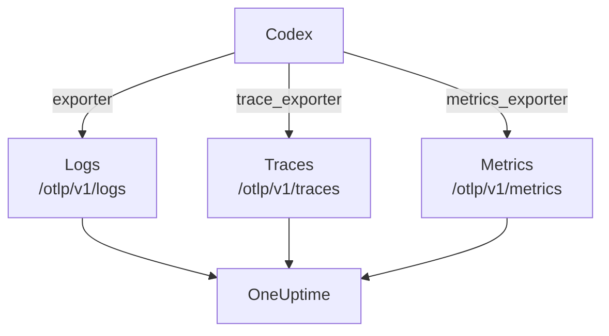

# OpenAI Codex

The Codex CLI has three OpenTelemetry exporters built in, one each for logs, traces and metrics. Point them at OneUptime in `~/.codex/config.toml` and every Codex turn arrives with its tokens and cost, with no wrapper or proxy in between.

:::cards
- [Configure Codex](#configure-codex): One `[otel]` block, with a full URL per signal.
- [Attribute usage to a person](#attribute-codex-usage-to-a-person): Codex names nobody on spans or metrics, so you do.
- [Tokens and cost](#tokens-and-cost): Which signal OneUptime reads, and what that shows.
- [Troubleshooting](#troubleshooting): What to check when nothing arrives.
:::

## How it works

Each exporter sends one signal to its own URL. Traces and logs are off until you configure them; metrics are not.



> [!WARNING]
> Codex sends its metrics to OpenAI unless you change this. In a release build, `metrics_exporter` defaults to `statsig`, which sends them to `https://ab.chatgpt.com/otlp/v1/metrics`. Setting `metrics_exporter` to an OTLP exporter, as below, or to `none` stops it. `[analytics]` with `enabled = false` also stops the Statsig default, but leaves an OTLP metrics exporter you set up working.

## Before you begin

1. Create a telemetry ingestion key under **Project Settings → Telemetry & APM → Ingestion Keys**.
2. Your OTLP endpoint is `https://oneuptime.com/otlp`, or `https://YOUR-ONEUPTIME-HOST/otlp` if you host OneUptime yourself.
3. Every export sends the key in the `x-oneuptime-token` header.

## Configure Codex

:::steps
### Add the otel block

Put this in `~/.codex/config.toml`. It turns on all three signals, and replaces the Statsig default on the way:

```toml title="~/.codex/config.toml"
[otel]
environment = "prod"
log_user_prompt = false

[otel.exporter.otlp-http]
endpoint = "https://oneuptime.com/otlp/v1/logs"
protocol = "binary"
headers = { "x-oneuptime-token" = "YOUR_INGESTION_TOKEN" }

[otel.trace_exporter.otlp-http]
endpoint = "https://oneuptime.com/otlp/v1/traces"
protocol = "binary"
headers = { "x-oneuptime-token" = "YOUR_INGESTION_TOKEN" }

[otel.metrics_exporter.otlp-http]
endpoint = "https://oneuptime.com/otlp/v1/metrics"
protocol = "binary"
headers = { "x-oneuptime-token" = "YOUR_INGESTION_TOKEN" }

[otel.span_attributes]
"user.id" = "dev@example.com"
"user.email" = "dev@example.com"
"team" = "platform"
```

### Give every exporter its full URL

Codex uses each `endpoint` exactly as written: it does not add `/v1/logs`, `/v1/traces` or `/v1/metrics` the way most SDKs do. Three exporters set to the bare `https://oneuptime.com/otlp` send nothing anywhere, without an error.

### Run a turn

Start an interactive `codex` session, ask something small and let the turn finish. Then open **Logs** in OneUptime: Codex's events, such as `codex.conversation_starts`, `codex.api_request` and `codex.turn_cost`, show up there.
:::

> [!IMPORTANT]
> Codex ignores keys it does not know under `[otel]`, without a warning. Its keys are snake_case (`trace_exporter`, `metrics_exporter`, `span_attributes`), but its exporter names and TLS fields are kebab-case (`otlp-http`, `ca-certificate`). A `trace-exporter` turns traces off with no error at all.

## Configuration keys

| Key | Default | What it does |
| --- | --- | --- |
| `environment` | `"dev"` | Sets the `env` resource attribute |
| `log_user_prompt` | `false` | Sends the prompt text on `codex.user_prompt`; otherwise it reads `[REDACTED]` |
| `log_agent_responses` | `false` | Sends the agent's final answers to the logs exporter |
| `exporter` | `none` | The logs exporter |
| `trace_exporter` | `none` | The traces exporter |
| `metrics_exporter` | `statsig` | The metrics exporter: set it |
| `span_attributes` | — | Attributes added to every exported span |
| `tracestate` | — | W3C `tracestate` members |
| `tool_result` | `{ max_bytes = 2048 }` | How much of a tool's result a log record keeps, in UTF-8 bytes |

An exporter is `none`, `statsig`, `otlp-http` or `otlp-grpc`. `otlp-http` takes `endpoint`, `headers`, `protocol` (`"binary"` or `"json"`, both of which OneUptime accepts) and `tls` (`ca-certificate`, `client-certificate`, `client-private-key`); `otlp-grpc` takes the same without `protocol`.

## Attribute Codex usage to a person

Codex names the developer in one place only:

- **Log records** carry `user.account_id` and `user.email`.
- **Spans** don't: Codex keeps both off its traces on purpose.
- **Metrics** don't either: they carry `auth_mode`, `session_source`, `originator`, `service_name`, `model` and `app.version`, and no person.

OneUptime reads people from spans and metric data points, never from log records. So stamp the identity on every span yourself, in `[otel.span_attributes]`:

```toml title="~/.codex/config.toml"
[otel.span_attributes]
"user.id" = "dev@example.com"
"user.email" = "dev@example.com"
"team" = "platform"
"cost_center" = "eng-123"
```

`user.id` is the key OneUptime prefers, and `user.email` fills the email column. Codex has no resource attributes, so set the team keys (`team.id`, `team`, `cost_center`, `department`) here too. This block lives in each developer's own config file: provision it per developer, through your dotfiles or an MDM profile. One shared file with one identity would bill everyone's spend to one person.

## Tokens and cost

| Signal | What Codex sends | What OneUptime does with it |
| --- | --- | --- |
| Traces | `gen_ai.usage.input_tokens`, `gen_ai.usage.output_tokens` and the cache tokens, but no model | Counts the tokens per person; cannot price them |
| Metrics | `codex.turn.token_usage` by `token_type`, and `codex.turn.cost_microusd`, in millionths of a USD | Converts the cost to USD; reads the metrics only where spans report nothing |
| Logs | `codex.turn_cost`, with `usage.estimated_usd` and the person | Stores it in the **Logs** explorer; not joined to spend |

With the configuration above, that adds up to this on the **Usage** tab:

- The tokens come from the spans, per person, and `codex.turn.token_usage` is not added on top: the two are never summed ([why](/docs/telemetry/ai-llm-observability#spans-come-first-metrics-fill-in)).
- Codex's spans name no model, so OneUptime cannot price them, and their cost is 0. The cost totals then take Codex's cost from `codex.turn.cost_microusd`, converted to USD for you.
- The **Employee**, **Team** and **Model** tables show the spans' rows: tokens per person, but no cost per person.
- Without traces, the metrics fill those tables instead, with cost only, all under **Unattributed**, since Codex's metrics name nobody.

The most precise cost per turn, with the person on it, is the `codex.turn_cost` log record. OneUptime does not join log records to spend yet, but keep the logs exporter on: the history is there when it does.

## Codex in CI and as an MCP server

`codex`, `codex exec` and `codex mcp-server` all build their telemetry from the same `[otel]` block, with all three exporters. `codex exec` runs carry the `originator` `codex_exec`, and `codex mcp-server` exports as `codex_mcp_server`, so you can tell CI and MCP runs from interactive sessions by those values.

## Privacy

`log_user_prompt` and `log_agent_responses` default to `false`: leave them off. The `codex.user_prompt` event still arrives, with the prompt replaced by `[REDACTED]`, so you keep the turn, its tokens and its cost without the prompt text. The person (`user.email`, `user.account_id`) is on log records whatever these switches say.

If you turn content on for an investigation, the traces' **Scrub Rules** and **Drop Filters** under **Traces → Settings** mask or drop it before it is stored.

## Using the OpenAI API instead of Codex

OpenAI's platform API sends no OpenTelemetry of its own: every span comes from instrumenting your own client. Three instrumentations work with OneUptime:

- **OpenTelemetry**: `opentelemetry-instrumentation-genai-openai` for Python, which replaces `opentelemetry-instrumentation-openai-v2`. `OTEL_INSTRUMENTATION_GENAI_CAPTURE_MESSAGE_CONTENT` decides whether messages are recorded.
- **OpenLLMetry** (Traceloop): `opentelemetry-instrumentation-openai`.
- **OpenInference** (Arize): `openinference-instrumentation-openai`.

Point any of them at OneUptime as [AI / LLM Observability](/docs/telemetry/ai-llm-observability) shows. None of them knows who your employee is: set `user.id` yourself.

The **OpenAI Agents SDK** traces to OpenAI's own endpoint, not OTLP. Bridge it with `opentelemetry-instrumentation-openai-agents-v2` or `openinference-instrumentation-openai-agents`, which hand the SDK's spans to an OTLP exporter.

## Troubleshooting

:::details Nothing arrives
Check the three `endpoint` values first: each must end in `/v1/logs`, `/v1/traces` or `/v1/metrics`. Then check the `x-oneuptime-token` header: OneUptime refuses a wrong key.
:::

:::details Traces never arrive, but logs do
Look for a misspelled key under `[otel]`: Codex ignores it silently. `trace-exporter` instead of `trace_exporter` is the usual one.
:::

:::details Codex's cost shows in the totals, but every person shows $0
That is expected: Codex's spans carry tokens but no model, so they cannot be priced, and the cost metric names nobody. See [Tokens and cost](#tokens-and-cost).
:::

:::details Everyone's spend shows under one person
The same `[otel.span_attributes]` identity is on every machine. Give each developer their own.
:::

## Next steps

:::cards
- [AI Coding Assistants](/docs/telemetry/ai-coding-assistants): How spend is attributed across every coding assistant.
- [AI / LLM Observability](/docs/telemetry/ai-llm-observability): Conversations, alerts, cost and budgets for your own AI calls.
- [AI Gateways](/docs/telemetry/ai-gateways): One gateway that traces and prices every model call.
:::
