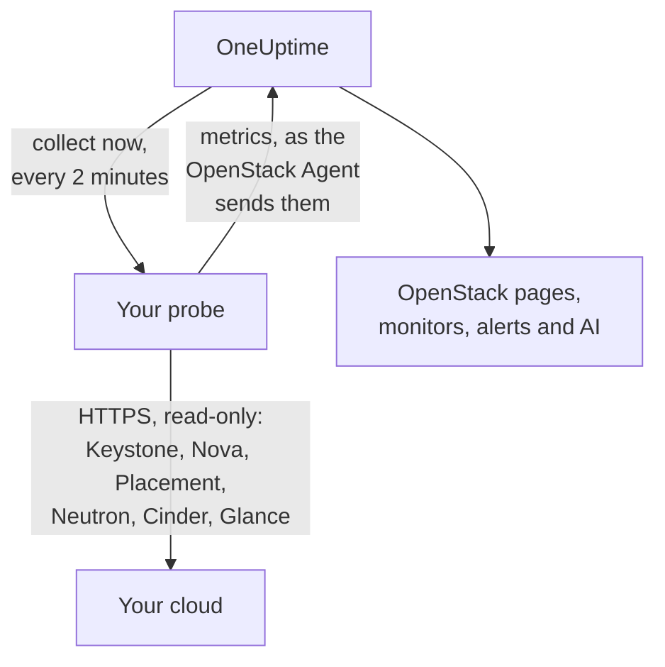

# OpenStack Without an Agent

Monitor an OpenStack cloud without installing anything: enter Keystone's address and an application credential in OneUptime, pick the probe that can reach the cloud, and the probe collects the same data the [OpenStack Agent](/docs/telemetry/openstack) would. There is no agent to install, upgrade or keep running, and no machine of its own to provision.

> [!IMPORTANT]
> A probe only speaks HTTPS to a cloud. A credential or its token is never sent over plain HTTP, and DevStack and Kolla-Ansible serve their APIs on plain HTTP by default. For such a cloud, turn on TLS for its APIs, or use the [OpenStack Agent](/docs/telemetry/openstack), which runs beside it. The connection test says so when it finds a plain HTTP address.

:::cards
- [Before you begin](#before-you-begin): A probe that reaches the APIs, and a credential.
- [Connect a cloud](#connect-a-cloud): The address, a credential, a test and a name.
- [Troubleshooting](#troubleshooting): What each message means and what fixes it.
:::

## How it works



Every two minutes the probe reads each service of each region you picked, and sends what it found to OneUptime. It arrives exactly as the OpenStack Agent's does, so every OpenStack page, [OpenStack monitor](/docs/monitor/openstack-monitor) and alert template reads it the same way.

Each service is read on its own and at the same time as the others. A Neutron that fails or hangs costs Neutron's series, and Nova's data arrives as usual.

## Probe or agent?

| | A probe (this page) | The OpenStack Agent |
|---|---|---|
| What you run | A probe you already run, or a new one | The agent, on a machine of its own |
| Where the credential is kept | Encrypted in OneUptime, sent only to the probe | In the agent's `clouds.yaml` file |
| What it needs to reach | Keystone and each service's API, over HTTPS | Keystone and each service's API |
| APIs on plain HTTP | Not collected: a token is never sent unencrypted | Collected |
| Largest cloud | About 48 MiB of metrics per collection | No limit |
| Service logs and the AI agent | Not included | Included |
| Logins to Keystone | One for the life of a token, usually an hour | One per scrape |
| A plain `reader` on one project | That project's instances, volumes and networks | That project's volumes and networks, and no instances |

Both send the same series, so the pages and monitors work with either. A probe also sends what only a native client can read: an instance's task state and fault message, when an instance, volume or image last changed, and the status of each volume snapshot and backup.

Pick the agent for a cloud past a probe's payload cap, for service logs, for the AI agent, or for a cloud whose APIs only speak plain HTTP, as DevStack and Kolla-Ansible do by default.

You can switch a cloud from one to the other at any time on its **Settings** page.

## Before you begin

- **A probe that can reach Keystone and every service's API over HTTPS.** This is usually a [custom probe](/docs/probe/custom-probe) in the cloud's network. Keystone's catalog names where each service answers, and the probe connects to those addresses, so each has to be reachable from the probe, and each has to be HTTPS. On OneUptime Cloud, the shared probes never receive an OpenStack credential, so add a probe of your own. On a self-hosted instance, the instance's own probes can collect too.
- **A credential.** An application credential is best, because it can be limited to reading and can expire. A user name and password work too, and can do whatever their account can.

OpenStack has no global read-only role, so how much the probe sees is up to the credential:

| Level | What it needs | What the probe reads |
|---|---|---|
| Full view | An application credential on an account with `admin` on a project of its own, limited by access rules to reading | Everything, but Keystone's users and groups, which the rules leave out on purpose |
| Infrastructure only | The `oneuptime_monitoring` and `reader` roles on a project of its own that holds nothing and has zero quota, and the policy files the OpenStack Agent ships | Hypervisors, Nova's services, Neutron's agents, address pools, Placement, the project list and every project's instances. Volumes, networks and routers only where the role is assigned. Not `cinder-volume` and `cinder-scheduler` state or storage pools: Cinder's own code asks for an admin |
| Project view | Plain `reader` on one project | That project's instances, volumes and networks, and no infrastructure |

The connection test says which of these a credential adds up to, and warns when its own project holds things: where Cinder has `enforce_new_defaults` off, which is its own default, any role on a project can create that project's volumes, `reader` included.

> [!IMPORTANT]
> An application credential limited by access rules is refused with a `401` by any service whose `keystonemiddleware` does not have `service_type` set. The connection test says so for each read. Set it in each service's configuration, then restart it. [Create the credential](/docs/telemetry/openstack#create-the-credential) has the rules, the policy files and the settings for each service, and [what each level reads](/docs/telemetry/openstack#what-each-level-reads) is what real clouds answered.

## Connect a cloud

:::steps
### Open your clouds
In OneUptime, open **OpenStack → All Clouds** and click **Connect Cloud**.

### Enter the address and the credential
Enter the `auth_url` from your `clouds.yaml` or `openrc` file, such as `https://keystone.example.com:5000/v3`, and the application credential's ID and secret. Pick the probe that reaches the cloud.

### Test the connection
Click **Test connection**. The probe logs in, tries each read a collection makes in each region, and logs out. It says which regions the catalog names, what the credential can read, what it is refused, which pages go without it, and the line that opens it. A failed read does not stop the test.

### Trust the cloud's certificate
A cloud with its own certificate authority presents a certificate the probe does not trust. The test then shows the certificate and the host that presented it. Check its fingerprint against the API's own, then click **Trust this certificate**. A cloud with a host per service can have a certificate per service, and you can trust up to 32.

### Pick the regions and connect
Pick the regions to read, name the cloud, and click **Connect Cloud**. The cloud's page opens.
:::

The cloud's **Overview** shows a **Data Collection** card. It reads **Checking** until the first collection, which starts within a minute, then **Collecting**, and the pages fill in. When some services were read and another was not, it says which.

## What it costs your cloud

Monitoring must never be what takes a cloud down, so a collection is gentle by construction:

- **One login, kept.** The token is used until five minutes before it expires. A login is what a Keystone in trouble can least afford.
- **Lists in pages.** Every list is read a thousand rows at a time, with `limit` and `marker`.
- **Instances by what changed.** Between full reads, every half hour, the probe asks Nova only for what changed since the last read, with `changes-since`.
- **Only the fields it reads.** Neutron's lists name their fields, and security groups are asked for their IDs alone.
- **Never stacked.** A collection that takes longer than its interval is skipped, not run beside the next.
- **A time budget.** A collection has nine-tenths of its interval, and at most ten minutes. What was read by then is sent, and the service that ran out of time says so.
- **Backing off.** Asked to wait with a `429` or `Retry-After`, the probe waits. A service that answers `429`, `503` or nothing at all is left alone for a minute, then two, then four, up to half an hour, and its series keep saying it is down while it waits. A slow answer slows the next request.
- **A refused credential waits longest.** Repeating one is what locks an account, so it waits five minutes, then ten, up to an hour. A credential you corrected is tried at once.

On each collection, with the defaults, a region costs about 7 calls to Nova, 7 to Neutron and 5 to Cinder, one call to Placement and three more per hypervisor, and, about every five minutes, 5 to Keystone and 1 to Glance. A list longer than a thousand rows takes a call per thousand. On ML2/OVS, Neutron takes one more call per router, to ask which L3 agents hold it. A cloud on OVN has none to ask about.

Two things are off unless you turn them on, under **Data Collection** on the cloud's **Settings** page, because each costs your cloud more:

| Option | What you get | What it costs |
|---|---|---|
| Ports | One series per port, and how many have no address or a load balancer that is down | One paged list per network or project you name, or of every port if you name none. An unscoped list of ports can saturate Neutron on a large cloud |
| Project limits | Quotas and limits per project | Four calls per project, on every collection |

## Certificates

The probe never skips certificate verification. Every connection completes a full TLS handshake, and then:

- with no certificate trusted, an API's certificate must come from an authority the probe's machine trusts, for the address it answers on;
- with certificates trusted, an API must present one of exactly those, identified by their SHA-256 fingerprints. Nothing else is accepted, not even a publicly trusted one.

To check a fingerprint, run this from the probe's machine:

```bash
openssl s_client -connect keystone.example.com:5000 </dev/null | openssl x509 -noout -fingerprint -sha256
```

When a certificate is renewed, collection stops with **The API's certificate changed** and the new certificate is shown. Nothing is sent until you trust it, on the cloud's **Overview** or **Settings** page.

## The saved credential

The secret is encrypted and write-only: nobody can read it back, and the API never returns it. It is sent only to the probe that collects the cloud, which keeps it in memory.

A saved credential is only ever sent to the address, through the probe and to the certificates it was entered for. Changing the address, the probe or the trusted certificates asks for the secret again, so nobody who can edit the cloud can send it somewhere else. Trusting the certificate the probe found at the saved address keeps it, and so does trusting fewer.

The catalog is held to the same rules as the address you typed, because a token goes wherever it says. The probe does not connect to a loopback, link-local or cloud metadata address, whether the catalog names it or a host name resolves to it, and it connects to the addresses it checked, not to whatever DNS says a moment later. It does not follow redirects.

## Switch between the agent and a probe

Open the cloud's **Settings** page. Its **Data Collection** card offers **Collect With a Probe** for a cloud the agent sends, and **Use the OpenStack Agent** for one a probe collects. Switching to the agent forgets the saved credential.

> [!WARNING]
> Stop the OpenStack Agent once the first probe collection succeeds. While both run, every metric arrives twice.

## Reference

| Setting | Default | Notes |
|---|---|---|
| Collect every | 2 minutes | From 1 to 60 minutes. Collect a large cloud less often to go easier on it. Keystone and Glance are read about every five minutes, however often the rest are. |
| Endpoint interface | public | Which of the catalog's URLs to use: public, internal or admin. |
| Collections at once | 4 per probe | A collection slower than its interval is skipped, never stacked. |
| Largest collection | About 48 MiB | Larger clouds need the OpenStack Agent. |
| Requests to each service | One at a time | Placement's per-provider calls go four at a time. |
| Waiting for one answer | 60 seconds | Tried three times in all when it is a `429` or a server error. |
| Connection test | 90 seconds to start | A test no probe picks up in time, or that runs longer than 3 minutes, is answered as failed. Five can wait or run at once in a project. |

## Troubleshooting

:::details The API's certificate is not trusted
The cloud presents a certificate from its own authority. Check the fingerprint shown against the API's certificate, then click **Trust this certificate**.
:::

:::details The API's certificate changed
The certificate was renewed, or someone is in the middle. Nothing is sent until you trust the new one. Check its fingerprint, then trust it.
:::

:::details The auth URL is not valid
Enter Keystone's address over HTTPS, such as `https://keystone.example.com:5000/v3`. An address on plain HTTP is refused before anything is sent. For a cloud whose APIs only speak plain HTTP, turn on TLS, or use the [OpenStack Agent](/docs/telemetry/openstack).
:::

:::details The catalog names a plain HTTP endpoint
A credential's token is never sent unencrypted. Turn on TLS for that API, pick another endpoint interface, or use the [OpenStack Agent](/docs/telemetry/openstack) for this cloud. The connection test fails until each API it reads is on HTTPS. In a collection, only the service with that endpoint goes without: the others are read as usual.
:::

:::details Keystone refused the credential
The ID, secret or password is wrong, it has expired or been deleted, or its account lost its role on the project. Make a new one and enter it with **Edit Connection** on the cloud's **Settings** page.
:::

:::details The account has no role on that project
A user name and password logged in, and not on that project. Check the project name and both domains. An application credential avoids this: it is scoped when it is made.
:::

:::details The credential cannot read what monitoring needs
The test lists each read it was refused, what goes without it, and the line that opens it. A `401` on a credential with access rules means they do not list that path, or that service's `keystonemiddleware` has no `service_type` set and has not been restarted.
:::

:::details The probe gets no answer from the cloud
The probe's network cannot reach that API. Allow it through the firewall, or pick a probe in the cloud's network. Each service's address is its own: the message names the one that did not answer.
:::

:::details Nothing answers on that port
Check the address and port. Keystone usually serves on 5000, or on 443 behind a path such as `/identity`.
:::

:::details The secure connection failed
The address probably points at a port that does not speak HTTPS. Check it. If the cloud's APIs only speak plain HTTP, turn on TLS, or use the OpenStack Agent.
:::

:::details OneUptime does not connect to this address
The address, or something the catalog names, is or resolves to a loopback, link-local or cloud metadata address. Use the address the API answers on in your network.
:::

:::details This address is not Keystone
Enter the Identity endpoint from your `clouds.yaml` or `openrc` file: its `auth_url`.
:::

:::details A region is not in the catalog
Pick from the regions the catalog names. The connection test lists them.
:::

:::details Keystone is failing
Keystone answered with a server error. The probe waits longer between logins until it recovers, and nothing else can be read without a login. Check Keystone's service and the database behind it.
:::

:::details A service is too busy to answer
It kept answering `429` or a server error, so the probe waits longer between collections until it recovers. Collect less often, or check its load.
:::

:::details Collecting took too long
The cloud answered too slowly for this interval. Collect less often, or check its load.
:::

:::details The probe did not pick this up
The probe is offline, or runs a OneUptime version older than OpenStack collection. Check that it is connected on the **Probes** page, and update it.
:::

:::details This cloud is too large to collect from a probe
Its metrics are larger than one probe upload may be. Use the [OpenStack Agent](/docs/telemetry/openstack) for this cloud.
:::

## Next steps

:::cards
- [OpenStack Monitor](/docs/monitor/openstack-monitor): Alert on services, hypervisors, instances, networks and volumes.
- [Custom Probe](/docs/probe/custom-probe): Run a probe in the cloud's network.
- [OpenStack Agent](/docs/telemetry/openstack): Collect a cloud with the agent instead.
:::
