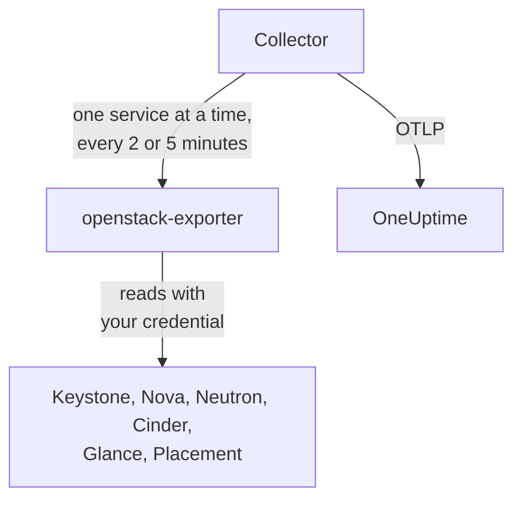

# OpenStack Agent

The OneUptime OpenStack agent monitors an OpenStack cloud: its services and agents, hypervisors, instances, networks, routers, volumes, storage pools, images and projects, in every region. It reads the cloud's APIs with a credential you choose and sends what it finds to OneUptime, where the cloud appears with its regions, hypervisors and projects. [OpenStack monitors](/docs/monitor/openstack-monitor) alert on what arrives, and a [probe](/docs/telemetry/openstack-agentless) can collect a cloud with nothing to install.

:::cards
- [Choose how much it sees](#choose-how-much-the-agent-sees): OpenStack has no global read-only role, so there are three levels.
- [Install the agent](#install-the-agent): A credential, then the install script, Docker Compose or no Docker at all.
- [What it costs your cloud](#what-it-costs-your-cloud): What each setting reads, and how to change it.
- [Troubleshooting](#troubleshooting): A diagnostic script, and the usual problems.
:::

## How it works

The agent is two pinned upstream programs and their configuration, on one machine: [openstack-exporter](https://github.com/openstack-exporter/openstack-exporter) reads the cloud's APIs and turns them into `openstack_*` series, and an OpenTelemetry Collector asks it for one OpenStack service at a time, stamps every series with the cloud and region it came from, and sends them to OneUptime. Nothing runs on your controllers or compute nodes.



The cloud registers itself with its first data, under the name the agent stamps on every metric as `openstack.cloud.name`. One agent watches one cloud: one Keystone, with one region or several.

## Before you begin

- Docker Engine 20.10 or later with the Docker Compose v2 plugin, or, to run without Docker, a Linux machine (x86_64 or arm64) with systemd 235 or later and root.
- A route from that machine to Keystone and to each service's public endpoint.
- The `openstack` command line, as someone who can create the credential below.
- An ingestion key. Create one under **Project Settings → Telemetry & APM → Ingestion Keys** and copy its value.
- Outbound HTTPS from that machine to your OneUptime URL.

### Where to run the agent

Run the agent outside the cloud it watches: a small VM on separate hardware, a management host, another cloud. An agent inside a cloud that has failed goes quiet with it, and quiet looks like a healthy cloud that stopped reporting.

## Choose how much the agent sees

OpenStack has no global read-only role, and that is the hardest thing about monitoring it:

- `reader` is scoped to a project everywhere except Keystone and Ironic.
- Hypervisors, services, agents, pools and Placement default to admin.
- A policy override cannot open all-project lists in Neutron or Cinder, which scope those by admin context in their own code.
- Cinder's services and storage pools answer anything but an admin with a `403`, from Cinder's own code, after policy has already passed. No override opens those either.
- Neutron and Cinder answer a plain reader with a `200` and only that reader's own project. It looks like it worked, and it did not.
- Where Cinder has `enforce_new_defaults` off, which is Cinder's own default, any role on a project can create that project's volumes, including `reader` and `oneuptime_monitoring`. On Epoxy, Flamingo and Gazpacho a plain reader and the role on a real project both created a volume (`202`). On Hibiscus both were refused (`403`), because DevStack only turns `enforce_new_defaults` on there. A read-only role on a real project is not read-only.

So there are three levels, and each one costs something. Start with the first if you can.

| Level | What it needs | What it sees | What goes without |
| --- | --- | --- | --- |
| **1. Full view** | An application credential on an account with `admin` on a project of its own, limited by access rules to reading, with `service_type` set on each service | Every read the agent makes, and `cinder-volume` and `cinder-scheduler` state and storage pools, which only this level sees | Keystone's users and groups, on purpose. It cannot write: every write answered `401` |
| **2. Infrastructure only** | The `oneuptime_monitoring` and `reader` roles on a project of its own that holds nothing and has zero quota, and the policy overrides the agent ships | All of Keystone's projects, domains, services and endpoints, all of Nova including every project's servers, all of Placement, and Neutron's agents and IP availabilities | Neutron's networks, subnets, routers, floating IPs and ports, and Cinder's volumes and snapshots, are only its own project's, so on an empty project just the shared and external ones. No `cinder-volume` or `cinder-scheduler` state or storage pools. It cannot write: every write answered `403`, or `409` and `413` from quota |
| **3. Project view** | Plain `reader` on a real project, for a team watching its own part of a cloud someone else runs | That project's volumes, networks and routers, from Cinder and Neutron | All infrastructure: no hypervisors, services, agents, pools or capacity. Through the agent, no instances either, because the exporter's all-projects read is refused. And on many clouds `reader` can write there |

The **Block Storage Service Down**, **Storage Pool Warning** and **Storage Pool Critical** templates need level 1. **Compute Service Down**, **Network Agent Down** and the Placement and hypervisor templates need level 1 or 2, and nothing at level 3 reads an instance.

### What each level reads

This is what five real clouds answered, on Epoxy, Flamingo, Gazpacho (OVN and OVS) and Hibiscus. Each cell is written from those recordings.

| Read | Level 1: Full view | Level 2: Infrastructure only | Level 3: Project view |
| --- | --- | --- | --- |
| Keystone: projects | all | all | refused |
| Keystone: domains | all | all | refused |
| Keystone: regions | all | what anyone sees | what anyone sees |
| Keystone: services | all | all | refused |
| Keystone: endpoints | all | all | refused |
| Nova: servers, all projects | all | all | refused |
| Nova: services | all | all | refused |
| Nova: hypervisors | all | all | refused |
| Nova: aggregates | all | all | refused |
| Nova: availability zones, detail | all | all | refused |
| Nova: flavors | all | what anyone sees | what anyone sees |
| Nova: usage per project | all | all | refused |
| Placement: resource providers | all | all | refused |
| Neutron: agents | all | all | nothing |
| Neutron: networks | all | own project only | own project only |
| Neutron: subnets | all | own project only | own project only |
| Neutron: routers | all | own project only | own project only |
| Neutron: floating IPs | all | own project only | own project only |
| Neutron: IP availabilities | all | all | nothing |
| Neutron: security groups | all | 409, expected | own project only |
| Neutron: ports | all | own project only | own project only |
| Neutron: quotas | all | refused | refused |
| Cinder: volumes, all projects | all | own project only | own project only |
| Cinder: services | all | refused | refused |
| Cinder: pools | all | refused | refused |
| Cinder: snapshots, all projects | all | own project only | own project only |
| Cinder: backups, all projects | all | none recorded | none recorded |
| Cinder: volume types | all | what anyone sees | what anyone sees |
| Glance: images | all | what anyone sees | what anyone sees |

- **all**: the same rows an admin saw.
- **own project only**: that project's rows, and anything shared or external. On a project that holds nothing, that is just the shared and external ones.
- **refused**: a `401` or a `403`.
- **what anyone sees**: every credential saw every row, on clouds that hold only public flavors, volume types and images. A private one in another project takes level 1.
- **nothing**: a `200` with no rows, on a project that has networks too. It looks like it worked, and it did not.
- **none recorded**: a `200` with no rows where an admin saw none either, so there was nothing to tell by.
- **409, expected**: Neutron tries to create the project's default security group when it lists them, and zero quota does not let it, so it answers `409 Quota exceeded`. That is harmless, and nothing to fix.

Octavia and Ironic are not here because those clouds do not run them. The [diagnostic script](#troubleshooting) asks them too, where a cloud does, and it reads every path with your real credential and says what that credential can see.

What the agent's exporter got with each, in series per service. The counts follow what a cloud holds when it is asked, so compare them with each other and not with yours:

| Exporter service | Admin | Level 1: Full view | Level 2: Infrastructure only | Level 3: Project view |
| --- | --- | --- | --- | --- |
| identity | 14 | 13 | 13 | 4 |
| compute | 33 | 33 | 33 | 15 |
| placement | 25 | 25 | 25 | 1 |
| network | 36 to 40 | 36 to 40 | 24 to 26 | 14 |
| volume | 33 | 33 to 41 | 23 | 29 to 37 |
| image | 4 | 4 | 4 | 4 |

## Install the agent

Every OneUptime serves the agent's install script and files for its own release: the commands below download them from `https://oneuptime.com`, so on a self-hosted OneUptime replace it with your URL. The install script is saved as `install.sh` first, so you can read it before you run it.

:::steps
### Create the credential

Pick the level you chose. Each makes an application credential, which prints an `id` and a `secret`: the secret is shown only once. Give it an expiry and never `--unrestricted`, which would let it make more credentials.

:::tabs
@tab Level 1: Full view
As an admin, make a project and an account for the agent:

```bash
openstack project create --domain default oneuptime-monitoring
openstack user create --domain default --password-prompt oneuptime-monitoring
openstack role add --project oneuptime-monitoring --user oneuptime-monitoring admin
```

Then, logged in as that account on that project, make the credential. The rules are the exact `GET` paths the agent uses, fitted to your cloud:

```bash
curl -fsSLO https://oneuptime.com/install/openstack-agent/access/application-credential-access-rules.json
curl -fsSLO https://oneuptime.com/install/openstack-agent/access/access-rules-for-cloud.py
openstack catalog list -f json | python3 access-rules-for-cloud.py \
  application-credential-access-rules.json > access-rules-for-this-cloud.json
openstack application credential create oneuptime-agent \
  --role admin \
  --access-rules "$(cat access-rules-for-this-cloud.json)" \
  --expiration 2027-11-01T00:00:00
```

An access rule is matched against the path the service sees. A service behind a path prefix, like `https://cloud.example/compute/v2.1`, sees `/compute/v2.1/servers`, and refuses the shipped rule for `/v2.1/servers` with a `401`. `access-rules-for-cloud.py` adds each rule again under its service's prefix, read from your catalog.

Access rules also need `service_type` set for keystonemiddleware on each service, and a restart of that service:

```ini title="nova.conf"
[keystone_authtoken]
service_type = compute
```

| Config file | `service_type` |
| --- | --- |
| `nova.conf` | `compute` |
| `neutron.conf` | `network` |
| `cinder.conf` | `block-storage`. The rules also carry `volumev3`, for a Cinder configured that way |
| `glance-api.conf` | `image` |
| `placement.conf` | `placement` |

Keystone needs nothing. With the rules fitted, `service_type` set and the APIs restarted, every read answered `200` and every write `401`, on every release we record. The exporter gets what an admin gets, except Keystone's users and groups, on purpose.

If you will not make that change, make the same credential without `--access-rules`: a plain admin application credential. It works, and it can write, so the diagnostic script labels it as one.
@tab Level 2: Infrastructure only
As an admin, make the role, a project that holds nothing and has zero quota, and an account:

```bash
openstack role create oneuptime_monitoring
openstack project create --domain default --description "OneUptime monitoring: holds nothing" oneuptime-monitoring
openstack quota set --instances 0 --cores 0 --ram 0 --key-pairs 0 oneuptime-monitoring
openstack quota set --volumes 0 --gigabytes 0 --snapshots 0 --backups 0 --backup-gigabytes 0 oneuptime-monitoring
openstack quota set --networks 0 --subnets 0 --ports 0 --routers 0 --floating-ips 0 --secgroups 0 --secgroup-rules 0 oneuptime-monitoring
openstack user create --domain default --password-prompt oneuptime-monitoring
openstack role add --project oneuptime-monitoring --user oneuptime-monitoring oneuptime_monitoring
openstack role add --project oneuptime-monitoring --user oneuptime-monitoring reader
```

The project holds nothing and has zero quota on purpose. Where Cinder has `enforce_new_defaults` off, any role on a project can create that project's volumes. With nothing to touch and no quota to make anything with, there is nothing for it to write: on every release we record, every write answered `403`, or `409` and `413` from quota.

Download the policy overrides, and merge each file, on every controller, into the file named by `[oslo_policy] policy_file` in that service's config (`nova.conf`, `neutron.conf` and so on). That is `/etc/nova/policy.yaml`, and so on, unless your deployment says otherwise: DevStack says `policy.json`. Each rule keeps the service's default and adds the role, and oslo.policy notices a changed file on its own, so no restart is needed.

```bash
curl -fsSLO https://oneuptime.com/install/openstack-agent/access/policy/nova.yaml
curl -fsSLO https://oneuptime.com/install/openstack-agent/access/policy/neutron.yaml
curl -fsSLO https://oneuptime.com/install/openstack-agent/access/policy/keystone.yaml
curl -fsSLO https://oneuptime.com/install/openstack-agent/access/policy/placement.yaml
```

There is no file for Cinder. Its `os-services` and `scheduler-stats/get_pools` answer the role with `403 User does not have admin privileges`, on all five releases we record. That comes from Cinder's own code requiring an admin context, after policy has already passed, so no override can open them.

**To take the overrides off again, empty the file (`{}`) and never delete it.** On Flamingo (2025.2) and Epoxy (2025.1), oslo.policy raises on every check once a policy file it has read is gone, so that service fails every request. When the service is Keystone, it stops validating tokens and the whole cloud answers `503`. If it has already happened, restart the service.

Then, logged in as that account on that project, make the credential:

```bash
openstack application credential create oneuptime-agent --expiration 2027-11-01T00:00:00
```

Putting the role on a real project to see its volumes and routers also lets the account write there, on a cloud where Cinder has `enforce_new_defaults` off. The diagnostic script warns when the credential's project holds things.
@tab Level 3: Project view
Give an account the plain `reader` role on the project, then, logged in as that account on that project, make the credential:

```bash
openstack role add --project my-team --user my-monitoring-account reader
openstack application credential create oneuptime-agent --expiration 2027-11-01T00:00:00
```

The agent sees that project's rows from Cinder and Neutron and no infrastructure. Two things to know before you choose this:

- **Through the agent it shows no instances at all.** The exporter asks Nova for all projects' servers, Nova refuses a plain reader, and that read fails whole. Only a OneUptime probe, collecting without this agent, can list one project's instances.
- **It may be able to write.** On a cloud where Cinder has `enforce_new_defaults` off, plain `reader` can create volumes in its project too. On Epoxy, Flamingo and Gazpacho it did (`202`), and on Hibiscus it was refused (`403`), because DevStack only turns `enforce_new_defaults` on there. Cinder's own default is off.
:::

### Install and start the agent

:::tabs
@tab install.sh
Download the install script and run it on the machine that will host the agent:

```bash
curl -fsSL https://oneuptime.com/install/openstack-agent -o install.sh
bash install.sh
```

The script asks for your OneUptime URL, the ingestion key, a stable name for the cloud, the Keystone auth URL, the region names, the application credential (a username and password if you say no to it) and a private CA file if the cloud has its own certificate authority. Nothing secret is echoed or goes on a command line. It checks the credential with Keystone before it writes or starts anything, installs to `/opt/oneuptime-openstack-agent`, writes `.env` and `clouds.yaml` with mode `0600`, and starts the agent with Docker Compose. Every answer also works as an environment variable, and running the script again reuses them instead of asking again, which is how you [upgrade the agent](#upgrading-the-agent).
@tab Docker Compose
Download `docker-compose.yml` and `otel-collector-config.yaml` from your OneUptime into a new folder:

```bash
mkdir oneuptime-openstack-agent && cd oneuptime-openstack-agent
curl -fsSLO https://oneuptime.com/install/openstack-agent/docker-compose.yml
curl -fsSLO https://oneuptime.com/install/openstack-agent/otel-collector-config.yaml
```

Create a `clouds.yaml` next to them, with one entry per region, **named for the region**, because the exporter's series do not say which region they are from and the collector stamps the entry's name on them as `openstack.region.name`:

```yaml title="clouds.yaml"
clouds:
  RegionOne:
    region_name: RegionOne
    identity_api_version: 3
    auth_type: v3applicationcredential
    auth:
      auth_url: https://keystone.example.com:5000/v3
      application_credential_id: your-credential-id
      application_credential_secret: your-credential-secret
```

Then a `.env` file:

```bash title=".env"
ONEUPTIME_URL=YOUR_ONEUPTIME_URL
ONEUPTIME_TELEMETRY_INGESTION_KEY=YOUR_TELEMETRY_INGESTION_TOKEN
OPENSTACK_CLOUD_NAME=my-cloud
OPENSTACK_EXPORTER_CLOUDS=[RegionOne,RegionTwo]
COMPOSE_PROFILES=openstack-exporter
```

`OPENSTACK_EXPORTER_CLOUDS` lists every region, in square brackets, and `COMPOSE_PROFILES=openstack-exporter` starts the bundled exporter. Both files hold secrets. The exporter runs as uid 65532, and must be the one account that can read `clouds.yaml`. Start the agent:

```bash
chmod 600 .env
sudo chown 65532:65532 clouds.yaml
sudo chmod 600 clouds.yaml
docker compose up -d
```
@tab Without Docker
On Linux (x86_64 or arm64) with systemd 235 or later, the install script runs the upstream releases of the same two programs as systemd services:

```bash
curl -fsSL https://oneuptime.com/install/openstack-agent -o install.sh
sudo bash install.sh --without-docker
```

The same questions, the same check with Keystone and the same files. Each release archive is held to a sha256 pinned in `install.sh`, and a download that does not match stops the install before anything changes. The collector runs as a throwaway unprivileged user that never sees the OpenStack credential, and the exporter as the `oneuptime-openstack` system user, the only account that can read `clouds.yaml`, listening on `127.0.0.1:9180` alone.

Run one agent per cloud: moving off a Docker install, run `docker compose down` first, or every metric arrives twice.
:::

Already run openstack-exporter, say the one Kolla-Ansible deploys? Point the agent at it, and the bundled one never starts: `OPENSTACK_EXPORTER_ADDRESS=10.0.0.5:9180 bash install.sh`, or leave `COMPOSE_PROFILES` out of `.env` and set `OPENSTACK_EXPORTER_ADDRESS` there. It must run with `--multi-cloud`, its `clouds.yaml` needs an entry named for each region, and it should turn off what the bundled one turns off: see [What it costs your cloud](#what-it-costs-your-cloud). Use an address the agent's container can reach: `localhost` is the container itself.

### Check the agent is running

```bash
docker compose ps
docker logs -f oneuptime-openstack-agent
```

`docker compose ps` lists the collector (`oneuptime-openstack-agent`) and the bundled exporter (`oneuptime-openstack-exporter`). The collector's logs should show this line once it has started:

```text
Everything is ready. Begin running and processing data.
```

Without Docker, ask `systemctl status oneuptime-openstack-agent oneuptime-openstack-exporter` and `journalctl -u oneuptime-openstack-agent`.

### Find the cloud in OneUptime

Open **Products → Infrastructure → OpenStack**. The cloud appears under its `OPENSTACK_CLOUD_NAME` after its first collection, within a few minutes. Compute, network, volume and Placement are read every 2 minutes, identity and images every 5.
:::

## Environment variables

The install script writes these to `/opt/oneuptime-openstack-agent/.env`; a Docker Compose install reads them from the `.env` next to `docker-compose.yml`. After changing one, run `docker compose up -d` in that folder. `clouds.yaml` alone holds the credential.

| Variable | Required | Description |
| --- | --- | --- |
| `ONEUPTIME_URL` | Yes | Your OneUptime URL, such as `https://oneuptime.com` or your self-hosted instance. |
| `ONEUPTIME_TELEMETRY_INGESTION_KEY` | Yes | The ingestion key from **Project Settings → Telemetry & APM → Ingestion Keys**. |
| `OPENSTACK_CLOUD_NAME` | Yes | The cloud's name in OneUptime, stamped on every metric as the `openstack.cloud.name` resource attribute. Keep it stable: changing it registers a new cloud. Defaults to `openstack`. |
| `OPENSTACK_AUTH_URL` | Bundled exporter | An answer to the install script: the Keystone auth URL. `/v3` is added if it is missing. |
| `OPENSTACK_EXPORTER_CLOUDS` | Yes | The regions, in square brackets, such as `[RegionOne,RegionTwo]`, each the name of a `clouds.yaml` entry. Defaults to `[RegionOne]`. |
| `OPENSTACK_EXPORTER_ADDRESS` | No | `host:port`, no scheme, of your own exporter. Leave it out for the bundled one. |
| `OPENSTACK_CA_FILE` | No | A PEM file with the certificate authority of a cloud that has its own. The install script keeps a copy as `ca.pem` next to `clouds.yaml`. |
| `OPENSTACK_EXPORTER_USER` | No | The `uid:gid` the exporter's container runs as, which must own `clouds.yaml`. Defaults to `65532:65532`. |
| `COMPOSE_PROFILES` | Bundled exporter | `openstack-exporter` starts the bundled exporter. |

The install script also reads the credential from the environment, to skip its questions: `OPENSTACK_APPLICATION_CREDENTIAL_ID` and `OPENSTACK_APPLICATION_CREDENTIAL_SECRET`, or `OPENSTACK_USERNAME`, `OPENSTACK_PASSWORD`, `OPENSTACK_PROJECT_NAME`, `OPENSTACK_USER_DOMAIN_NAME` and `OPENSTACK_PROJECT_DOMAIN_NAME`. They have names of their own rather than the `OS_*` ones an openrc file sets, so an admin's sourced openrc never becomes the agent's credential without anyone being asked. An application credential is better than a username and password: it can be limited to reading and can expire.

## What the agent collects

The collector makes one scrape job per OpenStack service, through the exporter's `/probe?cloud=<region>&include_services=<service>`, so a failing Nova leaves only Nova's series missing:

| Scrape job | Every | Timeout | Series |
| --- | --- | --- | --- |
| `oneuptime-openstack-compute` | 2 minutes | 110 s | `openstack_nova_agent_state`, `openstack_nova_running_vms`, `openstack_nova_vcpus_used`, `openstack_nova_memory_used_bytes`, `openstack_nova_local_storage_used_bytes`, `openstack_nova_total_vms`, `openstack_nova_server_status`, `openstack_nova_flavors`, `openstack_nova_availability_zones` |
| `oneuptime-openstack-network` | 2 minutes | 110 s | `openstack_neutron_agent_state`, `openstack_neutron_networks`, `openstack_neutron_subnets`, `openstack_neutron_routers`, `openstack_neutron_router`, `openstack_neutron_l3_agent_of_router`, `openstack_neutron_floating_ips`, `openstack_neutron_security_groups`, `openstack_neutron_network_ip_availabilities_total`, `openstack_neutron_network_ip_availabilities_used` |
| `oneuptime-openstack-volume` | 2 minutes | 110 s | `openstack_cinder_agent_state`, `openstack_cinder_volumes`, `openstack_cinder_volume_gb`, `openstack_cinder_snapshots`, `openstack_cinder_pool_capacity_free_gb`, `openstack_cinder_pool_capacity_total_gb` |
| `oneuptime-openstack-placement` | 2 minutes | 110 s | `openstack_placement_resource_total`, `openstack_placement_resource_usage`, `openstack_placement_resource_allocation_ratio`, `openstack_placement_resource_reserved` |
| `oneuptime-openstack-identity` | 5 minutes | 120 s | `openstack_identity_projects`, `openstack_identity_project_info`, `openstack_identity_domains`, `openstack_identity_regions` |
| `oneuptime-openstack-image` | 5 minutes | 120 s | `openstack_glance_images`, `openstack_glance_image_bytes`, `openstack_glance_image_created_at` |

Each service also reports `openstack_<service>_up`, such as `openstack_nova_up`. The [OpenStack monitor](/docs/monitor/openstack-monitor#collected-metrics) lists every series with what it means. Every series carries:

| Attribute | What it says |
| --- | --- |
| `openstack.cloud.name` | The cloud's name, a resource attribute |
| `oneuptime.agent.version` | The collector version the agent's files pin, a resource attribute |
| `openstack.region.name` | The region, from the name of the `clouds.yaml` entry, on each datapoint |
| `openstack_service` | The job's OpenStack service (`compute`, `network`, ...), on each datapoint |

Monitor filters match on equality, so keep the `transform/openstack-identity` processor if you customize the config, and the two deletes of `service.name` and `service.instance.id` in the `resource` processor: without the deletes the data registers a phantom Service instead of reaching the cloud.

## What it costs your cloud

Monitoring must never be what takes a cloud down, so the defaults are gentle. Each scrape logs in to Keystone again and makes real API calls.

| Setting | Default | Turning it on or changing it gives you | What it costs |
| --- | --- | --- | --- |
| Slow metrics | Off | Quotas and limits per project, and usage per server | One call per project per scrape, so it grows with the number of projects |
| Per-port series | Off | `openstack_neutron_port`, `openstack_neutron_ports`, `openstack_neutron_ports_no_ips`, `openstack_neutron_ports_lb_not_active` | An unscoped list of every port. On a large cloud that [can saturate Neutron and cause cascading failures](https://github.com/openstack-exporter/openstack-exporter/issues/540), so leave it off unless you know your port count is small |
| Scrape intervals | 2 and 5 minutes | Fresher data, or less load | Twice as often is twice the API calls. Keep each `scrape_timeout` under its `scrape_interval`, so a slow scrape never stacks on the one before |

**Slow metrics:** delete the `--disable-metric` line for what you want, from the exporter's `command` in `docker-compose.yml`, or from `ExecStart` in `oneuptime-openstack-exporter.service` without Docker. The cost is one call per project per scrape.

| Delete | To collect |
| --- | --- |
| `--disable-metric=nova-quota_cores` | `openstack_nova_quota_*` |
| `--disable-metric=nova-limits_vcpus_max` | `openstack_nova_limits_*` |
| `--disable-metric=neutron-quota_network` | `openstack_neutron_quota_*` |
| `--disable-metric=cinder-limits_volume_max_gb` | `openstack_cinder_limits_*`, `openstack_cinder_volume_type_quota_gigabytes` |
| `--disable-metric=nova-server_local_gb` | `openstack_nova_server_local_gb`, usage per server. This one is a single usage report that walks every server rather than a call per project, and it is slow on a large cloud all the same |

Each flag names the series that reads the rest of its row, which is why one line turns them all off. Do not use the exporter's own `--disable-slow-metrics` instead: it also takes `openstack_glance_image_*`, the image list the Images page reads with one call. Neutron's list of quotas is an admin's alone at every level but level 1, so `openstack_neutron_quota_*` needs that level.

**Per-port series:** delete the four `--disable-metric=neutron-port*` lines, in the same place.

**Intervals:** change `scrape_interval` and `scrape_timeout` under a job in `otel-collector-config.yaml`.

Then run `docker compose up -d --force-recreate`, or `sudo systemctl daemon-reload` and restart both services without Docker. An upgrade replaces these files and keeps your copy as `<file>.bak.<timestamp>`, so make your edit again afterwards.

Two more lines stay in, because you will not miss them. `--disable-metric=neutron-subnets_total` leaves out many series saying what the address pools already say (`openstack_neutron_subnets_total`, `openstack_neutron_subnets_used`, `openstack_neutron_subnets_free`). `--disable-metric=nova-security_groups` leaves out a read of a route Nova no longer has, which would only fill the exporter's log.

To read internal endpoints rather than public ones, add `--endpoint-type=internal` in the same place.

Three open upstream issues shape all this, and the project has also [asked for maintainers](https://github.com/openstack-exporter/openstack-exporter/issues/443):

- [Issue 660](https://github.com/openstack-exporter/openstack-exporter/issues/660): one failing service empties a whole scrape. So there is one scrape job per service. Do not merge them.
- [Issue 540](https://github.com/openstack-exporter/openstack-exporter/issues/540): an unscoped port list can saturate Neutron. So the per-port series are off, and the diagnostic script asks for one small page of ports.
- [Issue 244](https://github.com/openstack-exporter/openstack-exporter/issues/244): scrapes time out on larger clouds. So intervals are minutes rather than seconds, each with a timeout under it. If `openstack_*_up` goes missing for one service on a large cloud, raise that job's interval and timeout before anything else.

## Run as a systemd service

To start the agent with the machine and restart it when it fails, install its systemd unit. It assumes the agent lives in `/opt/oneuptime-openstack-agent`, where the install script puts it. An install without Docker is a systemd service already.

```bash
sudo curl -fsSL https://oneuptime.com/install/openstack-agent/systemd/oneuptime-openstack-agent.service -o /etc/systemd/system/oneuptime-openstack-agent.service
sudo systemctl daemon-reload
sudo systemctl enable --now oneuptime-openstack-agent
```

## Upgrading the agent

The agent reports the collector version its files pin as its **Agent Version**. When this OneUptime pins a newer one, a warning sign appears beside it. Select it to see these commands.

The collector image is pinned in `docker-compose.yml` and its config is a file next to it, so pulling alone does not move the agent forward. Run `install.sh` again, with `sudo` if you installed without Docker: it reuses every value in your existing `.env` and the credential in `clouds.yaml` (nothing is asked again), checks the credential with Keystone, refreshes the agent's files (a file you edited is kept as `<file>.bak.<timestamp>`), pulls the images and recreates the agent so the collector reads its new config.

```bash
curl -fsSL https://oneuptime.com/install/openstack-agent -o install.sh
bash install.sh
```

Installed it with Docker Compose instead? In the agent's folder, download both files again (and make again any change you made to them), then pull the images and recreate the agent:

```bash
curl -fsSLO https://oneuptime.com/install/openstack-agent/docker-compose.yml
curl -fsSLO https://oneuptime.com/install/openstack-agent/otel-collector-config.yaml
docker compose pull
docker compose up -d --force-recreate
```

To change what is in `clouds.yaml`, move the file aside and run the script again, which asks only for the credential. Or export what changes, such as `OPENSTACK_EXPORTER_CLOUDS=RegionOne,RegionTwo` to add a region. The old file is kept as `clouds.yaml.bak.<timestamp>`, as private as it was. It holds the old credential, so delete it once the agent reports with the new one. To replace a credential, make the second one before you delete the first, so the agent never goes without one.

## Uninstalling the agent

```bash
cd /opt/oneuptime-openstack-agent
docker compose down
cd /
sudo rm -r /opt/oneuptime-openstack-agent
```

Without Docker:

```bash
sudo systemctl disable --now oneuptime-openstack-agent oneuptime-openstack-exporter
sudo rm -f /etc/systemd/system/oneuptime-openstack-agent.service /etc/systemd/system/oneuptime-openstack-exporter.service
sudo systemctl daemon-reload
sudo rm -r /opt/oneuptime-openstack-agent
sudo userdel oneuptime-openstack
```

Then delete the credential: `openstack application credential delete oneuptime-agent`. If you used the policy overrides, take them out of each service's file, or empty the file (`{}`). Never delete the file.

## Troubleshooting

:::details Run the diagnostic script first
The agent ships with a script, [`troubleshoot.sh`](https://oneuptime.com/install/openstack-agent/troubleshoot.sh), that checks the whole chain on the network path the agent uses: the containers or services, `clouds.yaml`, the exporter, DNS, TLS, Keystone, each service in the catalog, the cloud name, and whether OneUptime accepts the ingestion key. OneUptime refuses a bad key with `401` (`422` for a disabled key or a browser key), and the collector drops each refused batch with a single `Exporting failed` log line that is easy to miss.

```bash
curl -fsSL https://oneuptime.com/install/openstack-agent/troubleshoot.sh -o troubleshoot.sh
sudo bash troubleshoot.sh    # add -d <dir> if you installed outside /opt/oneuptime-openstack-agent
```

It reads every path the agent needs with the real credential, one small page at a time, and reports each as **reads everything**, **may be own project only**, **refused** or **not deployed**, with which pages and alerts go without it and what to do. Then it says which level the answers add up to, warns when the credential's own project holds things, and ends with a verdict naming the most likely cause.
:::

:::details No cloud appears in OneUptime
1. Read the collector's logs: `docker logs oneuptime-openstack-agent`, or `journalctl -u oneuptime-openstack-agent` without Docker. A `401` on export means a bad ingestion key; connection refused means a wrong `ONEUPTIME_URL`.
2. Check that the exporter answers. The bundled exporter does not publish its port on the host, so ask from inside its network: `docker run --rm --network container:oneuptime-openstack-exporter curlimages/curl -s "http://localhost:9180/probe?cloud=RegionOne&include_services=identity" | head` should print `openstack_identity_*` lines.
3. Give it one scrape interval: 2 minutes for compute, 5 for identity.
:::

:::details The exporter keeps restarting, or says it cannot read its config
The exporter must be the owner of `clouds.yaml`. Its image runs as uid 65532. Run as root, `install.sh` gives the file to that user; run as anyone else, it runs the exporter as that user instead, and says so in `OPENSTACK_EXPORTER_USER`. Re-run `install.sh` to put it right, or `sudo chown 65532:65532 clouds.yaml` when the variable is unset.
:::

:::details x509 or TLS errors from Keystone
The exporter's image trusts public certificate authorities, not your machine's. Give it the cloud's own: `OPENSTACK_CA_FILE=/path/to/ca.pem bash install.sh`.
:::

:::details Every read answers 401 with an access-rule credential
A service behind a path prefix refuses the shipped rules: fit them to your cloud with `access-rules-for-cloud.py`. Each service also needs `service_type` set for keystonemiddleware, and a restart. Both are under [Create the credential](#install-the-agent), at level 1.
:::

:::details Hypervisors or services are empty
A level 3 credential cannot read them, and neither can a role without the policy overrides. Use level 1, or level 2 with the policy files merged into the file `[oslo_policy] policy_file` names. A file the service does not read changes nothing: the diagnostic script says which reads were refused.
:::

:::details Cinder's services or storage pools are empty
Only level 1 sees `cinder-volume` and `cinder-scheduler` state and storage pools. Cinder's own code answers anything else with `403 User does not have admin privileges`, after policy has already passed, so no override opens them.
:::

:::details Security groups answer 409 Quota exceeded
That is expected at level 2, and harmless. Neutron tries to create a project's default security group when it lists them, and a project with zero quota cannot hold one. There is nothing to fix.
:::

:::details Volumes and routers show only one project
Neutron and Cinder answer anything but an admin with a `200` and only its own project, which looks like it worked. Seeing every project takes level 1. A role on a real project shows that project, and on many clouds lets the account write there.
:::

:::details No instances at level 3
The exporter asks Nova for all projects' servers, Nova refuses a plain reader, and that read fails whole. Use level 1 or 2, or a [probe](/docs/telemetry/openstack-agentless), which can list one project's instances.
:::

:::details One service's data is missing
That is the design working: the others keep reporting. The diagnostic script says whether the service answers. Then read the exporter's log: `docker logs oneuptime-openstack-exporter`, or `journalctl -u oneuptime-openstack-exporter` without Docker.
:::

:::details Every OpenStack service fails after taking a policy file away
On Flamingo and Epoxy, oslo.policy raises on every check once a policy file it has read is gone, and when the service is Keystone the whole cloud answers `503`. Restart the service. To take overrides off, empty the file (`{}`) and never delete it.
:::

## Next steps

:::cards
- [OpenStack Monitor](/docs/monitor/openstack-monitor): Alert on services, hypervisors, instances, networks and storage pools.
- [OpenStack Without an Agent](/docs/telemetry/openstack-agentless): Collect a cloud from a probe, with nothing to install.
- [Host OpenTelemetry Collector](/docs/telemetry/host-otel-collector): The OS-level view of each controller and hypervisor.
:::
