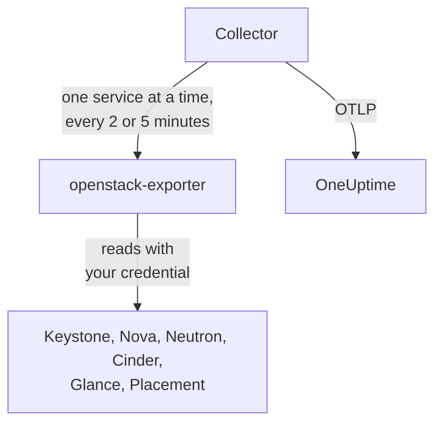

# OpenStack Agent

The OneUptime OpenStack agent monitors an OpenStack cloud: its services and agents, hypervisors, instances, networks, routers, volumes, storage pools, images and projects, in every region. It reads the cloud's APIs with a credential you choose and sends what it finds to OneUptime, where the cloud appears with its regions, hypervisors and projects. [OpenStack monitors](/docs/monitor/openstack-monitor) alert on what arrives, and a [probe](/docs/telemetry/openstack-agentless) can collect a cloud with nothing to install.

:::cards
- [Probe or agent?](/docs/telemetry/openstack-agentless#probe-or-agent): Which to pick, for a cloud that could use either.
- [Choose how much it sees](#choose-how-much-the-agent-sees): OpenStack has no global read-only role, so there are three levels.
- [Install the agent](#install-the-agent): A credential, then the install script, Docker Compose or no Docker at all.
- [What it costs your cloud](#what-it-costs-your-cloud): What each setting reads, and how to change it.
- [Service logs](#service-logs): Parsed, with a request followed across services.
- [Lifecycle events](#lifecycle-events): Instance actions on the feed and on charts, from notifications or a probe.
- [Who did what](#who-did-what): Audit trails into Security Events.
- [Trace a request](#trace-requests-through-the-control-plane): One signed request, followed across the control plane.
- [By deployment tool](/docs/telemetry/openstack-deployment-tools): Kolla-Ansible, OpenStack-Ansible, OpenStack-Helm, Atmosphere, Sunbeam, Red Hat and Mirantis.
- [Troubleshooting](#troubleshooting): A diagnostic script, and the usual problems.
:::

## How it works

The agent is two pinned upstream programs and their configuration, on one machine: [openstack-exporter](https://github.com/openstack-exporter/openstack-exporter) reads the cloud's APIs and turns them into `openstack_*` series, and an OpenTelemetry Collector asks it for one OpenStack service at a time, stamps every series with the cloud and region it came from, and sends them to OneUptime. Nothing runs on your controllers or compute nodes, unless you add the optional [logs profile](#service-logs), which reads their logs.



The cloud registers itself with its first data, under the name the agent stamps on every metric as `openstack.cloud.name`. One agent watches one cloud: one Keystone, with one region or several.

## Before you begin

- Docker Engine 20.10 or later with the Docker Compose v2 plugin, or, to run without Docker, a Linux machine (x86_64 or arm64) with systemd 235 or later, glibc 2.34 or later (RHEL 9, Ubuntu 22.04, Debian 12) and root.
- A route from that machine to Keystone and to each service's public endpoint.
- The `openstack` command line, as someone who can create the credential below.
- An ingestion key. Create one under **Project Settings → Telemetry & APM → Ingestion Keys** and copy its value.
- Outbound HTTPS from that machine to your OneUptime URL.

### Where to run the agent

Run the agent outside the cloud it watches: a small VM on separate hardware, a management host, another cloud. An agent inside a cloud that has failed goes quiet with it, and quiet looks like a healthy cloud that stopped reporting.

## Choose how much the agent sees

OpenStack has no global read-only role, and that is the hardest thing about monitoring it:

- `reader` is scoped to a project everywhere except Keystone and Ironic.
- Hypervisors, services, agents, pools and Placement default to admin.
- A policy override cannot open all-project lists in Neutron or Cinder, which scope those by admin context in their own code.
- Cinder's services and storage pools answer anything but an admin with a `403`, from Cinder's own code, after policy has already passed. No override opens those either.
- Neutron and Cinder answer a plain reader with a `200` and only that reader's own project. It looks like it worked, and it did not.
- Where Cinder has `enforce_new_defaults` off, which is Cinder's own default, any role on a project can create that project's volumes, including `reader` and `oneuptime_monitoring`. On Epoxy, Flamingo and Gazpacho a plain reader and the role on a real project both created a volume (`202`). On Hibiscus both were refused (`403`), because DevStack only turns `enforce_new_defaults` on there. A read-only role on a real project is not read-only.

So there are three levels, and each one costs something. Start with the first if you can.

| Level | What it needs | What it sees | What goes without |
| --- | --- | --- | --- |
| **1. Full view** | An application credential on an account with `admin` on a project of its own, limited by access rules to reading, with `service_type` set on each service | Every read the agent makes, and `cinder-volume` and `cinder-scheduler` state and storage pools, which only this level sees | Keystone's users and groups, on purpose. It cannot write: every write answered `401` |
| **2. Infrastructure only** | The `oneuptime_monitoring` and `reader` roles on a project of its own that holds nothing and has zero quota, and the policy overrides the agent ships | All of Keystone's projects, domains, services and endpoints, all of Nova including every project's servers, all of Placement, and Neutron's agents and IP availabilities | Neutron's networks, subnets, routers, floating IPs and ports, and Cinder's volumes and snapshots, are only its own project's, so on an empty project just the shared and external ones. No `cinder-volume` or `cinder-scheduler` state or storage pools. It cannot write: every write answered `403`, or `409` and `413` from quota |
| **3. Project view** | Plain `reader` on a real project, for a team watching its own part of a cloud someone else runs | That project's volumes, networks and routers, from Cinder and Neutron | All infrastructure: no hypervisors, services, agents, pools or capacity. Through the agent, no instances either, because the exporter's all-projects read is refused. And on many clouds `reader` can write there |

The **Block Storage Service Down**, **Storage Pool Warning** and **Storage Pool Critical** templates need level 1. **Compute Service Down**, **Network Agent Down** and the Placement and hypervisor templates need level 1 or 2, and nothing at level 3 reads an instance.

### What each level reads

This is what five real clouds answered, on Epoxy, Flamingo, Gazpacho (OVN and OVS) and Hibiscus. Each cell is written from those recordings.

| Read | Level 1: Full view | Level 2: Infrastructure only | Level 3: Project view |
| --- | --- | --- | --- |
| Keystone: projects | all | all | refused |
| Keystone: domains | all | all | refused |
| Keystone: regions | all | what anyone sees | what anyone sees |
| Keystone: services | all | all | refused |
| Keystone: endpoints | all | all | refused |
| Nova: servers, all projects | all | all | refused |
| Nova: services | all | all | refused |
| Nova: hypervisors | all | all | refused |
| Nova: aggregates | all | all | refused |
| Nova: availability zones, detail | all | all | refused |
| Nova: flavors | all | what anyone sees | what anyone sees |
| Nova: usage per project | all | all | refused |
| Placement: resource providers | all | all | refused |
| Neutron: agents | all | all | nothing |
| Neutron: networks | all | own project only | own project only |
| Neutron: subnets | all | own project only | own project only |
| Neutron: routers | all | own project only | own project only |
| Neutron: floating IPs | all | own project only | own project only |
| Neutron: IP availabilities | all | all | nothing |
| Neutron: security groups | all | 409, expected | own project only |
| Neutron: ports | all | own project only | own project only |
| Neutron: quotas | all | refused | refused |
| Cinder: volumes, all projects | all | own project only | own project only |
| Cinder: services | all | refused | refused |
| Cinder: pools | all | refused | refused |
| Cinder: snapshots, all projects | all | own project only | own project only |
| Cinder: backups, all projects | all | none recorded | none recorded |
| Cinder: volume types | all | what anyone sees | what anyone sees |
| Glance: images | all | what anyone sees | what anyone sees |

- **all**: the same rows an admin saw.
- **own project only**: that project's rows, and anything shared or external. On a project that holds nothing, that is just the shared and external ones.
- **refused**: a `401` or a `403`.
- **what anyone sees**: every credential saw every row, on clouds that hold only public flavors, volume types and images. A private one in another project takes level 1.
- **nothing**: a `200` with no rows, on a project that has networks too. It looks like it worked, and it did not.
- **none recorded**: a `200` with no rows where an admin saw none either, so there was nothing to tell by.
- **409, expected**: Neutron tries to create the project's default security group when it lists them, and zero quota does not let it, so it answers `409 Quota exceeded`. That is harmless, and nothing to fix.

Octavia and Ironic are not here because those clouds do not run them. The [diagnostic script](#troubleshooting) asks them too, where a cloud does, and it reads every path with your real credential and says what that credential can see.

What the agent's exporter got with each, in series per service. The counts follow what a cloud holds when it is asked, so compare them with each other and not with yours:

| Exporter service | Admin | Level 1: Full view | Level 2: Infrastructure only | Level 3: Project view |
| --- | --- | --- | --- | --- |
| identity | 14 | 13 | 13 | 4 |
| compute | 33 | 33 | 33 | 15 |
| placement | 25 | 25 | 25 | 1 |
| network | 36 to 40 | 36 to 40 | 24 to 26 | 14 |
| volume | 33 | 33 to 41 | 23 | 29 to 37 |
| image | 4 | 4 | 4 | 4 |

## Install the agent

Every OneUptime serves the agent's install script and files for its own release: the commands below download them from `https://oneuptime.com`, so on a self-hosted OneUptime replace it with your URL. The install script is saved as `install.sh` first, so you can read it before you run it.

:::steps
### Create the credential

Pick the level you chose. Each makes an application credential, which prints an `id` and a `secret`: the secret is shown only once. Give it an expiry and never `--unrestricted`, which would let it make more credentials.

:::tabs
@tab Level 1: Full view
As an admin, make a project and an account for the agent:

```bash
openstack project create --domain default oneuptime-monitoring
openstack user create --domain default --password-prompt oneuptime-monitoring
openstack role add --project oneuptime-monitoring --user oneuptime-monitoring admin
```

Then, logged in as that account on that project, make the credential. The rules are the exact `GET` paths the agent uses, fitted to your cloud:

```bash
curl -fsSLO https://oneuptime.com/install/openstack-agent/access/application-credential-access-rules.json
curl -fsSLO https://oneuptime.com/install/openstack-agent/access/access-rules-for-cloud.py
openstack catalog list -f json | python3 access-rules-for-cloud.py \
  application-credential-access-rules.json > access-rules-for-this-cloud.json
openstack application credential create oneuptime-agent \
  --role admin \
  --access-rules "$(cat access-rules-for-this-cloud.json)" \
  --expiration 2027-11-01T00:00:00
```

An access rule is matched against the path the service sees. A service behind a path prefix, like `https://cloud.example/compute/v2.1`, sees `/compute/v2.1/servers`, and refuses the shipped rule for `/v2.1/servers` with a `401`. `access-rules-for-cloud.py` adds each rule again under its service's prefix, read from your catalog.

Access rules also need `service_type` set for keystonemiddleware on each service, and a restart of that service. Without it, the service refuses the credential with a `401`:

```ini title="nova.conf"
[keystone_authtoken]
service_type = compute
```

| Config file | `service_type` |
| --- | --- |
| `nova.conf` | `compute` |
| `neutron.conf` | `network` |
| `cinder.conf` | `block-storage`. The rules also carry `volume` and `volumev3`, for a Cinder configured that way |
| `glance-api.conf` | `image` |
| `placement.conf` | `placement` |

Keystone needs nothing. With the rules fitted, `service_type` set and the APIs restarted, every read answered `200` and every write `401`, on every release we record. The exporter gets what an admin gets, except Keystone's users and groups, on purpose.

If you will not make that change, make the same credential without `--access-rules`: a plain admin application credential. It works, and it can write, so the diagnostic script labels it as one.
@tab Level 2: Infrastructure only
As an admin, make the role, a project that holds nothing and has zero quota, and an account:

```bash
openstack role create oneuptime_monitoring
openstack project create --domain default --description "OneUptime monitoring: holds nothing" oneuptime-monitoring
openstack quota set --instances 0 --cores 0 --ram 0 --key-pairs 0 oneuptime-monitoring
openstack quota set --volumes 0 --gigabytes 0 --snapshots 0 --backups 0 --backup-gigabytes 0 oneuptime-monitoring
openstack quota set --networks 0 --subnets 0 --ports 0 --routers 0 --floating-ips 0 --secgroups 0 --secgroup-rules 0 oneuptime-monitoring
openstack user create --domain default --password-prompt oneuptime-monitoring
openstack role add --project oneuptime-monitoring --user oneuptime-monitoring oneuptime_monitoring
openstack role add --project oneuptime-monitoring --user oneuptime-monitoring reader
```

The project holds nothing and has zero quota on purpose. Where Cinder has `enforce_new_defaults` off, any role on a project can create that project's volumes. With nothing to touch and no quota to make anything with, there is nothing for it to write: on every release we record, every write answered `403`, or `409` and `413` from quota.

Download the policy overrides, and merge each file, on every controller, into the file named by `[oslo_policy] policy_file` in that service's config (`nova.conf`, `neutron.conf` and so on). That is `/etc/nova/policy.yaml`, and so on, unless your deployment says otherwise: DevStack says `policy.json`. Each rule keeps the service's default and adds the role, and oslo.policy notices a changed file on its own, so no restart is needed.

```bash
curl -fsSLO https://oneuptime.com/install/openstack-agent/access/policy/nova.yaml
curl -fsSLO https://oneuptime.com/install/openstack-agent/access/policy/neutron.yaml
curl -fsSLO https://oneuptime.com/install/openstack-agent/access/policy/keystone.yaml
curl -fsSLO https://oneuptime.com/install/openstack-agent/access/policy/placement.yaml
```

There is no file for Cinder. Its `os-services` and `scheduler-stats/get_pools` answer the role with `403 User does not have admin privileges`, on all five releases we record. That comes from Cinder's own code requiring an admin context, after policy has already passed, so no override can open them.

**To take the overrides off again, empty the file (`{}`) and never delete it.** On Flamingo (2025.2) and Epoxy (2025.1), oslo.policy raises on every check once a policy file it has read is gone, so that service fails every request. When the service is Keystone, it stops validating tokens and the whole cloud answers `503`. If it has already happened, restart the service.

Then, logged in as that account on that project, make the credential:

```bash
openstack application credential create oneuptime-agent --expiration 2027-11-01T00:00:00
```

Putting the role on a real project to see its volumes and routers also lets the account write there, on a cloud where Cinder has `enforce_new_defaults` off. The diagnostic script warns when the credential's project holds things.
@tab Level 3: Project view
Give an account the plain `reader` role on the project, then, logged in as that account on that project, make the credential:

```bash
openstack role add --project my-team --user my-monitoring-account reader
openstack application credential create oneuptime-agent --expiration 2027-11-01T00:00:00
```

The agent sees that project's rows from Cinder and Neutron and no infrastructure. Three things to know before you choose this:

- **Through the agent it shows no instances at all.** The exporter asks Nova for all projects' servers, Nova refuses a plain reader, and that read fails whole. Only a OneUptime probe, collecting without this agent, can list one project's instances.
- **It may be able to write.** On a cloud where Cinder has `enforce_new_defaults` off, plain `reader` can create volumes in its project too. On Epoxy, Flamingo and Gazpacho it did (`202`), and on Hibiscus it was refused (`403`), because DevStack only turns `enforce_new_defaults` on there. Cinder's own default is off.
- **Placement reads as not answering.** Every call it makes is refused, and the exporter reports that the way it reports a stopped Placement: `openstack_placement_up 0`, on all five releases we record. The pages can tell, from what else is closed to this credential, and say so. The [Placement API Down](/docs/monitor/openstack-monitor#pre-built-alert-templates) template can't, so leave that one out at this level.
:::

### Install and start the agent

:::tabs
@tab install.sh
Download the install script and run it on the machine that will host the agent:

```bash
curl -fsSL https://oneuptime.com/install/openstack-agent -o install.sh
bash install.sh
```

The script asks for your OneUptime URL, the ingestion key, a stable name for the cloud, the Keystone auth URL, the region names, the application credential (a username and password if you say no to it) and a private CA file if the cloud has its own certificate authority. Nothing secret is echoed or goes on a command line. It checks the credential with Keystone before it writes or starts anything, installs to `/opt/oneuptime-openstack-agent`, or to `oneuptime-openstack-agent` in your home folder if you have no rights on `/opt` (it needs only the `docker` group), writes `.env` and `clouds.yaml` with mode `0600`, and starts the agent with Docker Compose. Every answer also works as an environment variable, and running the script again reuses them instead of asking again, which is how you [upgrade the agent](#upgrading-the-agent).
@tab Docker Compose
Download `docker-compose.yml` and `otel-collector-config.yaml` from your OneUptime into a new folder:

```bash
mkdir oneuptime-openstack-agent && cd oneuptime-openstack-agent
curl -fsSLO https://oneuptime.com/install/openstack-agent/docker-compose.yml
curl -fsSLO https://oneuptime.com/install/openstack-agent/otel-collector-config.yaml
```

Create a `clouds.yaml` next to them, with one entry per region, **named for the region**, because the exporter's series do not say which region they are from and the collector stamps the entry's name on them as `openstack.region.name`:

```yaml title="clouds.yaml"
clouds:
  RegionOne:
    region_name: RegionOne
    identity_api_version: 3
    auth_type: v3applicationcredential
    auth:
      auth_url: https://keystone.example.com:5000/v3
      application_credential_id: your-credential-id
      application_credential_secret: your-credential-secret
```

Then a `.env` file:

```bash title=".env"
ONEUPTIME_URL=YOUR_ONEUPTIME_URL
ONEUPTIME_TELEMETRY_INGESTION_KEY=YOUR_TELEMETRY_INGESTION_TOKEN
OPENSTACK_CLOUD_NAME=my-cloud
OPENSTACK_EXPORTER_CLOUDS=[RegionOne,RegionTwo]
COMPOSE_PROFILES=openstack-exporter
```

`OPENSTACK_EXPORTER_CLOUDS` lists every region, in square brackets, and `COMPOSE_PROFILES=openstack-exporter` starts the bundled exporter. Both files hold secrets. The exporter runs as uid 65532, and must be the one account that can read `clouds.yaml`. Start the agent:

```bash
chmod 600 .env
sudo chown 65532:65532 clouds.yaml
sudo chmod 600 clouds.yaml
docker compose up -d
```
@tab Without Docker
On Linux (x86_64 or arm64) with systemd 235 or later and glibc 2.34 or later, the install script runs the upstream releases of the same two programs as systemd services. RHEL 8 and its relatives have an older glibc, which the exporter's release can't run on: the script says so and changes nothing, so use Docker there.

```bash
curl -fsSL https://oneuptime.com/install/openstack-agent -o install.sh
sudo bash install.sh --without-docker
```

The same questions, the same check with Keystone and the same files. Each release archive is held to a sha256 pinned in `install.sh`, and a download that does not match stops the install before anything changes. The collector runs as a throwaway unprivileged user that never sees the OpenStack credential, and the exporter as the `oneuptime-openstack` system user, the only account that can read `clouds.yaml`, listening on `127.0.0.1:9180` alone.

Run one agent per cloud: moving off a Docker install, run `docker compose down` first, or every metric arrives twice.
:::

Already run openstack-exporter with `--multi-cloud`? Point the agent at it, and the bundled one never starts: `OPENSTACK_EXPORTER_ADDRESS=10.0.0.5:9180 bash install.sh`, or leave `COMPOSE_PROFILES` out of `.env` and set `OPENSTACK_EXPORTER_ADDRESS` there. Its `clouds.yaml` needs an entry named for each region, and it should turn off what the bundled one turns off: see [What it costs your cloud](#what-it-costs-your-cloud). Use an address the agent's container can reach: `localhost` is the container itself.

Kolla-Ansible's exporter runs without `--multi-cloud`, so it has no `/probe`, and it is pinned to a release that says less. [Use the exporter you already run](/docs/telemetry/openstack-deployment-tools#use-the-exporter-you-already-run) says how to read it, and exactly what the pages go without. [OpenStack by Deployment Tool](/docs/telemetry/openstack-deployment-tools) has the rest of each tool's steps.

### Check the agent is running

```bash
cd /opt/oneuptime-openstack-agent    # or the folder the script said it installed to
docker compose ps
docker logs oneuptime-openstack-agent
```

`docker compose ps` lists the collector (`oneuptime-openstack-agent`) and the bundled exporter (`oneuptime-openstack-exporter`). The collector's logs should show this line once it has started:

```text
Everything is ready. Begin running and processing data.
```

Without Docker, ask `systemctl status oneuptime-openstack-agent oneuptime-openstack-exporter` and `journalctl -u oneuptime-openstack-agent`.

### Find the cloud in OneUptime

Open **Products → Infrastructure → OpenStack**. The cloud appears under its `OPENSTACK_CLOUD_NAME` after its first collection, within a few minutes. Compute, network, volume and Placement are read every 2 minutes, identity and images every 5.
:::

## Environment variables

The install script writes these to `/opt/oneuptime-openstack-agent/.env`; a Docker Compose install reads them from the `.env` next to `docker-compose.yml`. After changing one, run `docker compose up -d` in that folder. `clouds.yaml` alone holds the credential.

| Variable | Required | Description |
| --- | --- | --- |
| `ONEUPTIME_URL` | Yes | Your OneUptime URL, such as `https://oneuptime.com` or your self-hosted instance. |
| `ONEUPTIME_TELEMETRY_INGESTION_KEY` | Yes | The ingestion key from **Project Settings → Telemetry & APM → Ingestion Keys**. |
| `OPENSTACK_CLOUD_NAME` | Yes | The cloud's name in OneUptime, stamped on every metric as the `openstack.cloud.name` resource attribute. Keep it stable: changing it registers a new cloud. Defaults to `openstack`. |
| `OPENSTACK_AUTH_URL` | Bundled exporter | An answer to the install script: the Keystone auth URL. `/v3` is added if it is missing. |
| `OPENSTACK_EXPORTER_CLOUDS` | Yes | The regions, in square brackets, such as `[RegionOne,RegionTwo]`, each the name of a `clouds.yaml` entry. Defaults to `[RegionOne]`. |
| `OPENSTACK_EXPORTER_ADDRESS` | No | `host:port`, no scheme, of your own exporter. Leave it out for the bundled one. |
| `OPENSTACK_CA_FILE` | No | A PEM file with the certificate authority of a cloud that has its own. The install script keeps a copy as `ca.pem` next to `clouds.yaml`. |
| `OPENSTACK_EXPORTER_USER` | No | The `uid:gid` the exporter's container runs as, which must own `clouds.yaml`. Defaults to `65532:65532`. |
| `COMPOSE_PROFILES` | Bundled exporter | `openstack-exporter` starts the bundled exporter. |
| `OPENSTACK_LIBVIRT_EXPORTER_TARGETS` | No | The compute nodes to read [real usage](#real-usage) from through `prometheus-libvirt-exporter`, in square brackets, such as `[compute-01:9177,compute-02:9177]`. Defaults to none. |
| `OPENSTACK_CEILOMETER_EXPORTER_TARGETS` | No | The same through Ceilometer's own exporter, such as `[compute-01:9101]`. Defaults to none. |
| `OPENSTACK_SINGLE_CLOUD_EXPORTER_TARGETS` | No | An exporter already running without `--multi-cloud`, such as Kolla-Ansible's: `[10.0.0.254:9198]`. See [Use the exporter you already run](/docs/telemetry/openstack-deployment-tools#use-the-exporter-you-already-run). |
| `OPENSTACK_RABBITMQ_TARGETS` | No | RabbitMQ's Prometheus plugin on each node, for [what the cloud stands on](/docs/monitor/openstack-monitor#control-plane): `[10.0.0.11:15692,10.0.0.12:15692]`. Defaults to none. |
| `OPENSTACK_MARIADB_TARGETS` | No | mysqld_exporter beside each MariaDB node, usually on `9104`. Defaults to none. |
| `OPENSTACK_MEMCACHED_TARGETS` | No | memcached_exporter beside each Memcached, usually on `9150`. Defaults to none. |
| `OPENSTACK_HAPROXY_TARGETS` | No | HAProxy's own Prometheus exporter. Defaults to none. |
| `OPENSTACK_NETWORK_EXPORTER_TARGETS` | No | openstack-network-exporter on each node, for OVN and Open vSwitch, usually on `1981`. Defaults to none. |
| `OPENSTACK_LIBVIRT_HEALTH_TARGETS` | No | prometheus-libvirt-exporter on each compute node, usually on `9177`, for whether libvirt answers and nothing per instance. Defaults to none. |
| `OPENSTACK_CONTROL_PLANE_REGION` | No | The region of a target above that does not say its own. A target can: `RegionTwo@10.1.0.11:15692`. Defaults to the first region. |
| `OPENSTACK_AGENT_SERVICES` | No | Which services this agent reads, for [sharing a cloud between agents](/docs/telemetry/openstack-very-large-clouds#sharing-a-cloud-between-collectors), such as `compute\|placement`. Defaults to all of them. |
| `OPENSTACK_AGENT_MEMORY_LIMIT_MIB` | No | What the collector may hold in memory. A very large cloud's scrape takes more than the default of `512`. |
| `OPENSTACK_DATABASE_EXPORTER_TARGETS` | No | `openstack_database_exporter`, for [the database path](/docs/telemetry/openstack-very-large-clouds#the-database-path): `[openstack-database-exporter:9180]`. Defaults to none. The other settings of that path are listed there. |

The install script also reads the credential from the environment, to skip its questions: `OPENSTACK_APPLICATION_CREDENTIAL_ID` and `OPENSTACK_APPLICATION_CREDENTIAL_SECRET`, or `OPENSTACK_USERNAME`, `OPENSTACK_PASSWORD`, `OPENSTACK_PROJECT_NAME`, `OPENSTACK_USER_DOMAIN_NAME` and `OPENSTACK_PROJECT_DOMAIN_NAME`. They have names of their own rather than the `OS_*` ones an openrc file sets, so an admin's sourced openrc never becomes the agent's credential without anyone being asked. An application credential is better than a username and password: it can be limited to reading and can expire.

## What the agent collects

The collector makes one scrape job per OpenStack service, through the exporter's `/probe?cloud=<region>&include_services=<service>`, so a failing Nova leaves only Nova's series missing:

| Scrape job | Every | Timeout | Series |
| --- | --- | --- | --- |
| `oneuptime-openstack-compute` | 2 minutes | 110 s | `openstack_nova_agent_state`, `openstack_nova_running_vms`, `openstack_nova_vcpus_used`, `openstack_nova_memory_used_bytes`, `openstack_nova_local_storage_used_bytes`, `openstack_nova_total_vms`, `openstack_nova_server_status`, `openstack_nova_flavors`, `openstack_nova_availability_zones` |
| `oneuptime-openstack-network` | 2 minutes | 110 s | `openstack_neutron_agent_state`, `openstack_neutron_networks`, `openstack_neutron_subnets`, `openstack_neutron_routers`, `openstack_neutron_router`, `openstack_neutron_l3_agent_of_router`, `openstack_neutron_floating_ips`, `openstack_neutron_security_groups`, `openstack_neutron_network_ip_availabilities_total`, `openstack_neutron_network_ip_availabilities_used` |
| `oneuptime-openstack-volume` | 2 minutes | 110 s | `openstack_cinder_agent_state`, `openstack_cinder_volumes`, `openstack_cinder_volume_gb`, `openstack_cinder_snapshots`, `openstack_cinder_pool_capacity_free_gb`, `openstack_cinder_pool_capacity_total_gb` |
| `oneuptime-openstack-placement` | 2 minutes | 110 s | `openstack_placement_resource_total`, `openstack_placement_resource_usage`, `openstack_placement_resource_allocation_ratio`, `openstack_placement_resource_reserved` |
| `oneuptime-openstack-identity` | 5 minutes | 120 s | `openstack_identity_projects`, `openstack_identity_project_info`, `openstack_identity_domains`, `openstack_identity_regions` |
| `oneuptime-openstack-image` | 5 minutes | 120 s | `openstack_glance_images`, `openstack_glance_image_bytes`, `openstack_glance_image_created_at` |
| `oneuptime-openstack-load-balancer` | 5 minutes | 120 s | `openstack_loadbalancer_total_loadbalancers`, `openstack_loadbalancer_loadbalancer_status`, `openstack_loadbalancer_total_amphorae`, `openstack_loadbalancer_amphora_status`, `openstack_loadbalancer_total_pools`, `openstack_loadbalancer_pool_status` |
| `oneuptime-openstack-baremetal` | 5 minutes | 120 s | `openstack_ironic_node`, `openstack_ironic_node_updated_at`, `openstack_ironic_node_provision_updated_at` |
| `oneuptime-openstack-orchestration` | 5 minutes | 120 s | `openstack_heat_stack_status`, `openstack_heat_stack_status_counter` |
| `oneuptime-openstack-container-infra` | 5 minutes | 120 s | `openstack_container_infra_total_clusters`, `openstack_container_infra_cluster_masters`, `openstack_container_infra_cluster_nodes`, `openstack_container_infra_cluster_status` |
| `oneuptime-openstack-sharev2` | 5 minutes | 120 s | `openstack_sharev2_shares_counter`, `openstack_sharev2_share_gb`, `openstack_sharev2_share_status`, `openstack_sharev2_share_status_counter` |
| `oneuptime-openstack-dns` | 5 minutes | 120 s | `openstack_designate_zones`, `openstack_designate_zone_status`, `openstack_designate_recordsets`, `openstack_designate_recordsets_status` |
| `oneuptime-openstack-object-store` | 5 minutes | 120 s | `openstack_object_store_objects`, `openstack_object_store_bytes` |
| `oneuptime-openstack-database` | 5 minutes | 120 s | `openstack_trove_total_instances`, `openstack_trove_instance_status`, `openstack_trove_instance_volume_size_gb`, `openstack_trove_instance_volume_used_gb` |
| `oneuptime-openstack-gnocchi` | 5 minutes | 120 s | `openstack_gnocchi_status_metricd_processors`, `openstack_gnocchi_status_metric_having_measures_to_process`, `openstack_gnocchi_status_measures_to_process` |

The last nine are services a cloud may not run. Asked about one that is not in its catalog, the exporter logs in to Keystone, logs one line (`No suitable endpoint could be found in the service catalog`) and answers with nothing, and that cloud shows no trace of the service. It is one login each 5 minutes per service and region, which is why these are all 5 minutes. To ask only for the services you run, set `OPENSTACK_AGENT_SERVICES`, such as `identity|compute|placement|network|volume|image`.

Each service also reports `openstack_<service>_up`, such as `openstack_nova_up`. The [OpenStack monitor](/docs/monitor/openstack-monitor#collected-metrics) lists every series with what it means. Every series carries:

| Attribute | What it says |
| --- | --- |
| `openstack.cloud.name` | The cloud's name, a resource attribute |
| `oneuptime.agent.version` | The collector version the agent's files pin, a resource attribute |
| `openstack.region.name` | The region, from the name of the `clouds.yaml` entry, on each datapoint |
| `openstack_service` | The job's OpenStack service (`compute`, `network`, ...), on each datapoint |

Monitor filters match on equality, so keep the `transform/openstack-identity` processor if you customize the config, and the two deletes of `service.name` and `service.instance.id` in the `resource` processor: without the deletes the data registers a phantom Service instead of reaching the cloud.

## What it costs your cloud

Monitoring must never be what takes a cloud down, so the defaults are gentle. Each scrape logs in to Keystone again and makes real API calls. [Very Large OpenStack Clouds](/docs/telemetry/openstack-very-large-clouds) has what that comes to, in requests a minute and gigabytes a day, at each size.

| Setting | Default | Turning it on or changing it gives you | What it costs |
| --- | --- | --- | --- |
| Project quotas | Off | How much of each quota a project has used, on its page and under **Needs attention**, and the Project Quota Nearly Reached alert | Four API calls per project, per region, once an hour (Nova one, Cinder two, Neutron one), from an exporter of their own |
| Slow metrics | Off | Nova's own quota lists and usage per server | One call per project per scrape, so it grows with the number of projects |
| Per-port series | Off | `openstack_neutron_port`, `openstack_neutron_ports`, `openstack_neutron_ports_no_ips`, `openstack_neutron_ports_lb_not_active` | An unscoped list of every port. On a large cloud that [can saturate Neutron and cause cascading failures](https://github.com/openstack-exporter/openstack-exporter/issues/540), so leave it off unless you know your port count is small |
| Services a cloud may not run | On | Load balancers, bare metal, stacks, clusters, shares, DNS, object storage, databases and Gnocchi, where the cloud has them | A cloud without one pays one login each 5 minutes. Designate costs one call per zone per scrape, so it grows with the number of zones |
| Scrape intervals | 2 and 5 minutes | Fresher data, or less load | Twice as often is twice the API calls. Keep each `scrape_timeout` under its `scrape_interval`, so a slow scrape never stacks on the one before |

**Project quotas:** run `install.sh` again with `OPENSTACK_COLLECT_QUOTAS=true`. It starts a second exporter, `openstack-quota-exporter`, that reads nothing else, and the collector asks it once an hour for `openstack_nova_limits_*`, `openstack_neutron_quota_*`, `openstack_cinder_limits_*` and `openstack_cinder_volume_type_quota_gigabytes`. They change slowly, and an exporter reads the same things whichever job asks, so reading them less often takes an exporter of their own. Your own exporter has no such thing: the agent reads what it says, on every scrape.

**Slow metrics:** delete the `--disable-metric` line for what you want, from the exporter's `command` in `docker-compose.yml`, or from `ExecStart` in `oneuptime-openstack-exporter.service` without Docker. The cost is one call per project per scrape.

| Delete | To collect |
| --- | --- |
| `--disable-metric=nova-quota_cores` | `openstack_nova_quota_*` |
| `--disable-metric=nova-server_local_gb` | `openstack_nova_server_local_gb`, usage per server. This one is a single usage report that walks every server rather than a call per project, and it is slow on a large cloud all the same |

The three lines that leave project quotas out of this exporter (`--disable-metric=nova-limits_vcpus_max`, `--disable-metric=neutron-quota_network`, `--disable-metric=cinder-limits_volume_max_gb`) stay in. Deleting them reads them every two minutes as well.

Each flag names the series that reads the rest of its row, which is why one line turns them all off. Do not use the exporter's own `--disable-slow-metrics` instead: it also takes `openstack_glance_image_*`, the image list the Images page reads with one call. Neutron's list of quotas is an admin's alone at every level but level 1, so `openstack_neutron_quota_*` needs that level.

**Per-port series:** delete the four `--disable-metric=neutron-port*` lines, in the same place.

**Intervals:** change `scrape_interval` and `scrape_timeout` under a job in `otel-collector-config.yaml`.

Then run `docker compose up -d --force-recreate`, or `sudo systemctl daemon-reload` and restart both services without Docker. An upgrade replaces these files and keeps your copy as `<file>.bak.<timestamp>`, so make your edit again afterwards.

Three more lines stay in, because you will not miss them. `--disable-metric=neutron-subnets_total` leaves out many series saying what the address pools already say (`openstack_neutron_subnets_total`, `openstack_neutron_subnets_used`, `openstack_neutron_subnets_free`). `--disable-metric=nova-security_groups` leaves out a read of a route Nova no longer has, which would only fill the exporter's log. `--disable-metric=gnocchi-total_metrics` leaves out a read of every metric in Gnocchi, page by page, for one count (`openstack_gnocchi_total_metrics`): a Gnocchi can hold millions.

To read internal endpoints rather than public ones, add `--endpoint-type=internal` in the same place.

Three open upstream issues shape all this, and the project has also [asked for maintainers](https://github.com/openstack-exporter/openstack-exporter/issues/443):

- [Issue 660](https://github.com/openstack-exporter/openstack-exporter/issues/660): one failing service empties a whole scrape. So there is one scrape job per service. Do not merge them.
- [Issue 540](https://github.com/openstack-exporter/openstack-exporter/issues/540): an unscoped port list can saturate Neutron. So the per-port series are off, and the diagnostic script asks for one small page of ports.
- [Issue 244](https://github.com/openstack-exporter/openstack-exporter/issues/244): scrapes time out on larger clouds. So intervals are minutes rather than seconds, each with a timeout under it. If `openstack_*_up` goes missing for one service on a large cloud, raise that job's interval and timeout before anything else.

## Real usage

Nova and Placement say what is promised on a hypervisor, not what is busy: an idle instance holds all of its vCPUs. So nothing in OneUptime calls those numbers usage. To see what is really busy, point the agent at whichever of these your cloud already runs. The OpenTelemetry Collector has no libvirt receiver of its own.

| Source | Where it runs | Turn it on |
| --- | --- | --- |
| [`prometheus-libvirt-exporter`](https://github.com/inovex/prometheus-libvirt-exporter) | Port 9177 on each compute node. Kolla-Ansible runs it when Prometheus and KVM are on. | Set `OPENSTACK_LIBVIRT_EXPORTER_TARGETS=[compute-01:9177,compute-02:9177]` |
| Ceilometer's own exporter, from 2025.1 | Port 9101 on each compute node, beside its polling agent. | In `ceilometer.conf`, under `[polling]`, set `enable_prometheus_exporter = true`, `prometheus_listen_addresses` to an address the agent can reach, and `batch_size` higher than the most instances on one node. Then set `OPENSTACK_CEILOMETER_EXPORTER_TARGETS=[compute-01:9101]` |

After changing either, run `docker compose up -d`. Each exporter speaks for one compute node, so name every node you want read.

Ceilometer only says what its `polling.yaml` asks for, and the file it ships leaves some of this out. Add these meters to it for the whole picture:

| Meter | Without it |
| --- | --- |
| `vcpus` | An instance's CPU is measured against what its flavor says instead. Epoxy has no such meter. |
| `memory.resident` | Nothing says what instances hold on their hypervisor, so no **Hypervisor Memory Pressure** |
| `disk.device.read.latency`, `disk.device.write.latency` | No disk latency, so no **Instance Disk Latency High** |

OneUptime turns both into one set of series as they arrive, beside the originals: `openstack.instance.*` for each instance, by its UUID, and `openstack.hypervisor.instances.*` for what a hypervisor's instances add up to. The [OpenStack monitor](/docs/monitor/openstack-monitor#collected-metrics) lists them. So pages and alerts mean the same thing whichever source a cloud has:

| What it reads | libvirt | Ceilometer |
| --- | --- | --- |
| CPU in use | How much CPU time passed, over the time between two readings | The same, from a cumulative number in nanoseconds |
| CPU waiting, what the guest calls steal | `libvirt_domain_vcpu_delay_seconds_total` | `ceilometer_cpu_delay`, once a release has it. No released Ceilometer does yet, from Epoxy to Hibiscus, so these show no reading |
| Memory in use | What the guest's balloon driver says: available less usable | `ceilometer_memory_usage`, which is the same sum. Without a balloon driver neither has this, and it is left out rather than guessed |
| Memory on the hypervisor | `libvirt_domain_memory_stats_rss_bytes` | `ceilometer_memory_resident`. It holds more than the flavor's size, because QEMU itself is in it |
| Disk and network | Rates per disk and interface, and latency as the time requests took over how many there were | The same |

Ceilometer's readings only change once a polling cycle, five minutes by default, however often they are read. A rate is worked out between the moments a reading changed, so it doesn't read 0, 0, then five times the truth, and a reading that didn't change adds no data. The first value seen says nothing about when it was polled, so the first rate takes two polls. Once a poll has moved something about an instance, what it left as it was reads 0, and a reading on an instance where nothing moves reads 0 after 11 minutes. A counter that goes backwards has restarted, after an instance rebooted or moved, and counts from zero. `libvirt_domain_info_memory_usage_bytes` is not read as usage: it is the size of the balloon, which on an idle instance is its flavor's memory.

A shut-off instance has no reading from either source: libvirt reports a CPU time of 0 and Ceilometer says nothing, and neither is an instance doing nothing. A config drive is a CD-ROM, which libvirt's exporter leaves out and Ceilometer doesn't, so with Ceilometer an instance that has one shows one more disk, usually `hda`, reading nothing.

An instance's page shows CPU, memory, disk and network beside its flavor's size, with their charts under **Usage**. A hypervisor's page shows what its instances use, measured against what it has before any allocation ratio, and names the busiest beside what each was given, with their charts under **Metrics**. Past a line it says which instances are responsible, and which are being made to wait. Without a source each page says so, and what to add. Where OneUptime's [host agent](/docs/telemetry/hosts) runs on a hypervisor, its page reads that machine's own CPU, memory, disk and network from there, which includes the host's own processes, so it can be past the line while its instances aren't.

The agent's troubleshooting script reads each exporter you named, says how many instances it knows and which meters Ceilometer isn't polling, and what each one costs you.

Four [alert templates](/docs/monitor/openstack-monitor#pre-built-alert-templates) read these: **Hypervisor CPU Saturated**, **Hypervisor Memory Pressure**, **Instance CPU Saturated** and **Instance Disk Latency High**. Without a source they stay quiet.

### What it costs

Per-instance series multiply fast, so keeping them is a choice, under the cloud's **Settings**, in **Real usage per instance**:

| Choice | What it keeps |
| --- | --- |
| Automatic, the default | Every instance while the cloud has 500 or fewer, and none past that |
| Every instance | Every instance, at any size |
| Only the projects and aggregates I choose | The instances of those projects, and those on the hypervisors of those aggregates |
| None | No instance's series |

An instance not kept loses its original series too, so the choice stops the whole cost, and it still counts towards its hypervisor's totals, which are five series per hypervisor whatever you choose. The agent's scrape jobs keep only what OneUptime reads of each exporter. Past 5,000 instances the same choice also decides who keeps a [series of their status](/docs/telemetry/openstack-very-large-clouds#summary-mode).

What one instance costs, with two vCPUs, one disk and one network interface:

| Source | Series per instance | Rows per hour | Rows per month, 100 instances | Rows per month, 1,000 instances |
| --- | --- | --- | --- | --- |
| `prometheus-libvirt-exporter`, read every minute | 30 | 1,800 | 131,400,000 | 1,314,000,000 |
| Ceilometer's exporter, read every minute and polled every 5 | 24 | 864 | 63,072,000 | 630,720,000 |

Each further disk adds 12 series to either, and each further interface 4. Each further vCPU adds 1 from libvirt. The agent's collector holds these in memory on their way out, so a large cloud may want more than its default 512 MiB. The guide's calculator, under **Documentation** on a cloud, puts a price on these for a cloud of your size.

## Projects and domains

A cloud holds many tenants, so OneUptime keeps track of whose everything is.

- **Projects** lists every project with its domain, what it runs, what needs attention in it and the incidents and alerts open on its parts. A project's page says the same in full, and names any host that is down under it.
- **Domains** says how many projects each domain holds.
- **Every list of what a project owns** can be narrowed to one project, and to one domain on a cloud with more than one. Both go by ID, so renaming a project or a domain breaks nothing.

### Send a project's alerts to its team

On a project's page, add a rule under **Who is told about this** or **Labels on what opens about this**. **Domains** has the same two for a whole domain. From then on, every alert and incident that reaches that project or domain gets those owners or labels.

An alert or incident on a part of the cloud names the projects it reaches in its description, by ID, as ``OpenStack project `<id>` `` and ``OpenStack domain `<id>` ``. A rule here is an ordinary alert rule and an ordinary incident rule that match those words, so the pair also appears under each one's **Owner Rules** or **Label Rules** settings.

Only what a monitor opens carries those words, and it names at most 50 of the projects it reaches. An incident someone declares by hand carries none, so these rules do not reach it.

### Quotas

With quotas on, a project's page shows how much of each it has used: instances, cores, RAM, gigabytes of volumes, networks, ports and floating IPs. A project at 90% of one, or past it, appears under **Needs attention**. A limit of -1 means no limit, so it is never at anything. They are read once an hour. A reading more than three hours old is shown but no longer judged, because quotas may have been turned off.

They are off by default because of what they cost: see [What it costs your cloud](#what-it-costs-your-cloud). OpenStack's quota on how many volumes a project may hold is not shown, because the exporter reads only its gigabytes.

### Labels from Nova metadata

To see a Nova metadata key as a label, add `--nova.metadata-extra-labels=team` to the exporter's command, with any more keys after a comma. A project's page shows the values its instances carry.

## Topology and blast radius

A cloud's **Topology** page draws it region by region: availability zones, hypervisors and the instances on them, storage pools and volumes, networks, routers and floating IPs, and the APIs and services. Each part is coloured by the same rules as **Needs attention**, so a hypervisor whose `nova-compute` has stopped is red, with its instances beneath it.

Past 5,000 parts, the map reads what has failed and what that takes with it rather than everything, opens on the hosts that failed and says what it left out. **Needs attention** narrows it to all of the rest. [Infrastructure](/docs/telemetry/topology) draws the cloud beside your hosts and clusters.

A part's blast radius is what it takes with it, by count and by project:

| When this fails | It reaches |
| --- | --- |
| A hypervisor, or its `nova-compute` | Its instances |
| A storage pool | Its volumes, and the instances they are attached to |
| An L3 agent | The routers no other agent can take over, and their floating IPs |
| A region's API | Everything that API serves in the region, in every project |

A part's page shows it. An alert or incident on the part says it in its description, such as "3 instances in 2 projects", with their names.

The exporter does not say which network an instance is on, or which pool holds a volume, so neither is drawn for a cloud the agent collects. The map says so, and a storage pool's blast radius says it cannot tell rather than answering none. A [probe](/docs/telemetry/openstack-agentless) says which pool holds a volume, when Cinder treats its credential as an admin, and then a pool's blast radius counts its volumes and the instances they are attached to.

## Joined up with the rest of OneUptime

An incident rarely stays in OpenStack. A pod is slow because its node's instance sits on a full hypervisor whose volumes sit on a degraded Ceph pool. Each of those reports to OneUptime on its own, and these are the joins.

No link is made on a guess. A name that matches two parts links to neither, whichever end you read it from: a host called `compute-01` beside two hypervisors called `compute-01.east.example` and `compute-01.west.example` is on neither, and a hypervisor two hosts could be has no host. The same UUID in two clouds, such as a restored copy, links to neither, unless one of them is archived.

| What | Links to | How |
| --- | --- | --- |
| A [host](/docs/telemetry/hosts) running OneUptime's agent on a compute node | Its hypervisor | By name, where exactly one host and one hypervisor match. A short name matches a full one, and two full names in different domains are two machines |
| A host inside a guest | Its instance | Its `host.id` is the instance's UUID, which the collector's `nova` resource detector reports. Put it first, so it wins over `system`: `detectors: [nova, system, env]`. Leave `host.name` to `system` with `nova: { resource_attributes: { host.name: { enabled: false } } }`, or the host's name changes to the instance's |
| A Kubernetes node | Its instance | Its `spec.providerID`, `openstack:///<uuid>` or `openstack://<region>/<uuid>`, which `openstack-cloud-controller-manager` sets |
| A service | The instance or hypervisor it runs on | The host its telemetry names, or the Kubernetes node its pods are on |
| A Cinder storage pool | Its Ceph cluster | See below |

Each page links to the next: a host, a Kubernetes node and a service say where they run, an instance says what it also is, and [Infrastructure](/docs/telemetry/topology) draws a linked host's services under their instance. A host's link is made once and left alone. It is checked every five minutes until it can be made, and is never written over. When more than one cloud could be it, choose one under **OpenStack Cloud** on the host's Settings page.

The RabbitMQ and MariaDB pages under **What It Stands On** lead to [Queues](/docs/telemetry/queues) and [Databases](/docs/telemetry/databases), which go deeper once their own agent reads them.

When a hypervisor fails, its blast radius goes on past the cloud, and an alert's description and OneUptime AI read the same answer: its instances, the machine itself, the hosts and Kubernetes nodes its instances are, the clusters those are in, and the services on those hosts and nodes. An investigation that starts at a slow service can walk down to its hypervisor.

### A storage pool and Ceph

What each source says about a pool decides how it links:

| Source | What it says | What happens |
| --- | --- | --- |
| A [probe](/docs/telemetry/openstack-agentless) at the Full view level | Cinder's RBD driver names the Ceph cluster's fsid and pool in `location_info` | It links on its own, when one [Ceph cluster](/docs/telemetry/ceph) here reports that fsid. A Ceph cluster reports it only with `ceph.cluster.fsid` set in its agent's config |
| The agent's exporter | The pool's name, its backend's name and its vendor, which reads `Open Source` for LVM and RBD alike | Nothing says it is on Ceph. A Ceph pool of the same name in exactly one cluster is offered, for someone to confirm once on the pool's page, unless another Cinder pool has that name too. With no such match they can choose a cluster, or say it isn't on Ceph |

Once linked, the pool's page says how its cluster reads, and `HEALTH_WARN` or `HEALTH_ERR` appears in the cloud's **Needs attention**. A suggestion nobody confirmed raises nothing. An answer someone gave can be changed on the pool's page. Only the Full view credential can see pools at all: see [Choose how much the agent sees](#choose-how-much-the-agent-sees).

## Service logs

The agent above reads a cloud's APIs from outside. Why an instance failed to build is somewhere else: in `nova-api`, `nova-conductor`, `nova-scheduler`, `nova-compute`, Neutron and Cinder, on several machines. An optional logs profile sends those lines to OneUptime, parsed, with a stack trace as one record. Unlike the agent, it runs on the cloud's own controllers and compute nodes, and it only reads.

:::cards
- [Install the logs profile](#install-the-logs-profile): One command per machine, or a chart value.
- [Follow a request](#follow-a-request): From an instance's page to its scheduler line in two clicks.
- [Log alerts](#log-alerts): The failures every operator knows by their words.
- [What it keeps and costs](#what-it-keeps-and-costs): The filters it starts with, and what they save.
- [Secrets](#secrets-in-logs): What never gets stored, and how that is done.
:::

### Install the logs profile

Where a cloud's services log depends on what deployed it:

| Deployed with | Where its services log | What to run |
| --- | --- | --- |
| Kolla-Ansible | Files in `/var/log/kolla`, in the `kolla_logs` Docker volume | `install-logs.sh files` on each node. A container that can read those files and nothing else |
| OpenStack-Ansible | The journal, its containers' passed through to the host | `install-logs.sh journald` on each host. A systemd service in the `systemd-journal` group |
| DevStack | The journal, under `devstack@*` units | `install-logs.sh journald` |
| OpenStack-Helm, Atmosphere, Red Hat's distribution | Pods | The [Kubernetes agent](/docs/telemetry/kubernetes-agent), with the chart values below |

```bash
curl -fsSLO https://oneuptime.com/install/openstack-agent/install-logs.sh
sudo bash install-logs.sh
```

With no argument the script looks at the machine, and asks if it cannot tell. It asks for your OneUptime URL, the ingestion key, the cloud's name, which must be the name the cloud has in OneUptime, and the region this machine serves. Every answer also works as an environment variable, so a run across a fleet asks nothing: `ONEUPTIME_URL`, `ONEUPTIME_TELEMETRY_INGESTION_KEY`, `OPENSTACK_CLOUD_NAME`, `OPENSTACK_REGION_NAME`, `OPENSTACK_NODE_NAME` and `OPENSTACK_LOGS_PROFILE`. Running it again is the upgrade, and keeps every answer.

| Variable | What it is for |
| --- | --- |
| `OPENSTACK_REGION_NAME` | The region this machine serves, which the cloud's Logs page narrows by. Defaults to `RegionOne`. A machine set up before this says no region, so its logs only show under **All regions** until you run the script again |
| `OPENSTACK_NODE_NAME` | This machine's name, which a hypervisor's and a service's pages read logs by. Defaults to the machine's own |
| `OPENSTACK_LOGS_DIRECTORY` | Where Kolla-Ansible's logs are, if not in its usual Docker volume |
| `OPENSTACK_LOGS_TIMEZONE` | The zone oslo.log writes its times in. Defaults to `UTC` |
| `OPENSTACK_LOGS_UNITS` | The journal's units to read, in square brackets. Defaults to every OpenStack service's |

The files profile reads OpenStack's services by name, so RabbitMQ, MariaDB, HAProxy and libvirt in the same folder are left alone. A collector restarted later goes on from the line it had reached.

On a cluster, name the cloud in the Kubernetes agent's values, with the namespaces its services run in. Pods in those namespaces then have their stack traces joined, and their logs go under the cloud as well as the cluster. This takes the agent's DaemonSet log mode: the log tailer the restricted presets use does not read it.

```yaml title="values.yaml"
logs:
  openStack:
    cloudName: my-cloud
    namespaces:
      - openstack
```

### Follow a request

Every line OneUptime reads has its level, service, machine, request, user, project and instance as attributes, however the service was configured: oslo.log's default format, DevStack's journal format, `use_json`, and `use_journal` are all read as the same thing. So:

- An instance's **Logs** tab shows what names its UUID, starting with the requests those lines belong to, the failed ones first. A hypervisor's shows what came from that machine, and a service's its own.
- Any line that has a request ID says **Follow request**, which opens that request on the cloud's Logs page: every line holding its ID or its global ID, across every service, in time order.

The services join when the one calling them sends a global request ID. Nova sends one to Neutron, Cinder and Glance, and something you wrote may not. So the page says which services joined, and names those that wrote other requests' lines in the same moments, which OneUptime can't tell took part or not.

### Log alerts

The cloud's **Recommendations** page offers these beside the other [alert templates](/docs/monitor/openstack-monitor#what-the-services-say):

| Alert | Fires on |
| --- | --- |
| **No Valid Host** | `No valid host was found` |
| **RabbitMQ Connection Lost** | `AMQP server on <host> is unreachable`, or `MessagingTimeout` |
| **Database Connection Lost** | `DBConnectionError`, or MySQL's `Lost connection` and `Can't connect` |
| **Too Many Errors from a Service** | One service on one machine writing many `ERROR` lines |
| **Token Validation Failing** | A service saying `Authorization failed for token`, or Keystone `not a recognized Fernet token`: what a controller whose Fernet keys differ from the others looks like |

### What it keeps and costs

A cloud writes a great deal nobody reads. The first time a project's OpenStack logs arrive, it gets these as [drop filters](/docs/telemetry/drop-filters-and-scrub-rules), where they can be counted, changed or turned off. Turned off, they stay off, and so does one you delete while either of the others is left. Delete all three and the next logs bring all three back, so turn off what you don't want.

| Filter | What it drops | What it costs you |
| --- | --- | --- |
| **OpenStack: DEBUG lines** | Every `DEBUG` line. On a cloud with `debug = True` that is most of what it writes, and it is where its secrets have leaked | The detail you turn `debug` on to read. Turn this off while you debug a service |
| **OpenStack: health checks** | A load balancer asking each API for `/` or `/healthcheck`: a line every few seconds, per API, per controller | Nothing a person reads. The same line from a person looks the same |
| **OpenStack: routine notifications** | `metrics.update`, and every `*.exists` and `*.usage`. See [Lifecycle events](#lifecycle-events) | Nothing that says anything changed. Turn this off to keep every notification |

These filters match only what OneUptime read from a cloud's logs, so nothing else in a project is touched.

### Secrets in logs

OpenStack's debug logs have leaked tokens and passwords, and a Fernet token in a log is a login. Before a cloud's line is stored, whatever rules a project has set, OneUptime takes out Fernet, JWS and PKI tokens by their shape, the value of anything named as a secret (`password`, `token`, `X-Auth-Token`, `adminPass`, and the like), the password in a URL such as a `transport_url`, and private keys. A line too long to keep whole is cut first, and a secret the cut fell inside goes as well. Nothing turns this off. Four [scrub rules](/docs/telemetry/drop-filters-and-scrub-rules) cover the same shapes on a project's other logs, such as a pod's with no cloud named. Those are yours to change.

oslo.log masks a good deal itself, and not everything: our test clouds' Cinder wrote `connection_info` in the clear, CHAP password included. OneUptime takes that out too, though anyone who can read the service's own log can still read it there.

## Lifecycle events

"What changed just before this?" is the first question in any incident, and OpenStack says so through its notifications: instances migrated, a hypervisor disabled, a volume detached. Those go to a message bus nobody reads, and attaching a consumer to a production RabbitMQ is a risk operators rightly refuse. So OneUptime asks for no consumer. oslo.messaging's `log` driver writes each notification as JSON, with passwords masked, to the service's own log, and the [logs profile](#install-the-logs-profile) carries it.

Each one becomes:

- A line on the part's **Feed**, and on the cloud's.
- A marker on the part's charts, and a suspect when OneUptime AI investigates an incident on it.
- The real time a part's state changed, rather than when the next collection noticed.
- For what failed, **Instance Action Failed** and **Scheduling Failed** alerts, each with the reason it gives.

### Turn on notifications

Each service takes the same setting, and Nova one more, because it defaults to `unversioned`:

```ini title="nova.conf"
[oslo_messaging_notifications]
driver = log

[notifications]
notification_format = versioned
```

Set `driver = log` in `neutron.conf`, `cinder.conf` and `glance-api.conf` too. Each service needs a restart to read it, and what that takes depends on what deployed it:

| Deployed with | Where it goes | What restarts it |
| --- | --- | --- |
| Kolla-Ansible | `/etc/kolla/config/global.conf` for every service, and `/etc/kolla/config/nova.conf` for Nova's own | `kolla-ansible reconfigure -i <inventory> -t nova,neutron,cinder,glance` |
| OpenStack-Ansible | `nova_nova_conf_overrides`, `neutron_neutron_conf_overrides`, `cinder_cinder_conf_overrides` and `glance_glance_api_conf_overrides` in `user_variables.yml` | `openstack-ansible openstack.osa.nova`, and the same for each service. An older release names its playbooks `os-nova-install.yml` |
| OpenStack-Helm | `conf.nova.oslo_messaging_notifications.driver` and `conf.nova.notifications.notification_format` in the chart's values, and the same for each service's chart | `helm upgrade`, which restarts the pods whose configuration changed |
| Red Hat's distribution | `customServiceConfig` for each service in the `OpenStackControlPlane` resource. This is from Red Hat's documentation: we have not run it | Its operators, when the resource changes |
| DevStack | Each service's file in `/etc`. `iniset` does it | `sudo systemctl restart "devstack@n-*" "devstack@q-*" "devstack@c-*" "devstack@g-*"` |

A cloud that sends these to Ceilometer too can name two: `driver` can be set more than once. If that Ceilometer reads Nova's older form, use `notification_format = both`. OneUptime reads the versioned one of each pair, so nothing appears twice.

Leave `notify_on_state_change` as it is. It only adds `instance.update` lines, which are [steps on the way](#what-is-kept), and Nova's other events already say when a part's state changed.

### Without notifications

A cloud whose configuration isn't yours to change can still have failed actions. A [probe](/docs/telemetry/openstack-agentless) reads `os-instance-actions` for the instances that changed since it last looked, and says each thing as the notification Nova would have sent, with the reason Nova gives. It costs one call per instance that changed, a few per collection at most, and a quiet cloud none at all. It stays quiet once a cloud's own notifications arrive, so nothing is said twice.

Nova keeps these only per instance, and with no record that changed nothing brings one up. A failed volume attach can leave its instance as it was, so a probe can't see it. Notifications can.

### What is kept

Three levels of event, as the [drop filter](#what-it-keeps-and-costs) reads them:

| Level | What | Where it goes |
| --- | --- | --- |
| Routine | `metrics.update`, `*.exists` and `*.usage`, which say nothing happened | Dropped, one setting away from kept. Kept, they are logs and go nowhere else |
| Trail | Steps on the way: `*.start`, a port updated while an instance boots, `instance.update` | Logs, to follow a request by |
| Change | Something happened | Logs, the feed, chart markers and OneUptime AI |

Cinder's `volume.attach.start` counts as a change, because Cinder says nothing more about a volume Nova attaches. Nova's `instance.volume_attach.end` says when it finished, on the instance.

## Who did what

Security teams need to know who changed what in a cloud: role grants, failed logins and admin actions. OpenStack can write all of it, and it goes the same way as everything above: to the logs, with no bus. OneUptime reads it as a source of [Security Events](/docs/telemetry/security-events).

Whichever you turn on, OneUptime reads it once **Find security events in your logs** is on, under **Security Events → Connections**. [Each tool's guide](/docs/telemetry/openstack-deployment-tools) says where these settings go on it.

### Turn on Keystone's audit trail

```ini title="keystone.conf"
[DEFAULT]
notification_format = cadf
notification_opt_out = identity.authenticate.pending

[oslo_messaging_notifications]
driver = log
```

Name `notification_opt_out` yourself. Keystone's documentation says every login is left out by default. On Epoxy, Flamingo and Hibiscus its own default sends failed logins and leaves out those that worked: 24 wrong logins sent 24 notifications, whether or not the user existed, and good logins sent none. Naming `pending` alone sends a line for each login, failed or not. **OpenStack admin credential used from a new address** reads the ones that worked. To send failed logins only, add `identity.authenticate.success`, and that detection then reads what the audit filter saw.

### Turn on the audit filter

Keystone's notifications cover identity. For who did what through Nova, Neutron, Cinder and Glance, keystonemiddleware's audit filter records each call. It goes in the service's paste file, with a map file from pyCADF, in `etc/pycadf` under the Python environment the service runs in:

```ini title="api-paste.ini"
[filter:audit]
paste.filter_factory = keystonemiddleware.audit:filter_factory
audit_map_file = /path/to/venv/etc/pycadf/nova_api_audit_map.conf
```

```ini title="nova.conf"
[audit_middleware_notifications]
driver = log
```

In each pipeline, `audit` goes right after `authtoken` and the context filter that follows it. Not at the end: Neutron's `extensions` filter answers its routers and security groups, and a filter after it never sees them.

The filter writes two lines for each call, and most calls are reads. A read says nothing unless it was refused, so OneUptime keeps what changed something, and what was refused, which is what someone probing a cloud looks like. `ignore_req_list = GET, HEAD` in the filter's section leaves reads out of the logs too, and refused reads with them.

### What reaches Security Events

| What | Who, what, and on what |
| --- | --- |
| A login, failed or not | Who, from which address, against Keystone |
| A role granted or taken | Who, which role, to whom, on which project or domain |
| A change to Keystone's records | Who, which change, and which project, user or application credential |
| A call through the audit filter | Who, which action, on which part, and whether it was refused |
| A security group opened to the world | Who, which group, which project, and the sensitive port it opened |
| An image made public | Who, which image, and whose it was |

Keystone sends nothing for a role given on the system, so nothing here sees one. When a user joins a group it says only that the group changed, and not who joined. A login for a user who doesn't exist names what was typed, which someone can mistype a password into. To keep that out, add a [scrub rule](/docs/telemetry/drop-filters-and-scrub-rules) for the `user_name` in those lines.

A project and a part are named from the cloud's inventory where OneUptime knows them, so a case reads `project payments` and `instance web-1` and not their IDs. A part's project is the one its row says, whichever project the token that touched it was for. Keystone's users aren't in the inventory, because the access the agent asks for leaves them out on purpose. A user is named once one of the cloud's events has said their name, and by ID until then. A role is named by ID, because no event says its name.

The cloud's page says what Security Events found about it, a case names the cloud, and each part's page has **Who changed this**: who did what around the moment its state last changed. It reads the audit trail, and a notification's own actor without one, and it isn't there when neither says anything.

These six [detections](/docs/telemetry/security-events) come from the rule library:

| Detection | What it says |
| --- | --- |
| **OpenStack failed logins burst** | Ten or more failed sign-ins from one address in five minutes |
| **OpenStack role granted on a protected project** | A role given on `admin` or `service`. Add your own projects to the rule's list. It reads a project's name, so it needs the cloud's inventory |
| **OpenStack admin credential used from a new address** | The `admin` account used from an address it has not used in thirty days: a sign-in, a change or a call through the audit filter. Behind a load balancer that doesn't pass on the client's address, every address is the load balancer's |
| **OpenStack application credential created** | One was made. Keystone's notification reads the same for one that is unrestricted, so this fires on every one and says so. `openstack application credential show` says which it was |
| **OpenStack security group opened to the world** | `0.0.0.0/0`, `::/0` or no address at all, inbound, on a sensitive port or every port |
| **OpenStack public image published** | An image seen public for the first time in thirty days. An edit to one already known stays quiet, because Glance says what an image is and not what it was. So one made private and public again within those thirty days isn't said twice |

### What is never stored

A CADF event can hold what should not be kept: its initiator's credential holds part of a token, an invalid password's attachment holds part of its hash, and an API request can hold anything. OneUptime keeps a list of named fields, and nothing else of an event, so what a new release adds stays out until someone reads it and adds it. A request path keeps no query string. Request and response bodies stay off: the audit filter does not write them, and they would not be kept if it did. Audit records keep [Security Events'](/docs/telemetry/security-events) own retention, and a line goes through a project's log scrub rules before it is read.

## Trace requests through the control plane

"Why does booting an instance take four minutes?" crosses Nova, Neutron, Keystone and Glance, and logs only show the pieces. A trace shows where the time went. OpenStack's way of making one is [OSProfiler](https://docs.openstack.org/osprofiler/latest/), and OneUptime shows what it sends in [Traces](/docs/telemetry/traces-explorer), joined to the cloud's parts and to its logs.

Be clear about what you are turning on:

- **It is off until you ask for it, and it is per request.** A span exists only for a request [signed with an HMAC key](https://docs.openstack.org/osprofiler/latest/user/integration.html) your services hold. With nothing signed nothing is sent, so this is never an always-on feed.
- **Its [OTLP driver](https://github.com/openstack/osprofiler/blob/master/osprofiler/drivers/otlp.py) is marked experimental** by OpenStack, so try it on a cloud that can take it first.
- **It can only post plain HTTP**, which is why a collector on each machine takes its spans and forwards them to OneUptime over TLS.
- **It needs `opentelemetry-sdk` and `opentelemetry-exporter-otlp` in each service**, which no deployment tool's images hold.

> [!WARNING]
> Stay below version 1.44 of OpenTelemetry's SDK. That version hangs a service when it starts a subprocess ([its bug](https://github.com/open-telemetry/opentelemetry-python/issues/5789)). On our 2026.2 test cloud, whose pins name 1.44.0, it left Neutron's API never answering, and cinder-volume stopped working. The commands here ask for less than 1.44. On 2026.2 that has not been run yet, so use a test cloud first.

:::cards
- [What a trace shows](#what-a-trace-shows): What is traced, and what is not, on a stock cloud.
- [Turn on traces](#turn-on-traces): The collector, the libraries and the config.
- [Trace a request](#trace-a-request): The command for your cloud, and where its trace is.
- [What tracing costs](#what-tracing-costs): What was counted, and what nobody has measured.
:::

### What a trace shows

Everything here was read from what the driver really sent for a signed boot on DevStack, on OpenStack 2025.2 and 2026.2, not from its documentation. One request is one trace, whichever services it crosses, and its Trace ID is the one the client prints. Each service is named as you know it, and joined to its page. A trace is also tied to what its requests named: a boot to the instance it made, its image and its network.

| Service | On a stock cloud | What you can do |
| --- | --- | --- |
| `nova-api`, `nova-compute`, `neutron-server`, `keystone`, `glance-api`, `cinder-api`, `cinder-scheduler` | In the trace | |
| Placement | Sends nothing. It keeps a config of its own without `[profiler_otlp]`, so the driver stops as it starts, with `no such option profiler_otlp` in its log | [One line](#placement-one-line) of its code. With `trace_requests` on, `nova-compute` shows its own calls to Placement without it |
| `nova-conductor`, `nova-scheduler` | On 2025.2 they send nothing while they run more than one worker: they make the driver and then fork on eventlet, and nothing a forked worker made arrived. On 2026.2 they run on threads and are in the trace | On 2025.2, [one worker each](#novas-conductor-and-scheduler-one-worker-each) |
| `cinder-volume` | On 2025.2 it sends nothing: it always runs each backend in a forked worker | Nothing to set |
| Neutron's RPC server | Sends nothing. It never says it started OSProfiler, and Neutron's API does | Nothing to set |

So on a stock 2025.2 cloud, a span that one of those called arrives with a parent that never does. `nova-compute`'s `build_and_run_instance` is called by `nova-conductor`, so everything `nova-compute` did for a boot is under a span whose parent is missing. The trace is whole otherwise, it says **Not in this trace** above the waterfall, and those services' lines are still in [the logs of that request](#from-a-trace-to-its-logs).

On 2026.2 a trace can also hold more than its request. Nova's workers there keep a signed request's context on their threads, so a boot's trace held that instance's delete ten minutes later, and a failed boot's conductor spans arrived under the boot before it. Read a trace's times as well as its services.

### Turn on traces

Open your cloud's **Traces** page. It has these steps for whichever tool deployed your cloud, with its paths and variables. None of those tools' guides has been followed on a real deployment of that tool: what has been run is the same config on DevStack, and each guide says so.

:::steps
#### Run the collector on each machine

On every controller and compute node whose services you want traced. It listens on this machine alone, removes what a call was handed, says which cloud and machine a span is from, and forwards the rest over TLS.

```bash
curl -fsSLO https://oneuptime.com/install/openstack-agent/install-traces.sh
sudo -E bash install-traces.sh
```

#### Give each service the libraries

In the environment each service runs from. Without them a service says so in its log and carries on, untraced.

```bash
pip install 'opentelemetry-sdk<1.44' 'opentelemetry-exporter-otlp<1.44'
```

#### Turn OSProfiler on

Make one key with `openssl rand -hex 32`, and give every service that same key. Anyone holding it can make any request traced, so keep it as you keep a password. Leave `hmac_keys` unset and OSProfiler uses the literal value `SECRET_KEY`. Add this to `nova.conf`, `neutron.conf`, `cinder.conf`, `glance-api.conf` and `keystone.conf`, and restart them.

```ini
[profiler]
enabled = True
hmac_keys = <your key>
connection_string = otlp://127.0.0.1:4318
trace_sqlalchemy = False
```

#### Check each service started it

Each service's own log should hold this line as it starts, and no `Could not initialize driver`:

```text
osprofiler is enabled with connection string: otlp://127.0.0.1:4318
```
:::

### Placement, one line

Without this, a signed request still reaches Placement and works, and Placement's own part of it is not in the trace. With it, a boot crosses Placement, `allocation_candidates` and the instance's allocations included: this was run on 2025.2 and on 2026.2. It is a change to OpenStack's code on your machines, so it is yours to keep across upgrades. Run it with the Python in Placement's environment, add the same `[profiler]` section to `placement.conf`, and restart it:

```bash
sed -i '/profiler\.set_defaults(config)/a\        config.register_opts(profiler._OTLP_OPTS, group="profiler_otlp")' "$(python3 -c 'import placement.wsgi as module; print(module.__file__)')"
```

### Nova's conductor and scheduler, one worker each

On 2026.2 these run on threads, and send spans as they are, so this is for 2025.2. With one worker each they run in the process that made the driver. That was run on 2025.2: with Placement's line too, a boot's trace had no span missing its parent, from `nova-api` through both of them to `nova-compute`, and a failed scheduling showed as a failed span, `No valid host was found`. One worker is also all the capacity each of those processes then has, so this is for a test cloud, or a quiet hour of looking into something, and not for a busy cloud to run on.

```ini title="nova.conf"
[conductor]
workers = 1

[scheduler]
workers = 1
```

OpenStack-Helm's Nova chart sets both to 1 already and scales by pods.

### Trace a request

**Trace a request**, on your cloud's **Traces** page, has the commands for this cloud. They ask for your key without echoing it, which keeps it out of your shell's history and the machine's process list:

```bash
read -rs OS_PROFILE && export OS_PROFILE
openstack server list
openstack server create --wait --flavor <flavor> --image <image> --network <network> oneuptime-trace-test
openstack server delete --wait oneuptime-trace-test
unset OS_PROFILE
```

`openstack --os-profile <key> server create ...` does the same, with the key in your history. Each command prints `Trace ID: ...`, whether or not anything was traced, so paste it into the page to open that trace. Give it a few seconds, because spans are sent in batches. On 2025.2 an API's spans can wait for that worker's next request: 15 seconds after a signed `server list`, `nova-api`'s had not arrived on our test cloud, and they came with the next request.

A signed `server list` crosses `nova-api`, `keystone`, `neutron-server` and `glance-api`. A signed boot adds `nova-compute`, tied to the instance it made. If those are there, it works.

| What you see | What it means |
| --- | --- |
| No `Trace ID` line | The client has no OSProfiler, and ignores your key without it. `pip install osprofiler` where you run `openstack` |
| A `Trace ID`, and no trace | A wrong key is not an error: the request just goes untraced. Check the key, that the service was restarted, its log, and that the collector answers `curl -i -X POST http://127.0.0.1:4318/v1/traces` |
| A span missing its parent | It was called by a service that sends nothing. See [What a trace shows](#what-a-trace-shows) |
| A service hangs or will not answer after a restart | `pip list \| grep opentelemetry-sdk` where it runs. Version 1.44 hangs it as soon as it runs a command. Install below it, or take `[profiler]` off that service. `py-spy dump --pid <worker>` shows it stuck in `TracerProvider._handle_fork` |

Your traces are on the cloud's **Traces** page, an instance's, a volume's and a network's are on its **Traces** tab, and a service's and an API's on theirs. An instance a request made is found by the requests that named it: a boot's own `POST` cannot name it, and what follows does.

### The control plane

The cloud's **Traces** page draws the control plane from your newest traces: which service called which, how often and how long it took. It is what those requests crossed and no more, so a service no traced request reached is not on it, and a call from a service that sends nothing is not drawn.

### From a trace to its logs

No span holds a request ID, and no log line holds a trace's, because OSProfiler and oslo.log do not know each other. With the [logs profile](#service-logs) on, the card above a trace finds its requests by what the two have in common, and says how sure each is:

| It says | Which means |
| --- | --- |
| Its lines name an instance this trace touched | As good as an ID: on a real boot, this gives the request ID Nova's own instance actions give |
| An API logged the same call at the same moment | Sure, unless someone else made the same call at that moment |
| Only the same services at the same moment | On a quiet cloud that is the request, and on a busy one it may not be |

Each opens [that request](#follow-a-request), across every service, which includes the ones that send no spans.

### What tracing costs

Nothing until a request is signed. With OSProfiler on and nothing signed, a request costs one failed check of a header. OpenStack [gives no figure](https://docs.openstack.org/osprofiler/latest/user/integration.html) for what a signed one costs, and neither do we, because nobody has measured it. A signed request does more work in every service it crosses, sends every span over HTTP from each of them, and carries your key across the message bus in its context. Sign what you are looking into, not traffic.

What has been counted is what a signed boot sends, on one machine's DevStack:

| Settings | Spans | What the collector sends on |
| --- | --- | --- |
| The defaults above | About 100 | About 50 KB |
| `trace_requests = True` | About 150 | About 90 KB |
| `trace_sqlalchemy = True` | About 900 | About 1 MB |

With the collector stopped, a signed boot still worked and its spans were lost, so tracing did not get in the request's way.

### What a span holds

OSProfiler's driver copies what a traced call was handed into its span, written out as Python would print it: an instance's admin password and user data, and a volume's connection info. The collector removes `args`, `kwargs`, `result` and `db.params` before they leave the machine, and OneUptime removes them on arrival for a span that came some other way. Nothing turns that off. A statement from `trace_sqlalchemy` is kept with its placeholders, and its values are not.

Your key is in neither. It does travel between a service's own parts, in the context of each message on your message bus, for as long as a signed request lasts.

### Traces on a schedule

A trace only exists when a request is signed, so nothing here traces a cloud on its own. The planned lifecycle check signs its own requests when it is given the key, so a slow boot it sees has a trace: it is not built yet.

### OpenStack's own tracing

oslo.middleware 8.2.0 and oslo.messaging 18.3.1, on 2026.2, can trace with nothing signed, so they could one day be an always-on feed. We ran them, and OneUptime does not read them yet, because as shipped they do not follow a request across services:

- oslo.messaging on its own sends nothing, and logs `has no attribute 'trace_exporter'` for every call.
- With oslo.middleware's filter added to each API's pipeline, an API call is a trace of its own. A boot made 83 traces, and none crossed two services, because nothing passes the trace along on an outgoing HTTP call. Keystone and Placement have no pipeline to add it to.
- Those spans hold no request ID, and the RPC spans do.

If you turn them on, their spans still reach this cloud's **Traces** page through the collector, under their own names.

## Run as a systemd service

To start the agent with the machine and restart it when it fails, install its systemd unit. It assumes the agent lives in `/opt/oneuptime-openstack-agent`, where the install script puts it. An install without Docker is a systemd service already.

```bash
sudo curl -fsSL https://oneuptime.com/install/openstack-agent/systemd/oneuptime-openstack-agent.service -o /etc/systemd/system/oneuptime-openstack-agent.service
sudo systemctl daemon-reload
sudo systemctl enable --now oneuptime-openstack-agent
```

## Upgrading the agent

The agent reports the collector version its files pin as its **Agent Version**. When this OneUptime pins a newer one, a warning sign appears beside it. Select it to see these commands.

The collector image is pinned in `docker-compose.yml` and its config is a file next to it, so pulling alone does not move the agent forward. Run `install.sh` again, with `sudo` if you installed without Docker: it reuses every value in your existing `.env` and the credential in `clouds.yaml` (nothing is asked again), checks the credential with Keystone, refreshes the agent's files (a file you edited is kept as `<file>.bak.<timestamp>`), pulls the images and recreates the agent so the collector reads its new config.

```bash
curl -fsSL https://oneuptime.com/install/openstack-agent -o install.sh
bash install.sh
```

Installed it with Docker Compose instead? In the agent's folder, download both files again (and make again any change you made to them), then pull the images and recreate the agent:

```bash
curl -fsSLO https://oneuptime.com/install/openstack-agent/docker-compose.yml
curl -fsSLO https://oneuptime.com/install/openstack-agent/otel-collector-config.yaml
docker compose pull
docker compose up -d --force-recreate
```

To change what is in `clouds.yaml`, move the file aside and run the script again, which asks only for the credential. Or export what changes, such as `OPENSTACK_EXPORTER_CLOUDS=RegionOne,RegionTwo` to add a region. The old file is kept as `clouds.yaml.bak.<timestamp>`, as private as it was. It holds the old credential, so delete it once the agent reports with the new one. To replace a credential, make the second one before you delete the first, so the agent never goes without one.

## Uninstalling the agent

```bash
cd /opt/oneuptime-openstack-agent
docker compose down
cd /
sudo rm -r /opt/oneuptime-openstack-agent
```

If it installed in your home folder, use `~/oneuptime-openstack-agent` in those commands, with no `sudo`. If you [run it as a systemd service](#run-as-a-systemd-service), take the unit away first:

```bash
sudo systemctl disable --now oneuptime-openstack-agent
sudo rm -f /etc/systemd/system/oneuptime-openstack-agent.service
sudo systemctl daemon-reload
```

Without Docker:

```bash
sudo systemctl disable --now oneuptime-openstack-agent oneuptime-openstack-exporter
sudo rm -f /etc/systemd/system/oneuptime-openstack-agent.service /etc/systemd/system/oneuptime-openstack-exporter.service
sudo systemctl daemon-reload
sudo rm -r /opt/oneuptime-openstack-agent
sudo userdel oneuptime-openstack
```

Then delete the credential: `openstack application credential delete oneuptime-agent`. If you used the policy overrides, take them out of each service's file, or empty the file (`{}`). Never delete the file.

## Troubleshooting

:::details Run the diagnostic script first
The agent ships with a script, [`troubleshoot.sh`](https://oneuptime.com/install/openstack-agent/troubleshoot.sh), that checks the whole chain on the network path the agent uses: the containers or services, `clouds.yaml`, the exporter, DNS, TLS, Keystone, each service in the catalog, the cloud name, and whether OneUptime accepts the ingestion key. OneUptime refuses a bad key with `401` (`422` for a disabled key or a browser key), and the collector drops each refused batch with a single `Exporting failed` log line that is easy to miss.

```bash
curl -fsSL https://oneuptime.com/install/openstack-agent/troubleshoot.sh -o troubleshoot.sh
sudo bash troubleshoot.sh    # add -d <dir> if you installed outside /opt/oneuptime-openstack-agent
```

It reads every path the agent needs with the real credential, one small page at a time, and reports each as **reads everything**, **may be own project only**, **refused** or **not deployed**, with which pages and alerts go without it and what to do. Then it says which level the answers add up to, warns when the credential's own project holds things, and ends with a verdict naming the most likely cause.
:::

:::details No cloud appears in OneUptime
1. Read the collector's logs: `docker logs oneuptime-openstack-agent`, or `journalctl -u oneuptime-openstack-agent` without Docker. A `401` on export means a bad ingestion key; connection refused means a wrong `ONEUPTIME_URL`.
2. Check that the exporter answers. The bundled exporter does not publish its port on the host, so ask from inside its network: `docker run --rm --network container:oneuptime-openstack-exporter curlimages/curl -s "http://localhost:9180/probe?cloud=RegionOne&include_services=identity" | head` should print `openstack_identity_*` lines.
3. Give it one scrape interval: 2 minutes for compute, 5 for identity.
:::

:::details The exporter keeps restarting, or says it cannot read its config
The exporter must be the owner of `clouds.yaml`. Its image runs as uid 65532. Run as root, `install.sh` gives the file to that user; run as anyone else, it runs the exporter as that user instead, and says so in `OPENSTACK_EXPORTER_USER`. Re-run `install.sh` to put it right, or `sudo chown 65532:65532 clouds.yaml` when the variable is unset.
:::

:::details x509 or TLS errors from Keystone
The exporter's image trusts public certificate authorities, not your machine's. Give it the cloud's own: `OPENSTACK_CA_FILE=/path/to/ca.pem bash install.sh`.
:::

:::details Every read answers 401 with an access-rule credential
A service behind a path prefix refuses the shipped rules: fit them to your cloud with `access-rules-for-cloud.py`. Each service also needs `service_type` set for keystonemiddleware, and a restart. Both are under [Create the credential](#install-the-agent), at level 1.
:::

:::details Hypervisors or services are empty
A level 3 credential cannot read them, and neither can a role without the policy overrides. Use level 1, or level 2 with the policy files merged into the file `[oslo_policy] policy_file` names. A file the service does not read changes nothing: the diagnostic script says which reads were refused.
:::

:::details Cinder's services or storage pools are empty
Only level 1 sees `cinder-volume` and `cinder-scheduler` state and storage pools. Cinder's own code answers anything else with `403 User does not have admin privileges`, after policy has already passed, so no override opens them.
:::

:::details Security groups answer 409 Quota exceeded
That is expected at level 2, and harmless. Neutron tries to create a project's default security group when it lists them, and a project with zero quota cannot hold one. There is nothing to fix.
:::

:::details Volumes and routers show only one project
Neutron and Cinder answer anything but an admin with a `200` and only its own project, which looks like it worked. Seeing every project takes level 1. A role on a real project shows that project, and on many clouds lets the account write there.
:::

:::details No instances at level 3
The exporter asks Nova for all projects' servers, Nova refuses a plain reader, and that read fails whole. Use level 1 or 2, or a [probe](/docs/telemetry/openstack-agentless), which can list one project's instances.
:::

:::details One service's data is missing
That is the design working: the others keep reporting. The diagnostic script says whether the service answers. Then read the exporter's log: `docker logs oneuptime-openstack-exporter`, or `journalctl -u oneuptime-openstack-exporter` without Docker.
:::

:::details Every OpenStack service fails after taking a policy file away
On Flamingo and Epoxy, oslo.policy raises on every check once a policy file it has read is gone, and when the service is Keystone the whole cloud answers `503`. Restart the service. To take overrides off, empty the file (`{}`) and never delete it.
:::

:::details A cloud's service logs don't arrive
Read the collector's log: `docker logs oneuptime-openstack-logs` for the files profile, or `journalctl -u oneuptime-openstack-logs` for the journal's. A `401` means a bad ingestion key. If lines arrive under no cloud, `OPENSTACK_CLOUD_NAME` isn't the name the cloud has in OneUptime: run `install-logs.sh` again with the right one.
:::

:::details Lines arrive with no level, request or service
OneUptime reads oslo.log's own formats. A cloud that changed `logging_context_format_string` or `logging_default_format_string` writes something else, and those lines are kept as they are, with nothing read from them. Put the format back, or turn on `use_json`, which reads the same whatever the format says.
:::

:::details The Feed stays empty
Each service needs `driver = log` and a restart, and Nova `notification_format = versioned` as well: see [Turn on notifications](#turn-on-notifications). To check a service, grep its log for `oslo.messaging.notification`. If there's nothing, look at `default_log_levels`: a level above `INFO` for `oslo.messaging` silences most of them. A cloud whose configuration isn't yours to change can use a [probe](#without-notifications).
:::

## Next steps

:::cards
- [OpenStack Monitor](/docs/monitor/openstack-monitor): Alert on services, hypervisors, instances, networks and storage pools.
- [OpenStack Without an Agent](/docs/telemetry/openstack-agentless): Collect a cloud from a probe, with nothing to install.
- [Host OpenTelemetry Collector](/docs/telemetry/host-otel-collector): The OS-level view of each controller and hypervisor.
:::
