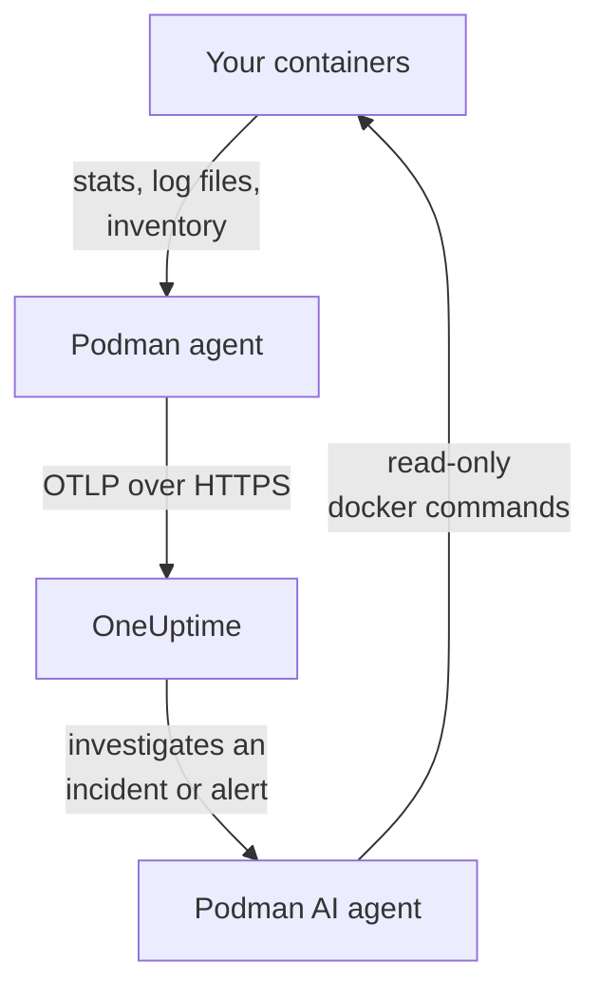

# Podman Agent

The OneUptime Podman agent is one container you run on a Podman host. It reads the stats and log files of every container on the host and sends them to OneUptime, where the host appears with its containers, metrics and logs. A second container, the Podman AI agent, lets OneUptime AI investigate the host. [Podman monitors](/docs/monitor/podman-monitor) alert on what the agent sends.

:::cards
- [Install the agent](#install-the-agent): Two containers, with `podman run` or Podman Compose.
- [What the agent collects](#what-the-agent-collects): Metrics, logs and an inventory of every container.
- [Container logs need k8s-file](#container-logs-need-the-k8s-file-log-driver): Podman logs to journald unless you switch.
- [Troubleshooting](#troubleshooting): Restart loops, missing metrics, missing logs.
:::

## How it works

The agent is an OpenTelemetry Collector with OneUptime's configuration built in. Through Podman's Docker-compatible API socket it reads each container's stats every 30 seconds and lists every container, image, network and volume every 5 minutes. It tails the containers' log files and sends everything to your OneUptime URL over OTLP, with the ingestion key you give it.



The host registers itself with its first data, under the name you give it in `PODMAN_HOST_NAME`. The AI agent is optional: leave it out and the collector works the same.

## Before you begin

- Podman 4.0 or later, and root access on the host.
- Podman's API socket at `/run/podman/podman.sock`. Turn it on with `sudo systemctl enable --now podman.socket`.
- An ingestion key. Create one under **Project Settings → Telemetry & APM → Ingestion Keys** and copy its value.
- Outbound HTTPS from the host to your OneUptime URL.
- For container logs, containers that use the `k8s-file` log driver. Rootful Podman logs to `journald` by default, which the agent cannot read. See [Container logs need the k8s-file log driver](#container-logs-need-the-k8s-file-log-driver).

## Install the agent

:::steps
### Start the agent

Replace `YOUR_ONEUPTIME_URL` with your OneUptime URL, `YOUR_TELEMETRY_INGESTION_TOKEN` with the ingestion key, and `my-podman-host` with a name for this host, such as `prod-podman-01`. The name is how the host appears in OneUptime, so keep it stable: a new name registers a new host.

:::tabs
@tab Podman CLI
```bash
podman run -d \
  --name oneuptime-podman-agent \
  --user 0:0 \
  --restart unless-stopped \
  -v /run/podman/podman.sock:/run/podman/podman.sock:ro \
  -v /var/lib/containers/storage:/var/lib/containers/storage:ro \
  -e ONEUPTIME_URL="YOUR_ONEUPTIME_URL" \
  -e ONEUPTIME_SERVICE_TOKEN="YOUR_TELEMETRY_INGESTION_TOKEN" \
  -e PODMAN_HOST_NAME="my-podman-host" \
  oneuptime/podman-agent:release
```

Then start the [AI agent](#ai-agent) beside it, with the same values. **AI investigations are on by default**: while OneUptime AI investigates an incident or alert on this host, it runs read-only `docker` commands through the AI agent, against Podman's Docker-compatible API, and it changes nothing unless you allow fixes. To install without AI investigations, skip this command.

```bash
podman run -d \
  --name oneuptime-podman-ai-agent \
  --user 0:0 \
  --restart unless-stopped \
  --read-only --tmpfs /tmp \
  -v /run/podman/podman.sock:/run/podman/podman.sock:ro \
  -e ONEUPTIME_URL="YOUR_ONEUPTIME_URL" \
  -e ONEUPTIME_SERVICE_TOKEN="YOUR_TELEMETRY_INGESTION_TOKEN" \
  -e ONEUPTIME_AI_AGENT_RESOURCE_TYPE=podman \
  -e PODMAN_HOST_NAME="my-podman-host" \
  oneuptime/resource-ai-agent:release
```
@tab Podman Compose
Save this as `docker-compose.yml` in a folder on the host. The second service is the [AI agent](#ai-agent): leave it out to run the collector without AI investigations.

```yaml title="docker-compose.yml"
services:
  oneuptime-podman-agent:
    image: oneuptime/podman-agent:release
    container_name: oneuptime-podman-agent
    user: "0:0"
    restart: unless-stopped
    volumes:
      - /run/podman/podman.sock:/run/podman/podman.sock:ro
      - /var/lib/containers/storage:/var/lib/containers/storage:ro
    environment:
      - ONEUPTIME_URL=YOUR_ONEUPTIME_URL
      - ONEUPTIME_SERVICE_TOKEN=YOUR_TELEMETRY_INGESTION_TOKEN
      - PODMAN_HOST_NAME=my-podman-host
    logging:
      driver: json-file
      options:
        max-size: "10m"
        max-file: "3"
  oneuptime-podman-ai-agent:
    image: oneuptime/resource-ai-agent:release
    container_name: oneuptime-podman-ai-agent
    user: "0:0"
    restart: unless-stopped
    read_only: true
    tmpfs:
      - /tmp
    volumes:
      - /run/podman/podman.sock:/run/podman/podman.sock:ro
    environment:
      - ONEUPTIME_URL=YOUR_ONEUPTIME_URL
      - ONEUPTIME_SERVICE_TOKEN=YOUR_TELEMETRY_INGESTION_TOKEN
      - ONEUPTIME_AI_AGENT_RESOURCE_TYPE=podman
      - PODMAN_HOST_NAME=my-podman-host
```

Start it in that folder:

```bash
podman compose up -d
```
:::

### Check the agent is running

```bash
podman ps --filter name=oneuptime-podman-agent
podman logs -f oneuptime-podman-agent
```

The logs should show this line once the collector has started:

```text
Everything is ready. Begin running and processing data.
```

### Find the host in OneUptime

Open **Products → Infrastructure → Podman → All Hosts**. The host appears under its `PODMAN_HOST_NAME` within a minute or so, with its containers, metrics and logs. The AI agent shows as connected on the host's **AI agent** page, and at the bottom of its **Overview**.
:::

## Environment variables

| Variable | Required | Description |
| --- | --- | --- |
| `ONEUPTIME_URL` | Yes | Your OneUptime URL, such as `https://oneuptime.com` or your self-hosted instance. Use `http://` and its port if the instance is HTTP-only. |
| `ONEUPTIME_SERVICE_TOKEN` | Yes | The ingestion key from **Project Settings → Telemetry & APM → Ingestion Keys**. |
| `PODMAN_HOST_NAME` | No | The host's name in OneUptime. Defaults to `podman-host`, so give every host its own. |
| `DOCKER_API_VERSION` | No | The Docker API version the agent speaks to the Podman socket. Defaults to `1.44`. Lower it if the socket reports an older maximum, or set it to an empty value to negotiate it (see [Troubleshooting](#troubleshooting)). |

To change a value, remove the agent and run its command again (Podman CLI), or edit `docker-compose.yml` and run `podman compose up -d` (Podman Compose).

## What the agent collects

| Data | What it is |
| --- | --- |
| Container metrics | CPU (usage, percentage, throttling), memory (usage, limit, percentage), network and block I/O, uptime, restarts and process count, per container, every 30 seconds. |
| Container logs | The stdout and stderr of every container, from the `ctr.log` file the `k8s-file` log driver writes. |
| Inventory | Every container in every state, and every image, network and volume, every 5 minutes. |

Each container's metrics and logs are filed under a service named after the container. Each log line gets a severity from the level it names, such as `[ERROR]`, `level=warn` or `{"level":"info"}`; a line that names none takes its stream's: stderr is `ERROR`, stdout is `INFO`. Lines that start with whitespace or a closing bracket join the line before, so a stack trace arrives as one record. The agent's own logs are left out.

[Podman Monitor](/docs/monitor/podman-monitor#collected-metrics) lists every metric and what it means.

## Container logs need the k8s-file log driver

The agent tails `/var/lib/containers/storage/overlay-containers/*/userdata/ctr.log`, the files Podman's `k8s-file` log driver writes (`json-file` is the same driver in Podman). Rootful Podman's default driver is `journald`, which leaves no file to read, and so does a remote driver such as `syslog`. Such a container's metrics still arrive; its logs do not.

Check a container's log driver, and Podman's default:

```bash
podman inspect <container> --format '{{.HostConfig.LogConfig.Type}}'
podman info --format '{{.Host.LogDriver}}'
```

Run a container with `k8s-file`, or switch a Compose service to it:

```bash
podman run --log-driver k8s-file --log-opt max-size=100m ... <image>
```

```yaml
services:
  my-app:
    image: my-app:latest
    logging:
      driver: "k8s-file"
      options:
        max-size: "100m"
```

Or make it the default for every container created afterwards, in `containers.conf` (`/etc/containers/containers.conf` rootful, `~/.config/containers/containers.conf` rootless):

```toml title="containers.conf"
[containers]
log_driver = "k8s-file"
log_size_max = 104857600
```

Then recreate the containers. A container keeps the log driver it was created with, so restarting it is not enough.

## Upgrading the agent

When the agent is older than your OneUptime, a warning sign appears beside **Agent Version** on the host's **Overview**. Select it to see these commands.

:::tabs
@tab Podman CLI
```bash
podman pull oneuptime/podman-agent:release
podman pull oneuptime/resource-ai-agent:release
podman rm -f oneuptime-podman-agent oneuptime-podman-ai-agent
```

Then run both `podman run` commands from [Start the agent](#start-the-agent) again.
@tab Podman Compose
```bash
podman compose pull
podman compose up -d
```
:::

The `release` tag always points at the newest release. To pin a version, use `oneuptime/podman-agent:<version>`, such as `oneuptime/podman-agent:10.0.31`. The same image is on the GitHub Container Registry as `ghcr.io/oneuptime/podman-agent:release`.

## Uninstalling the agent

:::tabs
@tab Podman CLI
```bash
podman rm -f oneuptime-podman-agent
podman rm -f oneuptime-podman-ai-agent
```
@tab Podman Compose
```bash
podman compose down
```
:::

The host stays in OneUptime with the data it sent. If you no longer need it, delete it with **Delete Host** in its menu.

## AI agent

The commands and the Compose file above, the Podman agent's `install.sh` and the `docker-compose.yml` in its [PodmanAgent directory](https://github.com/OneUptime/oneuptime/tree/master/agents/PodmanAgent) all run the **Podman AI agent**: a second container, `oneuptime-podman-ai-agent` (image `oneuptime/resource-ai-agent:release`), that runs the read-only commands OneUptime AI asks for while it investigates an incident or alert on this host — through Podman's Docker-compatible API, with the `docker` CLI: `docker ps -a`, `docker logs --tail 200 web`, `docker container inspect web` — and, only if you allow it, applies fixes such as restarting a named container. It reads the same `ONEUPTIME_URL`, `ONEUPTIME_SERVICE_TOKEN` and `PODMAN_HOST_NAME` as the collector, so it serves exactly this host, and it shows up on the host's **AI agent** page in OneUptime.

- **AI investigations are on by default.** Once the agent connects, OneUptime AI investigates incidents and alerts on this host with it, and the host's **Overview** shows the agent's status. To stop, set `ONEUPTIME_AI_INVESTIGATION=false` where the agent runs (**Change** under **What AI may do** on the AI agent page shows how), or leave the agent out.
- It is read-only unless you start it with `ONEUPTIME_AI_ALLOW_WRITES=true`; `ONEUPTIME_AI_WRITE_TARGETS` (for example `web-*,api-*`) limits which containers a fix may touch. Start it with `ONEUPTIME_AI_FIXES` too, to say how fixes run — `ask-for-approval` (a person approves each one), `automatic` or `bypass-approval` — and the AI agent page shows it read-only ([What AI may do, set by the agent](/docs/ai/infrastructure-ai-agents#what-ai-may-do-set-by-the-agent)).
- It needs the same socket as the collector and runs as root with it mounted, because the socket is root-owned — and for rootful Podman whoever can use the socket is root on this host, `:ro` or not. The agent's command policy is the limit: it never runs `exec`, `run`, `rm` or `prune`, and it never changes itself, the collector or anything in `ONEUPTIME_AI_PROTECTED_TARGETS` (container name globs).
- `install.sh --no-ai-agent` leaves it out; `podman rm -f oneuptime-podman-ai-agent` removes it. Upgrade it like the collector: `podman pull oneuptime/resource-ai-agent:release`, remove it, and start it again.

What it may run, how fixes work and how to troubleshoot it: [Infrastructure AI Agents](/docs/ai/infrastructure-ai-agents#docker-and-podman-hosts).

## Troubleshooting

:::details The agent restarts with "client version is too new"
The agent's logs show:

```text
Error: cannot start pipelines: failed to start "docker_stats" receiver:
Error response from daemon: client version 1.44 is too new.
Maximum supported API version is 1.41
```

A Docker-API server that enforces a maximum client version refuses a newer one, so the receiver never starts and the collector exits with it. Check the API version the Podman socket reports:

```bash
curl -s -o /dev/null -D - --unix-socket /run/podman/podman.sock http://localhost/_ping | grep -i '^api-version'
```

Then add `-e DOCKER_API_VERSION=1.41` (or the value you got) to `podman run`, or set `DOCKER_API_VERSION` in Compose. Newer servers still serve older API versions, so the setting stays valid after an upgrade.

Rather not look the number up? Set `DOCKER_API_VERSION` to the empty string. The agent then negotiates the version with the socket (one `HEAD /_ping`, then the maximum the socket reports) instead of pinning one:

```bash
podman run -d ... -e DOCKER_API_VERSION= ...
```
:::

:::details Podman socket permission denied, or no socket
The agent must run as root to read `/run/podman/podman.sock`. Check that `--user 0:0` is in your `podman run` command, or `user: "0:0"` in Compose, and that the socket is on: `sudo systemctl enable --now podman.socket`. Rootless Podman has its socket at `/run/user/<uid>/podman/podman.sock` instead (`systemctl --user enable --now podman.socket`): mount that path in place of `/run/podman/podman.sock`.
:::

:::details The host shows as Disconnected
1. Check that the agent is running: `podman ps --filter name=oneuptime-podman-agent`
2. Look for errors in its logs: `podman logs oneuptime-podman-agent 2>&1 | grep -i error`
3. Check `ONEUPTIME_URL` and `ONEUPTIME_SERVICE_TOKEN`: the key must be a valid ingestion key that has not been disabled.
4. Check that the host can reach your OneUptime URL over the network.
:::

:::details No metrics appear
1. Check that the Podman socket is mounted into the agent. Its image has no shell, so look from a throwaway container that shares its mounts: `podman run --rm --volumes-from oneuptime-podman-agent alpine:3.19 ls -la /run/podman/podman.sock`
2. Look for export errors in its logs: `podman logs oneuptime-podman-agent 2>&1 | tail -100`
3. Check that the ingestion key is valid and has not expired.
:::

:::details Metrics arrive but no container logs
Your containers most likely use `journald`, Podman's default log driver. Check which files the agent watches, and which driver a container uses:

```bash
podman logs oneuptime-podman-agent 2>&1 | grep -E "Started watching file|no files match"
podman inspect <container> --format '{{.HostConfig.LogConfig.Type}}'
```

If the agent reports `no files match the configured criteria`, switch the containers to `k8s-file` and recreate them, as [Container logs need the k8s-file log driver](#container-logs-need-the-k8s-file-log-driver) shows.
:::

:::details The logs are on another host, or the host is named podman-host
The host's name comes from `PODMAN_HOST_NAME`. An agent started without it reports `podman-host`, so every host set up that way looks like the same one; change the name later and OneUptime registers a second host, which then holds the new data. Set `PODMAN_HOST_NAME` to a name of its own on each host, and recreate the agent. To check the name the agent reports:

```bash
podman inspect oneuptime-podman-agent --format '{{range .Config.Env}}{{println .}}{{end}}' | grep PODMAN_HOST_NAME
```
:::

## Next steps

:::cards
- [Podman Monitor](/docs/monitor/podman-monitor): Alert on container CPU, memory and restarts.
- [Databases](/docs/telemetry/databases): Database containers on the host are found and get pages of their own.
- [Kubernetes Agent](/docs/telemetry/kubernetes-agent): Monitor a Kubernetes cluster instead.
- [Host OpenTelemetry Collector](/docs/telemetry/host-otel-collector): Monitor the machine itself: CPU, disks, processes and logs.
:::
