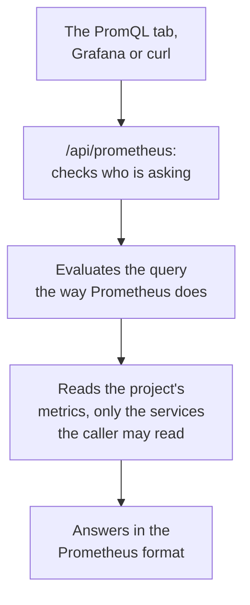

# Query Metrics with PromQL

PromQL is the query language of Prometheus, and the one most people who chart metrics already know. OneUptime reads your project's metrics with it: on the **PromQL** tab of Metrics, and through a Prometheus-compatible API that Grafana, or any tool with a Prometheus data source, can point at.

:::cards
- [Write a query](#write-a-query): Run PromQL on the Metrics page and see a graph or a table.
- [How metrics are named](#how-metrics-are-named): How OpenTelemetry names and attributes read in PromQL.
- [Connect Grafana](#connect-grafana): Add OneUptime as a Prometheus data source.
- [Limits](#limits): What a query may read, and for how long.
:::

## How it works

The PromQL tab and Grafana ask the same API. OneUptime checks that the caller may read the project's metrics, reads only the services they may read, and evaluates the query the way Prometheus does.



## Before you begin

- **Metrics arriving.** Send them with [OpenTelemetry](/docs/telemetry/open-telemetry), or from an agent such as the [Host OpenTelemetry Collector](/docs/telemetry/host-otel-collector).
- **A role that reads metrics.** Project Owner, Project Admin, Project Member, Viewer, Telemetry Admin, Telemetry Member or Telemetry Viewer, or a custom role with the Read Metrics permission. A role limited to some services reads only their metrics.
- **For Grafana or a script: a project API key** with one of those roles or the Read Metrics permission. See [Create an API key](/docs/api-reference/api-reference#create-an-api-key). On OneUptime Cloud, API keys need the **Growth** plan.

## Write a query

:::steps
### Open PromQL

Open **Metrics** and click the **PromQL** tab.

### Write the query

Type it in the editor, pick an example under **Examples**, or start from **Add a metric name**, which lists your project's metrics as PromQL names them.

### Run it

Click **Run Query**, or press Ctrl+Enter (⌘+Enter on a Mac). **Graph** draws the query over the time range; **Table** shows each series' value at the end of it.
:::

A few queries to start from:

```text title="PromQL"
# Requests per second, by service
sum by (job) (rate(http_requests_total[5m]))

# The 95th percentile of a latency histogram
histogram_quantile(0.95, sum by (le) (rate(http_server_request_duration_bucket[5m])))

# The five hosts using the most memory
topk(5, system_memory_usage)
```

The editor shows what went wrong with a query that does not run, and where: `rate(http_requests_total)`, for example, says the function needs a range such as `[5m]`.

## How metrics are named

OneUptime stores metrics the OpenTelemetry way. PromQL reads them the way Prometheus' own OpenTelemetry support names them, so a query written for Prometheus works here:

| In OneUptime | In PromQL |
| --- | --- |
| A gauge `system.cpu.utilization` | `system_cpu_utilization` |
| A counter `http.requests` | `http_requests`, or `http_requests_total` |
| A histogram `http.server.request.duration` | `http_server_request_duration_bucket` (with `le`), `_count` and `_sum` |
| A summary `rpc.latency` | `rpc_latency` (with `quantile`), `_count` and `_sum` |
| An attribute `http.route` | The label `http_route` |
| A resource attribute `service.name` | The label `resource_service_name`, and `job` |
| A resource attribute `service.instance.id` | The label `resource_service_instance_id`, and `instance` |

- **Dots and dashes become underscores** in metric and label names. To name a metric or a label exactly as it is stored, quote it, as Prometheus 3 does: `{"http.server.request.duration", "http.route"="/checkout"}`.
- **Delta counters are added up** from the start of the query's time range, so `rate()` and `increase()` read them like any other counter.
- **Exponential histograms** have `_count` and `_sum`, but no buckets.

## Connect Grafana

:::steps
### Create an API key

In OneUptime, open **Project Settings → Advanced → API Keys** and click **Create API Key**. Give the key a role that reads telemetry, or the Read Metrics permission.

### Add a Prometheus data source

In Grafana, open **Connections → Data sources → Add data source** and pick **Prometheus**.

### Enter the server URL

Set **Prometheus server URL** to your OneUptime address followed by `/api/prometheus`. On OneUptime Cloud, that is `https://oneuptime.com/api/prometheus`. The **PromQL** tab shows the address of your own server, with a copy button.

### Send the API key

Under **HTTP headers**, add the header `Authorization` with the value `Bearer` followed by a space and your API key. Basic authentication works too: any user name, with the API key as the password.

### Save and test

Click **Save & test**. Grafana runs a query, and says the data source works.
:::

Any other Prometheus client works the same way. With curl:

```bash title="Query OneUptime's Prometheus API"
curl -H "Authorization: Bearer $ONEUPTIME_API_KEY" \
  "https://oneuptime.com/api/prometheus/api/v1/query?query=up"
```

## The API

The API answers the Prometheus HTTP API's routes, with `GET` or `POST`, under `/api/prometheus`:

| Route | What it answers |
| --- | --- |
| `/api/v1/query` | A query at one time (`time`, by default now). |
| `/api/v1/query_range` | A query at every `step` from `start` to `end`. |
| `/api/v1/series` | The series that `match[]` selects. |
| `/api/v1/labels` | Label names, of the series `match[]` selects or of every metric. |
| `/api/v1/label/<name>/values` | One label's values. `__name__` lists the metric names. |
| `/api/v1/metadata` | Each metric's type, help and unit. |

Times are Unix seconds or RFC 3339, durations are seconds or a duration such as `15s`, and answers are in Prometheus' format. `/api/v1/status/buildinfo` answers as a Prometheus 3 server; rules and alerts are empty, because OneUptime alerts with [monitors](/docs/monitor/metrics-monitor).

## What PromQL covers

- **Selectors** with every matcher (`=`, `!=`, `=~`, `!~`), ranges, `offset`, `@` (with `start()` and `end()`) and subqueries.
- **Operators**: arithmetic, comparisons (with `bool`), `and`, `or`, `unless`, and vector matching with `on`, `ignoring`, `group_left` and `group_right`.
- **Aggregations**: `sum`, `avg`, `min`, `max`, `count`, `group`, `stddev`, `stdvar`, `topk`, `bottomk`, `quantile` and `count_values`, with `by` or `without`.
- **Functions**: `rate`, `irate`, `increase`, `delta`, `idelta`, `deriv`, `predict_linear`, `histogram_quantile`, every `*_over_time` function, `changes`, `resets`, `absent`, `label_replace`, `label_join`, `sort`, `clamp`, `round`, the math and date functions, and more.

Prometheus' native histogram functions, such as `histogram_count()`, are not available: OneUptime stores histograms with buckets, which `histogram_quantile()` and the `_count` and `_sum` series read.

## Limits

Every query is bounded, so a dashboard of many panels cannot overload OneUptime:

| Limit | Value |
| --- | --- |
| Points in one series of a range query | 11,000 |
| Samples one query may read and hold | 5,000,000 |
| Metric points one selector may read | 1,000,000 |
| Time a read may take | 30 seconds |
| Time evaluating may take | 30 seconds |
| How far back a selector looks for a series' latest sample | 5 minutes |
| A subquery's step, when the query leaves it out | 1 minute |

## Troubleshooting

:::details Grafana says the data source does not work
Check the URL ends in `/api/prometheus`, and the `Authorization` header holds `Bearer`, a space and the API key. A key with no role that reads metrics is refused: give it one in **Project Settings → Advanced → API Keys**.
:::

:::details A metric from the explorer finds nothing
Its PromQL name has underscores where the stored name has dots, and a histogram is read through `_bucket`, `_count` or `_sum`. **Add a metric name** on the PromQL tab lists every name as PromQL writes it.
:::

:::details "The query reads more than 1,000,000 metric points"
The query asks for more than a read may hold. Add label matchers, shorten the time range, or use a larger step.
:::

## Next steps

:::cards
- [Metrics Explorer](/docs/telemetry/metrics-explorer): Chart metrics without writing a query.
- [Metrics Monitor](/docs/monitor/metrics-monitor): Alert when a metric crosses a threshold.
- [External Data Sources](/docs/dashboards/data-sources): Chart an outside Prometheus on your dashboards.
:::
