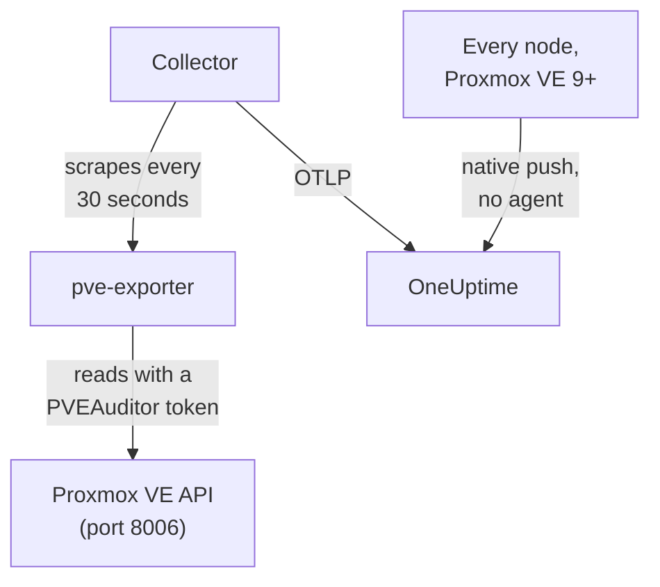

# Proxmox Agent

The OneUptime Proxmox agent monitors a Proxmox VE cluster: its nodes, QEMU VMs, LXC containers, storage, HA state, backup coverage and replication. It reads the cluster through the Proxmox VE API with a read-only token and sends what it finds to OneUptime, where the cluster appears with its nodes, guests and storage. On Proxmox VE 9 and later the nodes can also push their own metrics, with nothing to install. [Proxmox monitors](/docs/monitor/proxmox-monitor) alert on what arrives.

:::cards
- [Choose how to connect](#choose-how-to-connect): The agent, or Proxmox VE 9's own push.
- [Install the agent](#install-the-agent): An API token, then the install script or Docker Compose.
- [Native push](#zero-install-alternative-proxmox-ve-9-native-opentelemetry-push): Proxmox VE 9 sends its metrics itself.
- [Troubleshooting](#troubleshooting): A diagnostic script, and the usual problems.
:::

## How it works

The agent is a set of containers you run with Docker Compose on one machine: [prometheus-pve-exporter](https://github.com/prometheus-pve/prometheus-pve-exporter) reads the Proxmox VE API on port 8006, an OpenTelemetry Collector scrapes the exporter every 30 seconds and stamps every metric with your cluster's name, and the Proxmox AI agent lets OneUptime AI read the cluster while it investigates. Proxmox VE 9's native push sends each node's metrics straight to OneUptime instead.



The cluster registers itself with its first data, under the name the agent stamps on every metric as `proxmox.cluster.name`.

## Choose how to connect

| | The agent | Native push |
| --- | --- | --- |
| Proxmox VE | Any supported version | 9.0 or later |
| To install | Docker Compose on one machine | Nothing: a metric server in the Proxmox web UI |
| Nodes, guests and storage | Yes | Yes |
| HA state, start-on-boot, backup coverage and replication | Yes | No |
| Proxmox AI agent | Yes | No |

The **HA Resource in Error State**, **Guest Down**, **Guest Not Backed Up** and **Replication Failing** templates need the agent. Use one or the other for a cluster: running both reports every resource twice.

## Before you begin

- Docker Engine 20.10 or later with the Docker Compose v2 plugin, on a machine that can reach the Proxmox VE API on port 8006.
- A root shell on any Proxmox VE node, or the Proxmox web UI, to create an API token.
- An ingestion key. Create one under **Project Settings → Telemetry & APM → Ingestion Keys** and copy its value.
- Outbound HTTPS from that machine to your OneUptime URL.

### Where to run the agent

The agent queries the Proxmox VE API over the network, so it does not have to live on a cluster node, and it should not: run it on a machine that survives a node failure (a small monitoring VM on separate hardware, a management host), or point `PVE_HOST` at a virtual IP or round-robin DNS name instead of one node's address. If the agent's API target is the node that just died, your monitoring dies with it. The one exception is the optional journald logs pipeline, which must run on a Proxmox VE node (see [Ship Proxmox service logs](#optional-ship-proxmox-service-logs)).

## Install the agent

:::steps
### Create a read-only API token

The agent reads the cluster with an API token that has the **PVEAuditor** role, which can read and nothing else.

:::tabs
@tab Shell
As root on any Proxmox VE node:

```bash
pveum user add monitoring@pam
pveum acl modify / --roles PVEAuditor --users monitoring@pam
pveum user token add monitoring@pam oneuptime --privsep 1
pveum acl modify / --roles PVEAuditor --tokens 'monitoring@pam!oneuptime'
```

The first command only fails, harmlessly, if `monitoring@pam` already exists: API tokens carry their own secret, so the user needs no password or system account. `pveum user token add` prints the token secret once; the token id is `monitoring@pam!oneuptime`.
@tab Proxmox web UI
1. Go to *Datacenter → Permissions → API Tokens* and click **Add**.
2. Pick (or create) a user, give the token an ID like `oneuptime`, and leave **Privilege Separation** checked.
3. Copy the token id (`user@realm!tokenname`) and the secret: the secret is shown only once.
4. Under *Datacenter → Permissions*, add the **PVEAuditor** role on path `/` twice: once as an **API Token Permission** for the token, once as a **User Permission** for its user.
:::

The role goes on the user as well as the token because a privilege-separated token only gets the permissions its user also has. It must sit on the root path `/`, because the exporter reads every node, guest and storage object: a narrower path hides the rest of the cluster and fails with `401`/`403 Permission check failed (/, Sys.Audit)`.

### Install and start the agent

:::tabs
@tab install.sh
Download the install script and run it on the machine that will host the agent:

```bash
curl -sSL https://raw.githubusercontent.com/OneUptime/oneuptime/master/agents/ProxmoxAgent/install.sh -o install.sh
bash install.sh
```

The script asks for your OneUptime URL, the ingestion key, a name for the cluster, the Proxmox VE API host, whether to run the bundled exporter, and the token id and secret — and whether the [AI agent](#ai-agent) may apply fixes, and if so for a token of its own and the guests it must never change. It installs to `/opt/oneuptime-proxmox-agent`, writes a `0600` `.env` file, and starts the agent with Docker Compose. Running the script again reuses everything in that `.env` instead of prompting again, which is how you [upgrade the agent](#upgrading-the-agent).
@tab Docker Compose
Download `docker-compose.yml` and `otel-collector-config.yaml` from the [ProxmoxAgent directory](https://github.com/OneUptime/oneuptime/tree/master/agents/ProxmoxAgent) into a new folder:

```bash
mkdir oneuptime-proxmox-agent && cd oneuptime-proxmox-agent
curl -fsSLO https://raw.githubusercontent.com/OneUptime/oneuptime/master/agents/ProxmoxAgent/docker-compose.yml
curl -fsSLO https://raw.githubusercontent.com/OneUptime/oneuptime/master/agents/ProxmoxAgent/otel-collector-config.yaml
```

Create a `.env` file next to them. It holds the token secret, so keep it private with `chmod 600 .env`:

```bash title=".env"
ONEUPTIME_URL=YOUR_ONEUPTIME_URL
ONEUPTIME_TELEMETRY_INGESTION_KEY=YOUR_TELEMETRY_INGESTION_TOKEN
PROXMOX_CLUSTER_NAME=my-proxmox-cluster
PVE_HOST=192.168.1.10
PVE_API_TOKEN_ID=monitoring@pam!oneuptime
PVE_API_TOKEN_SECRET=your-token-secret
COMPOSE_PROFILES=pve-exporter
```

`COMPOSE_PROFILES=pve-exporter` also starts the bundled exporter. Start the agent:

```bash
docker compose up -d
```
:::

Already run prometheus-pve-exporter? Answer **n** when the script asks to run the bundled one, or drop `COMPOSE_PROFILES` from `.env`, and point the agent at yours (`host:port`, no scheme, an address the agent's container can reach: `localhost` is the container itself). Keep `PVE_API_TOKEN_ID` and `PVE_API_TOKEN_SECRET` if you use the [AI agent](#ai-agent), which calls the API with that token:

```bash
PVE_EXPORTER_URL=your-exporter-host:9221
```

### Check the agent is running

```bash
docker compose ps
docker logs -f oneuptime-proxmox-agent
```

`docker compose ps` lists the collector (`oneuptime-proxmox-agent`), the bundled exporter (`oneuptime-pve-exporter`, unless you use your own) and the AI agent (`oneuptime-proxmox-ai-agent`). The collector's logs should show this line once it has started:

```text
Everything is ready. Begin running and processing data.
```

### Find the cluster in OneUptime

Open **Products → Infrastructure → Proxmox → All Clusters**. The cluster appears under its `PROXMOX_CLUSTER_NAME` about a minute after the first scrape, with its nodes, guests and storage.
:::

## Environment variables

The install script writes these to `/opt/oneuptime-proxmox-agent/.env`; a Docker Compose install reads them from the `.env` next to `docker-compose.yml`. After changing one, run `docker compose up -d` in that folder.

| Variable | Required | Description |
| --- | --- | --- |
| `ONEUPTIME_URL` | Yes | Your OneUptime URL, such as `https://oneuptime.com` or your self-hosted instance. Use `http://` and its port if the instance is HTTP-only. |
| `ONEUPTIME_TELEMETRY_INGESTION_KEY` | Yes | The ingestion key from **Project Settings → Telemetry & APM → Ingestion Keys**. |
| `PROXMOX_CLUSTER_NAME` | Yes | The cluster's name in OneUptime, stamped on every metric as the `proxmox.cluster.name` resource attribute. Keep it stable: changing it later registers a second cluster. Defaults to `proxmox-cluster`. |
| `PVE_HOST` | Yes | The Proxmox VE API host (any node of the cluster) the exporter and the AI agent query, such as `192.168.1.10`. |
| `PVE_EXPORTER_URL` | No | The address (`host:port`, no scheme) of prometheus-pve-exporter. Defaults to the bundled exporter, `pve-exporter:9221`. |
| `PVE_API_TOKEN_ID` | Bundled exporter or AI agent | The full Proxmox API token id, such as `monitoring@pam!oneuptime`. The AI agent reads the API with it unless it has a token of its own (`ONEUPTIME_AI_PVE_API_TOKEN_ID` / `ONEUPTIME_AI_PVE_API_TOKEN_SECRET`). |
| `PVE_API_TOKEN_SECRET` | Bundled exporter or AI agent | The Proxmox API token secret. |
| `PVE_VERIFY_SSL` | No | Verify the Proxmox API's TLS certificate (the exporter and the AI agent). Defaults to `false`, because Proxmox ships self-signed certificates. |
| `COMPOSE_PROFILES` | No | Set to `pve-exporter` to start the bundled exporter container. |

## What the agent collects

The collector scrapes the exporter every 30 seconds with both its cluster and node collectors on, which also covers the exporter's default-on `backup-info` (cluster-level) and `replication` (node-level) collectors. Every series carries an `id` label naming the resource: `node/<name>`, `qemu/<vmid>`, `lxc/<vmid>` or `storage/<node>/<storage>`.

| Category | Metrics |
| --- | --- |
| Availability | `pve_up`, `pve_uptime_seconds` |
| Node | `pve_node_info`, `pve_cpu_usage_ratio`, `pve_cpu_usage_limit`, `pve_memory_usage_bytes`, `pve_memory_size_bytes` |
| Guest (VM or LXC) | `pve_guest_info`, and CPU, memory and network series on `qemu/*` and `lxc/*` ids (`pve_network_receive_bytes`, `pve_network_transmit_bytes`) |
| Storage | `pve_disk_usage_bytes`, `pve_disk_size_bytes`, `pve_storage_info` |
| HA | `pve_ha_state` |
| Backup coverage | `pve_not_backed_up_total` (the guests no backup job covers; one cluster-level series, no `id` label) and `pve_not_backed_up_info` (one series per uncovered guest, with its `id`). Covered means at least one job selects the guest: whether backups ran recently or succeeded is not exposed by the exporter. |
| Replication | `pve_replication_failed_syncs`, `pve_replication_duration_seconds`, `pve_replication_last_sync_timestamp_seconds`, `pve_replication_last_try_timestamp_seconds`, `pve_replication_next_sync_timestamp_seconds`, `pve_replication_info`, per storage replication job. Their `id` label is the job id (such as `100-0`), not a resource. |

Monitor criteria and attribute filters match on equality, not on a prefix, so the collector's `transform/pve-identity` processor also splits `id` into three attributes. The built-in Proxmox alert templates filter on them, so keep the processor if you customize the config:

| Attribute | Values | For `qemu/100` |
| --- | --- | --- |
| `pve.scope` | `node`, `guest`, `storage`, `cluster` (`qemu` and `lxc` are both `guest`) | `guest` |
| `pve.type` | `node`, `qemu`, `lxc`, `storage` | `qemu` |
| `pve.id` | Everything after the first `/` of `id` (`pve1`, `100`, `pve1/local`) | `100` |

The original `id` label is kept as it is.

## Optional — Ship Proxmox service logs

By default the agent ships metrics only, so the cluster's **Logs** page stays empty. The Proxmox VE services log to the systemd journal under eight units: `pveproxy`, `pvedaemon`, `pve-firewall`, `pve-ha-crm`, `pve-ha-lrm`, `pvescheduler`, `pvestatd` and `qmeventd`. The shipped `otel-collector-config.yaml` has a commented-out `journald` receiver for exactly those units, wired to a commented `logs` pipeline that stamps `proxmox.cluster.name` so the logs land on your cluster.

:::steps
### Run the agent on a node

The journal is per host, so a remote agent cannot read it. This is the one setup that goes against [Where to run the agent](#where-to-run-the-agent): to keep the metrics agent off the cluster, run a second, log-only collector on the node instead (copy the config, then delete the `prometheus` receiver and the `metrics` pipeline).

### Turn the receiver on

Uncomment the `journald` receiver and the `logs` pipeline in `otel-collector-config.yaml`, and the journal volumes in `docker-compose.yml`, so the container can read the host's journal:

```yaml
- /var/log/journal:/var/log/journal:ro
- /etc/machine-id:/etc/machine-id:ro
```

### Swap the collector image

The stock `otel/opentelemetry-collector-contrib` image is built `FROM scratch`: it has no `journalctl`, which the journald receiver runs, and runs as a user that cannot read the journal. Build this wrapper and point `image:` in `docker-compose.yml` at it:

```dockerfile title="Dockerfile"
FROM otel/opentelemetry-collector-contrib:0.161.0 AS otelcol
FROM debian:stable-slim
RUN apt-get update \
    && apt-get install -y --no-install-recommends systemd \
    && rm -rf /var/lib/apt/lists/*
COPY --from=otelcol /otelcol-contrib /otelcol-contrib
ENTRYPOINT ["/otelcol-contrib"]
CMD ["--config", "/etc/otelcol-contrib/config.yaml"]
```

The `systemd` package is there only for `journalctl`, and this image runs as root, which is what can read the journal. Or skip Docker for the logs and run the `otelcol-contrib` release `.deb` on the node itself, where `journalctl` already is.
:::

Each node ships only its own journal: for service logs from every node, run the log-only collector on each node.

### Fallback without a custom image: filelog on /var/log/syslog

To keep the stock image, tail syslog instead. Install rsyslog on the node (`apt install rsyslog`; Debian 12 and Proxmox VE 8 and later no longer ship it), mount the `/var/log` directory into the container (`- /var/log:/var/log:ro`; the directory, not the file, so log rotation does not pin a stale file), and use a `filelog` receiver in place of the journald one:

```yaml
receivers:
  filelog:
    include:
      - /var/log/syslog
    start_at: end
```

You lose the per-unit filter (syslog carries everything, not just the eight services), and the stock image's user must be able to read the file. Wire it into the same commented `logs` pipeline (`receivers: [filelog]`).

## Zero-install alternative: Proxmox VE 9+ native OpenTelemetry push

Proxmox VE 9.0 and later ship an OpenTelemetry metric server that pushes node, guest and storage metrics to any OTLP/HTTP endpoint, with no agent or exporter to install. In the Proxmox web UI, go to *Datacenter → Metric Server → Add → OpenTelemetry* and fill in:

| Field | Value |
| --- | --- |
| Server | Your OneUptime host, such as `oneuptime.com`, or your self-hosted host |
| Port | `443` |
| Protocol | `https` |
| Path | `/otlp/v1/metrics` |
| Headers | `{"x-oneuptime-token": "YOUR_TELEMETRY_INGESTION_TOKEN"}` |

Add it once: every node of the cluster pushes its own metrics. OneUptime recognizes the push and translates it into the same `pve_*` series the agent sends, so:

- the cluster registers itself under your Proxmox cluster name (a standalone node under its node name), and a `proxmox.cluster.name` you set under *Resource Attributes* keeps being used instead;
- the Nodes, Guests and Storage pages, the overview charts, the metric catalog and the CPU, memory and storage alert templates work as they do with the agent;
- the original `proxmox_node_*`, `proxmox_vm_*` and `proxmox_storage_*` series stay in [Metrics Explorer](/docs/monitor/metrics-monitor) for anything else Proxmox VE reports (load average, swap, pressure stall, per-NIC traffic).

### When a node stops reporting

Each node pushes only its own status, so a node that goes down cannot say so itself. The nodes that are still alive report it for it:

- About 2 minutes after its last report, the node shows **Offline** on the Nodes page. **Last Seen** on the node's own page keeps the time of its own last report.
- After about 5 minutes, **Node Offline** fires for it. **Cluster Quorum at Risk** counts it as offline too; because that template needs a full 5-minute window of reports, it fires about 7–9 minutes after the node went quiet.
- With its next report it is **Online** again and its alert recovers.

Offline here means the node stopped reporting, not necessarily that it is down. A node that is up but whose `pvestatd` is hung or killed, whose cluster file system (`pmxcfs`) is down, or whose network to OneUptime is cut is reported the same way.

What it cannot cover:

- A standalone host, or a whole cluster going silent at once: nobody is left to report it, so no per-node alert fires. The cluster turns **Disconnected** instead, as when the agent stops.
- A node silent for more than 7 days is no longer reported: its alert resolves and it drops off the Nodes page. A self-hosted OneUptime changes the 7 days with `PVE_SILENT_NODE_RETENTION_HOURS`.
- A node you take out of the cluster looks the same as a dead one. Use **Remove Node** on its page: it goes away and its alert resolves. Otherwise it stays Offline for up to 7 days.
- The node's guests and storage: only the node itself is kept as Offline. Its VMs, containers and storage drop off their pages about 15 minutes after its last report, and guests that HA restarts on another node come back under that node.

After a OneUptime ingest outage, a node that newly went quiet is only reported once one of the others has pushed again for 2 minutes, so the outage itself never pages for every node. A node that was already Offline stays Offline through a short outage and keeps its alert; after an outage longer than 5 minutes it is reported again once the others have pushed for 2 minutes.

In [Metrics Explorer](/docs/monitor/metrics-monitor) these reports are the `pve_up` = 0 points labelled `oneuptime.proxmox.inferred` = `not-reporting`, so you can always tell them apart from what a node said about itself.

### What the native push cannot do

The native push sends only what each node knows about itself, so part of what the agent collects has no native equivalent:

| Needs the agent | Why |
| --- | --- |
| HA state | Not pushed: the **HA Resource in Error State** template needs the agent. |
| Start-on-boot flag | Not pushed: **Guest Down**, which only pages for guests set to start on boot, needs the agent. |
| Backup coverage and replication | Not pushed: **Guest Not Backed Up** and **Replication Failing** need the agent. |

If you need those, run the agent instead, and remove the metric server: running both reports every resource twice.

## Run as a systemd service

To start the agent with the machine and restart it when it fails, install its systemd unit. It assumes the agent lives in `/opt/oneuptime-proxmox-agent`, where the install script puts it:

```bash
sudo cp systemd/oneuptime-proxmox-agent.service /etc/systemd/system/
sudo systemctl daemon-reload
sudo systemctl enable --now oneuptime-proxmox-agent
```

## Upgrading the agent

The agent reports the collector version its files pin as its **Agent Version**. When that is older than the version this OneUptime release pins, a warning sign appears beside it on the cluster's **Overview**. Select it to see these commands. An agent installed before its files reported a version shows none until it is upgraded this way.

The collector image is pinned in `docker-compose.yml` and its config is a file next to it, so pulling alone does not move the agent forward. Run `install.sh` again: it reuses every value in your existing `.env` (nothing is prompted for again), refreshes `docker-compose.yml` and `otel-collector-config.yaml` (a file you edited is kept as `<file>.bak.<timestamp>`), pulls the images and recreates the agent so the collector reads its new config.

```bash
curl -sSL https://raw.githubusercontent.com/OneUptime/oneuptime/master/agents/ProxmoxAgent/install.sh -o install.sh
bash install.sh
```

Installed it with Docker Compose instead? In the agent's folder, download both files again (and make again any change you made to them), then pull the images and recreate the agent:

```bash
curl -fsSLO https://raw.githubusercontent.com/OneUptime/oneuptime/master/agents/ProxmoxAgent/docker-compose.yml
curl -fsSLO https://raw.githubusercontent.com/OneUptime/oneuptime/master/agents/ProxmoxAgent/otel-collector-config.yaml
docker compose pull
docker compose up -d --force-recreate
```

## Uninstalling the agent

```bash
cd /opt/oneuptime-proxmox-agent
docker compose down
```

Then delete the API token under *Datacenter → Permissions → API Tokens* if you no longer need it.

## AI agent

The agent's `docker-compose.yml` also runs the **Proxmox AI agent**, `oneuptime-proxmox-ai-agent` (image `oneuptime/resource-ai-agent:release`). While OneUptime AI investigates an incident or alert on this cluster it runs read-only `pvesh` commands through it — `pvesh get /cluster/status`, `pvesh get /nodes/pve1/qemu/101/status/current`, `pvesh get /nodes/pve1/tasks --errors 1 --limit 20` — and, only if you allow it, applies fixes such as starting or rebooting a guest. There is no `pvesh` binary in it: each command becomes exactly one call to the Proxmox VE API at `PVE_HOST`, with a token from the same `.env`. It registers as the cluster named `PROXMOX_CLUSTER_NAME`, like the collector, and shows up on the cluster's **AI agent** page in OneUptime.

- **AI investigations are on by default.** Once the agent connects, OneUptime AI investigates incidents and alerts on this cluster with it, and the cluster's **Overview** shows the agent's status. To stop, set `ONEUPTIME_AI_INVESTIGATION=false` where the agent runs (**Change** under **What AI may do** on the AI agent page shows how), or leave the agent out.
- The API token is the hard limit. Investigations use the collector's PVEAuditor token (`PVE_API_TOKEN_ID` / `PVE_API_TOKEN_SECRET`), which can read and nothing else; if you run your own exporter and have no token in `.env`, add one. Fixes need a token of the AI agent's own that may power guests (`VM.PowerMgmt`, for example the `PVEVMUser` role on `/vms` or on one pool), set as `ONEUPTIME_AI_PVE_API_TOKEN_ID` / `ONEUPTIME_AI_PVE_API_TOKEN_SECRET`.
- It is read-only unless you set `ONEUPTIME_AI_ALLOW_WRITES=true`; `ONEUPTIME_AI_WRITE_TARGETS` (VMIDs such as `100,101`, and `<node>/<service>` for node services) limits what a fix may touch. If the agent runs in a guest of this cluster, put that guest's VMID in `ONEUPTIME_AI_PROTECTED_TARGETS`. `ONEUPTIME_AI_FIXES` in the same `.env` says how fixes run — `ask-for-approval` (a person approves each one), `automatic` or `bypass-approval` — and the AI agent page shows it read-only ([What AI may do, set by the agent](/docs/ai/infrastructure-ai-agents#what-ai-may-do-set-by-the-agent)).
- Like the exporter, it does not verify the API's self-signed certificate unless you set `PVE_VERIFY_SSL=true` or point `PVE_CA_FILE` at the cluster's CA (`/etc/pve/pve-root-ca.pem`, mounted into the container).
- It runs as UID 1000 with no capabilities and a read-only root filesystem, and never reads `/access`, opens a console or changes configuration. Delete the `oneuptime-proxmox-ai-agent` service from `docker-compose.yml` if you do not use OneUptime AI.

What it may run, how fixes work and how to troubleshoot it: [Infrastructure AI Agents](/docs/ai/infrastructure-ai-agents#proxmox-clusters). The agent's README has the exact `pveum` commands for a fixes token.

## Troubleshooting

:::details Run the diagnostic script first
The agent ships with a script, [`troubleshoot.sh`](https://github.com/OneUptime/oneuptime/blob/master/agents/ProxmoxAgent/troubleshoot.sh), that checks the whole chain: the container runtime, the exporter scrape, the cluster name stamped on every metric, the token's shape, the collector's own metrics, and whether OneUptime accepts the ingestion key. That last check matters most. OneUptime refuses a bad key with `401` (`422` for a disabled key or a browser key), and the collector treats both as permanent: it drops the batch and logs one `Exporting failed` error, which is easy to miss while the container stays healthy. The script asks `GET <url>/otlp/v1/validate` from inside the agent's network for a direct `200` (valid) or `401` (invalid), and falls back to `POST /fluentd/v1/logs` on older servers.

```bash
curl -sSL https://raw.githubusercontent.com/OneUptime/oneuptime/master/agents/ProxmoxAgent/troubleshoot.sh -o troubleshoot.sh
bash troubleshoot.sh    # add -d <dir> if you installed outside /opt/oneuptime-proxmox-agent
```

It ends with a verdict naming the most likely cause.
:::

:::details No cluster appears in OneUptime
1. Read the collector's logs: `docker logs oneuptime-proxmox-agent`. A `401` on export means a bad ingestion key; connection refused means a wrong `ONEUPTIME_URL`.
2. Check that the exporter answers. The bundled exporter does not publish its port on the host, so ask from inside its network: `docker run --rm --network container:oneuptime-pve-exporter curlimages/curl -s "http://localhost:9221/pve?target=YOUR_PVE_HOST" | head` should print `pve_*` lines. For your own exporter, ask its `host:9221` directly.
3. Check that `PROXMOX_CLUSTER_NAME` is set: the cluster is found by its `proxmox.cluster.name` resource attribute.
:::

:::details The exporter returns 401 or 595 errors
The API token is wrong or lacks permissions. Check the token id's format (`user@realm!tokenname`), the secret, and that the **PVEAuditor** role is on path `/` for the token and for its user. The exporter's own logs show the API's answer: `docker logs oneuptime-pve-exporter`.
:::

:::details Only node metrics, no guest metrics
Guest series (`qemu/*` and `lxc/*` ids) come from the exporter's cluster collector, which the shipped config turns on with the `cluster=1` scrape parameter. If you customized `otel-collector-config.yaml`, put the `cluster: ["1"]` parameter back.
:::

:::details Metrics land under the wrong cluster
OneUptime registers a Proxmox cluster by its `proxmox.cluster.name`, which the agent takes from `PROXMOX_CLUSTER_NAME`. Changing it after the first data creates a second cluster rather than renaming the first.
:::

:::details With native push, a node shows Offline
It stopped reporting: a node that is down, a hung `pvestatd`, a stopped `pmxcfs` or a cut network to OneUptime look the same. Its next report brings it back. If you took the node out of the cluster, use **Remove Node** on its page; otherwise it stays Offline for up to 7 days. See [When a node stops reporting](#when-a-node-stops-reporting).
:::

:::details With native push, Guest Down, HA or backup alerts never fire
The native push does not send HA state, start-on-boot, backup coverage or replication. [Install the agent](#install-the-agent) for those, and remove the metric server: running both reports every resource twice.
:::

## Next steps

:::cards
- [Proxmox Monitor](/docs/monitor/proxmox-monitor): Alert on nodes, guests, storage, HA, backups and replication.
- [Ceph Agent](/docs/telemetry/ceph): Monitor the Ceph storage under your Proxmox cluster.
- [Infrastructure AI Agents](/docs/ai/infrastructure-ai-agents): What the Proxmox AI agent may run, and how fixes work.
- [Host OpenTelemetry Collector](/docs/telemetry/host-otel-collector): The OS-level view of each node.
:::
