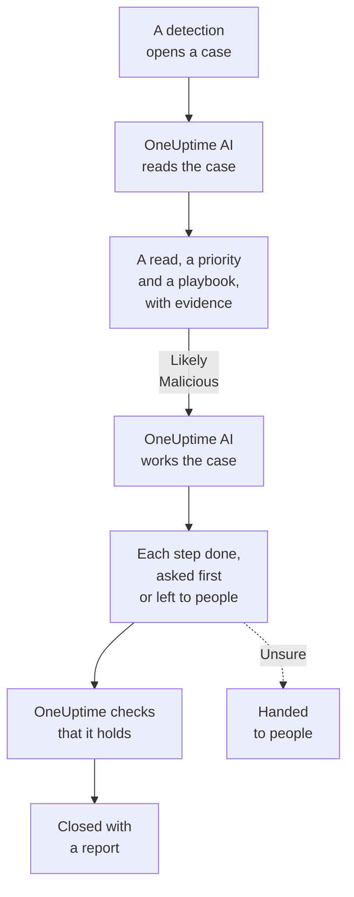

# OneUptime AI in Security

OneUptime AI reads each security case the way an analyst would: its detections, events, entities and threat intel, and the hosts and people around it. It says what happened and whether it looks real, suggests a priority and a playbook, and cites the evidence behind every claim. When you let it, it then works the case end to end: it takes the case, contains the threat, checks that what it did holds, has the code fixed, and closes the case with a report. It does each kind of step on its own, asks a person first, or leaves it to a person, as you set it, and it does every step through the same playbook engine people use, so each one is on the case's timeline as OneUptime AI's and can be undone. It also drafts detection rules from a sentence, and answers questions about your security data in Ask AI.

:::cards
- [Triage a case](#triage-a-case): What OneUptime AI reads, what it concludes, and what it never does.
- [Triage new cases automatically](#triage-new-cases-automatically): Every case a detection opens, triaged as it opens.
- [Work a case end to end](#work-a-case-end-to-end): Contain, check, fix and close, with a person approving what you choose.
- [What OneUptime AI may do on a case](#what-oneuptime-ai-may-do-on-a-case): Off, Ask first or On its own, for each kind of step.
- [When it hands a case to people](#when-it-hands-a-case-to-people): Why it stops, and who hears about it.
- [Run a playbook on a triage](#run-a-playbook-on-a-triage): Act on a case that reads as Likely Malicious.
- [Draft a detection rule](#draft-a-detection-rule): Describe what to catch, and read the Sigma rule.
- [Ask AI on Security pages](#ask-ai-on-security-pages): Questions about cases and events, in plain words.
:::

## How it works

A triage only reads. Working a case acts, within what you allow, and hands the case to people the moment it is unsure. Both run on the project's own AI: **Enable AI**, its LLM provider, its AI credits and its daily AI limits.

## Before you begin

- **Enable AI** on, under **Project Settings → AI → AI Features**. With it off, Security shows nothing of OneUptime AI and nothing runs.
- An LLM provider OneUptime AI can use, under **Project Settings → AI → LLM Providers**. OneUptime Cloud provides one.
- A role that can work security cases, to start a triage: Project Owner, Project Admin, Security Admin or Security Member. Security Viewer reads every triage but cannot start one. See [Roles](/docs/permissions/reference#roles).

## Triage a case

Open a case: the **OneUptime AI** card is at the top of its page.

| The card says | What it means |
| --- | --- |
| **Not triaged yet** | No triage has run. **Triage with AI** starts one. |
| **Triaging this case** | OneUptime AI is reading the case. Each check shows as it runs. |
| A read, such as **Likely Malicious** | The triage finished. **Triage again** reads the case afresh. |
| **The triage did not finish** | The run stopped. **Try again** starts another. |

A Security Viewer reads the same card: **Triage with AI** and **Try again** stay greyed beside a line that says who can start a triage, and **Triage again** and **Set priority** are not offered.

A triage reads:

- the case: its title, priority, status, entities and ATT&CK mapping;
- its detections, the latest first, with a sample event of each;
- the security events and threat intel about its users, hosts and addresses;
- the risk of its users, hosts and addresses, and what added to it this week;
- the hosts in OneUptime that its hosts and addresses match, and who owns them;
- the incident it declared, its notes, its protected entities, and the playbooks that are on.

It can also read the rest of OneUptime the way an incident's investigation does: logs, traces, metrics, hosts, and the read-only tools of the project's MCP servers.

Everyone who may see the case reads its triage, so a triage reads only what all of them may read. A team, custom role or API key that reads a kind of record only by owner or by label counts only when the API key, or someone on the team, may read security cases or the audit log. A kind of record that none of them reads only by owner or by label is read whole; where some do, a host, cluster, service or other record that an owner or a label sets apart is left out, and it is never named or counted. Who may read security cases is worked out each time a triage runs, so a triage written before someone got that access may name records set apart from them. The case is always read, and so is the incident it declared, unless that incident is private. Private incidents and alerts are never read.

### What it concludes

| Read | Means | Suggests closing as |
| --- | --- | --- |
| Likely Malicious | The evidence points at malicious or unauthorized activity | True Positive |
| Likely Benign | The activity looks real but expected, such as an admin task or a scan your team runs | Benign Positive |
| Likely False Positive | The detection looks like it misread normal activity | False Positive |
| Inconclusive | There was not enough evidence to tell. A person has to look | Nothing |

The read is OneUptime AI's, never the case's verdict: **Close Case** starts on the verdict it suggests, and a person picks. Under the read, the card has:

- **Suggested priority**, with **Set priority** when the case is at another one.
- **Suggested playbook**, with **Run playbook**, which runs it as you, with every approval it needs. While that playbook is already running on the case, its run's status, such as **Waiting for Approval**, takes the place of **Run playbook**: the run is on the case's **Playbooks**, and a second one would ask for the same approval again.
- The report: what happened, how sure it is and what to do next, each claim followed by a citation such as C1.
- **Evidence checked**: every query the triage ran. A citation opens its query, and expanding one runs it again with your permissions, over the time the triage read.
- **Ask about this case**, which opens Ask AI on the case.

Every case list shows the read beside each case's title, and filters by it with **AI Verdict**.

### What it never does

A triage changes nothing on the case: not its status, priority, assignee, verdict or notes. It runs no playbook and contains nobody. A playbook it suggests runs when a person runs it, or through the trigger below. Acting on the case is OneUptime AI working it, which is a setting of its own: see [Work a case end to end](#work-a-case-end-to-end).

### Text written to steer an AI

Events, alerts and entity values come from outside the project, and an attacker can write them. OneUptime AI reads all of them as data, never as instructions. When some of a case's data reads like instructions to an AI, the card says so first, a Likely Benign or Likely False Positive read becomes Inconclusive, that triage starts no playbook, and OneUptime AI does not work the case: it hands it to people.

## Triage new cases automatically

Open **Products → Security Events → AI → Settings** and turn on **Triage new cases**: every case a detection opens is then triaged as it opens. The switch saves as you flip it. Project Owner and Project Admin can change it.

New projects start with it on; a project created before keeps it off until someone turns it on. A case opened by hand, and the case of the test attack from **Send a test attack**, are triaged when someone clicks **Triage with AI**.

## Work a case end to end

On the same page, turn on **Work cases end to end**: OneUptime AI then takes each case its triage reads as Likely Malicious and works it, within what you allow under **What OneUptime AI may do on a case**. New projects start with it on; a project created before keeps it off until someone turns it on. Project Owner and Project Admin can change it.

While it is on, a person can also start it on one case: **Respond with AI**, on the case's **OneUptime AI** card, works a case OneUptime AI's triage read as Likely Malicious, Likely Benign or Likely False Positive. It is not offered on a case whose triage was Inconclusive, whose data reads like instructions to an AI, or that is at your highest priority: those are a person's. It takes a role that can work security cases.

### What it does

OneUptime AI works the case's **Response Plan**, most urgent first: **Confirm it is real**, **Contain it**, **Fix what let it happen** and **Close the case**. Each step is done, asked of a person, or left to a person, as the row of **What OneUptime AI may do on a case** for its kind says.

| Step | What OneUptime AI does |
| --- | --- |
| Take the case | Takes it, and raises its priority to the one the triage suggested. It never lowers a priority, and a case it raises to your highest priority goes to people |
| Rule out a false positive | Marks it done only when OneUptime's own facts leave no doubt: the address is not one of yours and nobody signed in from it. Otherwise it leaves the step to a person |
| Block the address | Blocks it for 24 hours through your [Blocklist](/docs/telemetry/security-cases#blocklist), then waits for OneUptime's check that the block holds. With nothing enforcing your blocklist, it leaves the step to a person |
| Suspend the user, contain the host | Runs the step of one of your playbooks that does it, through your identity provider or EDR. With no such playbook, it leaves the step to a person |
| Declare an incident | Always asks first: an incident pages people |
| Move the case to Contained | Once OneUptime has verified every step that contains the threat |
| Fix the route an attack reached | Has Fix With AI open a pull request. A person merges it. It closes the case once OneUptime verifies the fix in production, asks a person when the fix only looks done, and keeps working the case while it does not hold |
| Turn on MFA, review the account's changes | Left to a person: no product tells OneUptime whether they hold |
| Close the case | Once every other step is done and the case's detection has been quiet for 24 hours, as True Positive, with a [closing report](#the-closing-report) |

A step the case's detection rule adds of its own, and anything OneUptime has no way to do, such as blocking a domain at your DNS filter, is left to a person, saying why.

Every step OneUptime AI takes goes through the playbook engine, as a run of one step on the case's **Playbooks** page with **OneUptime AI** as its trigger. So it waits for approval, leaves protected entities alone, shows on the case's timeline, is kept in the audit log and can be undone, the same as a step anyone runs, and the timeline says it was OneUptime AI's. A step it asks about waits for a person's approval, on the case, on its **Playbooks** page, or in one tap in Slack or Microsoft Teams.

### Its log on the case

Under the triage, the **OneUptime AI** card says how OneUptime AI is working the case, under **Working the case**:

| The card says | What it means |
| --- | --- |
| **OneUptime AI is not working this case** | **Respond with AI** takes it. |
| **Working this case** | OneUptime AI is working the plan. **Take Over** stops it, and the case is yours. |
| **Waiting for a person** | It asked someone to approve a step, and goes on once someone answers. |
| **Handed to people** | It stopped, and says why. |
| **The case is closed** | It closed the case, or a person did. Its **Closing report** is above its steps. |

Under it, every step it took, asked about or left, the latest first, each with why: **Done on its own: your settings allow it.**, **Your settings have this wait for a person's approval.**, **OneUptime has no way to do this step, so a person does it.** A step it asked about has **Approve** and **Decline**; a step it took links to its run, where it can be undone. A step OneUptime checks says what the check found, and a step it took before on cases of the same rule says how often it held: "It held on 14 of 15 similar cases."

### A case it reads as benign or a false positive

**Respond with AI** on a case the triage read as Likely Benign or Likely False Positive closes it as Benign Positive or False Positive, as **Close the case** allows. Once it is closed, OneUptime AI lifts the blocks the case made, as **Close the case** allows too, and offers the case's rule an exception for the value that set it off. The exception always waits for a person: **Approve** adds it, as you.

## What OneUptime AI may do on a case

Under **What OneUptime AI may do on a case**, on **Products → Security Events → AI → Settings**, each kind of step has its own row, which saves as you pick it:

- **Off**: OneUptime AI leaves this to a person, and says so on the case.
- **Ask first**: it asks a person, with the evidence, and does it once someone approves.
- **On its own**: it does it without asking, and says so on the case's timeline.

| Row | Covers | New projects start on |
| --- | --- | --- |
| **Work the case** | Taking the case, raising its priority, marking steps done with their evidence, moving it to Contained | On its own |
| **Block addresses** | Blocking the case's address at your edge, for 24 hours | Ask first |
| **Contain accounts** | Suspending the case's user or ending their sessions | Ask first |
| **Contain hosts** | Containing or isolating the case's host | Ask first |
| **Fix the code** | Having Fix With AI open a pull request for the route an attack reached | On its own |
| **Close the case** | Closing the case with its closing report, and lifting the case's blocks once it is closed as harmless | Ask first |

The settings take effect while **Work cases end to end** is on, and the card says so while it is off. Project Owner and Project Admin can change them.

Setting **Block addresses**, **Contain accounts** or **Contain hosts** to **On its own** takes the authority of a Security Admin, which Project Owners and Project Admins hold too, and OneUptime keeps who did it and when, as it does for a playbook step whose approval is turned off. **Block addresses** asks first: **Confirm and Turn On** is a Security Admin's confirmation, and the row then says when it was given. Until a Security Admin confirms it, OneUptime AI asks before it blocks.

Whatever the rows say, OneUptime AI:

- never acts on a protected user, host or address: it hands the case to people;
- takes at most 10 actions on its own an hour, across all your cases, and then hands the next case to people;
- blocks for 24 hours at most;
- never merges code: a person merges every pull request;
- always asks before it declares an incident or adds a rule exception;
- works a case one run at a time, and a server that restarts never drops a run that acts.

## When it hands a case to people

OneUptime AI never stands down quietly. It hands the case to people, saying why on the card and the timeline, when:

- some of the case's data reads like instructions to an AI;
- the case is at your highest priority;
- what its next step acts on is protected;
- it has acted on its own as often as it may in an hour;
- AI is off for the project or for security cases, there is no LLM provider, or the project is out of AI credits or reached its daily AI limit;
- its triage could not tell whether the case is real;
- a step it took does not hold, a step it started did not finish, or a person turned down or undid a step it took;
- it cannot tell what to do next, or everything left on the case is a person's to do.

The people on the case hear about it at once, or when nobody is on it, the people told about cases at its priority: **OneUptime AI handed a security case to people**, under **User Settings → Notification Settings**. A workspace notification rule for security cases posts it to its Slack or Microsoft Teams channel under **Handed to people by OneUptime AI**. **Take Over** hands the case over without telling anyone, since the person who pressed it has it.

**Respond with AI** asks OneUptime AI to work the case again, from where the case stands.

## The closing report

When OneUptime AI closes a case, or asks a person to, it writes a closing report from what the case holds, not from the triage's words: what happened, the impact, what was done, what was fixed and what to watch. The report is the case's closing note, it is on the timeline, and the card shows it under **Closing report**. With **Close the case** on **Ask first**, the case waits for a person to approve the close, with the report to read first.

## How it is measured

**Products → Security Events → Overview** shows how OneUptime AI worked the cases of the last 30 days, once it has worked or asked about one: **Resolved by OneUptime AI**, of the cases it worked; **Time to Contain with AI** and **Time to Close with AI**, each beside the time without it; and **Approvals Asked**, how soon people answered, and how many of its steps people undid.

## Run a playbook on a triage

A playbook whose **Trigger** is **Triaged as Likely Malicious** runs on a case once, when a triage reads it as Likely Malicious. **For Cases At Least**, **Only For Detections From** and **Only For These Detection Rules** narrow it as for any trigger, and its containment steps wait for approval as always. It does not run:

- after a triage that found text written to steer an AI;
- a second time on the same case, however often the case is triaged;
- on the test attack's case, unless every step of the playbook stays inside OneUptime.

A new playbook is offered this trigger only while the project's AI is on.

## Draft a detection rule

On **Detection Rules**, under the **Sigma Rule (YAML)** field, click **Draft with AI** and say what the rule should catch, such as ten failed sign-ins from one IP address within five minutes. **Draft rule** puts a Sigma rule into the field, checked the way a saved rule is. Read it, change it as you need, and save it as usual: nothing is saved until you do. With a rule in the field already, the button reads **Redraft with AI**, and the draft replaces that rule.

Drafting takes a role that can create detection rules.

## Ask AI on Security pages

**Ask AI** knows which Security page you are on. On a case, it reads the case first and offers questions such as **Is it real?**. On the other Security Events pages, a question in plain words searches your security events. It can also check values against your threat intel, see how active a user, host or address has been, and list the playbooks a case can go to.

Ask AI can add a note to a case and run a playbook on it, as you, and asks before each. A playbook it runs waits for approval like any other.

When a case declares an incident, the incident's AI investigation reads the case too: what was detected, about whom, and OneUptime AI's triage of it.

## Costs and limits

A triage is OneUptime AI work, like an incident's investigation. On OneUptime Cloud it is paid from the project's AI credits, and it counts toward the project's own daily AI limits (**Daily limits**, under **Project Settings → AI → AI Features**). The incident and alert daily limits do not apply. A case has one triage at a time, and the AI Logs (**Project Settings → AI → AI Logs**) list its calls.

When the project is out of AI credits or has reached a daily AI limit, new cases are not triaged: the card says why, and **Triage with AI** works again once credits are added or the limit resets. OneUptime AI working a case reads the case's own plan and checks rather than asking the LLM, and it stops at the same limits: it hands the case to people, saying why.

## Troubleshooting

:::details A new case was not triaged
Check that **Enable AI** is on, and **Triage new cases** under **Products → Security Events → AI → Settings**. A case opened by hand and the test attack's case are triaged only when someone asks. Open the case: when something stops a triage, the card says what, and where to fix it.
:::

:::details OneUptime AI did not work a case
Check that **Work cases end to end** is on under **Products → Security Events → AI → Settings**. It takes up a case on its own only when the triage reads it as Likely Malicious. Open the case: under **Working the case**, the card says why it is not working it, and **Respond with AI** asks it to.
:::

:::details It asks before it blocks, though Block addresses is On its own
**On its own** for **Block addresses** counts once a Security Admin has confirmed it: the row says when, or that nobody has yet. An address that is protected, or one of your own, is never blocked: OneUptime AI hands the case to people. While nothing enforces your blocklist, it leaves the step to a person.
:::

:::details The card says the project is out of AI credits, or reached its daily AI limit
A Project Owner or someone with Manage Billing can add credits under **Project Settings → AI → AI Credits**, or raise or remove the limit under **Project Settings → AI → AI Features**. Then click **Triage with AI** on the case.
:::

:::details The card says text in the case reads like instructions to an AI
Some of the case's data, such as an event message or a user name, was written to steer an AI. OneUptime AI read it as data and left the decision to you: read the detections and the evidence yourself before you close the case.
:::

:::details A playbook with the AI trigger did not run
Check that the playbook is enabled, that the triage read the case as Likely Malicious, and that its **For Cases At Least**, **Only For Detections From** and **Only For These Detection Rules** settings fit the case. It runs once on a case, and not after a triage that found text written to steer an AI.
:::

## Next steps

:::cards
- [Security Cases and Playbooks](/docs/telemetry/security-cases): Work cases, close them with a verdict, and build playbooks.
- [AI SRE](/docs/ai/ai-sre): How OneUptime AI investigates incidents and alerts, and its limits.
- [Ask AI](/docs/ai/ask-ai): Ask questions about your project in plain words.
- [LLM Providers](/docs/ai/llm-provider): Choose the model OneUptime AI uses.
:::
