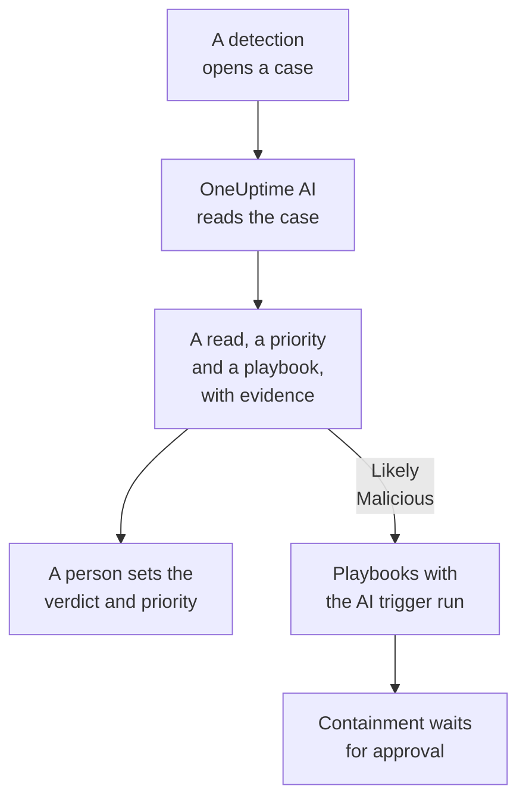

# OneUptime AI in Security

OneUptime AI reads each security case the way an analyst would: its detections, events, entities and threat intel, and the hosts and people around it. It says what happened and whether it looks real, suggests a priority and a playbook, and cites the evidence behind every claim. It changes nothing by itself: a person sets the verdict and the priority, and runs the playbook. It also drafts detection rules from a sentence, and answers questions about your security data in Ask AI.

:::cards
- [Triage a case](#triage-a-case): What OneUptime AI reads, what it concludes, and what it never does.
- [Triage new cases automatically](#triage-new-cases-automatically): Every case a detection opens, triaged as it opens.
- [Run a playbook on a triage](#run-a-playbook-on-a-triage): Act on a case that reads as Likely Malicious.
- [Draft a detection rule](#draft-a-detection-rule): Describe what to catch, and read the Sigma rule.
- [Ask AI on Security pages](#ask-ai-on-security-pages): Questions about cases and events, in plain words.
:::

## How it works

A triage only reads. It runs on the project's own AI: **Enable AI**, its LLM provider, its AI credits and its daily AI limits.

## Before you begin

- **Enable AI** on, under **Project Settings → AI → AI Features**. With it off, Security shows nothing of OneUptime AI and nothing runs.
- An LLM provider OneUptime AI can use, under **Project Settings → AI → LLM Providers**. OneUptime Cloud provides one.
- A role that can work security cases, to start a triage: Project Owner, Project Admin, Security Admin or Security Member. Security Viewer reads every triage but cannot start one. See [Roles](/docs/permissions/reference#roles).

## Triage a case

Open a case: the **OneUptime AI** card is at the top of its page.

| The card says | What it means |
| --- | --- |
| **Not triaged yet** | No triage has run. **Triage with AI** starts one. |
| **Triaging this case** | OneUptime AI is reading the case. Each check shows as it runs. |
| A read, such as **Likely Malicious** | The triage finished. **Triage again** reads the case afresh. |
| **The triage did not finish** | The run stopped. **Try again** starts another. |

A Security Viewer reads the same card: **Triage with AI** and **Try again** stay greyed beside a line that says who can start a triage, and **Triage again** and **Set priority** are not offered.

A triage reads:

- the case: its title, priority, status, entities and ATT&CK mapping;
- its detections, the latest first, with a sample event of each;
- the security events and threat intel about its users, hosts and addresses;
- the risk of its users, hosts and addresses, and what added to it this week;
- the hosts in OneUptime that its hosts and addresses match, and who owns them;
- the incident it declared, its notes, its protected entities, and the playbooks that are on.

It can also read the rest of OneUptime the way an incident's investigation does: logs, traces, metrics, hosts, and the read-only tools of the project's MCP servers.

### What it concludes

| Read | Means | Suggests closing as |
| --- | --- | --- |
| Likely Malicious | The evidence points at malicious or unauthorized activity | True Positive |
| Likely Benign | The activity looks real but expected, such as an admin task or a scan your team runs | Benign Positive |
| Likely False Positive | The detection looks like it misread normal activity | False Positive |
| Inconclusive | There was not enough evidence to tell. A person has to look | Nothing |

The read is OneUptime AI's, never the case's verdict: **Close Case** starts on the verdict it suggests, and a person picks. Under the read, the card has:

- **Suggested priority**, with **Set priority** when the case is at another one.
- **Suggested playbook**, with **Run playbook**, which runs it as you, with every approval it needs. While that playbook is already running on the case, its run's status, such as **Waiting for Approval**, takes the place of **Run playbook**: the run is on the case's **Playbook Runs**, and a second one would ask for the same approval again.
- The report: what happened, how sure it is and what to do next, each claim followed by a citation such as C1.
- **Evidence checked**: every query the triage ran. A citation opens its query, and expanding one runs it again with your permissions, over the time the triage read.
- **Ask about this case**, which opens Ask AI on the case.

Every case list shows the read beside each case's title, and filters by it with **AI Verdict**.

### What it never does

A triage changes nothing on the case: not its status, priority, assignee, verdict or notes. It runs no playbook and contains nobody. A playbook it suggests runs when a person runs it, or through the trigger below.

### Text written to steer an AI

Events, alerts and entity values come from outside the project, and an attacker can write them. OneUptime AI reads all of them as data, never as instructions. When some of a case's data reads like instructions to an AI, the card says so first, a Likely Benign or Likely False Positive read becomes Inconclusive, and that triage starts no playbook.

## Triage new cases automatically

Open **Products → Security Events → AI → Settings** and turn on **Triage new cases**: every case a detection opens is then triaged as it opens. The switch saves as you flip it. Project Owner and Project Admin can change it.

New projects start with it on; a project created before keeps it off until someone turns it on. A case opened by hand, and the case of the test attack from **Send a test attack**, are triaged when someone clicks **Triage with AI**.

## Run a playbook on a triage

A playbook whose **Trigger** is **Triaged as Likely Malicious** runs on a case once, when a triage reads it as Likely Malicious. **For Cases At Least**, **Only For Detections From** and **Only For These Detection Rules** narrow it as for any trigger, and its containment steps wait for approval as always. It does not run:

- after a triage that found text written to steer an AI;
- a second time on the same case, however often the case is triaged;
- on the test attack's case, unless every step of the playbook stays inside OneUptime.

A new playbook is offered this trigger only while the project's AI is on.

## Draft a detection rule

On **Detection Rules**, under the **Sigma Rule (YAML)** field, click **Draft with AI** and say what the rule should catch, such as ten failed sign-ins from one IP address within five minutes. **Draft rule** puts a Sigma rule into the field, checked the way a saved rule is. Read it, change it as you need, and save it as usual: nothing is saved until you do. With a rule in the field already, the button reads **Redraft with AI**, and the draft replaces that rule.

Drafting takes a role that can create detection rules.

## Ask AI on Security pages

**Ask AI** knows which Security page you are on. On a case, it reads the case first and offers questions such as **Is it real?**. On the other Security Events pages, a question in plain words searches your security events. It can also check values against your threat intel, see how active a user, host or address has been, and list the playbooks a case can go to.

Ask AI can add a note to a case and run a playbook on it, as you, and asks before each. A playbook it runs waits for approval like any other.

When a case declares an incident, the incident's AI investigation reads the case too: what was detected, about whom, and OneUptime AI's triage of it.

## Costs and limits

A triage is OneUptime AI work, like an incident's investigation. On OneUptime Cloud it is paid from the project's AI credits, and it counts toward the project's own daily AI limits (**Daily limits**, under **Project Settings → AI → AI Features**). The incident and alert daily limits do not apply. A case has one triage at a time, and the AI Logs (**Project Settings → AI → AI Logs**) list its calls.

When the project is out of AI credits or has reached a daily AI limit, new cases are not triaged: the card says why, and **Triage with AI** works again once credits are added or the limit resets.

## Troubleshooting

:::details A new case was not triaged
Check that **Enable AI** is on, and **Triage new cases** under **Products → Security Events → AI → Settings**. A case opened by hand and the test attack's case are triaged only when someone asks. Open the case: when something stops a triage, the card says what, and where to fix it.
:::

:::details The card says the project is out of AI credits, or reached its daily AI limit
A project owner or someone with Manage Billing can add credits under **Project Settings → AI → AI Credits**, or raise or remove the limit under **Project Settings → AI → AI Features**. Then click **Triage with AI** on the case.
:::

:::details The card says text in the case reads like instructions to an AI
Some of the case's data, such as an event message or a user name, was written to steer an AI. OneUptime AI read it as data and left the decision to you: read the detections and the evidence yourself before you close the case.
:::

:::details A playbook with the AI trigger did not run
Check that the playbook is enabled, that the triage read the case as Likely Malicious, and that its **For Cases At Least**, **Only For Detections From** and **Only For These Detection Rules** settings fit the case. It runs once on a case, and not after a triage that found text written to steer an AI.
:::

## Next steps

:::cards
- [Security Cases and Playbooks](/docs/telemetry/security-cases): Work cases, close them with a verdict, and build playbooks.
- [AI SRE](/docs/ai/ai-sre): How OneUptime AI investigates incidents and alerts, and its limits.
- [Ask AI](/docs/ai/ask-ai): Ask questions about your project in plain words.
- [LLM Providers](/docs/ai/llm-provider): Choose the model OneUptime AI uses.
:::
