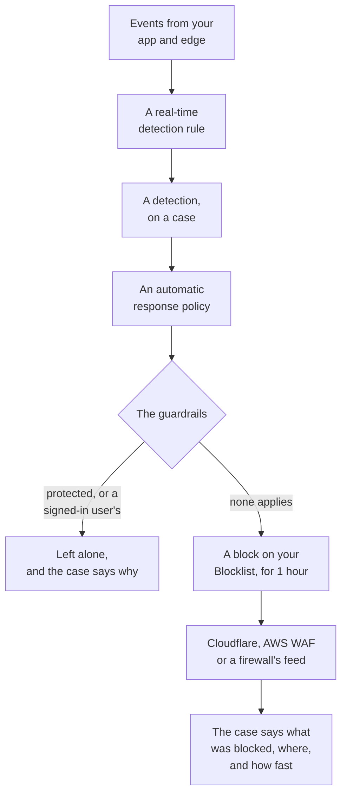

# Automatic Response

Automatic response policies challenge or block an attacking address as the detection is made, before anybody triages the case: scanners probing your app, and bots trying password after password, are turned away within a couple of minutes of their first request. Three ready policies come with every project, each off until you turn it on, and each starts with a week of trial run that only records what it would have done. Guardrails keep a policy safe to leave on: it never touches your own addresses or one your signed-in users use, and it stops and pages a person when an attack is larger than it should handle alone.

:::cards
- [Turn a policy on](#turn-a-policy-on): A week of trial run first, then one click.
- [The guardrails](#the-guardrails): What a policy never does, and when it stops.
- [Time to block](#time-to-block): How fast each policy blocks, on its card and on the case.
- [Your own policy](#your-own-policy): Act on the techniques, rules or threat intel you choose.
:::

## How it works

A policy acts on a detection as it is recorded on its case, a few seconds after the rule fires. Its block goes on your [Blocklist](/docs/telemetry/security-cases#blocklist) the way a playbook's **Block the address** step does, with the policy's name as who made it: the destinations that enforce your blocklist hold it, it shows on the case's timeline and in the audit log, and it expires on its own. It needs nobody's approval: whoever turned the policy on approved its blocks.

## Before you begin

- A destination that enforces your blocklist: Cloudflare, AWS WAF, or a firewall or proxy that reads a [blocklist feed](/docs/telemetry/blocklist-feeds). While nothing enforces it, the page says so, and a policy's blocks hold nowhere.
- The events a policy's rules read: your app's access logs or traces, or your edge's events, such as Cloudflare's firewall events, and your sign-ins. See [Security Events](/docs/telemetry/security-events).
- A role that can turn a policy on: Security Admin, Project Admin or Project Owner. Security Member and Security Viewer see the policies and what they did. See [Roles](/docs/permissions/reference#roles).

## The ready policies

| Policy | Acts on | Does | First block |
| --- | --- | --- | --- |
| **Scanners** | Web scanning and exploit attempts (ATT&CK T1595, T1190): SQL injection, path traversal and Log4Shell attempts, and many Cloudflare managed rule hits from one address, while every request from the address was turned away | Challenge | 1 hour |
| **Password Guessing** | Brute force and password spraying (ATT&CK T1110): failed sign-ins from one address, and failed sign-ins then a success from the same address | Block | 1 hour |
| **Known-Bad Addresses** | Any detection about an address your [threat intel](/docs/telemetry/threat-intelligence) lists | Block | 24 hours |

People pass a challenge, and scripts and bots do not. Scanners only challenges an address while none of its requests reached your app: an address whose requests got through is a case for a person.

Turning Scanners or Password Guessing on, into its trial run or on, runs the **Rule Library** rules it acts on in real time, adding the ones your project does not have: a real-time rule fires seconds after the events arrive, where a scheduled one reads minutes behind. A rule someone turned off stays off. A project runs at most 50 rules in real time: past that, a rule stays on its schedule, and the policy's card says **On a schedule** beside it.

## Turn a policy on

:::steps
### Open Automatic Response

Open **Products → Security Events → Playbooks → Automatic Response**. Each policy has its card: what it does, a chip that says **Off**, **Trial Run**, **Trial Finished** or **On**, and its switch.

### Start its trial run

Flip the policy's switch. For 7 days it records what it would have done, and touches no traffic: the case says "Trial run: the Scanners policy would have challenged 35.205.11.131 for 1 hour." The card counts the addresses so far, and what its guardrails left alone.

### Turn it on

When the week is up, the card says what the policy would have done, as in "In 7 days this would have challenged 1,283 addresses. None had signed-in users, and none were yours. Turn it on?", and your security owners get the same by email. Click **Turn On**: from then on, the policy acts.
:::

To turn a policy on without its week of trial run, open **More settings** on its card and click **Turn On Without a Trial Run**. Its guardrails still apply. Flip the switch again to turn a policy off; turned on again after a whole week of trial run, it acts straight away.

## The guardrails

- **Never your own or protected addresses.** The entries of **Protected Entities**, and everything OneUptime protects by itself: your hosts, cloud resources and probes, the ranges that are not on the internet, and the edge in front of your app. See [Blocklist](/docs/telemetry/security-cases#blocklist).
- **Never an address a signed-in user used in the last 30 days.** An office's network, a customer's proxy or a person's home: OneUptime looks for the address on your identity provider's sign-ins and on the requests your app served to a signed-in user, the ones with a user ID in their traces or logs. An address it cannot check, because those events could not be read or your scrub rules hide addresses in a way it cannot match, is left for a person.
- **Longer blocks for an address that comes back.** The first block lasts 1 hour, then 24 hours, then 7 days for an address blocked again within 30 days. Known-Bad Addresses starts at 24 hours.
- **At most 50 automatic blocks an hour.** Past that, your policies stop blocking and page your security owners: an attack that large needs a person. The page says so while it lasts.
- **Undo on doubt.** When a signed-in user is seen from an address a policy blocked, the policy lifts the block and tells your security owners.

Your security owners are your project's Security Admins, or its Project Owners when it has none. Each address a guardrail left alone is on its case, with the reason.

## Where a destination cannot challenge

Cloudflare and AWS WAF challenge. A firewall that reads a blocklist feed cannot, so a policy's challenge is a block there, for the same time, and the policy's card and the case say so, as in "FortiGate feed cannot challenge, so it blocks the address there for the same time." A challenge you make yourself is never turned into a block.

## Time to block

Time to block runs from the address's first request, the earliest event of its detection, to the block holding at your edge. Each policy's card charts its 50th and 95th percentiles day by day over the last 30 days. A case an automatic response blocked says so under **Time to Contain** on its **Overview**, as in "Blocked automatically 41s after its first request", and its timeline says what was blocked, where and how fast: "OneUptime challenged 35.205.11.131 at Cloudflare for 1 hour (Scanners policy), 41 seconds after its first request." The address's step in the case's **Response Plan** is done, with **Lift** beside it.

## Your own policy

Click **Create Policy** under the ready policies. A policy of your own needs a **Name** and what it acts on:

| Field | What it does |
| --- | --- |
| **ATT&CK Techniques** | The techniques a detection must carry, separated by commas, such as `T1110, T1190`. A technique covers its sub-techniques. |
| **Action** | **Block** or **Challenge**. |
| **First Block Lasts** | Under **More fields**: 1 hour, 24 hours or 7 days. An address that comes back is blocked for longer. |
| **Detection Rules** | Under **More fields**: or a detection made by one of these rules. |
| **Only Addresses Your Threat Intel Lists** | Under **More fields**: acts only on addresses your threat intel lists. On its own, acts on any detection about one. |
| **Only While Every Request Was Turned Away** | Under **More fields**: acts only while none of the address's requests reached your app. |

A policy of your own starts off, runs a week of trial run like a ready one, and has the same guardrails. **Edit Policy** and **Delete Policy** are on its card; deleting it leaves its blocks on your Blocklist until they expire.

## Troubleshooting

:::details A policy is on, but it did not block an address
Look at the case's timeline: a policy that left an address alone says why, such as a signed-in user having used it. Check that a destination enforces your blocklist, and that the policy's rules say **Real time** on its card.
:::

:::details The page says the hour's automatic blocks are used up
Your policies made 50 automatic blocks in the last hour, and paged your security owners. They start again as the hour's blocks age out. Look at the cases for the attack, and block a range from **Blocklist** if it comes from one network.
:::

## Next steps

:::cards
- [Security Cases and Playbooks](/docs/telemetry/security-cases): Work the cases your policies act on, and block by hand.
- [Blocklist Feeds](/docs/telemetry/blocklist-feeds): Enforce your blocklist at a firewall or proxy.
- [Threat Intelligence](/docs/telemetry/threat-intelligence): The feeds Known-Bad Addresses acts on.
:::
