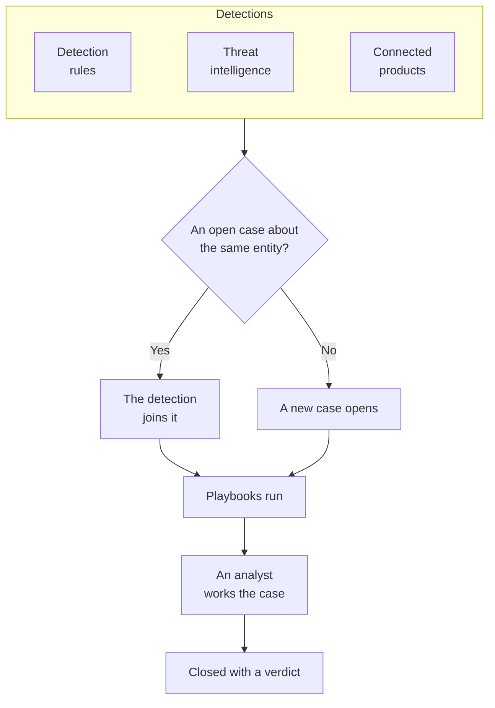

# Security Cases and Playbooks (SOAR)

Security Events turns what your detection rules, threat intelligence and connected security products find into cases: one case for each thing worth looking into, with every detection about the same user, host or address grouped into it. Analysts work the cases in a queue, and playbooks respond to them, by themselves or at a click.

:::cards
- [Where cases come from](#where-cases-come-from): Detection rules, threat intelligence, connected products, entity risk and people.
- [Work a case](#work-a-case): Assign it, investigate its entities, close it with a verdict.
- [Case priorities and statuses](#case-priorities-and-statuses): Rename, recolor and reorder them, and add your own.
- [Response targets](#response-targets): How fast a case at each priority must be taken on and contained.
- [Notifications](#notifications): Who is told about a new case, an assignment, a response target, a task and a step waiting for approval.
- [Playbooks](#playbooks): Steps that run on a case, with approval where it matters.
- [The overview](#the-overview): What needs someone now, and how fast cases are handled.
:::

## How it works

Open **Products → Security Events → Security Cases → Open Cases** for the queue. **Assigned to Me**, **Unassigned**, **Closed Cases** and **All Cases** are pages of their own beside it, each listing the cases its name says.

## Before you begin

Cases and playbooks follow the three Security roles. Project Owner and Project Admin can do everything.

| Role | What it can do |
| --- | --- |
| Security Admin | Everything, including deleting cases, removing evidence and setting up playbooks |
| Security Member | Open, assign, change and close cases, write notes, work tasks, add evidence, run playbooks and approve or reject their steps |
| Security Viewer | Read cases, detections, notes, tasks, evidence, playbooks and their runs |

Each of these can also be granted on its own, from creating a case to approving a playbook's steps; see [Permission Reference](/docs/permissions/reference).

## Where cases come from

| Source | Opens a case when | Turn it off with |
| --- | --- | --- |
| Detection rules | A rule matches | **Open a Case on Match**, on the rule's **On Match** step |
| Threat intelligence | An event names a known indicator | **Open a Case on Match**, on the feed's **On Match** step |
| Connected products | A product's own alert is imported at or above the connection's threshold | **Open Cases From** set to **Never**, in the connection's **Polling** step |
| Security products in your logs | A threat a firewall, IDS or endpoint product writes in your logs is at or above Your logs' threshold | **Open cases from** set to **Never**, on **Your logs** |
| Entity risk | A user's, host's or address's risk reaches the project's threshold | **Risk Cases**, under **Settings → Risk Scoring** |
| People | Someone opens one from **Security Cases**, or with **Open Case** in an event's panel | None |

Every source opens cases by default, except entity risk on projects created before it existed, which turn on **Risk Cases** first ([Entity Risk](/docs/telemetry/security-entity-risk)). A connection opens cases for **High and above** unless you choose another level; the alerts below it are still imported as events. **Your logs** does the same for the threats in your logs.

### How detections are grouped

A detection is about an entity: the value its rule groups by, such as the IP address of a brute-force rule, or the indicator a threat intelligence match names. A detection without one stands alone.

- When an open case is already about that entity, the detection joins it. The case's entities and ATT&CK mapping grow, and its priority rises to the detection's, never down.
- When no open case is, a new case opens, named after the detection, at the detection's priority.
- A detection that fires again counts up on its row instead of adding one.

A case's priority comes from the detection's severity, at the project's built-in priority for that level, whatever you have named it:

| Severity | Priority |
| --- | --- |
| Critical or Fatal | Critical |
| High | High |
| Medium, Unknown or Other | Medium |
| Low | Low |
| Informational | Informational |

## Work a case

A new project's cases move through four statuses, which you can rename and add to (see [Case priorities and statuses](#case-priorities-and-statuses)). A case can skip one, such as a false positive closed straight from New, and it can be reopened.

| Status | Means |
| --- | --- |
| New | Nobody has looked at it yet |
| Investigating | Someone is working out what happened |
| Contained | The threat can no longer do harm; the cleanup is still to do |
| Closed | Done, with a verdict on what it was |

A case has a side menu of its own, as an incident has, and each part of the case is a page of its own:

| Side menu section | Pages |
| --- | --- |
| **Overview** | **Overview**, **Timeline** |
| **Investigation** | **Story**, **Detections**, **Entities**, **Connected Signals**, **Evidence**, **Tasks**, **Playbooks** |
| **Notes** | **Private Notes** |
| **Advanced** | **Custom Fields**, **Audit Logs**, **Delete Case**, folded until you click **Advanced** |

Every page keeps the case's header on top: its number, priority, status and title, **Assign to Me**, **Run Playbook**, **Declare Incident** and **Close Case**, and in the ⋯ menu beside them **Set priority**, **Assign to Someone Else**, **Change Status**, **Edit Case** and **Delete Case**. So the case can be worked from any of its pages, and a link to the case still opens its **Overview**. When the case's priority has response targets, the header also says when the next one is due ([Response targets](#response-targets)).

- **Overview**: the case's description, labels and status steps, who has it and what opened it, and its figures: how many detections it has, how long it has been open, and how long it took to acknowledge and to contain. Under **Time to Acknowledge** and **Time to Contain**, it says where the case stands against its response targets.
- **Why This Case Was Opened**, on the **Overview**: the detection that opened the case and how its rule fires (its threshold, what it groups by and the window it counts in), how many events it matched, from what and between when, what the rule looks for, and how far the requests got. Under **What matched**, the events themselves, oldest first: each with what the rule looks for highlighted, how far its request got, the log line or product it came from, and its **Trace**, **Logs** and **Exception** one click away; the log line it came from opens in the Logs explorer at that line. Click an event to see all of it, with the log line it was read from. **Keep on This Case**, on its row or in its panel, keeps the event on the case's **Evidence**, naming the detection that matched it; an event the case keeps already says so, and opens it there. A detection keeps up to 25 of the events it matched when it fires, and lists those, even once they are past their retention; your role sees the ones from the sources it can read. A rule that fires for many groups at once, a correlation rule too, keeps events for every one of them: at most 1,000 in all, so each keeps at least 10, and up to 25 as it fires again. For a detection from before it kept them, a rule's matches are its own condition, for the detection's group, over the windows it fired in; a threat intel match lists the events carrying its indicator, and a connected product's alert the event it was sent as. **Look next** opens everything about the address or user the detection is about, the events and log lines naming it, the logs of the services its log lines came from and the traces of its requests, each over the detection's window, and the case's **Story** and **Connected Signals**. The case's other detections fold under **Also on this case**.
- **Response Plan**, on the **Overview**: what to do about the case now, most urgent first, under **Confirm it is real**, **Contain it**, **Fix what let it happen** and **Close the case**. Each step is about this case: its addresses, users and hosts, how far its requests got, what its rule says it can also fire on, the ATT&CK tactics and techniques its detections map to, and the playbooks the project has. The steps a detection rule carries of its own, written under **Response Steps** on its form, come first in the part of the plan they go under, and the rule library's rules come with steps of their own. A step OneUptime can do has its button: **Assign to Me**, **Add Exception** with the rule and the address filled in, **Run Playbook** on the playbook that suspends the account or contains the host, or the one OneUptime AI suggests, **Declare Incident**, **Mark as Contained** and **Close Case**. A public address's step blocks it in one click, **Block for 24 Hours**, once a destination enforces your blocklist (see [Block an address from a case](#block-an-address-from-a-case)). A step OneUptime cannot do, such as blocking a domain at your DNS filter, says **Outside OneUptime**, with the value one click from the clipboard. Where a connection blocks on every machine (see [Blocklist](#blocklist)), blocking the case's domain, its file or its command-and-control server is one click too: **Block for 7 Days**, or **Block File** for 30 days, puts it on the blocklist, and the step is done once Microsoft Defender or CrowdStrike Falcon holds the block. Tick a step off when it is done: it is kept as one of the case's **Tasks**, done, with who did it and when. Steps the case decides tick themselves: it is assigned, an incident was declared, a playbook ran, it is contained or closed. Once every step that contains the threat is done, the plan offers **Mark as Contained**, which records the case's time to contain. OneUptime checks most steps itself, and says beside each what it found: see [How OneUptime checks a step](#how-oneuptime-checks-a-step). When OneUptime AI has triaged the case, its read leads the plan, and its suggested steps fold under the plan's own.
- **OneUptime AI**, on the **Overview**: what OneUptime AI made of the case, the priority and playbook it suggests, and the evidence behind them. See [OneUptime AI in Security](/docs/telemetry/security-ai).
- **Impact**, on the **Overview**: what the case puts at risk: whether OneUptime has seen its records reached from the internet, who owns them, what last changed on them, and the data at risk - the stores with sensitive data the case names or its users and roles can reach (see [Data Security Integrations](/docs/data-security/integrations#security-operations)). Open it to see what each record calls and is called by, the monitors and status pages watching it, and the machines the case's addresses talked to.
- **MITRE ATT&CK**, on the **Overview**: the tactics and techniques its detections map to, each linked to its page on attack.mitre.org.
- **Timeline**: everything that happened to the case, with who did it.
- **Story**: what happened, in order, across OneUptime: each detection and the security events behind it, how far their requests got, the exceptions they threw, the changes on the records the case names, the incidents and alerts raised on them, and what the team did. A scanner's many probes are one line, and each line opens what it names, such as the request's trace or the exception.
- **Detections**: what fired to open the case or join it, how often, and the latest matching event.
- **Entities**: the users, hosts and addresses the case is about, with their activity across all your security events in the last 7 days. Each opens in **Correlate**.
- **Connected Signals**: the hosts, clusters, services and members the case names, as OneUptime knows them, and what was happening on each around its detections: their logs, traces and metrics, what is open on them and what changed. See [Connected Signals](/docs/telemetry/security-connected-signals).
- **Evidence**: the files, links and security events kept on the case, each with who added it and when. **Add File** uploads a file of up to 10 MB and records the SHA-256 of what was uploaded, so whoever downloads it later can check it is what was kept; **Add Link** points to evidence kept somewhere else. Only a Security Admin can remove a piece of evidence, and the case's **Timeline** says what was added and removed. A security event is kept here as it was, with **Add to Case** on **Events** or on a [hunt's](/docs/telemetry/security-events#hunts) page, or with **Keep on This Case** on an event a detection matched, and **View Event** opens it. A playbook's **Preserve the evidence** step keeps the events behind the case's detections here too.
- **Tasks**: what has to be done on the case, who is doing it, and whether it is done. Add a task as a line, hand it to someone, and tick it off when it is done. The person it is handed to is told, unless they took it themselves, and the menu shows how many tasks are open beside **Tasks**. A playbook's **Add tasks** step adds tasks too, and leaves out any the case has already.
- **Playbooks**: what each playbook did on the case, step by step, and the steps waiting for approval. While runs wait, the menu shows how many beside **Playbooks**.
- **Private Notes**: what the team wrote about the case. The composer's **Templates** menu puts one of the project's note templates in a note.
- **Custom Fields**: the project's own fields, filled in for this case, and **Edit Fields** to change them. Once the project has a field, the **Overview** shows them too, in its last card. See [Custom fields, note templates and numbering](#custom-fields-note-templates-and-numbering).
- **Audit Logs**: every change made to the case, and who made it. See [Audit Logs](/docs/configuration/audit-logs).
- **Delete Case**: deletes the case and its detections, notes, timeline and playbook runs for good. To keep the record, close it with a verdict instead.

### How OneUptime checks a step

A tick says someone did a step. OneUptime also checks the steps of a case's **Response Plan** itself, against what really happened: every minute while the case is open, and at once when a step is ticked off, a task changes or a playbook contains something. Beside each step it checked, the plan says what it found:

| Beside the step | Means |
| --- | --- |
| **Checked by OneUptime** | OneUptime saw the step done, and it holds. Nobody needs to tick it |
| **Looks Done** | What OneUptime sees fits the step being done, but does not prove it. **Confirm** ticks it off as yours |
| **Not Done Yet** | OneUptime sees the step is still to do |
| **OneUptime Cannot Tell** | OneUptime has nothing to check the step against, and says why, with **How to let OneUptime check this** |
| **Stopped Holding** | The step was done, and has stopped working, such as a blocked address getting through again |
| **Not Needed So Far** | Nothing has happened that calls for the step |

**How We Know**, beside what OneUptime found, opens the rest: what else it saw, a link to the traces or the product it read, and when it checked. The plan's progress counts the steps OneUptime checked itself, as in "4 of 9 done, 3 checked by OneUptime".

| Step | What OneUptime reads |
| --- | --- |
| Block the address | Whether a destination holds a block of the address on your [Blocklist](#blocklist) and read it back, and whether requests from the address still reach your app, in its traces and access logs. A block a destination holds is checked; a block nothing enforces is not. An address that goes quiet with no block looks done: it may have been blocked, or may simply have stopped |
| Check that nothing else got through | How every request from the address since the case's first detection ended. When your app turned every one of them away, the step is checked |
| Suspend the account | The account in Okta, Microsoft Entra ID or Google Workspace: suspended, or disabled with its sessions ended after the case opened |
| Take the host off the network | The host in CrowdStrike Falcon or Microsoft Defender for Endpoint: contained, or isolated |
| Block the domain, the file or the server on every machine | Its block on the blocklist: done while Microsoft Defender or CrowdStrike Falcon holds it, not done while it is on its way or refused, which the step says |
| Declare an incident | Whether a request got past your app's checks, or a monitor of the services it reached went down, while the case was open. Until one does, the step is not needed so far |
| Rule out a false positive | Nothing: only you can rule it out. The step lists what OneUptime knows about the address: whether one of your records has it, the threat intel feeds that list it, and the signed-in users who used it in the last 30 days |
| Fix the route the attack went to | The attack requests to the route, in your app's traces and logs, before and after a change shipped to the service behind it: a pull request a playbook's **Fix the code with AI** opened, or any deploy or new version of the service. Once enough of the same attack are turned away since, or kept out of the database where before they reached it, the step is checked. With no attack since, it says there were no attempts since the fix, and looks done |
| Reset the password | The account in Okta or Microsoft Entra ID: its password changed, and its sessions were ended, after the case opened. Google Workspace does not say when a password changed, so OneUptime cannot tell |
| Make sure the accounts use MFA | Each account the attack went after, in Okta, Microsoft Entra ID or Google Workspace: an active factor, an MFA method, or 2-Step Verification. With MFA on every one, the step looks done: no product says whether failed sign-ins are locked out, so you confirm it |

- A step done outside OneUptime counts as well. Block the address at your own firewall, and OneUptime sees its requests stop; suspend the account in Okta, and OneUptime reads it back.
- You can still tick a step off yourself, even one OneUptime does not see done. A step OneUptime has checked needs no tick.
- When a step that was done stops holding, the plan says so at its top, the case's **Timeline** says what OneUptime saw, and the people on the case are told: see [Notifications](#notifications).
- OneUptime cannot see an address's requests when your app sends it no traces or logs, when its traces do not say which address each request came from, or when they carry the addresses of Cloudflare or a load balancer in front of your app instead of your visitors'. Set the client's address (`client.address`) on your app's server spans: from `CF-Connecting-IP` behind Cloudflare, from `X-Forwarded-For` behind a load balancer.
- OneUptime reads accounts and hosts through the project's connections to the products that hold them, the ones [Responding through OneUptime](#responding-through-oneuptime) uses. With none, it cannot tell.
- A product that does not answer, or a read that fails, never counts as a step not done: the step says OneUptime could not check it just now, and OneUptime tries again in a few minutes.
- A fix of a route is checked only once the attack itself is turned away: a deploy alone is not a fix. OneUptime waits for so many attacks turned away since the fix shipped that, at the rate they got through before, at least one would almost surely (95%) have got through had nothing changed, and never fewer than 3. The step says how many it waits for, and watches the route for 7 days after the fix ships, as in "Watching /api/search until Nov 27". When almost none got through before, the attacks cannot show a fix worked, and the step stays **Looks Done** for you to confirm.
- OneUptime sees a fix ship when it sees the service's deploys: send them to OneUptime, or report `service.version` in your app's telemetry (see [Deploys and Changes](/docs/telemetry/change-events)). A pull request **Fix the code with AI** opened is kept on the case, and its deploy is matched to its commit. Requests stopped at your edge, by Cloudflare for example, never reached your app, so they say nothing of the fix.
- Reading the MFA of an account in Microsoft Entra ID takes the UserAuthenticationMethod.Read.All application permission, beside the ones [Containment](#containment) lists.

**Mark Cases Contained When Verified**, under **Products → Security Events → Settings → Case Statuses**, moves a case to Contained once every step that contains it is **Checked by OneUptime** or **Not Needed So Far**. Its time to contain is recorded, and the case's **Timeline** says OneUptime verified every step that contains the threat. A step that only looks done, or a tick, never moves a case on its own. The setting is on in every project, and a Project Owner or Project Admin can turn it off: a case then stays where it is until somebody marks it Contained.

Everyone who can see a case sees what OneUptime found. Nobody edits it: a person who disagrees ticks the step themselves, which takes a role that can work the case's tasks.

### Block an address from a case

A public address the case is about has a step of its own in the **Response Plan**. While a destination enforces your blocklist, such as Cloudflare, [AWS WAF](/docs/telemetry/cloud-aws-waf-blocklist) or a firewall that reads a list, the step names it, as in "Block 35.205.11.131 at Cloudflare." **Block for 24 Hours** blocks the address there, and the menu beside it holds **Challenge Instead**, **Block for 7 Days** and **Block Until Lifted**, which only a Security Admin, a Project Admin or a Project Owner can choose. People pass a challenge; scripts and API clients do not. On the case's **Entities** page, an address's **Block…** does the same, and asks how long.

- A block goes through the playbook engine, as a playbook's block does: it is kept on the case's **Playbooks** page, its **Timeline** and the audit log. It waits for someone else's approval, unless you are a Security Admin, a Project Admin or a Project Owner.
- It is refused, saying why, for an address the case's requests only claimed, one of your own or a protected one, and one a block already covers.
- Once a destination holds the block, the step is done and says where, since when, by whom and until when, with **Lift**. While no destination holds it, the step says so and is not done.
- While nothing enforces your blocklist, the step says how to connect Cloudflare, AWS WAF or a firewall, and **How to Block It** shows the address in the Cloudflare dashboard, the AWS CLI, nginx and nftables.
- Closing a case as **False Positive** or **Benign Positive** offers to lift the blocks it made, ticked, naming each one.

### Work cases from the queue

You do not have to open a case to work it. In the queue's lists, the ⋯ menu on a case's row has **Assign to Me**, **Assign to Someone Else**, **Change Status** and **Change Priority**. To work several cases at once, select them and use the same actions under **Bulk Actions**: it says which cases it changed, and which it left as they were, and why.

- To give a case to someone else, use **Assign to Someone Else** and pick one person, or a team. A team's case waits under **Unassigned** until someone on the team takes it.
- A status that closes a case asks for a verdict and a closing note, as **Close Case** does.
- A closed case is not assigned to anyone. To work it again, reopen it with **Change Status**.

### Close a case

**Close Case** asks for a verdict and an optional closing note:

| Verdict | Means |
| --- | --- |
| True Positive | Malicious or unauthorized activity really happened |
| Benign Positive | The activity was real but expected, such as a penetration test or an admin task |
| False Positive | The detection was wrong: the rule or the data misread normal activity |
| Undetermined | There was not enough information to tell |

The verdicts are counted on the overview. A rule whose cases keep closing as False Positive is a rule to tune.

While tasks on the case are still open, **Close Case** says how many.

A case opened from Google SecOps alerts closes them in Google SecOps too, with the verdict and the closing note, when its connection has **Close alerts when their case closes** on: see [Google SecOps](/docs/integrations/google-secops#close-alerts-when-their-case-closes).

### Declare an incident

**Declare Incident** opens a OneUptime incident for the case, at the severity you choose, and links the two both ways: the incident's description names the case, and the case's header links to the incident. On-call, status pages and the postmortem take over from there. It takes a role that can both work cases and create incidents.

## Case priorities and statuses

Each project keeps its own case priorities and statuses, under **Products → Security Events → Settings → Case Priorities** and **Case Statuses**. Rename them, recolor them, drag them into another order, and add your own, such as a "Triage" status or an "Emergency" priority above **Critical**. A new name shows everywhere at once: in the queue, on the case pages and the overview, in notifications, in Slack, Microsoft Teams and Mattermost, and in playbook messages.

Some are built in, because OneUptime reads what they mean. They can be renamed and recolored, but not deleted or archived, and they keep their order:

| Built in | What OneUptime does with it |
| --- | --- |
| The new status | New cases start in it |
| The acknowledged status | Reaching it records when the case was acknowledged, and **Reopen** moves a closed case back to it |
| The contained status | Reaching it records when the case was contained |
| The closed status | **Close Case** moves a case to it, with a verdict |
| The Critical, High, Medium, Low and Informational priorities | A detection opens its case at the one of its severity, and a case someone opens starts at Medium |

- Where a status sits decides what a case in it counts as, as the **Counts as** column shows: from the acknowledged status down, acknowledged; from the contained status down, contained; from the closed status down, closed. A status you add goes just above the closed status, and moving a case into a status that closes it asks for a verdict first.
- A priority's rank is how urgent it is, the most urgent first: **For Cases At Least**, the notification choices and the Slack, Microsoft Teams and Mattermost rules read this order. A priority you add goes to the end, and the **Detection severity** column shows which detections open their cases at each built-in priority.

To stop using a status or priority of your own, use **Archive** on its row. Nobody can pick it again, and the API, Terraform and MCP refuse it, but the cases that have it keep it, and you can still filter by it. Archived values are listed in the folded **Archived Case Statuses** or **Archived Case Priorities** section under the table, where **Unarchive** puts one back. **Delete** is refused while cases have the value or a playbook runs from the priority.

## Response targets

A response target is how fast a case must be worked: **Acknowledge Within**, how long a new case may wait for someone to take it on, and **Contain Within**, how long it may take to be contained or closed. Each case priority has its own, under **Products → Security Events → Settings → Response Targets**: **Edit** on a priority's row sets its two, in minutes, hours or days, up to a year, and an empty one is no target. A new project's priorities start with these:

| Priority | Acknowledge Within | Contain Within |
| --- | --- | --- |
| Critical | 15 minutes | 4 hours |
| High | 1 hour | 1 day |
| Medium | 12 hours | 3 days |
| Low | 1 day | 7 days |
| Informational | No target | No target |

A project created before response targets has none until someone sets them.

- A case's due times are set as it opens, from its priority's targets. A target changed later applies to the cases opened after it.
- A case is acknowledged once someone takes it on: a person is assigned, or it moves to a status that counts as acknowledged. It is contained once it reaches a status that counts as contained, or closes.
- When a case's priority changes, a target it has met or missed stays as it was. A higher priority brings a due time closer: the new target counts from the change, unless the old due time comes first. A lower priority moves it later, never earlier: the new target counts from when the case opened. A priority with no target keeps a raised case's due time, and clears a lowered one's.
- A closed case reopened before it was ever contained gets a new contain due time, counted from the reopening.
- In the last fifth of a target, the case is about to miss it: the people on it are told, and told again when it is missed. See [Notifications](#notifications).

Where the targets show:

- The case's header names the next target and how long is left, or how long it is overdue: grey while there is time, amber in its last fifth, red once missed.
- On the case's **Overview**, under **Time to Acknowledge** and **Time to Contain**: where the case stands against each target, or how far over it the case went.
- In the queue's lists: the line under each case's priority, and a **Due** column you can turn on and sort by. While the column is on, the line under the priority is left out. The lists draw them only when one of the project's priorities has a target.

## Custom fields, note templates and numbering

Three more settings make cases your project's own, under **Products → Security Events → Settings**:

- **Custom Fields**: the fields your team fills in on every case, such as the business unit it is about or its ticket in another tool. A field holds text, a number, a date, a yes or no, a choice from a list, or a file. A case's **Custom Fields** page, under **Advanced**, lists every field with the case's value, and **Edit Fields** changes them. In the queue's lists, each field is a column you can turn on in **Columns**.
- **Note Templates**: ready-made text for the notes your team writes on case after case, such as a containment checklist or a hand-over to the next shift. On a case's **Private Notes**, the composer's **Templates** menu puts one in the note, to edit before it is posted, and **Manage templates** opens the list.
- **Numbering**: the text in front of case numbers, `CASE-` in `CASE-42` unless you set your own, and the number the next case gets. Moving from another tool? Start after its last case number, so a number never means two cases. A new prefix or start applies to new cases only, and a start must be higher than the highest number used so far.

A Security Admin manages the custom fields and note templates, and a Security Member fills in a case's fields; on OneUptime Cloud they take the Growth plan or above. Numbering is set by a Project Owner or Project Admin, as it is for incidents and alerts.

## Notifications

OneUptime tells people about seven things on a case. Nobody has to set anything up: a project that only clicked **Turn on recommended** hears about its High and Critical cases by email and push.

| Notification | Who is told | By default |
| --- | --- | --- |
| New security case | Everyone who can see the project's cases, when a case opens, or rises, at the priority they chose or above | Email and push, for High and Critical cases |
| Security case assigned to me | The person the case is assigned to, and the members of the team it is assigned to | Email and push |
| Playbook step waiting for my approval | The people on the case who can approve the step: the person it is assigned to and the members of its team. When none of them can approve, everyone in the project who can | Email and push |
| Security case response target | The people on the case: the person it is assigned to and the members of its team. When nobody is on it, the people told about new cases at its priority | Email and push |
| Security case task assigned to me | The person a task on the case is handed to, unless they took it themselves | Email and push |
| Security case step stopped holding | The people on the case, when a step OneUptime saw done stops holding: the person it is assigned to and the members of its team. When nobody is on it, the people told about new cases at its priority | Email and push |
| OneUptime AI handed a security case to people | The people on the case, when OneUptime AI stops working it and says why: the person it is assigned to and the members of its team. When nobody is on it, the people told about new cases at its priority | Email and push |

- Only people who can see the case are told about it: Project Owners, Project Admins, and the Security Admin, Security Member and Security Viewer roles. A role limited to some labels is told only about the cases with those labels.
- Nobody is told about what they did: the person who opens a case by hand, assigns it or starts a run is not notified of it.
- Each person hears about a case once. A case that opens at Medium and later rises to Critical reaches the people who chose High or Critical when it rises, and not again the people who chose Medium, who heard about it when it opened.
- The test attack from **Send a test attack** opens a case that notifies nobody.
- A Critical case and a step waiting for approval are sent at once, never held back in an [email rollup](/docs/emails/notification-rollup). So is a response target about to be missed, or missed, a step that stopped holding, and a case OneUptime AI handed to people.
- The case's **Timeline** says who was told, and when.

### Choose what you are told

Each person chooses for themselves, under **User Settings → Notification Settings → Security**: the channels for each notification (email, SMS, call, push, Telegram, Slack, Microsoft Teams, Mattermost or webhook), and under **New security case**, the priority that notifies them:

| Choice | Notifies about cases at |
| --- | --- |
| Critical only | Critical |
| High and above | Critical and High (the default) |
| Medium and above | Critical, High and Medium |
| Low and above | Every priority but Informational |
| Every case | Every priority |

The choices follow the project's case priorities, under their own names: these are a new project's.

WhatsApp messages are not sent for security cases. A push notification opens the case in the OneUptime On-Call app (1.7.0 or later), where you can approve or reject a waiting playbook step, take the case on and close it. Its link opens the case in the browser. A push about a step waiting for your approval opens on that approval, with its evidence; when somebody decided it since, the case says who, when and how the step went.

A step waiting for your approval reaches you in Slack or Microsoft Teams as a message you can approve from, and its email says what the step will do and why: see [Approve from Slack and Microsoft Teams](#approve-from-slack-and-microsoft-teams).

### Post to Slack, Microsoft Teams and Mattermost channels

To post to a channel, add a rule under **Products → Security Events → Workspace → Slack** (or **Microsoft Teams**, or **Mattermost**). With none connected, the section's one entry is **Connect a workspace**. A rule names the channels to post to (and, in Microsoft Teams, the chats) and, if you want, the cases it is for:

| Condition | Matches on |
| --- | --- |
| Security Case Priority | One of the project's case priorities, such as Critical or High |
| Security Case Title, Security Case Description | Text the case's title or description contains, starts with or ends with |
| Security Case Status | One of the project's case statuses, such as New or Closed |
| Security Case Source | Detection Rule, Threat Intel, Connected Product, Entity Risk, Data Security or Manual |
| Security Case Labels | The case's labels |

Each notification but a task's is posted to the channels of every rule the case matches at that moment. A rule with **Security Case Priority** contains any of **Critical** and **High** posts High and Critical cases as they open, and a Medium case when it rises to High. A security case never gets a channel of its own.

A rule's **Updates** step picks which of these notices it posts: **New and raised cases**, **Assignments**, **Approvals needed**, **Response targets** and **Handed to people by OneUptime AI**, one box each under **Choose updates**. **Key updates only** posts every one but the assignments, for a channel that should hear only what someone has to act on. A rule saved before the step, and a new rule, posts every notice.

## Playbooks

A playbook is a list of steps that run on a case. Create one under **Products → Security Events → Playbooks**, from a template or blank, and add its steps on its page. A project with no playbooks sees the templates in place of an empty list; once there are playbooks, **Create from Template** on the list opens them, with **Added** on the ones the project already has.

### When a playbook runs

| Trigger | When it runs |
| --- | --- |
| Case Opened | Once, as a case opens |
| Detection Added | Each time a new detection joins an open case |
| Triaged as Likely Malicious | Once, when OneUptime AI's triage reads the case as Likely Malicious |
| Manual | Only when someone runs it from a case |

Any enabled playbook can also be run by hand, with **Run Playbook** on a case. A playbook that runs by itself can be narrowed:

- **For Cases At Least**: only cases of this priority or higher.
- **Only For Detections From**: only when the detection behind the case came from this source.
- **Only For These Detection Rules**: only when it came from one of these rules.

A disabled playbook runs neither by itself nor by hand.

### Steps

| Category | Step | What it does |
| --- | --- | --- |
| Case | Assign the case | Gives the case to a person, a team, or both |
| Case | Set the priority | Raises or lowers the case's priority |
| Case | Set the status | Moves the case to another of the project's statuses, with the verdict you choose when that status closes it |
| Case | Add a note | Writes a note on the case, such as context for the analyst |
| Case | Add labels | Tags the case with labels |
| Case | Add tasks | Adds tasks to the case's checklist, for a person or for whoever works the case |
| Investigate | Check entities against threat intel | Looks each entity up in your threat intelligence, and can raise the priority on a match |
| Investigate | Look up entity activity | Counts each entity's security events over a recent window, and notes it on the case |
| Investigate | Preserve the evidence | Keeps the events behind the case's detections and the session replays of its requests, and notes their traces and exceptions on the case |
| Notify | Email people | Emails users and teams a summary of the case, with a link to it |
| Notify | Notify data store owners | Emails the owners of each data store the case is about, with a link to the case |
| Notify | Post to Slack | Posts a summary of the case to a Slack channel |
| Notify | Post to Microsoft Teams | Posts a summary of the case to a Microsoft Teams channel |
| Notify | Post a status page announcement | Posts an announcement you wrote on the status pages you choose |
| Escalate | Page on-call | Runs an on-call policy |
| Escalate | Declare an incident | Opens a OneUptime incident linked to the case |
| Contain | Suspend the user in Okta | Suspends the user the case is about in Okta |
| Contain | End the user's Okta sessions | Signs the user the case is about out of Okta and revokes their tokens |
| Contain | Contain the host in CrowdStrike | Network-contains the host the case is about with CrowdStrike Falcon |
| Contain | Isolate the device in Microsoft Defender | Isolates the host the case is about with Microsoft Defender for Endpoint |
| Contain | Disable the user in Microsoft Entra ID | Disables the account of the user the case is about in Microsoft Entra ID |
| Contain | Sign the user out of Microsoft Entra ID | Signs the user the case is about out of Microsoft Entra ID everywhere and revokes their refresh tokens |
| Contain | Suspend the user in Google Workspace | Suspends the user the case is about in Google Workspace |
| Contain | Sign the user out of Google Workspace | Signs the user the case is about out of Google Workspace on every browser and device |
| Contain | Unsuspend the user in Okta | Unsuspends the user the case is about in Okta |
| Contain | Lift containment in CrowdStrike | Lifts CrowdStrike Falcon's network containment from the host the case is about |
| Contain | Release the device in Microsoft Defender | Releases the host the case is about from isolation in Microsoft Defender for Endpoint |
| Contain | Enable the user in Microsoft Entra ID | Enables the account of the user the case is about in Microsoft Entra ID again |
| Contain | Unsuspend the user in Google Workspace | Unsuspends the user the case is about in Google Workspace |
| Contain | Block public access to data stores | Blocks public access to each bucket or storage account the case is about, through its cloud connection |
| Contain | Revoke data store sharing | Stops sharing the snapshots of each database the case is about outside your accounts, through its cloud connection |
| Contain | Block the address | Blocks or challenges the address the case is about at every destination that enforces your blocklist |
| Contain | Lift the block on the address | Lifts the block on the address the case is about |
| Automate | Send a webhook | Posts the case as JSON to a URL |
| Automate | Run a workflow | Starts a OneUptime workflow with the case as its input |
| Automate | Run a runbook | Starts one of your OneUptime runbooks with the case as its inputs |
| Automate | Fix the code with AI | Asks OneUptime AI for a pull request that fixes the exceptions the case's requests threw |
| Flow control | Stop the run | Ends the run there, as done: the steps after it do not run |

A playbook has at most 25 steps. They run in order, each once the one before it is done. Every step can also:

- **Needs Approval**: stop the run before the step until someone approves it on the case. The nine steps that cut someone off always do, unless a Security Admin turns it off. **Run a runbook**, **Post a status page announcement** and the two data store steps start with it on, since they run commands on your systems, speak to your customers or change a cloud's settings; whoever adds the step can turn it off.
- **Run This Step**: **Always**, or only after results of steps before it, such as **Check entities against threat intel** finding a known-bad entity; see [Branch on a step's result](#branch-on-a-steps-result).
- **Carry On If It Fails**: run the next step even if this one fails. Off, a failed step stops the run. It waits under **More fields**, with **Run This Step**.

### Branch on a step's result

**Run This Step** makes a step wait on how a step before it ended. Each step before it offers its results:

| A step before it | Its results |
| --- | --- |
| Check entities against threat intel | Found a known-bad entity, or found nothing known-bad |
| Look up entity activity | Found activity, or found no activity |
| Any other step | Succeeded, and failed when it has **Carry On If It Fails** on |

Two steps that wait on opposite results of one step are an if and an else: suspend a user only when threat intel knows them, and otherwise add a task to confirm the sign-in with them. When the step waited on ends another way, the step that waits is skipped, and the run says why under it; so is a step that waits on one that was skipped. A step's card says what it waits on, and a step that another waits on can't be moved below it or deleted until that one runs another way. The **Escalate Known-Bad Indicators** template raises a case's priority and status only when threat intel matched, and a step saved with the old threat intel switch keeps it as **Only if an earlier threat intel check found a known-bad entity**.

A step can wait on up to five results: pick each in **Run This Step**, and **Run When** asks how they are read, **When all of them happened** or **When any one of them happened**. Suspend a user only when threat intel knows them and their activity was found, or page on-call when either lookup found something. A step that waits on all of its results can't wait on two results of one step, such as found and found nothing, since no run has both.

### Stop the run

**Stop the run**, under **Flow control**, ends the run where it is, as done: the steps after it are skipped, each saying where the run stopped, and the run succeeds. With **Run This Step**, it stops only after a result: stop when threat intel found nothing known-bad, and let the containment steps below it run otherwise. What you write in **Why It Stops** is said on the case's timeline when the run stops there. It has nothing to approve and never fails, so it has neither **Needs Approval** nor **Carry On If It Fails**, and no step can wait on it. One that always runs ends every run, so it can only be the last step.

### Send a webhook

**Send a webhook** posts the case as JSON to its **Webhook URL**, signed so the receiver can check it came from OneUptime. A receiver whose certificate it signed itself, or one your own CA signed, is refused until the step trusts it: nothing is sent, and the step fails saying what to change. Under **More fields**, paste the certificate that signed it in **CA certificate**: the CA's, or the receiver's own when it is self-signed. The step then checks the receiver's certificate against it, the host name and the dates included, so a server that only pretends to be the receiver is still refused. Turn on **Allow self-signed certificates** only when you cannot paste one: the step then checks no certificate at all, so anyone on the network path could read the case and change the answer. Both are off by default, and either applies to this step's request alone, never to another step, another request of OneUptime or the connection to an outbound proxy. A receiver with such a certificate is usually on your own network, which a playbook reaches only when a self-hosted administrator allows private network addresses for webhooks: see [Webhooks and workflows](/docs/self-hosted/private-network-access#webhooks-and-workflows).

### Responding through OneUptime

Four steps act through the rest of OneUptime rather than a connected product:

- **Run a runbook** starts one of your [runbooks](/docs/runbooks/index) with the case as its inputs, which a Bash step reads as environment variables (see [Call the webhook](/docs/runbooks/triggers#call-the-webhook)). `ONEUPTIME_INPUT_IP`, `ONEUPTIME_INPUT_USER` and `ONEUPTIME_INPUT_HOST` are the address, user and host the case is about, chosen by the same rule as a Contain step, and empty when it is about none. `ONEUPTIME_INPUT_IPS`, `ONEUPTIME_INPUT_USERS` and `ONEUPTIME_INPUT_HOSTS` list every one the case names, as JSON, and `ONEUPTIME_INPUT_CASE_NUMBER`, `ONEUPTIME_INPUT_CASE_TITLE` and `ONEUPTIME_INPUT_CASE_URL` say which case it is. A protected user or host is never among them. The runbook's run says it was started by **Security playbook**, for the case.
- **Preserve the evidence** keeps the latest event of each of the case's detections, up to 100, on its **Evidence** page as it is now, and the session replays of the requests behind the case past their retention, and writes a note on the case that links each request's trace, each replay and each exception. Logs and traces cannot be kept longer than the project keeps telemetry, so export what you need before then.
- **Post a status page announcement** posts what you wrote, as you wrote it, on the status pages you choose. Nothing from the case is added to it. Its subscribers are told only when **Notify Subscribers** is on.
- **Fix the code with AI** asks OneUptime AI for a pull request that fixes each exception the case's requests threw, up to three. It needs OneUptime AI on, a repository that holds the code connected through the GitHub App, and a runner. Without them the step is skipped and says what is missing. Each pull request is kept on the case, and the Response Plan's Fix step reads whether it shipped and turned the attack away: see [How OneUptime checks a step](#how-oneuptime-checks-a-step). On a Data Security case whose issues one mistake made, it asks for the one pull request that fixes their cause instead, and leaves the stores made in the console for a person to approve (see [Issues with one cause](/docs/data-security/checks-and-issues#issues-with-one-cause)).

### Containment

The Contain steps act through a connection that needs more than read access: a [security event connection](/docs/telemetry/security-events#connect-a-security-product) to the product, or the data store's [cloud connection](/docs/telemetry/cloud-accounts):

| Step | Connection | Needs |
| --- | --- | --- |
| Suspend the user in Okta, End the user's Okta sessions, Unsuspend the user in Okta | Okta System Log | An API token allowed to manage users |
| Contain the host in CrowdStrike, Lift containment in CrowdStrike | CrowdStrike Falcon | An API client with the Hosts write scope |
| Isolate the device in Microsoft Defender, Release the device in Microsoft Defender | Microsoft Defender XDR | An app with the Machine.Isolate permission |
| Disable the user in Microsoft Entra ID, Sign the user out of Microsoft Entra ID, Enable the user in Microsoft Entra ID | Microsoft Entra ID | An app with the User.Read.All, User.EnableDisableAccount.All and User.RevokeSessions.All application permissions |
| Suspend the user in Google Workspace, Sign the user out of Google Workspace, Unsuspend the user in Google Workspace | Google Workspace | Domain-wide delegation with the admin.directory.user and admin.directory.user.security scopes, for an administrator who manages the user |
| Block public access to data stores, Revoke data store sharing | The store's cloud connection | **Data security response** turned on, and its setup command run again |

A user or host step acts only on the users or hosts the case is about, never on every one it names:

- The value a detection of the case is grouped on, such as the account an impossible-travel rule groups by, or the host a connected product's alert names.
- A user or host of the case that your threat intelligence knows as an indicator.

A case grouped on an address, such as a brute force against your VPN, is about neither: its Contain steps are skipped, and the account it tried and the gateway it hit are left alone. A step acts on at most 10 users or hosts. It finds each in the product by name, and says on the run what it did with each one: done, already done, not found, refused, or protected. Microsoft Entra ID finds a user by sign-in name or mail address, and changes an administrator's account only for an app that also holds the Privileged Authentication Administrator role; Google Workspace finds one by primary or alias address.

**Block the address** and **Lift the block on the address** act through your [Blocklist](#blocklist), which its destinations enforce, so they need no connection of their own. They act on the case's public addresses that a detection is grouped on or your threat intelligence knows, at most 10, never one its requests only claimed. One of your own addresses, such as a host's or a load balancer's, is protected and left alone, saying what it is. A playbook's block expires: after 24 hours, unless the step says 1 hour, 7 days or 30 days. A block that nothing enforces fails the step: "Not enforced anywhere: connect Cloudflare, AWS WAF or a firewall."

The two data store steps act on the data stores the case is about, at most 10: those of the Data Security issues it took in, and any a detection grouped it on. They leave a store marked **Public By Design** alone, change how a store is shared but never its data, and say on the run what they did with each store (see [Close an exposure](/docs/data-security/integrations#close-an-exposure)).

#### Protected entities

**Protected Entities**, under **Playbooks** in the menu, lists the users, hosts, IP addresses, domains and files no playbook contains and the blocklist never blocks, such as break-glass accounts, domain controllers, VPN gateways, office addresses, your domains and your builds. A value matches whatever its case, and `*` stands for any run of characters: `svc-*` protects every service account. An address entry is an address or a range, such as `203.0.113.0/24`, which protects every address in it. A domain entry, such as `status.acme.com`, is never blocked, nor is a domain above it, whose block would block it too; write `*.` before a domain, such as `*.acme.com`, to protect every name under it as well. A file hash entry, MD5, SHA-1 or SHA-256, protects that file: list the hashes of the software you ship. A step reports a protected user or host as protected and leaves it alone. Security Admins keep the list.

#### Approval

The nine steps that cut someone off wait for approval. Only a Security Admin can turn **Needs Approval** off for one, and OneUptime records who did. The approval lists the users or hosts the step would act on under **Act On**, every one ticked: untick any it should leave alone. Protected ones are not offered. Whoever started a run cannot approve its steps: someone else does, though they can still reject it.

#### Approve from Slack and Microsoft Teams

A step waiting for approval is a message with **Approve**, **Reject** and **Open Case**; when it acts on more than one user or host, it also lets you approve only some of them. It goes to the channels and chats of every Security Case rule whose **Updates** post **Approvals needed**, and to each approver who chose Slack or Microsoft Teams for **Playbook step waiting for my approval**, in the language on their account. It says what the step will do and through which connection, each user or host it acts on and why, the protected ones it leaves alone, who or what asked, the evidence behind the case (how far the requests behind it got, what threat intel knows, that nothing it acts on is protected) and whether it can be undone. The email asking for the approval says the same; its button opens the approval on the case and never decides anything, since mail scanners follow links.

- Approving only some lists the users or hosts the step would act on, every one ticked: untick any it should leave alone. At least one stays, or reject the step instead.
- Pressing a button decides as you, through the Slack or Microsoft Teams account you connected to OneUptime. Not connected yet, you are asked to connect, then press again. You need a role that can run playbooks, and to be able to see the case; whoever started the run cannot approve it, though they can reject it. A refusal says why: in Slack only you see it.
- OneUptime checks every press came from Slack or Microsoft Teams, and decides once: a press repeated, sent again or on a message about another step decides nothing, and a press after somebody decided says who and when.
- Once somebody decides, in Slack, in Microsoft Teams, on the case or in the app, every copy of the message says who approved or rejected it and when, then how the step went and what became of each user or host, with no buttons but **Open Case**. The decision is kept on the case's timeline, saying it came from Slack or Microsoft Teams, and in the project's audit log.

Mattermost gets the approval as text, without buttons.

#### Undo

The undo steps act on the users or hosts the case is about, like the steps they undo. Once the run has stopped, a contained user or host also has a button of its own on its step: **Unsuspend**, **Lift Containment**, **Release**, **Enable** or **Lift**. A sign-out cannot be undone. Every undo is kept on the case's timeline and in the project's audit log. In the OneUptime On-Call app, the case lists what its playbooks contained, each of which can be undone from there.

### Blocklist

**Blocklist**, under **Playbooks** in the menu, lists what your project blocks, on a tab of each kind, **Addresses**, **Domains and URLs** and **Files**: why, until when, its case and who or what added it. **Block Address** blocks an address or a range for 24 hours unless you choose 1 hour, 7 days or 30 days. Only a Security Admin, a Project Admin or a Project Owner can keep a block until someone lifts it, or block a range wider than a /24 (a /48 for IPv6), and no one blocks a range wider than a /8 (a /16 for IPv6). **Lift** ends a block, on one row or several at once, and **Extend** moves its end.

**Block Domain or URL** and **Block File** block on every machine, through a [Microsoft Defender](/docs/integrations/microsoft-defender-xdr) or [CrowdStrike Falcon](/docs/integrations/crowdstrike-falcon) connection with blocking turned on: a domain with every name under it, a URL, or a file by its MD5, SHA-1 or SHA-256 hash, which is quarantined too unless you turn **Quarantine It** off. A domain or a URL is blocked for 7 days and a file for 30 unless you choose otherwise. **Block on Every Machine Too**, on **Block Address**, blocks an address on every machine as well as at the edge, for a command-and-control server your machines reach out to. A block nothing you connected can enforce is refused, saying what to turn on.

Your project's own addresses are never blocked: the entries of **Protected Entities**, your hosts, Kubernetes nodes, cloud resources, network devices and endpoints, your address names and probes, OneUptime Cloud's probes, the ranges that are not on the internet, and the edge in front of your app. A block that would meet one is refused, saying what the address is, and **Protected Entities** lists them under **Protected Automatically**. Nor are its own domains blocked: OneUptime's, Microsoft Defender's and CrowdStrike Falcon's, the hosts your monitors check, your status pages' and verified domains, and your cloud resources' DNS names and zones, nor the hash of an empty file. A block of one is refused the same way. When OneUptime cannot tell whether an address, a domain or a file is protected, it does not block it.

**Enforced At** shows each place a block is enforced, and whether it holds there. A firewall or a proxy enforces it by reading a [blocklist feed](/docs/telemetry/blocklist-feeds), a secret URL it fetches every few minutes. AWS WAF enforces it in the web ACLs you pick, once you turn it on for an AWS cloud connection: [Block Addresses in AWS WAF](/docs/telemetry/cloud-aws-waf-blocklist). While nothing enforces the blocklist, the page says so, and a block is recorded but blocks nothing. Each block, lift and expiry is kept in the project's audit log, and on its case's timeline when it has a case. A block of a case's address is on its **Response Plan** too, where **Lift** ends it, and **Block Address** on a row of **Campaigns** blocks that campaign's address.

### Messages

A note, an email, a Slack post and a Teams post can use the case's values:

| Placeholder | Becomes |
| --- | --- |
| `{{case.number}}` | The case number, like CASE-42 |
| `{{case.title}}` | The case title |
| `{{case.priority}}` | The case's priority, as your project names it, such as High |
| `{{case.status}}` | The case's status, as your project names it, such as Investigating |
| `{{case.assignee}}` | Who the case is assigned to |
| `{{case.url}}` | A link to the case in OneUptime |
| `{{case.entities}}` | The users, hosts and addresses the case is about |
| `{{case.detections}}` | How many detections the case holds |

An email or a post with no message of its own sends a summary of the case.

### Runs and approvals

Every run is listed on its case and under **Products → Security Events → Playbooks → Playbook Runs**, step by step:

| Run status | Means |
| --- | --- |
| Queued | Waiting for a worker |
| Running | Running its steps |
| Waiting for Approval | Held before a step that needs approval |
| Succeeded | Every step ran or was skipped, or a **Stop the run** step ended it |
| Failed | A step failed and the run stopped |
| Cancelled | Someone cancelled it, or rejected a step |

A step waiting for approval shows **Approve** and **Reject** on the run, with an optional comment. Approving carries the run on from that step; rejecting ends it. The decision, who made it and their comment are kept on the step, on the case's timeline and in the project's audit log. **Approvals**, under **Playbooks** in the menu, lists the runs held for a decision and counts them; **Playbook Runs** lists every run. On **Playbook Runs**, on a playbook's page and on a case's **Playbooks**, each run is a line that says how far it got, or the step where it stopped; **Show steps** opens its steps. A run waiting for approval opens by itself, and so does the newest run on a case.

A run that stops hearing from its worker, after a restart for example, is picked up again: a queued run is queued again after 2 minutes, and a run that has said nothing for 30 minutes is failed.

## The overview

**Products → Security Events → Overview** is where the product opens:

- The open cases assigned to you, the open cases nobody has picked up, and the playbook steps waiting for approval, each opening the page that lists them.
- **Mean Time to Acknowledge**, **Mean Time to Contain** and **Mean Time to Close**, over the cases opened in the last 30 days: from a case opening to someone taking it on (assigning a person, or moving it to a status that counts as acknowledged), to a status that counts as contained, and to one that counts as closed. A case still waiting is not counted in a mean.
- The cases opened each day for 30 days, by priority, and the detections raised each day for 14 days, by source.
- The open cases by priority and by status, the riskiest entities by their risk score, the detections that fired most, the ATT&CK tactics behind the cases, and the verdicts of the last 30 days.

Above them, a strip shows how Security is set up: its sources, detections, cases and playbooks, each with its figures. A project that has not set it up yet sees **Turn on recommended** and **Send a test attack** there; see [Get Started with Security](/docs/telemetry/security-getting-started). When nothing needs anybody, the page says **All quiet**, and the charts show once there is something to chart.

## Find threats

- **Entity Risk** ranks the users, hosts and addresses by their risk score, the riskiest first, and the Overview's **Riskiest Entities** shows the top of the same list. Select an entity to see why it is risky. Under the list, **Look Up an Entity** looks any value up across 30 days of events, a domain or a file hash too, and opens it in **Correlate**.
- **Rule Library** has ready-made detection rules, for identity, endpoint, cloud, network, web and Kubernetes threats. Each is a Sigma rule written for the fields every connected source is normalized to. Its row says what it finds, the MITRE ATT&CK tactics and techniques it is tagged with, the events it reads and whether any arrived in the last 7 days (**Receiving** or **Not receiving**), and its severity. Narrow the list by category, by the data the rules read and by whether you have added them, or search it by name, ATT&CK technique or severity; the page's address keeps the filters. Select a rule for its details: how to start sending the events it reads, how it runs, and its Sigma rule. **Add** creates it as a detection rule of yours, on, and opening cases rather than alerts; change it under **Detection Rules** like any other. The rules marked **Recommended** find threats in data OneUptime already has, and one button adds the ones you do not have yet.
- **ATT&CK Coverage** lists the MITRE ATT&CK tactics, each with how many of its techniques your enabled rules cover, and how many more the **Rule Library** has rules for. Open a tactic for its techniques, or switch to **Matrix** for the whole matrix. Select a technique to see the library rules that cover it, and open the **Rule Library** on them.

## Automate

- **Workflows**: a case or a note can start a workflow when it is created, updated or deleted. A **Run a workflow** step starts a workflow whose trigger is a webhook.
- **API**: cases, notes, tasks, evidence, detections, playbooks, runs, protected entities, blocks, and case priorities and statuses have the same REST API as the rest of OneUptime, under `/security-case`, `/security-case-note`, `/security-case-task`, `/security-case-evidence`, `/security-detection`, `/security-playbook`, `/security-playbook-run`, `/security-protected-entity`, `/security-block`, `/security-case-priority` and `/security-case-status`. See [API Reference](/docs/api-reference/api-reference).
- AI agents: the MCP server has tools for cases, notes, tasks, evidence, detections, playbooks, and case priorities and statuses. See [MCP Server](/docs/ai/mcp-server).
- Terraform: the `oneuptime_security_case_priority` and `oneuptime_security_case_status` resources keep a project's priorities and statuses as code.

## Troubleshooting

:::details A rule matches, but no case opens
Check **Open a Case on Match** on the rule's **On Match** step. A detection about an entity that already has an open case joins that case instead of opening another: look for it under **Detections** on the open case.
:::

:::details Nobody was told about a case
Look at the case's **Timeline**, which says who was notified. A **New security case** notification goes to the people whose chosen priority the case reaches, so a Medium case notifies nobody who kept the default, **High and above**. Check that the people who should hear can see security cases (a Security role, or Project Owner or Admin), and that the notification is on for them under **User Settings → Notification Settings → Security**.
:::

:::details A case shows no due time
Its priority has no response target, or got one only after the case opened: a case's due times are set as it opens. The test attack's case has none. See [Response targets](#response-targets).
:::

:::details A step says OneUptime Cannot Tell
The step says why, beside it. Most often your app sends OneUptime no traces or logs, its traces do not carry the client's address, or the project has no connection to the product that holds the account or the host. See [How OneUptime checks a step](#how-oneuptime-checks-a-step).
:::

:::details A playbook did not run
Check that it is enabled, that its **Trigger** fits (Case Opened runs once, as a case opens), and that the case meets its **For Cases At Least**, **Only For Detections From** and **Only For These Detection Rules** settings. A case opened by hand has no detection, so a playbook limited to a source or to rules does not run on it.
:::

:::details A Contain step failed
Open the run on the case: the step says, for each user or host, whether the product refused it, did not find it, or could not be reached. Check that the connection's credential may make the change, and use **Test connection** in its row.
:::

:::details A Contain step was skipped
The case is about no user or host, only an address for example, or every user or host it is about is protected. Open the run on the case: the step says which.
:::

:::details A step that runs only after another was skipped
The step it waits on ended another way, or was skipped itself: it found nothing known-bad, say, where the step waits for a known-bad entity. Open the run on the case: the skipped step says which step it waited on, and for what. To change it, edit the step and open **More fields**.
:::

:::details A run ended before its last steps
A **Stop the run** step ran: the result it waits on came, or it runs always. Open the run on the case: the steps after it say where the run stopped, and the Stop step says why when you gave it a reason. To change when it stops, edit the step and open **More fields**.
:::

:::details A status or priority can't be deleted or archived
A built-in one can be renamed and recolored, but never deleted or archived: its **Archive** is locked, with the reason. One of your own can't be deleted while cases have it or a playbook runs from it: move the cases to another first, or archive it.
:::

## Next steps

:::cards
- [Security Events](/docs/telemetry/security-events): Send events, write detection rules and connect security products.
- [Threat Intelligence](/docs/telemetry/threat-intelligence): Match your events against STIX/TAXII feeds.
- [OneUptime AI in Security](/docs/telemetry/security-ai): Triage cases, draft detection rules and ask about security, with AI.
- [Permission Reference](/docs/permissions/reference): The Security roles, and what each can do.
:::
