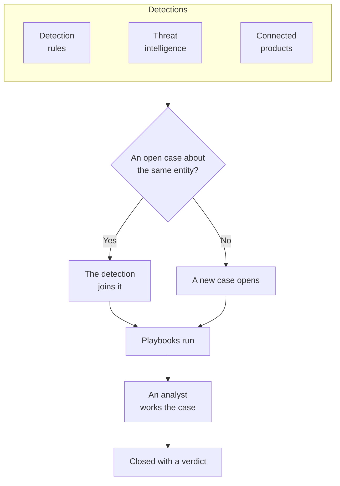

# Security Cases and Playbooks (SOAR)

Security Events turns what your detection rules, threat intelligence and connected security products find into cases: one case for each thing worth looking into, with every detection about the same user, host or address grouped into it. Analysts work the cases in a queue, and playbooks respond to them, by themselves or at a click.

:::cards
- [Where cases come from](#where-cases-come-from): Detection rules, threat intelligence, connected products, entity risk and people.
- [Work a case](#work-a-case): Assign it, investigate its entities, close it with a verdict.
- [Case priorities and statuses](#case-priorities-and-statuses): Rename, recolor and reorder them, and add your own.
- [Notifications](#notifications): Who is told about a new case, an assignment and a step waiting for approval.
- [Playbooks](#playbooks): Steps that run on a case, with approval where it matters.
- [The overview](#the-overview): What needs someone now, and how fast cases are handled.
:::

## How it works

Open **Products → Security Events → Security Cases → Open Cases** for the queue. **Assigned to Me**, **Unassigned**, **Closed Cases** and **All Cases** are pages of their own beside it, each listing the cases its name says.

## Before you begin

Cases and playbooks follow the three Security roles. Project Owner and Project Admin can do everything.

| Role | What it can do |
| --- | --- |
| Security Admin | Everything, including deleting cases and setting up playbooks |
| Security Member | Open, assign, change and close cases, write notes, run playbooks and approve or reject their steps |
| Security Viewer | Read cases, detections, notes, playbooks and their runs |

Each of these can also be granted on its own, from creating a case to approving a playbook's steps; see [Permission Reference](/docs/permissions/reference).

## Where cases come from

| Source | Opens a case when | Turn it off with |
| --- | --- | --- |
| Detection rules | A rule matches | **Open a Case on Match**, on the rule's **On Match** step |
| Threat intelligence | An event names a known indicator | **Open a Case on Match**, on the feed's **On Match** step |
| Connected products | A product's own alert is imported at or above the connection's threshold | **Open Cases From** set to **Never**, in the connection's **Polling** step |
| Entity risk | A user's, host's or address's risk reaches the project's threshold | **Risk Cases**, under **Settings → Risk Scoring** |
| People | Someone opens one from **Security Cases**, or with **Open Case** in an event's panel | None |

Every source opens cases by default, except entity risk on projects created before it existed, which turn on **Risk Cases** first ([Entity Risk](/docs/telemetry/security-entity-risk)). A connection opens cases for **High and above** unless you choose another level; the alerts below it are still imported as events.

### How detections are grouped

A detection is about an entity: the value its rule groups by, such as the IP address of a brute-force rule, or the indicator a threat intelligence match names. A detection without one stands alone.

- When an open case is already about that entity, the detection joins it. The case's entities and ATT&CK mapping grow, and its priority rises to the detection's, never down.
- When no open case is, a new case opens, named after the detection, at the detection's priority.
- A detection that fires again counts up on its row instead of adding one.

A case's priority comes from the detection's severity, at the project's built-in priority for that level, whatever you have named it:

| Severity | Priority |
| --- | --- |
| Critical or Fatal | Critical |
| High | High |
| Medium, Unknown or Other | Medium |
| Low | Low |
| Informational | Informational |

## Work a case

A new project's cases move through four statuses, which you can rename and add to (see [Case priorities and statuses](#case-priorities-and-statuses)). A case can skip one, such as a false positive closed straight from New, and it can be reopened.

| Status | Means |
| --- | --- |
| New | Nobody has looked at it yet |
| Investigating | Someone is working out what happened |
| Contained | The threat can no longer do harm; the cleanup is still to do |
| Closed | Done, with a verdict on what it was |

A case has a side menu of its own, as an incident has, and each part of the case is a page of its own:

| Side menu section | Pages |
| --- | --- |
| **Overview** | **Overview**, **Timeline** |
| **Investigation** | **Detections**, **Entities**, **Connected Signals**, **Playbook Runs** |
| **Notes** | **Private Notes** |
| **Advanced** | **Audit Logs**, **Delete Case**, folded until you click **Advanced** |

Every page keeps the case's header on top: its number, priority, status and title, **Assign to Me**, **Run Playbook**, **Declare Incident** and **Close Case**, and in the ⋯ menu beside them **Set priority**, **Assign to Someone Else**, **Change Status**, **Edit Case** and **Delete Case**. So the case can be worked from any of its pages, and a link to the case still opens its **Overview**.

- **Overview**: the case's description, labels and status steps, who has it and what opened it, and its figures: how many detections it has, how long it has been open, and how long it took to acknowledge and to contain.
- **OneUptime AI**, on the **Overview**: what OneUptime AI made of the case, the priority and playbook it suggests, and the evidence behind them. See [OneUptime AI in Security](/docs/telemetry/security-ai).
- **MITRE ATT&CK**, on the **Overview**: the tactics and techniques its detections map to, each linked to its page on attack.mitre.org.
- **Timeline**: everything that happened to the case, with who did it.
- **Detections**: what fired to open the case or join it, how often, and the latest matching event.
- **Entities**: the users, hosts and addresses the case is about, with their activity across all your security events in the last 7 days. Each opens in **Correlate**.
- **Connected Signals**: the hosts, clusters, services and members the case names, as OneUptime knows them, and what was happening on each around its detections: their logs, traces and metrics, what is open on them and what changed. See [Connected Signals](/docs/telemetry/security-connected-signals).
- **Playbook Runs**: what each playbook did on the case, step by step, and the steps waiting for approval. While runs wait, the menu shows how many beside **Playbook Runs**.
- **Private Notes**: what the team wrote about the case.
- **Audit Logs**: every change made to the case, and who made it. See [Audit Logs](/docs/configuration/audit-logs).
- **Delete Case**: deletes the case and its detections, notes, timeline and playbook runs for good. To keep the record, close it with a verdict instead.

### Work cases from the queue

You do not have to open a case to work it. In the queue's lists, the ⋯ menu on a case's row has **Assign to Me**, **Assign to Someone Else**, **Change Status** and **Change Priority**. To work several cases at once, select them and use the same actions under **Bulk Actions**: it says which cases it changed, and which it left as they were, and why.

- To give a case to someone else, use **Assign to Someone Else** and pick one person, or a team. A team's case waits under **Unassigned** until someone on the team takes it.
- A status that closes a case asks for a verdict and a closing note, as **Close Case** does.
- A closed case is not assigned to anyone. To work it again, reopen it with **Change Status**.

### Close a case

**Close Case** asks for a verdict and an optional closing note:

| Verdict | Means |
| --- | --- |
| True Positive | Malicious or unauthorized activity really happened |
| Benign Positive | The activity was real but expected, such as a penetration test or an admin task |
| False Positive | The detection was wrong: the rule or the data misread normal activity |
| Undetermined | There was not enough information to tell |

The verdicts are counted on the overview. A rule whose cases keep closing as False Positive is a rule to tune.

A case opened from Google SecOps alerts closes them in Google SecOps too, with the verdict and the closing note, when its connection has **Close alerts when their case closes** on: see [Google SecOps](/docs/integrations/google-secops#close-alerts-when-their-case-closes).

### Declare an incident

**Declare Incident** opens a OneUptime incident for the case, at the severity you choose, and links the two both ways: the incident's description names the case, and the case's header links to the incident. On-call, status pages and the postmortem take over from there. It takes a role that can both work cases and create incidents.

## Case priorities and statuses

Each project keeps its own case priorities and statuses, under **Products → Security Events → Settings → Case Priorities** and **Case Statuses**. Rename them, recolor them, drag them into another order, and add your own, such as a "Triage" status or an "Emergency" priority above **Critical**. A new name shows everywhere at once: in the queue, on the case pages and the overview, in notifications, in Slack and Microsoft Teams, and in playbook messages.

Some are built in, because OneUptime reads what they mean. They can be renamed and recolored, but not deleted or archived, and they keep their order:

| Built in | What OneUptime does with it |
| --- | --- |
| The new status | New cases start in it |
| The acknowledged status | Reaching it records when the case was acknowledged, and **Reopen** moves a closed case back to it |
| The contained status | Reaching it records when the case was contained |
| The closed status | **Close Case** moves a case to it, with a verdict |
| The Critical, High, Medium, Low and Informational priorities | A detection opens its case at the one of its severity, and a case someone opens starts at Medium |

- Where a status sits decides what a case in it counts as, as the **Counts as** column shows: from the acknowledged status down, acknowledged; from the contained status down, contained; from the closed status down, closed. A status you add goes just above the closed status, and moving a case into a status that closes it asks for a verdict first.
- A priority's rank is how urgent it is, the most urgent first: **For Cases At Least**, the notification choices and the Slack and Microsoft Teams rules read this order. A priority you add goes to the end, and the **Detection severity** column shows which detections open their cases at each built-in priority.

To stop using a status or priority of your own, use **Archive** on its row. Nobody can pick it again, and the API, Terraform and MCP refuse it, but the cases that have it keep it, and you can still filter by it. Archived values are listed in the folded **Archived Case Statuses** or **Archived Case Priorities** section under the table, where **Unarchive** puts one back. **Delete** is refused while cases have the value or a playbook runs from the priority.

## Notifications

OneUptime tells people about three things on a case. Nobody has to set anything up: a project that only clicked **Turn on recommended** hears about its High and Critical cases by email and push.

| Notification | Who is told | By default |
| --- | --- | --- |
| New security case | Everyone who can see the project's cases, when a case opens, or rises, at the priority they chose or above | Email and push, for High and Critical cases |
| Security case assigned to me | The person the case is assigned to, and the members of the team it is assigned to | Email and push |
| Playbook step waiting for my approval | The people on the case who can approve the step: the person it is assigned to and the members of its team. When none of them can approve, everyone in the project who can | Email and push |

- Only people who can see the case are told about it: Project Owners, Project Admins, and the Security Admin, Security Member and Security Viewer roles. A role limited to some labels is told only about the cases with those labels.
- Nobody is told about what they did: the person who opens a case by hand, assigns it or starts a run is not notified of it.
- Each person hears about a case once. A case that opens at Medium and later rises to Critical reaches the people who chose High or Critical when it rises, and not again the people who chose Medium, who heard about it when it opened.
- The test attack from **Send a test attack** opens a case that notifies nobody.
- A Critical case and a step waiting for approval are sent at once, never held back in an [email rollup](/docs/emails/notification-rollup).
- The case's **Timeline** says who was told, and when.

### Choose what you are told

Each person chooses for themselves, under **User Settings → Notification Settings → Security**: the channels for each notification (email, SMS, call, push, Telegram, Slack, Microsoft Teams or webhook), and under **New security case**, the priority that notifies them:

| Choice | Notifies about cases at |
| --- | --- |
| Critical only | Critical |
| High and above | Critical and High (the default) |
| Medium and above | Critical, High and Medium |
| Low and above | Every priority but Informational |
| Every case | Every priority |

The choices follow the project's case priorities, under their own names: these are a new project's.

WhatsApp messages are not sent for security cases. A push notification opens the OneUptime app, and its link opens the case in the browser.

### Post to Slack and Microsoft Teams channels

To post to a channel, add a rule under **Products → Security Events → Workspace → Slack** (or **Microsoft Teams**). With neither connected, the section's one entry is **Connect Slack or Teams**. A rule names the channels to post to (and, in Microsoft Teams, the chats) and, if you want, the cases it is for:

| Condition | Matches on |
| --- | --- |
| Security Case Priority | One of the project's case priorities, such as Critical or High |
| Security Case Title, Security Case Description | Text the case's title or description contains, starts with or ends with |
| Security Case Status | One of the project's case statuses, such as New or Closed |
| Security Case Source | Detection Rule, Threat Intel, Connected Product, Entity Risk or Manual |
| Security Case Labels | The case's labels |

The three notifications are each posted to the channels of every rule the case matches at that moment. A rule with **Security Case Priority** contains any of **Critical** and **High** posts High and Critical cases as they open, and a Medium case when it rises to High. A security case never gets a channel of its own.

## Playbooks

A playbook is a list of steps that run on a case. Create one under **Products → Security Events → Playbooks**, from a template or blank, and add its steps on its page. A project with no playbooks sees the templates in place of an empty list; once there are playbooks, **Create from Template** on the list opens them, with **Added** on the ones the project already has.

### When a playbook runs

| Trigger | When it runs |
| --- | --- |
| Case Opened | Once, as a case opens |
| Detection Added | Each time a new detection joins an open case |
| Triaged as Likely Malicious | Once, when OneUptime AI's triage reads the case as Likely Malicious |
| Manual | Only when someone runs it from a case |

Any enabled playbook can also be run by hand, with **Run Playbook** on a case. A playbook that runs by itself can be narrowed:

- **For Cases At Least**: only cases of this priority or higher.
- **Only For Detections From**: only when the detection behind the case came from this source.
- **Only For These Detection Rules**: only when it came from one of these rules.

A disabled playbook runs neither by itself nor by hand.

### Steps

| Category | Step | What it does |
| --- | --- | --- |
| Case | Assign the case | Gives the case to a person, a team, or both |
| Case | Set the priority | Raises or lowers the case's priority |
| Case | Set the status | Moves the case to another of the project's statuses, with the verdict you choose when that status closes it |
| Case | Add a note | Writes a note on the case, such as a checklist for the analyst |
| Case | Add labels | Tags the case with labels |
| Investigate | Check entities against threat intel | Looks each entity up in your threat intelligence, and can raise the priority on a match |
| Investigate | Look up entity activity | Counts each entity's security events over a recent window, and notes it on the case |
| Notify | Email people | Emails users and teams a summary of the case, with a link to it |
| Notify | Post to Slack | Posts a summary of the case to a Slack channel |
| Notify | Post to Microsoft Teams | Posts a summary of the case to a Microsoft Teams channel |
| Escalate | Page on-call | Runs an on-call policy |
| Escalate | Declare an incident | Opens a OneUptime incident linked to the case |
| Contain | Suspend the user in Okta | Suspends the user the case is about in Okta |
| Contain | End the user's Okta sessions | Signs the user the case is about out of Okta and revokes their tokens |
| Contain | Contain the host in CrowdStrike | Network-contains the host the case is about with CrowdStrike Falcon |
| Contain | Isolate the device in Microsoft Defender | Isolates the host the case is about with Microsoft Defender for Endpoint |
| Contain | Unsuspend the user in Okta | Unsuspends the user the case is about in Okta |
| Contain | Lift containment in CrowdStrike | Lifts CrowdStrike Falcon's network containment from the host the case is about |
| Contain | Release the device in Microsoft Defender | Releases the host the case is about from isolation in Microsoft Defender for Endpoint |
| Automate | Send a webhook | Posts the case as JSON to a URL |
| Automate | Run a workflow | Starts a OneUptime workflow with the case as its input |

A playbook has at most 25 steps. They run in order, each once the one before it is done. Every step can also:

- **Needs Approval**: stop the run before the step until someone approves it on the case. The four steps that cut someone off always do, unless a Security Admin turns it off.
- **Only If Threat Intel Matched**: skip the step unless an earlier **Check entities against threat intel** step of the run found a known indicator.
- **Carry On If It Fails**: run the next step even if this one fails. Off, a failed step stops the run.

### Containment

The Contain steps act through a [security event connection](/docs/telemetry/security-events#connect-a-security-product) to the product, which needs more than read access:

| Step | Connection | Needs |
| --- | --- | --- |
| Suspend the user in Okta, End the user's Okta sessions, Unsuspend the user in Okta | Okta System Log | An API token allowed to manage users |
| Contain the host in CrowdStrike, Lift containment in CrowdStrike | CrowdStrike Falcon | An API client with the Hosts write scope |
| Isolate the device in Microsoft Defender, Release the device in Microsoft Defender | Microsoft Defender XDR | An app with the Machine.Isolate permission |

A Contain step acts only on the users or hosts the case is about, never on every one it names:

- The value a detection of the case is grouped on, such as the account an impossible-travel rule groups by, or the host a connected product's alert names.
- A user or host of the case that your threat intelligence knows as an indicator.

A case grouped on an address, such as a brute force against your VPN, is about neither: its Contain steps are skipped, and the account it tried and the gateway it hit are left alone. A step acts on at most 10 users or hosts. It finds each in the product by name, and says on the run what it did with each one: done, already done, not found, refused, or protected.

#### Protected entities

**Protected Entities**, under **Playbooks** in the menu, lists the users and hosts no playbook contains, such as break-glass accounts, domain controllers and VPN gateways. A value matches whatever its case, and `*` stands for any run of characters: `svc-*` protects every service account. A step reports a protected user or host as protected and leaves it alone. Security Admins keep the list.

#### Approval

The four steps that cut someone off wait for approval. Only a Security Admin can turn **Needs Approval** off for one, and OneUptime records who did. The approval lists the users or hosts the step would act on under **Act On**, every one ticked: untick any it should leave alone. Protected ones are not offered. Whoever started a run cannot approve its steps: someone else does, though they can still reject it.

#### Undo

The undo steps act on the users or hosts the case is about, like the steps they undo. Once the run has stopped, a contained user or host also has a button of its own on its step: **Unsuspend**, **Lift Containment** or **Release**. An ended Okta session cannot be undone. Every undo is kept on the case's timeline and in the project's audit log.

### Messages

A note, an email, a Slack post and a Teams post can use the case's values:

| Placeholder | Becomes |
| --- | --- |
| `{{case.number}}` | The case number, like CASE-42 |
| `{{case.title}}` | The case title |
| `{{case.priority}}` | The case's priority, as your project names it, such as High |
| `{{case.status}}` | The case's status, as your project names it, such as Investigating |
| `{{case.assignee}}` | Who the case is assigned to |
| `{{case.url}}` | A link to the case in OneUptime |
| `{{case.entities}}` | The users, hosts and addresses the case is about |
| `{{case.detections}}` | How many detections the case holds |

An email or a post with no message of its own sends a summary of the case.

### Runs and approvals

Every run is listed on its case and under **Products → Security Events → Playbooks → Playbook Runs**, step by step:

| Run status | Means |
| --- | --- |
| Queued | Waiting for a worker |
| Running | Running its steps |
| Waiting for Approval | Held before a step that needs approval |
| Succeeded | Every step ran, or was skipped |
| Failed | A step failed and the run stopped |
| Cancelled | Someone cancelled it, or rejected a step |

A step waiting for approval shows **Approve** and **Reject** on the run, with an optional comment. Approving carries the run on from that step; rejecting ends it. The decision, who made it and their comment are kept on the step, on the case's timeline and in the project's audit log. **Waiting for Approval**, under **Playbooks** in the menu, lists the runs held for a decision and counts them; **Playbook Runs** lists every run. On **Playbook Runs** and on a playbook's page, each run is a line that says how far it got, or the step where it stopped; **Show steps** opens its steps. A run waiting for approval opens by itself.

A run that stops hearing from its worker, after a restart for example, is picked up again: a queued run is queued again after 2 minutes, and a run that has said nothing for 30 minutes is failed.

## The overview

**Products → Security Events → Overview** is where the product opens:

- The open cases assigned to you, the open cases nobody has picked up, and the playbook steps waiting for approval, each opening the page that lists them.
- **Mean Time to Acknowledge**, **Mean Time to Contain** and **Mean Time to Close**, over the cases opened in the last 30 days: from a case opening to someone taking it on (assigning a person, or moving it to a status that counts as acknowledged), to a status that counts as contained, and to one that counts as closed. A case still waiting is not counted in a mean.
- The cases opened each day for 30 days, by priority, and the detections raised each day for 14 days, by source.
- The open cases by priority and by status, the entities named by the most findings, the detections that fired most, the ATT&CK tactics behind the cases, and the verdicts of the last 30 days.

Above them, a strip shows how Security is set up: its sources, detections, cases and playbooks, each with its figures. A project that has not set it up yet sees **Turn on recommended** and **Send a test attack** there; see [Get Started with Security](/docs/telemetry/security-getting-started). When nothing needs anybody, the page says **All quiet**, and the charts show once there is something to chart.

## Find threats

- **Entities** ranks the users, hosts, addresses and hashes that your findings name most, over the last day, week or month, and looks any value up across 30 days of events. Select an entity to open it in **Correlate**.
- **Rule Library** has ready-made detection rules, for identity, endpoint, cloud, network, web and Kubernetes threats. Each is a Sigma rule written for the fields every connected source is normalized to. Its row says what it finds, the MITRE ATT&CK tactics and techniques it is tagged with, the events it reads and whether any arrived in the last 7 days (**Receiving** or **Not receiving**), and its severity. Narrow the list by category, by the data the rules read and by whether you have added them, or search it by name, ATT&CK technique or severity; the page's address keeps the filters. Select a rule for its details: how to start sending the events it reads, how it runs, and its Sigma rule. **Add** creates it as a detection rule of yours, on, and opening cases rather than alerts; change it under **Detection Rules** like any other. The rules marked **Recommended** find threats in data OneUptime already has, and one button adds the ones you do not have yet.
- **ATT&CK Coverage** lists the MITRE ATT&CK tactics, each with how many of its techniques your enabled rules cover, and how many more the **Rule Library** has rules for. Open a tactic for its techniques, or switch to **Matrix** for the whole matrix. Select a technique to see the library rules that cover it, and open the **Rule Library** on them.

## Automate

- **Workflows**: a case or a note can start a workflow when it is created, updated or deleted. A **Run a workflow** step starts a workflow whose trigger is a webhook.
- **API**: cases, notes, detections, playbooks, runs, protected entities, and case priorities and statuses have the same REST API as the rest of OneUptime, under `/security-case`, `/security-case-note`, `/security-detection`, `/security-playbook`, `/security-playbook-run`, `/security-protected-entity`, `/security-case-priority` and `/security-case-status`. See [API Reference](/docs/api-reference/api-reference).
- AI agents: the MCP server has tools for cases, notes, detections, playbooks, and case priorities and statuses. See [MCP Server](/docs/ai/mcp-server).
- Terraform: the `oneuptime_security_case_priority` and `oneuptime_security_case_status` resources keep a project's priorities and statuses as code.

## Troubleshooting

:::details A rule matches, but no case opens
Check **Open a Case on Match** on the rule's **On Match** step. A detection about an entity that already has an open case joins that case instead of opening another: look for it under **Detections** on the open case.
:::

:::details Nobody was told about a case
Look at the case's **Timeline**, which says who was notified. A **New security case** notification goes to the people whose chosen priority the case reaches, so a Medium case notifies nobody who kept the default, **High and above**. Check that the people who should hear can see security cases (a Security role, or Project Owner or Admin), and that the notification is on for them under **User Settings → Notification Settings → Security**.
:::

:::details A playbook did not run
Check that it is enabled, that its **Trigger** fits (Case Opened runs once, as a case opens), and that the case meets its **For Cases At Least**, **Only For Detections From** and **Only For These Detection Rules** settings. A case opened by hand has no detection, so a playbook limited to a source or to rules does not run on it.
:::

:::details A Contain step failed
Open the run on the case: the step says, for each user or host, whether the product refused it, did not find it, or could not be reached. Check that the connection's credential may make the change, and use **Test connection** in its row.
:::

:::details A Contain step was skipped
The case is about no user or host, only an address for example, or every user or host it is about is protected. Open the run on the case: the step says which.
:::

:::details A status or priority can't be deleted or archived
A built-in one can be renamed and recolored, but never deleted or archived: its **Archive** is locked, with the reason. One of your own can't be deleted while cases have it or a playbook runs from it: move the cases to another first, or archive it.
:::

## Next steps

:::cards
- [Security Events](/docs/telemetry/security-events): Send events, write detection rules and connect security products.
- [Threat Intelligence](/docs/telemetry/threat-intelligence): Match your events against STIX/TAXII feeds.
- [OneUptime AI in Security](/docs/telemetry/security-ai): Triage cases, draft detection rules and ask about security, with AI.
- [Permission Reference](/docs/permissions/reference): The Security roles, and what each can do.
:::
