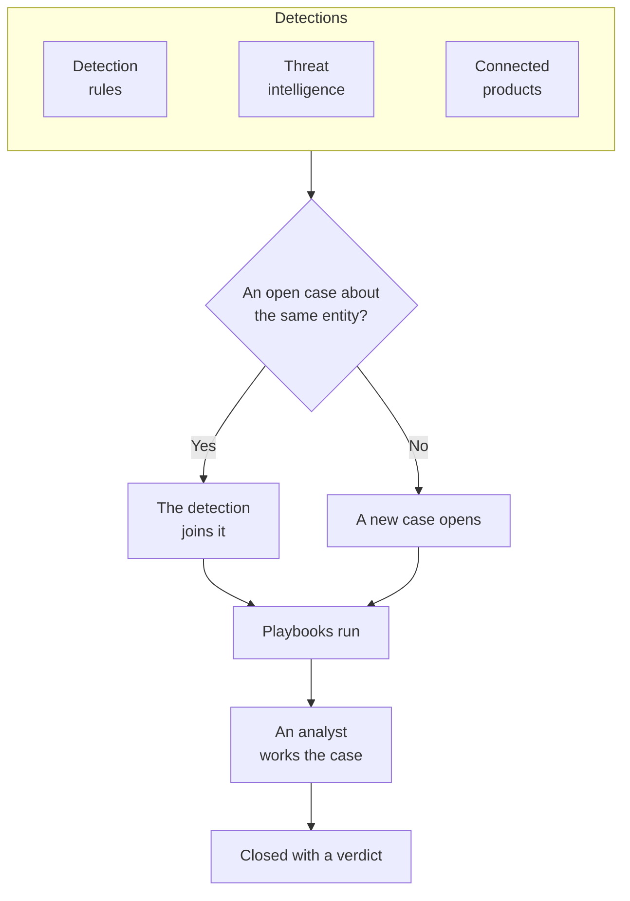

# Security Cases and Playbooks (SOAR)

Security Events turns what your detection rules, threat intelligence and connected security products find into cases: one case for each thing worth looking into, with every detection about the same user, host or address grouped into it. Analysts work the cases in a queue, and playbooks respond to them, by themselves or at a click.

:::cards
- [Where cases come from](#where-cases-come-from): Detection rules, threat intelligence, connected products and people.
- [Work a case](#work-a-case): Assign it, investigate its entities, close it with a verdict.
- [Playbooks](#playbooks): Steps that run on a case, with approval where it matters.
- [The overview](#the-overview): What needs someone now, and how fast cases are handled.
:::

## How it works

Open **Products → Security Events → Security Cases**. The queue opens on the open cases; **Assigned to Me**, **Unassigned**, **Closed** and **All** are the other views.

## Before you begin

Cases and playbooks follow the three Security roles. Project Owner and Project Admin can do everything.

| Role | What it can do |
| --- | --- |
| Security Admin | Everything, including deleting cases and setting up playbooks |
| Security Member | Open, assign, change and close cases, write notes, run playbooks and approve or reject their steps |
| Security Viewer | Read cases, detections, notes, playbooks and their runs |

Each of these can also be granted on its own, from creating a case to approving a playbook's steps; see [Permission Reference](/docs/permissions/reference).

## Where cases come from

| Source | Opens a case when | Turn it off with |
| --- | --- | --- |
| Detection rules | A rule matches | **Open a Case on Match**, on the rule's **On Match** step |
| Threat intelligence | An event names a known indicator | **Open a Case on Match**, on the feed's **On Match** step |
| Connected products | A product's own alert is imported at or above the connection's threshold | **Open Cases From** set to **Never**, in the connection's **Polling** step |
| People | Someone opens one from **Security Cases**, or with **Open Case** in an event's panel | None |

Every source is on by default. A connection opens cases for **High and above** unless you choose another level; the alerts below it are still imported as events.

### How detections are grouped

A detection is about an entity: the value its rule groups by, such as the IP address of a brute-force rule, or the indicator a threat intelligence match names. A detection without one stands alone.

- When an open case is already about that entity, the detection joins it. The case's entities and ATT&CK mapping grow, and its priority rises to the detection's, never down.
- When no open case is, a new case opens, named after the detection, at the detection's priority.
- A detection that fires again counts up on its row instead of adding one.

A case's priority comes from the detection's severity:

| Severity | Priority |
| --- | --- |
| Critical or Fatal | Critical |
| High | High |
| Medium, Unknown or Other | Medium |
| Low | Low |
| Informational | Informational |

## Work a case

A case moves through four statuses. It can skip one, such as a false positive closed straight from New, and it can be reopened.

| Status | Means |
| --- | --- |
| New | Nobody has looked at it yet |
| Investigating | Someone is working out what happened |
| Contained | The threat can no longer do harm; the cleanup is still to do |
| Closed | Done, with a verdict on what it was |

The case's page has everything to work it:

- At the top: **Assign to Me**, **Run Playbook**, **Declare Incident** and **Close Case**, the status steps, and the priority under the menu beside them.
- **Detections**: what fired to open the case or join it, how often, and the latest matching event.
- **Entities**: the users, hosts and addresses the case is about, with their activity across all your security events in the last 7 days. Each opens in **Correlate**.
- **MITRE ATT&CK**: the tactics and techniques its detections map to, each linked to its page on attack.mitre.org.
- **Playbook Runs**: what each playbook did on the case, step by step, and the steps waiting for approval.
- **Notes** and **Timeline**: what the team wrote, and everything that happened, with who did it.

To work several cases at once, select them in the queue and use **Assign to Me**, **Change Status** or **Change Priority**.

### Close a case

**Close Case** asks for a verdict and an optional closing note:

| Verdict | Means |
| --- | --- |
| True Positive | Malicious or unauthorized activity really happened |
| Benign Positive | The activity was real but expected, such as a penetration test or an admin task |
| False Positive | The detection was wrong: the rule or the data misread normal activity |
| Undetermined | There was not enough information to tell |

The verdicts are counted on the overview. A rule whose cases keep closing as False Positive is a rule to tune.

### Declare an incident

**Declare Incident** opens a OneUptime incident for the case, at the severity you choose, and links the two both ways: the incident's description names the case, and the case's header links to the incident. On-call, status pages and the postmortem take over from there. It takes a role that can both work cases and create incidents.

## Playbooks

A playbook is a list of steps that run on a case. Create one under **Products → Security Events → Playbooks**, from a template or blank, and add its steps on its page.

### When a playbook runs

| Trigger | When it runs |
| --- | --- |
| Case Opened | Once, as a case opens |
| Detection Added | Each time a new detection joins an open case |
| Manual | Only when someone runs it from a case |

Any enabled playbook can also be run by hand, with **Run Playbook** on a case. A playbook that runs by itself can be narrowed:

- **For Cases At Least**: only cases of this priority or higher.
- **Only For Detections From**: only when the detection behind the case came from this source.
- **Only For These Detection Rules**: only when it came from one of these rules.

A disabled playbook runs neither by itself nor by hand.

### Steps

| Category | Step | What it does |
| --- | --- | --- |
| Case | Assign the case | Gives the case to a person, a team, or both |
| Case | Set the priority | Raises or lowers the case's priority |
| Case | Set the status | Moves the case to Investigating, Contained or Closed, with the verdict you choose |
| Case | Add a note | Writes a note on the case, such as a checklist for the analyst |
| Case | Add labels | Tags the case with labels |
| Investigate | Check entities against threat intel | Looks each entity up in your threat intelligence, and can raise the priority on a match |
| Investigate | Look up entity activity | Counts each entity's security events over a recent window, and notes it on the case |
| Notify | Email people | Emails users and teams a summary of the case, with a link to it |
| Notify | Post to Slack | Posts a summary of the case to a Slack channel |
| Notify | Post to Microsoft Teams | Posts a summary of the case to a Microsoft Teams channel |
| Escalate | Page on-call | Runs an on-call policy |
| Escalate | Declare an incident | Opens a OneUptime incident linked to the case |
| Contain | Suspend the user in Okta | Suspends each user of the case in Okta |
| Contain | End the user's Okta sessions | Signs each user of the case out of Okta and revokes their tokens |
| Contain | Contain the host in CrowdStrike | Network-contains each host of the case with CrowdStrike Falcon |
| Contain | Isolate the device in Microsoft Defender | Isolates each host of the case with Microsoft Defender for Endpoint |
| Automate | Send a webhook | Posts the case as JSON to a URL |
| Automate | Run a workflow | Starts a OneUptime workflow with the case as its input |

A playbook has at most 25 steps. They run in order, each once the one before it is done. Every step can also:

- **Needs Approval**: stop the run before the step until someone approves it on the case. It is on by default for the four Contain steps, which act outside OneUptime.
- **Only If Threat Intel Matched**: skip the step unless an earlier **Check entities against threat intel** step of the run found a known indicator.
- **Carry On If It Fails**: run the next step even if this one fails. Off, a failed step stops the run.

### Containment

The Contain steps act through a [security event connection](/docs/telemetry/security-events#connect-a-security-product) to the product, which needs more than read access:

| Step | Connection | Needs |
| --- | --- | --- |
| Suspend the user in Okta, End the user's Okta sessions | Okta System Log | An API token allowed to manage users |
| Contain the host in CrowdStrike | CrowdStrike Falcon | An API client with the Hosts write scope |
| Isolate the device in Microsoft Defender | Microsoft Defender XDR | An app with the Machine.Isolate permission |

A Contain step acts on at most 10 of the case's users or hosts. It finds each in the product by name, and says on the case what it did with each one: contained, already contained, not found, or refused.

### Messages

A note, an email, a Slack post and a Teams post can use the case's values:

| Placeholder | Becomes |
| --- | --- |
| `{{case.number}}` | The case number, like CASE-42 |
| `{{case.title}}` | The case title |
| `{{case.priority}}` | Critical, High, Medium, Low or Informational |
| `{{case.status}}` | New, Investigating, Contained or Closed |
| `{{case.assignee}}` | Who the case is assigned to |
| `{{case.url}}` | A link to the case in OneUptime |
| `{{case.entities}}` | The users, hosts and addresses the case is about |
| `{{case.detections}}` | How many detections the case holds |

An email or a post with no message of its own sends a summary of the case.

### Runs and approvals

Every run is listed on its case and under **Products → Security Events → Playbook Runs**, step by step:

| Run status | Means |
| --- | --- |
| Queued | Waiting for a worker |
| Running | Running its steps |
| Waiting for Approval | Held before a step that needs approval |
| Succeeded | Every step ran, or was skipped |
| Failed | A step failed and the run stopped |
| Cancelled | Someone cancelled it, or rejected a step |

A step waiting for approval shows **Approve** and **Reject** on the run, with an optional comment. Approving carries the run on from that step; rejecting ends it. The decision, who made it and their comment are kept on the step and on the case's timeline. **Playbook Runs** opens on the runs waiting for approval, and its menu entry counts them.

A run that stops hearing from its worker, after a restart for example, is picked up again: a queued run is queued again after 2 minutes, and a run that has said nothing for 30 minutes is failed.

## The overview

**Products → Security Events → Overview** is where the product opens:

- The open cases assigned to you, the open cases nobody has picked up, and the playbook steps waiting for approval.
- **Mean Time to Acknowledge**, **Mean Time to Contain** and **Mean Time to Close**, over the cases opened in the last 30 days: from a case opening to someone taking it on (assigning a person, or moving it out of New), to Contained, and to Closed. A case still waiting is not counted in a mean.
- The cases opened each day for 30 days, by priority, and the detections raised each day for 14 days, by source.
- The open cases by priority and by status, the verdicts of the last 30 days, the ATT&CK tactics behind the cases, the detections that fired most, and the entities named by the most findings.

A project with no cases and no detections yet shows, above these, the three steps that set it up.

## Find threats

- **Entities** ranks the users, hosts, addresses and hashes that your findings name most, over the last day, week or month, and looks any value up across 30 days of events.
- **Rule Library** has ready-made detection rules, for identity, endpoint, cloud, network, web and Kubernetes threats. Each is a Sigma rule written for the fields every connected source is normalized to. **Add Rule** creates it as a detection rule of yours, on, and opening cases rather than alerts; change it under **Detection Rules** like any other.
- **ATT&CK Coverage** draws the MITRE ATT&CK matrix with the techniques your enabled rules cover lit, and outlines the ones a library rule would cover.

## Automate

- **Workflows**: a case or a note can start a workflow when it is created, updated or deleted. A **Run a workflow** step starts a workflow whose trigger is a webhook.
- **API**: cases, notes, detections, playbooks and runs have the same REST API as the rest of OneUptime, under `/security-case`, `/security-case-note`, `/security-detection`, `/security-playbook` and `/security-playbook-run`. See [API Reference](/docs/api-reference/api-reference).
- AI agents: the MCP server has tools for cases, notes, detections and playbooks. See [MCP Server](/docs/ai/mcp-server).

## Troubleshooting

:::details A rule matches, but no case opens
Check **Open a Case on Match** on the rule's **On Match** step. A detection about an entity that already has an open case joins that case instead of opening another: look for it under **Detections** on the open case.
:::

:::details A playbook did not run
Check that it is enabled, that its **Trigger** fits (Case Opened runs once, as a case opens), and that the case meets its **For Cases At Least**, **Only For Detections From** and **Only For These Detection Rules** settings. A case opened by hand has no detection, so a playbook limited to a source or to rules does not run on it.
:::

:::details A Contain step failed
Open the run on the case: the step says, for each user or host, whether the product refused it, did not find it, or could not be reached. Check that the connection's credential may make the change, and use **Test connection** in its row.
:::

## Next steps

:::cards
- [Security Events](/docs/telemetry/security-events): Send events, write detection rules and connect security products.
- [Threat Intelligence](/docs/telemetry/threat-intelligence): Match your events against STIX/TAXII feeds.
- [Permission Reference](/docs/permissions/reference): The Security roles, and what each can do.
:::
