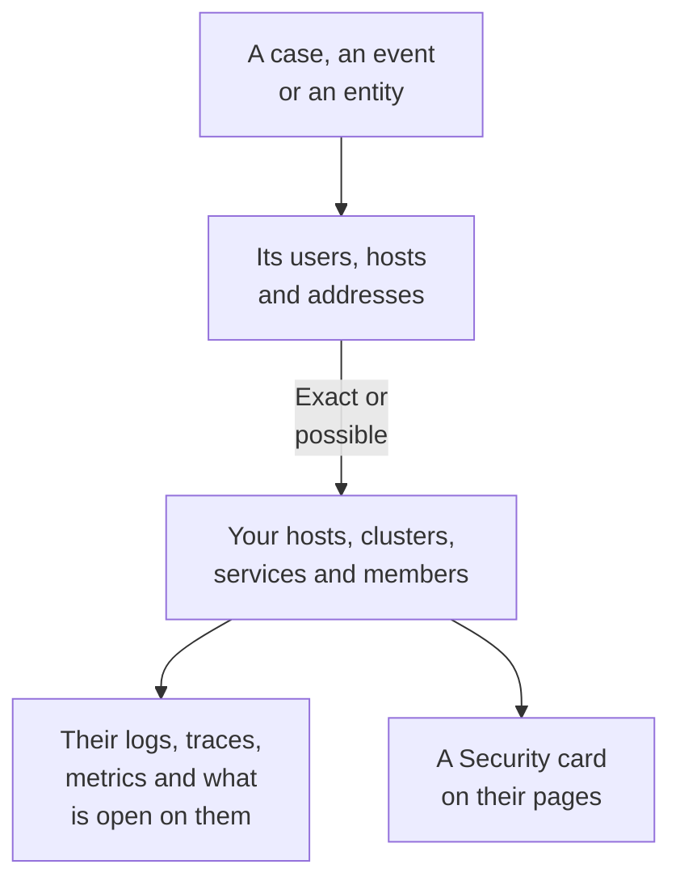

# Connected Signals

A security case says which users, hosts and addresses it is about. Connected Signals says which of them OneUptime already knows - your hosts, container hosts, Kubernetes clusters, network devices, services and members - and what was happening on each around the case: its logs, traces and metrics, the incidents and alerts open on it, the monitors watching it and what changed on it. The other way round, the page of a host, a cluster, a service or a member says what Security Events found about it.

:::cards
- [Where you see it](#where-you-see-it): A case's page, an event's tab, an entity's page, and the pages of what they name.
- [How a value is matched](#how-a-value-is-matched): What counts as the same record, and what only possibly is.
- [What each record shows](#what-each-record-shows): Its signals around the case, and what is open on it.
- [Who sees what](#who-sees-what): Every record is read with the reader's own role.
:::

## How it works

OneUptime looks each value up among the project's records, says how sure each match is, and shows what was happening on each record around the case.

## Before you begin

- Security events arriving, and hosts, Kubernetes clusters, services or members in the project for them to name. See [Get Started with Security](/docs/telemetry/security-getting-started).
- A role that can read security events, and the kinds of record you want to see.

## Where you see it

- **Connected Signals**, a page of every security case: open a case under **Products → Security Events → Security Cases → Open Cases**, then **Connected Signals** after **Entities** in its menu.
- **Connected**, a tab of every security event: open an event under **Products → Security Events → Events**. It lists what the event names, in the hour around it.
- An entity's page, under **Products → Security Events → Entity Risk**: where OneUptime knows the user, host or address, around its last security event.
- A **Security** card on the page of each host, Docker host, Podman host, Kubernetes cluster, network device, service, member and inventory item: the open security cases naming it, how many security events and findings named it in the last 7 days, the worst of them, and its risk. **Open in Security Events** opens it there.
- A **Security** card on an incident's page, when a security case declared the incident (**Declared from**) or open cases name a host or cluster it affects (**Open cases naming what it affects**).

## How a value is matched

Each user, host and address a case or an event names is looked up among the project's records:

| What the case or event names | Matched to | How sure |
| --- | --- | --- |
| A host or domain name the same as the name a host, container host, cluster or network device reports | That record | Exact |
| The same name, given without saying it is a host | That record | Possible |
| A short or full form of a record's name, such as `web-1` and `web-1.acme.internal` | That record | Possible |
| A public IP address only one record holds | That record | Exact |
| A private IP address, or one more than one record holds | Each record holding it | Possible |
| A member's email | That member | Exact |
| The record a log line was sent under, for the events read from your logs | That host, cluster or service | Exact |
| A bare user name, a URL, a file hash or a process | Nothing: no record is keyed by them | - |

- A possible match shows **Possible match** beside its name, and says why. It is never counted on the record's page, and an incident the case declares is never linked to it.
- What was looked for and is not a record of the project is listed under **Not in OneUptime**. A value is never listed there when a kind of record it could be could not be read.
- At most 10 records are listed for a case, the exact ones first.

## What each record shows

- Its signals, each opening on the record and the case's window: **Logs**, **Traces** and **Metrics**, a service's **Exceptions**, a cluster's **Kubernetes Events**, the record's **Topology**, and its **Inventory** item when Inventory has one.
- The incidents and alerts open on it now, and the monitors watching it, each opening its page.
- What changed on it in the window: a service's deploys, a cluster's rollouts and a host's fixes.

| Where | Window |
| --- | --- |
| A case | From 30 minutes before its first detection to 30 minutes after its last, at most its last 24 hours |
| An event | 30 minutes either side of it |
| An entity's page | 30 minutes either side of its last security event |
| A record's **Security** card | The last 7 days |

## Who sees what

- Connected Signals and a record's **Security** card take a role that can read security events: Security Admin, Security Member, Security Viewer, Project Owner or Project Admin. Anyone else sees no security data on any page. See [Roles](/docs/permissions/reference#roles).
- An incident's **Security** card takes a role that can read security cases.
- Each record is read with your own role. A kind of record your role cannot read is left out, and the page says so; one that could not be read just now says so too, with **Try again**.
- A record's page shows its **Security** card only in a project that uses Security Events: one that received a security event in the last 7 days.

## Incidents a case declares

**Declare Incident** on a case, or a playbook's step that declares one, links the incident to the hosts, Docker and Podman hosts, Kubernetes clusters and services the case is exactly connected to. The incident shows on their pages and their owners' rules apply to it, and its feed names the case and what it was linked to. A possible match is never linked.

## OneUptime AI

OneUptime AI's triage of a case reads its Connected Signals: what is open and what changed on the hosts, services and members the case names. An incident's investigation reads the security case that declared it and the open cases naming what it affects. See [OneUptime AI in Security](/docs/telemetry/security-ai).

## Troubleshooting

:::details A host the case names is not listed
Check that the case names the host as the host names itself, or names a public address only that host holds. A short name, such as `web-1` for `web-1.acme.internal`, is listed as a possible match, and a user's bare name, a URL, a file hash or a process is not looked up at all.
:::

:::details The right host is listed as a possible match
A possible match is never counted or linked, so that a name two machines share never tells you about the wrong one. Have your logs and detections name the host by the name it reports.
:::

:::details A host's page has no Security card
The card is shown to a role that can read security events, in a project that received a security event in the last 7 days. A host nothing named in that time shows one line that says so.
:::

:::details The page says your role cannot see a kind of record
Each record is read with your own role. Ask a Project Owner or Project Admin for a role that can read that kind of record.
:::

## Next steps

:::cards
- [Security Cases and Playbooks](/docs/telemetry/security-cases): Work a case, and declare an incident from it.
- [Security Events (SIEM)](/docs/telemetry/security-events): The events behind a case, and the logs they are read from.
- [Entity Risk (Risk-Based Alerting)](/docs/telemetry/security-entity-risk): An entity's page, its risk, and where OneUptime knows it.
- [OneUptime AI in Security](/docs/telemetry/security-ai): How a triage reads what a case names.
:::
