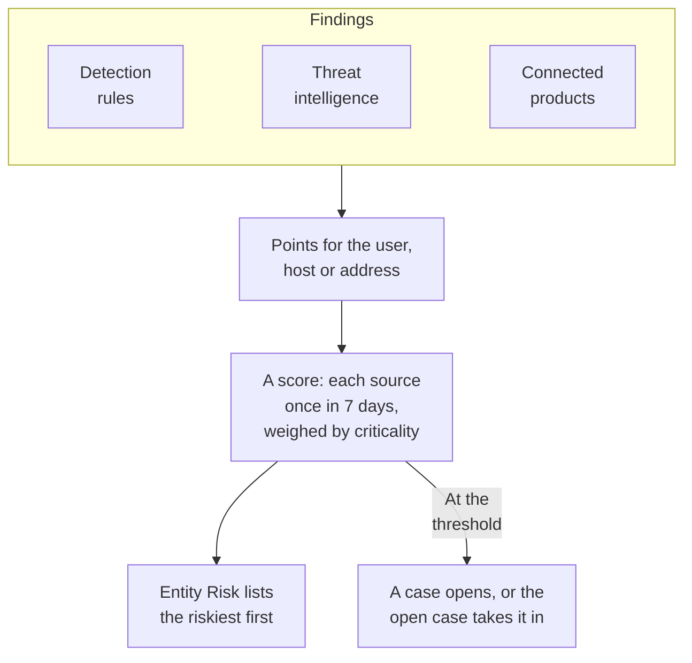

# Entity Risk (Risk-Based Alerting)

One finding rarely says much. A burst of failed sign-ins, a first sudo on a host and a sign-in from a new country are each worth a glance; the same account in all three within a week is worth a case. Entity risk adds up what your detection rules, threat intelligence, connected products and Data Security find about each user, host, IP address and data store, lists the riskiest first, and opens a case about one whose risk reaches the project's threshold.

:::cards
- [How a score is counted](#how-a-score-is-counted): Points by severity, and each source once a week.
- [Risk levels and cases](#risk-levels-and-cases): What a score reads as, and when a case opens.
- [Entity criticality](#entity-criticality): Count more what matters more, and less what matters less.
- [An entity's page](#an-entitys-page): Why it is risky, its month, and the cases about it.
- [Risk points on a detection rule](#risk-points-on-a-detection-rule): A rule's own say in the score.
:::

## How it works

Open **Products → Security Events → Entity Risk**: every user, host, IP address and data store with risk now, the riskiest first, with its level, how much it matters, what found it and when. Each one opens on a page of its own. The Overview's **Riskiest Entities** shows the top of this list, and **Look Up an Entity**, under it, looks any value up across 30 days of events, a domain or a file hash too.

## Before you begin

- Security events arriving, and detection rules, threat intelligence or connected products that find things in them. See [Get Started with Security](/docs/telemetry/security-getting-started).
- Detection rules that group by a field naming someone: **Group By Field**, such as `principalUser`, `principalHost` or `principalIp`, or the fields a correlation groups by. A rule that groups by nothing adds no risk.
- To change **Risk Scoring**: Project Owner or Project Admin for its switch and its threshold, and a role that can create detection rules for its list of entities. Security Viewer reads all of it. See [Roles](/docs/permissions/reference#roles).

## How a score is counted

Every finding adds risk points to the user, host, IP address or data store it is about:

| A finding of severity | Adds |
| --- | --- |
| Low | 10 points |
| Medium | 25 points |
| High | 50 points |
| Critical | 75 points |

- An informational finding adds nothing, and a finding of unknown severity counts as Medium.
- A detection rule's points go to the value it groups by. A threat intelligence match adds to the IP address the indicator names. A connected product's alert adds to the user and the host it names, or else to its IP address. A Data Security issue adds to the data store it was found on.
- Each source counts once. A detection rule, a threat intelligence feed, a connected product's rule or a Data Security check counts once in 7 days, at the most it added, however often it fires: one noisy rule cannot make an entity look worse than three different ones.
- A source that has found nothing for 7 days stops counting, and the score falls. Scores are checked every 15 minutes, so a score falls on time without a new finding.

An entity's score is what its sources add up to, weighed by its criticality. The test attack from **Send a test attack**, and a case someone opens by hand, add no risk.

## Risk levels and cases

Each score reads as a level against the project's threshold, 100 unless you change it:

| Risk score | Reads as | What happens |
| --- | --- | --- |
| 1 to 49 | Low | Listed under Entity Risk |
| 50 to 99 | Medium | Listed under Entity Risk |
| 100 to 199 | High | A case opens, at High |
| 200 or more | Critical | A case opens, at Critical |

When an entity's risk reaches the threshold, a detection from the source Entity Risk is raised about it. It joins the open case about the entity, or opens one titled after it, such as `High risk — k.morgan@acme-commerce.example`, and it lists the sources that added the most to the risk, up to 10, with their points, how often each fired and when it last did.

Once a case opens about an entity's risk, what was behind it is not counted again: another case opens only when sources new since then add up to the threshold again. A case closed as handled is not opened again by the same findings.

Change the threshold under **Products → Security Events → Settings → Risk Scoring → Risk Threshold**: a whole number from 10 to 10000. Medium starts at half of it and Critical at twice it, on every page.

### Turn risk cases on or off

**Risk Cases**, under **Settings → Risk Scoring**, decides whether risk opens cases, and saves as you flip it. New projects start with it on. A project created before Entity Risk keeps it off until someone turns it on, and **Entity Risk** says so above its list. Risk is scored and listed either way.

## Entity criticality

Some entities matter more than others: a domain controller, an executive's account, a payment server. Others matter less, such as a vulnerability scanner whose scans are expected. List them under **Settings → Risk Scoring → Entity Criticality** with **Add Entity**:

| Criticality | Counts its risk |
| --- | --- |
| Low | ×0.5 |
| Not listed | ×1 |
| High | ×1.5 |
| Extreme | ×2 |

An entry is a value or a `*` pattern, matched whatever its case: `dc-*` names every domain controller, and `*@contractors.example` every contractor. **Type** narrows it to users, hosts, IP addresses or data stores; empty matches any of them. When several entries name an entity, the most specific counts: a value written out over a pattern, and a longer pattern over a shorter one. A change reaches every entity's score within minutes. Data Security lists the data stores it finds sensitive itself, Confidential ones at High and Restricted ones at Extreme; change one and it is yours, and Data Security leaves it alone.

## An entity's page

Click **View** on a row of **Entity Risk**, or the risk beside an entity on a case's **Entities** page:

| Part | What it shows |
| --- | --- |
| The header | Its kind and criticality, its score and level, and how the score is worked out |
| **Activity** | Its security events and findings over the last 7 days |
| **What Adds to Its Risk** | Each source, its severity, the points it adds, how often it fired and when it last did |
| **Risk Over the Last 30 Days** | Its score at the end of each day, colored by its level |
| **Cases About It** | The security cases opened about it, the latest first |

**Open in Correlate** draws a graph of its events, and **Search Its Events** opens **Events** on its week. **Reset Risk** clears its score and its sources, after a planned test for instance: what is found next counts from zero, and its cases are not changed. Resetting takes a role that can delete security data, and the [audit log](/docs/configuration/audit-logs) records it.

OneUptime AI reads the risk of a case's entities when it triages the case. See [OneUptime AI in Security](/docs/telemetry/security-ai).

## Risk points on a detection rule

A detection rule adds the points of its level, from its Sigma `level`. To give it a say of its own, open the rule's form, go to **On Match**, open **More fields** and set **Risk Points**, from 0, which adds no risk, to 100. Leave it empty for the points of its level.

## Troubleshooting

:::details An entity is not under Entity Risk
Check that a detection rule, a threat intelligence feed or a connected product found something about it in the last 7 days, and that the rule groups by a field that names it. Informational findings add nothing, and a source that has found nothing for 7 days stops counting.
:::

:::details An entity's risk reached the threshold, and no case opened
Check that **Risk Cases** is on under **Settings → Risk Scoring**. If a case opened about the entity's risk before, only sources new since then count toward the next one.
:::

:::details A rule fires again and again, and the entity's score does not rise
That is how it is counted: a source counts once in 7 days, at the most it added. Lower a noisy rule's **Risk Points**, or mark an entity whose findings are expected as Low criticality.
:::

:::details A score is not what its sources add up to
Its criticality weighs it. The entity's page shows the sum of its sources and the weight, such as 100 from its sources × 2 = 200.
:::

## Next steps

:::cards
- [Security Cases and Playbooks](/docs/telemetry/security-cases): Work the cases risk opens, and close them with a verdict.
- [Security Events (SIEM)](/docs/telemetry/security-events): Detection rules, Correlate and the events behind every finding.
- [Threat Intelligence (STIX/TAXII)](/docs/telemetry/threat-intelligence): The matches that add to an address's risk.
- [OneUptime AI in Security](/docs/telemetry/security-ai): How a triage reads the risk of a case's entities.
:::
