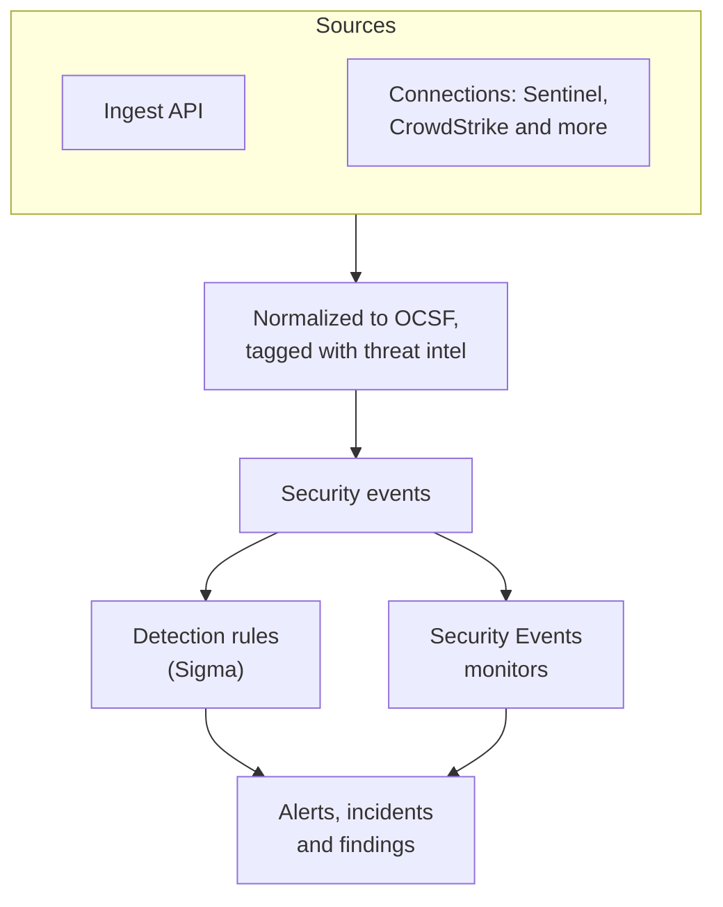
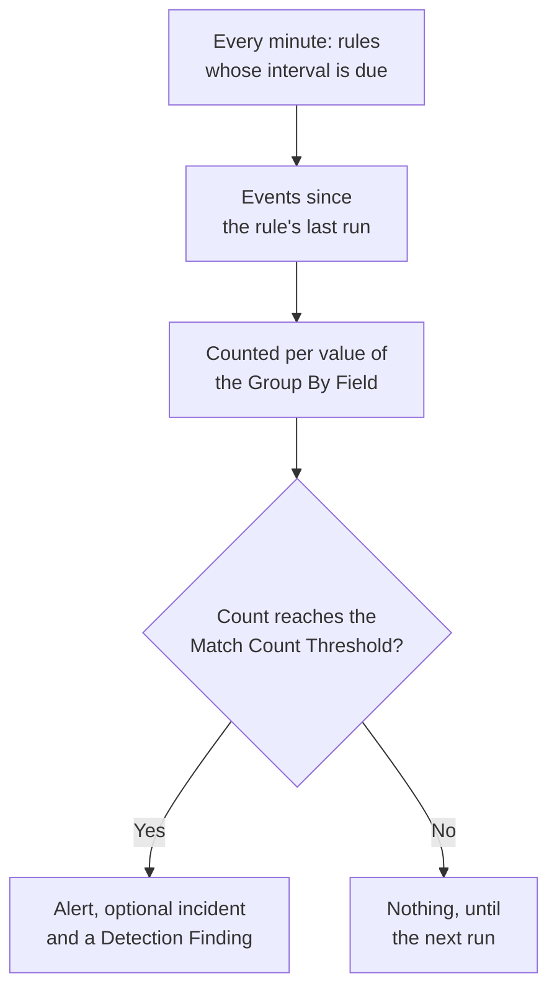

# Security Events (SIEM)

OneUptime keeps security events beside your logs, traces and metrics, and gives every one the same shape, [OCSF](https://schema.ocsf.io/) (the Open Cybersecurity Schema Framework), whatever format it arrived in. Send events from any source, search them, and turn the ones that matter into alerts with Sigma detection rules, threat intelligence and monitors.

:::cards
- [Send events](#send-security-events): An HTTPS POST, a Fluent Bit output, or a connection to a security product.
- [Search and correlate](#explore-security-events): The Events explorer and the Correlate graph.
- [Detection rules](#detection-rules): Sigma rules that open alerts.
- [Monitors](#security-events-monitors): Counts over a rolling window, with a status that recovers.
:::

## How it works



Open **Products → Security Events**, under **Observability**. Its tabs:

| Tab | What it is for |
| --- | --- |
| **Events** | Search and filter every event, and open one to see all its fields |
| **Correlate** | A graph of the events that share a host, a user or an IP address |
| **Detection Rules** | Sigma rules that run on a schedule and open alerts |
| **Threat Intel** | STIX/TAXII feeds of known-bad indicators |
| **Monitors** | The project's Security Events monitors |
| **Connections** | Security products that OneUptime polls for new records |
| **Setup Guide** | Snippets to send events, filled in with your ingestion key |

## Before you begin

Security data is read only by the Project Owner and Project Admin roles and by the three Security roles; other roles see nothing in Security Events. See [Roles](/docs/permissions/reference#roles).

| Role | What it can do |
| --- | --- |
| Security Admin | Everything: events, detection rules, threat intel feeds and connections |
| Security Member | Read events and threat intel, and create, change and delete detection rules and feeds. It can't set up connections or delete security data. |
| Security Viewer | Read events, rules, feeds, indicators and connections |

## Send security events

:::steps
### Create an ingestion key

Open **Project Settings → Telemetry & APM → Ingestion Keys** and click **Create Ingestion Key**. Security events use the same keys as the rest of your telemetry.

### Post your events

Send JSON to `/security-events/v1/ingest` with the key in `x-oneuptime-token`:

:::tabs
@tab OCSF
```bash
curl -X POST "https://oneuptime.com/security-events/v1/ingest?format=ocsf" \
  -H "Content-Type: application/json" \
  -H "x-oneuptime-token: YOUR_INGESTION_TOKEN" \
  -H "x-oneuptime-service-name: my-security-source" \
  -d '{ "events": [ { "class_uid": 3002, "severity_id": 4, "time": 1755770400000, "status": "Failure", "message": "Failed logon for alice", "actor": { "user": { "name": "alice" } }, "src_endpoint": { "ip": "203.0.113.7" } } ] }'
```
@tab Google UDM
```bash
curl -X POST "https://oneuptime.com/security-events/v1/ingest?format=udm" \
  -H "Content-Type: application/json" \
  -H "x-oneuptime-token: YOUR_INGESTION_TOKEN" \
  -d '{ "events": [ { "metadata": { "event_type": "USER_LOGIN", "event_timestamp": "2026-08-21T10:00:00Z" }, "principal": { "user": { "userid": "alice" }, "ip": ["203.0.113.7"] }, "security_result": [{ "severity": "HIGH", "action": ["BLOCK"] }] } ] }'
```
@tab Generic JSON
```bash
curl -X POST "https://oneuptime.com/security-events/v1/ingest" \
  -H "Content-Type: application/json" \
  -H "x-oneuptime-token: YOUR_INGESTION_TOKEN" \
  -d '{ "events": [ { "timestamp": "2026-08-21T10:00:00Z", "severity": "high", "event_type": "ssh_brute_force", "message": "12 failed SSH logins in 60s", "username": "root", "hostname": "web-01", "src_ip": "203.0.113.7" } ] }'
```
:::

The endpoint answers `200` once the events are queued.

### Find them in Events

Open **Products → Security Events → Events**. The events show within a few seconds, with their severity, class, user, host and IP addresses filled in.
:::

### Formats

| `format` | What it reads | Also accepted |
| --- | --- | --- |
| `ocsf` | OCSF event JSON (`class_uid`, `severity_id` and so on) | None |
| `udm` | Google SecOps (Chronicle) UDM events (`metadata.event_type` and so on) | `chronicle`, `google-secops` |
| `google-secops-alert` | Google SecOps detections and alerts: SOAR webhooks and the detections stream | `secops-alert`, `detection` |
| `generic` | Any other JSON, read by common field names | None |

Name the format with `?format=`, with the `x-oneuptime-security-event-format` header, or with a top-level `"format"` field. Leave it out, and each event's format is worked out on its own, so one webhook can mix detections with raw events.

- The body can be one event, an array of events, or `{ "events": [...] }`.
- The `x-oneuptime-service-name` header names the telemetry service the events belong to. Without it, they belong to the service named after the first event's product or vendor, or to `Security Events`.
- Nothing is dropped because it didn't map: every field of the source arrives in the event's attributes.

### Generic JSON fields

A generic event is read by common field names:

| Field of the event | Read from the first of |
| --- | --- |
| `message` | `message`, `msg`, `summary`, `description`, `title` |
| `severityName` | `severity`, `severity_name`, `level`, `priority`, `risk_level` |
| `time` | `timestamp`, `time`, `@timestamp`, `event_time`, `created_at` |
| `principalUser` | `user`, `username`, `user_name`, `account`, `actor` |
| `principalHost` | `host`, `hostname`, `computer`, `device`, `machine` |
| `principalIp` | `source_ip`, `src_ip`, `client_ip`, `ip` |
| `targetIp` | `destination_ip`, `dest_ip`, `dst_ip`, `target_ip` |
| `className` | `event_type`, `category`, `type`, `action` |
| `ruleName` | `rule`, `rule_name`, `signature`, `detection` |
| `productName` | `product`, `product_name`, `source`, `log_source` |

A severity word becomes an OCSF level: `info` reads as Informational, `warning` as Low, `error` as Medium, `alert` as Critical and `emergency` as Fatal.

### Forward with Fluent Bit

To send security logs you already collect, such as auditd, syslog or Falco, add an `http` output to Fluent Bit:

```ini title="fluent-bit.conf"
[OUTPUT]
    Name             http
    Match            security.*
    Host             oneuptime.com
    Port             443
    tls              On
    URI              /security-events/v1/ingest
    Format           json
    Json_date_key    timestamp
    Json_date_format iso8601
    Header           x-oneuptime-token YOUR_INGESTION_TOKEN
    Header           x-oneuptime-service-name my-security-source
    Retry_Limit      5
```

The **Setup Guide** tab has these snippets with your own host and key filled in.

### Connect a security product

**Connections** polls a security product for you and imports its new records as security events. A connection holds the product's settings and an encrypted credential; a worker polls it on the interval you set and skips records it already imported.

| Product | Imports | Setup guide |
| --- | --- | --- |
| Google SecOps (Chronicle) | Rule detections, curated detections and alerts, as Detection Findings | [Google SecOps](/docs/integrations/google-secops) |
| Microsoft Sentinel | Incidents, as Incident Findings | [Microsoft Sentinel](/docs/integrations/microsoft-sentinel) |
| Microsoft Defender XDR | Alerts, as Detection Findings | [Microsoft Defender XDR](/docs/integrations/microsoft-defender-xdr) |
| CrowdStrike Falcon | Alerts, as Detection Findings | [CrowdStrike Falcon](/docs/integrations/crowdstrike-falcon) |
| Splunk Enterprise Security | Notable events, or any search, as Detection Findings | [Splunk Enterprise Security](/docs/integrations/splunk) |
| Elastic Security | Detection alerts, as Detection Findings | [Elastic Security](/docs/integrations/elastic-security) |
| AWS Security Hub | Findings, as Detection and Compliance Findings | [AWS Security Hub](/docs/integrations/aws-security-hub) |
| Okta System Log | Sign-in, MFA, account and policy events | [Okta System Log](/docs/integrations/okta) |

- A connection reads records by the time the product created them, not by the time of the activity they describe. A SIEM rule that runs hourly creates detections long after the events it matched, and they are still imported.
- The first poll looks back 24 hours, so a new connection shows recent records at once.
- **Test connection**, in the connection's row, checks access to the product and that OneUptime's own workers are running, and imports nothing. **Run now** polls straight away.

## What an event holds

Every event is stored with typed fields and its source payload:

| Group | Fields |
| --- | --- |
| Classification | `categoryName`, `className`, `activityName`, `statusName`, with their OCSF ids (`categoryUid`, `classUid`) |
| Severity | `severityName`, one of Unknown, Informational, Low, Medium, High, Critical, Fatal or Other, and `severityId` |
| Who did it | `principalUser`, `principalHost`, `principalIp`, `principalProcess` |
| What it touched | `targetUser`, `targetHost`, `targetIp`, `targetPort`, `targetResource` |
| Source | `productName`, `vendorName`, `ruleId`, `ruleName`, `eventUid` |
| Content | `message`, `mitreTactics`, `mitreTechniques` and `observables`: every user, host, IP address, domain and hash taken from the event |
| Attributes | The whole source payload, flattened to dotted keys |

## Explore security events

**Events** is a telemetry explorer like the Logs and Traces explorers: a chart of the window's events by severity, a sidebar of facets, the list, and a panel with every field and attribute of the event you open. The window, the filters and the search all live in the URL, so a filtered view can be shared and survives a refresh.

### Search

The search bar speaks the same language as the other telemetry explorers (see [Search Syntax](/docs/telemetry/search-syntax)):

| Syntax | Means | Example |
| --- | --- | --- |
| free text | The message contains it | `failed logon` |
| `"quoted phrase"` | Keep the words together | `"brute force"` |
| `<field>:<value>` | A typed field | `severity:Critical` |
| `@<attribute>:<value>` | A source attribute | `@threat.matched:true` |
| `-<filter>` | Not this | `-severity:Informational` |
| `<field>:(a OR b)` | Any of these values | `severity:(High OR Critical)` |
| `<field>:a*` | `*` is any text, `?` one character | `host:web-*` |
| `@<attribute>:*` | The attribute is present | `@threat.indicator_id:*` |
| `@<attribute>:~text` | The attribute contains the text | `@finding_info.title:~ransom` |

A field is either a short name (`severity`, `class`, `category`, `activity`, `status`, `vendor`, `product`, `rule`, `user`, `host`, `ip`, `targetuser`, `targethost`, `targetip`, `observable`, `tactic`, `technique`) or the field's own name, such as `severityName` or `principalHost`. Any other name is read as a source attribute. `observable:<value>` finds every event that mentions a value, on whichever side of the activity it was.

### Facets

The sidebar counts the window's events by **Source**, **Severity**, **Event Class**, **Category**, **Activity**, **Status**, **Vendor**, **Product**, **Detection Rule**, **Principal User** and **Principal Host**. Click a value to keep only its events, or the minus beside it to leave them out. The chart and every count describe exactly the events in the list.

### Correlate

**Correlate** draws the events around a host, a user or an IP address: their event classes around what you searched, marked by their worst severity, and the other values seen in the same events on the outer ring. Click a class to list its events, or a value to correlate on it next. Every observable in an event's panel on **Events** opens **Correlate** on it.

## Detection rules

A detection rule is a [Sigma](https://sigmahq.io/) rule, an open YAML format for describing suspicious activity, that OneUptime runs on a schedule against your events. When it matches, it opens an alert, optionally an incident, and writes a Detection Finding back into the events.



### Create a rule

:::steps
1. Open **Products → Security Events → Detection Rules** and click **Create Detection Rule**.
2. In **Basic Info**, give it a **Name**, and keep **Enabled** on.
3. In **Sigma Rule**, paste the rule's YAML into **Sigma Rule (YAML)**. It is parsed when you save, so a mistake shows in the form.
4. In **Evaluation**, set how often it runs and how many matches it takes; see [Evaluation settings](#evaluation-settings).
5. In **On Match**, choose what a match does: **Create Alert on Match** (on), **Create Incident on Match** (off) and **Write Detection Finding on Match** (on), with an optional **Alert Severity** and **Incident Severity**.
:::

A first rule, which matches failed logons from outside `10.x.x.x`:

```yaml title="Sigma rule"
title: Failed logon burst
description: Repeated authentication failures from one source.
level: high
tags:
  - attack.t1110
  - attack.ta0006
detection:
  selection:
    className: Authentication
    statusName: Failure
  filter_internal:
    principalIp|startswith: '10.'
  condition: selection and not filter_internal
```

### What a rule can say

OneUptime runs the boolean core of Sigma:

- Selections are field maps (every field must match; a list of values matches any of them) or keyword lists, which match anywhere in the message.
- Conditions combine selections with `and`, `or`, `not` and parentheses, or with `1 of selection_*`, `all of selection_*`, `any of them` and `all of them`.
- Field modifiers: `contains`, `startswith`, `endswith`, `all`, `re`, `cased`, `gt`, `gte`, `lt`, `lte`, `cidr`, `exists` and `windash`. Text is compared ignoring case, unless you add `cased`.
- A field is a typed field (`principalUser`), a common Sigma spelling of one (`CommandLine`, `src_ip`, `Hostname`), or any attribute key, spelled as it is in the event (`threat.matched`).
- `level` sets the severity: `informational`, `low`, `medium`, `high` or `critical`, and `medium` when missing. ATT&CK ids in `tags` (`attack.t1110`, `attack.ta0006`) fill the finding's MITRE fields.

Aggregations such as `| count() by principalIp > 5` are refused when you save: use **Group By Field** and **Match Count Threshold** instead. `logsource` is informational only and narrows nothing: put that filter in a selection, such as `className: Authentication`. A `timeframe` is ignored, because the rule's interval sets its window.

### Evaluation settings

| Field | What it does |
| --- | --- |
| **Evaluation Interval (Minutes)** | How often the rule runs: whole minutes, 1 to 1440. A new rule's form starts at 5. |
| **Group By Field** | Optional. Matches that share this field's value, such as `principalHost`, are counted, alerted and deduplicated together: one alert per host instead of hundreds. |
| **Distinct Count Field** | Optional. Count the different values of this field instead of the matching events. Empty values are not counted. |
| **Match Count Threshold** | A group fires only when its count reaches this number within one run: 1 to 1000000, and 1 fires on any match. |

Group By and Distinct Count take the same field names as the rule. With them, the threshold says "this many, from the same thing, in one run", with no monitor on top:

| Goal | Group By Field | Distinct Count Field | Threshold |
| --- | --- | --- | --- |
| Alert on any match | Empty | Empty | 1 |
| One alert per host | `principalHost` | Empty | 1 |
| Brute force: 5 failed logons from one IP | `principalIp` | Empty | 5 |
| Password spraying: one IP failing against 5 different accounts | `principalIp` | `principalUser` | 5 |
| Port scan: one IP reaching 20 different ports | `principalIp` | `targetPort` | 20 |

### When a rule runs

OneUptime checks every minute for enabled rules whose interval has passed since their last run. Each run reads the events whose event time falls between the previous run and now, then moves on:

- Windows are back to back, not rolling. With a 10-minute interval, failures at 09:58 and 10:01 can land in different runs and are counted apart, so leave headroom when you choose a threshold.
- After a gap, such as a worker outage or a rule turned back on, the next run covers the whole gap, up to the last 24 hours.
- An event that arrives late, with a time from before the rule's last run, is stored and searchable, but that rule never reads it.
- At most 100 groups fire per run: the ones with the highest counts.

### Severity

A rule's `level` is the severity of its findings: `informational`, `low`, `medium`, `high` and `critical` become Informational, Low, Medium, High and Critical. Its alerts and incidents take one of your project's severities, in this order:

1. The rule's **Alert Severity** (or **Incident Severity**), when set.
2. Your severity named after the level, such as High, whatever its case.
3. By rank: `critical` and `high` rules take your most severe severity, the others your least severe.

> [!TIP]
> Name your alert severities after the Sigma levels (Critical, High, Medium, Low, Informational), and every rule lands on the right one without a setting per rule.

### Alerts and findings

Each firing group opens an alert titled `[Detection] <rule name> — <group value>`, or `[Detection] <rule name>` for a rule without a Group By Field. While it is open, more matches for that group don't open another. A rule only sees matches and can't tell that an attack has stopped, so its alerts stay open until someone resolves them.

A Detection Finding is a security event of class `Detection Finding` (OCSF class 2004) from the product `OneUptime Detections`, with the rule's MITRE tags, the group value first in `observables`, and these attributes:

| Attribute | Value |
| --- | --- |
| `oneuptime.detection.rule_id` | The id of the rule that fired |
| `oneuptime.detection.rule_name` | The rule's name |
| `oneuptime.detection.match_count` | How many events are behind the finding |
| `oneuptime.detection.distinct_count` | How many different values are behind it, for a rule with a Distinct Count Field |
| `oneuptime.detection.group_value` | The group's value, for a rule with a Group By Field |
| `oneuptime.detection.sigma_id` | The Sigma rule's own `id` |

Findings are ordinary events: search them in **Events** and pivot on them in **Correlate**. To try a new rule quietly, turn off every action but the finding until you trust it.

## Security Events monitors

A Security Events monitor counts the events that match its filters over a rolling window and runs the usual monitor criteria on the count: it changes the monitor's status, opens alerts or incidents, and pages on-call. Create one under **Monitors → Create Monitor**, with **Security Events** as the type; **Security Events → Monitors** lists them all.

Its form shows **Monitor events that include this text**, **Monitor Security Events for (time)**, **Event Severity** and **Event Class**. **Filter by Telemetry Service** and **Filter by Attributes** wait under **More fields**, whose header shows the ones a monitor uses. Its criteria check **Security Event Count**.

| | Detection rule | Security Events monitor |
| --- | --- | --- |
| Matches | A Sigma rule | Filters on severity, class, message, service and attributes |
| Window | Back to back, one per run | Rolling: the last 5 seconds to 24 hours |
| Counts per group | Yes, with **Group By Field** | No: one count for everything that matches |
| Opens | Alerts, incidents and findings | A status, alerts and incidents |
| Recovers | No: alerts stay open until resolved | Yes: the status returns when the count does |

Write the detection itself as a rule, with its threshold. Use a monitor when you want a rolling window, a status that recovers on its own, a status page, or different on-call policies per criteria.

### Watch your detections

Findings are events, so a monitor can watch the rules themselves:

- Storms: a monitor on the `Detection Finding` class, counting every finding. Twenty different rules firing in an hour is a signal no single rule can see.
- Rate changes: filter on one rule's `oneuptime.detection.rule_id`. A rule that fires weekly firing fifty times an hour needs a different response.
- Silence: findings falling to zero, when you normally see a few, usually means a source stopped sending. Use a criteria that checks for a count below a number.

The **Create Monitor** action in a rule's row opens a new monitor already set up this way: the `Detection Finding` class, the rule's id (never its name, which a rename would change), and the last hour. Such a monitor counts findings, one per group per run, not the events behind them. To need a number of events before anything fires, use the rule's **Match Count Threshold**.

## Threat intelligence

**Threat Intel** subscribes STIX/TAXII feeds of known-bad IP addresses, domains, URLs, email addresses and file hashes. Events that mention one are tagged with `threat.*` attributes as they arrive, which rules and monitors can filter on, and every minute recent events are matched against the feeds, opening alerts and findings like a rule does. See [Threat Intelligence](/docs/telemetry/threat-intelligence).

## Retention and billing

Security events are billed per GB ingested, like the rest of your telemetry, and kept for your telemetry retention: the project's **Default Retention (Days)**, under **Project Settings → Telemetry & APM → Data Retention**, or a retention set on the telemetry service they belong to. When an event's retention ends, it is deleted.

## Troubleshooting

:::details Events don't appear
Check the key in `x-oneuptime-token` and the path, `/security-events/v1/ingest`. Then check the window in **Events**, the past day unless you change it: an event is placed at its own time, so one with an older timestamp falls outside it.
:::

:::details A rule never matches
Check that it is **Enabled**, and read **Last Evaluated** and **Last Error** in its row. Open an event you expected to match and compare it with the rule, field by field: a plain value must equal the whole field, so use `contains` or `*` for part of one. An attribute is named as it is in the event (`threat.matched`, not `attributes.threat.matched`). With a threshold above 1, the matches must fall in one run.
:::

:::details A rule matched, but no alert opened
**Create Alert on Match** is off, or an alert for the same rule and group value is still open, and later matches are folded into it. A project needs at least one alert severity for rules to open alerts.
:::

:::details A rule opens too many alerts
Each value of the **Group By Field** gets its own alert: group by something coarser, raise the threshold, or add a Distinct Count Field. To care about the rate rather than each match, turn **Create Alert on Match** off and put a monitor on the rule's findings.
:::

## Next steps

:::cards
- [Threat Intelligence](/docs/telemetry/threat-intelligence): Match your events against STIX/TAXII feeds.
- [Google SecOps](/docs/integrations/google-secops): Bring Chronicle's detections and events in.
- [Search Syntax](/docs/telemetry/search-syntax): Everything the search bar understands.
- [Permission Reference](/docs/permissions/reference): The Security roles, and what each can do.
:::
