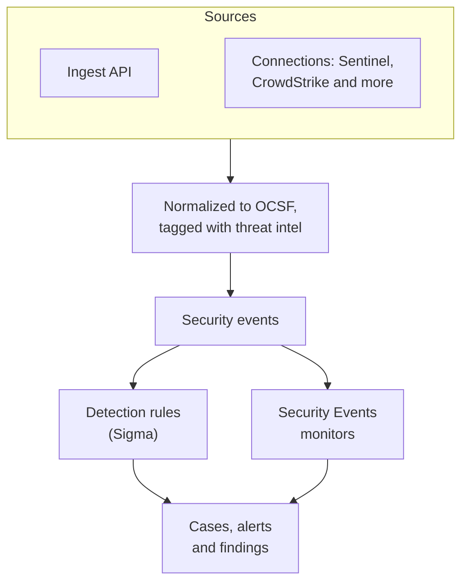
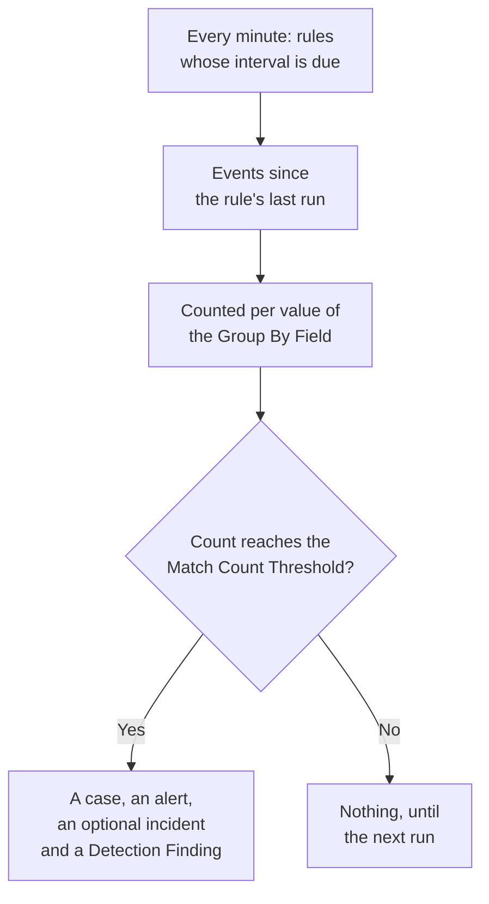

# Security Events (SIEM)

OneUptime keeps security events beside your logs, traces and metrics, and gives every one the same shape, [OCSF](https://schema.ocsf.io/) (the Open Cybersecurity Schema Framework), whatever format it arrived in. Send events from any source, search them, and find the ones that matter with Sigma detection rules, threat intelligence and monitors. What they find becomes [cases](/docs/telemetry/security-cases) to work, and playbooks respond to them.

:::cards
- [Send events](#send-security-events): An HTTPS POST, a Fluent Bit output, or a connection to a security product.
- [Search and correlate](#explore-security-events): The Events explorer and the Correlate graph.
- [Hunts](#hunts): Saved searches that run on a schedule and tell people when they find something.
- [Detection rules](#detection-rules): Sigma rules that open cases and alerts.
- [Monitors](#security-events-monitors): Counts over a rolling window, with a status that recovers.
:::

## How it works



Open **Products → Security Events**, under **Observability**. Its menu has a section for each part of Security, and a page of its own for each thing in it:

| Page | Section | What it is for |
| --- | --- | --- |
| **Overview** | Overview | How Security is set up, what needs someone now, and how fast cases are handled |
| **Open Cases** | Security Cases | The queue: every case not closed yet, grouped by what it is about |
| **Assigned to Me** | Security Cases | The open cases assigned to you |
| **Unassigned** | Security Cases | The open cases nobody has picked up |
| **Closed Cases** | Security Cases | The cases closed with a verdict, the latest first |
| **All Cases** | Security Cases | Every case, open or closed |
| **Events** | Events | Search and filter every event, and open one to see all its fields |
| **Hunts** | Events | Searches saved from Events, opened again in one click or run on a schedule that tells people when they find something |
| **Campaigns** | Events | Every address that sent attack requests, and whether any of its requests got through |
| **Entity Risk** | Events | Every user, host and address scored by what was found about it this week, the riskiest first |
| **Correlate** | Events | A graph of the events that share a host, a user or an IP address |
| **Detection Rules** | Detections | Sigma rules that run on a schedule and open cases |
| **Rule Exceptions** | Detections | What your rules skip on purpose, such as a scanner or a planned test, each with who added it and why |
| **Watchlists** | Detections | The lists your rules match against, such as VIP users, critical hosts, known-bad file hashes and the addresses admins may sign in from |
| **Rule Library** | Detections | Ready-made detection rules to add, each with the events it reads and whether they arrive, the recommended ones marked |
| **Threat Intel** | Detections | STIX/TAXII feeds of known-bad indicators |
| **ATT&CK Coverage** | Detections | The MITRE ATT&CK techniques your rules cover |
| **Playbooks** | Playbooks | Steps that run on cases, by themselves or by hand |
| **Approvals** | Playbooks | The playbook steps waiting for someone to approve or reject them |
| **Playbook Runs** | Playbooks | What each playbook did, step by step |
| **Protected Entities** | Playbooks | The users and hosts no playbook contains |
| **Settings** | AI | Whether OneUptime AI triages each new case |
| **Connections** | Connections | Your logs, the security products OneUptime polls, and the SIEMs it sends to |
| **Setup Guide** | Connections | Snippets to send events, filled in with your ingestion key |
| **Case Priorities** | Settings | How urgent a case is: the project's own priorities, most urgent first |
| **Response Targets** | Settings | How fast a case at each priority must be taken on and contained |
| **Case Statuses** | Settings | The steps a case moves through, and what a case in each counts as |
| **Risk Scoring** | Settings | Whether an entity's risk opens a case, at what risk, and how much each entity matters |

**Detections**, **AI**, **Connections** and **Settings**, set up once, stay folded until you open them. New to Security? [Get Started with Security](/docs/telemetry/security-getting-started) sets it up in two clicks.

## Before you begin

Security data is read only by the Project Owner and Project Admin roles and by the three Security roles; other roles see nothing in Security Events. See [Roles](/docs/permissions/reference#roles).

| Role | What it can do |
| --- | --- |
| Security Admin | Everything: events, cases, playbooks, detection rules, threat intel feeds and connections |
| Security Member | Read events and threat intel, work cases, run playbooks and approve their steps, and create, change and delete detection rules and feeds. It can't set up playbooks or connections, or delete security data. |
| Security Viewer | Read events, cases, playbooks, rules, feeds, indicators and connections |

## Send security events

:::steps
### Create an ingestion key

Open **Project Settings → Telemetry & APM → Ingestion Keys** and click **Create Ingestion Key**. Security events use the same keys as the rest of your telemetry.

### Post your events

Send JSON to `/security-events/v1/ingest` with the key in `x-oneuptime-token`:

:::tabs
@tab OCSF
```bash
curl -X POST "https://oneuptime.com/security-events/v1/ingest?format=ocsf" \
  -H "Content-Type: application/json" \
  -H "x-oneuptime-token: YOUR_INGESTION_TOKEN" \
  -H "x-oneuptime-service-name: my-security-source" \
  -d '{ "events": [ { "class_uid": 3002, "severity_id": 4, "status": "Failure", "message": "Failed logon for alice", "actor": { "user": { "name": "alice" } }, "src_endpoint": { "ip": "203.0.113.7", "hostname": "laptop-alice" } } ] }'
```
@tab Google UDM
```bash
curl -X POST "https://oneuptime.com/security-events/v1/ingest?format=udm" \
  -H "Content-Type: application/json" \
  -H "x-oneuptime-token: YOUR_INGESTION_TOKEN" \
  -d '{ "events": [ { "metadata": { "event_type": "USER_LOGIN" }, "principal": { "hostname": "laptop-alice", "user": { "userid": "alice" }, "ip": ["203.0.113.7"] }, "security_result": [{ "severity": "HIGH", "action": ["BLOCK"] }] } ] }'
```
@tab Generic JSON
```bash
curl -X POST "https://oneuptime.com/security-events/v1/ingest" \
  -H "Content-Type: application/json" \
  -H "x-oneuptime-token: YOUR_INGESTION_TOKEN" \
  -d '{ "events": [ { "severity": "high", "event_type": "ssh_brute_force", "message": "12 failed SSH logins in 60s", "username": "root", "hostname": "web-01", "src_ip": "203.0.113.7" } ] }'
```
:::

The endpoint answers `200` once the events are queued. An event sent without a time, like these, is placed at the moment it arrives.

### Find them in Events

Open **Products → Security Events → Events**. The events show within a few seconds, with their severity, class, user, host and IP addresses filled in.
:::

### Formats

| `format` | What it reads | Also accepted |
| --- | --- | --- |
| `ocsf` | OCSF event JSON (`class_uid`, `severity_id` and so on) | None |
| `udm` | Google SecOps (Chronicle) UDM events (`metadata.event_type` and so on) | `chronicle`, `google-secops` |
| `google-secops-alert` | Google SecOps detections and alerts: SOAR webhooks and the detections stream | `secops-alert`, `detection` |
| `generic` | Any other JSON, read by common field names | None |

Name the format with `?format=`, with the `x-oneuptime-security-event-format` header, or with a top-level `"format"` field. Leave it out, and each event's format is worked out on its own, so one webhook can mix detections with raw events.

- The body can be one event, an array of events, or `{ "events": [...] }`.
- The `x-oneuptime-service-name` header names the telemetry service the events belong to. Without it, they belong to the service named after the first event's product or vendor, or to `Security Events`.
- Nothing is dropped because it didn't map: every field of the source arrives in the event's attributes.

### Generic JSON fields

A generic event is read by common field names:

| Field of the event | Read from the first of |
| --- | --- |
| `message` | `message`, `msg`, `summary`, `description`, `title` |
| `severityName` | `severity`, `severity_name`, `level`, `priority`, `risk_level` |
| `time` | `timestamp`, `time`, `@timestamp`, `event_time`, `created_at` |
| `principalUser` | `user`, `username`, `user_name`, `account`, `actor` |
| `principalHost` | `host`, `hostname`, `computer`, `device`, `machine` |
| `principalIp` | `source_ip`, `src_ip`, `client_ip`, `ip` |
| `targetIp` | `destination_ip`, `dest_ip`, `dst_ip`, `target_ip` |
| `className` | `event_type`, `category`, `type`, `action` |
| `ruleName` | `rule`, `rule_name`, `signature`, `detection` |
| `productName` | `product`, `product_name`, `source`, `log_source` |
| `processName` | `process_name`, `process.name`, `proc.name`, `comm` |
| `processPath` | `process_path`, `Image`, `NewProcessName`, `exe`, `process.executable` |
| `processCommandLine` | `command_line`, `CommandLine`, `cmdline`, `process.command_line`, `proc.cmdline`, `process` |
| `parentProcessName` | `parent_process_name`, `process.parent.name`, `proc.pname` |
| `parentProcessPath` | `parent_process_path`, `ParentImage`, `ParentProcessName`, `process.parent.executable` |
| `parentProcessCommandLine` | `parent_command_line`, `ParentCommandLine`, `process.parent.command_line`, `proc.pcmdline` |

A severity word becomes an OCSF level: `info` reads as Informational, `warning` as Low, `error` as Medium, `alert` as Critical and `emergency` as Fatal.

### Forward with Fluent Bit

To send security logs you already collect, such as auditd, syslog or Falco, add an `http` output to Fluent Bit:

```ini title="fluent-bit.conf"
[OUTPUT]
    Name             http
    Match            security.*
    Host             oneuptime.com
    Port             443
    tls              On
    URI              /security-events/v1/ingest
    Format           json
    Json_date_key    timestamp
    Json_date_format iso8601
    Header           x-oneuptime-token YOUR_INGESTION_TOKEN
    Header           x-oneuptime-service-name my-security-source
    Retry_Limit      5
```

The **Setup Guide** page, under **Connections**, has these snippets with your own host and key filled in.

### Find security events in your logs

**Your logs**, at the top of **Connections**, turns the logs you already send OneUptime into a source. With **Find security events in your logs** on, the project's new logs are read every minute, and each SSH or Windows sign-in, sudo command, cloud audit record, security product's CEF or LEEF record, Kubernetes audit record and web attack in them is stored as a security event. See [Get Started with Security](/docs/telemetry/security-getting-started#find-security-events-in-your-logs) for what each kind covers.

Each kind reaches OneUptime as ordinary logs:

| Kind | Send it from |
| --- | --- |
| SSH sign-ins, sudo | A Linux machine's journal or auth log, with the [OpenTelemetry Collector](/docs/telemetry/host-otel-collector) |
| Windows events | The collector's `windowseventlog` receiver on the machine, or a forwarder that writes each event as JSON, such as NXLog or Winlogbeat |
| AWS CloudTrail | A trail delivered to CloudWatch Logs, read by the collector's `awscloudwatch` receiver |
| Google Cloud audit logs | A log sink to Pub/Sub, read by the collector's `googlecloudpubsub` receiver with `encoding: raw_text` |
| Azure activity and Entra ID logs | A diagnostic setting that streams to an Event Hub, read by the collector's `azureeventhub` receiver with `format: raw` |
| CEF, LEEF | The product's syslog, relayed by [rsyslog](/docs/telemetry/syslog) |
| Kubernetes audit logs | The API server's audit log file, read by the collector's `filelog` receiver |
| Web attacks | A web server's access log, read by the collector's `filelog` receiver |

On **Your logs**, each kind says when it was last found, and **Check a log line** shows what a line you paste becomes, before any arrives.

### Connect a security product

**Connections** polls a security product for you and imports its new records as security events. A connection holds the product's settings and an encrypted credential; a worker polls it on the interval you set and skips records it already imported.

| Product | Imports | Setup guide |
| --- | --- | --- |
| Google SecOps (Chronicle) | Rule detections, curated detections and alerts, as Detection Findings | [Google SecOps](/docs/integrations/google-secops) |
| Microsoft Sentinel | Incidents, as Incident Findings | [Microsoft Sentinel](/docs/integrations/microsoft-sentinel) |
| Microsoft Defender XDR | Alerts, as Detection Findings | [Microsoft Defender XDR](/docs/integrations/microsoft-defender-xdr) |
| CrowdStrike Falcon | Alerts, as Detection Findings | [CrowdStrike Falcon](/docs/integrations/crowdstrike-falcon) |
| Splunk Enterprise Security | Notable events, or any search, as Detection Findings | [Splunk Enterprise Security](/docs/integrations/splunk) |
| Elastic Security | Detection alerts, as Detection Findings | [Elastic Security](/docs/integrations/elastic-security) |
| AWS Security Hub | Findings, as Detection and Compliance Findings | [AWS Security Hub](/docs/integrations/aws-security-hub) |
| Okta System Log | Sign-in, MFA, account and policy events | [Okta System Log](/docs/integrations/okta) |
| Microsoft Entra ID | Sign-ins and directory changes, and the Microsoft 365 audit log's mail forwarding, sharing and phishing verdicts | [Microsoft Entra ID](/docs/integrations/microsoft-entra-id) |
| Google Workspace | Sign-ins, Google's own findings, admin changes and app grants, and Drive sharing | [Google Workspace](/docs/integrations/google-workspace) |

- The product's own alerts at or above **Open Cases From** (**High and above** unless you choose another level, or **Never**) open [cases](/docs/telemetry/security-cases), grouped by the user, host or address they are about.
- A connection reads records by the time the product created them, not by the time of the activity they describe. A SIEM rule that runs hourly creates detections long after the events it matched, and they are still imported.
- The first poll looks back 24 hours, so a new connection shows recent records at once.
- **Test connection**, in the connection's row, checks access to the product and that OneUptime's own workers are running, and imports nothing. **Run now** polls straight away.

## What an event holds

Every event is stored with typed fields and its source payload:

| Group | Fields |
| --- | --- |
| Classification | `categoryName`, `className`, `activityName`, `statusName`, with their OCSF ids (`categoryUid`, `classUid`) |
| Severity | `severityName`, one of Unknown, Informational, Low, Medium, High, Critical, Fatal or Other, and `severityId` |
| Who did it | `principalUser`, `principalHost`, `principalIp`, `principalProcess` |
| What it touched | `targetUser`, `targetHost`, `targetIp`, `targetPort`, `targetResource` |
| The process | `processName`, `processPath` and `processCommandLine`: in a process activity the process launched, opened, injected into or ended, otherwise the process that acted. `parentProcessName`, `parentProcessPath` and `parentProcessCommandLine`: the process that started it |
| Source | `productName`, `vendorName`, `ruleId`, `ruleName`, `eventUid` |
| Content | `message`, `mitreTactics`, `mitreTechniques` and `observables`: every user, host, IP address, domain and hash taken from the event |
| Attributes | The whole source payload, flattened to dotted keys |

Events stored before OneUptime 14.0.84 leave the process fields empty and name their process only as `principalProcess`, the process that acted. They are not filled in afterwards: they keep what they were stored with until their retention ends.

## Explore security events

**Events** is a telemetry explorer like the Logs and Traces explorers: a chart of the window's events by severity, a sidebar of facets, the list, and a panel with every field and attribute of the event you open. The window, the filters and the search all live in the URL, so a filtered view can be shared and survives a refresh.

### Search

The search bar speaks the same language as the other telemetry explorers (see [Search Syntax](/docs/telemetry/search-syntax)):

| Syntax | Means | Example |
| --- | --- | --- |
| free text | The message contains it | `failed logon` |
| `"quoted phrase"` | Keep the words together | `"brute force"` |
| `<field>:<value>` | A typed field | `severity:Critical` |
| `@<attribute>:<value>` | A source attribute | `@threat.matched:true` |
| `-<filter>` | Not this | `-severity:Informational` |
| `<field>:(a OR b)` | Any of these values | `severity:(High OR Critical)` |
| `<field>:a*` | `*` is any text, `?` one character | `host:web-*` |
| `@<attribute>:*` | The attribute is present | `@threat.indicator_id:*` |
| `@<attribute>:~text` | The attribute contains the text | `@finding_info.title:~ransom` |

A field is either a short name (`severity`, `class`, `category`, `activity`, `status`, `vendor`, `product`, `rule`, `user`, `host`, `ip`, `targetuser`, `targethost`, `targetip`, `processname`, `commandline`, `parentprocessname`, `observable`, `tactic`, `technique`, `requestoutcome`, `trace`, `session`) or the field's own name, such as `severityName` or `principalHost`. Any other name is read as a source attribute. `observable:<value>` finds every event that mentions a value, on whichever side of the activity it was.

### Facets

The sidebar counts the window's events by **Source**, **Severity**, **Request Outcome**, **Event Class**, **Category**, **Activity**, **Status**, **Vendor**, **Product**, **Detection Rule**, **Principal User**, **Principal Host**, **Process** and **Parent Process**. Click a value to keep only its events, or the minus beside it to leave them out. Click it again to undo. The chart and every count describe exactly the events in the list.

### What happened next

An event read from a log line written inside a traced request is followed into that request. Its panel says how far the request got (**Rejected**, **Reached App**, **Errored** or **Reached Database**), who sent it, and links to its trace, its exception, its session replay and the log line itself. A log line, a trace and an exception that are part of an attack say so on their own pages too.

### Campaigns

**Campaigns** lists every address that sent attack requests as one row, with the kinds of attack, the tools and the requests it sent, and how many got through. The ones whose requests reached your app come first.

### Correlate

**Correlate** draws the events around a host, a user or an IP address: their event classes around what you searched, marked by their worst severity, and the other values seen in the same events on the outer ring. Click a class to list its events, or a value to correlate on it next. Every observable in an event's panel on **Events** opens **Correlate** on it.

## Hunts

A hunt is a search over your security events kept with a name: the search bar's text, the sidebar's filters, and how far back it looks. Open it again in one click, run it on a schedule that tells people when it finds something, and keep the events it finds on a case.

### Save a search as a hunt

On **Events**, search and filter until the list shows what you are after, then open **Hunts** on the toolbar and choose **Save as Hunt**. Name it, choose whether it runs on a schedule, and its page opens. **Events → Hunts** lists the project's hunts, each with its search, how often it runs, who it tells and what its last run found; **Create Hunt** there takes the search as you would type it on **Events**. A project keeps up to 200 hunts.

A hunt's page is its search, opened on the Events explorer. Change the search or the filters there, and the hunt's header offers **Save Changes** and **Discard Changes**. **Edit** changes its name, its search, how far back it looks, its schedule and who it tells, and **Delete Hunt** is in its menu. A Security Member or higher can save, change and delete hunts, and a Security Viewer can open them.

### Run a hunt on a schedule

| Schedule | Runs |
| --- | --- |
| **Not Scheduled** | Only when you open it |
| **Every Hour**, **Every 6 Hours**, **Every Day**, **Every Week** | On its own, that often |

A scheduled hunt tells the people and teams you choose under **Notify**: at least one, and at most 50 in all. Each run:

- reads the events whose time falls after the run before, up to two minutes ago, so every event is searched once. The first run reads from when the schedule was set or the search last changed, and after an outage a run catches up on at most a day more than its interval.
- counts the events its search finds there, exactly as **Events** would list them, reading only what the person it runs as can read.
- when it finds events, tells the people the hunt names, and the members of the teams it names, who can read hunts and security events.

A run opens no case and raises no alert: write what should open cases as a [detection rule](#detection-rules). A run whose search takes too long, or that cannot read the events, says why on the hunt and is tried again within the hour, from where it stopped.

A scheduled hunt runs as the person who last set its schedule, changed its search or saved it with **Edit**. An API key cannot set a schedule. When that person leaves the project or can no longer read security events, the hunt says so: open **Edit** and save it to run it as you.

### Who is told

The notification **Hunt found security events** names the hunt and its search, how many events its run found and the window it read, and links to the hunt's page on those events; no event's own words are in it. Everyone has it by email and push, and chooses its channels under **User Settings → Notification Settings**. Like other routine emails, it can be held back in an [email rollup](/docs/emails/notification-rollup).

### Keep events on a case

Select events on **Events** or on a hunt's page and choose **Bulk Actions → Add to Case**, or open one event and choose **Add to Case**. Pick an open case by its number or title. Up to 100 events go at a time.

OneUptime reads each event again as you and keeps it on the case's **Evidence** page as it was, so the case still shows it after the event's retention ends. An event you cannot read is not kept, and one the case keeps already is left as it is. An event found from a hunt names the hunt, and **View Event** opens it as it was kept.

Hunts have the same REST API as the rest of OneUptime, under `/security-hunt`, and `POST /security-case-evidence/add-events` keeps events on a case. See [API Reference](/docs/api-reference/api-reference).

## Detection rules

A detection rule is a [Sigma](https://sigmahq.io/) rule, an open YAML format for describing suspicious activity, that OneUptime runs on a schedule against your events, or on each event as it arrives. When it matches, it opens or joins a [case](/docs/telemetry/security-cases), opens an alert, optionally an incident, and writes a Detection Finding back into the events. The **Rule Library** has ready-made rules to start from.



### Create a rule

:::steps
1. Open **Products → Security Events → Detections → Detection Rules** and click **Create Detection Rule**.
2. In **Sigma Rule**, paste the rule's YAML into **Sigma Rule (YAML)**. It is parsed when you save, so a mistake shows in the form.
3. The **Name** fills in from the rule's `title`: type over it to call the rule something else. A new rule runs; **Enabled** is on its edit form.
4. In **On Match**, keep **Open a Case on Match** on to group its matches into cases, by the value the rule groups by.
5. Under **Alerts and Incidents**, choose what else a match raises: **Create an alert** (the default), **Declare an incident**, **Both** or **Neither**, with an optional **Alert Severity** or **Incident Severity**.
6. **More fields** holds the **Description**, **Write Detection Finding on Match** (on), **Run in Real Time** (off) and how matches are counted; see [Evaluation settings](#evaluation-settings).
:::

A first rule, which matches failed logons from outside `10.x.x.x`:

```yaml title="failed-logon-burst.yml"
title: Failed logon burst
description: Repeated authentication failures from one source.
level: high
tags:
  - attack.t1110
  - attack.ta0006
detection:
  selection:
    className: Authentication
    statusName: Failure
  filter_internal:
    principalIp|startswith: '10.'
  condition: selection and not filter_internal
```

### What a rule can say

OneUptime runs the boolean core of Sigma:

- Selections are field maps (every field must match; a list of values matches any of them) or keyword lists, which match anywhere in the message.
- Conditions combine selections with `and`, `or`, `not` and parentheses, or with `1 of selection_*`, `all of selection_*`, `any of them` and `all of them`.
- Field modifiers: `contains`, `startswith`, `endswith`, `all`, `re`, `cased`, `gt`, `gte`, `lt`, `lte`, `cidr`, `exists`, `windash` and `expand`, which reads a [watchlist](#watchlists). Text is compared ignoring case, unless you add `cased`.
- A field is a typed field (`principalUser`), a common Sigma spelling of one (`CommandLine`, `src_ip`, `Hostname`), or any attribute key, spelled as it is in the event (`threat.matched`).
- `Image` and `CommandLine` read the process the event is about, the one that started in a process launch (`processPath`, `processCommandLine`), and `ParentImage` and `ParentCommandLine` the process that started it (`parentProcessPath`, `parentProcessCommandLine`). `principalProcess` is the process that acted, which in a launch is the parent.
- `level` sets the severity: `informational`, `low`, `medium`, `high` or `critical`, and `medium` when missing. ATT&CK ids in `tags` (`attack.t1110`, `attack.ta0006`) fill the finding's MITRE fields.

Aggregations such as `| count() by principalIp > 5` are refused when you save: use a [correlation rule](#correlation-rules), or **Group By Field** and **Match Count Threshold**, instead. `logsource` is informational only and narrows nothing: put that filter in a selection, such as `className: Authentication`. A `timeframe` is ignored, because the rule's interval sets its window.

### Correlation rules

A [Sigma correlation](https://sigmahq.io/docs/meta/correlations.html) fires on several events together rather than one. Paste it into **Sigma Rule (YAML)** with the rules it reads, as YAML documents separated by `---`, or name rules the project already has by their Sigma `name` or `id`. The **Rule Library** has ready-made ones, such as failed sign-ins followed by a success.

| Type | Fires when | Shown as |
| --- | --- | --- |
| `event_count` | One group reaches a number of events within the `timespan` | Event count |
| `value_count` | One group shows a number of different values of a field within the `timespan` | Distinct values |
| `temporal` | Every rule matches for the same group within the `timespan`, in any order | Events together |
| `temporal_ordered` | The rules match in their order for the same group within the `timespan` | Sequence |
| `new_value` | A group shows a value of a field it has not shown within the `timespan` | First seen |

```yaml title="failed-then-success.yml"
title: Failed sign-ins, then a success from the same address
level: high
correlation:
  type: temporal_ordered
  rules:
    - failed_sign_ins
    - successful_sign_in
  group-by:
    - principalIp
  timespan: 10m
---
title: Five failed sign-ins
name: failed_sign_ins
correlation:
  type: event_count
  rules:
    - failed_sign_in
  group-by:
    - principalIp
  timespan: 10m
  condition:
    gte: 5
---
title: Failed sign-in
name: failed_sign_in
detection:
  selection:
    className: Authentication
    statusName: Failure
  condition: selection
---
title: Successful sign-in
name: successful_sign_in
detection:
  selection:
    className: Authentication
    statusName: Success
  condition: selection
```

- A group is the value of the `group-by` fields, such as one address. Counts are rolling: a burst that two runs split is still counted whole within its `timespan`, which is at most 24 hours.
- `new_value` is OneUptime's own type, since Sigma has no "first seen" correlation: it compares with up to 30 days of history. `value_sum`, `value_avg`, `value_percentile` and `value_median` are refused when you save.
- The **Type** column of **Detection Rules** names each rule's kind, and the form says in a sentence what the rule looks for.

### Evaluation settings

| Field | What it does |
| --- | --- |
| **Evaluation Interval (Minutes)** | How often the rule runs: whole minutes, 1 to 1440. A new rule's form starts at 5. |
| **Run in Real Time** | Off on a new rule. On, the rule checks each event as it arrives instead of every interval; see [Real-time rules](#real-time-rules). |
| **Group By Field** | Optional. Matches that share this field's value, such as `principalHost`, are counted, alerted and deduplicated together: one alert per host instead of hundreds. |
| **Distinct Count Field** | Optional. Count the different values of this field instead of the matching events. Empty values are not counted. |
| **Match Count Threshold** | A group fires only when its count reaches this number within one run: 1 to 1000000, and 1 fires on any match. |

Group By and Distinct Count take the same field names as the rule. With them, the threshold says "this many, from the same thing, in one run", with no monitor on top:

| Goal | Group By Field | Distinct Count Field | Threshold |
| --- | --- | --- | --- |
| Alert on any match | Empty | Empty | 1 |
| One alert per host | `principalHost` | Empty | 1 |
| Brute force: 5 failed logons from one IP | `principalIp` | Empty | 5 |
| Password spraying: one IP failing against 5 different accounts | `principalIp` | `principalUser` | 5 |
| Port scan: one IP reaching 20 different ports | `principalIp` | `targetPort` | 20 |

### When a rule runs

OneUptime checks every minute for enabled rules whose interval has passed since their last run. Each run reads the events whose event time falls between the previous run and two minutes ago, then moves on. The two minutes leave room for events still on their way, such as a log line read a minute after it was written:

- Windows are back to back, not rolling. With a 10-minute interval, failures at 09:58 and 10:01 can land in different runs and are counted apart, so leave headroom when you choose a threshold.
- After a gap, such as a worker outage or a rule turned back on, the next run covers the whole gap, up to the last 24 hours.
- An event that arrives more than two minutes late, once a run has covered its time, is stored and searchable, but that rule never reads it.
- Every group that reaches the threshold becomes a Detection Finding, up to 10,000 a run. Alerts, incidents and cases open for the 100 with the highest counts; the rest share one case about the rule, and the rule's **Last Error** says how many groups matched.

### Real-time rules

A rule that fires on one event can run in real time instead of on its interval: turn on **Run in Real Time**, under **More fields** on the **On Match** step. Every event OneUptime receives, from every source, is then checked against the rule as it arrives, and a match opens its case, alert and finding within seconds.

- It fits a rule with a **Match Count Threshold** of 1, no **Distinct Count Field** and no `re` modifier. A correlation counts events together, so it runs on its interval. The form says what to change when a rule does not fit.
- A project runs at most 50 rules in real time, since every event is checked against each.
- In **Detection Rules**, a real-time rule's **Status** says **Real time**, and so does its interval column. A check that fails shows in its **Last Error**, as a run's does.
- Turned on, the rule first reads what arrived since its last run, so nothing falls between its schedule and real time. Turned off, it goes back to its interval, from two minutes before.
- Exceptions and watchlists apply to it as to any rule, and **Run on Past Events** reads it like any other.

### Severity

A rule's `level` is the severity of its findings: `informational`, `low`, `medium`, `high` and `critical` become Informational, Low, Medium, High and Critical. Its alerts and incidents take one of your project's severities, in this order:

1. The rule's **Alert Severity** (or **Incident Severity**), when set.
2. Your severity named after the level, such as High, whatever its case.
3. By rank: `critical` and `high` rules take your most severe severity, the others your least severe.

> [!TIP]
> Name your alert severities after the Sigma levels (Critical, High, Medium, Low, Informational), and every rule lands on the right one without a setting per rule.

### Alerts and findings

Each firing group opens an alert titled `[Detection] <rule name> — <group value>`, or `[Detection] <rule name>` for a rule without a Group By Field. While it is open, more matches for that group don't open another. A rule only sees matches and can't tell that an attack has stopped, so its alerts stay open until someone resolves them.

A Detection Finding is a security event of class `Detection Finding` (OCSF class 2004) from the product `OneUptime Detections`, with the rule's MITRE tags, the group value first in `observables`, and these attributes:

| Attribute | Value |
| --- | --- |
| `oneuptime.detection.rule_id` | The id of the rule that fired |
| `oneuptime.detection.rule_name` | The rule's name |
| `oneuptime.detection.match_count` | How many events are behind the finding |
| `oneuptime.detection.distinct_count` | How many different values are behind it, for a rule with a Distinct Count Field |
| `oneuptime.detection.group_value` | The group's value, for a rule with a Group By Field |
| `oneuptime.detection.sigma_id` | The Sigma rule's own `id` |

Findings are ordinary events: search them in **Events** and pivot on them in **Correlate**. To try a new rule quietly, turn off every action but the finding until you trust it.

### Exceptions

An exception is something a rule skips because you expect it, such as a vulnerability scanner, a nightly backup job or a planned penetration test. It quiets the rule for that one thing without turning it off, and the rule's other matches still fire. Every exception is listed under **Products → Security Events → Detections → Rule Exceptions**: add one there with **Add Rule Exception**, with **Add Exception** in a rule's row, or with **Add Exception** in a detection's row on a case, which starts with the detection's rule and what it fired for.

| What the rule skips | What it matches |
| --- | --- |
| **An entity** | A user, host or IP address wherever an event names it: as who acted (`principalUser`, `principalHost`, `principalIp`), as who was acted on (`targetUser`, `targetHost`, `targetIp`), or among its `observables` |
| **A value** | One field's value, the field named as a rule names it: `processName`, `principalUser` or an attribute key such as `http.user_agent` |
| **A time window** | Every event from **Starts At** to **Ends At**, at most 30 days apart |

- Values match whatever their case, and `*` stands for any run of characters: `svc-*` skips every service account, and `*.lab.example.com` every host of a domain. An IP address can be a range, such as `10.20.0.0/16`. A value of only `*` is refused: to stop a rule, turn it off.
- Each exception says why in its **Reason**, which everyone who reads the list sees, and keeps who added it and when. An entity or a value can have an **Expires At**, after which the rule sees it again; a time window ends by itself.
- **Status** says where each one stands: **Active**, **Upcoming** for a window that has not started, **Expired** or **Ended**. Under a rule's name in **Detection Rules**, a line counts its active exceptions, and **View Exceptions** in the rule's row opens the list filtered to it.
- Skipped events are left out before the rule counts anything, so they never count toward its **Match Count Threshold** and open no case, alert, incident or finding. Exceptions apply to every run of the rule, correlations included, and to **Run on Past Events**, but never to a test attack, which checks that events get through.
- A rule has at most 100 exceptions. Whoever may edit detection rules adds, changes and removes them, every Security role can read them, and each change is kept in the project's audit log.

### Watchlists

A watchlist is a list your team keeps once and any rule can read, such as VIP users, critical hosts, known-bad file hashes or the addresses admins may sign in from. Every list is under **Products → Security Events → Detections → Watchlists**: create one there with **Create Watchlist**, which asks for its name and what it holds, or add a common one from **Start with a common list**. A list's page shows its values, and **Use It in a Rule** gives a selection that reads the list, to copy into a rule.

A rule reads a list with `expand` and the list's name between `%` signs. This rule fires when an admin signs in from an address that is not on the allowed list:

```yaml title="admin-sign-in-from-outside.yml"
title: Admin sign-in from outside the allowed addresses
detection:
  admin_sign_in:
    className: Authentication
    principalUser|expand: '%admins%'
  allowed:
    principalIp|expand: '%admin_addresses%'
  condition: admin_sign_in and not allowed
level: high
```

- A list holds users, hosts, IP addresses, file hashes, domains, URLs, processes or other values, chosen when it is created. A value matches whatever its case, and `*` stands for any run of characters: `svc-*` matches every service account. An IP address list also takes ranges, such as `10.20.0.0/16`, and a file hash list takes MD5, SHA-1, SHA-256 and SHA-512 hashes.
- Add values one at a time with **Add Value**, or many at once with **Import Values**: paste them, or choose a `.txt` or `.csv` file, one value a line, with an optional note after a comma. **Add to the list** keeps the values already on it, and **Replace the list** removes the ones the import does not have.
- Instead of keeping values, a list of IP addresses, file hashes, domains or URLs can follow a threat intel feed: its values are the feed's active indicators of the list's kind, kept up to date as the feed is read.
- `expand` is used alone, since the list's values say how they match. A field that holds several values, such as `observables`, matches when any of them is on the list. **Read By** names the rules that read each list, and under a rule's YAML its form names the lists the rule reads.
- A rule names a list whatever the case. A rule that names a list the project does not have is refused when you save it, and a list that rules read cannot be renamed or deleted until no rule reads it.
- A change to a list reaches every rule that reads it at the rule's next run. Correlation rules and **Run on Past Events** read lists too.
- A list holds at most 5,000 values, at most 100 of them with `*` and 100 of them ranges, and a project has at most 200 lists: for a longer list, follow a threat intel feed. Whoever may create, edit or delete detection rules may do the same to lists, and whoever may edit detection rules adds, changes and removes their values. Every Security role can read them, and each change is kept in the project's audit log.

### Run on Past Events

**Run on Past Events** shows what a rule would have found had it been running, without opening, sending or writing anything. It is in a rule's row, for the rule as saved, and under **Sigma Rule (YAML)** in the rule's form, for the rule as it stands there, before you save it. Pick **Last 24 hours**, **Last 7 days** or **Last 30 days**.

- A rule is counted as its runs count it: in windows as long as its **Evaluation Interval (Minutes)**, a group firing in a window when its count there reaches the **Match Count Threshold**. A correlation is read over the whole period, and lists the groups it would have matched, each with what happened.
- The answer says how many times the rule would have fired, how many times a day, for how many users, hosts or addresses, and how many events matched. The 50 groups that fired most are listed, each with its events and when it last fired.
- A saved rule's exceptions apply, and the answer says how many events they skipped and how many firings they prevented. A rule that would not have fired says how close it came: how many events matched, and the threshold no group reached in one window.
- A rule that would fire more than 20 times a day fires more than a person can look at, and the answer says so, with ways to make it quieter.
- It reads only the sources you can read. A run that takes longer than 45 seconds is stopped and says so: pick a shorter period.

## Security Events monitors

A Security Events monitor counts the events that match its filters over a rolling window and runs the usual monitor criteria on the count: it changes the monitor's status, opens alerts or incidents, and pages on-call. Create one under **Monitors → Create Monitor**, with **Security Events** as the type; it is listed there with your other monitors.

Its form shows **Monitor events that include this text**, **Monitor Security Events for (time)**, **Event Severity** and **Event Class**. **Filter by Telemetry Service** and **Filter by Attributes** wait under **More fields**, whose header shows the ones a monitor uses. Its criteria check **Security Event Count**.

| | Detection rule | Security Events monitor |
| --- | --- | --- |
| Matches | A Sigma rule | Filters on severity, class, message, service and attributes |
| Window | Back to back, one per run | Rolling: the last 5 seconds to 24 hours |
| Counts per group | Yes, with **Group By Field** | No: one count for everything that matches |
| Opens | Alerts, incidents and findings | A status, alerts and incidents |
| Recovers | No: alerts stay open until resolved | Yes: the status returns when the count does |

Write the detection itself as a rule, with its threshold. Use a monitor when you want a rolling window, a status that recovers on its own, a status page, or different on-call policies per criteria.

### Watch your detections

Findings are events, so a monitor can watch the rules themselves:

- Storms: a monitor on the `Detection Finding` class, counting every finding. Twenty different rules firing in an hour is a signal no single rule can see.
- Rate changes: filter on one rule's `oneuptime.detection.rule_id`. A rule that fires weekly firing fifty times an hour needs a different response.
- Silence: findings falling to zero, when you normally see a few, usually means a source stopped sending. Use a criteria that checks for a count below a number.

The **Create Monitor** action in a rule's row opens a new monitor already set up this way: the `Detection Finding` class, the rule's id (never its name, which a rename would change), and the last hour. Such a monitor counts findings, one per group per run, not the events behind them. To need a number of events before anything fires, use the rule's **Match Count Threshold**.

## Threat intelligence

**Threat Intel** subscribes STIX/TAXII feeds of known-bad IP addresses, domains, URLs, email addresses and file hashes. Events that mention one are tagged with `threat.*` attributes as they arrive, which rules and monitors can filter on, and every minute recent events are matched against the feeds, opening alerts and findings like a rule does. See [Threat Intelligence](/docs/telemetry/threat-intelligence).

## Retention and billing

Security events are billed per GB ingested, like the rest of your telemetry, and kept for your telemetry retention: the project's **Default Retention (Days)**, under **Project Settings → Telemetry & APM → Data Retention**, or a retention set on the telemetry service they belong to. When an event's retention ends, it is deleted.

## Troubleshooting

:::details Events don't appear
Check the key in `x-oneuptime-token` and the path, `/security-events/v1/ingest`. Then check the window in **Events**, the past day unless you change it: an event is placed at its own time, so one with an older timestamp falls outside it.
:::

:::details A rule never matches
Check its **Status**: a **Disabled** rule does not run, and when it reads **Run failed**, **View Error** in its row shows why. Open an event you expected to match and compare it with the rule, field by field: a plain value must equal the whole field, so use `contains` or `*` for part of one. An attribute is named as it is in the event (`threat.matched`, not `attributes.threat.matched`). With a threshold above 1, the matches must fall in one run.
:::

:::details Run in Real Time can't be turned on
The rule counts matches, counts distinct values, reads a regular expression or is a correlation, and the form says which: set **Match Count Threshold** to 1, clear **Distinct Count Field**, or use `contains`, `startswith` or `endswith` in place of `re`. A project runs at most 50 rules in real time: turn it off on another rule first.
:::

:::details A rule matched, but no alert opened
**Alerts and Incidents** is set to **Declare an incident** or **Neither**, or an alert for the same rule and group value is still open, and later matches are folded into it. A project needs at least one alert severity for rules to open alerts.
:::

:::details A rule opens too many alerts
Each value of the **Group By Field** gets its own alert: group by something coarser, raise the threshold, or add a Distinct Count Field. To care about the rate rather than each match, set **Alerts and Incidents** to **Neither** and put a monitor on the rule's findings.
:::

:::details A rule fires on something you expect
Add an exception for it rather than turning the rule off: **Add Exception** in the detection's row on its case starts with the rule and what it fired for. To change the rule itself, **Run on Past Events** under its YAML shows what the change would have found before you save it.
:::

:::details An exception doesn't skip what it should
Check its **Status** in **Rule Exceptions**: an **Expired** one skips nothing, and a time window skips only the events between its two times. An entity is looked for as who acted, as who was acted on and among the event's `observables`; to skip a value of another field, add **A value** that names the field. Without a `*`, a value must equal the whole field: `svc-*` skips `svc-backup`, and `svc-` does not.
:::

:::details A rule that reads a watchlist doesn't match
Open the list and check its values: a value without `*` must equal the whole field, whatever its case, and a list that follows a threat intel feed holds only the feed's active indicators of its kind. Check that the rule reads the field your events fill: **Use It in a Rule** starts with the field a list of its kind is usually in. A change to a list reaches a rule at the rule's next run.
:::

:::details A watchlist can't be renamed or deleted
Rules still read it by its name, and the message names them. Change the name in those rules, or take the list out of them, then rename or delete it.
:::

:::details Run on Past Events finds nothing
It reads only the period you pick and the sources you can read. When events matched but no group reached the **Match Count Threshold** in one window, the answer says how many matched: lower the threshold, or count over a longer **Evaluation Interval (Minutes)**.
:::

## Next steps

:::cards
- [Threat Intelligence](/docs/telemetry/threat-intelligence): Match your events against STIX/TAXII feeds.
- [Security Cases and Playbooks](/docs/telemetry/security-cases): Work what your rules find, and respond with playbooks.
- [Google SecOps](/docs/integrations/google-secops): Bring Chronicle's detections and events in.
- [Search Syntax](/docs/telemetry/search-syntax): Everything the search bar understands.
- [Permission Reference](/docs/permissions/reference): The Security roles, and what each can do.
:::
