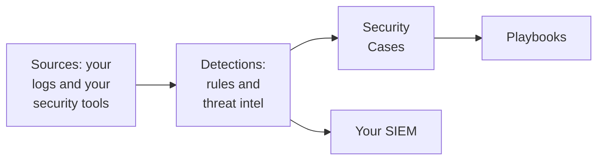

# Get Started with Security

OneUptime finds threats in data you already have - your logs, the security tools you use and anything you send it - groups what it finds into cases, and responds with playbooks. Two clicks set it up, and there is nothing to install.

:::cards
- [Set it up](#set-it-up): Turn on what most teams need, then watch a test attack open a case.
- [How it works](#how-it-works): Sources, detections, cases and playbooks, and what each one does.
- [Your logs](#find-security-events-in-your-logs): The security events already in the logs you send OneUptime.
- [Your SIEM](#send-what-oneuptime-finds-to-your-siem): Send what OneUptime finds to Google SecOps.
:::

## Before you begin

Setting Security up takes the Project Owner, Project Admin or Security Admin role. The Security Member and Security Viewer roles read what it finds; see [Roles](/docs/permissions/reference#roles).

## Set it up

:::steps
### Turn on what most teams need

Open **Products → Security Events**. On **Overview**, click **Turn on recommended**. It turns on three things at once: **Find security events in your logs**, the recommended detection rules, and **Enrich New Cases**, a playbook that checks every new case against threat intel and leaves a triage checklist on it.

### Send a test attack

Click **Send a test attack**. A dozen failed sign-ins from one documentation address go through the real pipeline: they are stored, the brute force rule matches them, and a case opens. Nobody is paged, and no SIEM receives them.

### Open the case

Click **Open the case**. This is what a real finding looks like: the events behind it, the address it is about, and what **Enrich New Cases** found. Close it as a test when you are done.
:::

From then on, **Overview** opens on what needs someone, under **Needs attention**: the open cases that are yours, the ones nobody has picked up and the playbook steps waiting for an approval. When there are none, it says **All quiet**.

## How it works

| Part | Where | What it does |
| --- | --- | --- |
| **Sources** | **Connections** | Your logs, the security products OneUptime polls, and anything you send |
| **Detections** | **Detections** | Sigma rules and threat intel feeds that look for threats in every event |
| **Security Cases** | **Security Cases** | What was found, grouped by the user, host or address it is about |
| **Playbooks** | **Playbooks** | Steps that run on new cases: enrich them, notify, open an incident or contain |

At the top of **Overview**, under what needs someone, each part shows its figures: the sources and their events in the last 24 hours, the rules that are on, the open cases and the playbooks that respond. A part that is not set up says so, and opens the page where you set it up.

## Find security events in your logs

**Your logs**, at the top of **Connections**, needs nothing installed. With **Find security events in your logs** on, OneUptime reads the project's new logs every minute and turns the lines it recognizes into security events:

| Logs | What becomes a security event |
| --- | --- |
| SSH sign-ins | Failed and successful SSH sign-ins from a server's auth log, journal or syslog |
| sudo | Commands run as another user, wrong sudo passwords and people not allowed to use sudo |
| Kubernetes audit logs | Changes to the cluster, shells opened in pods, secrets read and refused requests |
| AWS CloudTrail | Console sign-ins, changes made in your AWS accounts and calls AWS refused |
| Web attacks | Requests in a web server's access log that try SQL injection, path traversal or Log4Shell |

Your logs stay as they are. Only the lines that matter for security become events: never every page a web server served, or every read of an API.

## Send what OneUptime finds to your SIEM

If your team already works in a SIEM, OneUptime sends what it finds there too. Under **Connections → Send to your SIEM**, click **Add destination**, fill in your Google SecOps region, instance and service account key, and click **Send a test event** before you save. See [Send security events to Google SecOps](/docs/integrations/google-secops#send-security-events-to-google-secops).

## Troubleshooting

:::details Turn on recommended is greyed out
Your role cannot add detection rules, playbooks or the logs source. Ask a Project Owner, a Project Admin or a Security Admin, or have them give you the Security Admin role.
:::

:::details Turn on recommended could not turn everything on
The card names each thing it could not turn on, and why: your role, your plan, or something that went wrong on OneUptime's side. Everything else is on. Fix what it names, then click **Try again**: it turns on only what is still missing, and adds nothing twice.
:::

:::details The test attack did not open a case
The case usually opens before the button answers; when the rule is still catching up, it says so and the case opens within a minute. Check **Security Cases** again, and that the brute force rule is on under **Detections**.
:::

:::details No security event comes from my logs
Check that **Find security events in your logs** is on and that **Your logs** says when it last checked. Only the kinds of lines in the table above become events: a server that sends no SSH, sudo, audit, CloudTrail or access logs has nothing to find.
:::

:::details Overview says the last security event arrived days ago
Nothing has reached Security since then. Open **Connections** and check that **Your logs** and each connection are still on, and when each last checked.
:::

:::details The card that turns Security on is gone
Someone put it away with **Dismiss**. While nothing is being watched for threats yet, **Overview** offers **Set up Security**, which brings it back.
:::

## Next steps

:::cards
- [Security Events (SIEM)](/docs/telemetry/security-events): Send events, search them and write detection rules.
- [Security Cases and Playbooks (SOAR)](/docs/telemetry/security-cases): Work the cases and respond with playbooks.
- [Threat Intelligence (STIX/TAXII)](/docs/telemetry/threat-intelligence): Match your events against known-bad indicators.
- [Google SecOps](/docs/integrations/google-secops): Bring Google SecOps detections in, and send what OneUptime finds out.
:::
