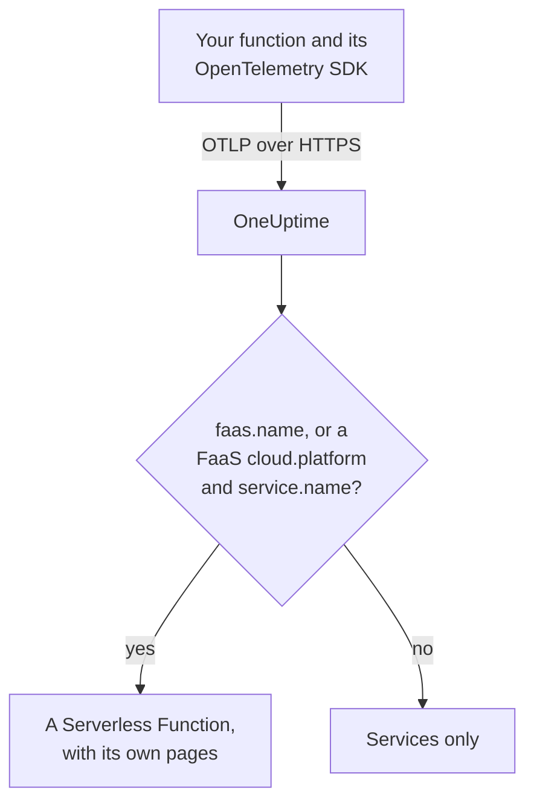

# Serverless Functions

OneUptime recognizes a serverless function the moment it receives OpenTelemetry data from one, and lists it under **Serverless Functions** with its traces, logs and metrics. It works for AWS Lambda, Google Cloud Functions, Azure Functions, Cloudflare Workers, and any other FaaS runtime that can send OpenTelemetry. There is nothing to create by hand: instrument the function with the OpenTelemetry SDK for its runtime and point its OTLP exporter at OneUptime.

:::cards
- [How OneUptime identifies a function](#how-oneuptime-identifies-a-function): `faas.name`, or a FaaS `cloud.platform` with a `service.name`.
- [Send a function's telemetry](#send-a-functions-telemetry): The exporter settings, and the Lambda layer.
- [Azure Functions](#azure-functions): One function per Function App, from the Functions host.
- [Troubleshooting](#troubleshooting): A function that does not appear, or whose pages are empty.
:::

## How it works

OneUptime reads each batch's resource attributes as it arrives. A resource with a `faas.name`, or with a FaaS `cloud.platform` such as `aws_lambda` or `azure_functions` together with a `service.name`, is a serverless function: OneUptime creates it with its first data and files the telemetry under it.



## Before you begin

- An ingestion key. Create one under **Project Settings → Telemetry & APM → Ingestion Keys** and copy its value.
- The OpenTelemetry SDK, or an auto-instrumentation layer, for your function's language.

## How OneUptime identifies a function

OneUptime keys each function on the `faas.name` resource attribute. Some platforms' resource detectors never set it ([Azure Functions](#azure-functions) is the common case), so when a resource has no `faas.name` but its `cloud.platform` is a FaaS platform, OneUptime uses its `service.name` as the function's identity instead, and fills in `faas.name` with that value on every span, log, metric and profile it stores, so the function's pages find all of its telemetry:

| Attribute | Required | Purpose |
| --- | --- | --- |
| `faas.name` | **yes**, unless the next two are set | Function identity (such as `checkout-handler`) |
| `cloud.platform` | with `service.name`, when there is no `faas.name` | `aws_lambda`, `gcp_cloud_functions`, `azure_functions`, `tencent_cloud_scf` or `alibaba_cloud_fc` |
| `service.name` | on a FaaS `cloud.platform` without `faas.name` | Function identity, written onto the telemetry as `faas.name` |
| `faas.version` | no | Shown on the overview |
| `faas.instance` | no | Tracked per instance on the **Instances** page |
| `cloud.provider` / `cloud.region` / `cloud.account.id` | no | Shown on the overview |
| `process.runtime.name` / `process.runtime.version` | no | Shown as the runtime on the overview |

A `faas.name` you set is never replaced. The `cloud.platform` value must be spelled as listed (the dotted `azure.functions` that some Azure detectors send is accepted too), and `service.name` must be a resource attribute: the `x-oneuptime-service-name` header names a service, not a function.

> [!NOTE]
> A function that also sets `service.name` still appears under **Services** too. **Serverless Functions** is the view built for functions, scoped by `faas.name`.

## Send a function's telemetry

:::steps
### Set the OTLP exporter environment variables

Most language auto-instrumentations read the standard OpenTelemetry environment variables:

```bash
OTEL_EXPORTER_OTLP_ENDPOINT="https://oneuptime.com/otlp"
OTEL_EXPORTER_OTLP_HEADERS="x-oneuptime-token=YOUR_TELEMETRY_INGESTION_TOKEN"
OTEL_RESOURCE_ATTRIBUTES="faas.name=checkout-handler,faas.version=1.4.2"
```

If you self-host OneUptime, replace the endpoint with `https://YOUR-ONEUPTIME-HOST/otlp`. On Azure Functions, leave `faas.name` out of `OTEL_RESOURCE_ATTRIBUTES` — see [Azure Functions](#azure-functions).

> [!WARNING]
> The ingestion key is a secret. Use a **Server** ingestion key, set as an environment variable of the function. A key that reaches a browser can be read by anyone who views the page's source.

### Add the OpenTelemetry Lambda layer (AWS Lambda)

On AWS Lambda, the simplest path is the [OpenTelemetry Lambda layer](https://opentelemetry.io/docs/faas/lambda-auto/). Attach the layer for your function's runtime, and set:

```bash
AWS_LAMBDA_EXEC_WRAPPER=/opt/otel-handler
OTEL_EXPORTER_OTLP_ENDPOINT=https://oneuptime.com/otlp
OTEL_EXPORTER_OTLP_HEADERS=x-oneuptime-token=YOUR_TELEMETRY_INGESTION_TOKEN
```

The layer sets `faas.name` from the function's name, and its resource detector fills in `cloud.platform`, `cloud.region` and `cloud.account.id`. On another platform, skip this step.

### Invoke the function and check it arrives

Check that OneUptime accepts the key:

```bash
curl -i https://oneuptime.com/otlp/v1/validate \
  -H "x-oneuptime-token: YOUR_TELEMETRY_INGESTION_TOKEN"
```

`200` with `"valid": true` means OneUptime accepts the key; `401` means it is unknown, revoked, disabled or expired. Then invoke the function. Once it sends a span, a log or a metric, it appears under **Products → Infrastructure → Serverless → All Functions**.
:::

## Azure Functions

The Azure Functions host can send OpenTelemetry itself, so a Function App reports its invocations (traces, logs and metrics) without code changes, whatever language it is written in. Microsoft's guide is [Use OpenTelemetry with Azure Functions](https://learn.microsoft.com/en-us/azure/azure-functions/opentelemetry-howto).

### How a Function App shows up

Azure's resource detectors (the Functions host's own, the .NET isolated worker's in `Microsoft.Azure.Functions.Worker.OpenTelemetry`, and the Node.js one in `@opentelemetry/resource-detector-azure`) describe the **Function App**, not a single function, and none of them sets `faas.name`:

| Attribute | Value |
| --- | --- |
| `service.name` | The Function App's name, from `WEBSITE_SITE_NAME` |
| `cloud.provider` | `azure` |
| `cloud.platform` | `azure_functions`; the Node.js detector writes `azure.functions`, which OneUptime rewrites |
| `cloud.region` | The app's region, from `REGION_NAME` |
| `cloud.resource_id` | `/subscriptions/<subscription>/resourceGroups/<group>/providers/Microsoft.Web/sites/<app>` |
| `faas.instance` | The instance, from `WEBSITE_INSTANCE_ID`: the Node.js detector only |

So OneUptime keys the function on `service.name`, fills in `faas.name` with the Function App's name, and shows **one Serverless Function per Function App**. The resource describes the app, not one of its functions: every instance reports the same app-level attributes whichever of the app's functions it runs, and on the Flex Consumption plan some functions even scale out on instances of their own. The individual functions are in the telemetry itself:

- The host starts a span for each invocation, named after the function it ran: search the function's **Traces** page by that name.
- The host records `faas.invoke_duration`, a histogram in seconds, with the function's name in the datapoint attribute `faas.name`: group the metric by it on the **Metrics** page or on a dashboard for each function's latency.

Don't add `faas.name` to `OTEL_RESOURCE_ATTRIBUTES` on a Function App, as the generic [first step](#set-the-otlp-exporter-environment-variables) example does. Application settings reach every process of the app, so the telemetry of all its functions would carry that one name, and OneUptime never replaces a `faas.name` it is given. Microsoft's guide says the same: don't put function-specific values on the resource. Leave it unset, and the function is named after the app.

The host and the .NET isolated worker use `OTEL_SERVICE_NAME` instead of the app's name when it is set. Keep every process of one app on the same `service.name`: the host and the language worker both send telemetry, and a worker that reports a second name makes a second Serverless Function. A worker whose resource has no FaaS `cloud.platform` joins no Serverless Function at all — see [Instrument your function code](#instrument-your-function-code-optional).

:::steps
### Turn on OpenTelemetry in the Functions host

Add `"telemetryMode": "OpenTelemetry"` to the root of the app's `host.json`:

```json title="host.json"
{
  "version": "2.0",
  "telemetryMode": "OpenTelemetry"
}
```

The host then sends, whatever the app's language, its own traces (a span per invocation, plus the Service Bus and Event Hubs processor spans behind triggered functions), its logs, and metrics including `faas.invoke_duration`.

### Point the host at OneUptime

Set the exporter as application settings:

```bash
az functionapp config appsettings set \
  --name my-function-app \
  --resource-group my-rg \
  --settings \
    OTEL_EXPORTER_OTLP_ENDPOINT=https://oneuptime.com/otlp \
    OTEL_EXPORTER_OTLP_PROTOCOL=http/protobuf \
    "OTEL_EXPORTER_OTLP_HEADERS=x-oneuptime-token=YOUR_TELEMETRY_INGESTION_TOKEN"
```

If you self-host OneUptime, replace the endpoint with `https://YOUR-ONEUPTIME-HOST/otlp`. `OTEL_EXPORTER_OTLP_PROTOCOL=http/protobuf` matters: the host's .NET exporter defaults to gRPC, and with `http/protobuf` it posts to `/otlp/v1/traces`, `/otlp/v1/metrics` and `/otlp/v1/logs` under the endpoint. The host sends OTLP only while `OTEL_EXPORTER_OTLP_ENDPOINT` is set.

> [!WARNING]
> This token is a secret: use a **Server** ingestion key. Application settings are encrypted at rest; to keep the token in Key Vault instead, set `OTEL_EXPORTER_OTLP_HEADERS` to a Key Vault reference such as `@Microsoft.KeyVault(SecretUri=https://my-vault.vault.azure.net/secrets/oneuptime-otlp-headers/)` and grant the app's managed identity **Key Vault Secrets User** on the vault. The reference resolves to the secret's value as stored, so store the whole header, `x-oneuptime-token=YOUR_TELEMETRY_INGESTION_TOKEN`, not just the token.

Keep `APPLICATIONINSIGHTS_CONNECTION_STRING` if you still want Application Insights: with both set, the host sends the same OpenTelemetry data to Application Insights and to OneUptime. Remove it to send to OneUptime only.

### Instrument your function code (optional)

The host already traces every invocation. To add spans and logs from your own code, connected to the host's, turn on OpenTelemetry in the language worker as well. It sends with the same `OTEL_EXPORTER_OTLP_*` settings:

- **C# (isolated worker)**: add the NuGet packages `Microsoft.Azure.Functions.Worker.OpenTelemetry`, `OpenTelemetry.Extensions.Hosting` and `OpenTelemetry.Exporter.OpenTelemetryProtocol`, then in `Program.cs`: `builder.Services.AddOpenTelemetry().UseFunctionsWorkerDefaults().UseOtlpExporter();`
- **JavaScript / TypeScript**: `npm install @azure/functions-opentelemetry-instrumentation` alongside the OpenTelemetry Node.js SDK and its OTLP exporters, and register `AzureFunctionsInstrumentation` in a file the `main` field of `package.json` includes.
- **Java**: add the Maven dependency `com.microsoft.azure.functions:azure-functions-java-opentelemetry`.
- **Python**: set the application setting `PYTHON_ENABLE_OPENTELEMETRY=true`, add the OpenTelemetry packages Microsoft lists (among them `opentelemetry-sdk` and `opentelemetry-exporter-otlp`) to `requirements.txt`, and configure the exporters in `function_app.py`.
- **PowerShell**: set the application setting `OTEL_FUNCTIONS_WORKER_ENABLED=True` and load the `AzureFunctions.PowerShell.OpenTelemetry.SDK` module from `profile.ps1`.

Microsoft's guide has the full code for each language. The .NET worker (through `UseFunctionsWorkerDefaults()`) and the Python worker (through `PYTHON_ENABLE_OPENTELEMETRY`) tell the host to leave their logs to them, so those logs are not sent twice.

A worker's spans and logs reach the function's pages only when its resource describes the app the way the host's does: the same `service.name` and a FaaS `cloud.platform`. The .NET isolated worker (through `UseFunctionsWorkerDefaults()`) and Microsoft's Node.js example (through the Azure detectors that `getResourceDetectors()` includes) report both. Microsoft's Python example builds its resource without an Azure detector, so out of the box it reports neither and its telemetry never reaches the function. For Python, or any worker set up without an Azure Functions resource detector, add two more application settings. Every process of the app reads them, the host included, so all of them report the same identity:

```bash
az functionapp config appsettings set \
  --name my-function-app \
  --resource-group my-rg \
  --settings \
    OTEL_SERVICE_NAME=my-function-app \
    "OTEL_RESOURCE_ATTRIBUTES=cloud.provider=azure,cloud.platform=azure_functions"
```

Set `OTEL_SERVICE_NAME` to the Function App's own name. It is the name the host and the Node.js detector report without it, so the function keeps the identity it already has.
:::

### Limitations

- **C# in-process apps** can't use OpenTelemetry: move them to the isolated worker model first.
- **Log streaming** in the Azure portal doesn't work while the host is in OpenTelemetry mode, and the portal's _Recent function invocations_ list needs the telemetry in Application Insights. Use the function's **Logs** and **Traces** pages in OneUptime instead.
- The `logging.applicationInsights` section of `host.json` no longer applies once `telemetryMode` is `OpenTelemetry`.
- **Instances** lists `faas.instance` values. Of the detectors above, only the Node.js one sets it, so the page stays empty for telemetry from the host and the .NET worker.

## What you get

Once the function sends a span, a log or a metric, it appears under **Serverless Functions**. Its **Overview** shows:

- **Invocations**, **error rate** and **p95 duration**, worked out from your traces over a time range you pick, with trend charts.
- **Instances**: a live list of the `faas.instance` values the function reports.
- Full **Logs**, **Traces** and **Metrics** pages scoped to this function.

## Label functions and assign owners

A resource attribute that starts with `oneuptime.label.` becomes a project label on the function: `oneuptime.label.team=payments` adds the label `team:payments`. Add the attributes to `OTEL_RESOURCE_ATTRIBUTES`:

```bash
OTEL_RESOURCE_ATTRIBUTES="faas.name=checkout-handler,oneuptime.label.team=payments,oneuptime.label.env=production"
```

To label functions or assign owners by their names instead, open **Products → Infrastructure → Serverless** and use **Label Rules** and **Owner Rules** in the side menu. Rules run when a function is created, auto-discovered ones included. To apply a rule to the functions you already have, use its **Run Now** (see [Run Rules on Existing Resources](/docs/configuration/run-rules-now)).

## Troubleshooting

:::details The function does not appear under Serverless Functions
Check, in order:

1. The function has been invoked since you set the variables: it sends telemetry only while it runs.
2. On AWS Lambda, the layer is attached for the function's runtime, and `AWS_LAMBDA_EXEC_WRAPPER` is `/opt/otel-handler`: without the wrapper, the layer's instrumentation never starts.
3. Elsewhere, the function's code loads the OpenTelemetry SDK or auto-instrumentation: the variables alone send nothing.
4. The resource carries `faas.name`, or a FaaS `cloud.platform` and a `service.name`. Without them the telemetry is filed under **Services** instead, as a service.
5. The function can reach your OneUptime URL. One on a private network needs a route out to it, such as a NAT gateway.
:::

:::details The function is listed, but its pages are empty
The function's **Overview**, **Logs**, **Traces** and **Metrics** show telemetry whose `faas.name` equals the function's name exactly, case included. A function named by a FaaS `cloud.platform` and its `service.name` needs no `faas.name` of its own: OneUptime writes the `service.name` onto the telemetry as `faas.name` as it arrives. Telemetry stored before OneUptime began filling in `faas.name` is not updated and stays out of the pages: invoke the function to send new telemetry. Also check the time range at the top of the page.
:::

:::details The function shows as Disconnected
A function turns Disconnected when OneUptime has received nothing from it for 15 minutes; OneUptime checks every 5 minutes, and time it was not receiving data itself does not count. A function that runs only now and then is Disconnected between runs: it turns Connected again with its next telemetry.
:::

## Next steps

:::cards
- [OpenTelemetry](/docs/telemetry/open-telemetry): Send traces, logs and metrics from any application.
- [Queues](/docs/telemetry/queues): The queues and topics your functions publish to and consume from.
- [Traces Monitor](/docs/monitor/traces-monitor): Alert on a function's failed or slow invocations.
:::
