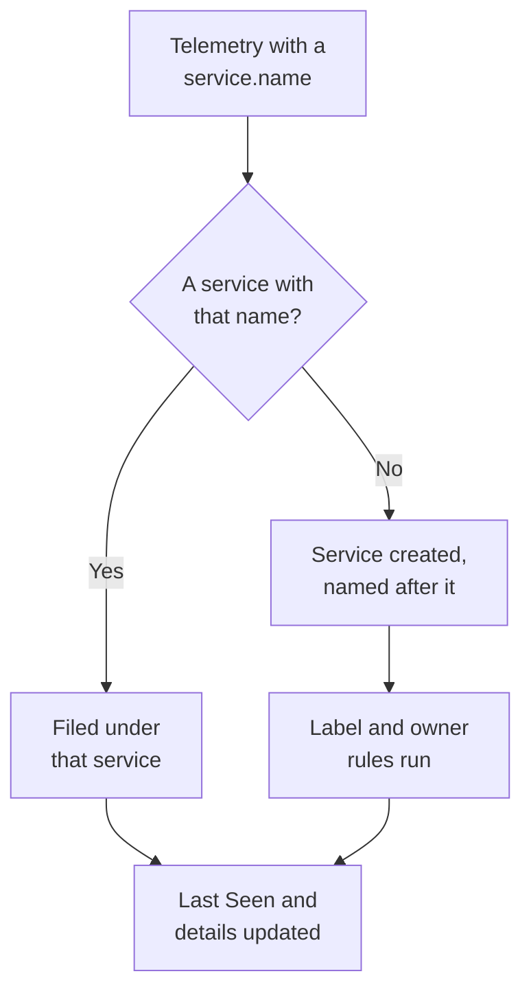

# Service Catalog

The Service Catalog lists the applications and microservices you run. OneUptime adds a service the first time its telemetry arrives, then brings its logs, traces, metrics, exceptions, incidents and owners together on one page, so anyone can find what a service does, who owns it and how it is doing.

:::cards
- [How a service gets into the catalog](#how-a-service-gets-into-the-catalog): Its `service.name`, on its first telemetry.
- [Find a service](#find-a-service): The list, its filters and its columns.
- [A service's pages](#a-services-pages): Everything about one service.
- [Archive or delete a service](#archive-or-delete-a-service): Keep the history, or remove it.
:::

## How a service gets into the catalog

You do not have to create services. Every batch of telemetry names the service that sent it in its `service.name` resource attribute. OneUptime files the batch under the service with that name, and creates the service when the project has none.

- **The name is the service's identity.** It is compared without regard to case, so `Checkout-API` and `checkout-api` are one service. A new `service.name` starts a new service.
- **Containers name themselves.** Telemetry from the Docker and Podman agents names a service after its container when it has no `service.name`.
- **An ingestion key can name the service.** OpenTelemetry data sent with a key that has a **Pinned Service Name** is filed under that name, whatever its `service.name` says. See [Ingestion Keys](/docs/telemetry/ingestion-keys#lock-down-a-browser-key).
- **Browsers and phones are not services.** Telemetry from a browser or a mobile app belongs to a [RUM application](/docs/rum/applications) instead.
- **Labels can come with the telemetry.** A resource attribute named `oneuptime.label.<name>` adds the label `<name>:<value>` to the service, such as `oneuptime.label.team=payments` for `team:payments`.

Each time telemetry arrives, the service's **Last Seen** moves forward, and its details are refreshed from the resource attributes that come with it:

| Detail | From the attribute |
| --- | --- |
| Service Version | `service.version` |
| Deployment Environment | `deployment.environment.name`, or `deployment.environment` |
| Service Namespace | `service.namespace` |
| Runtime | `process.runtime.name` and `process.runtime.version` |
| Technology | `telemetry.sdk.language`, or the runtime |
| Cloud | `cloud.provider`, `cloud.platform`, `cloud.region` and `cloud.account.id` |

## Before you begin

- **Telemetry arriving** with a `service.name`. See [OpenTelemetry](/docs/telemetry/open-telemetry): `OTEL_SERVICE_NAME` sets it.
- **A role that reads services.** Project Owner, Project Admin, Project Member, Viewer, Settings Admin, Settings Member or Settings Viewer, or a custom role with the Read Service permission. Creating, changing and deleting services takes Project Owner, Project Admin, Project Member, Settings Admin or Settings Member, or the matching service permissions.

## Find a service

Go to **Products → Resources → Services**. **All Services** lists every service with its **Name**, **Description**, **Technology**, **Last Seen**, **Labels** and **Owners**.

- Search by name or description, and filter by owner or label with the bar above the list.
- Select several services to add labels or owners to all of them at once, or to archive them.
- Click a service to open its pages.

To add a service before its telemetry arrives, for example to set its owners first, click **Create Service** and enter its **Name** exactly as its `service.name` will be. Label and owner rules run on it as on a discovered service. Once it is saved, the OpenTelemetry setup guide opens with that name in every snippet, and its last step, **Wait for it to connect**, says when the service's first data arrives.

## A service's pages

A service's side menu has five sections:

| Section | Pages |
| --- | --- |
| **Basic** | **Overview**: requests, error rate and p95 latency from its spans, charts, and its details. **Recommendations**: ready-made monitors for the service, picked for its language. **Owners**: the people and teams responsible for it. **Feed**: everything that happened to it, from how it was created to every change since. |
| **Telemetry** | Its **Logs**, **Traces**, **Metrics**, **Performance Profiles**, **Exceptions** and **Source Maps**, already filtered to this service. |
| **Activity** | The **Incidents**, **Alerts** and **Scheduled Maintenance** events that affect it. |
| **Developer** | **Terraform**, **API** and **AI Assistants**: the service managed from code. It starts collapsed. |
| **Advanced** | **Settings**, **Audit Logs** and **Delete Service**. **Advanced** starts collapsed: expand it first. |

Owners matter beyond the page: a role whose scope is Owned reads the telemetry of the services you or your teams own. See [Telemetry](/docs/permissions/index#telemetry).

## Change a service

:::steps
### Open its settings

Open the service, expand **Advanced** in its side menu and click **Settings**.

### Rename or describe it

On **Service Details**, click **Edit Details** to change its **Name**, **Description** or **Labels**. The name must still match the `service.name` its telemetry reports: change it in your OpenTelemetry setup too, or the next telemetry creates a new service.

### Pick its color and tech stack

On **Service Settings**, click **Edit Settings**. The **Service Color** marks the service in charts and lists; a new service gets one of its own. **Tech Stack** is optional: leave it empty to show the language detected from its telemetry.
:::

The same page holds the service's retention, folded under **More settings**. The **Telemetry Data Retention** and **Retention by Telemetry Type** cards keep its telemetry for longer or shorter than the project's default retention. They are part of the [Enterprise Edition](/docs/self-hosted/enterprise), and of the Scale plan on OneUptime Cloud; without them the page shows what they add, and the service keeps the project's retention.

## Set labels and owners automatically

Rules give new services their labels and owners as they are created, discovered ones included. Find them under **Services → Settings → Owner Rules** and **Services → Settings → Label Rules**; **Settings** starts collapsed in the side menu. See [Label and Owner Rules](/docs/configuration/label-and-owner-rules).

## Archive or delete a service

Archive a service you no longer watch but whose history you want to keep. An archived service is hidden from **All Services**, but it keeps collecting telemetry. Archive it from its **Settings** page, or select several in the list. To bring one back, open **Services → Advanced → Archived**.

> [!WARNING]
> Deleting a service also deletes its source maps, and the metric pipeline rules and LLM cost budgets set for it. If OneUptime still receives its telemetry, the service is added back, without the labels, owners and settings you gave it. To take it off the list and keep everything, archive it instead.

## Troubleshooting

:::details A service shows up twice
Two `service.name` values reached OneUptime, for example from two versions of your setup, or after a rename on one side only. Telemetry is matched by name: make every instance report the same `service.name`, then archive or delete the service you no longer need.
:::

:::details My service is not in the catalog
Check that its telemetry carries a `service.name`. Telemetry from a browser or a mobile app goes to Real User Monitoring instead, and a host or cluster without a service name is filed under that host or cluster.
:::

:::details Last Seen is behind
**Last Seen** is updated about once a minute, not on every batch, so it can trail live telemetry by a minute or so.
:::

## Next steps

:::cards
- [Logs Explorer](/docs/telemetry/logs-explorer): Search a service's logs.
- [Traces Explorer](/docs/telemetry/traces-explorer): Follow its requests.
- [Exception Tracking](/docs/telemetry/exceptions): Triage the errors it throws.
- [Label and Owner Rules](/docs/configuration/label-and-owner-rules): Give new services labels and owners.
:::
