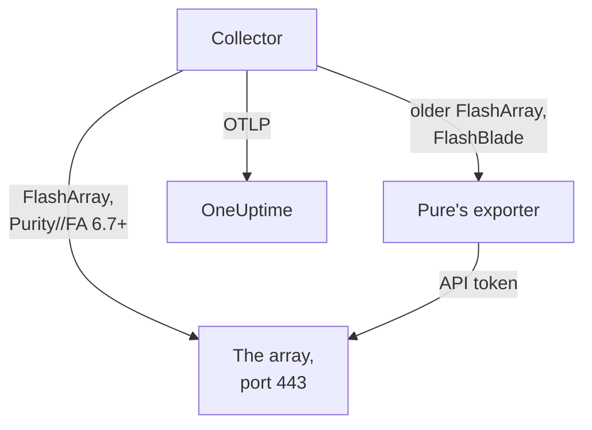

# Storage Array Agent

The OneUptime Storage Array agent monitors storage arrays: capacity and data reduction, latency, IOPS and bandwidth, volumes, hosts, pods and replication, hardware health, file systems and buckets. It is a stock OpenTelemetry Collector that scrapes the array's OpenMetrics endpoints with a read-only user's API token, stamps every metric with your array's identity and sends it to OneUptime. [Storage array monitors](/docs/monitor/storage-array-monitor) alert on what arrives.

:::cards
- [Install the agent](#install-the-agent): A read-only user, then the install script or Docker Compose.
- [What the agent collects](#what-the-agent-collects): Every endpoint, and the pages built from it.
- [Monitoring several arrays](#monitoring-several-arrays): One agent per array, on one machine.
- [Troubleshooting](#troubleshooting): A diagnostic script, and the usual problems.
:::

## How it works

Storage Arrays is a product that works the same way for every vendor. It supports:

| Array | How the agent reads it | Collector config |
| --- | --- | --- |
| **Pure Storage FlashArray**, Purity//FA 6.7 and later | The array's own OpenMetrics endpoint (`https://<array>/metrics/...?namespace=purefa`): nothing runs beside the collector | `otel-collector-config.yaml` (the default) |
| **Pure Storage FlashArray**, older Purity//FA | Pure's FlashArray OpenMetrics exporter, which the same Compose file runs as the `pure-fa-exporter` service | `otel-collector-config.flasharray-exporter.yaml` |
| **Pure Storage FlashBlade** | Pure's FlashBlade OpenMetrics exporter, which the same Compose file runs as the `pure-fb-exporter` service | `otel-collector-config.flashblade.yaml` |

Pure Storage renamed itself **Everpure** in February 2026. FlashArray, FlashBlade and Purity kept their names, and so did the `purefa_*` and `purefb_*` metrics, so everything on this page applies to arrays sold under either name.



One agent monitors one array: run one agent per array (see [Monitoring several arrays](#monitoring-several-arrays)). The array registers itself with its first data, under the name the agent stamps on every metric as `storage.array.name`.

## Before you begin

- Docker Engine 20.10 or later with the Docker Compose v2 plugin, on a machine that can reach the array's management interface over HTTPS (TCP 443).
- An administrator account on the array, to create a user with the built-in **readonly** role and an API token for it.
- An ingestion key. Create one under **Project Settings → Telemetry & APM → Ingestion Keys** and copy its value.

### Where to run the agent

The agent talks to the array's management interface over HTTPS, so it can run on any machine with Docker and a route to the management network on TCP 443: a monitoring host, or a small management VM. Prefer a machine whose own storage does not live on the array it watches: if the array goes down, your monitoring should not go down with it. The optional syslog listener also needs the array to reach the agent on the syslog port (see [Ship the array's syslog](#optional-ship-the-arrays-syslog)).

## Install the agent

:::steps
### Create the read-only user and API token

The agent only ever reads. Give it a user of its own with the built-in **readonly** role, never an administrator, and an API token for that user. Create the token **without an expiry**, or the agent stops the day the token expires.

:::tabs
@tab Purity CLI
SSH to the FlashArray as an administrator. The first command asks for the new user's password; the second prints its API token, a UUID:

```bash
pureadmin create --role readonly oneuptime
pureadmin create --api-token oneuptime
```
@tab FlashArray GUI
1. Open _Settings → Users and Policies_ (_Settings → Access_ on older releases).
2. From the ⋮ menu of the **Users** panel, choose **Create User…**, name the user `oneuptime` and give it the readonly role.
3. From the new user's ⋮ menu, choose **Create API Token…**, leave **Expires In** empty, and copy the token.
@tab FlashBlade
Create a user with the **readonly** role and an API token for it the same way: in the FlashBlade GUI's user settings, or with `pureadmin` in the Purity//FB CLI. On a release without local users, use a directory service (LDAP or Active Directory) account whose group maps to the readonly role. FlashBlade API tokens start with `T-`.
:::

### Check whether the FlashArray serves its own metrics

Pure documents the native OpenMetrics endpoint for **Purity//FA 6.7.0 and later** (the deprecation notice on Pure's FlashArray exporter says 6.6.11 and later). The quickest way to know is to ask the array, from the machine the agent will run on:

```bash
curl -k 'https://<array>/metrics/array?namespace=purefa' --header 'Authorization: Bearer <api-token>' | grep purefa_info
```

A `purefa_info{...} 1` line means the array serves its metrics natively: use the default config. A `404` means it does not: use the exporter config, which runs Pure's exporter next to the collector. Pure has deprecated that exporter, so move to the native config once the array is upgraded. A FlashBlade always goes through Pure's FlashBlade exporter, so skip this step for one.

### Install and start the agent

:::tabs
@tab install.sh
Download the install script and run it on the machine that will host the agent:

```bash
curl -sSL https://raw.githubusercontent.com/OneUptime/oneuptime/master/agents/StorageArrayAgent/install.sh -o install.sh
bash install.sh
```

The script asks which array this is (a FlashArray serving native metrics, a FlashArray on an older Purity//FA, or a FlashBlade), then for your OneUptime URL, the ingestion key, a name for the array, the array's management address and the read-only user's API token (read without echo). It installs to `/opt/oneuptime-storage-array-agent`, downloads the Compose file and all three collector configs, writes a `0600` `.env` file with the matching config and Compose profile, and starts the agent with Docker Compose. It quotes every value for Docker Compose as you typed it. Running it again reuses everything in an existing `.env` instead of prompting again, and keeps a file you edited as `<file>.bak.<timestamp>` before replacing it.
@tab Docker Compose
Download `docker-compose.yml` and the three `otel-collector-config*.yaml` files from the [StorageArrayAgent directory](https://github.com/OneUptime/oneuptime/tree/master/agents/StorageArrayAgent) into a new folder:

```bash
curl -fsSLO https://raw.githubusercontent.com/OneUptime/oneuptime/master/agents/StorageArrayAgent/docker-compose.yml
curl -fsSLO https://raw.githubusercontent.com/OneUptime/oneuptime/master/agents/StorageArrayAgent/otel-collector-config.yaml
curl -fsSLO https://raw.githubusercontent.com/OneUptime/oneuptime/master/agents/StorageArrayAgent/otel-collector-config.flasharray-exporter.yaml
curl -fsSLO https://raw.githubusercontent.com/OneUptime/oneuptime/master/agents/StorageArrayAgent/otel-collector-config.flashblade.yaml
```

Create a `.env` file next to them. It holds the API token, so keep it private with `chmod 600 .env`. For a FlashArray that serves native metrics:

```bash title=".env"
ONEUPTIME_URL=YOUR_ONEUPTIME_URL
ONEUPTIME_TELEMETRY_INGESTION_KEY=YOUR_TELEMETRY_INGESTION_TOKEN
STORAGE_ARRAY_NAME=my-storage-array
STORAGE_SYSTEM=purestorage.flasharray
STORAGE_ARRAY_COLLECTOR_CONFIG=otel-collector-config.yaml
COMPOSE_PROFILES=
PURE_FA_ENDPOINT=fa-prod-01.example.com
PURE_FA_API_TOKEN=YOUR_READ_ONLY_API_TOKEN
PURE_FB_ENDPOINT=
PURE_FB_API_TOKEN=
STORAGE_ARRAY_INSECURE_SKIP_VERIFY=true
```

For a FlashArray on an older Purity//FA, set `STORAGE_ARRAY_COLLECTOR_CONFIG=otel-collector-config.flasharray-exporter.yaml` and `COMPOSE_PROFILES=flasharray-exporter`. For a FlashBlade, set `STORAGE_SYSTEM=purestorage.flashblade`, `STORAGE_ARRAY_COLLECTOR_CONFIG=otel-collector-config.flashblade.yaml` and `COMPOSE_PROFILES=flashblade`, and fill in `PURE_FB_ENDPOINT` and `PURE_FB_API_TOKEN` instead of the `PURE_FA_*` pair. Start the agent:

```bash
docker compose up -d
```
:::

### Check the agent is running

```bash
docker compose ps
docker logs -f oneuptime-storage-array-agent
```

`docker compose ps` lists the collector (`oneuptime-storage-array-agent`) and, with an exporter config, the exporter (`pure-fa-exporter` or `pure-fb-exporter`). The collector's logs should show this line once it has started:

```text
Everything is ready. Begin running and processing data.
```

### Find the array in OneUptime

Open **Products → Infrastructure → Storage Arrays → All Storage Arrays**. After the first scrape (about a minute) the array is there with its capacity, performance, open alerts and hardware. Volumes, hosts and pods follow within 2 minutes, a FlashBlade's file systems and buckets within 5, and FlashArray directories within 30.
:::

## Environment variables

The install script writes these to `/opt/oneuptime-storage-array-agent/.env`; a Docker Compose install reads them from the `.env` next to `docker-compose.yml`. After changing one, run `docker compose up -d` in that folder.

| Variable | Required | Description |
| --- | --- | --- |
| `ONEUPTIME_URL` | Yes | Your OneUptime URL, such as `https://oneuptime.com` or your self-hosted instance. Use `http://` and its port if the instance is HTTP-only. |
| `ONEUPTIME_TELEMETRY_INGESTION_KEY` | Yes | The ingestion key from **Project Settings → Telemetry & APM → Ingestion Keys**. |
| `STORAGE_ARRAY_NAME` | Yes | The name the array registers under in OneUptime, stamped on every metric as the `storage.array.name` resource attribute. Keep it stable: changing it later registers a second array. The collector refuses to start without it. |
| `STORAGE_SYSTEM` | No | The platform, stamped as the `storage.system` resource attribute: `purestorage.flasharray` or `purestorage.flashblade`. Defaults to `purestorage.flasharray`. |
| `STORAGE_ARRAY_COLLECTOR_CONFIG` | No | Which shipped collector config runs: `otel-collector-config.yaml` (FlashArray, native: the default), `otel-collector-config.flasharray-exporter.yaml` (older FlashArray) or `otel-collector-config.flashblade.yaml` (FlashBlade). |
| `COMPOSE_PROFILES` | No | Starts the exporter the chosen config scrapes: empty for the native FlashArray config, `flasharray-exporter` or `flashblade` for the other two. |
| `PURE_FA_ENDPOINT` | FlashArray | The FlashArray's management address: a host name or IP, without `https://`. |
| `PURE_FA_API_TOKEN` | FlashArray | The API token of the FlashArray user with the readonly role. |
| `PURE_FB_ENDPOINT` | FlashBlade | The FlashBlade's management address: a host name or IP, without `https://`. |
| `PURE_FB_API_TOKEN` | FlashBlade | The API token of the FlashBlade user with the readonly role. |
| `STORAGE_ARRAY_INSECURE_SKIP_VERIFY` | No | `true` accepts the array's self-signed certificate on the native endpoint; `false` verifies it. Defaults to `true`. Pure's exporters never verify the array's certificate, so it does not apply to them. |

## How the agent scrapes

- **One scrape job per endpoint, each read as often as it is worth.** FlashArray: `/metrics/array` every 60 seconds; `/metrics/volumes`, `/metrics/hosts` and `/metrics/pods` every 2 minutes; `/metrics/directories` every 30 minutes, which is Pure's own advice, since directory space is expensive for the array to work out. FlashBlade: `/metrics/array` every 60 seconds; `/metrics/filesystems` and `/metrics/objectstore` every 5 minutes, again following Pure's advice to read the file system and object store endpoints less often than the array.
- **Every job labels its series `scrape_endpoint: <endpoint>`.** Each endpoint also exports `purefa_info` or `purefb_info`, so OneUptime knows which families a batch is the complete list of: that is how a deleted volume, host, pod, file system or bucket leaves the inventory instead of lingering. Keep the labels as shipped.
- **Per-volume and per-host latency keeps three dimensions.** Each volume and host exports its latency in up to sixteen `dimension`s. A `metric_relabel_configs` rule keeps `usec_per_read_op`, `usec_per_write_op` and `usec_per_mirrored_write_op` and drops the QoS rate limit, queue, SAN and service-time breakdown, which multiplies the series of a large array. The array-wide breakdown on `purefa_array_performance_latency_usec` is kept. Delete the rule to keep the per-volume breakdown too.
- **The API token is a Bearer token.** The native config sends it to the array itself; the exporter configs send it to the exporter over the Compose network only, and the exporters' ports are never published.
- **No `send_batch_max_size`.** OneUptime rebuilds the inventory from one whole scrape per request, so the shipped `batch` processor never splits a scrape across exports. Keep the batch settings as shipped.

## What the agent collects

Pure's semantic conventions are shared by the FlashArray native endpoint and both exporters. Every value is a gauge the array works out itself (latencies in microseconds per operation, throughput per second), so no rates need computing, and objects are named by **datapoint labels**: `name` for volumes, pods, directories, file systems and buckets, `host` for hosts, `component_name` for FlashArray hardware. The agent adds the `storage.array.name` and `storage.system` resource attributes, so OneUptime files everything under your array:

| Endpoint | Metric families | What OneUptime builds from them |
| --- | --- | --- |
| FlashArray `/metrics/array` | `purefa_info`, `purefa_alerts_open`, `purefa_array_space_*`, `purefa_array_performance_*`, `purefa_hw_component_status`, `purefa_hw_component_temperature_celsius`, `purefa_hw_controller_info`, `purefa_drive_capacity_bytes`, `purefa_network_interface_*` | The array's name, Purity version and system ID; capacity, used space and data reduction; open alert counts; the array's health; the **Hardware** page (components, drives, controllers, network interfaces) |
| FlashArray `/metrics/volumes` | `purefa_volume_performance_*`, `purefa_volume_space_*`, `purefa_volume_qos_*` | The **Volumes** page: provisioned and physical size, data reduction, read and write latency, IOPS and bandwidth per volume |
| FlashArray `/metrics/hosts` | `purefa_host_connectivity_info`, `purefa_host_connections_info`, `purefa_host_performance_*`, `purefa_host_space_*` | The **Hosts** page: connectivity (redundant paths or not), connected volumes, latency, IOPS and bandwidth per host |
| FlashArray `/metrics/pods` | `purefa_pod_performance_*`, `purefa_pod_space_*`, `purefa_pod_replica_links_*`, `purefa_pod_mediator_status` | The **Replication** page: ActiveCluster and ActiveDR pods, replica link status and lag |
| FlashArray `/metrics/directories` | `purefa_directory_performance_*`, `purefa_directory_space_*` | The **Directories** page (FlashArray File Services) |
| FlashBlade `/metrics/array` | `purefb_info`, `purefb_alerts_open`, `purefb_array_space_*`, `purefb_array_performance_*`, `purefb_hardware_health` | The FlashBlade's name, Purity version and system ID; capacity and data reduction; open alert counts; the array's health; the **Hardware** page |
| FlashBlade `/metrics/filesystems` | `purefb_file_systems_space_*`, `purefb_file_systems_performance_*` | The **File Systems** page: provisioned and used space, data reduction, latency, IOPS and bandwidth per file system |
| FlashBlade `/metrics/objectstore` | `purefb_buckets_space_*`, `purefb_buckets_quota_space_bytes`, `purefb_buckets_object_count`, `purefb_buckets_performance_*`, `purefb_object_store_accounts_*` | The **Buckets** page: space, quota, object count and performance per bucket, grouped by account |

The array's health on its **Overview** is **Critical** while it reports an open critical alert, or a hardware component, drive or controller that is critical, failed, missing or unhealthy; **Warning** while it reports an open warning alert, or a degraded or unknown component; and **OK** otherwise. In monitor criteria, the array's attributes take a `resource.` prefix (`resource.storage.array.name`, `resource.storage.system`), while the datapoint labels stay bare (`name`, `host`, `dimension`, `space`).

## Optional — Ship the array's syslog

By default the agent sends metrics only, so the array's **Logs** page stays empty. Arrays forward their alerts and audit events as syslog, and every shipped collector config has a commented-out `syslog` receiver pair (TCP and UDP on port 5514, RFC 3164), wired to a commented `logs` pipeline that stamps `storage.array.name` so the logs land on your array.

:::steps
### Turn the receivers on

Uncomment the two `syslog/*` receivers and the `logs` pipeline in the collector config you use. RFC 3164 timestamps carry no time zone: set `location` to the array's time zone unless its clock runs on UTC.

### Open the port

Uncomment the `ports:` block in `docker-compose.yml`, so the machine publishes `5514/tcp` and `5514/udp`, then run `docker compose up -d`. Open the port in the machine's firewall for the array's management network.

### Point the array at the agent

Do this as an administrator, not as the read-only monitoring user. On a FlashArray, open _Settings → System → Syslog Servers_, add `udp://<agent-host>:5514` (or `tcp://<agent-host>:5514`) and send a test message. On a FlashBlade, add a syslog server with the same URI in its syslog settings. Both arrays take the `PROTOCOL://HOST:PORT` form, through their REST APIs (`syslog-servers`) too.
:::

A syslog receiver listens on only one transport, which is why TCP and UDP are two receivers: leave one commented if you need only the other. The stock collector image reads syslog as it is: no custom image is needed.

## Tag the array with project labels

A resource attribute that starts with `oneuptime.label.` becomes a project label on the storage array: `oneuptime.label.<dimension>=<value>` is the label `<dimension>:<value>`. Add the attributes to the `resource` processor in the collector config you use, next to `storage.array.name`:

```yaml
processors:
  resource:
    attributes:
      # ...existing attributes...
      - key: oneuptime.label.team
        value: storage
        action: upsert
      - key: oneuptime.label.env
        value: production
        action: upsert
```

The collector reads its config only when it starts: run `docker compose restart oneuptime-storage-array-agent`. The array then shows the labels `team:storage` and `env:production`. Labels are matched without regard to case, so an existing `Production` label is reused rather than duplicated, and the agent never removes a label someone added in OneUptime.

## Monitoring several arrays

One agent reads one array. To monitor several from the same machine, install each into its own folder with its own `.env`, such as `INSTALL_DIR=/opt/oneuptime-storage-array-agent-fa02 bash install.sh`, and give each its own `container_name` in its `docker-compose.yml` (such as `oneuptime-storage-array-agent-fa02`): two containers cannot share a name. Pass the folder to the diagnostic script with `-d`.

## Run as a systemd service

To start the agent with the machine and restart it when it fails, install its systemd unit. It assumes the agent lives in `/opt/oneuptime-storage-array-agent`, where the install script puts it:

```bash
sudo curl -fsSL https://raw.githubusercontent.com/OneUptime/oneuptime/master/agents/StorageArrayAgent/systemd/oneuptime-storage-array-agent.service -o /etc/systemd/system/oneuptime-storage-array-agent.service
sudo systemctl daemon-reload
sudo systemctl enable --now oneuptime-storage-array-agent
```

## Upgrading the agent

The agent reports the collector version its files pin as its **Agent Version**. When that is older than the version this OneUptime release pins, a warning sign appears beside it on the array's **Overview**. Select it to see these commands. An agent installed before its files reported a version shows none until it is upgraded this way.

The collector image is pinned in `docker-compose.yml` and its configs are files next to it, so pulling alone does not move the agent forward. Run `install.sh` again: it reuses every value in your existing `.env` (nothing is prompted for again), refreshes `docker-compose.yml` and the three collector configs (a file you edited is kept as `<file>.bak.<timestamp>`), and recreates the agent so the collector reads its new config. An agent installed outside `/opt/oneuptime-storage-array-agent` needs its folder: `INSTALL_DIR=<folder> bash install.sh`.

```bash
curl -sSL https://raw.githubusercontent.com/OneUptime/oneuptime/master/agents/StorageArrayAgent/install.sh -o install.sh
bash install.sh
```

Installed it with Docker Compose instead? In the agent's folder, download the Compose file and the three collector configs again (and make again any change you made to them), then pull the images and recreate the agent:

```bash
curl -fsSLO https://raw.githubusercontent.com/OneUptime/oneuptime/master/agents/StorageArrayAgent/docker-compose.yml
curl -fsSLO https://raw.githubusercontent.com/OneUptime/oneuptime/master/agents/StorageArrayAgent/otel-collector-config.yaml
curl -fsSLO https://raw.githubusercontent.com/OneUptime/oneuptime/master/agents/StorageArrayAgent/otel-collector-config.flasharray-exporter.yaml
curl -fsSLO https://raw.githubusercontent.com/OneUptime/oneuptime/master/agents/StorageArrayAgent/otel-collector-config.flashblade.yaml
docker compose pull
docker compose up -d --force-recreate
```

## Uninstalling the agent

```bash
cd /opt/oneuptime-storage-array-agent
docker compose down
```

Then delete the read-only user and its API token on the array if you no longer need them.

## Troubleshooting

:::details Run the diagnostic script first
The agent ships with a script, [`troubleshoot.sh`](https://github.com/OneUptime/oneuptime/blob/master/agents/StorageArrayAgent/troubleshoot.sh), that checks the whole chain: the container runtime; the array endpoint exactly as the collector reaches it (the native endpoint or Pure's exporter: DNS, TLS, whether a FlashArray has the native endpoint at all, and whether the array accepts the API token, which the script hands to curl on stdin); the array name stamped on every metric; the token's shape; the collector's own metrics; and whether OneUptime accepts the ingestion key. That last check matters most. OneUptime refuses a bad key with `401` (`422` for a disabled key or a browser key), and the collector treats both as permanent: it drops the batch and logs one `Exporting failed` error, which is easy to miss while the container stays healthy. The script asks `GET <url>/otlp/v1/validate` from inside the agent's network for a direct `200` (valid) or `401` (invalid), and falls back to `POST /fluentd/v1/logs` on older servers.

```bash
curl -sSL https://raw.githubusercontent.com/OneUptime/oneuptime/master/agents/StorageArrayAgent/troubleshoot.sh -o troubleshoot.sh
bash troubleshoot.sh    # add -d <dir> if you installed outside /opt/oneuptime-storage-array-agent
```

It ends with a verdict naming the most likely cause.
:::

:::details No array appears in OneUptime
1. Read the collector's logs: `docker logs oneuptime-storage-array-agent`. `server returned HTTP status 401` means the array refused the API token, `404` means the FlashArray has no native endpoint, `x509` means TLS verification is on against the array's self-signed certificate, `no such host` or `connection refused` means a wrong `PURE_FA_ENDPOINT` or `PURE_FB_ENDPOINT`, and a `401` on export means a bad ingestion key.
2. Ask the array from the agent's network. The collector image has no shell or curl, so ask from a container in its network: `docker run --rm --network container:oneuptime-storage-array-agent curlimages/curl -sk -H 'Authorization: Bearer <api-token>' 'https://<array>/metrics/array?namespace=purefa'` should print `purefa_*` lines.
3. Check that `STORAGE_ARRAY_NAME` is set: the array is found by its `storage.array.name` resource attribute, and the collector refuses to start without it.
:::

:::details The array shows as Disconnected
An array turns Disconnected when OneUptime has received nothing from it for 15 minutes; OneUptime checks every 5 minutes, and time it was not receiving data itself does not count. Check that the collector runs (`docker compose ps`), that its logs show no scrape or export errors, and that the machine still reaches the array and your OneUptime URL. The array turns Connected again with its next data.
:::

:::details The FlashArray answers 404
Its Purity//FA has no native OpenMetrics endpoint. Run `install.sh` again and choose the older-Purity option, or set `STORAGE_ARRAY_COLLECTOR_CONFIG=otel-collector-config.flasharray-exporter.yaml` and `COMPOSE_PROFILES=flasharray-exporter` in `.env` and run `docker compose up -d`. After upgrading the array to Purity//FA 6.7 or later, switch back to the native config and drop the profile.
:::

:::details The array refuses the API token
Check that you pasted the API token, not the user's password; that the user still exists and has the readonly role; and that the token has not expired. Create a new token (`pureadmin create --api-token oneuptime` on a FlashArray), put it in `.env` and run `docker compose up -d`. Through Pure's exporters, a refused token shows in the collector's log as an HTTP `400` from the exporter, whose body reads `failed to login`.
:::

:::details x509 or TLS errors
Arrays present a self-signed certificate by default, which no Docker image trusts. Either set `STORAGE_ARRAY_INSECURE_SKIP_VERIFY=true` (the practical choice on a private management network), or install a certificate on the array from a CA the collector image trusts.
:::

:::details pure-fa-exporter or pure-fb-exporter does not resolve
The exporter is not running: `COMPOSE_PROFILES` must match `STORAGE_ARRAY_COLLECTOR_CONFIG` (`flasharray-exporter` for the FlashArray exporter config, `flashblade` for the FlashBlade config). Fix `.env` and run `docker compose up -d`; `docker compose ps` then lists the exporter.
:::

:::details Deleted volumes or hosts stay in the inventory
OneUptime removes an object when a complete scrape of its endpoint no longer has it, which it recognizes by the `scrape_endpoint` label. If you replaced the shipped collector config with your own, keep the `scrape_endpoint` labels on its scrape jobs; otherwise objects leave the inventory only when they go stale.
:::

:::details Metrics land under the wrong array
OneUptime registers a storage array by its `storage.array.name`, which the agent takes from `STORAGE_ARRAY_NAME`. Changing it after the first data creates a second array rather than renaming the first.
:::

:::details Sending metrics without the agent
The agent is one stock collector config, so collectors you already run can do the same job: copy the scrape jobs and the `resource` processor from the shipped config into your own. The `storage.array.name` resource attribute is what registers the array in OneUptime, and the deletes of `service.name` / `service.instance.id` keep the data from being filed under a Service: keep both, and keep the `scrape_endpoint` labels.
:::

## Next steps

:::cards
- [Storage Array Monitor](/docs/monitor/storage-array-monitor): Alert on alerts, capacity, latency, hardware, host paths, replication and file systems.
- [VMware Agent](/docs/telemetry/vmware): Running VMware on the array? See its datastores and VMs too.
- [Host OpenTelemetry Collector](/docs/telemetry/host-otel-collector): The operating system view of the machines that use the array.
:::
