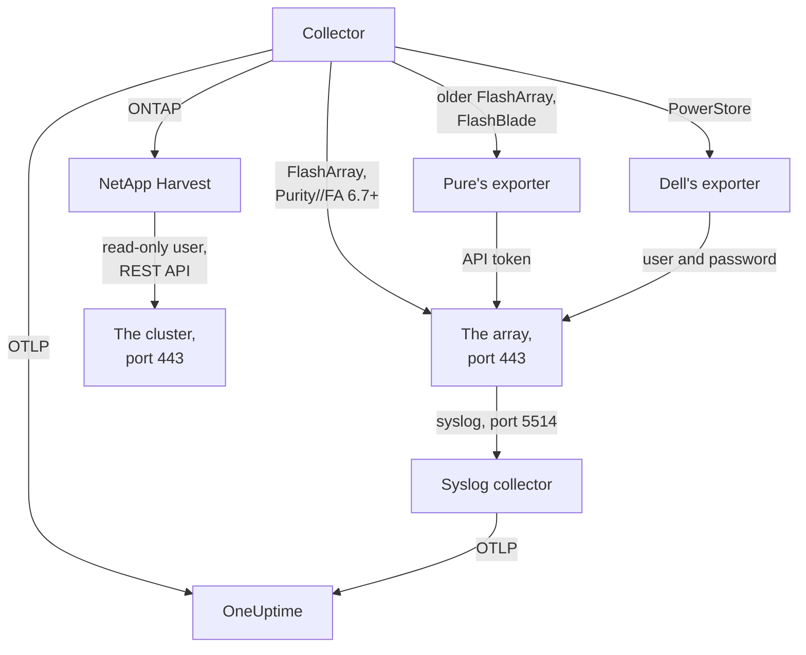

# Storage Array Agent

The OneUptime Storage Array agent monitors storage arrays: capacity and data reduction, latency, IOPS and bandwidth, volumes, hosts, pods and replication, hardware health, file systems and buckets, and on NetApp ONTAP its aggregates, SVMs, LUNs and SnapMirror relationships. It is a stock OpenTelemetry Collector that scrapes the array's OpenMetrics endpoints with a read-only user's API token (or, for ONTAP, NetApp's own Harvest exporter beside it), stamps every metric with your array's identity and sends it to OneUptime. [Storage array monitors](/docs/monitor/storage-array-monitor) alert on what arrives.

:::cards
- [Install the agent](#install-the-agent): A read-only user, then the install script or Docker Compose.
- [Dell PowerScale](#dell-powerscale): SNMP on the cluster, every node polled, and what its pages show.
- [What the agent collects](#what-the-agent-collects): Every endpoint, and the pages built from it.
- [Monitoring several arrays](#monitoring-several-arrays): One agent per array, on one machine.
- [Troubleshooting](#troubleshooting): A diagnostic script, and the usual problems.
:::

## How it works

Storage Arrays is a product that works the same way for every vendor. It supports:

| Array | `storage.system` | How the agent reads it | Collector config |
| --- | --- | --- | --- |
| **Pure Storage FlashArray**, Purity//FA 6.7 and later | `purestorage.flasharray` | The array's own OpenMetrics endpoint (`https://<array>/metrics/...?namespace=purefa`): nothing runs beside the collector | `otel-collector-config.yaml` (the default) |
| **Pure Storage FlashArray**, older Purity//FA | `purestorage.flasharray` | Pure's FlashArray OpenMetrics exporter, which the same Compose file runs as the `pure-fa-exporter` service | `otel-collector-config.flasharray-exporter.yaml` |
| **Pure Storage FlashBlade** | `purestorage.flashblade` | Pure's FlashBlade OpenMetrics exporter, which the same Compose file runs as the `pure-fb-exporter` service | `otel-collector-config.flashblade.yaml` |
| **Dell PowerStore** | `dell.powerstore` | Dell's PowerStore Metrics Exporter, which the same Compose file builds and runs as the `powerstore-exporter` service; the cluster's alerts arrive by syslog at its `powerstore-syslog` service | `otel-collector-config.powerstore.yaml` |
| **NetApp ONTAP** 9.12.1 and later (AFF, FAS, ASA, ONTAP Select, Cloud Volumes ONTAP), and **Amazon FSx for NetApp ONTAP** | `netapp.ontap` | [NetApp Harvest](https://github.com/NetApp/harvest) 26.11, which the same Compose file runs as the `netapp-harvest` service: it logs in to the cluster's REST API with a read-only user and password | `otel-collector-config.netapp-ontap.yaml` |
| **Dell PowerScale** (Isilon), OneFS 8.0 and later | `dell.powerscale` | Each node over SNMP (Dell's ISILON-MIB), with the collector's own SNMP receiver: nothing runs beside the collector | `otel-collector-config.powerscale.yaml` |

ONTAP has no metrics endpoint of its own, so the agent runs NetApp's open-source exporter, Harvest, next to the collector. Harvest reads the cluster's REST API and serves what it read on the Compose network, every series named `netapp_<object>_<counter>`; the collector scrapes it and sends it on. Harvest never writes to the cluster, and its AutoSupport report to NetApp is turned off.

Pure Storage renamed itself **Everpure** in February 2026. FlashArray, FlashBlade and Purity kept their names, and so did the `purefa_*` and `purefb_*` metrics, so everything on this page applies to arrays sold under either name.

A **Dell PowerScale** cluster is read another way: the agent polls each of its nodes over SNMP, with a read-only community or SNMPv3 user and no API token. [Dell PowerScale](#dell-powerscale) takes it from turning SNMP on to what its pages show; the install steps below are Pure Storage's.



One agent monitors one array: run one agent per array (see [Monitoring several arrays](#monitoring-several-arrays)). The array registers itself with its first data, under the name the agent stamps on every metric as `storage.array.name`.

## Before you begin

- Docker Engine 20.10 or later with the Docker Compose v2 plugin, on a machine that can reach the array's management interface over HTTPS (TCP 443).
- An administrator account on the array, to create a user with the built-in **readonly** role and an API token for it. On ONTAP, a cluster administrator (on Amazon FSx for NetApp ONTAP, `fsxadmin`), to create a read-only REST user with a password.
- For a Dell PowerStore, an x86-64 machine (Dell builds its exporter for x86-64 only) and a PowerStore user for the agent: see [Dell PowerStore](#dell-powerstore).
- An ingestion key. Create one under **Project Settings → Telemetry & APM → Ingestion Keys** and copy its value.

### Where to run the agent

The agent talks to the array's management interface over HTTPS, so it can run on any machine with Docker and a route to the management network on TCP 443: a monitoring host, or a small management VM. Prefer a machine whose own storage does not live on the array it watches: if the array goes down, your monitoring should not go down with it. The optional syslog listener also needs the array to reach the agent on the syslog port (see [Ship the array's syslog](#optional-ship-the-arrays-syslog)).

## Install the agent

:::steps
### Create the read-only user and API token

The agent only ever reads. Give it a user of its own with the built-in **readonly** role, never an administrator, and an API token for that user. Create the token **without an expiry**, or the agent stops the day the token expires.

:::tabs
@tab Purity CLI
SSH to the FlashArray as an administrator. The first command asks for the new user's password; the second prints its API token, a UUID:

```bash
pureadmin create --role readonly oneuptime
pureadmin create --api-token oneuptime
```
@tab FlashArray GUI
1. Open _Settings → Users and Policies_ (_Settings → Access_ on older releases).
2. From the ⋮ menu of the **Users** panel, choose **Create User…**, name the user `oneuptime` and give it the readonly role.
3. From the new user's ⋮ menu, choose **Create API Token…**, leave **Expires In** empty, and copy the token.
@tab FlashBlade
Create a user with the **readonly** role and an API token for it the same way: in the FlashBlade GUI's user settings, or with `pureadmin` in the Purity//FB CLI. On a release without local users, use a directory service (LDAP or Active Directory) account whose group maps to the readonly role. FlashBlade API tokens start with `T-`.
@tab ONTAP CLI
SSH to the cluster management address as an administrator. The first command creates a REST role that may read every API and nothing else; the second creates an HTTP user that holds it, and asks for its password:

```bash
security login rest-role create -role oneuptime-readonly -api /api -access readonly
security login create -user-or-group-name oneuptime -application http -authentication-method password -role oneuptime-readonly
```

The agent logs in with this user and password. No API token is involved.
@tab ONTAP System Manager
1. Open _Cluster → Settings → Users and Roles_.
2. Under **Roles**, choose **Add**, name the role `oneuptime-readonly`, enter `/api` as the **REST API path** and choose **Read-Only** access.
3. Under **Users**, choose **Add**, name the user `oneuptime`, give it the new role, add the **HTTP** login method with **Password**, and set the password.
@tab Amazon FSx for NetApp ONTAP
SSH to the file system's management endpoint (its DNS name or IP, from the FSx console) as `fsxadmin`, and create the user with FSx's predefined read-only role. The command asks for its password:

```bash
security login create -user-or-group-name oneuptime -application http -authentication-method password -role fsxadmin-readonly
```

AWS runs the file system's hardware, so FSx answers nobody's questions about disks, shelves or sensors: the array's **Hardware** page lists its nodes and ports and says so.
:::

### Check whether the FlashArray serves its own metrics

Pure documents the native OpenMetrics endpoint for **Purity//FA 6.7.0 and later** (the deprecation notice on Pure's FlashArray exporter says 6.6.11 and later). The quickest way to know is to ask the array, from the machine the agent will run on:

```bash
curl -k 'https://<array>/metrics/array?namespace=purefa' --header 'Authorization: Bearer <api-token>' | grep purefa_info
```

A `purefa_info{...} 1` line means the array serves its metrics natively: use the default config. A `404` means it does not: use the exporter config, which runs Pure's exporter next to the collector. Pure has deprecated that exporter, so move to the native config once the array is upgraded. A FlashBlade always goes through Pure's FlashBlade exporter, and an ONTAP cluster through NetApp Harvest, so skip this step for them.

### Install and start the agent

Every OneUptime serves the agent's install script and files for its own release: the commands below download them from `https://oneuptime.com`, so on a self-hosted OneUptime replace it with your URL. The install script is saved as `install.sh` first, so you can read it before you run it.

:::tabs
@tab install.sh
Download the install script and run it on the machine that will host the agent:

```bash
curl -fsSL https://oneuptime.com/install/storage-array-agent -o install.sh
bash install.sh
```

The script asks which array this is (a FlashArray serving native metrics, a FlashArray on an older Purity//FA, a FlashBlade, or a NetApp ONTAP cluster), then for your OneUptime URL, the ingestion key, a name for the array, the array's management address and the read-only user's API token, or for ONTAP the read-only user's name and password (read without echo). It installs to `/opt/oneuptime-storage-array-agent`, downloads the Compose file, every collector config and Harvest's four files, writes a `0600` `.env` file with the matching config and Compose profile, and starts the agent with Docker Compose. It quotes every value for Docker Compose as you typed it. Running it again reuses everything in an existing `.env` instead of prompting again, and keeps a file you edited as `<file>.bak.<timestamp>` before replacing it.
@tab Docker Compose
Download `docker-compose.yml` and the three `otel-collector-config*.yaml` files from your OneUptime into a new folder:

```bash
curl -fsSLO https://oneuptime.com/install/storage-array-agent/docker-compose.yml
curl -fsSLO https://oneuptime.com/install/storage-array-agent/otel-collector-config.yaml
curl -fsSLO https://oneuptime.com/install/storage-array-agent/otel-collector-config.flasharray-exporter.yaml
curl -fsSLO https://oneuptime.com/install/storage-array-agent/otel-collector-config.flashblade.yaml
```

Create a `.env` file next to them. It holds the API token, so keep it private with `chmod 600 .env`. For a FlashArray that serves native metrics:

```bash title=".env"
ONEUPTIME_URL=YOUR_ONEUPTIME_URL
ONEUPTIME_TELEMETRY_INGESTION_KEY=YOUR_TELEMETRY_INGESTION_TOKEN
STORAGE_ARRAY_NAME=my-storage-array
STORAGE_SYSTEM=purestorage.flasharray
STORAGE_ARRAY_COLLECTOR_CONFIG=otel-collector-config.yaml
COMPOSE_PROFILES=
PURE_FA_ENDPOINT=fa-prod-01.example.com
PURE_FA_API_TOKEN=YOUR_READ_ONLY_API_TOKEN
PURE_FB_ENDPOINT=
PURE_FB_API_TOKEN=
POWERSCALE_ENDPOINT=
POWERSCALE_SNMP_COMMUNITY=
STORAGE_ARRAY_INSECURE_SKIP_VERIFY=true
POWERSTORE_ENDPOINT=
POWERSTORE_PASSWORD=
POWERSTORE_USERNAME=
POWERSTORE_BULK_METRICS=
POWERSTORE_API_VERSION=
POWERSTORE_REQUEST_LIMIT=
POWERSTORE_SYSLOG_PORT=
```

For a Dell PowerStore, also download `otel-collector-config.powerstore.yaml`, `powerstore-exporter.Dockerfile` and `powerstore-syslog.yaml`, set `STORAGE_SYSTEM=dell.powerstore`, `STORAGE_ARRAY_COLLECTOR_CONFIG=otel-collector-config.powerstore.yaml` and `COMPOSE_PROFILES=powerstore`, and fill in `POWERSTORE_ENDPOINT`, `POWERSTORE_USERNAME` and `POWERSTORE_PASSWORD`, the password in single quotes.

For a FlashArray on an older Purity//FA, set `STORAGE_ARRAY_COLLECTOR_CONFIG=otel-collector-config.flasharray-exporter.yaml` and `COMPOSE_PROFILES=flasharray-exporter`. For a FlashBlade, set `STORAGE_SYSTEM=purestorage.flashblade`, `STORAGE_ARRAY_COLLECTOR_CONFIG=otel-collector-config.flashblade.yaml` and `COMPOSE_PROFILES=flashblade`, and fill in `PURE_FB_ENDPOINT` and `PURE_FB_API_TOKEN` instead of the `PURE_FA_*` pair.

For a NetApp ONTAP cluster or Amazon FSx for NetApp ONTAP, also download the ONTAP config and Harvest's four files:

```bash
curl -fsSLO https://oneuptime.com/install/storage-array-agent/otel-collector-config.netapp-ontap.yaml
curl -fsSLO https://oneuptime.com/install/storage-array-agent/netapp-harvest.yml
curl -fsSLO https://oneuptime.com/install/storage-array-agent/netapp-harvest-rest.yaml
curl -fsSLO https://oneuptime.com/install/storage-array-agent/netapp-harvest-keyperf.yaml
curl -fsSLO https://oneuptime.com/install/storage-array-agent/netapp-harvest-restperf.yaml
```

and use this `.env`. Keep the password in single quotes, as here: Docker Compose then reads it exactly as written, whatever it holds. A password with a `'` in it goes in double quotes instead, with `\"`, `\\` and `$$` for a `"`, a `\` and a `$`:

```bash title=".env"
ONEUPTIME_URL=YOUR_ONEUPTIME_URL
ONEUPTIME_TELEMETRY_INGESTION_KEY=YOUR_TELEMETRY_INGESTION_TOKEN
STORAGE_ARRAY_NAME=ontap-prod-01
STORAGE_SYSTEM=netapp.ontap
STORAGE_ARRAY_COLLECTOR_CONFIG=otel-collector-config.netapp-ontap.yaml
COMPOSE_PROFILES=netapp-ontap
NETAPP_ONTAP_ENDPOINT=ontap-prod-01.example.com
NETAPP_ONTAP_USERNAME=oneuptime
NETAPP_ONTAP_PASSWORD='YOUR_READ_ONLY_USER_PASSWORD'
STORAGE_ARRAY_INSECURE_SKIP_VERIFY=true
```

Start the agent:

```bash
docker compose up -d
```
:::

### Check the agent is running

```bash
docker compose ps
docker logs -f oneuptime-storage-array-agent
```

`docker compose ps` lists the collector (`oneuptime-storage-array-agent`) and, with an exporter config, the exporter (`pure-fa-exporter`, `pure-fb-exporter` or `netapp-harvest`). The collector's logs should show this line once it has started:

```text
Everything is ready. Begin running and processing data.
```

### Find the array in OneUptime

Open **Products → Infrastructure → Storage Arrays → All Storage Arrays**. After the first scrape (about a minute) the array is there with its capacity, performance, open alerts and hardware. Volumes, hosts and pods follow within 2 minutes, a FlashBlade's file systems and buckets within 5, and FlashArray directories within 30. An ONTAP cluster appears once Harvest has read it, and its whole inventory within about 3 minutes, Harvest's poll of its configuration. The array's **Topology** page draws its hosts, volumes, file systems and hardware as one map: see [Topology](/docs/telemetry/topology#open-a-resources-own-map).
:::

## Dell PowerStore

The agent reads a PowerStore cluster through Dell's PowerStore Metrics Exporter, release `powerstore-metrics-exporter_v1.0.3`. Dell publishes it as a binary, not an image, so the `powerstore-exporter` service builds Dell's documented image from `powerstore-exporter.Dockerfile` when it first starts, checking the binary's SHA-256; that build needs `quay.io` and `github.com` once.

Dell's exporter logs in with a user name and password, since PowerStore has no API tokens. In PowerStore Manager, add a local user for the agent alone under _Settings → Users_, with the **Storage Operator** role: the exporter reads performance from PowerStore's five-minute bulk metrics archive, which it turns on itself and which PowerStoreOS 4.1 and later require, and Dell's README says the Operator role cannot turn it on. On an older PowerStoreOS, the read-only **Operator** role is enough with `POWERSTORE_BULK_METRICS=false`. Only the exporter reads the password, from `.env`.

Dell's exporter reads no alerts, so the cluster sends its own: the `powerstore-syslog` service takes its remote syslog on port 5514, TCP and UDP, and files every line on the array's **Logs** page with PowerStore's record in attributes (`powerstore.alert.id`, `powerstore.alert.state`, `powerstore.event.code`) and a severity from Dell's event codes (`powerstore.alert.severity`). In PowerStore Manager, open _Settings → Security → Remote Logging_, add this machine on port 5514, and open the port in its firewall. Syslog over TLS on port 6514 is described in `powerstore-syslog.yaml`.

Dell's exporter reports no hosts and no replication sessions, so this version has neither.

## Environment variables

The install script writes these to `/opt/oneuptime-storage-array-agent/.env`; a Docker Compose install reads them from the `.env` next to `docker-compose.yml`. After changing one, run `docker compose up -d` in that folder.

| Variable | Required | Description |
| --- | --- | --- |
| `ONEUPTIME_URL` | Yes | Your OneUptime URL, such as `https://oneuptime.com` or your self-hosted instance. Use `http://` and its port if the instance is HTTP-only. |
| `ONEUPTIME_TELEMETRY_INGESTION_KEY` | Yes | The ingestion key from **Project Settings → Telemetry & APM → Ingestion Keys**. |
| `STORAGE_ARRAY_NAME` | Yes | The name the array registers under in OneUptime, stamped on every metric as the `storage.array.name` resource attribute. Keep it stable: changing it later registers a second array. The collector refuses to start without it. |
| `STORAGE_SYSTEM` | No | The platform, stamped as the `storage.system` resource attribute: `purestorage.flasharray`, `purestorage.flashblade` or `netapp.ontap`. Defaults to `purestorage.flasharray`. |
| `STORAGE_ARRAY_COLLECTOR_CONFIG` | No | Which shipped collector config runs: `otel-collector-config.yaml` (FlashArray, native: the default), `otel-collector-config.flasharray-exporter.yaml` (older FlashArray), `otel-collector-config.flashblade.yaml` (FlashBlade) or `otel-collector-config.netapp-ontap.yaml` (ONTAP). |
| `COMPOSE_PROFILES` | No | Starts the exporter the chosen config scrapes: empty for the native FlashArray config, `flasharray-exporter`, `flashblade` or `netapp-ontap` for the others. |
| `PURE_FA_ENDPOINT` | FlashArray | The FlashArray's management address: a host name or IP, without `https://`. |
| `PURE_FA_API_TOKEN` | FlashArray | The API token of the FlashArray user with the readonly role. |
| `PURE_FB_ENDPOINT` | FlashBlade | The FlashBlade's management address: a host name or IP, without `https://`. |
| `PURE_FB_API_TOKEN` | FlashBlade | The API token of the FlashBlade user with the readonly role. |
| `POWERSTORE_ENDPOINT` | PowerStore | The PowerStore cluster's management address: a host name or IP, without `https://`. |
| `POWERSTORE_USERNAME` | PowerStore | The PowerStore user Dell's exporter logs in as. |
| `POWERSTORE_PASSWORD` | PowerStore | That user's password. Only the exporter reads it. |
| `POWERSTORE_BULK_METRICS` | No | `true` reads performance from PowerStore's bulk metrics archive; `false` reads each object one by one. Defaults to `true`. |
| `POWERSTORE_API_VERSION` | No | `v3` for PowerStoreOS 3.6 and later, or `v1`. Defaults to `v3`. |
| `POWERSTORE_REQUEST_LIMIT` | No | How many requests the exporter sends the cluster at once. Defaults to `16`. |
| `POWERSTORE_SYSLOG_PORT` | No | The port this machine takes the cluster's syslog on, TCP and UDP. Defaults to `5514`. |
| `NETAPP_ONTAP_ENDPOINT` | ONTAP | The cluster management address (on FSx, the file system's management endpoint): a host name or IP, without `https://`. |
| `NETAPP_ONTAP_USERNAME` | ONTAP | The read-only REST user, such as `oneuptime`. |
| `NETAPP_ONTAP_PASSWORD` | ONTAP | Its password. Only Harvest reads it, exactly as written. |
| `POWERSCALE_NODES` | PowerScale | Every node's address, separated by commas, never the SmartConnect zone name. The install script writes the polls below from it. |
| `POWERSCALE_ENDPOINT` | PowerScale | The node the cluster's own health, capacity and quotas are read through: the first in `POWERSCALE_NODES`. |
| `POWERSCALE_SNMP_RECEIVERS` | PowerScale | The polls the collector runs: `snmp/cluster`, `snmp/quotas`, then `snmp/node-1` and on, one per node. |
| `POWERSCALE_NODE_<n>` | PowerScale | Node `<n>`'s address, from `1` to `252`. An IPv6 address goes in brackets, such as `[fd00::11]`. |
| `POWERSCALE_SNMP_VERSION` | No | `v2c` or `v3`. Defaults to `v2c`. |
| `POWERSCALE_SNMP_COMMUNITY` | SNMP v2c | The cluster's read-only community. |
| `POWERSCALE_SNMP_USER` | SNMPv3 | The cluster's SNMPv3 read-only user. |
| `POWERSCALE_SNMP_SECURITY_LEVEL` | No | `auth_priv`, `auth_no_priv` or `no_auth_no_priv`. Defaults to `auth_priv`. |
| `POWERSCALE_SNMP_AUTH_PROTOCOL` | No | `MD5`, `SHA`, `SHA224`, `SHA256`, `SHA384` or `SHA512`, as `isi snmp settings view` shows it. Defaults to `SHA`. |
| `POWERSCALE_SNMP_AUTH_PASSWORD` | SNMPv3 | The SNMPv3 user's authentication password. |
| `POWERSCALE_SNMP_PRIVACY_PROTOCOL` | No | `DES`, `AES`, `AES192`, `AES256`, `AES192C` or `AES256C`. Defaults to `AES`. |
| `POWERSCALE_SNMP_PRIVACY_PASSWORD` | SNMPv3 | The SNMPv3 user's privacy password, at the `auth_priv` level. |
| `STORAGE_ARRAY_INSECURE_SKIP_VERIFY` | No | `true` accepts the array's self-signed certificate on the native endpoint and in Harvest; `false` verifies it. Defaults to `true`. Pure's exporters never verify the array's certificate, so it does not apply to them. |

## How the agent scrapes

- **One scrape job per endpoint, each read as often as it is worth.** FlashArray: `/metrics/array` every 60 seconds; `/metrics/volumes`, `/metrics/hosts` and `/metrics/pods` every 2 minutes; `/metrics/directories` every 30 minutes, which is Pure's own advice, since directory space is expensive for the array to work out. FlashBlade: `/metrics/array` every 60 seconds; `/metrics/filesystems` and `/metrics/objectstore` every 5 minutes, again following Pure's advice to read the file system and object store endpoints less often than the array.
- **Every job labels its series `scrape_endpoint: <endpoint>`.** Each endpoint also exports `purefa_info` or `purefb_info`, so OneUptime knows which families a batch is the complete list of: that is how a deleted volume, host, pod, file system or bucket leaves the inventory instead of lingering. Keep the labels as shipped.
- **Per-volume and per-host latency keeps three dimensions.** Each volume and host exports its latency in up to sixteen `dimension`s. A `metric_relabel_configs` rule keeps `usec_per_read_op`, `usec_per_write_op` and `usec_per_mirrored_write_op` and drops the QoS rate limit, queue, SAN and service-time breakdown, which multiplies the series of a large array. The array-wide breakdown on `purefa_array_performance_latency_usec` is kept. Delete the rule to keep the per-volume breakdown too.
- **The API token is a Bearer token.** The native config sends it to the array itself; the exporter configs send it to the exporter over the Compose network only, and the exporters' ports are never published.
- **A PowerStore every 5 minutes.** Dell's exporter serves each part of the cluster at `/metrics/<cluster>/<part>`: the config reads `cluster` every 60 seconds, its heartbeat, and `appliance`, `capacity`, `hardware`, `port`, `volume`, `volumeGroup`, `nas` and `file` every 5 minutes, as PowerStore works them out in five-minute samples.
- **No `send_batch_max_size`.** OneUptime rebuilds the inventory from one whole scrape per request, so the shipped `batch` processor never splits a scrape across exports. Keep the batch settings as shipped.
- **ONTAP: Harvest polls the cluster, the collector scrapes Harvest.** Harvest reads the cluster's configuration and state every 3 minutes, its performance every minute (latencies in microseconds per operation, operations and bytes per second) and its EMS events every 3 minutes, and serves the latest of everything on `netapp-harvest:12990`, which the collector scrapes every 60 seconds with the label `scrape_endpoint: harvest`. The three `netapp-harvest-*.yaml` files limit Harvest to what OneUptime reads. Harvest's own `netapp_metadata_*` series say which objects it listed in full, so a deleted volume leaves the inventory while an object Harvest could not read keeps its last count. The collector drops Harvest's measurements of itself and the per-disk performance series, and turns each SnapMirror relationship's schedule into `netapp_snapmirror_schedule_seconds` (an hourly schedule is 3600), which SnapMirror Behind Schedule compares the lag with.

## What the agent collects

Pure's semantic conventions are shared by the FlashArray native endpoint and both exporters; ONTAP's are Harvest's, described after the table. Every value is a gauge the array works out itself (latencies in microseconds per operation, throughput per second), so no rates need computing, and objects are named by **datapoint labels**: `name` for volumes, pods, directories, file systems and buckets, `host` for hosts, `component_name` for FlashArray hardware. The agent adds the `storage.array.name` and `storage.system` resource attributes, so OneUptime files everything under your array:

| Endpoint | Metric families | What OneUptime builds from them |
| --- | --- | --- |
| FlashArray `/metrics/array` | `purefa_info`, `purefa_alerts_open`, `purefa_array_space_*`, `purefa_array_performance_*`, `purefa_hw_component_status`, `purefa_hw_component_temperature_celsius`, `purefa_hw_controller_info`, `purefa_drive_capacity_bytes`, `purefa_network_interface_*` | The array's name, Purity version and system ID; capacity, used space and data reduction; open alert counts; the array's health; the **Hardware** page (components, drives, controllers, network interfaces) |
| FlashArray `/metrics/volumes` | `purefa_volume_performance_*`, `purefa_volume_space_*`, `purefa_volume_qos_*` | The **Volumes** page: provisioned and physical size, data reduction, read and write latency, IOPS and bandwidth per volume |
| FlashArray `/metrics/hosts` | `purefa_host_connectivity_info`, `purefa_host_connections_info`, `purefa_host_performance_*`, `purefa_host_space_*` | The **Hosts** page: connectivity (redundant paths or not), connected volumes, latency, IOPS and bandwidth per host |
| FlashArray `/metrics/pods` | `purefa_pod_performance_*`, `purefa_pod_space_*`, `purefa_pod_replica_links_*`, `purefa_pod_mediator_status` | The **Replication** page: ActiveCluster and ActiveDR pods, replica link status and lag |
| FlashArray `/metrics/directories` | `purefa_directory_performance_*`, `purefa_directory_space_*` | The **Directories** page (FlashArray File Services) |
| FlashBlade `/metrics/array` | `purefb_info`, `purefb_alerts_open`, `purefb_array_space_*`, `purefb_array_performance_*`, `purefb_hardware_health` | The FlashBlade's name, Purity version and system ID; capacity and data reduction; open alert counts; the array's health; the **Hardware** page |
| FlashBlade `/metrics/filesystems` | `purefb_file_systems_space_*`, `purefb_file_systems_performance_*` | The **File Systems** page: provisioned and used space, data reduction, latency, IOPS and bandwidth per file system |
| FlashBlade `/metrics/objectstore` | `purefb_buckets_space_*`, `purefb_buckets_quota_space_bytes`, `purefb_buckets_object_count`, `purefb_buckets_performance_*`, `purefb_object_store_accounts_*` | The **Buckets** page: space, quota, object count and performance per bucket, grouped by account |
| PowerStore `cluster`, `appliance`, `capacity` | `powerstore_cluster`, `powerstore_metro_*`, `powerstore_appliance`, `powerstore_perf_*`, `powerstore_cap_*` | The cluster's name and state; the **Appliances** page: each appliance's capacity, data reduction, latency, IOPS and bandwidth |
| PowerStore `hardware`, `port` | `powerstore_hardware_*`, `powerstore_wear_metrics_by_drive`, `powerstore_fc_port_*`, `powerstore_eth_port_*`, `powerstore_metricFcPort_*`, `powerstore_metricEthPort_*` | The **Hardware** page: nodes, fans, power supplies, batteries, drives and front-end ports, each with its appliance |
| PowerStore `volume`, `volumeGroup`, `nas`, `file` | `powerstore_volume_*`, `powerstore_metricVolume_*`, `powerstore_volumegroup_*`, `powerstore_metricVg_*`, `powerstore_nas_server_operational_status`, `powerstore_metricNas_*`, `powerstore_filesystem_*`, `powerstore_metricFilesystem_*` | The **Volumes**, **Volume Groups**, **NAS Servers** and **File Systems** pages |
| ONTAP, through Harvest | `netapp_cluster_*`, `netapp_node_*`, `netapp_aggr_*`, `netapp_svm_*`, `netapp_volume_*`, `netapp_lun_*`, `netapp_snapmirror_*` | The cluster's name, release and UUID; its capacity (its data aggregates', summed) and data reduction; the **Volumes** page; the **Aggregates**, **SVMs**, **LUNs** and **SnapMirror** pages, a page per object |
| ONTAP hardware, through Harvest | `netapp_disk_*`, `netapp_shelf_*`, `netapp_environment_sensor_*`, `netapp_net_port_*`, `netapp_nic_*`, `netapp_fcp_*` | The **Hardware** page: nodes, disks, shelves, their power supplies, fans, modules and sensors, the nodes' sensors, and Ethernet and Fibre Channel ports |
| ONTAP's open problems and events | `netapp_health_*`, `netapp_ems_events` | The open alert counts and the **Active Alerts** card (broken disks, shelf faults, HA takeover, ports down, system health alerts), and the EMS templates |
| PowerScale `snmp/cluster` | `powerscale_cluster_*`, `powerscale_ifs_*` | The cluster's name, OneFS version, health and node counts; the capacity of `/ifs`; throughput, network and CPU across the cluster |
| PowerScale `snmp/quotas` | `powerscale_quota_*` | The **Quotas** page: each quota's usage, its limits and how close it is to them |
| PowerScale `snmp/node-<n>` | `powerscale_node_*`, `powerscale_protocol_*`, `powerscale_drive_*`, `powerscale_fan_*`, `powerscale_temperature_*`, `powerscale_power_sensor_*`, `powerscale_interface_*`, `powerscale_chassis_*` | The **Nodes** page: each node's health, CPU, throughput and protocol performance; the **Hardware** page: its drives, sensors and ports |

On ONTAP every series is Harvest's: an object is named by its labels (`volume` within its `svm`, `aggr`, `lun`, `node`, `disk`, `shelf`, `destination_location` for a SnapMirror relationship), a state is a `netapp_*_new_status` of 1 or 0 or a `netapp_*_labels` series whose labels say it, and each open problem is a `netapp_health_*_alerts` series that exists while it lasts.

The **Health** column of **All Storage Arrays** reads the array's own alerts and hardware in its latest data: **Critical** while it reports an open critical alert, or a hardware component, drive or controller that is critical, failed, missing or unhealthy; **Warning** while it reports an open warning alert, or a degraded or unknown component; **OK** otherwise; and **Unknown** while the agent is disconnected. The array's **Overview** judges more, as the next section says. In monitor criteria, the array's attributes take a `resource.` prefix (`resource.storage.array.name`, `resource.storage.system`), while the datapoint labels stay bare (`name`, `host`, `dimension`, `space`).

A PowerStore's health is its hardware's, since its alerts arrive as logs. The agent works out `powerstore_cap_physical_used_percent` and `powerstore_filesystem_logical_used_percent` itself, and reads a node's state as 1 while it is Healthy.

## What the array's pages show

The array's **Overview** says its health, **Healthy**, **Degraded** or **Unhealthy**, from what needs attention, and lists that under **Needs attention**, the most urgent first, each one step from where to look:

- **The array itself.** An open alert the array raised with critical severity is critical, and one with warning severity needs a look. Past 80% of its usable capacity it needs a look, and past 90% it is critical, where the Capacity Above 80% and Capacity Above 90% alerts fire. A FlashArray whose average read or write latency is past 5 ms, or a FlashBlade whose reads take longer than 10 ms, needs a look.
- **Hardware.** A component, drive, controller or network interface the array reports critical, failed, missing or unhealthy is critical: its redundancy is gone until the part is replaced. One it reports degraded, unknown, unrecognized or not ready needs a look. Parts that are not installed, powered off or unused are never listed.
- **Hosts.** A host that no longer reaches the array through both controllers needs a look, with why: through one controller only, over uneven paths, or with no path at all.
- **Pods.** A pod whose replica link the array reports unhealthy is critical, and one more than a minute behind needs a look.
- **File systems.** A FlashBlade file system with less than 10% of its provisioned size left needs a look.
- **An ONTAP cluster's own objects.** A volume, aggregate or LUN ONTAP reports offline, a broken disk, a shelf part in error, a node sensor past its critical threshold and a port that is down are critical; a stopped SVM, a node with a failed fan or power supply and a sensor past its warning threshold need a look, with ONTAP's own words for why. A SnapMirror relationship ONTAP reports unhealthy is critical, and one more than one and a half schedule intervals behind needs a look.

The **Hosts**, **Replication** and **File Systems** lists say each part's state by the same rules, with why under it, and so do an ONTAP cluster's **Volumes**, **Aggregates**, **SVMs**, **LUNs** and **SnapMirror** lists, whose every row opens a page of its own: its state, what needs attention, what is open on it, the cluster's alerts that watch it, what ONTAP reports about it and its charts. Each platform's pages speak its own words: an ONTAP volume lists its SVM, its aggregate and how full it is, and its page charts ONTAP's series. On Amazon FSx for NetApp ONTAP, the **Hardware** page lists the nodes and ports and says why there are no disks or shelves. A host's and a file system's own page says what about it needs attention and which of the array's alerts watch it, with one step to turn on the rest, and every part's page, a volume's and a bucket's too, says what is open on it. While the agent is disconnected, the health reads **Health Unknown**: the array's last report is no longer the truth. Every line above is the one its alert template fires at, as the [Storage Array Monitor](/docs/monitor/storage-array-monitor) lists them.

On a PowerStore, the **Appliances**, **Volume Groups** and **NAS Servers** tabs list the parts only a PowerStore has, and the **Hardware** page names each part's appliance, since every appliance names its parts alike.

## Optional — Ship the array's syslog

A PowerStore's syslog collector runs as shipped (see [Dell PowerStore](#dell-powerstore)): this section is for Pure's arrays.

By default the agent sends metrics only, so the array's **Logs** page stays empty. Arrays forward their alerts and audit events as syslog, and every shipped collector config has a commented-out `syslog` receiver pair (TCP and UDP on port 5514, RFC 3164), wired to a commented `logs` pipeline that stamps `storage.array.name` so the logs land on your array.

:::steps
### Turn the receivers on

Uncomment the two `syslog/*` receivers and the `logs` pipeline in the collector config you use. RFC 3164 timestamps carry no time zone: set `location` to the array's time zone unless its clock runs on UTC.

### Open the port

Uncomment the `ports:` block in `docker-compose.yml`, so the machine publishes `5514/tcp` and `5514/udp`, then run `docker compose up -d`. Open the port in the machine's firewall for the array's management network.

### Point the array at the agent

Do this as an administrator, not as the read-only monitoring user. On a FlashArray, open _Settings → System → Syslog Servers_, add `udp://<agent-host>:5514` (or `tcp://<agent-host>:5514`) and send a test message. On a FlashBlade, add a syslog server with the same URI in its syslog settings. Both arrays take the `PROTOCOL://HOST:PORT` form, through their REST APIs (`syslog-servers`) too.
:::

A syslog receiver listens on only one transport, which is why TCP and UDP are two receivers: leave one commented if you need only the other. The stock collector image reads syslog as it is: no custom image is needed.

## Tag the array with project labels

A resource attribute that starts with `oneuptime.label.` becomes a project label on the storage array: `oneuptime.label.<dimension>=<value>` is the label `<dimension>:<value>`. Add the attributes to the `resource` processor in the collector config you use, next to `storage.array.name`:

```yaml
processors:
  resource:
    attributes:
      # ...existing attributes...
      - key: oneuptime.label.team
        value: storage
        action: upsert
      - key: oneuptime.label.env
        value: production
        action: upsert
```

The collector reads its config only when it starts: run `docker compose restart oneuptime-storage-array-agent`. The array then shows the labels `team:storage` and `env:production`. Labels are matched without regard to case, so an existing `Production` label is reused rather than duplicated, and the agent never removes a label someone added in OneUptime.

## Monitoring several arrays

One agent reads one array. To monitor several from the same machine, install each into its own folder with its own `.env`, such as `INSTALL_DIR=/opt/oneuptime-storage-array-agent-fa02 bash install.sh`, and give each its own `container_name` in its `docker-compose.yml` (such as `oneuptime-storage-array-agent-fa02`): two containers cannot share a name. Pass the folder to the diagnostic script with `-d`.

A second PowerStore agent also needs a syslog port of its own: set `POWERSTORE_SYSLOG_PORT`, such as `5515`, in its `.env`.

## Run as a systemd service

To start the agent with the machine and restart it when it fails, install its systemd unit. It assumes the agent lives in `/opt/oneuptime-storage-array-agent`, where the install script puts it:

```bash
sudo curl -fsSL https://oneuptime.com/install/storage-array-agent/systemd/oneuptime-storage-array-agent.service -o /etc/systemd/system/oneuptime-storage-array-agent.service
sudo systemctl daemon-reload
sudo systemctl enable --now oneuptime-storage-array-agent
```

## Upgrading the agent

The agent reports the collector version its files pin as its **Agent Version**. When that is older than the version this OneUptime release pins, a warning sign appears beside it on the array's **Overview**. Select it to see these commands. An agent installed before its files reported a version shows none until it is upgraded this way.

The collector image is pinned in `docker-compose.yml` and its configs are files next to it, so pulling alone does not move the agent forward. Run `install.sh` again: it reuses every value in your existing `.env` (nothing is prompted for again), refreshes `docker-compose.yml`, every collector config and Harvest's files (a file you edited is kept as `<file>.bak.<timestamp>`), and recreates the agent so the collector reads its new config. An agent installed outside `/opt/oneuptime-storage-array-agent` needs its folder: `INSTALL_DIR=<folder> bash install.sh`.

```bash
curl -fsSL https://oneuptime.com/install/storage-array-agent -o install.sh
bash install.sh
```

Installed it with Docker Compose instead? In the agent's folder, download the Compose file and the collector configs again (for ONTAP, the ONTAP config and Harvest's four files too, and make again any change you made to them), then pull the images and recreate the agent:

```bash
curl -fsSLO https://oneuptime.com/install/storage-array-agent/docker-compose.yml
curl -fsSLO https://oneuptime.com/install/storage-array-agent/otel-collector-config.yaml
curl -fsSLO https://oneuptime.com/install/storage-array-agent/otel-collector-config.flasharray-exporter.yaml
curl -fsSLO https://oneuptime.com/install/storage-array-agent/otel-collector-config.flashblade.yaml
curl -fsSLO https://oneuptime.com/install/storage-array-agent/otel-collector-config.powerscale.yaml
docker compose pull
docker compose up -d --force-recreate
```

A PowerStore agent downloads `otel-collector-config.powerstore.yaml`, `powerstore-exporter.Dockerfile` and `powerstore-syslog.yaml` again too; `docker compose up` builds the exporter's image again when a new release moves its tag.

## Uninstalling the agent

```bash
cd /opt/oneuptime-storage-array-agent
docker compose down
```

Then delete the read-only user and its API token on the array if you no longer need them. On ONTAP, run `security login delete -user-or-group-name oneuptime -application http -authentication-method password`, then `security login rest-role delete -role oneuptime-readonly -api /api`.

On a PowerStore, run `docker compose --profile powerstore down`, so the exporter and the syslog collector stop too.

## Dell PowerScale

The agent reads a Dell PowerScale (Isilon) cluster over SNMP, from Dell's ISILON-MIB, with the collector's own SNMP receiver: no API token, and nothing runs beside the collector. A cluster is one storage array, and its nodes, quotas, drives, sensors and ports are its inventory.

- **Every node is polled at its own address.** A node answers SNMP only for its own drives, sensors and ports, so the agent polls each node by its address on the network the agent reaches, never by the SmartConnect zone name, which hands each poll to whichever node it picks. A cluster has up to 252 nodes.
- **The cluster's own objects are read once, through the first node:** its health, capacity, throughput, CPU and node counts every 60 seconds (`snmp/cluster`), and its SmartQuotas every 5 minutes (`snmp/quotas`). Each node's health, CPU, protocol performance (NFS, SMB, S3, HDFS and the rest), drives, sensors and ports are read from the node every 60 seconds (`snmp/node-<n>`).
- **Readings OneFS gives as text or in other units** (sensor readings, CPU in tenths of a percent, throughput in bits) are turned into numbers by the collector before it sends them, so every chart and template reads a plain gauge.

### Turn on SNMP on the cluster

SSH to any node as an administrator: OneFS applies SNMP settings to the whole cluster. If the cluster already answers SNMP for another tool, give the agent the same read-only community or SNMPv3 user and skip this step. Otherwise, turn on the SNMP service and SNMP v2c with a read-only community of your own, not OneFS's default `I$ilonpublic`:

```bash
isi snmp settings modify --service yes
isi snmp settings modify --snmp-v1-v2c-access yes -c '<read-only-community>'
```

Or turn on SNMPv3, which authenticates and encrypts every poll. OneFS has one SNMPv3 read-only user, `general` until you rename it: give it passwords of at least eight characters, without spaces:

```bash
isi snmp settings modify --service yes
isi snmp settings modify --snmp-v3-access yes -u '<read-only-user>' --snmp-v3-password '<authentication-password>' --snmp-v3-priv-password '<privacy-password>'
```

`isi snmp settings view` shows the settings, with the user's authentication and privacy protocols. Allow UDP 161 from the agent's machine to every node, and list the nodes' addresses with `isi network interfaces list`.

### Install the agent on a PowerScale cluster

Run the install script with the PowerScale config:

```bash
curl -fsSL https://oneuptime.com/install/storage-array-agent -o install.sh
STORAGE_ARRAY_COLLECTOR_CONFIG=otel-collector-config.powerscale.yaml bash install.sh
```

The script asks for your OneUptime URL, the ingestion key and a name for the cluster, then for every node's address, separated by commas, and the SNMP version, then for the read-only community, or the SNMPv3 user and its two passwords, each read without echo. A user whose protocols are not SHA and AES needs `POWERSCALE_SNMP_AUTH_PROTOCOL` and `POWERSCALE_SNMP_PRIVACY_PROTOCOL` in front of `bash install.sh`, and a user without privacy `POWERSCALE_SNMP_SECURITY_LEVEL=auth_no_priv`. The script writes one poll per node into `.env`:

```bash title=".env"
STORAGE_SYSTEM=dell.powerscale
STORAGE_ARRAY_COLLECTOR_CONFIG=otel-collector-config.powerscale.yaml
POWERSCALE_ENDPOINT='10.20.0.11'
POWERSCALE_SNMP_COMMUNITY='YOUR_READ_ONLY_COMMUNITY'
POWERSCALE_SNMP_VERSION='v2c'
POWERSCALE_NODES='10.20.0.11,10.20.0.12,10.20.0.13'
POWERSCALE_SNMP_RECEIVERS='[snmp/cluster, snmp/quotas, snmp/node-1, snmp/node-2, snmp/node-3]'
POWERSCALE_NODE_1='10.20.0.11'
POWERSCALE_NODE_2='10.20.0.12'
POWERSCALE_NODE_3='10.20.0.13'
```

When the cluster gains a node, add its address to `POWERSCALE_NODES` in `.env` and run `install.sh` again: it writes the node's poll and recreates the agent. With Docker Compose, download `docker-compose.yml` and `otel-collector-config.powerscale.yaml`, and put these lines in the quick start's `.env` in place of its `STORAGE_SYSTEM`, `STORAGE_ARRAY_COLLECTOR_CONFIG` and `POWERSCALE_*` lines. `troubleshoot.sh` asks each node for the cluster's name with `snmpget` when the machine has it.

### What a PowerScale's pages show

The cluster's **Overview** takes its health from OneFS's own, counts its nodes and quotas, and draws each protocol's latency and load, throughput, the busiest nodes and capacity used. **Nodes** lists each node with its health, model, OneFS version, CPU and throughput; **Quotas** lists each quota with how much of its limit it uses, the largest first; **Hardware** lists every node's drives, its fans and its temperature and power sensors with their readings, and its ports. Capacity is that of `/ifs`, and the space OneFS keeps back for virtual hot spares counts as used: it is not available for writes.

### What the agent does not read yet

- **OneFS's events and its storage pools.** SNMP carries neither: they come from the OneFS API, which a OneUptime probe will read ([#11249](https://github.com/OneUptime/oneuptime/issues/11249)). Until then, send the events to a [custom probe](/docs/probe/custom-probe) as SNMP traps, and add the cluster's nodes to it as [network devices](/docs/monitor/network-device-monitor): the traps arrive on UDP 162, and the **SNMP Trap Received (Trap OID)** criteria alert on them. For SNMPv3 traps, give the network devices the cluster's SNMPv3 user ([SNMPv3 traps and informs](/docs/monitor/network-device-monitor#snmpv3-traps-and-informs)). On the cluster, create the channel and send an alert to it:

```bash
isi event channels create oneuptime snmp --host <probe-address> --community '<trap-community>' --use-snmp-trap true
isi event alerts modify <alert> --channel oneuptime
```

- **Data reduction**, which OneFS reports only over its API, comes with the same probe.

## Troubleshooting

:::details Run the diagnostic script first
The agent ships with a script, [`troubleshoot.sh`](https://oneuptime.com/install/storage-array-agent/troubleshoot.sh), that checks the whole chain: the container runtime; the array endpoint exactly as the collector reaches it (the native endpoint or Pure's exporter: DNS, TLS, whether a FlashArray has the native endpoint at all, and whether the array accepts the API token, which the script hands to curl on stdin); the array name stamped on every metric; the token's shape; the collector's own metrics; and whether OneUptime accepts the ingestion key. That last check matters most. OneUptime refuses a bad key with `401` (`422` for a disabled key or a browser key), and the collector treats both as permanent: it drops the batch and logs one `Exporting failed` error, which is easy to miss while the container stays healthy. The script asks `GET <url>/otlp/v1/validate` from inside the agent's network for a direct `200` (valid) or `401` (invalid), and falls back to `POST /fluentd/v1/logs` on older servers.

```bash
curl -fsSL https://oneuptime.com/install/storage-array-agent/troubleshoot.sh -o troubleshoot.sh
bash troubleshoot.sh    # add -d <dir> if you installed outside /opt/oneuptime-storage-array-agent
```

It ends with a verdict naming the most likely cause.
:::

:::details No array appears in OneUptime
1. Read the collector's logs: `docker logs oneuptime-storage-array-agent`. `server returned HTTP status 401` means the array refused the API token, `404` means the FlashArray has no native endpoint, `x509` means TLS verification is on against the array's self-signed certificate, `no such host` or `connection refused` means a wrong `PURE_FA_ENDPOINT` or `PURE_FB_ENDPOINT`, and a `401` on export means a bad ingestion key.
2. Ask the array from the agent's network. The collector image has no shell or curl, so ask from a container in its network: `docker run --rm --network container:oneuptime-storage-array-agent curlimages/curl -sk -H 'Authorization: Bearer <api-token>' 'https://<array>/metrics/array?namespace=purefa'` should print `purefa_*` lines.
3. Check that `STORAGE_ARRAY_NAME` is set: the array is found by its `storage.array.name` resource attribute, and the collector refuses to start without it.
:::

:::details The array shows as Disconnected
An array turns Disconnected when OneUptime has received nothing from it for 15 minutes; OneUptime checks every 5 minutes, and time it was not receiving data itself does not count. Check that the collector runs (`docker compose ps`), that its logs show no scrape or export errors, and that the machine still reaches the array and your OneUptime URL. The array turns Connected again with its next data.
:::

:::details The FlashArray answers 404
Its Purity//FA has no native OpenMetrics endpoint. Run `install.sh` again and choose the older-Purity option, or set `STORAGE_ARRAY_COLLECTOR_CONFIG=otel-collector-config.flasharray-exporter.yaml` and `COMPOSE_PROFILES=flasharray-exporter` in `.env` and run `docker compose up -d`. After upgrading the array to Purity//FA 6.7 or later, switch back to the native config and drop the profile.
:::

:::details The array refuses the API token
Check that you pasted the API token, not the user's password; that the user still exists and has the readonly role; and that the token has not expired. Create a new token (`pureadmin create --api-token oneuptime` on a FlashArray), put it in `.env` and run `docker compose up -d`. Through Pure's exporters, a refused token shows in the collector's log as an HTTP `400` from the exporter, whose body reads `failed to login`.
:::

:::details x509 or TLS errors
Arrays present a self-signed certificate by default, which no Docker image trusts. Either set `STORAGE_ARRAY_INSECURE_SKIP_VERIFY=true` (the practical choice on a private management network), or install a certificate on the array from a CA the collector image trusts.
:::

:::details pure-fa-exporter, pure-fb-exporter or netapp-harvest does not resolve
The exporter is not running: `COMPOSE_PROFILES` must match `STORAGE_ARRAY_COLLECTOR_CONFIG` (`flasharray-exporter` for the FlashArray exporter config, `flashblade` for the FlashBlade config, `netapp-ontap` for the ONTAP config). Fix `.env` and run `docker compose up -d`; `docker compose ps` then lists the exporter.
:::

:::details ONTAP: Harvest cannot log in, or an object is missing
Read Harvest's log: `docker compose logs netapp-harvest`. A `401` or `Unauthorized` means the cluster refused the user or its password: check that the user has the **http** login method and the read-only REST role (`security login show -user-or-group-name oneuptime`), fix `.env` and run `docker compose up -d`. A `403` or `not authorized` on one object means the role does not reach that API; the role above reaches all of `/api`. On Amazon FSx for NetApp ONTAP, FSx answers so for disks, shelves and sensors whoever asks: that is expected, and the **Hardware** page says so. `connection refused` or `no such host` means a wrong `NETAPP_ONTAP_ENDPOINT`: it is the cluster management address (on FSx, the management endpoint), not a node's or an SVM's. The diagnostic script checks all of this too.
:::

:::details A PowerStore sends nothing
Read the exporter's log with `docker compose logs powerstore-exporter`: a `401` means a wrong user name or password, and a `403` on `latest_five_min_metrics` means the user's role cannot turn the bulk metrics archive on (give it **Storage Operator**, or set `POWERSTORE_BULK_METRICS=false` on a PowerStoreOS older than 4.1). The exporter needs a minute after it starts before it answers. No alerts on the **Logs** page: check the cluster's _Remote Logging_ settings, the firewall on port 5514 and `docker compose logs powerstore-syslog`.
:::

:::details A PowerScale cluster or node sends nothing
`Error scraping metrics` with `request timeout` in the collector's log names a node that does not answer SNMP from the agent's machine: SNMP is off for the version the agent uses, the community or SNMPv3 user is not the cluster's, or UDP 161 is blocked. `bash troubleshoot.sh` asks each node with `snmpget`. A node that answers but is missing from **Nodes** is not in `POWERSCALE_NODES`: add it and run `install.sh` again.
:::

:::details Deleted volumes or hosts stay in the inventory
OneUptime removes an object when a complete scrape of its endpoint no longer has it, which it recognizes by the `scrape_endpoint` label. If you replaced the shipped collector config with your own, keep the `scrape_endpoint` labels on its scrape jobs; otherwise objects leave the inventory only when they go stale.
:::

:::details Metrics land under the wrong array
OneUptime registers a storage array by its `storage.array.name`, which the agent takes from `STORAGE_ARRAY_NAME`. Changing it after the first data creates a second array rather than renaming the first.
:::

:::details Sending metrics without the agent
The agent is one stock collector config, so collectors you already run can do the same job: copy the scrape jobs and the `resource` processor from the shipped config into your own. The `storage.array.name` resource attribute is what registers the array in OneUptime, and the deletes of `service.name` / `service.instance.id` keep the data from being filed under a Service: keep both, and keep the `scrape_endpoint` labels.
:::

## Next steps

:::cards
- [Storage Array Monitor](/docs/monitor/storage-array-monitor): Alert on alerts, capacity, latency, hardware, host paths, replication and file systems.
- [VMware Agent](/docs/telemetry/vmware): Running VMware on the array? See its datastores and VMs too.
- [Host OpenTelemetry Collector](/docs/telemetry/host-otel-collector): The operating system view of the machines that use the array.
:::
