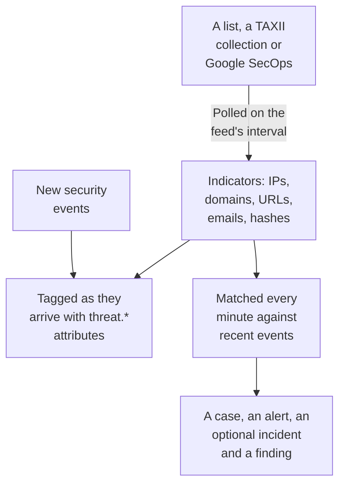

# Threat Intelligence (STIX/TAXII)

A threat intel feed brings known-bad IP addresses, domains, URLs, email addresses and file hashes into OneUptime, and tells you when your [security events](/docs/telemetry/security-events) mention one. A feed reads one source: a list of indicators at an https address, such as the free lists OneUptime adds in one click, a TAXII 2.1 collection of STIX 2.1 indicators from your own MISP, OpenCTI or OpenTAXII server or a provider, or the indicators Google SecOps found in your events.

:::cards
- [Add a free list](#add-a-free-list): Feodo Tracker, Emerging Threats and the Tor exit nodes, in one click.
- [Subscribe a feed](#subscribe-a-feed): A list's address, a TAXII collection or a Google SecOps connection.
- [What gets ingested](#what-gets-ingested): The indicator patterns OneUptime keeps, and for how long.
- [How matches are found](#how-matches-are-found): Tagged as events arrive, and matched every minute.
- [Threat levels](#threat-levels): How an indicator's confidence becomes a severity.
:::

## How it works



## Before you begin

- For a list, an `https` address that downloads a text file with one indicator a line.
- For a TAXII feed, a TAXII 2.1 server that publishes STIX 2.1 `indicator` objects, and the ID of the collection to poll. A TAXII feed signs in anonymously, with a bearer token, or with HTTP basic auth.
- For a Google SecOps feed, a [Google SecOps connection](/docs/integrations/google-secops#set-up-the-managed-connector) whose service account can search indicator matches: the `roles/chronicle.viewer` role can.
- Servers that require a TLS client certificate (mutual TLS), such as CISA AIS, are not supported. MITRE's public ATT&CK server publishes techniques and groups rather than indicators, so a feed pointed at it stays empty.
- A role that can create feeds: Project Owner, Project Admin, Security Admin or Security Member. Security Viewer can read feeds and indicators. See [Roles](/docs/permissions/reference#roles).

## Add a free list

The **Free Lists** card on **Threat Intel** adds a free blocklist in one click: click **Add List** on a list, and OneUptime creates a feed that downloads it on the list's schedule. A list the project reads already says **Added**.

| List | Published by | Read | Confidence | A match opens |
| --- | --- | --- | --- | --- |
| Feodo Tracker botnet C2 servers | abuse.ch | Every hour | 90, Critical | A case and an alert |
| Emerging Threats compromised hosts | Proofpoint Emerging Threats | Every day | 70, High | A case and an alert |
| Tor exit nodes | The Tor Project | Every hour | 30, Low | A case |

A list's tile links its terms: Feodo Tracker is free for any use (CC0), and the Emerging Threats list is BSD licensed. A feed added from a list is edited and deleted like any other.

## Subscribe a feed

:::steps
### Open Threat Intel

Open **Products → Security Events → Detections → Threat Intel**.

### Create the feed

Click **Create Threat Intel Feed** and pick its **Source**: **List of indicators**, **TAXII collection** or **Google SecOps**. The next step asks for that source alone: a list's **List URL**, a collection's **TAXII Server** and **Sign-in**, or the **Google SecOps Connection**. **On Match** comes last. The fields are in the table below.

### Check the first poll

Within a minute or two the feed's row shows **Last Polled**, and **Last Poll Summary** says what the poll fetched. Indicators appear in the **Indicators** table under the feeds.
:::

| Field | What to enter |
| --- | --- |
| **Source** | Where the indicators come from. It is set when the feed is created: a feed of another source is a new feed. |
| **List URL** | For a list: the `https` address of a text file with one IP address, domain, URL or file hash a line. |
| **Confidence** | For a list: how sure the list is, 1 to 100. Each indicator on the list gets it, and it sets the [threat level](#threat-levels); empty is Medium. |
| **Google SecOps Connection** | For Google SecOps: the connection whose key reads the indicators Google SecOps found. **Connect Google SecOps** opens **Connections** when there is none. |
| **TAXII API Root URL** | The server's TAXII 2.1 API root, such as `https://taxii.example.com/api1/`. Collections are addressed under it. |
| **Collection ID** | The collection that publishes the indicators. |
| **Poll Interval (Minutes)** | How often to read the source: 1 to 1440 minutes, 60 by default. A list is read every 15 minutes at most. |
| **Minimum Confidence** | For a TAXII collection or Google SecOps: indicators with a lower confidence are skipped, 0 to 100, 0 keeps everything. Indicators with no confidence always pass. |
| **Sign-in** | How OneUptime signs in: **No sign-in** for a public collection, **Bearer token** for a token the server's operator gave you, or **Username and password** for HTTP basic auth. |
| **API Token**, **Basic Auth Username** and **Basic Auth Password** | Asked only for the sign-in picked. |
| **Open a Case on Match** | On by default: each event that names an indicator opens a [case](/docs/telemetry/security-cases) about it, or joins the open case already about it. |
| **Alerts and Incidents** | **Create an alert** by default: each matched indicator opens an alert. |
| **Alert Severity** | The severity of every alert this feed opens. Leave it empty to take each indicator's threat level. |
| **Declare an incident** or **Both** | Under **Alerts and Incidents**. Incidents drive on-call escalation, SLAs and status pages, and alerts are usually enough for indicator matches. |
| **Incident Severity** | Like **Alert Severity**, for incidents. |
| **Write Detection Finding on Match** | On by default: each match writes a finding into the event stream. |

A TAXII feed's tokens and passwords are encrypted and never shown again after you save them. To change them, pick **Update Credentials** in the feed's row and choose **Bearer token**, **Username and password** or **No sign-in**, which clears what is stored: your choice replaces the feed's sign-in, so saving a token clears a stored password, and the other way round.

### How a feed is polled

Each poll asks for the objects added since the previous one, through TAXII's `added_after` cursor, and reads up to 10 pages of 500 objects. A large collection therefore syncs over several polls: **Last Poll Summary** says when more pages remain. To finish a big first sync sooner, lower **Poll Interval (Minutes)**, down to 1, until it catches up.

Polls name themselves with the user agent `OneUptime/<version> (+https://oneuptime.com)`. If the provider's firewall answers `403`, ask them to allow it: many firewalls block requests that look like an unnamed script.

A disabled feed is neither polled nor matched. The indicators it already has keep tagging new events until they expire.

### How a list is read

- Each poll downloads the whole list and reads it a line at a time: the first value on a line, up to a space, tab, comma or semicolon. Lines starting with `#`, `;` or `//` are comments, a port after an address or a domain is dropped, and an address range such as `198.51.100.0/24` is skipped.
- A value stays an active indicator for 2 days after the poll that last read it, and a value the list drops stops matching at the next poll. A list that has not changed is written again once a day.
- A list holds at most 50,000 indicators. **Last Poll Summary** says how many were read, how many lines were skipped and how many were left out.
- The address must use `https` and is held to the same outbound rules as a connection: on OneUptime Cloud a private address is refused.

### How Google SecOps is read

- Each poll reads the indicator matches Google SecOps recorded since the previous poll, with Mandiant's attributes: the matched domain, address or file hash, its confidence, its category and the campaigns and actors it is tied to. The first poll reads the last 7 days.
- An indicator stays active for 30 days after Google SecOps last saw it, or until its source says it stops being active, and one an analyst muted in Google SecOps stops matching here too.
- A match Google SecOps marks as an active breach is Critical, and a high-priority one is High at least.

## What gets ingested

From a TAXII collection, OneUptime keeps STIX `indicator` objects whose pattern is plain equality on one of these types. A list and Google SecOps give the same types:

| Type | Example pattern |
| --- | --- |
| IPv4 address (`ipv4-addr`) | `[ipv4-addr:value = '198.51.100.7']` |
| IPv6 address (`ipv6-addr`) | `[ipv6-addr:value = '2001:db8::7']` |
| Domain name (`domain-name`) | `[domain-name:value = 'evil.example']` |
| URL (`url`) | `[url:value = 'http://evil.example/payload']` |
| Email address (`email-addr`) | `[email-addr:value = 'billing@evil.example']` |
| File hash, SHA-256 (`file-hash-sha256`) | `[file:hashes.'SHA-256' = 'e3b0…b855']` |
| File hash, SHA-1 (`file-hash-sha1`) | `[file:hashes.'SHA-1' = 'da39…0709']` |
| File hash, MD5 (`file-hash-md5`) | `[file:hashes.MD5 = 'd41d…427e']` |

Comparisons joined with `OR`, inside one `[...]` or across several, are fine, and each value becomes an indicator of its own:

```text
[domain-name:value = 'evil.example' OR domain-name:value = 'evil2.example']
[ipv4-addr:value = '198.51.100.7'] OR [url:value = 'http://evil.example/x']
```

Any other pattern, with `AND`, `FOLLOWEDBY`, `NOT`, `LIKE`, `MATCHES`, a time qualifier such as `WITHIN`, or another object type, is skipped whole and counted as unsupported in **Last Poll Summary**. Translating only part of an `AND` pattern would match far more than the feed's author meant.

### How long an indicator stays active

- An indicator matches from its `valid_from` until its `valid_until`. With no `valid_until`, it stays active for 365 days from `valid_from`, and polling it again doesn't extend that.
- A revoked indicator, or one updated with a `valid_until` in the past, stops matching as soon as the update is polled. So does a value the provider drops from an updated pattern.
- Values are stored in lowercase and matched whatever their case.

The **Indicators** table lists indicators as they are stored, with a **Status** of **Active**, **Expired** or **Revoked**. A re-polled indicator can show twice for a while, and an expired or revoked row stays listed until storage cleanup removes it, up to about a month after it expires. Matching always checks validity and revocation, so such a row never matches.

## How matches are found

### Tagged as events arrive

Every incoming security event, from the ingest API or a connection, is checked against your active indicators before it is stored. When one of its observables (the IPs, hosts, domains, hashes and users taken from the event) equals an indicator's value, the event is stamped with these attributes:

| Attribute | Value |
| --- | --- |
| `threat.matched` | Always `"true"` on a tagged event |
| `threat.indicator_id` | The STIX indicator's id, or `list` or `google-secops` for those sources |
| `threat.indicator_type` | The indicator's type, such as `ipv4-addr` or `file-hash-sha256` |
| `threat.indicator_value` | The matched value, in lowercase |
| `threat.feed` / `threat.feed_id` | The feed the indicator came from |
| `threat.confidence` | The indicator's STIX confidence |
| `threat.match_count` | How many of the event's observables matched an indicator |

When several indicators match one event, the one with the highest confidence fills in these values. They are ordinary attributes, so you can search on them in **Events**, filter Security Events monitors with them, and use them in detection rules:

```yaml title="threat-intel-logon.yml"
title: High-confidence indicator in a successful logon
level: critical
detection:
  selection:
    threat.matched: 'true'
    threat.confidence|gte: 80
    className: Authentication
    statusName: Success
  condition: selection
```

Tagging knows only the indicators that exist when an event arrives: events are never tagged again later.

### Matched every minute

Every minute, each enabled feed's active indicators are matched against the events whose event time falls since the feed's previous check. This catches intel that arrived after an event was tagged.

- The first check covers the last 15 minutes. After an outage, the next check catches up on at most the last 24 hours.
- Each window is checked once. Intel that arrives after its window was checked applies only to later events.
- An event that arrives late, with a time from before the previous check, is still tagged as it arrives, but not matched.
- Each check records every matched indicator value as a finding, up to 10,000 per feed. Alerts, incidents and cases open for the 100 values seen in the most events; the rest share one case about the feed, and the feed's **Last Match Error** says how many matched.

### What a match does

- An alert, titled `[Threat Intel] <feed name> — <indicator value>`, one per feed and value while it stays open. Once it is resolved, the next match opens a new one. Alerts are not resolved automatically.
- An incident, only with **Declare an incident** or **Both** under **Alerts and Incidents**, deduplicated the same way.
- A Threat Intel finding, with **Write Detection Finding on Match**: a `Detection Finding` event (OCSF class 2004) from the product `OneUptime Threat Intel`, with the indicator's threat level as its severity, and these attributes:

| Attribute | Value |
| --- | --- |
| `oneuptime.threat.feed_id` / `oneuptime.threat.feed_name` | The feed |
| `oneuptime.threat.indicator_id` | The STIX indicator's id, or `list` or `google-secops` for those sources |
| `oneuptime.threat.indicator_type` / `oneuptime.threat.indicator_value` | What matched |
| `oneuptime.threat.confidence` | The indicator's confidence |
| `oneuptime.threat.match_count` | How many events are behind this finding |

Findings are never matched themselves, so one match can't set off another.

## Threat levels

Indicators have no Sigma level: their STIX `confidence` sets a threat level instead.

| Indicator confidence | Threat level |
| --- | --- |
| 90 to 100 | Critical |
| 70 to 89 | High |
| 40 to 69 | Medium |
| 1 to 39 | Low |
| Not scored (0 or missing) | Medium |

An unscored indicator counts as Medium: someone still chose to put it in a feed. The threat level is the severity of the finding, and picks the alert's severity from your project's severities, in this order:

1. The feed's **Alert Severity** (or **Incident Severity**), when set: it applies to every match from the feed.
2. Your severity named after the threat level, such as High, whatever its case.
3. By rank: Critical and High take your most severe severity, Medium and Low your least severe.

The threat level belongs to each indicator, not to the feed, so one feed can open a Critical alert and a Low one in the same minute. **Minimum Confidence** filters on the same number: a minimum of 70 keeps only High and Critical indicators, plus unscored ones, which always pass.

## Watch a feed's matches

The **Create Monitor** action in a feed's row opens a new Security Events monitor that counts the feed's findings: event class `Detection Finding`, filtered by the feed's id in `oneuptime.threat.feed_id` (never its name, which a rename would change), over the last hour. Use it for a sudden burst of matches, or for a busy feed going quiet.

## Retention and billing

Indicators are configuration, not telemetry, and are not billed as ingested data. The findings a match writes are ordinary security events, billed and kept like the rest: see [Security Events](/docs/telemetry/security-events#retention-and-billing).

## Troubleshooting

:::details Last Error is set after a poll
`401` or `403`: the credentials are wrong or missing; replace them with **Update Credentials**. A `403` can also be the provider's firewall blocking the user agent. `404`: check the **TAXII API Root URL**, which usually ends in a path such as `/api1/`, and the **Collection ID**. The error clears on the next successful poll.
:::

:::details The feed polls, but no indicators appear
Read **Last Poll Summary**. No objects fetched: the collection is empty or publishes no indicators. Unsupported patterns: the provider uses pattern features this page lists as skipped. Below minimum confidence: lower **Minimum Confidence**. Already inactive: the provider sent indicators that were already revoked or expired.
:::

:::details Indicators exist, but nothing matches
Matching compares an indicator's value with an event's observables, not with every field: open an event you expected to match in **Events** and check that its observables hold the value. Only indicators with the **Active** status match. If the feed's **Status** reads **Matching failed**, **View Error** in its row shows why.
:::

:::details A list feed's Last Error says the address answered with a web page
The **List URL** opens a page, such as a sign-in or an error page, not the list: open it in a browser and copy the address of the file itself. A list whose text holds no IP address, domain, URL or file hash is refused the same way, and the feed's indicators are kept as they were.
:::

:::details A Google SecOps feed's Last Error says HTTP 403
The connection's service account cannot search indicator matches: grant it `roles/chronicle.viewer`. When the connection was deleted, the feed says so: edit it and pick another **Google SecOps Connection**.
:::

:::details A match didn't open an alert
**Alerts and Incidents** is set to **Declare an incident** or **Neither**, or an alert for the same feed and value is still open, and later matches are folded into it. A project needs at least one alert severity for a feed to open alerts.
:::

## Next steps

:::cards
- [Security Events](/docs/telemetry/security-events): Send events, search them and write detection rules.
- [Google SecOps](/docs/integrations/google-secops): Bring Chronicle's detections and events in.
- [Permission Reference](/docs/permissions/reference): The Security roles, and what each can do.
:::
