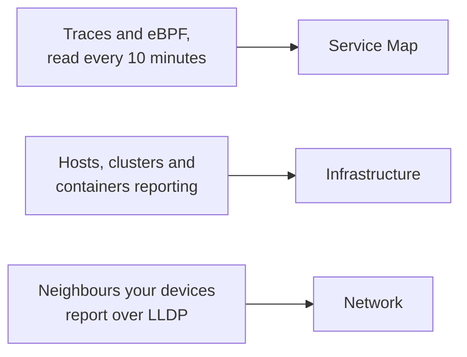

# Topology

Topology draws how your systems connect: which services call which, what runs where, and how your network devices are cabled. OneUptime builds it from the telemetry you already send, so there is nothing to draw by hand, and it shows at a glance where errors and incidents sit.

:::cards
- [Open Topology](#open-topology): Three views of one page.
- [Read the service map](#read-the-service-map): Who calls whom, and how healthy the calls are.
- [Explore your infrastructure](#explore-your-infrastructure): Where every service runs.
- [Open a resource's own map](#open-a-resources-own-map): One vCenter, cluster or host in depth.
- [See your network](#see-your-network): Devices and their links, live.
:::

## How the map is built

Each view of Topology is built from a different kind of telemetry:

- **Only what was active is drawn.** A view shows the services and resources that reported in the time range, and the connections seen in it. Turn on **Show inactive** to draw the silent ones too.
- **Calls are counted over a recent window.** OneUptime looks for calls between services every 10 minutes, and the traffic figures cover the latest 15 minutes, not the whole time range.
- **The network view is live.** It shows your devices as they are connected now, so it has no time range.

## Before you begin

- **Telemetry arriving.** The service map needs traces: see [OpenTelemetry](/docs/telemetry/open-telemetry). The infrastructure view needs a host or a cluster that reports: see the [Kubernetes Agent](/docs/telemetry/kubernetes-agent). The network view needs network devices: see [Network Device Monitor](/docs/monitor/network-device-monitor).
- **A role that reads telemetry.** Project Owner, Project Admin, Project Member, Viewer, Telemetry Admin, Telemetry Member or Telemetry Viewer, or a custom role with the Read Telemetry Service permission.

## Open Topology

Go to **Products → Observability → Topology**. **Inventory → Topology Map** opens the same page. It opens on the **Service Map**, for the **Past 1 Day**.

| View | The question it answers |
| --- | --- |
| **Service Map** | Which services depend on each other? |
| **Infrastructure** | What runs where in your infrastructure? |
| **Network** | How are your network devices connected? |

Beside the time picker, **Show inactive** adds what did not report in the range, and the refresh button loads the view again. **What is shown · About this data** says what the view draws and how often it is worked out. The address bar keeps the view you are on, so a link you share opens the same view.

## Read the service map

The **Service Map** draws every service that reported, and the databases, APIs and message brokers they call, even when those send no telemetry of their own. Arrows point from caller to callee, and thicker lines carry more requests. The counts above it say how many services, dependencies and connections it draws, and how many need attention.

Each service shows its status, worked out from the calls it received in the latest 15 minutes:

| Status | When |
| --- | --- |
| **Healthy** | At most 1% of the calls it received failed. |
| **Some errors** | More than 1% and less than 5% failed. |
| **High error rate** | 5% or more failed. |
| **Entry point** | It received no calls, but made some: a web frontend or a scheduled job. |
| **No calls observed** | It neither made nor received a call. |

A service with an active incident or alert shows how many instead, and like a service with **Some errors** or a **High error rate**, it counts as needing attention.

:::steps
### Find the services that need attention

Click **Needs attention** to keep only those services and their direct connections, or search by name in the box above the map.

### Open a service

Click a service for its requests, errors and average latency in the latest 15 minutes, its **Active incidents** and **Active alerts**, and links to **Traces for this service** and its **Inventory details**.

### Open a connection

Click an arrow for its request rate, error rate and average latency. Between two services you instrument, it also has a **History** of calls, errors and latency.
:::

**Connection labels** writes a figure on every arrow: **Request rate**, **Error rate** or **Average latency**, or none until you hover. **Table** lists the same services with their **Requests**, **Error rate**, **Avg latency** and **Connections**, and **Show on map** draws one of them.

## Explore your infrastructure

**Infrastructure** shows where your services run: clusters, hosts, pods, containers and the other resources that report. Replicas of one workload are grouped into one entry, and you can open anything to look inside it.

- **Browse it your way.** Show it as a **List** or a **Map**, from all your infrastructure down to one pod. The counts above it say how many resources and workloads it draws, how many services it can place, and how many silent resources it leaves out.
- **Find a resource.** Search for it by name, and click **View details** to open its page.
- **Move between views.** A service listed on a resource opens on the **Service Map**, and the resources a service runs on open on **Infrastructure**.

## Open a resource's own map

A vCenter, a Kubernetes cluster, a host, a Docker or Podman host, a Docker Swarm, Proxmox or Ceph cluster and a storage array each have a **Topology** page of their own. It draws that one resource in depth, from its own inventory: what is inside what, each part coloured by how it is doing, and each open incident and alert on the part it is about.

- **Read it as a tree.** The resource is at the top, and each part's parts are drawn to its right, joined to it by a line that turns red or amber where something needs attention. Parts with trouble inside open by themselves, the round button on a part opens or closes it, and the arrow keys move through the map.
- **Find what needs attention.** **Needs attention** keeps only the troubled parts and the path to each, and the search finds a part anywhere in the resource.
- **Look closer.** Click a part for what it is and a link to its own page, and **Focus on this** to draw only that part, what is inside it and what it is related to.
- **Go both ways.** **Open in Topology** opens the resource on **Infrastructure**, and its **Open vCenter topology**, **Open cluster topology**, **Open host topology** or **Open storage array topology** button leads back.

## See your network

**Network** is the live map of your network devices, built from the neighbours they report over LLDP, and CDP on Cisco devices. It has no time picker: connections refresh by themselves.

If you group devices into sites, the view opens on your sites: pick one, or switch to **All devices**. **Map options** arranges the map and picks what it includes, and **Export PDF** saves the map you see. The network device pages draw the same map: see [Network Topology](/docs/monitor/network-device-monitor#network-topology).

## Troubleshooting

:::details The service map shows services but no connections
OneUptime finds calls between services in your traces every 10 minutes. It sees one when a request carries trace context, the `traceparent` header, from one instrumented service to the next, as OpenTelemetry's HTTP and gRPC instrumentations do; when a service reports client spans for the databases and APIs it calls; or when the Kubernetes agent runs with eBPF.
:::

:::details A service I removed is still on the map
It reported within the time range. Pick a shorter range, or wait until its last telemetry falls out of the range. With **Show inactive** on, the map also draws what stopped reporting.
:::

:::details The map says only part of it is shown
A very large project reaches the map's limits, and a notice says how many resources or connections it shows. Search for a service, or use **Show on map** in the table, to draw a readable part of it.
:::

## Next steps

:::cards
- [Service Catalog](/docs/telemetry/services): Everything about one service.
- [Traces Explorer](/docs/telemetry/traces-explorer): The requests behind each arrow.
- [Inventory Overview](/docs/inventory/overview): Every resource the map draws.
- [Network Device Monitor](/docs/monitor/network-device-monitor): Put your network on the map.
:::
