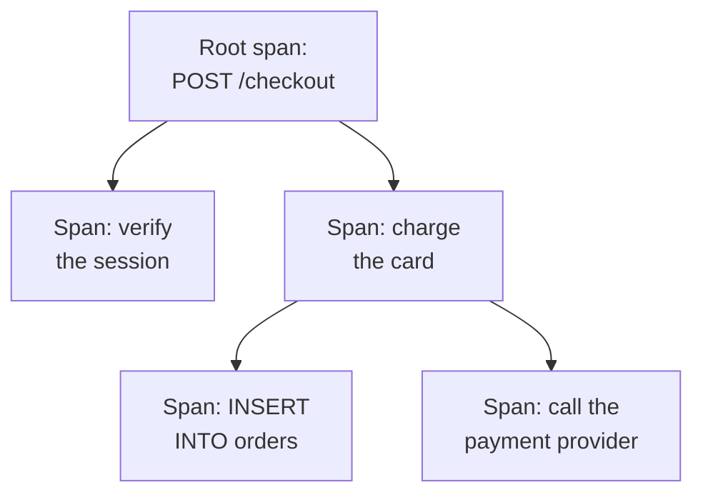

# Traces Explorer

The Traces explorer finds the requests that ran through your services: the slow ones, the failed ones, the ones that touched one customer's account. Search and filter the spans your services send, then open a trace to see every step of the request as a waterfall, a flame graph or a service map.

:::cards
- [Find a request](#find-a-request): Search spans, then filter by service, status or kind.
- [Read a trace](#read-a-trace): Where the time went, and which step failed.
- [Chart your spans](#chart-your-spans): Request counts and response times, grouped your way.
- [Traces Insights](#traces-insights): Error rates, latency and the slowest requests.
- [Find and fix slow and failing operations with AI](#find-and-fix-slow-and-failing-operations-with-ai): Pull requests that fix them, and add the tracing a trace lacks.
:::

## Traces and spans

A trace is one request on its way through your system. Each step it takes, such as an HTTP handler, a database query or a call to another service, is a span, and spans nest inside the spans that started them. The first span of a trace, with no parent, is its root span: the request's entry point.

Each row of the explorer is a span, so a busy service fills the list with its database queries and internal calls. To list one row per request, pick **Root spans** under **Span Type** in the sidebar.

The explorer has five tabs:

| Tab | What it is for |
| --- | --- |
| **Viewer** | Search and filter spans, and open their traces. It opens on the past hour, newest first, 50 spans per page. |
| **Insights** | Request rates, error rates and latency per service, and the requests worth a look. |
| **AI** | The slow and failing operations and the missing tracing OneUptime finds in your traces, and what OneUptime AI did about them. See [Find and fix slow and failing operations with AI](#find-and-fix-slow-and-failing-operations-with-ai). |
| **Setup Guide** | How to send traces with OpenTelemetry, using one of your [ingestion keys](/docs/telemetry/ingestion-keys). |
| **Settings** | What happens to spans as they arrive: **Pipelines**, **Drop Filters**, **Scrub Rules** and **Recording Rules**. |

## Before you begin

- **Traces arriving.** Instrument your services with [OpenTelemetry](/docs/telemetry/open-telemetry). The **Setup Guide** tab shows the code for your language.
- **A role that reads telemetry.** Project Owner, Project Admin, Project Member, Viewer, Telemetry Admin, Telemetry Member or Telemetry Viewer, or a custom role with the Read Telemetry Service Traces permission. Its scope decides whose spans you see: see [Telemetry](/docs/permissions/index#telemetry).

## Find a request

:::steps
### Open the Viewer

Go to **Products → Observability → Traces**. The **Viewer** lists the past hour's spans, newest first, each with its status, service, name and duration.

### Pick the time range

Pick a range in the time picker, or drag across the chart above the list to zoom into a spike. Double-click the chart to zoom back out. See [Zooming Into a Time Range](/docs/telemetry/charts-and-time-ranges).

### Search

Type a query and press Enter, for example `service:checkout status:error duration:>500`. Bare words search span names, and `@key:value` searches an attribute such as `@http.route:/orders`. See [Search Syntax](/docs/telemetry/search-syntax#traces).

### Narrow it down with filters

Click a value in the **Filters** sidebar to add it as a chip. The sidebar filters by **Service**, the host, cluster or other resource that sent the span, **Status**, **Span Type**, **Has Exception**, **Span Kind**, **Span Name**, **Service Instance** and **Host Name**.

### Open a span

Click a row to expand it: its attributes, and the logs and exceptions it recorded. Click **See full trace** to open its whole trace.
:::

Your search, your chips and the time range are kept in the page's address, so a refresh, a bookmark or a shared link opens the same spans.

## Read a trace

A trace's page starts with the request's numbers:

| Number | What it is |
| --- | --- |
| Duration | How long the whole request took. |
| Spans | How many spans the trace has. |
| Services | How many services the request went through. |
| Errors | How many spans ended with an error status. Click it to show only those. |
| Depth | The deepest chain of nested spans. |

Below them, pick one of four views:

| View | What it shows |
| --- | --- |
| **Waterfall** | Every span on a timeline, nested under the span that started it. Turn on **Critical path** to highlight the chain of spans that decided how long the request took. |
| **Flame graph** | The same tree as stacked bars, where the widest bars took the longest. |
| **Service map** | The services the request went through, and the calls between them. |
| **Operations** | One row per service and span name, with its calls, errors, self time and total time. An operation called 10 or more times from one parent span is marked: often an N+1 query or a loop that could be batched. |

Click a span in any view to open its panel, with tabs for its attributes, events, logs, exceptions and links, and its profile or LLM call when it has one. Search the trace's spans by name, ID or service with the search box beside the views (press `/`), and turn on **Errors only** to keep only the spans that failed.

A large trace loads 500 spans at a time. Click the button at the bottom of the trace to load more, or all of them.

> [!TIP]
> **Fix performance with AI** shows only on a trace worth fixing: one with an N+1 query, calls made one after another that could run in parallel, or one call that takes most of the request, when it costs real time (100 ms or more for the calls together, 500 ms or more for a single call, and at least a tenth of the request). It names what it found, such as "The same database query ran 40 times in ReportService.build", and starts an AI task that opens a pull request to fix it. See [Code](/docs/ai/ai-agent).

## Chart your spans

The chart above the list plots the number of spans over time, split by status. Pick another measure in the chart's header to plot their average, median (P50) or P95 response time instead.

For more, switch the list from **Spans** to **Analytics**. Pick a time series, a top list or a table; measure request counts, error counts or response times (average, P50, P90, P95, P99, minimum or maximum); and group by span name, service, status, span kind or any attribute, then by a second field. A top list or a table shows the top 5 to 100 groups.

## Follow, save and share

- Click **Paused** above the list to turn on live updates. The button then reads **Live**, and the list checks for new spans every 10 seconds. Click it again to pause.
- **Saved Views** keeps a search, its filters and the time range under a name, for everyone in the project. Saved views work as they do in the [Logs Explorer](/docs/telemetry/logs-explorer#save-a-view).
- The **Logs** and **Metrics** buttons open those explorers for the same time window, with as much of your filtering as they can use. Point at a button to see anything it cannot carry over.

## Traces Insights

The **Insights** tab sums up the requests in a time range:

- the number of requests, the error rate, and the P50, P95 and P99 latency;
- a health table of your services, sorted by error rate, so the services that need attention come first;
- the most recent failed requests, and the slowest ones.

Scope it to some services with the dropdown beside the time picker.

## Find and fix slow and failing operations with AI

Every hour OneUptime looks through each service's traces from the last hour for operations that are slow, that fail, or whose traces cannot say why, and files what it finds as AI insights, with the evidence. OneUptime AI then looks into each one and opens a pull request to fix it. Nothing is ever merged: your team reviews each pull request.

An operation is a service's spans of one name, such as `GET /orders`. OneUptime reads a service once it sent at least 100 spans in the last hour, and files three kinds of finding:

| Finding | When OneUptime files it | The pull request |
| --- | --- | --- |
| **Slow Operation** | The operation's P99 is 1 second or more over at least 20 spans, and its slowest request repeats a pattern that costs real time: the same call made again and again, calls made one after another that could run in parallel, or one call that takes most of the request. | Makes the operation faster. |
| **Failing Operation** | At least 20 of the operation's spans failed, 5% or more of them, and the most recent failures say why, with an exception or an error message. | Fixes why it fails. |
| **Missing Tracing** | The traces cannot say why: every one of a service's 500 or more spans was the root of its trace, with no span of the service under it, a slow request spent 60% or more of its time (and 500 ms or more) in one span with nothing traced under it, or an operation's failures recorded no error message and no exception. | Adds the tracing it lacks. |

OneUptime AI opens a failing operation's pull request on its own only once it finds the code at fault. A failure that comes from somewhere else, such as a dependency that is down, gets no pull request unless someone asks for one with **Fix with AI**.

### Turn it on

**Traces → AI → Settings** holds the switch **Find and fix slow and failing operations**, on for new projects. With **Enable AI** off, slow and failing operations are still found, but OneUptime AI does nothing with them. To open pull requests, OneUptime AI needs a repository connected in [Code](/docs/ai/ai-agent): the page says what is missing first. Each repository's code is changed on the Runner the repository picks in Code.

OneUptime AI opens at most 5 pull requests on its own each day (UTC), one for each finding, and never more than a repository's limit on open AI pull requests.

### AI rules

With no rule, OneUptime AI looks into every problem it finds in your traces right away, and opens a pull request for each. The **AI rules** under **More settings** narrow that, in three steps:

| Step | What it decides |
| --- | --- |
| **Match** | Which services: the ones picked, the ones with certain labels, or the ones whose names match a pattern. |
| **Investigate** | **Right away**, or **Only if still found after a wait**: a problem that goes away during the wait is not looked into. |
| **Fix** | **Don't fix**, **Ask before fixing** or **Fix without asking**. Asking first leaves the pull request to a person: the finding offers **Fix with AI**. |

Under **More fields** a rule picks the code repositories, the MCP servers and the LLM provider OneUptime AI may use for it. With none picked, it may use any of them, and the project's default LLM provider.

### See what it did

- **Traces → AI → Insights** lists what OneUptime found, each finding with its evidence and **Open in Traces**, which opens the spans it is about, from the hour it was found in, in the **Viewer**.
- **Traces → AI → Logs** lists every investigation and pull request, newest first, with how each one stands.
- In Code, the task says OneUptime started it, with a link to its finding, and the pull request says why it was opened.

## What happens to spans as they arrive

The **Settings** tab holds the rules OneUptime applies to spans as they arrive, as it does for logs. They act on the spans that arrive afterwards, not on stored ones. How long each span is kept is decided as it arrives too: see [Data Retention](/docs/telemetry/data-retention).

| Rule | What it does |
| --- | --- |
| **Drop Filters** | Discard spans you do not want to keep, or keep a sample of them. See [Drop or sample records](/docs/telemetry/drop-filters-and-scrub-rules#drop-or-sample-records). |
| **Scrub Rules** | Mask sensitive data in span attributes. See [Scrub sensitive data](/docs/telemetry/drop-filters-and-scrub-rules#scrub-sensitive-data). |
| **Pipelines** | Change and enrich spans: each pipeline matches spans with a filter, then runs its processors in order. |
| **Recording Rules** | Turn span counts, error counts and durations into new metrics, every minute. See [Log Recording Rules](/docs/telemetry/log-recording-rules). |

## Troubleshooting

:::details A trace says no spans were found
Spans usually arrive within a minute of the request finishing. Click **Refresh** on the trace's page to check again.
:::

:::details Some spans sit at the top level of the waterfall
They name a parent span that OneUptime has not received, often because the service that wrote the parent does not send traces to OneUptime yet. Instrument that service too.
:::

:::details The list shows far more rows than requests
Each row is a span, not a request. Pick **Root spans** under **Span Type** in the sidebar to list one row per request.
:::

## Next steps

:::cards
- [Search Syntax](/docs/telemetry/search-syntax): Every filter the search box understands.
- [Traces Monitor](/docs/monitor/traces-monitor): Get alerted on failed or slow requests.
- [Exception Tracking](/docs/telemetry/exceptions): Triage the errors your spans record.
- [Logs Explorer](/docs/telemetry/logs-explorer): Read the log lines a request wrote.
:::
