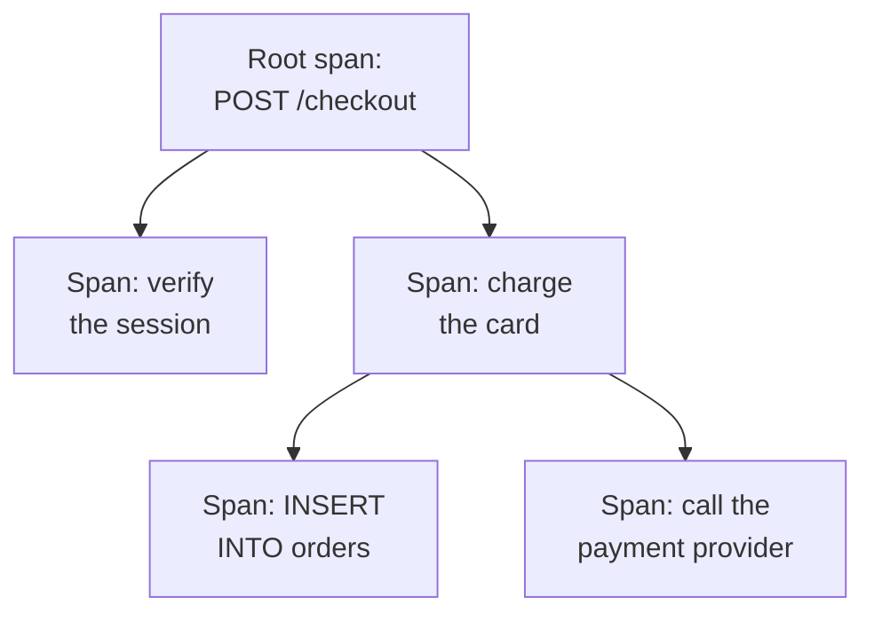

# Traces Explorer

The Traces explorer finds the requests that ran through your services: the slow ones, the failed ones, the ones that touched one customer's account. Search and filter the spans your services send, then open a trace to see every step of the request as a waterfall, a flame graph or a service map.

:::cards
- [Find a request](#find-a-request): Search spans, then filter by service, status or kind.
- [Read a trace](#read-a-trace): Where the time went, and which step failed.
- [Chart your spans](#chart-your-spans): Request counts and response times, grouped your way.
- [Traces Insights](#traces-insights): Error rates, latency and the slowest requests.
:::

## Traces and spans

A trace is one request on its way through your system. Each step it takes, such as an HTTP handler, a database query or a call to another service, is a span, and spans nest inside the spans that started them. The first span of a trace, with no parent, is its root span: the request's entry point.

Each row of the explorer is a span, so a busy service fills the list with its database queries and internal calls. To list one row per request, pick **Root spans** under **Span Type** in the sidebar.

The explorer has four tabs:

| Tab | What it is for |
| --- | --- |
| **Viewer** | Search and filter spans, and open their traces. It opens on the past hour, newest first, 50 spans per page. |
| **Insights** | Request rates, error rates and latency per service, and the requests worth a look. |
| **Setup Guide** | How to send traces with OpenTelemetry, using one of your [ingestion keys](/docs/telemetry/ingestion-keys). |
| **Settings** | What happens to spans as they arrive: **Pipelines**, **Drop Filters**, **Scrub Rules** and **Recording Rules**. |

## Before you begin

- **Traces arriving.** Instrument your services with [OpenTelemetry](/docs/telemetry/open-telemetry). The **Setup Guide** tab shows the code for your language.
- **A role that reads telemetry.** Project Owner, Project Admin, Project Member, Viewer, Telemetry Admin, Telemetry Member or Telemetry Viewer, or a custom role with the Read Telemetry Service Traces permission. Its scope decides whose spans you see: see [Telemetry](/docs/permissions/index#telemetry).

## Find a request

:::steps
### Open the Viewer

Go to **Products → Observability → Traces**. The **Viewer** lists the past hour's spans, newest first, each with its status, service, name and duration.

### Pick the time range

Pick a range in the time picker, or drag across the chart above the list to zoom into a spike. Double-click the chart to zoom back out. See [Zooming Into a Time Range](/docs/telemetry/charts-and-time-ranges).

### Search

Type a query and press Enter, for example `service:checkout status:error duration:>500`. Bare words search span names, and `@key:value` searches an attribute such as `@http.route:/orders`. See [Search Syntax](/docs/telemetry/search-syntax#traces).

### Narrow it down with filters

Click a value in the **Filters** sidebar to add it as a chip. The sidebar filters by **Service**, the host, cluster or other resource that sent the span, **Status**, **Span Type**, **Has Exception**, **Span Kind**, **Span Name**, **Service Instance** and **Host Name**.

### Open a span

Click a row to expand it: its attributes, and the logs and exceptions it recorded. Click **See full trace** to open its whole trace.
:::

Your search, your chips and the time range are kept in the page's address, so a refresh, a bookmark or a shared link opens the same spans.

## Read a trace

A trace's page starts with the request's numbers:

| Number | What it is |
| --- | --- |
| Duration | How long the whole request took. |
| Spans | How many spans the trace has. |
| Services | How many services the request went through. |
| Errors | How many spans ended with an error status. Click it to show only those. |
| Depth | The deepest chain of nested spans. |

Below them, pick one of four views:

| View | What it shows |
| --- | --- |
| **Waterfall** | Every span on a timeline, nested under the span that started it. Turn on **Critical path** to highlight the chain of spans that decided how long the request took. |
| **Flame graph** | The same tree as stacked bars, where the widest bars took the longest. |
| **Service map** | The services the request went through, and the calls between them. |
| **Operations** | One row per service and span name, with its calls, errors, self time and total time. An operation called 10 or more times from one parent span is marked: often an N+1 query or a loop that could be batched. |

Click a span in any view to open its panel, with tabs for its attributes, events, logs, exceptions and links, and its profile or LLM call when it has one. Search the trace's spans by name, ID or service with the search box beside the views (press `/`), and turn on **Errors only** to keep only the spans that failed.

A large trace loads 500 spans at a time. Click the button at the bottom of the trace to load more, or all of them.

> [!TIP]
> **Fix performance with AI** looks for a known performance pattern in the trace: an N+1 query, one span that takes most of the time, or calls made one after another that could run in parallel. When it finds one, it starts an AI task that opens a pull request to fix it. See [Fix Tasks](/docs/ai/ai-agent).

## Chart your spans

The chart above the list plots the number of spans over time, split by status. Pick another measure in the chart's header to plot their average, median (P50) or P95 response time instead.

For more, switch the list from **Spans** to **Analytics**. Pick a time series, a top list or a table; measure request counts, error counts or response times (average, P50, P90, P95, P99, minimum or maximum); and group by span name, service, status, span kind or any attribute, then by a second field. A top list or a table shows the top 5 to 100 groups.

## Follow, save and share

- Click **Paused** above the list to turn on live updates. The button then reads **Live**, and the list checks for new spans every 10 seconds. Click it again to pause.
- **Saved Views** keeps a search, its filters and the time range under a name, for everyone in the project. Saved views work as they do in the [Logs Explorer](/docs/telemetry/logs-explorer#save-a-view).
- The **Logs** and **Metrics** buttons open those explorers for the same time window, with as much of your filtering as they can use. Point at a button to see anything it cannot carry over.

## Traces Insights

The **Insights** tab sums up the requests in a time range:

- the number of requests, the error rate, and the P50, P95 and P99 latency;
- a health table of your services, sorted by error rate, so the services that need attention come first;
- the most recent failed requests, and the slowest ones.

Scope it to some services with the dropdown beside the time picker.

## What happens to spans as they arrive

The **Settings** tab holds the rules OneUptime applies to spans as they arrive, as it does for logs. They act on the spans that arrive afterwards, not on stored ones. How long each span is kept is decided as it arrives too: see [Data Retention](/docs/telemetry/data-retention).

| Rule | What it does |
| --- | --- |
| **Drop Filters** | Discard spans you do not want to keep, or keep a sample of them. See [Drop or sample records](/docs/telemetry/drop-filters-and-scrub-rules#drop-or-sample-records). |
| **Scrub Rules** | Mask sensitive data in span attributes. See [Scrub sensitive data](/docs/telemetry/drop-filters-and-scrub-rules#scrub-sensitive-data). |
| **Pipelines** | Change and enrich spans: each pipeline matches spans with a filter, then runs its processors in order. |
| **Recording Rules** | Turn span counts, error counts and durations into new metrics, every minute. See [Log Recording Rules](/docs/telemetry/log-recording-rules). |

## Troubleshooting

:::details A trace says no spans were found
Spans usually arrive within a minute of the request finishing. Click **Refresh** on the trace's page to check again.
:::

:::details Some spans sit at the top level of the waterfall
They name a parent span that OneUptime has not received, often because the service that wrote the parent does not send traces to OneUptime yet. Instrument that service too.
:::

:::details The list shows far more rows than requests
Each row is a span, not a request. Pick **Root spans** under **Span Type** in the sidebar to list one row per request.
:::

## Next steps

:::cards
- [Search Syntax](/docs/telemetry/search-syntax): Every filter the search box understands.
- [Traces Monitor](/docs/monitor/traces-monitor): Get alerted on failed or slow requests.
- [Exception Tracking](/docs/telemetry/exceptions): Triage the errors your spans record.
- [Logs Explorer](/docs/telemetry/logs-explorer): Read the log lines a request wrote.
:::
