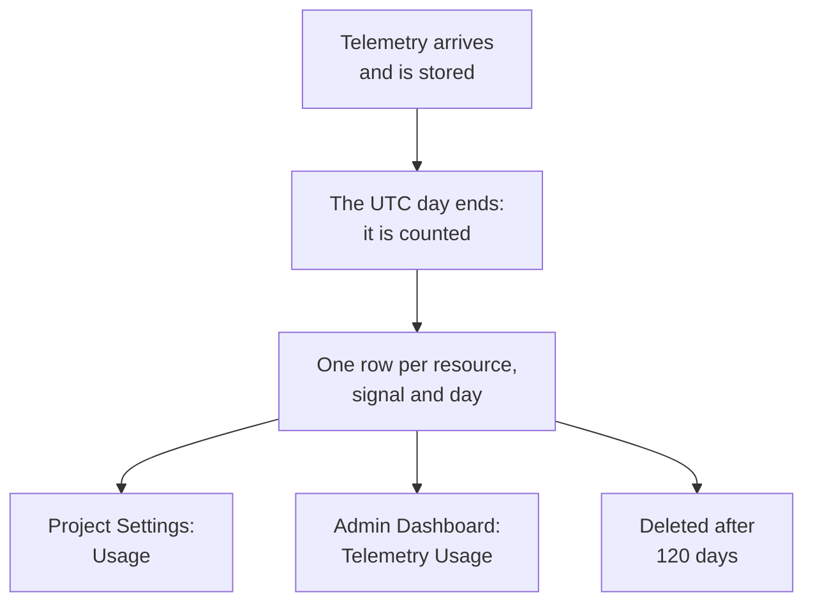

# Telemetry Usage

See how much telemetry each project, and each service or resource in it, sends: logs, metrics, traces, exceptions, profiles, session replays and security events. Usage is counted on every OneUptime installation, with billing or without, so you can find what fills your storage without querying ClickHouse.

:::cards
- [How usage is counted](#how-usage-is-counted): Once a day, for each resource and signal.
- [See a project's usage](#see-a-projects-usage): Project Settings → Telemetry & APM → Usage.
- [See every project's usage](#see-every-projects-usage): The Admin Dashboard, for the instance admin.
- [How long usage is kept](#how-long-usage-is-kept): 120 days unless you change it.
:::

## How usage is counted

Once a day, after a day has ended in UTC, OneUptime counts what each resource of each project sent that day, for each signal, and keeps the count as one row per resource, signal and day.



- **A day is counted once it is over.** Each day is counted by about 08:00 UTC the next day, so today's usage shows up tomorrow. A day that could not be counted is tried again for a week.
- **The size is the stored size.** Each signal is counted as the size of the rows it is stored in, before compression. Session replays are counted as the bytes the recorders uploaded.
- **Exceptions are shown on their own.** The exceptions recorded from spans and logs have a total, a column and a part of the chart of their own, and **Traces** counts spans. A day counted before exceptions were shown apart still has them inside **Traces**, as it did.
- **Profiles include their samples.**
- **OneUptime's own telemetry is not counted.** Monitor, alert, incident and SLO readings, Data Observability readings and the session replay budget metrics are written by OneUptime itself.
- **On OneUptime Cloud, these rows are what telemetry is billed from.** On an installation without billing, usage is counted at no cost, and nothing is charged for it, even if billing is turned on later.
- **Exceptions are billed as part of Traces.** On OneUptime Cloud, traces are billed for their spans and their exceptions together, at the traces price, as they always were. Showing exceptions apart changes nothing you are billed, and they are never charged twice.
- **A budget is counted apart from usage.** An [ingestion budget](/docs/telemetry/ingestion-budgets) counts telemetry as it arrives, decompressed, so it can stop a day's telemetry the same day. While one is set, this page opens with today's budgets. Exceptions have no budget of their own: they count in the budget of the traces or logs they arrive in.

## Before you begin

- **A role that reads the project's telemetry.** Project Owner, Project Admin, Project Member, Viewer, Telemetry Admin, Telemetry Member or Telemetry Viewer, or one of the billing roles. The role has to reach the whole project: one limited to some labels does not show usage.
- **Telemetry in the project.** Usage is counted for the telemetry the project's [ingestion keys](/docs/telemetry/ingestion-keys) send.

## See a project's usage

:::steps
### Open Usage

Go to **Project Settings → Telemetry & APM → Usage**. **Telemetry & APM** starts collapsed in the side menu: click it to open it.

### Pick a range

The page opens on **Last 30 days**. Pick **Last 7 days** or **Last 90 days** in the box at the top right of the **Telemetry Usage** card. A range ends with yesterday, the newest day that has been counted.

### Find what grew

The **Usage by Resource** card lists every service and resource that sent anything in the range, heaviest first. Click a column's title to sort by it, and a resource's name to open its page.
:::

The page has three cards:

| Card | What it shows |
| --- | --- |
| **Telemetry Usage** | The range's **Total**, a total for each signal, and a chart of each day, its signals stacked. |
| **Usage by Resource** | Each **Resource** with its kind, a column for each signal, the **Total** and the **Retention** its telemetry is kept for. |
| **Telemetry Usage History** | One row per product, resource and day, with filters for **Product**, **Day** and **Service**. A **Traces** row is billed for its spans and exceptions together, and says under **Data Ingested (in GB)** how much of it was exceptions. |

Telemetry that did not name a service is listed as **Unknown Service**. A resource that has been deleted since, or whose kind your role does not read, is listed by its kind and the start of its ID.

## Who sees what

| Role | Sees |
| --- | --- |
| Project Owner, Project Admin, Billing Admin, Billing Member, Billing Viewer, Manage Billing | How much each resource sent and how long it is kept, and on OneUptime Cloud what it cost |
| Project Member, Viewer, Telemetry Admin, Telemetry Member, Telemetry Viewer | How much each resource sent and how long it is kept |

What usage cost is shown only on OneUptime Cloud: an installation without billing charges nothing for it. See [Billing & Usage](/docs/configuration/billing#usage-history) for the prices.

## See every project's usage

On a self-hosted installation, the instance admin sees every project's usage in the Admin Dashboard:

:::steps
### Open Telemetry Usage

In the Admin Dashboard, open the menu and click **Telemetry Usage**. The list shows each project that sent anything in the range, heaviest first, with a column for each signal and the **Total**.

### Find the heaviest projects

Pick a range at the top right of the card, and click a column's title to sort by it: **Total**, a signal, or **Project** for the name.

### Open a project

Click a project's name. Its **Telemetry Usage** page, under **Projects** in the Admin Dashboard, shows its usage by day, signal and resource, as its members see it.
:::

## How long usage is kept

Usage is kept for 120 days unless you change it, with billing on or off. This is how long the usage counts are kept, not the telemetry itself: see [Data Retention](/docs/telemetry/data-retention) for that.

:::steps
### Open Data Retention

In the Admin Dashboard, go to **Settings → Data Retention**.

### Set the number of days

On the **Telemetry Usage Retention** card, click **Edit Telemetry Usage Retention**, enter **Telemetry Usage Retention (Days)** from 30 to 1095, and click **Save Changes**. Leave it empty for 120 days.
:::

Usage older than that is deleted once a day. The retention is never shorter than 30 days: a day that is counted is never deleted and counted again.

## Read usage with the API

`GET /api/telemetry-usage/project` answers with one project's usage over a range of UTC days, as the page shows it. Call it with an [API key](/docs/permissions/index#api-keys) that has one of the roles above:

```bash
curl 'https://oneuptime.com/api/telemetry-usage/project?startDay=2026-10-01&endDay=2026-10-31' \
  -H "ApiKey: $ONEUPTIME_API_KEY"
```

`startDay` and `endDay` are days written `YYYY-MM-DD`, both included, and a range can be up to 1095 days long. The answer has the totals, each day by signal and each resource by signal, in GB, with the cost only where billing is on and the key reads billing. Exceptions are under `Exceptions`, apart from `Traces`, and a day counted before exceptions were shown apart has them inside `Traces`.

## Troubleshooting

:::details The Usage page says No telemetry usage yet
A day is counted once it has ended in UTC, by about 08:00 UTC the next day: a project that started sending today shows its first day tomorrow. Check that the project receives telemetry in the explorers.
:::

:::details The numbers are larger than my ClickHouse disk
Usage is the size of the rows before compression. ClickHouse compresses what it stores, so the disk it uses is several times smaller.
:::

:::details A resource is listed by its kind and an ID
The resource has been deleted since it sent the telemetry, or your role does not read that kind of resource. Its usage is still counted.
:::

:::details Traces went down on the day Exceptions appeared
Exceptions used to be counted inside **Traces**. From the first day counted with exceptions apart, **Traces** counts spans and **Exceptions** counts the exceptions. Together they are what **Traces** was, and what traces are billed for.
:::

## Next steps

:::cards
- [Drop Filters & Scrub Rules](/docs/telemetry/drop-filters-and-scrub-rules): Stop storing the telemetry you do not need.
- [Data Retention](/docs/telemetry/data-retention): Keep telemetry as long as you need, and no longer.
- [Billing & Usage](/docs/configuration/billing): What telemetry costs on OneUptime Cloud.
- [Ingestion Keys](/docs/telemetry/ingestion-keys): Send telemetry into your project.
- [Ingestion Budgets](/docs/telemetry/ingestion-budgets): Cap how much of each signal a project sends in a day.
:::
