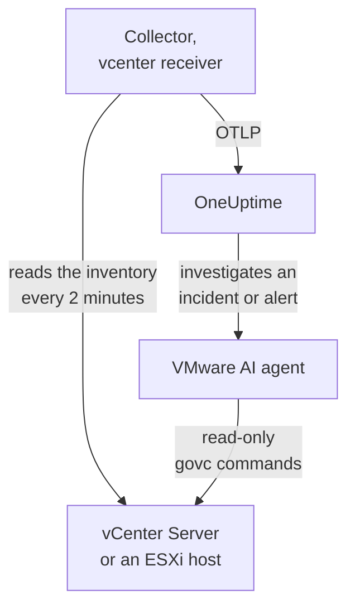

# VMware Agent

The OneUptime VMware agent monitors VMware vSphere: vCenter Server, ESXi hosts, virtual machines, datastores, clusters, resource pools and vSAN. It is a stock OpenTelemetry Collector whose [`vcenter` receiver](https://github.com/open-telemetry/opentelemetry-collector-contrib/tree/main/receiver/vcenterreceiver) reads the vSphere API with a read-only user, stamps every metric with your vCenter's name and sends it to OneUptime: no plugin on vCenter, and nothing inside the VMs. [VMware monitors](/docs/monitor/vmware-monitor) alert on what arrives.

:::cards
- [Install the agent](#install-the-agent): A read-only user, then the install script, Docker Compose or systemd.
- [What the agent collects](#what-the-agent-collects): Every vSphere object, its identity and its metrics.
- [AI agent](#ai-agent): Let OneUptime AI read the vCenter while it investigates.
- [Troubleshooting](#troubleshooting): A diagnostic script, and the usual problems.
:::

## How it works

One agent monitors one vSphere endpoint: a **vCenter Server**, which covers every datacenter, cluster and host it manages, or a **standalone ESXi host** that no vCenter manages. Run one agent per vCenter. The collector walks the whole inventory once per collection (every 2 minutes by default) and sends one resource per object. The same Compose file runs the VMware AI agent beside it, for OneUptime AI. Rather not run Docker? The same collector, with the same config, also runs as a systemd service on any Linux machine.



The vCenter registers itself with its first data, under the name the agent stamps on every metric as `vmware.vcenter.name`. To monitor a vCenter without running the agent at all, see [VMware Without an Agent](/docs/telemetry/vmware-agentless): one of your probes collects the same data with a read-only account.

## Before you begin

- Docker Engine 20.10 or later with the Docker Compose v2 plugin, or, to install without Docker, a Linux machine (x86_64 or arm64) with systemd 235 or later. Either way, the machine must reach vCenter over HTTPS (TCP 443).
- vCenter Server or ESXi 7.0 or later: the receiver supports vSphere 7 and 8.
- An account that can create a vSphere user and grant it a role on the top-level vCenter object.
- An ingestion key. Create one under **Project Settings → Telemetry & APM → Ingestion Keys** and copy its value.

### Where to run the agent

The agent talks to vCenter over HTTPS, so it does not have to run anywhere near it, and ideally it should not run on the vCenter Server Appliance or in a VM on the cluster it watches: if that cluster goes down, your monitoring goes down with it. A small management VM on separate hardware, a monitoring host, or any machine that runs Docker (or, without Docker, any Linux machine with systemd) and reaches vCenter on TCP 443 is the right home. The optional syslog listener also needs the ESXi hosts to reach the agent on the syslog port (see [Ship ESXi syslog](#optional-ship-esxi-syslog)).

## Install the agent

:::steps
### Create the read-only vSphere user

The agent only ever reads: the inventory, performance counters and vSAN statistics. Give it an account of its own with the built-in **Read-Only** role, never an administrator.

:::tabs
@tab vSphere Client
1. Create the account: open _Menu → Administration → Single Sign On → Users and Groups_, pick the `vsphere.local` domain (or your identity source), click **Add**, name the user `oneuptime` and set a password. The user is then `oneuptime@vsphere.local`.
2. Grant the role: select the top-level **vCenter Server** object in the _Hosts and Clusters_ inventory, open the **Permissions** tab, click **Add**, pick the user, set the role to **Read-Only**, and tick **Propagate to children**.
@tab govc
From a machine with administrator credentials:

```bash
govc sso.user.create -p 'a-strong-password' -R ReadOnly oneuptime
govc permissions.set -principal oneuptime@vsphere.local -role ReadOnly -propagate=true /
```
@tab PowerCLI
From a session connected to vCenter as an administrator:

```powershell
New-SsoPersonUser -UserName oneuptime -Password 'a-strong-password'
New-VIPermission -Entity (Get-Folder -NoRecursion) -Principal 'VSPHERE.LOCAL\oneuptime' -Role ReadOnly -Propagate:$true
```
@tab ESXi Host Client
For a standalone ESXi host (no vCenter), create the user under _Host → Manage → Security & Users → Users_ and give it the Read-Only role under _Host → Manage → Security & Users → Permissions_. Or, in the host's shell, run `esxcli system account add`, then `esxcli system permission set --id oneuptime --role ReadOnly`.
:::

> [!IMPORTANT]
> Propagation is the part people miss. The receiver walks datacenters, clusters, hosts, VMs, datastores and resource pools, and every object the user cannot see is silently left out. A Read-Only role granted on the vCenter object _without_ propagation gives an inventory with nothing in it, and a dashboard full of zeros.

### Install and start the agent

:::tabs
@tab install.sh
Download the install script and run it on the machine that will host the agent:

```bash
curl -sSL https://raw.githubusercontent.com/OneUptime/oneuptime/master/agents/VMwareAgent/install.sh -o install.sh
bash install.sh
```

The script asks for your OneUptime URL, the ingestion key, a name for the vCenter, the vCenter endpoint and the read-only credentials (it reads the password without echo), and whether the AI agent may apply fixes (if so, for a vSphere user of its own and the VMs it must never change). It installs to `/opt/oneuptime-vmware-agent`, writes a `0600` `.env` file, and starts the agent with Docker Compose. It quotes every value for Docker Compose as you typed it, so a password with `$`, `#`, spaces or quotes works as typed. Running the script again reuses everything in an existing `.env` instead of prompting again, which is how you [upgrade the agent](#upgrading-the-agent).
@tab Docker Compose
Download `docker-compose.yml` and `otel-collector-config.yaml` from the [VMwareAgent directory](https://github.com/OneUptime/oneuptime/tree/master/agents/VMwareAgent) into a new folder, then create a `.env` file next to them. It holds a password, so keep it private with `chmod 600 .env`:

```bash title=".env"
ONEUPTIME_URL=YOUR_ONEUPTIME_URL
ONEUPTIME_TELEMETRY_INGESTION_KEY=YOUR_TELEMETRY_INGESTION_TOKEN
VMWARE_VCENTER_NAME=my-vcenter
VCENTER_ENDPOINT=https://vcsa.example.com
VCENTER_USERNAME=oneuptime@vsphere.local
VCENTER_PASSWORD=a-strong-password
VCENTER_INSECURE_SKIP_VERIFY=true
VCENTER_COLLECTION_INTERVAL=2m
```

A password with `$`, `#`, spaces or quotes goes in single quotes (see [vCenter rejects the login](#troubleshooting)). Start the agent:

```bash
docker compose up -d
```
@tab systemd
The agent does not need Docker: it is one OpenTelemetry Collector binary and one config file. On a Linux machine (x86_64 or arm64) with systemd 235 or later (Ubuntu 18.04, Debian 10, RHEL 8 or newer), run the `otelcol-contrib` release the agent pins, with the same `otel-collector-config.yaml`, as a systemd service. The unit the agent ships for it, [`oneuptime-vmware-agent-native.service`](https://github.com/OneUptime/oneuptime/blob/master/agents/VMwareAgent/systemd/oneuptime-vmware-agent-native.service), runs the collector as a throwaway unprivileged user with no capabilities and nothing it can write to.

Download the collector, the config and the unit, and install them to `/opt/oneuptime-vmware-agent`:

```bash
cd "$(mktemp -d)"
VERSION=0.161.0   # the collector release the agent pins
ARCH=$(uname -m | sed 's/x86_64/amd64/;s/aarch64/arm64/')
curl -fL -o otelcol-contrib.tar.gz \
  https://github.com/open-telemetry/opentelemetry-collector-releases/releases/download/v${VERSION}/otelcol-contrib_${VERSION}_linux_${ARCH}.tar.gz
curl -fsSLO https://raw.githubusercontent.com/OneUptime/oneuptime/master/agents/VMwareAgent/otel-collector-config.yaml
curl -fsSL -o oneuptime-vmware-agent.service \
  https://raw.githubusercontent.com/OneUptime/oneuptime/master/agents/VMwareAgent/systemd/oneuptime-vmware-agent-native.service

sudo install -d -m 0755 /opt/oneuptime-vmware-agent
sudo tar --no-same-owner --preserve-permissions -xzf otelcol-contrib.tar.gz -C /opt/oneuptime-vmware-agent otelcol-contrib
sudo install -m 0644 otel-collector-config.yaml /opt/oneuptime-vmware-agent/otel-collector-config.yaml
sudo install -m 0644 oneuptime-vmware-agent.service /etc/systemd/system/oneuptime-vmware-agent.service
```

The settings go in `/opt/oneuptime-vmware-agent/.env`: the same variables as the Docker install's `.env`. It holds a password, so make it readable by root alone before you open it:

```bash
sudo touch /opt/oneuptime-vmware-agent/.env
sudo chmod 600 /opt/oneuptime-vmware-agent/.env
sudoedit /opt/oneuptime-vmware-agent/.env
```

Put this in it:

```bash
ONEUPTIME_URL=YOUR_ONEUPTIME_URL
ONEUPTIME_TELEMETRY_INGESTION_KEY=YOUR_TELEMETRY_INGESTION_TOKEN
VMWARE_VCENTER_NAME=my-vcenter
VCENTER_ENDPOINT=https://vcsa.example.com
VCENTER_USERNAME="oneuptime@vsphere.local"
VCENTER_PASSWORD="a-strong-password"
VCENTER_INSECURE_SKIP_VERIFY=true
VCENTER_COLLECTION_INTERVAL=2m
```

systemd reads this file, not a shell: keep the user name and the password in double quotes, with each `\` written `\\` and each `"` written `\"` — `DOMAIN\user` is `"DOMAIN\\user"` — while `$`, `#`, `'` and spaces go in as they are. That is the form every systemd version reads the same; older ones (RHEL 8's, for one) drop a backslash even inside single quotes. Then start the agent, and have it start on every boot:

```bash
sudo systemctl daemon-reload
sudo systemctl enable oneuptime-vmware-agent
sudo systemctl restart oneuptime-vmware-agent
```

This install runs the collector alone: the [AI agent](#ai-agent) ships only as a container image. Run one agent per vCenter: if you are moving off the Docker install, run `docker compose down` there first, or every metric arrives twice.
:::

### Verify the installation

Check that the agent is running, and read the collector's logs:

```bash
docker compose ps
docker logs -f oneuptime-vmware-agent
```

Installed it with systemd? Check the service and its journal instead:

```bash
systemctl status oneuptime-vmware-agent --no-pager
sudo journalctl -u oneuptime-vmware-agent -f
```

The collector's logs should show this line once it has started:

```text
Everything is ready. Begin running and processing data.
```

### Find the vCenter in OneUptime

Nothing is sent until the first full inventory walk completes, so give it one collection interval (2 minutes by default). Then open **Products → Infrastructure → VMware → All vCenters**: the vCenter is there, with its datacenters, clusters, ESXi hosts, virtual machines, datastores and resource pools.
:::

## Environment variables

Docker Compose reads these from the `.env` next to `docker-compose.yml`; the systemd install reads them from `/opt/oneuptime-vmware-agent/.env`, and its unit gives the same defaults.

| Variable | Required | Description |
| --- | --- | --- |
| `ONEUPTIME_URL` | Yes | Your OneUptime URL, such as `https://oneuptime.com` or your self-hosted instance. Use `http://` and its port if the instance is HTTP-only. |
| `ONEUPTIME_TELEMETRY_INGESTION_KEY` | Yes | The ingestion key from **Project Settings → Telemetry & APM → Ingestion Keys**. |
| `VMWARE_VCENTER_NAME` | Yes | The vCenter's name in OneUptime, stamped on every metric as the `vmware.vcenter.name` resource attribute. Keep it stable: changing it later registers a second vCenter. Defaults to `vmware-vcenter`. |
| `VCENTER_ENDPOINT` | Yes | The scheme and host of vCenter Server or a standalone ESXi host, **without** `/sdk`, such as `https://vcsa.example.com`. |
| `VCENTER_USERNAME` | Yes | The vSphere user with the Read-Only role, such as `oneuptime@vsphere.local` (or `DOMAIN\user` for an Active Directory identity source). |
| `VCENTER_PASSWORD` | Yes | That user's password. If it contains `$`, `#`, spaces or quotes, single-quote it in the Docker install's `.env` (`install.sh` does this for you), and double-quote it in the systemd install's (see [Troubleshooting](#troubleshooting)). |
| `VCENTER_INSECURE_SKIP_VERIFY` | No | `true` accepts vCenter's default self-signed (VMCA) certificate; `false` keeps TLS verification on. Defaults to `false`. |
| `VCENTER_COLLECTION_INTERVAL` | No | How often the whole inventory is read. Raise it to `5m` or `10m` for very large vCenters. Defaults to `2m`. |

The AI agent's own settings are under [AI agent](#ai-agent).

## What the agent collects

Every `VCENTER_COLLECTION_INTERVAL`, the receiver walks the whole vSphere inventory and sends one OpenTelemetry resource per object. Each object's identity is in its **resource attributes** — `vcenter.datacenter.name`, `vcenter.cluster.name`, `vcenter.host.name`, `vcenter.vm.name` / `vcenter.vm.id`, `vcenter.datastore.name`, `vcenter.resource_pool.name` / `vcenter.resource_pool.inventory_path` — and the agent adds `vmware.vcenter.name` on top, so OneUptime files everything under your vCenter:

| vSphere object | Identity (resource attributes) | Metrics |
| --- | --- | --- |
| Datacenter | `vcenter.datacenter.name` | `vcenter.datacenter.cluster.count`, `vcenter.datacenter.host.count`, `vcenter.datacenter.vm.count`, `vcenter.datacenter.datastore.count`, `vcenter.datacenter.disk.space`, `vcenter.datacenter.cpu.limit`, `vcenter.datacenter.memory.limit` |
| Cluster | + `vcenter.cluster.name` | `vcenter.cluster.cpu.effective`, `vcenter.cluster.cpu.limit`, `vcenter.cluster.memory.effective`, `vcenter.cluster.memory.limit`, `vcenter.cluster.host.count`, `vcenter.cluster.vm.count`, `vcenter.cluster.vm_template.count`, `vcenter.cluster.vsan.*` (throughput, operations, latency, congestions) |
| ESXi host | + `vcenter.host.name` (and `vcenter.cluster.name` when the host is in a cluster) | `vcenter.host.cpu.usage` / `.capacity` / `.utilization` / `.reserved`, `vcenter.host.memory.usage` / `.utilization` / `.capacity`, `vcenter.host.disk.latency.avg` / `.latency.max` / `.throughput`, `vcenter.host.network.usage` / `.throughput` / `.packet.rate` / `.packet.drop.rate` / `.packet.error.rate`, `vcenter.host.vsan.*` |
| Virtual machine | + `vcenter.host.name`, `vcenter.vm.name`, `vcenter.vm.id` (instance UUID); `vcenter.resource_pool.*` or `vcenter.virtual_app.*` | `vcenter.vm.disk.usage`, `vcenter.vm.disk.utilization`, `vcenter.vm.memory.usage` / `.utilization` / `.ballooned` / `.swapped` / `.swapped_ssd`; powered-on VMs only: `vcenter.vm.cpu.usage`, `vcenter.vm.cpu.readiness`, `vcenter.vm.cpu.utilization`, `vcenter.vm.disk.latency.avg` / `.latency.max` / `.throughput`, `vcenter.vm.network.*`, `vcenter.vm.vsan.*` |
| VM template | `vcenter.vm_template.name`, `vcenter.vm_template.id` | `vcenter.vm.disk.usage` only |
| Datastore | + `vcenter.datastore.name` | `vcenter.datastore.disk.usage`, `vcenter.datastore.disk.utilization` |
| Resource pool | + `vcenter.resource_pool.name`, `vcenter.resource_pool.inventory_path` | `vcenter.resource_pool.cpu.usage` / `.cpu.shares`, `vcenter.resource_pool.memory.usage` / `.memory.shares` / `.memory.ballooned` / `.memory.swapped` / `.memory.granted` |

Count and capacity metrics fan out over **datapoint attributes**, which are exactly what you filter and group by in monitor criteria:

| Attribute | Values | Carried by |
| --- | --- | --- |
| `direction` | `read` / `write` for disk, `transmitted` / `received` for network | Disk latency and throughput, network throughput and packet rates |
| `disk_state` | `available` / `used` | `vcenter.datastore.disk.usage`, `vcenter.vm.disk.usage`, `vcenter.datacenter.disk.space` |
| `status` | `red` / `yellow` / `green` / `gray` (vSphere's overall status of the object) | `vcenter.datacenter.cluster.count` / `.host.count` / `.vm.count` |
| `power_state` | Hosts: `on` / `off` / `standby` / `unknown`; VMs: `on` / `off` / `suspended` / `unknown` | `vcenter.datacenter.host.count` / `.vm.count`, `vcenter.cluster.vm.count` |
| `effective` | `true` / `false` (stored as strings) | `vcenter.cluster.host.count` |
| `object` | The NIC, disk or vCPU instance (such as `vmnic0`) | Per-device host and VM disk and network series |
| `cpu_reservation_type` | `total` / `used` | `vcenter.host.cpu.reserved` |
| `type` | Memory: `guest` / `host` / `overhead`, `private` / `shared`; vSAN: `read` / `write` / `unmap` | Resource pool memory series, vSAN latency and operations |

Units are the receiver's own OTLP units, which OneUptime scales for display: `MHz` for CPU usage and capacity, `%` for utilization and CPU readiness, `MiBy` for host, VM and resource pool memory, `By` for cluster and datacenter memory and all disk space, `ms` for host and VM disk latency, and `us` (microseconds) for vSAN latency. In monitor criteria the identity attributes take a `resource.` prefix (`resource.vcenter.host.name`, `resource.vmware.vcenter.name`), while datapoint attributes stay bare (`disk_state`, `power_state`, `status`).

`vcenter.host.memory.capacity` is off by default upstream; the shipped config turns it on, because OneUptime divides by it for host memory utilization. A comment in `otel-collector-config.yaml` lists the other optional metrics (`vcenter.vm.cpu.time`, `vcenter.vm.memory.granted`, `vcenter.host.memory.active`, `vcenter.host.memory.ballooned`, `vcenter.host.memory.granted`, `vcenter.vm.network.broadcast.packet.rate`, `vcenter.vm.network.multicast.packet.rate`): turn any of them on the same way.

### VM power state

The receiver sends no power-state metric for a VM. It sends `vcenter.vm.cpu.*` **only for powered-on VMs**, so OneUptime infers the state from what arrived in each collection: a VM that reported CPU metrics is **Powered on**; one that reported only memory and disk usage is **Powered off** (or suspended: vSphere does not tell the two apart here). VM templates have no power state. This reads a **whole collection at a time**, which is why the shipped `batch` processor has a large `send_batch_size` and on purpose no `send_batch_max_size`: a collection split across two exports would zero the inventory counts and turn VMs "off". Keep the batch settings as shipped.

## The vCenter in OneUptime


The **Overview** answers "is this vCenter healthy" first: the effective hosts, host CPU and memory weighted by capacity, the fullest datastore, and the worst VM CPU ready time. When something is degraded, it names the object responsible, so you do not have to go looking.

### ESXi hosts


### Virtual machines


Powered-off virtual machines and templates are listed too. vCenter reports CPU counters only for powered-on VMs, so their CPU columns read N/A rather than a misleading zero.

### Datastores


## Optional — Ship ESXi syslog

By default the agent sends metrics only, so the vCenter's **Logs** page stays empty. ESXi hosts (and vCenter itself) can forward their syslog to any listener, and the shipped `otel-collector-config.yaml` has a commented-out `syslog` receiver pair (TCP and UDP on port 5514, RFC 3164: ESXi's own format), wired to a commented `logs` pipeline that stamps `vmware.vcenter.name` so the logs land on your vCenter.

:::steps
### Turn the receivers on

Uncomment the two `syslog/*` receivers and the `logs` pipeline in `otel-collector-config.yaml`.

### Open the port

Uncomment the `ports:` block in `docker-compose.yml`, so the machine publishes `5514/tcp` and `5514/udp`, then run `docker compose up -d`. With systemd there is no port to publish, since the collector listens on the machine itself: run `sudo systemctl restart oneuptime-vmware-agent` instead. Open the port in the machine's firewall for the ESXi management network.

### Point every ESXi host at the agent

In the vSphere Client, select the host, open _Configure → System → Advanced System Settings_, edit `Syslog.global.logHost` and set it to `udp://<agent-host>:5514` (or `tcp://<agent-host>:5514`; separate several targets with commas). Then allow the outgoing traffic under _Configure → System → Firewall → Edit → syslog_. Or, on each host, with `esxcli`:

```bash
esxcli system syslog config set --loghost='udp://<agent-host>:5514'
esxcli system syslog reload
esxcli network firewall ruleset set --ruleset-id=syslog --enabled=true
```

With PowerCLI, across a whole cluster: `Get-VMHost | Get-AdvancedSetting -Name Syslog.global.logHost | Set-AdvancedSetting -Value 'udp://<agent-host>:5514' -Confirm:$false`.
:::

A syslog receiver listens on only one transport, which is why TCP and UDP are two receivers: leave one commented if you need only the other. For TLS syslog (`ssl://`), terminate it in front of the agent; the receiver itself speaks plain TCP and UDP. The stock collector image reads syslog as it is: no custom image is needed.

## Tag the vCenter with project labels

A resource attribute that starts with `oneuptime.label.` becomes a project label on the vCenter: `oneuptime.label.<dimension>=<value>` is the label `<dimension>:<value>`. Add the attributes to the `resource` processor in `otel-collector-config.yaml`, next to `vmware.vcenter.name`:

```yaml
processors:
  resource:
    attributes:
      # ...existing attributes...
      - key: oneuptime.label.team
        value: platform
        action: upsert
      - key: oneuptime.label.env
        value: production
        action: upsert
```

The collector reads its config only when it starts: run `docker compose restart oneuptime-vmware-agent`, or `sudo systemctl restart oneuptime-vmware-agent` with systemd. The vCenter then shows the labels `team:platform` and `env:production`. Labels are matched without regard to case, so an existing `Production` label is reused rather than duplicated, and the agent never removes a label someone added in OneUptime.

## Run as a systemd service

The Docker install can also run under systemd, so it starts with the machine and restarts when it fails. Its unit wraps Docker Compose and assumes the agent lives in `/opt/oneuptime-vmware-agent`, where the install script puts it:

```bash
sudo curl -fsSL https://raw.githubusercontent.com/OneUptime/oneuptime/master/agents/VMwareAgent/systemd/oneuptime-vmware-agent.service -o /etc/systemd/system/oneuptime-vmware-agent.service
sudo systemctl daemon-reload
sudo systemctl enable --now oneuptime-vmware-agent
```

The install without Docker is a systemd service already, with a unit of its own.

## Upgrading the agent

The agent reports the collector version its files pin as its **Agent Version**. When that is older than the version this OneUptime release pins, a warning sign appears beside it on the vCenter's **Overview** and in the **All vCenters** list. Select it to see these commands. An agent installed before its files reported a version shows none until it is upgraded this way.

The collector is pinned in `docker-compose.yml` (or, without Docker, by the release you downloaded) and its config is a file next to it, so pulling alone does not move the agent forward:

:::tabs
@tab install.sh
Run `install.sh` again: it reuses every value in your existing `.env` (nothing is prompted for again), refreshes `docker-compose.yml` and `otel-collector-config.yaml`, and recreates the agent so the collector reads its new config.

```bash
curl -sSL https://raw.githubusercontent.com/OneUptime/oneuptime/master/agents/VMwareAgent/install.sh -o install.sh
bash install.sh
```
@tab Docker Compose
In the agent's folder, download both files again (and make again any change you made to them), then pull the images and recreate the agent:

```bash
curl -fsSLO https://raw.githubusercontent.com/OneUptime/oneuptime/master/agents/VMwareAgent/docker-compose.yml
curl -fsSLO https://raw.githubusercontent.com/OneUptime/oneuptime/master/agents/VMwareAgent/otel-collector-config.yaml
docker compose pull
docker compose up -d --force-recreate
```
@tab systemd
Run the install commands again: they download the release this OneUptime pins with the latest `otel-collector-config.yaml` and unit, and leave your `.env` as it is (make again any change you made to the config). Then restart the service:

```bash
cd "$(mktemp -d)"
VERSION=0.161.0   # the collector release the agent pins
ARCH=$(uname -m | sed 's/x86_64/amd64/;s/aarch64/arm64/')
curl -fL -o otelcol-contrib.tar.gz \
  https://github.com/open-telemetry/opentelemetry-collector-releases/releases/download/v${VERSION}/otelcol-contrib_${VERSION}_linux_${ARCH}.tar.gz
curl -fsSLO https://raw.githubusercontent.com/OneUptime/oneuptime/master/agents/VMwareAgent/otel-collector-config.yaml
curl -fsSL -o oneuptime-vmware-agent.service \
  https://raw.githubusercontent.com/OneUptime/oneuptime/master/agents/VMwareAgent/systemd/oneuptime-vmware-agent-native.service

sudo install -d -m 0755 /opt/oneuptime-vmware-agent
sudo tar --no-same-owner --preserve-permissions -xzf otelcol-contrib.tar.gz -C /opt/oneuptime-vmware-agent otelcol-contrib
sudo install -m 0644 otel-collector-config.yaml /opt/oneuptime-vmware-agent/otel-collector-config.yaml
sudo install -m 0644 oneuptime-vmware-agent.service /etc/systemd/system/oneuptime-vmware-agent.service
sudo systemctl daemon-reload
sudo systemctl restart oneuptime-vmware-agent
```
:::

## Uninstalling the agent

:::tabs
@tab Docker Compose
```bash
cd /opt/oneuptime-vmware-agent
docker compose down
```
@tab systemd
```bash
sudo systemctl disable --now oneuptime-vmware-agent
sudo rm /etc/systemd/system/oneuptime-vmware-agent.service
sudo systemctl daemon-reload
sudo rm -r /opt/oneuptime-vmware-agent
```
:::

Then remove the `oneuptime` user's permission in vCenter if you no longer need it, and the AI agent's own user if you created one.

## AI agent

The agent's `docker-compose.yml` also runs the **VMware AI agent**, `oneuptime-vmware-ai-agent` (image `oneuptime/resource-ai-agent:release`). While OneUptime AI investigates an incident or alert on this vCenter it runs read-only `govc` commands through it — `govc vm.info web-01`, `govc events -n 50 /DC/vm/web-01`, `govc metric.sample -n 12 /DC/vm/web-01 cpu.usage.average` — and, only if you allow it, applies fixes such as powering a VM back on. It registers as the vCenter named `VMWARE_VCENTER_NAME`, like the collector, and shows up on the vCenter's **AI → AI agent** page in OneUptime.

- **AI investigations are on by default.** Once the agent connects, OneUptime AI investigates incidents and alerts on this vCenter with it, and the vCenter's **Overview** shows the agent's status. To stop, set `ONEUPTIME_AI_INVESTIGATION=false` where the agent runs (**Change** under **What AI may do** on the AI agent page shows how), or leave the agent out.
- **The vSphere role is the hard limit.** Investigations log in as the collector's **Read-Only** user (`VCENTER_USERNAME` / `VCENTER_PASSWORD`), which can read and nothing else. Fixes need a user of the AI agent's own whose role may power VMs on, off and reset them (`VirtualMachine.Interact.PowerOn`, `PowerOff` and `Reset`), granted only on the folders AI may fix and set as `ONEUPTIME_AI_VCENTER_USERNAME` / `ONEUPTIME_AI_VCENTER_PASSWORD`.
- It is **read-only** unless you set `ONEUPTIME_AI_ALLOW_WRITES=true`; `ONEUPTIME_AI_WRITE_TARGETS` (VM and host names or inventory paths) limits what a fix may touch. It never changes the VM named after the host in `VCENTER_ENDPOINT` — normally the vCenter appliance — and knows the appliance by that name only: when `VCENTER_ENDPOINT` is an IP address, or the appliance's VM has another name, put that VM in `ONEUPTIME_AI_PROTECTED_TARGETS`, with the VM the agent runs on. `ONEUPTIME_AI_FIXES` in the same `.env` says how fixes run — `ask-for-approval` (a person approves each one), `automatic` or `bypass-approval` — and the AI agent page shows it read-only ([What AI may do, set by the agent](/docs/ai/infrastructure-ai-agents#what-ai-may-do-set-by-the-agent)).
- To verify vCenter's certificate instead of skipping verification, mount its CA into the container and set `VCENTER_CA_FILE`; on a vCenter with several datacenters, set `GOVC_DATACENTER`.
- It runs as UID 1000 with no capabilities, and never runs guest operations, snapshots, `esxcli` or anything that creates or destroys a VM. Delete the `oneuptime-vmware-ai-agent` service from `docker-compose.yml` if you do not use OneUptime AI.
- The install without Docker has no AI agent: it ships only as a container image. To add one, run it with Docker on any machine that can reach vCenter — download `docker-compose.yml`, write a `.env` next to it with the settings of `/opt/oneuptime-vmware-agent/.env`, single-quoted as Docker Compose wants them, and start the AI agent alone with `docker compose up -d oneuptime-vmware-ai-agent` (not the collector, which already runs).

What it may run, how fixes work and how to troubleshoot it: [Infrastructure AI Agents](/docs/ai/infrastructure-ai-agents#vmware-vcenter). The agent's README has the exact commands for the fixes role.

## Troubleshooting

:::details Run the diagnostic script first
The agent ships with a script, [`troubleshoot.sh`](https://github.com/OneUptime/oneuptime/blob/master/agents/VMwareAgent/troubleshoot.sh), that checks the whole chain: the container runtime, whether vCenter answers and accepts the credentials, the vCenter name stamped on every metric, the token's shape, the collector's own metrics, and whether OneUptime accepts the ingestion key. That last check matters most. OneUptime refuses a bad key with `401` (`422` for a disabled key or a browser key), and the collector treats both as permanent: it drops the batch and logs one `Exporting failed` error, which is easy to miss while the container stays healthy. The script asks `GET <url>/otlp/v1/validate` from inside the agent's network for a direct `200` (valid) or `401` (invalid), falling back to `POST /fluentd/v1/logs` on older servers, and asks for `<VCENTER_ENDPOINT>/sdk/vimServiceVersions.xml` the same way, so DNS, firewall and TLS failures show up exactly as the collector meets them.

```bash
curl -sSL https://raw.githubusercontent.com/OneUptime/oneuptime/master/agents/VMwareAgent/troubleshoot.sh -o troubleshoot.sh
bash troubleshoot.sh    # add -d <dir> if you installed outside /opt/oneuptime-vmware-agent
```

It ends with a verdict naming the most likely cause.
:::

:::details Installed without Docker
The diagnostic script needs Docker. Without it the collector runs on the machine itself, so check the same chain directly: the service and its log, vCenter's API on the collector's own network path, whether OneUptime accepts the ingestion key (`"valid":true` with `"keyType":"Server"`), and the collector's own counters, which it serves on `127.0.0.1:8890` rather than `8888` so it can run beside another collector:

```bash
systemctl status oneuptime-vmware-agent --no-pager
sudo journalctl -u oneuptime-vmware-agent -n 100 --no-pager
curl -sk https://<vcenter-host>/sdk/vimServiceVersions.xml
curl -s -H "x-oneuptime-token: <key>" https://<oneuptime-host>/otlp/v1/validate
curl -s http://127.0.0.1:8890/metrics | grep -E 'otelcol_(receiver_accepted|exporter_sent|exporter_send_failed)_metric_points'
```

The log reads like the container's, so the entries below apply. A service that keeps restarting logs why: `Failed with result 'resources'` means systemd cannot read `/opt/oneuptime-vmware-agent/.env`, and `cannot unmarshal the configuration` or `requires positive value` means a value in it is not one the collector takes. systemd reads `.env` with rules of its own, and older versions (RHEL 8's, for one) drop a backslash even inside single quotes: keep the user name and password in double quotes, with each `\` written `\\` and each `"` written `\"`, the one form every version reads as typed. Since the collector trusts the machine's CA store, you can keep TLS verification on: add vCenter's root certificate (the `.0` files under `certs/lin/` in `https://<vcenter>/certs/download.zip`) to `/usr/local/share/ca-certificates/` with a `.crt` name and run `update-ca-certificates` on Debian and Ubuntu, or to `/etc/pki/ca-trust/source/anchors/` and run `update-ca-trust` on RHEL, then restart the service.
:::

:::details No vCenter appears in OneUptime
1. Read the collector's logs: `docker logs oneuptime-vmware-agent`. A login error (`incorrect user name or password`, `InvalidLogin`) means bad credentials, `x509: certificate signed by unknown authority` means TLS verification is on against a self-signed certificate, `connection refused` or `no such host` means a wrong `VCENTER_ENDPOINT`, and a `401` on export means a bad ingestion key.
2. Check that vCenter answers from the agent's network. The collector image has no shell or curl, so ask from a container in its network: `docker run --rm --network container:oneuptime-vmware-agent curlimages/curl -sk https://<vcenter-host>/sdk/vimServiceVersions.xml` should print an XML document that names `urn:vim25`.
3. Check that `VMWARE_VCENTER_NAME` is set: the vCenter is found by its `vmware.vcenter.name` resource attribute.
4. Give it one collection interval: nothing is sent until the first full inventory walk completes.
:::

:::details The vCenter shows as Disconnected
A vCenter turns Disconnected when OneUptime has received nothing from it for 15 minutes; OneUptime checks every 5 minutes, and time it was not receiving data itself does not count. Check that the collector runs, that its logs show no export errors, and that a collection completes within `VCENTER_COLLECTION_INTERVAL` (see the large inventories entry below). The vCenter turns Connected again with its next data.
:::

:::details x509 or TLS errors
vCenter appliances present a certificate their own VMCA issued, which no Docker image trusts. Either set `VCENTER_INSECURE_SKIP_VERIFY=true` (the practical choice on a private management network), or replace vCenter's machine certificate with one from a CA the collector image trusts. Do **not** point the endpoint at an `http://` URL: vCenter serves its API over HTTPS only.
:::

:::details vCenter rejects the login (401 or InvalidLogin)
Use the full principal — `oneuptime@vsphere.local`, or `DOMAIN\user` / `user@domain.example` for an Active Directory identity source — and check how the password is written in `.env`. Docker Compose v2 expands `$VAR` references in unquoted and double-quoted values, and reads a space followed by `#` as the start of a comment, so a password containing `$`, `#`, spaces or quotes must be single-quoted — `VCENTER_PASSWORD='p@ss$word'` — which is what `install.sh` writes. A password that itself contains a single quote goes in double quotes, with every `$` written as `$$` and `"` / `\` escaped with a backslash. A locked account (too many failed attempts) refuses a correct password too: check _Administration → Single Sign On → Users and Groups_.
:::

:::details Hosts appear but no VMs, datastores or clusters (NoPermission)
The Read-Only role was granted on the vCenter object without **Propagate to children**, or on a narrower object than the vCenter root. Objects the user cannot see are silently left out. Fix the permission on the top-level vCenter object with propagation on; the next collection fills in the inventory.
:::

:::details Every VM shows as powered off
A VM's power state is inferred from `vcenter.vm.cpu.*` datapoints arriving in the same collection as its memory and disk datapoints (see [VM power state](#vm-power-state)). If you changed the `batch` processor and added a `send_batch_max_size`, a large inventory is split across exports and the CPU datapoints land in another request than the rest: put the shipped batch settings back.
:::

:::details Large inventories: slow collections, vpxd.stats.maxQueryMetrics errors
Each collection walks the whole inventory and makes one performance query per batch of objects. For vCenters with thousands of VMs:

- Raise `VCENTER_COLLECTION_INTERVAL` to `5m` or `10m`. A collection that takes longer than the interval is skipped, not overlapped, so a too-short interval only leaves gaps.
- The receiver asks for up to `max_query_metrics: 256` entities per performance query. vCenter caps this with `vpxd.stats.maxQueryMetrics` (256 by default in vCenter 7 and 8). If an administrator lowered it, the collector logs `The maximum number of performance metrics per query exceeded`: lower `max_query_metrics` in `otel-collector-config.yaml` to match, or raise the vCenter setting under _vCenter → Configure → Advanced Settings_.
- Watch the collector's memory: the shipped `memory_limiter` allows 512 MiB. If the log says the limiter is dropping data, raise `limit_mib` (and give the container more memory).
:::

:::details Monitoring a standalone ESXi host (no vCenter)
Point `VCENTER_ENDPOINT` at the host itself (`https://esxi01.example.com`), with a local ESXi user that has the Read-Only role. Everything one host knows is collected: the host, its VMs, datastores and resource pools. A standalone host has no datacenter or cluster object, so those pages stay empty, and it has no vCenter REST API, so the diagnostic script reports the credential check as inconclusive (the collector's log has the answer there).
:::

:::details Metrics land under the wrong vCenter
OneUptime registers a vCenter by its `vmware.vcenter.name`, which the agent takes from `VMWARE_VCENTER_NAME`. Changing it after the first data creates a second vCenter rather than renaming the first.
:::

:::details Sending metrics without the agent
vSphere has no OpenTelemetry push of its own, so the agent (or any OpenTelemetry Collector with the `vcenter` receiver) is the way in. If you already run collectors, add the `vcenter` receiver to one of them instead of running this agent: copy the `vcenter` receiver and the `resource` processor from the shipped `otel-collector-config.yaml` into your own config. The `vmware.vcenter.name` resource attribute is what registers the vCenter in OneUptime, and the deletes of `service.name` / `service.instance.id` keep the data from being filed under a Service: keep both.
:::

## Next steps

:::cards
- [VMware Monitor](/docs/monitor/vmware-monitor): Alert on hosts, VMs, datastores, clusters, datacenters and vSAN.
- [VMware Without an Agent](/docs/telemetry/vmware-agentless): Let a probe collect the vCenter instead.
- [Infrastructure AI Agents](/docs/ai/infrastructure-ai-agents): What the VMware AI agent may run, and how fixes work.
- [Host OpenTelemetry Collector](/docs/telemetry/host-otel-collector): The operating system view inside the VMs, or of the agent's machine.
:::
