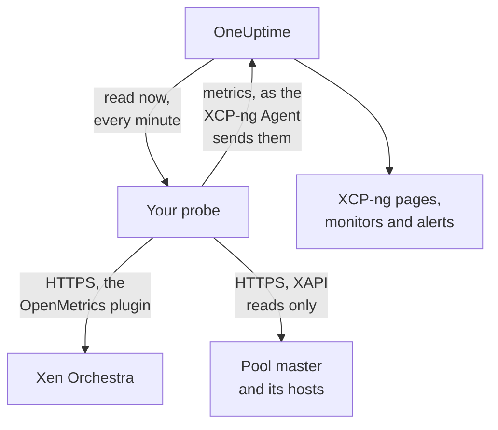

# XCP-ng Without an Agent

Monitor XCP-ng pools without installing anything: a OneUptime probe reads them, either through the Xen Orchestra that manages them or, for a pool with no Xen Orchestra, straight from XAPI on the pool's master. Each pool gets the same pages, [XCP-ng monitors](/docs/monitor/xcp-ng-monitor) and templates as a pool the [XCP-ng Agent](/docs/telemetry/xcp-ng) sends. There is no agent to install, upgrade or keep running.

:::cards
- [Before you begin](#before-you-begin): A probe that reaches Xen Orchestra or the pool, and read-only access.
- [Connect Xen Orchestra](#connect-xen-orchestra): Every pool it manages, through one connection.
- [Connect a pool without Xen Orchestra](#connect-a-pool-without-xen-orchestra): One pool, read from its master.
- [Alarms, HA and backups](#alarms-ha-and-backups): What a probe reads beyond the metrics, and the alerts it offers.
- [Troubleshooting](#troubleshooting): What each message means and what fixes it.
:::

## How it works

Every minute the probe reads each connection and sends what it read to OneUptime:

- **Xen Orchestra**: the probe reads Xen Orchestra's OpenMetrics plugin with the plugin's secret, exactly as the XCP-ng Agent does, so every pool Xen Orchestra manages arrives with the same series. With an API token, it also reads each pool's alarms, HA and backups from Xen Orchestra's REST API.
- **A pool's XAPI**: the probe logs in to the pool master and makes the reads Xen Orchestra's plugin makes itself: the pool's records, and each running host's metrics from that host. It turns them into the same series the plugin serves, so the pool reads exactly as it would through Xen Orchestra. It also puts the pool's XAPI messages, such as a VM that crashed or a host that HA lost, on the pool's feed.

Each pool registers itself by its UUID with its first read, as the agent's pools do, and shows up under **XCP-ng → All Pools**.

## Which way to connect

| | Xen Orchestra, from a probe | A pool's XAPI, from a probe | The XCP-ng Agent |
|---|---|---|---|
| What you run | A probe you already run, or a new one | A probe you already run, or a new one | The agent, on a machine of its own |
| What it reads | Every pool Xen Orchestra manages | One pool | Every pool Xen Orchestra manages |
| What it needs | The OpenMetrics plugin's secret, and an optional read-only API token | A pool account: root, or an Active Directory user with the read-only role | The OpenMetrics plugin's secret |
| Where the secrets are kept | Encrypted in OneUptime, sent only to the probe | Encrypted in OneUptime, sent only to the probe | In the agent's `.env` file |
| Alarms, HA and backups | All three, and missing patches, with an API token | Alarms and HA, without backups | Not included |

All three send the same series. A pool is read by one of them at a time, so its history stays one line whichever reads it.

## Before you begin

- **A probe that reaches the address on TCP 443.** This is usually a [custom probe](/docs/probe/custom-probe) in the same network. On OneUptime Cloud, the shared probes never receive XCP-ng secrets, so add a probe of your own. On a self-hosted instance, the instance's own probes can read too.
- **For Xen Orchestra:** Xen Orchestra 6.9 or later with its OpenMetrics plugin turned on: follow [Turn on the OpenMetrics plugin](/docs/telemetry/xcp-ng#turn-on-the-openmetrics-plugin) and copy its secret. Optionally, an API token of a Xen Orchestra user with the built-in **Read only** role: OneUptime checks that it only reads, and warns you before it expires.
- **For a pool without Xen Orchestra:** XCP-ng 8.2 or later, and its master's address. XAPI's roles apply to Active Directory users only, so its one local account, `root`, can change everything in the pool. For read-only access, join the pool to Active Directory and give a user the `read-only` role.

> [!IMPORTANT]
> Connect a pool through Xen Orchestra or through its XAPI, not both: the second connection that reads a pool leaves it to the first.

## Connect Xen Orchestra

:::steps
### Open Connections
In OneUptime, open **XCP-ng → Connections** and click **Connect XCP-ng**.

### Choose Xen Orchestra
Under **What to Read**, choose **Xen Orchestra**. Enter the **Xen Orchestra Address**, the one you open it at in a browser, such as `https://xo.example.com`, and pick the probe that reaches it.

### Enter the plugin's secret
Paste the **OpenMetrics Secret**. Add an **API Token** of the read-only user if you have one.

### Test the connection and trust the certificate
Click **Test connection**. Xen Orchestra signs its own certificate, so the test shows it: check its fingerprint, then click **Trust this certificate**. The result lists the pools Xen Orchestra serves, with their hosts, VMs and storage repositories.

### Name it and connect
The name defaults to Xen Orchestra's host name, and every pool it reads shows it. Click **Connect XCP-ng**, and the connection's page opens.
:::

## Connect a pool without Xen Orchestra

:::steps
### Start from Connections
In OneUptime, open **XCP-ng → Connections** and click **Connect XCP-ng**.

### Choose the pool
Under **What to Read**, choose **A pool without Xen Orchestra**. Enter the **Pool Master Address**, such as `https://10.0.0.10`, and pick the probe that reaches it.

### Enter the account
Enter the **User Name** and **Password**: `root`, or an Active Directory user with the read-only role, written with its domain, such as `EXAMPLE\oneuptime`.

### Test the connection and trust the master's certificate
Click **Test connection**. Each XCP-ng host signs its own certificate, so the test shows the master's: check its fingerprint, then click **Trust this certificate**. The result says which XCP-ng the master runs and what the account can read, and warns you when the account can change the pool.

### Name the pool and connect
Click **Connect XCP-ng**, and the connection's page opens.
:::

The connection's page shows how its reading stands. It reads **Checking** until the first read, which starts within a minute, then **Collecting**, and the pools it reads appear under **Pools It Reads**.

If no probe comes for the connection for 20 minutes, because it is offline or too old, the page reads **Not collecting** and says so. When no probe may read the connection, it reads **Not collecting** at once and says what to change: a secret, a user name or a password is missing, no probe is set to read it, its probe may not read it (a shared probe on OneUptime Cloud, or another project's), or its probe is disconnected.

## Pools the agent already sends

A pool the XCP-ng Agent registered is taken over by the first connection that reads it: its history carries on as one line, and the pool's feed says the agent can be stopped.

> [!WARNING]
> Stop the XCP-ng Agent once a probe reads its pools. While both run, every metric arrives twice.

To go back, open the pool's **Settings** page. Its **Data Collection** card offers **Use the XCP-ng Agent** for a pool a probe reads, and **Collect With a Probe** for a pool the agent sends. A pool switched back to the agent is left to it, whatever the connection reads.

## Certificates

The probe never skips certificate verification. Every connection completes a full TLS handshake, and then:

- with no certificate trusted, the certificate must come from an authority the probe's machine trusts, for the address you entered;
- with a certificate trusted, the address must present exactly that certificate, identified by its SHA-256 fingerprint, whatever name the certificate holds. Xen Orchestra's own certificate names no address, and is trusted this way.

To check a fingerprint, run `openssl s_client -connect xo.example.com:443 </dev/null | openssl x509 -noout -fingerprint -sha256` from the probe's machine, and compare it with the certificate itself: on a pool master, `openssl x509 -noout -fingerprint -sha256 -in /etc/xensource/xapi-ssl.pem`.

For a pool, you trust the master's certificate. The pool itself lists the certificate each of its hosts serves, and the probe reads every other host pinned to that one. When another host becomes master, the probe follows it only to a host the pool vouched for at its last read. When a certificate changes, reading stops with **The certificate changed** and the new certificate is shown: nothing is sent until you trust it, on the connection's page.

## The saved secrets

The secret, the token and the password are encrypted and write-only: nobody can read them back, and the API never returns them. They are sent only to the probe that reads the connection, which keeps them in memory.

A saved secret is only ever sent to the address, through the probe and to the certificate it was entered for. Changing the address, the probe or the trusted certificate in **Edit Connection** asks for it again, so nobody who can edit the connection can send it somewhere else, and a saved API token that is not entered again is forgotten. Trusting the certificate the probe found at the saved address keeps them. **Remove the API token** deletes the token from OneUptime: revoke it in Xen Orchestra too.

## The API token

An API token is optional: the metrics come through the plugin's secret, and the token reads each pool's alarms, HA and backups. With a token, every read checks it at most once an hour:

- **It only reads.** A token whose user is an administrator, or whose role may change anything, fails the test and is shown as a problem on the connection's page. OneUptime keeps only read-only tokens.
- **It reads what OneUptime needs.** Xen Orchestra answers a list a user may not read with an empty list, so the token must read alarms, messages and backup logs. The built-in **Read only** role reads all three.
- **When it expires.** Xen Orchestra forgets a token the moment it expires. Two weeks before, the connection's page and the feed of every pool it reads say so. Create a new token for the same user and enter it with **Edit Connection**.

## Alarms, HA and backups

Besides the metrics, a probe reads what XCP-ng and Xen Orchestra report about each pool. What it reads depends on the connection:

| | Xen Orchestra, with an API token | A pool's XAPI |
|---|---|---|
| XAPI messages and alarms | Read | Read |
| HA and the pool master | Read | Read, with HA's own plan |
| Backup jobs and their runs | Read | Not read: backups are Xen Orchestra's |
| Missing patches | Read every six hours, where Xen Orchestra's plan includes them | Not read: Xen Orchestra works them out |

A Xen Orchestra connection without an API token reads only the metrics, as the XCP-ng Agent does.

- **On the pool's pages.** The pool's **Overview** shows its HA and each backup job's last runs, a host's page its missing patches, and a VM's page its last backup. Messages of priority 1 to 4, a master that moved, HA turned on or off or no longer able to tolerate a host failure, and failed backup runs go on the pool's **Feed**, and every message and backup run is a record on its **Logs** page.
- **As alerts.** The pool's **Recommendations** offer a template for each under **XCP-ng alarms** and **Backups**: VM Crashed, HA Host Failed, HA State File Lost, HA Protected VM Restart Failed, Storage Failed to Plug, Storage GC Out of Space, XAPI Alarm, Pool Master Changed and Backup Job Failed. The [XCP-ng monitor](/docs/monitor/xcp-ng-monitor) adds HA Cannot Tolerate a Host Failure and VM Not Backed Up.
- **From the first read on.** What XAPI said before a pool's first read is not raised, and each message is raised once. The first read of the backup logs looks back a week and a day, so each job's last runs show at once.

## Reference

| Setting | Default | Notes |
|---|---|---|
| Read every | 1 minute | From 1 to 60 minutes. Every minute matches the XCP-ng Agent; read a large Xen Orchestra less often to go easier on it. |
| Reads at once | 4 per probe | A read slower than its interval is skipped, never stacked. |
| Largest read | About 48 MiB | Larger Xen Orchestras need the XCP-ng Agent. |
| XAPI messages | 200 per read | From the moment the pool is connected, each delivered once, the oldest first. |
| Backup runs | 20 per read | The first read looks back a week and a day. A run Xen Orchestra still calls pending after three days is no longer waited for. |
| Missing patches | Every 6 hours | Through Xen Orchestra, for up to 100 hosts a check. |
| Connection test | 90 seconds to start | A test no probe picks up in time, or that runs longer than 150 seconds, is answered as failed. |

## Troubleshooting

:::details The certificate is not trusted
Xen Orchestra and XCP-ng hosts sign their own certificates by default. Check the fingerprint shown against the certificate, then click **Trust this certificate**.
:::

:::details The certificate changed
Nothing is sent until you trust the new certificate. If you renewed it, check the new fingerprint, trust it, and enter the secrets again with **Edit Connection**.
:::

:::details Xen Orchestra refused the secret
Copy the secret again from **Settings → Plugins → openmetrics** in Xen Orchestra, and enter it with **Edit Connection**.
:::

:::details The OpenMetrics plugin does not answer
Load **openmetrics** under **Settings → Plugins** in Xen Orchestra, and turn on **Auto-load** so it comes back after a restart.
:::

:::details This Xen Orchestra has no OpenMetrics plugin
The plugin needs Xen Orchestra 6.9 or later, and on a Xen Orchestra Appliance a Premium licence. Without one, connect each pool through its XAPI instead.
:::

:::details No pool is connected
Xen Orchestra reports no connected pool. Add or reconnect your pools in Xen Orchestra, then test again.
:::

:::details The API token can change Xen Orchestra
OneUptime keeps only read-only tokens. Create one for a user holding a copy of the built-in **Read only** role, and no other role.
:::

:::details The API token cannot read alarms, messages or backups
Give the token's user a copy of Xen Orchestra's built-in **Read only** role, which reads all three.
:::

:::details The API token expired
Create a new token for the read-only user in Xen Orchestra, and enter it with **Edit Connection**. The metrics keep coming meanwhile.
:::

:::details XAPI refused the login
Check the user name and password. An Active Directory user is written with its domain, such as `EXAMPLE\oneuptime`.
:::

:::details This host is not the pool master
A pool member answers with its master's address, which the message names. Enter that address, and test again.
:::

:::details The account cannot read the pool
Give the Active Directory user the read-only role on the pool, or use an account that has it.
:::

:::details The probe gets no answer
The probe's network cannot reach the address on TCP 443. Allow it through the firewall, or pick a probe in the same network.
:::

:::details The probe did not pick this up
The probe is offline, or runs a OneUptime version older than XCP-ng reading. Check that it is connected in the **Custom Probes** table, and update it.
:::

:::details This connection is too large to read from a probe
Its metrics are larger than one probe upload may be. Use the [XCP-ng Agent](/docs/telemetry/xcp-ng) for it.
:::

## Next steps

:::cards
- [XCP-ng Monitor](/docs/monitor/xcp-ng-monitor): Alert on pools, hosts, VMs and storage repositories.
- [Custom Probe](/docs/probe/custom-probe): Run a probe in the pools' network.
- [XCP-ng Agent](/docs/telemetry/xcp-ng): Read Xen Orchestra with the agent instead.
:::
