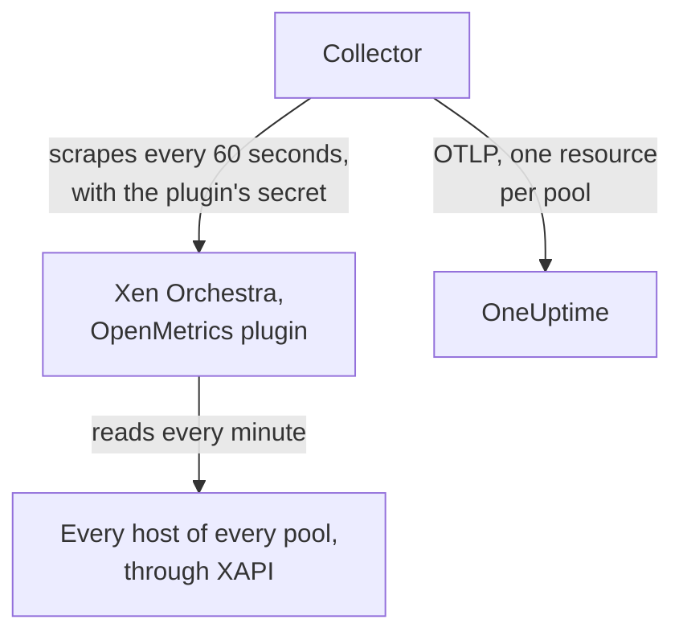

# XCP-ng Agent

The OneUptime XCP-ng agent monitors the XCP-ng pools a Xen Orchestra manages: their hosts, VMs, storage repositories and virtual disks. It is a stock OpenTelemetry Collector that reads Xen Orchestra's own OpenMetrics plugin with the plugin's secret and sends what it reads to OneUptime, where each pool appears with its inventory. No password of a pool or of Xen Orchestra ever reaches the agent. [XCP-ng monitors](/docs/monitor/xcp-ng-monitor) alert on what arrives.

:::cards
- [Install the agent](#install-the-agent): Turn on the plugin, then the install script or Docker Compose.
- [Xen Orchestra's certificate](#xen-orchestras-certificate): How the agent trusts Xen Orchestra, never by skipping the check.
- [What the agent collects](#what-the-agent-collects): Every series of the plugin, and the counters that are rates.
- [Troubleshooting](#troubleshooting): A diagnostic script, and the usual problems.
:::

## What you get

- **Every pool, on its own.** Each pool the Xen Orchestra manages becomes an XCP-ng pool in OneUptime, matched by its XAPI UUID and named as Xen Orchestra names it. Two pools behind one Xen Orchestra are two pools, and renaming a pool in OneUptime is safe: telemetry is matched by its UUID.
- **Its inventory.** The pool's hosts, VMs, storage repositories and virtual disks, with their state and their metrics. Control domains (dom0) report as VMs, and the pool's pages hide them unless you ask for them.
- **One agent per Xen Orchestra.** The plugin serves every pool its Xen Orchestra is connected to, so one agent reads them all, and a pool connected later appears with the next read.

## How it works

The agent is one container you run with Docker Compose on one machine: a stock OpenTelemetry Collector, with no image of OneUptime's own. Every 60 seconds it asks Xen Orchestra for `/openmetrics/metrics`, with the plugin's secret as a Bearer token, over Xen Orchestra's own address and certificate. The plugin reads each host's metrics from XAPI at 60-second resolution. The collector keeps the pools' series, groups them by pool, and sends them to OneUptime over OTLP.



Each pool registers itself with its first data, under the UUID the agent stamps on its series as `xcp_ng.pool.id`, and the name Xen Orchestra gives it, `xcp_ng.pool.name`. A pool with no name in Xen Orchestra is called "Pool" and the start of its UUID until you rename it.

## Before you begin

- Xen Orchestra 6.9 or later, connected to the pools you want to monitor, with its OpenMetrics plugin. On a Xen Orchestra Appliance (XOA) the plugin needs a Premium licence; Xen Orchestra built from sources includes it.
- Docker Engine 20.10 or later with the Docker Compose v2 plugin, `curl` and `openssl`, on a machine that can reach Xen Orchestra over HTTPS.
- A certificate on Xen Orchestra that names the address the agent connects to. The self-signed certificate Xen Orchestra makes for itself names none, so no current TLS client can check it, and Xen Orchestra built from sources serves plain HTTP until you give it one: see [Xen Orchestra's certificate](#xen-orchestras-certificate).
- An ingestion key. Create one under **Project Settings → Telemetry & APM → Ingestion Keys** and copy its value.
- Outbound HTTPS from that machine to your OneUptime URL.

### Supported versions

| | Supported | Why |
| --- | --- | --- |
| Xen Orchestra | 6.9 or later, with the OpenMetrics plugin `xo-server-openmetrics` 1.9 | Its plugin keeps its secret when Xen Orchestra restarts, has the fixes for the scrape's memory leaks, and serves every series the pool's pages read: the host and VM status, storage repositories and virtual disks. An older plugin could make a new secret at a restart, which locked the agent out until someone copied it again. |
| XCP-ng | 8.3 LTS | Supported by Vates until 30 November 2028. XCP-ng 8.2 reached its end of life on 16 September 2025. |
| XenServer | Not tried yet | Xen Orchestra reports a XenServer pool it manages with the same series, so it should work, but nobody has tried one with OneUptime yet. |

### Where to run the agent

The agent talks to Xen Orchestra over HTTPS, so it can run on any machine with Docker and a route to it: Xen Orchestra's own machine, a monitoring host, or a small management VM. Prefer a machine whose VM does not run on the pools it watches: if a pool goes down, your monitoring should not go down with it. One agent reads one Xen Orchestra; for more, see [Reading several Xen Orchestras](#reading-several-xen-orchestras).

## Turn on the OpenMetrics plugin

The agent reads every pool through Xen Orchestra's OpenMetrics plugin, with the plugin's secret.

:::steps
### Turn the plugin on

In Xen Orchestra, open *Settings → Plugins*, find **openmetrics** and turn it on. The first time it starts, it makes a secret, and Xen Orchestra keeps it across restarts.

### Copy its secret

Open the plugin's settings and copy its **Prometheus secret**: you give it to the agent in the next step. You can also type a secret of your own there and save it. Keep it private: anyone who has it can read every pool's metrics.

### Check that it answers

The plugin answers on Xen Orchestra's own address and certificate, at `/openmetrics/metrics`, and only to a request that carries its secret. Its health check needs none, so this one request may skip the certificate check with `-k`; the agent never does:

```bash
curl -k https://xo.example.com/openmetrics/health
```

It answers `{"status":"ok"}` while the plugin runs. A `404` means the plugin is not on.
:::

## Install the agent

:::steps
### Install and start the agent

Every OneUptime serves the agent's install script and files for its own release: the commands below download them from `https://oneuptime.com`, so on a self-hosted OneUptime replace it with your URL. The install script is saved as `install.sh` first, so you can read it before you run it.

:::tabs
@tab install.sh
Download the install script and run it on the machine that will host the agent:

```bash
curl -fsSL https://oneuptime.com/install/xcp-ng-agent -o install.sh
bash install.sh
```

The script asks for your OneUptime URL, the ingestion key, Xen Orchestra's address as you open it in a browser (such as `https://xo.example.com` or `https://10.0.0.5:8443`), the plugin's secret (not shown as you type it) and what to call this Xen Orchestra in OneUptime. It then reads Xen Orchestra's certificate: a certificate this machine already trusts is checked against its CA bundle; any other is shown with its SHA-256 fingerprint, and you answer **y** to trust that certificate and nothing else once you have compared the fingerprint with the one on Xen Orchestra's machine. It never turns the check off. Last, it asks the plugin for its metrics with the secret and says which pools Xen Orchestra reports, before it installs anything. It installs to `/opt/oneuptime-xcp-ng-agent`, writes a `0600` `.env` file and `xo-ca.pem`, the certificates the agent trusts for Xen Orchestra, and starts the agent with Docker Compose. Running the script again reuses everything in that `.env` instead of asking again, which is how you [upgrade the agent](#upgrading-the-agent).
@tab Docker Compose
Download `docker-compose.yml` and `otel-collector-config.yaml` from your OneUptime into a new folder:

```bash
mkdir oneuptime-xcp-ng-agent && cd oneuptime-xcp-ng-agent
curl -fsSLO https://oneuptime.com/install/xcp-ng-agent/docker-compose.yml
curl -fsSLO https://oneuptime.com/install/xcp-ng-agent/otel-collector-config.yaml
```

Create a `.env` file next to them. It holds the plugin's secret, so keep it private with `chmod 600 .env`:

```bash title=".env"
ONEUPTIME_URL=YOUR_ONEUPTIME_URL
ONEUPTIME_TELEMETRY_INGESTION_KEY=YOUR_TELEMETRY_INGESTION_TOKEN
XO_SCHEME=https
XO_ADDRESS=xo.example.com
XO_OPENMETRICS_SECRET='your-plugin-secret'
XO_NAME='Xen Orchestra'
XO_TLS_SERVER_NAME=
```

`XO_ADDRESS` is Xen Orchestra's `host` or `host:port`, without `https://`. Put the plugin's secret between single quotes, and write each `$` in it as `$$`: the collector reads the value once more, and would take a `$` for the start of a variable. A secret with a `'` in it cannot go between single quotes: let the install script write it, or choose another secret in Xen Orchestra.

Then save Xen Orchestra's certificate as `xo-ca.pem` next to `docker-compose.yml`: the agent checks Xen Orchestra against this file and nothing else. To trust Xen Orchestra's own certificate, read it, and compare its fingerprint with the one on Xen Orchestra's machine before you use it:

```bash
openssl s_client -connect xo.example.com:443 -servername xo.example.com </dev/null 2>/dev/null \
  | openssl x509 -out xo-ca.pem
openssl x509 -in xo-ca.pem -noout -fingerprint -sha256
```

When a CA of your own issued the certificate, copy that CA's certificate to `xo-ca.pem` instead; when a public CA did, copy this machine's CA bundle (`cp /etc/ssl/certs/ca-certificates.crt xo-ca.pem`). Start the agent:

```bash
docker compose up -d
```
:::

### Check the agent is running

```bash
docker compose ps
docker logs -f oneuptime-xcp-ng-agent
```

`docker compose ps` lists the collector, `oneuptime-xcp-ng-agent`. Its logs should show this line once it has started:

```text
Everything is ready. Begin running and processing data.
```

### Find the pools in OneUptime

Open **Products → Infrastructure → XCP-ng → All Pools**. Each pool Xen Orchestra reports appears about a minute after the first scrape, under the name Xen Orchestra gives it, with its hosts, VMs and storage. Its **Topology** page draws them as one map: see [Topology](/docs/telemetry/topology#open-a-resources-own-map).
:::

## Xen Orchestra's certificate

The agent checks Xen Orchestra's certificate on every read, against `xo-ca.pem` and nothing else, and never skips the check: the plugin's secret travels in every request. `xo-ca.pem` holds one of three things:

- **Xen Orchestra's own certificate**, pinned by its SHA-256 fingerprint (`XO_TLS_FINGERPRINT`): the agent trusts that certificate and no other.
- **The CA that issued it** (`XO_CA_FILE`), for a certificate from a CA of your own.
- **This machine's CA bundle**, for a certificate this machine already trusts, such as one from a public CA.

Either way, the certificate must name the address the agent connects to. The agent checks the names a certificate is issued to, its subject alternative names, as every current TLS client does, and never its subject. The self-signed certificate Xen Orchestra makes for itself names none, so the agent cannot trust it, pinned or not, and fails with `x509: certificate is not valid for any names`; the install script stops on such a certificate and says why.

### Give Xen Orchestra a certificate that names its address

Use a certificate from your own CA or a public one, or make a self-signed one that names Xen Orchestra's address, as root on Xen Orchestra's machine, with its name and its address in its subject alternative names:

```bash
mkdir -p /etc/ssl/xo
openssl req -x509 -newkey rsa:2048 -nodes -days 825 \
  -subj "/CN=xo.example.com" \
  -addext "subjectAltName=DNS:xo.example.com,IP:10.0.0.5" \
  -keyout /etc/ssl/xo/key.pem -out /etc/ssl/xo/cert.pem
```

Point xo-server's HTTPS listener at the two files, in a configuration file of its own: `/etc/xo-server/config.httpscert.toml` on an XOA, or next to xo-server's `config.toml` for Xen Orchestra built from sources. Xen Orchestra's listeners are numbered, and the second, `http.listen.1`, is its HTTPS one:

```toml
[http.listen.1]
port = 443
cert = '/etc/ssl/xo/cert.pem'
key = '/etc/ssl/xo/key.pem'
```

Then restart xo-server with `systemctl restart xo-server`, and install the agent, or run the install script again: it reads the new certificate and shows its fingerprint to check. Or let Xen Orchestra request a Let's Encrypt certificate itself, as an XOA can (see Xen Orchestra's documentation): it is publicly trusted, so the agent needs nothing set. With a certificate that names Xen Orchestra by a name other than the address in `XO_ADDRESS`, set `XO_TLS_SERVER_NAME` to that name; the install script fills it in from the certificate when it can.

When a pinned certificate is renewed, its fingerprint changes and the agent stops reading Xen Orchestra until it trusts the new one: run the install script again, which shows the new fingerprint and changes nothing until you answer **y**. Installed with Docker Compose, write `xo-ca.pem` again and run `docker compose up -d --force-recreate`.

## Environment variables

The install script writes these to `/opt/oneuptime-xcp-ng-agent/.env`; a Docker Compose install reads them from the `.env` next to `docker-compose.yml`. After changing one, run `docker compose up -d` in that folder.

| Variable | Required | Description |
| --- | --- | --- |
| `ONEUPTIME_URL` | Yes | Your OneUptime URL, such as `https://oneuptime.com` or your self-hosted instance. Use `http://` and its port if the instance is HTTP-only. |
| `ONEUPTIME_TELEMETRY_INGESTION_KEY` | Yes | The ingestion key from **Project Settings → Telemetry & APM → Ingestion Keys**. |
| `XO_URL` | Install script | Xen Orchestra's address as you open it in a browser, such as `https://xo.example.com` or `https://10.0.0.5:8443`. The install script works out `XO_SCHEME` and `XO_ADDRESS` from it. |
| `XO_SCHEME` | No | `https`, the default. `http` only in a lab: the secret then crosses the network in clear. |
| `XO_ADDRESS` | Yes | Xen Orchestra's `host` or `host:port`, without a scheme. |
| `XO_OPENMETRICS_SECRET` | Yes | The OpenMetrics plugin's secret, sent as a Bearer token. Every `$` in it is written as `$$`. |
| `XO_NAME` | No | What to call this Xen Orchestra in OneUptime, stamped on every pool it reads as `xen_orchestra.name` and shown on each pool's **Settings**. Defaults to Xen Orchestra's address. |
| `XO_TLS_FINGERPRINT` | Install script | The SHA-256 fingerprint of Xen Orchestra's own certificate, as `openssl x509 -fingerprint -sha256` prints it, colons optional, when the agent trusts that certificate and nothing else. The install script refuses a certificate that does not match it. |
| `XO_CA_FILE` | Install script | A CA bundle that issued Xen Orchestra's certificate, which the install script checks the certificate against and copies to `xo-ca.pem`. |
| `XO_TLS_SERVER_NAME` | No | The name Xen Orchestra's certificate is checked against, when `XO_ADDRESS` is an address the certificate does not list. Empty: the host of `XO_ADDRESS`. |

## What the agent collects

Every minute the agent reads the plugin, which reads each host's round-robin databases through XAPI at 60-second resolution. It keeps the `xcp_*` series, and moves each series' pool to the resource it sends them on, as `xcp_ng.pool.id` (the pool's UUID, which never changes) and `xcp_ng.pool.name`:

| Category | Series |
| --- | --- |
| Pool | `xcp_pool_connected`, present while Xen Orchestra is connected to the pool |
| Hosts | `xcp_host_status` (its power state and whether it is enabled), `xcp_host_uptime_seconds`, `xcp_host_cpu_average`, `xcp_host_cpu_core_usage`, `xcp_host_load`, `xcp_host_load_average`, `xcp_host_memory_*`, `xcp_host_running_vcpus`, `xcp_host_network_*` per physical interface, `xcp_host_disk_*` per storage repository, `xcp_host_power_consumption_watts` |
| VMs | `xcp_vm_status`, `xcp_vm_uptime_seconds`, `xcp_vm_cpu_usage`, `xcp_vm_cpu_core_usage`, `xcp_vm_runstate_*` (CPU contention), `xcp_vm_memory_*`, `xcp_vm_network_*` per interface, `xcp_vm_disk_*` per disk, `xcp_vm_power_consumption_watts` |
| Storage | `xcp_sr_physical_size_bytes`, `xcp_sr_physical_usage_bytes`, `xcp_sr_virtual_size_bytes`, `xcp_vdi_virtual_size_bytes`, `xcp_vdi_physical_usage_bytes` |
| XOSTOR | `xcp_xostor_*`, on pools that run XOSTOR |

Control domains report as VMs with `is_control_domain="true"`. Every series of Xen Orchestra's keeps its name and its labels, such as `uuid`, `host_name`, `vm_name`, `sr_name` and `tags`; the [XCP-ng Monitor](/docs/monitor/xcp-ng-monitor#collected-metrics) lists every one.

### The counters that are rates

Xen Orchestra types eight throughput series as counters and names them `_total`, though each holds XAPI's per-second rate: `xcp_host_network_receive_bytes_total`, `xcp_host_network_transmit_bytes_total`, `xcp_vm_network_receive_bytes_total`, `xcp_vm_network_transmit_bytes_total`, `xcp_vm_network_receive_errors_total`, `xcp_vm_network_transmit_errors_total`, `xcp_vm_disk_read_bytes_total` and `xcp_vm_disk_write_bytes_total`. Read as counters, every network and disk throughput chart would be wrong: a rate that goes down reads as a counter reset. The agent's `transform/xcp-ng-rates` processor turns them into gauges with their names and values untouched, so OneUptime stores them as the rates they are, in bytes or errors per second. OneUptime also converts any that still arrive as counters, from a collector you configured yourself.

### What OneUptime adds

OneUptime derives four 0/1 series for each pool as its data arrives, which the alert templates read:

| Series | 1 while |
| --- | --- |
| `xcp_ng.host.running` | Xen Orchestra reports the host Running; 0 while it is Halted, or its state is Unknown |
| `xcp_ng.host.enabled` | the host is enabled; 0 in maintenance mode or while it is evacuated, when XAPI starts no VM on it |
| `xcp_ng.vm.running` | the VM is Running; 0 while it is Halted, Paused or Suspended |
| `xcp_ng.vm.stopped_after_running` | a VM that ran in the last 24 hours is Halted or Paused |

It also stamps every point with `xcp_ng.scope` (`pool`, `host`, `vm`, `sr`, `vdi` or `xostor`) and `xcp_ng.id` (that object's UUID), which monitors and dashboards filter on: see [Resource identity](/docs/monitor/xcp-ng-monitor#resource-identity).

### What the agent does not keep

- Xen Orchestra's own process series (`xo_*`), which belong to no pool, and the collector's own scrape series.
- A host's power that Xen Orchestra reads over IPMI: the plugin sends that reading without its pool, so it belongs to no pool either. Each VM's estimated share of it, `xcp_vm_power_consumption_watts`, is kept.

## What the pool's pages show

Open a pool from **Products → Infrastructure → XCP-ng → All Pools**. Its menu has:

| Page | What it shows |
| --- | --- |
| **Overview** | The pool's health and what needs attention, its hosts, VMs and storage, its busiest VMs and hosts, and the Xen Orchestra it is read from, with the agent's version. |
| **Hosts**, **VMs**, **Storage** | Every host, VM and storage repository, each with a page of its own and its charts. **VMs** hides control domains unless you ask for them, and a storage repository's page lists its virtual disks. |
| **Topology** | The pool, its hosts, the VMs on each and the storage repositories they use, as one map. |
| **Resource Usage** | Charts of the pool's hosts, VMs, storage, disks and network over time, one line per host, VM or storage repository. |
| **Recommendations** | The [alert templates](/docs/monitor/xcp-ng-monitor#pre-built-alert-templates) to turn on, one monitor each. |
| **Metrics**, **Logs** | Every series of the pool in the explorers, scoped to it. The agent sends metrics only, so **Logs** lists only logs you send with the pool's `xcp_ng.pool.id`. |
| **Incidents**, **Alerts**, **Scheduled Maintenance** | The ones that name the pool. |
| **Feed** | What happened to the pool in OneUptime: when it was added, changed, archived or restored, who its owners are, and the owner and label rules that ran on it. |
| **Owners** | Who is told about it, by hand or by owner rules. |
| **Settings** | Its name, the Xen Orchestra it is read from, its name there and the agent's version, with how long its telemetry is kept. |
| **Documentation** | This setup, with your URL and key filled in. |

The pool's **Overview** says its health, **Healthy**, **Degraded** or **Unhealthy**, from what needs attention, and lists that under **Needs attention**, the most urgent first:

- **Critical:** a host Halted, or in a state Xen Orchestra cannot tell (Unknown); a storage repository more than 95% full, where VMs stop writing.
- **Needs a look:** a host disabled, in maintenance mode or being evacuated; a VM Halted or Paused that ran in the last 24 hours; a storage repository more than 90% full, where the Storage Repository Near Full alert fires, or allocated past its size by thin provisioning.

A suspended VM was suspended on purpose and never counts, nor does a VM nobody saw running for a day, nor a control domain. ISO libraries and removable media hold no VM disks, so the pool's storage figures leave them out.

When Xen Orchestra stops reporting a pool for 15 minutes, the pool turns **Disconnected**, and its pages keep what it last reported. A host, VM, storage repository or virtual disk that no longer appears in Xen Orchestra's reports leaves the inventory 15 minutes later; stopping a VM never removes it.

## Tag the pools with project labels

A resource attribute that starts with `oneuptime.label.` becomes a project label on every pool the agent reads: `oneuptime.label.<dimension>=<value>` is the label `<dimension>:<value>`. Add the attributes to the `resource` processor in `otel-collector-config.yaml`, next to `xen_orchestra.name`:

```yaml
processors:
  resource:
    attributes:
      # ...existing attributes...
      - key: oneuptime.label.team
        value: platform
        action: upsert
      - key: oneuptime.label.env
        value: production
        action: upsert
```

The collector reads its config only when it starts: run `docker compose restart oneuptime-xcp-ng-agent`. The pools then show the labels `team:platform` and `env:production`. Labels are matched without regard to case, so an existing `Production` label is reused rather than duplicated, and the agent never removes a label someone added in OneUptime. Running the install script again replaces an edited `otel-collector-config.yaml` and keeps yours next to it as `otel-collector-config.yaml.bak.<timestamp>`.

## Reading several Xen Orchestras

One agent reads one Xen Orchestra and every pool it manages. To read a second Xen Orchestra from the same machine, install a second agent into its own folder with its own `.env`, such as `INSTALL_DIR=/opt/oneuptime-xcp-ng-agent-lab bash install.sh`, and give it its own `container_name` in its `docker-compose.yml` (such as `oneuptime-xcp-ng-agent-lab`): two containers cannot share a name. Give each its own `XO_NAME`, so each pool's **Settings** says which Xen Orchestra reads it, and pass the folder to the diagnostic script with `-d`.

Never let two agents read the same pool, through two Xen Orchestras that both manage it: it is one pool in OneUptime, by its UUID, and it would be reported twice.

## Run as a systemd service

To start the agent with the machine and restart it when it fails, install its systemd unit. It assumes the agent lives in `/opt/oneuptime-xcp-ng-agent`, where the install script puts it:

```bash
sudo curl -fsSL https://oneuptime.com/install/xcp-ng-agent/systemd/oneuptime-xcp-ng-agent.service -o /etc/systemd/system/oneuptime-xcp-ng-agent.service
sudo systemctl daemon-reload
sudo systemctl enable --now oneuptime-xcp-ng-agent
```

## Upgrading the agent

The agent reports the collector version its files pin as its **Agent Version**, on each pool's **Overview** and **Settings**. When that is older than the version this OneUptime release pins, a warning sign appears beside it. Select it to see these commands.

The collector image is pinned in `docker-compose.yml` and its config is a file next to it, so pulling alone does not move the agent forward. Run `install.sh` again: it reuses every value in your existing `.env` (nothing is asked again), checks Xen Orchestra's certificate the same way, refreshes `docker-compose.yml` and `otel-collector-config.yaml` (a file you edited is kept as `<file>.bak.<timestamp>`), pulls the image and recreates the agent so the collector reads its new config. An agent installed outside `/opt/oneuptime-xcp-ng-agent` needs its folder: `INSTALL_DIR=<folder> bash install.sh`.

```bash
curl -fsSL https://oneuptime.com/install/xcp-ng-agent -o install.sh
bash install.sh
```

Installed it with Docker Compose instead? In the agent's folder, download both files again (and make again any change you made to them), then pull the image and recreate the agent. Your `.env` and `xo-ca.pem` stay:

```bash
curl -fsSLO https://oneuptime.com/install/xcp-ng-agent/docker-compose.yml
curl -fsSLO https://oneuptime.com/install/xcp-ng-agent/otel-collector-config.yaml
docker compose pull
docker compose up -d --force-recreate
```

## Uninstalling the agent

```bash
cd /opt/oneuptime-xcp-ng-agent
docker compose down
```

Then turn off the OpenMetrics plugin in Xen Orchestra if nothing else reads it.

## Troubleshooting

:::details Run the diagnostic script first
The agent ships with a script, [`troubleshoot.sh`](https://oneuptime.com/install/xcp-ng-agent/troubleshoot.sh), that checks the whole chain in the order the data travels: the container; Xen Orchestra's address from the agent's own network; the plugin's health check; Xen Orchestra's certificate against `xo-ca.pem`, and whether a pinned one is still the one it presents; the plugin's secret; the pools Xen Orchestra reports; the ingestion key's shape; the collector's own metrics; and whether OneUptime accepts the ingestion key. That last check matters most. OneUptime refuses a bad key with `401` (`422` for a disabled key or a browser key), and the collector treats both as permanent: it drops the batch and logs one `Exporting failed` error, which is easy to miss while the container stays healthy. The script asks `GET <url>/otlp/v1/validate` from inside the agent's network for a direct `200` (valid) or `401` (invalid), and falls back to `POST /fluentd/v1/logs` on older servers. It never prints the secret or the key.

```bash
curl -fsSL https://oneuptime.com/install/xcp-ng-agent/troubleshoot.sh -o troubleshoot.sh
bash troubleshoot.sh    # add -d <dir> if you installed outside /opt/oneuptime-xcp-ng-agent
```

It ends with a verdict naming the most likely cause.
:::

:::details Xen Orchestra refuses the secret (401)
The collector logs `server returned HTTP status 401 Unauthorized`. Copy the secret again from *Settings → Plugins → openmetrics*, set `XO_OPENMETRICS_SECRET` to it in `.env`, between single quotes and with every `$` written as `$$`, and run `docker compose up -d` in the agent's folder. Before 6.9, Xen Orchestra could make a new secret when it restarted: upgrade it.
:::

:::details The plugin does not answer (404, 500, 502 or 503)
Xen Orchestra answers, but its OpenMetrics plugin does not. Turn the plugin on under *Settings → Plugins → openmetrics*, and check that Xen Orchestra is 6.9 or later. An XOA needs a Premium licence for the plugin. `/openmetrics/health` answers `{"status":"ok"}` without a secret while the plugin runs.
:::

:::details Certificate errors
- `x509: certificate is not valid for any names`: the certificate names no address, as Xen Orchestra's own self-signed one does. [Give Xen Orchestra a certificate that names its address](#give-xen-orchestra-a-certificate-that-names-its-address).
- `x509: certificate is valid for <names>, not <address>`: connect to one of those names, or set `XO_TLS_SERVER_NAME` to one.
- `x509: cannot validate certificate for <IP> because it doesn't contain any IP SANs`: `XO_ADDRESS` is an IP address the certificate does not list. Set `XO_TLS_SERVER_NAME` to a name it lists, or run the install script again, which does.
- `x509: certificate signed by unknown authority`: `xo-ca.pem` holds neither this certificate nor the CA that issued it. The certificate was renewed, or the file holds another one: run the install script again, or write the file again.
- `unable to read CA cert`: `xo-ca.pem` is missing or cannot be read. Run the install script again.
:::

:::details The scrape times out (context deadline exceeded)
Xen Orchestra took longer than 50 seconds, the agent's limit, to gather the metrics, so that read sends nothing: usually a host of one of its pools does not answer it. Check the pools' hosts in Xen Orchestra; the agent reads again a minute later.
:::

:::details A pool shows as Disconnected
OneUptime marks a pool Disconnected when nothing has been read for it for 15 minutes; OneUptime checks every 5 minutes, and time it was not receiving data itself does not count.

1. If every pool of this Xen Orchestra is Disconnected, check the agent: `docker compose ps` and `docker logs oneuptime-xcp-ng-agent`, in the agent's folder.
2. If only one is, Xen Orchestra stopped reporting it: under *Settings → Servers* in Xen Orchestra, the pool's server must be connected. The pool's hosts, VMs and storage stay as Xen Orchestra last reported them.
:::

:::details A pool is missing
Xen Orchestra reports only the pools it is connected to, and the agent reads only that Xen Orchestra. Connect the pool's server under *Settings → Servers* in Xen Orchestra; the pool appears in OneUptime with the next read. A pool that another Xen Orchestra manages needs an agent of its own, beside that Xen Orchestra.
:::

:::details Throughput charts look wrong
The eight `_total` series that hold rates must reach OneUptime as gauges. If you replaced the shipped `otel-collector-config.yaml` with your own, keep its `transform/xcp-ng-rates` processor. Read them as they are, in bytes or errors per second: a per-second rate of them is a rate of a rate.
:::

:::details Sending metrics without the agent
The agent is one stock collector config, so a collector you already run can do the same job: copy the scrape job and the processors from the shipped config into your own. The `xcp_ng.pool.id` resource attribute is what registers each pool in OneUptime, the `groupbyattrs` processor makes each pool one resource, and the deletes of `service.name` and `service.instance.id` keep the data from being filed under a Service: keep all three, and `transform/xcp-ng-rates`.
:::

## What the plugin does not cover yet

Xen Orchestra's OpenMetrics plugin serves metrics, so some of what you watch an XCP-ng pool for is not in it yet:

- **Alarms**, other than XOSTOR's, the **HA state**, the **pool master**, **missing patches**, **backups** and **snapshots**, and the **link state** of a host's physical interfaces (PIFs). These come from Xen Orchestra's REST API, in [#10997](https://github.com/OneUptime/oneuptime/issues/10997).
- **Pools without Xen Orchestra**, or behind an XOA without the Premium licence the plugin needs: these will be read from XAPI directly, in [#10999](https://github.com/OneUptime/oneuptime/issues/10999).
- **Connecting without an agent**, from a OneUptime probe, as VMware can: [#10996](https://github.com/OneUptime/oneuptime/issues/10996).

## Next steps

:::cards
- [XCP-ng Monitor](/docs/monitor/xcp-ng-monitor): Alert on pools, hosts, VMs and storage repositories.
- [Proxmox Agent](/docs/telemetry/proxmox): Monitor Proxmox VE clusters the same way.
- [Host OpenTelemetry Collector](/docs/telemetry/host-otel-collector): The operating system view inside your VMs.
:::
