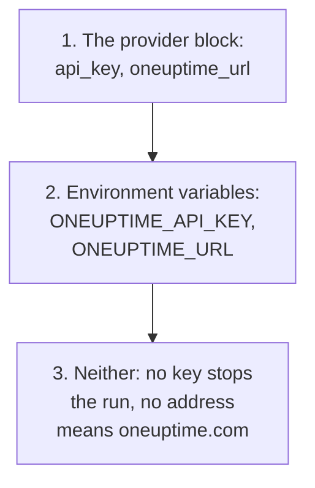
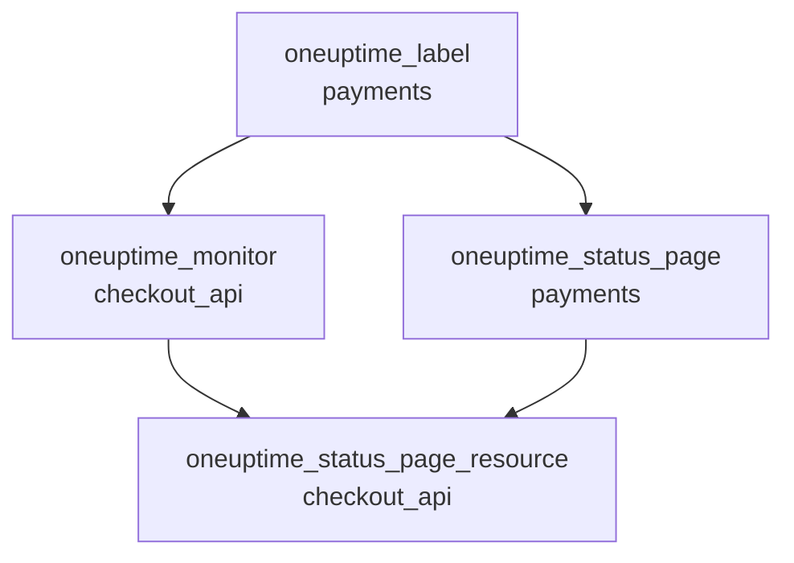

# Complete Guide

This guide covers what comes after your first apply: how the provider finds its API key, how to lay out a configuration for one project or several, how resources refer to each other, how to read records you do not manage, how to keep state safe, and how to upgrade. New to the provider? Start with the [Quick Start](/docs/terraform/quick-start).

:::cards
- [Configure the provider](#configure-the-provider): The API key and the address, and where the provider reads them.
- [Lay out a configuration](#lay-out-a-configuration): Files, projects, and many resources from one block.
- [Read what already exists](#read-what-already-exists): Data sources, and how a lookup matches.
- [Keep state safe](#keep-state-safe): A remote backend, and what never to commit.
:::

## Configure the provider

The provider takes two settings. Each comes from the provider block, or else from an environment variable:

| Setting | Environment variable | When neither is set |
| --- | --- | --- |
| `api_key` | `ONEUPTIME_API_KEY` | The provider stops before anything is planned: `Missing API Key` |
| `oneuptime_url` | `ONEUPTIME_URL` | `https://oneuptime.com`, which is OneUptime Cloud |



`oneuptime_url` is your OneUptime's address, without `/api`: the provider adds `https://` when the address has no scheme, and `/api` at the end. `api_key` is sensitive, so Terraform never prints it.

The key must be an API key of the project you manage, allowed to create, read, change and delete each kind of record your configuration has: see [Create a project API key](/docs/terraform/quick-start#create-a-project-api-key). A self-hosted OneUptime's master API key belongs to no project, so a create made with it fails with `ProjectId required`.

### Give the provider its key

:::tabs
@tab Environment variable
```bash
export ONEUPTIME_API_KEY="<your-api-key>"
# Only on a self-hosted OneUptime:
export ONEUPTIME_URL="https://oneuptime.example.com"
```

```hcl title="main.tf"
provider "oneuptime" {}
```
@tab Terraform variable
```hcl title="variables.tf"
variable "oneuptime_api_key" {
  description = "API key of the OneUptime project"
  type        = string
  sensitive   = true
}

provider "oneuptime" {
  api_key = var.oneuptime_api_key
}
```

```hcl title="terraform.tfvars"
oneuptime_api_key = "<your-api-key>"
```
:::

An environment variable keeps the key out of every file. A variable file is handy on your own machine: add `terraform.tfvars` to `.gitignore`. In a pipeline, set `TF_VAR_oneuptime_api_key` instead of writing the file.

### Run it in CI/CD

Give the job the key as a secret, in the `ONEUPTIME_API_KEY` environment variable:

:::tabs
@tab GitHub Actions
```yaml title=".github/workflows/oneuptime.yml"
name: OneUptime
on:
  push:
    branches: [main]

jobs:
  apply:
    runs-on: ubuntu-latest
    env:
      ONEUPTIME_API_KEY: ${{ secrets.ONEUPTIME_API_KEY }}
    steps:
      - uses: actions/checkout@v4
      - uses: hashicorp/setup-terraform@v3
      - run: terraform init -input=false
      - run: terraform plan -input=false -out=tfplan
      - run: terraform apply -input=false tfplan
```
@tab GitLab CI
```yaml title=".gitlab-ci.yml"
apply:
  image:
    name: hashicorp/terraform:latest
    entrypoint: [""]
  rules:
    - if: $CI_COMMIT_BRANCH == $CI_DEFAULT_BRANCH
  script:
    - terraform init -input=false
    - terraform plan -input=false -out=tfplan
    - terraform apply -input=false tfplan
```
:::

In GitHub, add the secret under **Settings → Secrets and variables → Actions**; in GitLab, add a masked CI/CD variable of the same name. Keep the state in a [remote backend](#keep-state-safe), so that each run starts from the state the last one left.

## Lay out a configuration

One layout that works well:

```text
oneuptime/
├── main.tf          # the terraform and provider blocks
├── variables.tf     # input variables
├── outputs.tf       # the IDs other configurations need
├── shared.tf        # labels, teams and monitor statuses
├── monitors.tf      # monitors and monitor groups
├── status-pages.tf  # status pages and their domains
└── on-call.tf       # on-call policies and escalation rules
```

- **One configuration for each project.** An API key belongs to one project, so a configuration naturally manages one.
- **Shared records once.** Define labels, teams and monitor statuses in one file, and refer to them by their address everywhere else.

### Manage several projects

To manage more than one project from one configuration, give the provider an alias for each, each with that project's key. A resource names the alias it uses with `provider`:

```hcl
provider "oneuptime" {
  alias   = "production"
  api_key = var.production_api_key
}

provider "oneuptime" {
  alias   = "staging"
  api_key = var.staging_api_key
}

resource "oneuptime_label" "staging_critical" {
  provider = oneuptime.staging

  name  = "critical"
  color = "#FF5733"
}
```

Declare `production_api_key` and `staging_api_key` as variables marked `sensitive`, as above.

### Many resources from one block

`for_each` makes one resource for each entry of a map. These monitors share their criteria and differ only in name and address:

```hcl
variable "websites" {
  type = map(string)
  default = {
    homepage = "https://example.com"
    docs     = "https://docs.example.com"
  }
}

resource "oneuptime_monitor" "website" {
  for_each = var.websites

  name                = "Website: ${each.key}"
  monitor_type        = "Website"
  monitoring_interval = "*/5 * * * *"

  monitor_steps = [{
    monitor_destination      = each.value
    monitor_destination_type = "URL"

    criteria = [
      {
        name                  = "Offline"
        filter_condition      = "Any"
        change_monitor_status = true
        monitor_status_id     = data.oneuptime_monitor_status.offline.id

        filters = [
          {
            check_on    = "Is Online"
            filter_type = "False"
          }
        ]
      }
    ]
  }]
}
```

Add a site to the map, and the next apply creates its monitor. Remove one, and it deletes it.

## Refer to other resources

A resource that names another one's attribute depends on it, and Terraform orders the work by those references. Here the label is created first and deleted last, because the monitor and the status page name it:



```hcl
resource "oneuptime_label" "payments" {
  name        = "payments"
  description = "Payment infrastructure"
  color       = "#2ECC71"
}

resource "oneuptime_monitor" "checkout_api" {
  name         = "Checkout API"
  description  = "Availability of the checkout API"
  monitor_type = "Manual"
  labels       = [oneuptime_label.payments.id]
}

resource "oneuptime_status_page" "payments" {
  name                  = "Payments Status"
  page_title            = "Payments Status"
  is_public_status_page = true
  labels                = [oneuptime_label.payments.id]
}

resource "oneuptime_status_page_resource" "checkout_api" {
  status_page_id = oneuptime_status_page.payments.id
  monitor_id     = oneuptime_monitor.checkout_api.id
  display_name   = "Checkout API"
}
```

You rarely need `depends_on`: add it only for an order Terraform cannot see from the attributes. Lists of IDs such as `labels` are sets, so reordering them changes nothing.

## Read what already exists

Every resource has a data source of the same name. A data source reads a record this configuration does not manage, made in the dashboard or by another configuration, so you can refer to it without taking it over.

```hcl
data "oneuptime_label" "critical" {
  name = "critical"
}

data "oneuptime_monitor_status" "offline" {
  is_offline_state = true
}

data "oneuptime_status_page" "main" {
  id = "5f8a1b2c-3d4e-4f6a-8b9c-0d1e2f3a4b5c"
}

resource "oneuptime_monitor" "database" {
  name         = "Database Health"
  monitor_type = "Manual"
  labels       = [data.oneuptime_label.critical.id]
}
```

How a lookup matches:

| You set | It finds | Errors |
| --- | --- | --- |
| `id` | The record with that ID | `Not Found` when no record has it |
| Any other plain arguments, one or more | The one record that matches all of them | `Not Found` when none matches, `Ambiguous Match` when more than one does |
| `id` and another argument, or nothing | Nothing | `Invalid Lookup` |

Plain arguments are text, numbers and true or false: a name, a priority, a flag such as `is_offline_state`. Lists, JSON values, timestamps and secrets cannot be looked up by. To take over a record rather than only read it, [import it](/docs/terraform/importing-resources) instead.

## Keep state safe

Terraform's state holds the IDs and attributes of everything it manages, secrets included. Keep it in a remote backend that locks it, so a team shares one state and two runs never write it at once. Any standard backend works, for example an S3 bucket:

```hcl
terraform {
  backend "s3" {
    bucket       = "my-terraform-state"
    key          = "oneuptime/production.tfstate"
    region       = "us-east-1"
    encrypt      = true
    use_lockfile = true
  }
}
```

`use_lockfile` needs Terraform 1.10 or OpenTofu 1.10, or later. Before them, the S3 backend locks with a DynamoDB table (`dynamodb_table`).

- **Never edit the state by hand.** Use `terraform state mv` and `terraform state rm`.
- **Never commit `terraform.tfstate`, or a `.tfvars` file with a secret in it.**

## Drift, and what does not cause it

`terraform plan` compares OneUptime with your configuration, and lists what differs. Some differences are never shown:

- **Times are compared as instants.** `2030-06-01T02:00:00Z` and the server's way of writing the same instant are equal.
- **Defaults the server adds** to a monitor's steps, or to a JSON value, are not a difference from what you wrote.
- **What the server keeps up to date**, such as a monitor's current status, is not a difference either.

A value you compute on every run is, though: `timestamp()` gives a new time each run, so a plan always shows it. Write fixed times instead:

```hcl
resource "oneuptime_scheduled_maintenance_event" "database_upgrade" {
  title       = "Database upgrade"
  description = "Planned PostgreSQL upgrade"
  starts_at   = "2030-06-01T02:00:00Z"
  ends_at     = "2030-06-01T04:00:00Z"
}
```

## Upgrade the provider

:::steps
### Read the release notes

The [Terraform Registry](https://registry.terraform.io/providers/oneuptime/oneuptime) and the [provider's GitHub releases](https://github.com/OneUptime/terraform-provider-oneuptime/releases) list what changed.

### Raise the version constraint

`{{TERRAFORM_PROVIDER_VERSION}}` already takes every {{TERRAFORM_PROVIDER_MAJOR}}.x release. A new major needs a new constraint.

### Download the new version

```bash
terraform init -upgrade
```

### Plan before you apply

Run `terraform plan`, and apply only when it is empty or shows the changes you expect.
:::

On a self-hosted OneUptime, upgrade OneUptime first and the provider after it: the provider must not be newer than your OneUptime. See [Self-Hosted Setup](/docs/terraform/self-hosted).

## Next steps

:::cards
- [Monitor Steps](/docs/terraform/monitor-steps): Decide what a monitor checks and what each result means.
- [Examples](/docs/terraform/examples): Ready-to-use configurations for the common resources.
- [Importing Resources](/docs/terraform/importing-resources): Bring what you made in the dashboard under Terraform.
- [Troubleshooting](/docs/terraform/troubleshooting): Common errors and how to fix them.
:::
