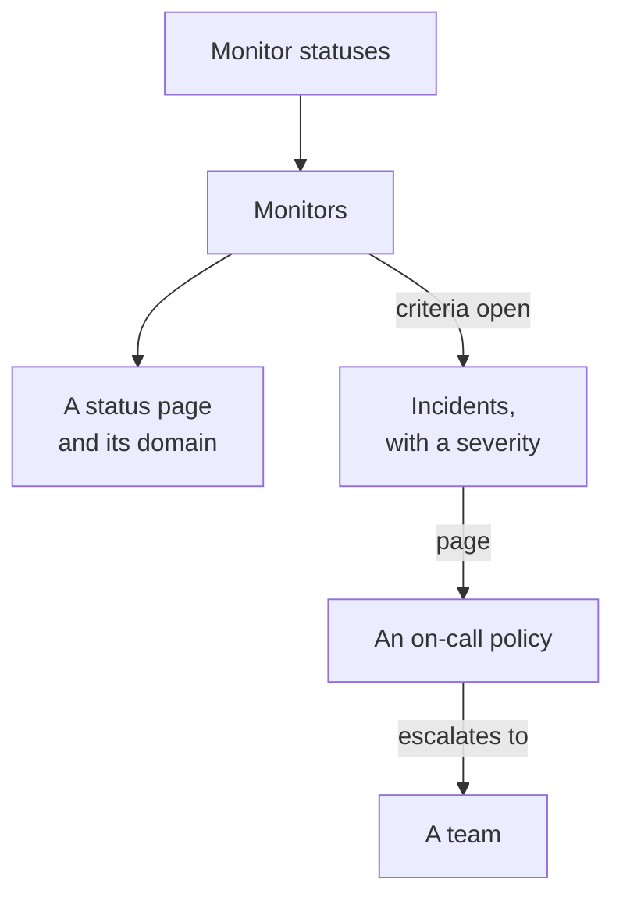

# Examples

Ready-to-use configurations for the resources most projects start with. Each block applies as it is on top of the provider setup below, and most come from the provider's end-to-end tests, which apply them to a real OneUptime on every change.

:::cards
- [Monitors](#monitors): Website, API, ping, port, SSL certificate, heartbeat and manual monitors.
- [Status pages](#status-pages): A status page with a group and a monitor, and a custom domain.
- [Teams and on-call](#teams-and-on-call): A team, and an on-call policy that pages it.
- [Incidents and maintenance](#incidents-and-maintenance): Severities, states, a declared incident and a maintenance window.
:::



## Provider setup

Every example assumes this setup, with the API key in the `ONEUPTIME_API_KEY` environment variable:

```hcl title="main.tf"
terraform {
  required_providers {
    oneuptime = {
      source  = "oneuptime/oneuptime"
      version = "{{TERRAFORM_PROVIDER_VERSION}}"
    }
  }
}

provider "oneuptime" {
  # On a self-hosted OneUptime, add your OneUptime's address:
  # oneuptime_url = "https://oneuptime.example.com"
}
```

## Labels

Labels sort and filter records. Most resources take a set of label IDs in `labels`:

```hcl
resource "oneuptime_label" "production" {
  name        = "production"
  description = "Production infrastructure"
  color       = "#FF5733"
}
```

## Monitors

The monitors below set their status with three of the statuses every project starts with, read with data sources:

```hcl
data "oneuptime_monitor_status" "operational" {
  name = "Operational"
}

data "oneuptime_monitor_status" "degraded" {
  name = "Degraded"
}

data "oneuptime_monitor_status" "offline" {
  name = "Offline"
}
```

Each monitor's `monitor_steps` say what it checks and how each result is judged: [Monitor Steps](/docs/terraform/monitor-steps) explains every attribute.

### Website monitor

Offline when the site does not answer, online when it answers with 200. The end-to-end test `35-monitor-with-steps` applies this monitor:

```hcl
resource "oneuptime_monitor" "website" {
  name                = "Website"
  description         = "Homepage availability and status code"
  monitor_type        = "Website"
  monitoring_interval = "*/5 * * * *"
  labels              = [oneuptime_label.production.id]

  monitor_steps = [{
    monitor_destination      = "https://example.com"
    monitor_destination_type = "URL"
    request_type             = "GET"

    criteria = [
      {
        name                  = "Offline"
        description           = "The website does not respond"
        filter_condition      = "Any"
        change_monitor_status = true
        monitor_status_id     = data.oneuptime_monitor_status.offline.id

        filters = [
          {
            check_on    = "Is Online"
            filter_type = "False"
          }
        ]
      },
      {
        name                  = "Online"
        description           = "The website responds with 200"
        filter_condition      = "All"
        change_monitor_status = true
        monitor_status_id     = data.oneuptime_monitor_status.operational.id

        filters = [
          {
            check_on    = "Is Online"
            filter_type = "True"
          },
          {
            check_on    = "Response Status Code"
            filter_type = "Equal To"
            value       = "200"
          }
        ]
      }
    ]
  }]
}
```

### API monitor

A `POST` with headers and a JSON body, degraded when the answer is slow. The end-to-end test `35-monitor-with-steps` applies an API monitor like it:

```hcl
resource "oneuptime_monitor" "orders_api" {
  name         = "Orders API"
  description  = "Health check of the orders API"
  monitor_type = "API"

  monitor_steps = [{
    monitor_destination      = "https://api.example.com/v1/health"
    monitor_destination_type = "URL"
    request_type             = "POST"
    request_headers = {
      "Content-Type" = "application/json"
      "Accept"       = "application/json"
    }
    request_body = jsonencode({ check = "health" })

    criteria = [
      {
        name                  = "Offline"
        description           = "The API does not answer, or answers with an error"
        filter_condition      = "Any"
        change_monitor_status = true
        monitor_status_id     = data.oneuptime_monitor_status.offline.id

        filters = [
          {
            check_on    = "Is Online"
            filter_type = "False"
          },
          {
            check_on    = "Response Status Code"
            filter_type = "Greater Than Or Equal To"
            value       = "500"
          }
        ]
      },
      {
        name                  = "Slow"
        description           = "The API takes more than two seconds"
        filter_condition      = "All"
        change_monitor_status = true
        monitor_status_id     = data.oneuptime_monitor_status.degraded.id

        filters = [
          {
            check_on    = "Response Time (in ms)"
            filter_type = "Greater Than"
            value       = "2000"
          }
        ]
      },
      {
        name                  = "Online"
        description           = "The API answers in time"
        filter_condition      = "All"
        change_monitor_status = true
        monitor_status_id     = data.oneuptime_monitor_status.operational.id

        filters = [
          {
            check_on    = "Is Online"
            filter_type = "True"
          }
        ]
      }
    ]
  }]
}
```

### Ping monitor

A Ping monitor takes a hostname or an IP address instead of a URL:

```hcl
resource "oneuptime_monitor" "gateway" {
  name         = "Gateway"
  description  = "The gateway answers ping"
  monitor_type = "Ping"

  monitor_steps = [{
    monitor_destination      = "gateway.example.com"
    monitor_destination_type = "Hostname"

    criteria = [
      {
        name                  = "Unreachable"
        filter_condition      = "Any"
        change_monitor_status = true
        monitor_status_id     = data.oneuptime_monitor_status.offline.id

        filters = [
          {
            check_on    = "Is Online"
            filter_type = "False"
          }
        ]
      },
      {
        name                  = "Reachable"
        filter_condition      = "All"
        change_monitor_status = true
        monitor_status_id     = data.oneuptime_monitor_status.operational.id

        filters = [
          {
            check_on    = "Is Online"
            filter_type = "True"
          }
        ]
      }
    ]
  }]
}
```

### Port monitor

A Port monitor adds the `port` to check, as a number:

```hcl
resource "oneuptime_monitor" "database_port" {
  name         = "Database port"
  description  = "PostgreSQL accepts connections"
  monitor_type = "Port"

  monitor_steps = [{
    monitor_destination      = "db.example.com"
    monitor_destination_type = "Hostname"
    port                     = 5432

    criteria = [
      {
        name                  = "Closed"
        filter_condition      = "Any"
        change_monitor_status = true
        monitor_status_id     = data.oneuptime_monitor_status.offline.id

        filters = [
          {
            check_on    = "Is Online"
            filter_type = "False"
          }
        ]
      },
      {
        name                  = "Open"
        filter_condition      = "All"
        change_monitor_status = true
        monitor_status_id     = data.oneuptime_monitor_status.operational.id

        filters = [
          {
            check_on    = "Is Online"
            filter_type = "True"
          }
        ]
      }
    ]
  }]
}
```

### SSL certificate monitor

Offline when the certificate is not valid, degraded when it expires in 14 days or less, as a new SSL certificate monitor is in the dashboard:

```hcl
resource "oneuptime_monitor" "certificate" {
  name         = "example.com certificate"
  description  = "The TLS certificate of example.com"
  monitor_type = "SSL Certificate"

  monitor_steps = [{
    monitor_destination      = "https://example.com"
    monitor_destination_type = "URL"

    criteria = [
      {
        name                  = "Not valid"
        description           = "Expired, self-signed, untrusted or not reachable"
        filter_condition      = "Any"
        change_monitor_status = true
        monitor_status_id     = data.oneuptime_monitor_status.offline.id

        filters = [
          {
            check_on    = "Is Not A Valid Certificate"
            filter_type = "True"
          }
        ]
      },
      {
        name                  = "Expires soon"
        description           = "Valid, and expires in 14 days or less"
        filter_condition      = "All"
        change_monitor_status = true
        monitor_status_id     = data.oneuptime_monitor_status.degraded.id

        filters = [
          {
            check_on    = "Is Valid Certificate"
            filter_type = "True"
          },
          {
            check_on    = "Expires In Days"
            filter_type = "Less Than Or Equal To"
            value       = "14"
          }
        ]
      },
      {
        name                  = "Valid"
        filter_condition      = "All"
        change_monitor_status = true
        monitor_status_id     = data.oneuptime_monitor_status.operational.id

        filters = [
          {
            check_on    = "Is Valid Certificate"
            filter_type = "True"
          }
        ]
      }
    ]
  }]
}
```

### Manual monitor

A Manual monitor checks nothing: you set its status yourself. It needs no `monitor_steps`:

```hcl
resource "oneuptime_monitor" "payment_provider" {
  name         = "Payment provider"
  description  = "Set by hand during the provider's incidents"
  monitor_type = "Manual"
}
```

### Heartbeat monitor

An Incoming Request monitor waits for requests instead of sending them: here, a backup job that reports in every night. It goes offline when no request has come for 25 hours:

```hcl
resource "oneuptime_monitor" "nightly_backup" {
  name         = "Nightly backup"
  description  = "The backup job sends a heartbeat when it finishes"
  monitor_type = "Incoming Request"

  monitor_steps = [{
    criteria = [
      {
        name                  = "No heartbeat"
        filter_condition      = "Any"
        change_monitor_status = true
        monitor_status_id     = data.oneuptime_monitor_status.offline.id

        filters = [
          {
            check_on    = "Incoming Request"
            filter_type = "Not Recieved In Minutes"
            value       = "1500"
          }
        ]
      },
      {
        name                  = "Heartbeat received"
        filter_condition      = "All"
        change_monitor_status = true
        monitor_status_id     = data.oneuptime_monitor_status.operational.id

        filters = [
          {
            check_on    = "Incoming Request"
            filter_type = "Recieved In Minutes"
            value       = "1500"
          }
        ]
      }
    ]
  }]
}

output "nightly_backup_heartbeat_key" {
  value     = oneuptime_monitor.nightly_backup.incoming_request_secret_key
  sensitive = true
}
```

The job sends its request to `https://oneuptime.com/heartbeat/YOUR_SECRET_KEY`, with the key that `terraform output -raw nightly_backup_heartbeat_key` prints: see [Incoming Request Monitor](/docs/monitor/incoming-request-monitor). A Server monitor's agent signs in the same way, with `server_monitor_secret_key`.

### Monitor group

A monitor group shows a set of monitors with one status:

```hcl
resource "oneuptime_monitor_group" "storefront" {
  name        = "Storefront"
  description = "Everything the shop needs"
}

resource "oneuptime_monitor_group_resource" "website" {
  monitor_group_id = oneuptime_monitor_group.storefront.id
  monitor_id       = oneuptime_monitor.website.id
}

resource "oneuptime_monitor_group_resource" "orders_api" {
  monitor_group_id = oneuptime_monitor_group.storefront.id
  monitor_id       = oneuptime_monitor.orders_api.id
}
```

## Status pages

### A status page with a group and a monitor

A status page shows resources, and can sort them into groups. The end-to-end test `42-status-page-resources` applies this setup:

```hcl
resource "oneuptime_status_page" "public" {
  name                  = "Public Status"
  description           = "Customer-facing status page"
  page_title            = "System Status"
  page_description      = "Check our system status and incident history"
  is_public_status_page = true
}

resource "oneuptime_status_page_group" "services" {
  status_page_id = oneuptime_status_page.public.id
  name           = "Services"
}

resource "oneuptime_status_page_resource" "website" {
  status_page_id       = oneuptime_status_page.public.id
  status_page_group_id = oneuptime_status_page_group.services.id
  monitor_id           = oneuptime_monitor.website.id
  display_name         = "Website"
}
```

### A custom domain

Three resources work together: a domain of your project, the status page, and the status page's domain that joins them. The server fills in `full_domain` and the CNAME verification token: do not set them. The end-to-end tests `12-status-page-domain` and `25-status-page-with-domain` apply this setup:

```hcl
resource "oneuptime_domain" "company" {
  domain = "example.com"
}

resource "oneuptime_status_page_domain" "status" {
  domain_id      = oneuptime_domain.company.id
  status_page_id = oneuptime_status_page.public.id
  subdomain      = "status"
}

output "status_page_address" {
  # The subdomain and the domain, such as status.example.com.
  value = oneuptime_status_page_domain.status.full_domain
}
```

A new domain must pass DNS verification before the status page answers on it.

## Teams and on-call

### A team and its members

```hcl
resource "oneuptime_team" "sre" {
  name        = "SRE"
  description = "Site reliability engineering"
}

variable "alice_user_id" {
  description = "Alice's user ID, the last part of the address of her page under Users"
  type        = string
}

resource "oneuptime_team_member" "alice" {
  team_id = oneuptime_team.sre.id
  user_id = var.alice_user_id
}
```

A person who is already in the project joins the team at once. Anyone else is invited, and is in the team once they accept. The end-to-end test `33-team-crud` applies the team.

### An on-call policy that pages a team

The policy's first rule pages the team, and the policy starts again, up to two times, when nobody acknowledges:

```hcl
resource "oneuptime_on_call_policy" "primary" {
  name                                             = "Primary on-call"
  description                                      = "First line for production incidents"
  repeat_policy_if_no_one_acknowledges             = true
  repeat_policy_if_no_one_acknowledges_no_of_times = 2
}

resource "oneuptime_escalation_rule" "first_line" {
  on_call_duty_policy_id    = oneuptime_on_call_policy.primary.id
  name                      = "Page the SRE team"
  description               = "Moves on after 5 minutes without an acknowledgement"
  order                     = 1
  escalate_after_in_minutes = 5
}

resource "oneuptime_team_on_call_duty_escalation_rule" "sre" {
  on_call_duty_policy_id                 = oneuptime_on_call_policy.primary.id
  on_call_duty_policy_escalation_rule_id = oneuptime_escalation_rule.first_line.id
  team_id                                = oneuptime_team.sre.id
}
```

A monitor's criteria page the policy through `on_call_policy_ids` on the incidents they open: see [Incidents and alerts](/docs/terraform/monitor-steps#incidents-and-alerts).

## Incidents and maintenance

### Severities and states

Severities rank an incident's impact, and states are the steps of its life. `order` is where each one is listed:

```hcl
resource "oneuptime_incident_severity" "sev1" {
  name        = "SEV-1"
  description = "Full outage, all hands"
  color       = "#E74C3C"
  order       = 1
}

resource "oneuptime_incident_state" "mitigated" {
  name        = "Mitigated"
  description = "Impact contained, fix in progress"
  color       = "#F39C12"
  order       = 3
}
```

`oneuptime_alert_severity` and `oneuptime_alert_state` work the same way for alerts. The end-to-end tests `03-incident-severity` and `04-incident-state` apply these.

### Declare an incident

Monitors usually open incidents, but an incident is a resource too, which suits a game day. It is a real incident, so keep a drill off your status pages:

```hcl
resource "oneuptime_incident" "drill" {
  title                     = "Disaster recovery drill"
  description               = "A game day: we fail over the database"
  incident_severity_id      = oneuptime_incident_severity.sev1.id
  is_visible_on_status_page = false

  should_status_page_subscribers_be_notified_on_incident_created = false
}
```

The end-to-end test `28-incident-crud` applies an incident.

### Scheduled maintenance

A maintenance window with fixed times, shown on your status pages:

```hcl
resource "oneuptime_scheduled_maintenance_event" "database_upgrade" {
  title                       = "Database maintenance"
  description                 = "Planned PostgreSQL upgrade: writes pause briefly"
  starts_at                   = "2030-06-01T02:00:00Z"
  ends_at                     = "2030-06-01T04:00:00Z"
  is_visible_on_status_page   = true
  monitors                    = [oneuptime_monitor.website.id]
  change_monitor_status_to_id = data.oneuptime_monitor_status.degraded.id
}
```

Times are RFC 3339, and the same instant written another way is no change. The end-to-end test `30-scheduled-maintenance-crud` applies maintenance events.

To put the event's monitors in a status while it runs, attach them with `monitors` and set `change_monitor_status_to_id` to one of your monitor statuses: the monitors change to it when the event starts, and back to operational when it ends. Terraform changes `change_monitor_status_to_id` in place until the event starts. Once the event has started, its monitors are already in the status, and an apply that changes it fails with "Change Monitor Status to can no longer be changed: this event has already started."

## Probes

A probe of your own runs checks from your network. Its key is the secret the probe signs in with, so pass it in a variable:

```hcl
variable "probe_key" {
  description = "The key the probe signs in with"
  type        = string
  sensitive   = true
}

resource "oneuptime_probe" "eu_west" {
  key           = var.probe_key
  name          = "EU West"
  description   = "Probe in our eu-west-1 network"
  probe_version = "1.0.0"

  should_auto_enable_probe_on_new_monitors = true
}
```

Run the probe with `PROBE_ID` set to the probe's `id` and `PROBE_KEY` to the key: see [Custom Probes](/docs/probe/custom-probe). The end-to-end test `23-probe-crud` applies probes.

## Next steps

:::cards
- [Monitor Steps](/docs/terraform/monitor-steps): Every attribute of a monitor's checks and criteria.
- [Importing Resources](/docs/terraform/importing-resources): Bring what you made in the dashboard under Terraform.
- [Complete Guide](/docs/terraform/complete-guide): Data sources, state, CI/CD and upgrades.
:::
