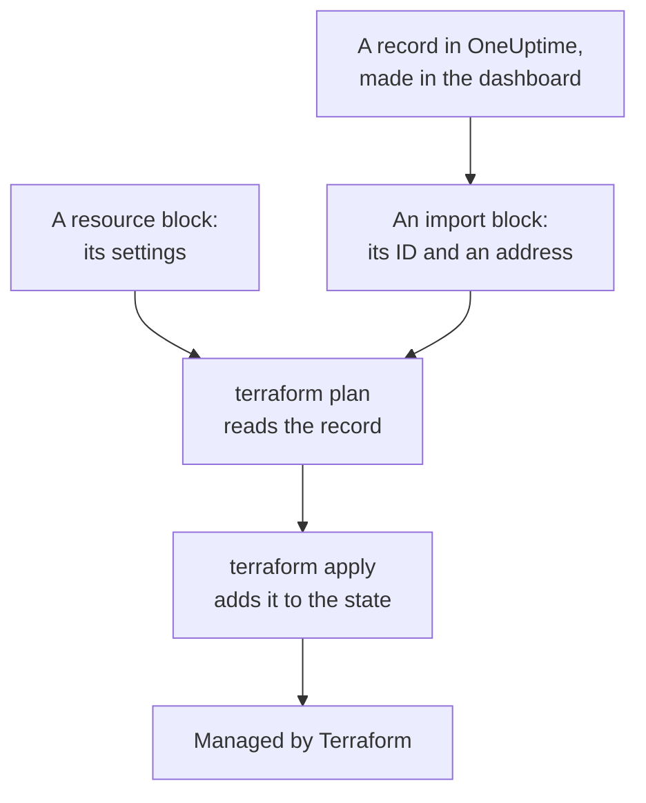
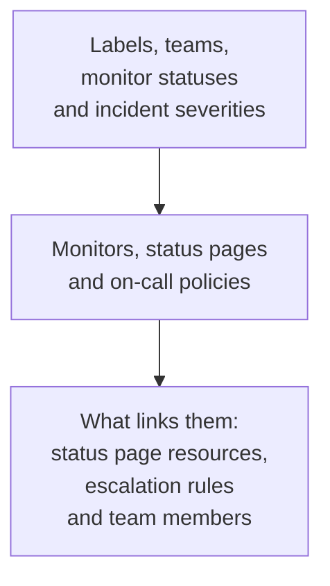

# Importing Resources

You do not have to start over to manage OneUptime with Terraform. Import the monitors, status pages, teams and other records you already have, and Terraform manages them from then on, as they are. An import only reads: nothing changes in OneUptime until you apply a change you planned.

:::cards
- [How importing works](#how-importing-works): What an import reads, and what you write.
- [Import one resource](#import-one-resource): From its page in the dashboard, in four steps.
- [Import many resources](#import-many-resources): Import blocks for a whole list, and configuration Terraform writes for you.
- [Stop managing a resource](#stop-managing-a-resource): Hand it back to the dashboard without deleting it.
:::

## How importing works

An import connects a record that already exists in OneUptime to a `resource` block of your configuration. You write an `import` block with the record's ID and the address it goes to. The next `terraform plan` reads the record by its ID and shows it being imported, with any difference between the record and your configuration. `terraform apply` adds it to Terraform's state, and from then on the record is managed like anything Terraform created.



Write the `resource` block so that it says what the record already is. Where they differ, the plan shows the import and a change, and applying it changes the record in OneUptime.

### What can be imported

Every resource of the provider can be imported by its ID, except `oneuptime_file`: the OneUptime API cannot read a file back, so the provider answers `Import Not Supported`. Data sources are never imported. To use a record in your configuration without managing it, read it with a [data source](/docs/terraform/complete-guide#read-what-already-exists) instead.

## Before you begin

- **Terraform 1.5 or later, or OpenTofu 1.6 or later.** The `import` blocks on this page need these versions. An older Terraform imports on the [command line](#import-on-the-command-line).
- **An API key that can read what you import.** The import reads each record with the provider's key, and managing it afterwards needs the permissions to change and delete it too. See [Create a project API key](/docs/terraform/quick-start#create-a-project-api-key).
- **The provider in your configuration**, set up as in the [Quick Start](/docs/terraform/quick-start#point-terraform-at-oneuptime).

## Import one resource

The dashboard writes the configuration of the resource you are looking at, with its `import` block, so you rarely write one by hand.

:::steps
### Open the resource's Terraform page

Open the monitor, status page or other resource in the dashboard. In its side menu, open **Developer**, then **Terraform**.

### Copy its configuration

The page writes the resource's `resource` block from its current settings, and an `import` block with its ID. Put both in a `.tf` file:

```hcl title="status-pages.tf"
resource "oneuptime_status_page" "public" {
  name                  = "Public Status"
  page_title            = "Acme Status"
  is_public_status_page = true
}

import {
  to = oneuptime_status_page.public
  id = "68a1b2c3-d4e5-4f6a-8b9c-0d1e2f3a4b02"
}
```

In the `resource` block, a comment after each ID names the record it points at. Secrets are never shown: the ones the resource needs are read from variables marked `sensitive`, and the rest are left out.

### Plan

Run `terraform plan`. It ends with `Plan: 1 to import, 0 to add, 0 to change, 0 to destroy.`: Terraform found the record, and your configuration matches it.

### Apply

Run `terraform apply`. The status page is in Terraform's state now, and the next plan answers `No changes.` You can then delete the `import` block, or keep it as a note of where the resource came from: it does nothing once the resource is managed.
:::

### Write the blocks yourself

Without the dashboard, write both blocks yourself. Start the `resource` block with the attributes the resource needs, and run `terraform plan`. Where your configuration differs from the record, the plan shows the change next to the import:

```text
  # oneuptime_label.critical will be updated in-place
  # (imported from "68a1b2c3-d4e5-4f6a-8b9c-0d1e2f3a4b03")
  ~ resource "oneuptime_label" "critical" {
      ~ color = "#FF5733" -> "#000000"
    }

Plan: 1 to import, 0 to add, 1 to change, 0 to destroy.
```

Copy the record's value into your configuration (here `color = "#FF5733"`), and plan again until the plan shows the import and no change. The record's ID is in three places:

| Where | How |
| --- | --- |
| The resource's page | Its details card ends with an **ID** line. Click the ID, or the copy button beside it, to copy the whole ID. |
| The address bar | The ID comes after the list's name: `/dashboard/<project-id>/monitors/<monitor-id>`. |
| The API | Every record carries its ID in `_id`. |

## Import many resources

To import every monitor, status page or other resource of one kind, start from its list.

:::steps
### Open the list's Terraform page

Open the list, then **Developer** and **Terraform** in its side menu, for example **Monitors → Developer → Terraform**.

### Copy the import blocks

The page writes an `import` block for each record (the first 100), with an address made from the record's name. Put them in a file of their own, such as `imports.tf`:

```hcl title="imports.tf"
import {
  to = oneuptime_monitor.homepage
  id = "68a1b2c3-d4e5-4f6a-8b9c-0d1e2f3a4b01"
}

import {
  to = oneuptime_monitor.checkout_api
  id = "68a1b2c3-d4e5-4f6a-8b9c-0d1e2f3a4b05"
}
```

### Let Terraform write the configuration

Run the plan with a file name for the configuration Terraform writes. The file must not exist yet: Terraform writes only into a new file.

```bash
terraform plan -generate-config-out=monitors.tf
```

Terraform reads each record and writes a `resource` block for every `import` block that has none. It warns that configuration generation is experimental, so read what it wrote.

### Review and apply

In the new file, replace the IDs of other records with references to their resources, such as `labels = [oneuptime_label.critical.id]`, so Terraform knows the order to work in. Run `terraform plan` until it shows only the imports, then `terraform apply`.
:::

### A whole project

Import a project list by list, starting with the records others refer to. Then each resource block can refer to the ones before it by address rather than by ID:



Records every project starts with, such as its monitor statuses and incident severities, are often better read with data sources than imported: Terraform can then refer to them, but never changes or deletes them. The project is imported when `terraform plan` answers `No changes.`

## Import on the command line

`terraform import` imports one resource at a time, and works on every Terraform and OpenTofu version. Write the `resource` block first, then run the command with the block's address and the record's ID:

```bash
terraform import oneuptime_status_page.public 68a1b2c3-d4e5-4f6a-8b9c-0d1e2f3a4b02
terraform import oneuptime_label.critical 68a1b2c3-d4e5-4f6a-8b9c-0d1e2f3a4b03
terraform import oneuptime_team.sre 68a1b2c3-d4e5-4f6a-8b9c-0d1e2f3a4b04
```

Each one ends with `Import successful!`. Unlike an `import` block, the command writes the state at once, without a plan to review first: run `terraform plan` after it, and change your configuration until the plan answers `No changes.`

## Stop managing a resource

To hand a resource back to the dashboard without deleting it, replace its `resource` block with a `removed` block that keeps the record:

```hcl
removed {
  from = oneuptime_team.sre

  lifecycle {
    destroy = false
  }
}
```

The plan says the team will no longer be managed by Terraform, and destroys nothing. Apply it, then delete the `removed` block. A `removed` block with `destroy = false` needs Terraform 1.7 or later, or OpenTofu 1.10 or later. On an older version, run `terraform state rm oneuptime_team.sre` instead.

> [!WARNING]
> Deleting a `resource` block deletes its record in OneUptime on the next apply. Under Terraform, so does a `removed` block without `destroy = false`: always write the `lifecycle` block.

## Good to know

- **An import changes nothing, but the next apply does.** Applying a plan that shows a change next to an import changes the record in OneUptime. Make the plan show only the import first.
- **Secrets are not read back.** A secret OneUptime never sends back, such as a monitor secret's `secret_value`, is not in the state after an import. If your configuration sets it, the first plan shows it as a change, and applying it writes the secret again.
- **One configuration for each record.** A record imported into two configurations is changed back to what each one says, on every apply.
- **Imported records are managed records.** `terraform destroy` deletes them from OneUptime, like the records Terraform created.

## Troubleshooting

:::details Cannot import non-existent remote object
No record has that ID, or the provider's API key may not read it: OneUptime answers both the same way. Check the ID, and that the key can read that kind of record.
:::

:::details Import Not Supported
`oneuptime_file` is the one resource that cannot be imported. Leave it out, and let Terraform create a new file instead.
:::

:::details Invalid ID format
The ID is not a record's ID, for example a name. An import takes the ID, a UUID such as `68a1b2c3-d4e5-4f6a-8b9c-0d1e2f3a4b02`: copy it from the resource's page.
:::

:::details Target generated file already exists
`-generate-config-out` names a file that is already there. Name a new file, or move what the file holds elsewhere and delete it.
:::

:::details Resource already managed by Terraform
`terraform import` was given an address that is in the state already. Import the record to another address, or check with `terraform state list` what the address holds.
:::

## Next steps

:::cards
- [Complete Guide](/docs/terraform/complete-guide): Data sources, references between resources, and state.
- [Monitor Steps](/docs/terraform/monitor-steps): Read and change what an imported monitor checks.
- [Examples](/docs/terraform/examples): Ready-to-use configurations for the common resources.
- [Troubleshooting](/docs/terraform/troubleshooting): Common errors and how to fix them.
:::
