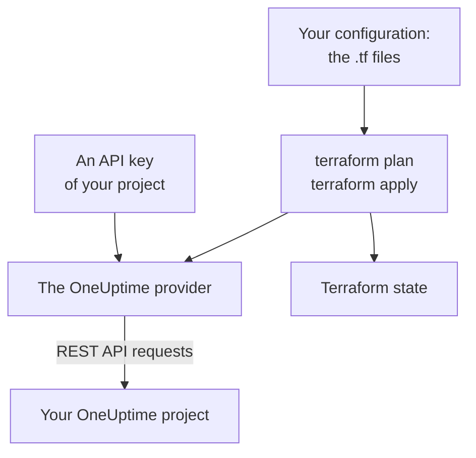

# Terraform Overview

The OneUptime Terraform provider manages your OneUptime project as code. Describe monitors, status pages, on-call policies, teams, labels and the other records of your project in `.tf` files, see what will change with `terraform plan`, and make the change with `terraform apply`. It works with OneUptime Cloud and with a self-hosted OneUptime, and with OpenTofu as well as Terraform.

:::cards
- [How the provider works](#how-the-provider-works): Your configuration, the plan, and the API requests behind them.
- [Install the provider](#install-the-provider): The provider block, and the version to pick.
- [Let the dashboard write it](#let-the-dashboard-write-it): Configuration and import blocks for what you already have.
- [What you can manage](#what-you-can-manage): Resources, data sources, and how their attributes are written.
:::

## How the provider works

The provider is a plugin that Terraform downloads from a registry. On `terraform apply`, it turns each change in the plan into a request to the OneUptime REST API, made with an API key of your project. Terraform keeps what it created in its state, so the next plan shows only what changed since.



An API key belongs to one project and decides what Terraform may read and change in it, so one configuration manages one project. To manage several, give the provider one [alias](/docs/terraform/complete-guide#manage-several-projects) for each.

## Before you begin

- **Terraform 1.5 or later, or OpenTofu 1.6 or later.** The `import` blocks the dashboard writes need these versions.
- **An API key of your project.** The [Quick Start](/docs/terraform/quick-start#create-a-project-api-key) shows how to create one in **Project Settings → Advanced → API Keys**.
- **On OneUptime Cloud, the Growth plan or above.** A project's API keys work only on it.

## Install the provider

Add the provider to a `.tf` file. `terraform init` downloads it from the Terraform Registry, and `tofu init` from the OpenTofu Registry:

```hcl title="main.tf"
terraform {
  required_providers {
    oneuptime = {
      source  = "oneuptime/oneuptime"
      version = "{{TERRAFORM_PROVIDER_VERSION}}"
    }
  }
}

provider "oneuptime" {
  # The API key comes from the ONEUPTIME_API_KEY environment variable.
  # On a self-hosted OneUptime, add your OneUptime's address:
  # oneuptime_url = "https://oneuptime.example.com"
}
```

Keep the key out of your files: export it before you run Terraform, or pass it in a variable marked `sensitive`. The [Complete Guide](/docs/terraform/complete-guide#configure-the-provider) lists every way to give the provider its key and address.

### Pick a version

Provider versions follow OneUptime's: provider {{TERRAFORM_PROVIDER_MAJOR}}.x is made from OneUptime {{TERRAFORM_PROVIDER_MAJOR}}.x. The constraint above, `{{TERRAFORM_PROVIDER_VERSION}}`, takes the newest {{TERRAFORM_PROVIDER_MAJOR}}.x release, which is right for OneUptime Cloud. On a self-hosted OneUptime, use the newest provider that is not newer than your OneUptime: [Self-Hosted Setup](/docs/terraform/self-hosted) shows how to pin it.

## Let the dashboard write it

You do not have to write a resource you already have by hand. Every resource in the OneUptime dashboard (a monitor, a status page, a workflow, an on-call policy and the others) has a **Developer** section in its side menu, collapsed until you open it. Its **Terraform** page writes the configuration for you, filled in from your own project.

:::steps
### Open the resource

Open the monitor, status page or other resource you want Terraform to manage.

### Open its Terraform page

In the side menu, open **Developer**, then **Terraform**.

### Copy the configuration

The page writes the resource's configuration from its current settings, with an `import` block. A comment after each ID names the record it points at (`incident_severity_id = "..." # Critical Incident`).

### Plan and apply

Run `terraform plan`: it shows the resource being imported and nothing to change. Apply it, and Terraform manages the resource from then on.
:::

Below the configuration, **Build on it** has what people often add next to the resource, referring to it by its address: an owner team for an incident, a group of monitors for a status page, an escalation rule for an on-call policy.

The list pages (for example **Incidents** or **Monitors**) have the same section. There, the **Terraform** page writes a new resource with the fields most people set, using your project's own records: an incident with one of your severities, a monitor with the criteria a new monitor gets in the dashboard, wired to your statuses. It gives ready-made **Common setups** (a status page with a group and a monitor, an on-call policy that pages a team, a weekly on-call rotation), and an `import` block for each resource you already have (the first 100), ready for `terraform plan -generate-config-out`. Both pages also give the provider block for your OneUptime: the right `oneuptime_url`, and a version constraint that matches your OneUptime.

Secrets are never shown on these pages. When the configuration needs one (for example a monitor's `Authorization` header), it reads it from a Terraform variable marked `sensitive`. Secrets it does not need are left out, and Terraform leaves them as they are in OneUptime.

The same section has an **API** page, with `curl` commands for the resource, and an **AI Assistants** page, which connects Claude, GitHub Copilot or Cursor to the [MCP server](/docs/ai/mcp-server).

## What you can manage

The provider has a resource for each kind of record you can create over the OneUptime API, named `oneuptime_<name>`. These are the ones most configurations start with:

| Resource | What it is |
| --- | --- |
| `oneuptime_monitor` | A monitor: website, API, ping, port, SSL certificate, server, incoming request, manual and every other type |
| `oneuptime_monitor_status` | A monitor status, such as Operational, Degraded or Offline |
| `oneuptime_monitor_group` | A group of monitors, shown with one status |
| `oneuptime_status_page` | A public or private status page |
| `oneuptime_status_page_domain` | A custom domain of a status page |
| `oneuptime_domain` | A domain of your project, verified for status pages |
| `oneuptime_label` | A label, to sort and filter records |
| `oneuptime_team`, `oneuptime_team_member` | A team, and who is in it |
| `oneuptime_on_call_policy`, `oneuptime_escalation_rule` | An on-call policy, and the rules it pages in order |
| `oneuptime_incident`, `oneuptime_incident_severity`, `oneuptime_incident_state` | Incidents, their severities and their states |
| `oneuptime_alert`, `oneuptime_alert_severity`, `oneuptime_alert_state` | Alerts, their severities and their states |
| `oneuptime_scheduled_maintenance_event` | A scheduled maintenance window |
| `oneuptime_probe` | A probe of your own, which checks from your network |

The [Terraform Registry](https://registry.terraform.io/providers/oneuptime/oneuptime/latest/docs) lists every resource with each of its attributes.

### Read what already exists

Every resource has a data source of the same name, such as `data "oneuptime_label"`. A data source reads a record that this configuration does not manage, for example one made in the dashboard. Look it up by its `id`, or by its other plain arguments: each one you set must match, and exactly one record may match them all.

```hcl
data "oneuptime_monitor_status" "offline" {
  name = "Offline"
}

# Any plain argument works. Set several, and all of them must match.
data "oneuptime_monitor_status" "offline_state" {
  is_offline_state = true
}
```

No match, or more than one, is an error rather than an empty or arbitrary answer. The [Complete Guide](/docs/terraform/complete-guide#read-what-already-exists) has the rules.

### Renamed resources

Resource names keep words such as IoT and vCenter whole: `oneuptime_iot_fleet` and `oneuptime_vcenter`, where older providers had `oneuptime_io_t_fleet` and `oneuptime_v_center` (and the same for their label rules, owners and feeds). The old names still work as deprecated aliases, and a plan that uses one says so. To switch, rename the resource in your configuration and add a `moved` block, and Terraform keeps the existing resource instead of replacing it:

```hcl
# Was: resource "oneuptime_io_t_fleet" "factory"
resource "oneuptime_iot_fleet" "factory" {
  name = "Factory floor"
}

moved {
  from = oneuptime_io_t_fleet.factory
  to   = oneuptime_iot_fleet.factory
}
```

Moving a resource to another type needs Terraform 1.8 or later. On an older engine, keep the old name for now: it keeps working.

## How attributes are written

Attributes follow the OneUptime API, in snake_case:

| Kind of value | How you write it | Example |
| --- | --- | --- |
| Text, numbers, true or false | As they are | `is_public_status_page = false` |
| A reference to another record | Its ID, usually another resource's `id` | `incident_severity_id = oneuptime_incident_severity.sev1.id` |
| A list of references | A set of IDs, whose order makes no difference | `labels = [oneuptime_label.critical.id]` |
| A color, a domain and other wrapped values | Their plain value | `color = "#FF5733"` |
| A date and time | RFC 3339 text | `starts_at = "2030-06-01T02:00:00Z"` |
| A monitor's checks | Typed nested attributes: see [Monitor Steps](/docs/terraform/monitor-steps) | `monitor_steps = [{ ... }]` |
| Other structured settings | JSON, written with `jsonencode()` | `log_monitor = jsonencode({ ... })` |

Two kinds of value are the server's, and you leave them out:

- **IDs inside a resource.** A monitor's steps and criteria, and their incident and alert templates, have IDs the server gives and keeps across every apply, so incidents keep pointing at the criteria that raised them.
- **What the server keeps up to date.** A monitor's current status, or when it last received a heartbeat, can change between `terraform plan` and the end of `terraform apply`. The provider keeps the planned value for anything you did not set, and the next refresh reads the server's, so this never fails an apply or shows as a change.

## Get help

- Bugs and feature requests: [github.com/OneUptime/oneuptime/issues](https://github.com/OneUptime/oneuptime/issues).
- The provider is generated from the OneUptime OpenAPI specification in the [main OneUptime repository](https://github.com/OneUptime/oneuptime). The published provider repository is read-only, so report problems in the main repository.

## Next steps

:::cards
- [Quick Start](/docs/terraform/quick-start): Create an API key and apply your first resources in ten minutes.
- [Complete Guide](/docs/terraform/complete-guide): Authentication, project layout, data sources, state and upgrades.
- [Monitor Steps](/docs/terraform/monitor-steps): Decide what a monitor checks and what each result means.
- [Examples](/docs/terraform/examples): Ready-to-use configurations for the common resources.
- [Importing Resources](/docs/terraform/importing-resources): Bring what you made in the dashboard under Terraform.
:::
