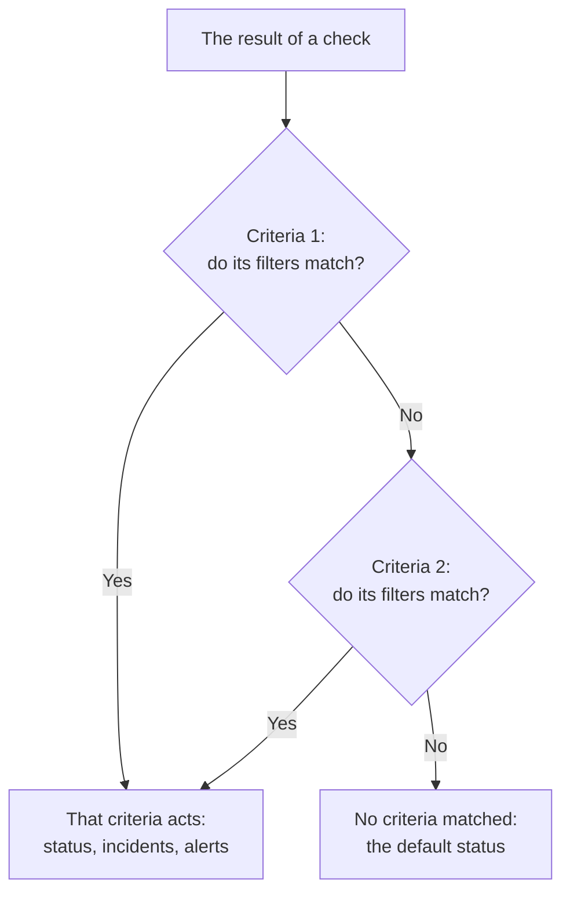
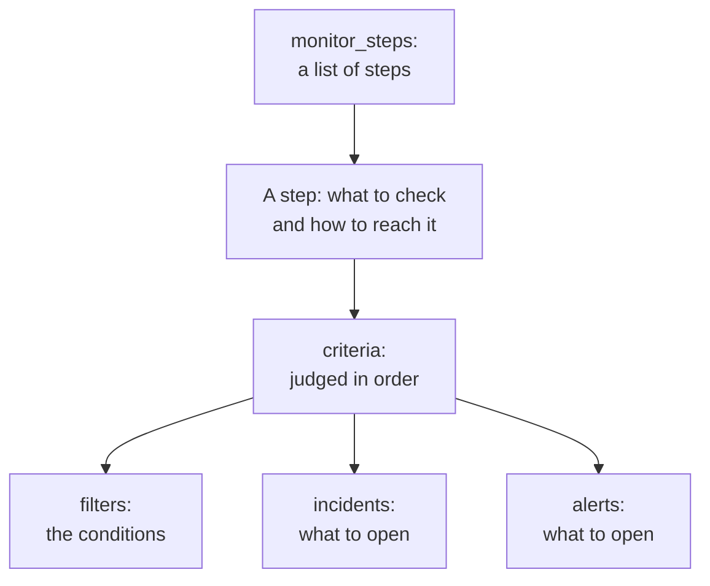

# Monitor Steps

`monitor_steps` is the attribute of `oneuptime_monitor` that says what a monitor checks and how each result is judged: the address to check, the request to send, and the criteria that turn a result into a monitor status, an incident or an alert. This page explains every part of it.

:::cards
- [How a check is judged](#how-a-check-is-judged): Criteria in order, and the first one that matches.
- [Write the steps](#write-the-steps): Their shape, a full example, and the two rules for values.
- [Filter reference](#filter-reference): What a filter can check, and how it compares.
- [Common mistakes](#common-mistakes): What goes wrong most often, and the fix.
:::

## How a check is judged

Each check gives a result: a probe's answer, a script's return value, or the telemetry the check reads. The step's criteria then judge it in their order. The first criteria whose filters match decides what happens: it can change the monitor's status, open incidents and open alerts. The criteria after it are not looked at for that check.



So the order of the criteria matters: list the criteria that alert first, the most severe first, and the healthy one last. [Criteria attributes](#criteria-attributes) explains why, and the one exception.

## Write the steps

`monitor_steps` is a list of typed objects written straight in HCL. There is no `jsonencode()`, no `{_type, value}` wrapper, no camelCase key and no ID to write: the provider turns your HCL into the API's format, and the server gives every step, criteria, incident template and alert template its ID. It keeps those IDs across every apply, matching each criteria and template to the one it replaces by name, else by position, so probe results stay with their step and incidents keep pointing at the criteria that raised them.



The smallest useful step checks one address and has one criteria with one filter:

```hcl
resource "oneuptime_monitor" "example" {
  name         = "Example"
  description  = "The smallest monitor_steps"
  monitor_type = "Website"

  monitor_steps = [{
    monitor_destination      = "https://example.com"
    monitor_destination_type = "URL"
    request_type             = "GET"

    criteria = [
      {
        name             = "Check if online"
        description      = "The website responds"
        filter_condition = "All"

        filters = [
          {
            check_on    = "Is Online"
            filter_type = "True"
          }
        ]
      }
    ]
  }]
}
```

Two rules hold everywhere in `monitor_steps`:

- **Leave out what you do not use.** An attribute you do not set is not sent to the API. Never write `[]`, `{}` or `""` as a placeholder: the provider refuses empty strings, lists and maps, so that a missing value always means "not set".
- **Filter values are strings.** A filter's `value` is a string, even a number: `value = "200"`, not `value = 200`. Numeric settings such as `port` are numbers.

:::details Moving from provider 1.x, where monitor_steps was JSON
In provider 1.x, `monitor_steps` was a JSON string written with `jsonencode({ _type = "MonitorSteps", value = { ... } })`. Rewrite it as the typed attributes on this page: drop the `_type` and `value` wrappers, write the camelCase keys in snake_case (`monitorDestination` becomes `monitor_destination` and `monitor_destination_type`, `filterCondition` becomes `filter_condition`, `checkOn` becomes `check_on`), and delete every `id`. The server gives all the IDs now, which also ends the hard-coded random IDs of issue [#2291](https://github.com/OneUptime/oneuptime/issues/2291). State saved as a JSON string is not upgraded on its own: apply the new configuration.
:::

### A complete example

This website monitor checks what the website monitor of the provider's end-to-end tests checks (test `35-monitor-with-steps`): offline when the site does not answer, online when it answers with 200.

```hcl
resource "oneuptime_monitor_status" "operational" {
  name                 = "Operational"
  description          = "Monitor is operational"
  color                = "#2ecc71"
  priority             = 1
  is_operational_state = true
}

resource "oneuptime_monitor_status" "offline" {
  name                 = "Offline"
  description          = "Monitor is offline"
  color                = "#e74c3c"
  priority             = 3
  is_operational_state = false
}

resource "oneuptime_monitor" "website" {
  name         = "Website"
  description  = "Website monitor with explicit steps"
  monitor_type = "Website"

  monitor_steps = [{
    monitor_destination      = "https://example.com" # what to check
    monitor_destination_type = "URL"                 # URL, Hostname or IP
    request_type             = "GET"                 # the HTTP method

    criteria = [ # judged in order: the first match decides
      {
        name                  = "Offline"
        description           = "Check if website is offline"
        filter_condition      = "Any"
        change_monitor_status = true
        create_incidents      = false
        create_alerts         = false
        monitor_status_id     = oneuptime_monitor_status.offline.id

        filters = [
          {
            check_on    = "Is Online"
            filter_type = "False"
          }
        ]
      },
      {
        name                  = "Online"
        description           = "Check if website is online"
        filter_condition      = "All" # All: every filter, Any: at least one
        change_monitor_status = true
        create_incidents      = false
        create_alerts         = false
        monitor_status_id     = oneuptime_monitor_status.operational.id

        filters = [
          {
            check_on    = "Is Online"
            filter_type = "True"
          },
          {
            check_on    = "Response Status Code"
            filter_type = "Equal To"
            value       = "200" # a string, even for a number
          }
        ]
      }
    ]
  }]
}
```

A criteria refers to a status by its resource, as `oneuptime_monitor_status.offline.id` does here, or to one your project already has through a [data source](/docs/terraform/complete-guide#read-what-already-exists).

## Step attributes

Each item of `monitor_steps` is one thing to check:

| Attribute | Type | Used by | Notes |
| --- | --- | --- | --- |
| `monitor_destination` | string | Website, API, Ping, IP, Port, SSL Certificate, NTP | The URL, hostname or IP address to check. Needs `monitor_destination_type`. |
| `monitor_destination_type` | string | the same | `URL`, `Hostname` or `IP`, as the monitor type takes: a URL for Website, API and SSL Certificate monitors; a hostname or an IP address for Ping, IP, Port and NTP monitors. |
| `port` | number | Port, NTP | The TCP port to check, such as `443`. For NTP, the UDP port the time server answers on: `123` when not set. |
| `request_type` | string | Website, API | The HTTP method: `GET`, `POST`, `PUT`, `DELETE`, `HEAD` or `PATCH`. The server uses `GET` when it is not set. |
| `request_headers` | map(string) | Website, API | Headers to send: `{ "Accept" = "application/json" }`. |
| `request_body` | string | API | The request body, as text. |
| `do_not_follow_redirects` | bool | Website, API | Stop at the first answer instead of following redirects. |
| `allow_self_signed_certificates` | bool | Website, API | Accept a self-signed TLS certificate. |
| `tls_client_certificate` | string | Website, API | A client certificate for mutual TLS: PEM, or a `{{monitorSecrets.name}}` reference. |
| `tls_client_key` | string (sensitive) | Website, API | The client certificate's private key. Set it with the certificate. |
| `tls_client_key_passphrase` | string (sensitive) | Website, API | The private key's passphrase. |
| `request_timeout_in_ms` | number | Checks made by a probe | How long one attempt may take, in milliseconds. The probe lowers anything above 60000 to 60000. |
| `retry_count` | number | Checks made by a probe | Retries after a failed first attempt: `0` checks once, `3` up to four times. The probe lowers anything above 3 to 3. |
| `custom_code` | string | Custom JavaScript Code, Synthetic | The script the step runs. |
| `screen_size_types` | list(string) | Synthetic | `Mobile`, `Tablet` and `Desktop`. |
| `browser_types` | list(string) | Synthetic | `Chromium` and `Firefox`. |
| `retry_count_on_error` | number | Synthetic | Retries when the script fails: `0` runs it once. |
| `criteria` | list (required) | All | How each result is judged: see [Criteria attributes](#criteria-attributes). |

### Settings of each monitor type

Monitor types with more to set than an address keep their settings (a log query, a database connection, a cluster to watch) in an attribute of their own, as raw JSON written with `jsonencode()`: `log_monitor`, `trace_monitor`, `llm_monitor`, `metric_monitor`, `exception_monitor`, `profile_monitor`, `dns_monitor`, `domain_monitor`, `dnssec_monitor`, `sql_monitor`, `database_monitor`, `external_status_page_monitor`, `network_device_monitor`, `kubernetes_monitor`, `docker_monitor`, `docker_swarm_monitor`, `host_monitor`, `podman_monitor`, `proxmox_monitor`, `vmware_monitor`, `ceph_monitor`, `storage_array_monitor`, `iot_monitor` and `probe_status_monitor`.

Their JSON is the same as the dashboard's, keys in camelCase. An ID in it is written as the API writes one, `{ _type = "ObjectID", value = "..." }`. A Logs monitor that counts errors from one service:

```hcl
resource "oneuptime_service" "checkout" {
  name = "checkout"
}

resource "oneuptime_monitor" "checkout_errors" {
  name         = "Checkout errors"
  monitor_type = "Logs"

  monitor_steps = [{
    log_monitor = jsonencode({
      attributes          = {}
      body                = "error"
      severityTexts       = ["Error"]
      telemetryServiceIds = [{ _type = "ObjectID", value = oneuptime_service.checkout.id }]
      lastXSecondsOfLogs  = 300
    })

    criteria = [
      {
        name             = "Errors found"
        filter_condition = "Any"

        filters = [
          {
            check_on    = "Log Count"
            filter_type = "Greater Than"
            value       = "0"
          }
        ]
      }
    ]
  }]
}
```

> [!TIP]
> The easiest way to get this JSON right: set the monitor up in the dashboard, then open its **Developer** section and **Terraform**. The page writes the monitor's `monitor_steps`, `jsonencode()` and all.

## Criteria attributes

Each item of `criteria` is one rule: when its filters match, do what it says.

The criteria are judged from the top, and the first one that matches decides, so list the criteria that alert first, the most severe first (critical, then warning), and the healthy one last. A healthy criteria at the top is the most common way to build a monitor that never alerts: a broad rule such as `Is Online` is `True`, or a metric value `Greater Than` `0`, matches almost every check, and the criteria below it are never looked at. Put last, it matches only when nothing above it did, which is what you want.

Grouped metric monitors are the one exception. When a metric monitor's query is grouped (`groupByAttributeKeys` set in the JSON of `metric_monitor`, at `metricViewConfig.queryConfigs[].metricQueryData.groupByAttributeKeys`), the monitor raises one alert or incident for each group (each host, container or mount point), and every criteria is judged, so a critical criteria and a warning one can fire for different hosts on the same check. A host that breaks both is still paged once, by the first criteria that matches, so the most severe still goes first. See [Metrics Monitor](/docs/monitor/metrics-monitor).

| Attribute | Type | What it is |
| --- | --- | --- |
| `name` | string (required) | The name the dashboard shows. |
| `description` | string | The description the dashboard shows. |
| `filter_condition` | string (required) | `All`: every filter must match. `Any`: one is enough. |
| `filters` | list (required) | The conditions, at least one: see [Filter reference](#filter-reference). |
| `change_monitor_status` | bool | Whether a match changes the monitor's status. |
| `monitor_status_id` | string | The ID of the `oneuptime_monitor_status` to change to. Set it when `change_monitor_status` is `true`. |
| `create_incidents` | bool | Whether a match opens incidents. |
| `incidents` | list | The incidents to open. Leave it out unless `create_incidents = true`. |
| `create_alerts` | bool | Whether a match opens alerts. |
| `alerts` | list | The alerts to open. Leave it out unless `create_alerts = true`. |
| `is_enabled` | bool | `true` on the server when not set. Set `false` to keep a criteria without judging with it. |
| `incident_grouping` | string (JSON) | Incoming Request monitors only: one incident for each value found in the request, such as `jsonencode({ groupByJSONPath = "..." })`. |
| `open_for_every_email` | bool | Incoming Email monitors only: `true` opens an incident (and an alert) for every email that matches, instead of one at a time. |

### Incidents and alerts

An item of `incidents` takes `title` and `description` (both required), `incident_severity_id`, `auto_resolve_incident`, `remediation_notes`, `on_call_policy_ids`, `label_ids`, `owner_team_ids`, `owner_user_ids`, `show_incident_on_status_page` and `is_private`. An item of `alerts` takes the same, with `alert_severity_id` and `auto_resolve_alert`, and without `show_incident_on_status_page`.

This criteria marks the monitor offline, opens an incident that pages the on-call policy, and resolves it when the site is back:

```hcl
criteria = [
  {
    name                  = "Offline"
    description           = "The site is unreachable"
    filter_condition      = "Any"
    change_monitor_status = true
    monitor_status_id     = oneuptime_monitor_status.offline.id
    create_incidents      = true

    filters = [
      {
        check_on    = "Is Online"
        filter_type = "False"
      }
    ]

    incidents = [
      {
        title                 = "Website is down"
        description           = "The website did not respond to the probe."
        incident_severity_id  = oneuptime_incident_severity.critical.id
        auto_resolve_incident = true
        on_call_policy_ids    = [oneuptime_on_call_policy.primary.id]
      }
    ]
  }
]
```

## Filter reference

A filter has `check_on` (what to look at), `filter_type` (how to compare) and `value` (what to compare with, as a string; leave it out for true-or-false checks such as `True` and `False`).

A filter can also judge a time window instead of the latest check: set `evaluate_over_time = true`, the window's length in `evaluate_over_time_minutes`, and in `evaluate_over_time_type` how the window is read: `Average`, `Sum`, `Maximum Value`, `Minimum Value`, `All Values` or `Any Value`.

`All Values` means every check in the window broke the rule, so it matches only once the window is covered by data: a monitor that was just created waits for its window to fill instead of matching on its first check. Give it a window at least twice the monitor's `monitoring_interval`; otherwise the window holds one check, and "all values" means the same as "any value". `Any Value` matches on one breaking check, by design.

`evaluate_over_time_no_data_policy` says what the filter does while the window does not hold enough data: `Ignore` (the default) does not match, `Trigger` treats the missing data as the failure, as a heartbeat does, and `Treat As Zero` compares the window as a single zero.

### What a filter can check

The `check_on` values each monitor type uses most. The dashboard's criteria editor offers the same ones, and lists them all:

| Monitor type | `check_on` values |
| --- | --- |
| Website / API | `Is Online`, `Response Time (in ms)`, `Response Status Code`, `Response Body`, `Response Header`, `Response Header Value`, `JavaScript Expression`, `Is Request Timeout` |
| Ping / IP | `Is Online`, `Response Time (in ms)`, `Packet Loss (in %)`, `Jitter (in ms)`, `Is Request Timeout` |
| Port | `Is Online`, `Response Time (in ms)` (the dashboard's total connection time), `Port DNS Lookup Time (in ms)`, `Port TCP Connect Time (in ms)`, `Is Request Timeout` |
| SSL Certificate | `Is Valid Certificate`, `Is Not A Valid Certificate`, `Is Self Signed Certificate`, `Is Expired Certificate`, `Expires In Days`, `Expires In Hours` |
| Incoming Request | `Incoming Request`, `Request Body`, `Request Header`, `Request Header Value`, `JavaScript Expression` |
| Incoming Email | `Email Received`, `Email Subject`, `Email From Address`, `Email To Address`, `Email Body` |
| Server | `Is Online`, `CPU Usage (in %)`, `Memory Usage (in %)`, `Disk Usage (in %)` (with `disk_path`), `Server Process Name` |
| Logs | `Log Count` |
| Traces | `Span Count` |
| Exceptions | `Exception Count` |
| Profiles | `Profile Count` |
| AI / LLM | `Bad AI Answers (in %)`, `Bad AI Answers`, `AI Answers` |
| Metrics | `Metric Value` (metric filters can take `metric_monitor_options` JSON) |
| Custom Code / Synthetic | `Result Value` (can compare one field of the returned data, named in `custom_code_monitor_options` JSON, e.g. `jsonencode({ resultValuePath = "status" })` — see below), `Error`, `Execution Time (in ms)` |
| DNS | `DNS Is Online`, `DNS Response Time (in ms)`, `DNS Record Value`, `DNS Record Exists` |
| Domain | `Domain Expires In Days`, `Domain Is Expired`, `Domain Registrar`, `Domain Name Server` |
| DNSSEC | `DNSSEC Chain Is Valid`, `DNSSEC DS Record Exists At Parent`, `DNSSEC Signature Expires In Days` |
| SQL Query | `SQL Is Online`, `SQL Query Row Count`, `SQL Query Scalar Value` |
| Database Health | `Database Is Online`, `Database Metric` (with `database_monitor_options` JSON naming the series, e.g. `jsonencode({ metricType = "oneuptime.monitor.database.connections.used.percent" })`), `Database Collection Error` |
| External Status Page | `External Status Page Is Online`, `External Status Page Active Incidents`, `External Status Page Component Status` |
| NTP | `NTP Is Online`, `NTP Is Synchronized`, `NTP Stratum`, `NTP Clock Offset (in ms)`, `NTP Response Time (in ms)`, `NTP Root Dispersion (in ms)` (`NTP Is Online` and `NTP Is Synchronized` take no `value`) |
| Network Device (SNMP) | `SNMP Device Is Online` (it answers ping or SNMP), `SNMP Walk Is Succeeding` (false when it answers but cannot be walked), `SNMP OID Value` (SNMP filters can take `snmp_monitor_options` JSON) |

### How a filter compares

| Kind | `filter_type` values |
| --- | --- |
| True or false | `True`, `False` |
| Numbers | `Equal To`, `Not Equal To`, `Greater Than`, `Less Than`, `Greater Than Or Equal To`, `Less Than Or Equal To` |
| Text | `Contains`, `Not Contains`, `Starts With`, `Ends With`, `Is Empty`, `Is Not Empty` |
| Heartbeats | `Recieved In Minutes`, `Not Recieved In Minutes` (spelled as the API spells them) |
| Server processes | `Is Executing`, `Is Not Executing` |
| Scripts | `Evaluates To True` |
| Anomalies, for metrics, logs and traces | `Anomalously High`, `Anomalously Low`, `Anomalous` |

A filter that matches when an SSL certificate expires in 14 days or less:

```hcl
filters = [
  {
    check_on    = "Expires In Days"
    filter_type = "Less Than Or Equal To"
    value       = "14"
  }
]
```

The provider checks `check_on`, `filter_type` and the other fixed lists when it plans, so a typo fails before anything is sent to the API. The values are the API's names for the options of the dashboard's criteria editor.

### Comparing one field of a script's result

A Custom Code or Synthetic monitor's script returns `data`, and a `Result Value` filter compares it. When `data` is an object or an array, `custom_code_monitor_options` names the one field of it to compare: the **Field Path** of the dashboard's Result Value filter. Use dots for nested fields and `[n]` for array items, and leave the attribute out to compare the whole value:

```hcl
monitor_steps = [{
  custom_code = <<-EOT
    const response = await axios.get("https://api.example.com/health");
    // For example { status: "UP", checks: [{ name: "db", latency: 12 }] }
    return { data: response.data };
  EOT

  criteria = [
    {
      name             = "Unhealthy"
      filter_condition = "Any"
      filters = [
        {
          check_on                    = "Result Value"
          filter_type                 = "Not Equal To"
          value                       = "UP"
          custom_code_monitor_options = jsonencode({ resultValuePath = "status" })
        },
        {
          check_on                    = "Result Value"
          filter_type                 = "Greater Than"
          value                       = "500"
          custom_code_monitor_options = jsonencode({ resultValuePath = "checks[0].latency" })
        }
      ]
    }
  ]
}]
```

`Greater Than` and the other number conditions only match a field that is a number, and a field missing from the returned data only matches `Is Empty`. See [Alerting on the returned data](/docs/monitor/custom-code-monitor#alerting-on-the-returned-data) for how paths and conditions work.

## Common mistakes

1. **Empty placeholders.** `incidents = []`, `request_headers = {}` and `description = ""` are refused: leave the attribute out instead.
2. **A number where a string goes.** A filter's `value` is a string, even for a number: `value = "200"`. Numeric settings such as `port`, `retry_count`, `request_timeout_in_ms` and `evaluate_over_time_minutes` take numbers.
3. **The wrong destination type.** `monitor_destination_type = "URL"` with a bare hostname, or `Hostname` with a full URL, fails the check. Website and API monitors take URLs; Ping, IP and Port monitors take hostnames or IP addresses.
4. **A status change with no status.** `change_monitor_status = true` without `monitor_status_id` matches, and has no status to change to.
5. **IDs.** No item of `monitor_steps` has an `id` attribute. If you are moving from the old JSON, delete them: the server gives the IDs.
6. **JSON written by hand.** Write `log_monitor` and the other settings with `jsonencode()`, so Terraform quotes them and writes the JSON the same way every time. For `metric_monitor`, give the whole object the dashboard writes: the server normalizes it.

## When no criteria matches

A check that matches none of the criteria puts the monitor in its default status: the project's operational status, the one the dashboard picks for a new monitor. Its open incidents whose criteria opted into auto-resolve are resolved too. To decide every outcome yourself, end the list with a broad healthy criteria, as the examples on this page do.

## A monitor without steps

`monitor_steps` is optional, but a monitor created without it has no criteria to judge a result by: probes skip a monitor without steps, and it stays in the status it started in. Your state keeps the attribute empty, and the plan stays clean. A Manual monitor never needs steps: you set its status yourself. Every other type needs at least one step to check anything.

## The wire format

Behind the provider, the API still speaks its own JSON, where every rich object is wrapped as `{_type, value}`:

```json
{
  "_type": "MonitorSteps",
  "value": {
    "monitorStepsInstanceArray": [
      {
        "_type": "MonitorStep",
        "value": {
          "monitorDestination": { "_type": "URL", "value": "https://example.com" },
          "requestType": "GET",
          "monitorCriteria": {
            "_type": "MonitorCriteria",
            "value": { "monitorCriteriaInstanceArray": [ { "_type": "MonitorCriteriaInstance", "value": { "...": "..." } } ] }
          }
        }
      }
    ]
  }
}
```

The provider builds this from your HCL when it writes, and reads it back into HCL, leaving out what the server manages (the IDs and the defaults it adds). You only meet it when you read the API's answers yourself, for example in a script that reads `monitorSteps`.

## Next steps

:::cards
- [Examples](/docs/terraform/examples): Ping, port, SSL certificate and API monitors, ready to use.
- [Complete Guide](/docs/terraform/complete-guide): Data sources, state and upgrades.
- [Metrics Monitor](/docs/monitor/metrics-monitor): Metric queries, grouping and anomalies.
- [Troubleshooting](/docs/terraform/troubleshooting): Including an inconsistent result after apply on a monitor.
:::
